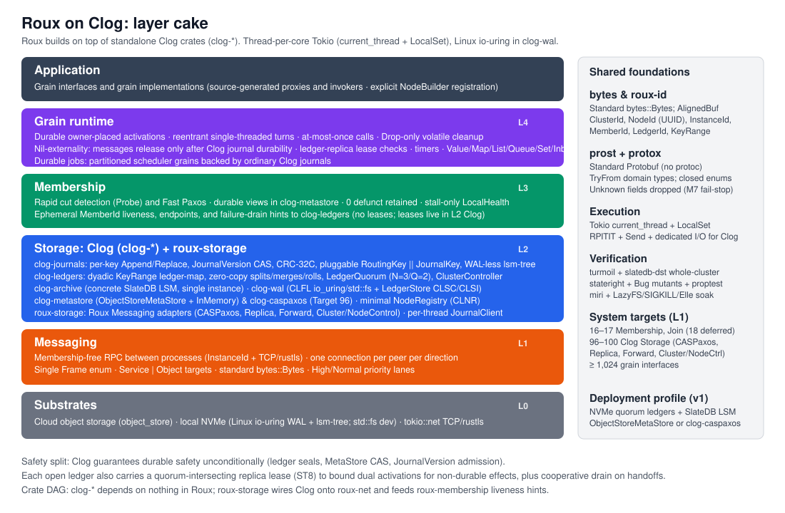

# Architecture

Roux is a distributed virtual-actor runtime built on top of **Clog** (`clog-*`), a standalone Rust storage, replication, partitioning, archiving, and journaling engine whose crates, plans, and specs live directly in the `roux` repository. Each layer depends only on layers below it through explicit contracts; `clog-*` crates have no dependency on `roux-*`.

| Layer | Crates | Provides | Uses | Document |
| --- | --- | --- | --- | --- |
| L4 Grain runtime | `roux-runtime`, `roux-macros`, `roux-jobs` | Durable owner-placed activations, reentrant single-threaded turns, nil-externality, durable state handles (`Value`, `Map`, `List`, `Queue`, `Set`, `Inbox`, `Outbox`), timers, durable jobs (partitioned scheduler grains), pluggable `KeyRouter`, ledger-replica lease gating | L3, L2, L1 | [Runtime](runtime.md) |
| L3 Membership | `roux-membership` | Rapid failure detection (`Probe` RPC), Fast Paxos views persisted in `clog-metastore`, member endpoints, failure-drain hints to Clog | L2 (`clog-metastore`), L1 | [Membership](membership.md) |
| L2 Storage (Clog + composition) | `clog-metastore`, `clog-caspaxos`, `clog-wal`, `clog-ledgers`, `clog-archive`, `clog-journals`, `roux-storage` | Dyadic `KeyRange` ledgers (`LedgerQuorum` `N=3/Q=2` over multiplexed `clog-wal` `LedgerStore`), `MetaStore` (`ObjectStoreMetaStore` via `object_store` conditional PUTs + `clog-caspaxos`), minimal `NodeRegistry` (`CLNR`), concrete SlateDB `clog-archive`, `clog-journals` (`JournalVersion` CAS + embedded WAL-less `lsm-tree` warm index), `ClusterController` + `NodeController` | L0, L1 (via `roux-storage` transport adapters), L3 (liveness hints into `roux-storage`) | [Storage](storage.md) |
| L1 Messaging | `roux-net` (`wire`, `transport`, `net` modules) | Membership-free authenticated RPC (`InstanceId` + TCP/`rustls`), single `Frame` enum, `Service \| Object` targets, High/Normal priority lanes, standard `bytes::Bytes` buffers | L0 (network), `bytes`, `prost` | [Messaging](messaging.md), [Serialization](serialization.md), [Connectivity](connectivity.md) |
| L0 Substrates | OS / cloud | Cloud object storage (S3, Azure Blob, GCS via `object_store`), local NVMe (Linux `io-uring` WAL + `lsm-tree` warm index; portable `std::fs` elsewhere), network (`tokio::net` TCP + `tokio-rustls`) | — | [Layers](layers.md) |

Shared foundations sit beside the stack: `bytes` (standard `bytes::Bytes` shared by Messaging and Clog, with `AlignedBuf` in `clog-wal` for 4 KiB direct I/O), `roux-id` (identities, adopting Clog's 128-bit UUID `NodeId`, plus `decode_canonical`), `prost` + `protox` (standard Protocol Buffers with zero `protoc` and no `roux-codec` wrapper crate; strict `TryFrom` domain types per crate), execution (thread-per-core Tokio `current_thread` + `LocalSet` for Roux actors and networking; `RPITIT + Send` Tokio storage workers with dedicated Linux `io-uring` / `std::fs` `clog-wal` threads and embedded pure-Rust WAL-less `lsm-tree` warm index, connected by `roux-storage` via bounded channels), and verification (`turmoil` + SlateDB DST whole-cluster simulation, `stateright` Rust model checking with `Bug` mutants and `LinearizabilityTester`, `proptest`, `miri`, `cargo-nextest`, `cargo xtask lint`, and LazyFS + `SIGKILL` + Elle real-process soak). Message and wire formats are collected in the [Wire catalog](wire-catalog.md).

