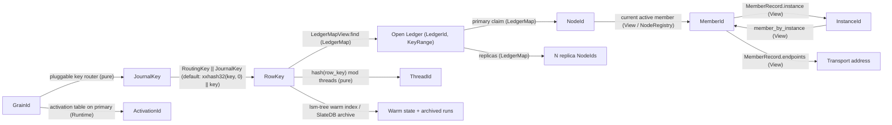

# Identities and addressing

Status: **Decided** (aligned with Clog). This document specifies every identity type in Roux, how Roux identities map onto Clog's storage identities ([Storage](storage.md), [Clog spec](clog/README.md)), and how Messaging addresses targets.

## Core decisions

- **Clog node and range identities.** Roux adopts Clog's `NodeId` (a random 128-bit UUID persisted in `wal/node`), `LedgerId` (`u64 >= 1`), dyadic `KeyRange` `(Prefix, Depth)`, and `JournalVersion` `(Base: RowToken, Count: u64)`.
- **Pluggable `GrainId → RoutingKey / JournalKey` mapping.** A pluggable key-routing strategy maps each canonical `GrainId` to its `(RoutingKey, JournalKey)` and Clog `RowKey = routing_key || journal_key`. The default strategy uses `xxhash32(journal_key, seed 0)` (4 big-endian bytes) as the routing prefix, matching Clog's default `RowKey` layout for uniform spread across dyadic `KeyRange`s; custom strategies (such as tenant/range-ordered prefixes or co-located grain groups) can plug in without changing Clog's dyadic `KeyRange` splits, merges, `clog-archive`, or `LedgerMapView` routing.
- **Typed grain keys.** Each grain type declares a canonical key type (`GrainKey: prost::Message + Default + Eq + Hash`), with built-in string, `u64`, and UUID key types. Key types forbid floats and maps at compile time, and `decode_canonical` verifies exact round-trip re-encoding (rejecting unknown or duplicate fields, Z24).
- **Addressing (`Service | Object`).** Messaging targets are `Service { interface, method }` (a handler on the peer process at the other end of the connection) or `Object { key: Bytes, hint: Option<u64>, interface, method }` (an entity routed to whichever process owns its key). Messaging never interprets `key` or `hint`; the target's handler answers `NotHere { location: Option<Location>, version: u64 }`.
- **Placement in the runtime.** Every grain is durable and activates on the primary node of the open Clog ledger whose `KeyRange` contains its `RowKey`.

## The identities

| Identity | Meaning | Encoding | Owner | Used by |
| --- | --- | --- | --- | --- |
| `ClusterId` | Identifies one cluster; scopes every handshake, MetaStore key (`{cluster:N}/{name}`), and node root (`{root}/cluster`) | 128-bit UUID (`Id128`) | Deployment | All layers |
| `InstanceId` | One running process incarnation, random at startup | `Id128` | Messaging (L1) | Connections, handshake, newest-wins |
| `NodeId` | Durable storage node identity created with a `LedgerStore` and fixed for its disk's lifetime (`wal/node`) | 128-bit UUID (`Id128`) | Clog (`clog-wal`) | `ledger-map`, `NodeRegistry` (`CLNR`), `MemberId`, replica calls |
| `ProcessId` | Monotonic process incarnation counter (`Join` view version) | `u64` | Membership (L3) | `MemberId`, member lifecycle |
| `MemberId` | `(NodeId, ProcessId)` — unique for the life of the cluster | `(Id128, u64)` | Membership (L3) | Views, `GrainAddress` |
| `LedgerId` | One live Clog ledger, assigned consecutively from `NextLedgerId` in `ledger-map` | `u64 >= 1` | Clog (`clog-ledgers`) | Replicas, tags `(LedgerId, Slot, Index)`, LSM drains |
| `KeyRange` | Dyadic keyspace interval `(Prefix, Depth)` (`0 <= Depth <= 524,280`) | `ceil(Depth/8)` prefix bytes + depth | Clog (`clog-ledgers`) | Open ledger ownership, splits/merges, LSM partitions |
| `GrainId` | A virtual actor (`{ grain_type: u32, key: Bytes }`, canonical, `<= 1 KiB`) | Canonical protobuf (`roux.runtime.v1`) | Runtime (L4) | Activations, proxies, `Object.key` |
| `JournalKey` / `RowKey` | A grain's Clog journal key and its routed ledger/LSM key `RoutingKey \|\| JournalKey` (default `RoutingKey = xxhash32(key, 0)`) | `5..=65,535` bytes | Runtime / Clog (`clog-journals`) | `LedgerMapView.find`, `Journals`, `lsm-tree` warm index, SlateDB `clog-archive` |
| `JournalVersion` | Opaque per-key version `(Base: RowToken, Count: u64)` — equality-only CAS token | `(0..32B token, varint)` | Clog (`clog-journals`) | Expected-version admission, optimistic concurrency |
| `ActivationId` | One in-memory activation of a grain on a process | `u64` | Runtime (L4) | `Object.hint`, `GrainAddress` |
| `ThreadId` | Virtual ordinal `0..N-1` naming a node's thread-per-core Tokio actor thread | `u32` | Runtime / Messaging | `Call.dest_thread`, `NodeEndpoints` |

## How identifiers map

Arrows show how one identifier is computed from another. *Pure* depends only on its input; *LedgerMap* reads Clog's cached `LedgerMapView`; *Registry / View* reads Clog's `NodeRegistry` (`CLNR`) and Roux's Membership `View`.



| From | To | Mapping | Owner | Kind |
| --- | --- | --- | --- | --- |
| `GrainId` | `RoutedKey` & `RowKey` | Pluggable `KeyRouter::route(&GrainId) -> RoutedKey { routing_key, journal_key }`; default `HashRouter` uses `journal_key = canonical GrainId`, `routing_key = xxhash32(key, seed 0)` (4 bytes big-endian), `RowKey = routing_key \|\| journal_key` | Runtime / Clog (`clog-journals`) | Pure |
| `RowKey` | open `Ledger` (`LedgerId`, `KeyRange`, primary `NodeId`) | `LedgerMapView.find(row_key)` on the cached `ledger-map` | Clog (`clog-ledgers`) | LedgerMap |
| `RowKey` | `ThreadId` | `mix(xxhash32(row_key, 0)) mod owner_threads` (hashed over the full `RowKey` so prefix-sharing custom routers spread across threads) | Runtime | Pure, given primary |
| `NodeId` | active `MemberId` / `InstanceId` / endpoints | Ephemeral `Membership::View` (and `NodeRegistry` `CLNR` for durable node-to-process resolution) | Membership / `roux-storage` | View / Registry |
| `InstanceId` | `MemberId` | `View::member_by_instance` | Membership | View |
| `GrainId` | `ActivationId` | Primary thread's local activation table | Runtime | Local state |
| `GrainId`, `MemberId`, `ActivationId`, `ThreadId` | `GrainAddress` | Composite location hint returned in `NotHere.location` | Runtime | Composite |
| `ClusterId` | all of the above | Scopes every handshake, `MetaStore` key, node root, and archive prefix | All | Scope |

**Invariants:**
- **A grain's activation and journal share the same primary node.** Both route through `LedgerMapView.find(RowKey)`. If a caller holds a stale `LedgerMapView`, the contacted node returns `NotHere` (for grain calls) or forwards/returns `Moved` (for Clog journal operations), refreshing the view.
- **No static bucket table or membership range-map extension.** Clog's `ledger-map` partitions the full keyspace into dyadic `KeyRange`s that split, merge, hand off, take over, and roll dynamically without copying data between nodes.
- **Separate ephemeral and durable node identities.** Membership tracks live `MemberId = (NodeId, ProcessId)` incarnations and endpoints; Clog's `NodeRegistry` (`CLNR` in `MetaStore`) tracks durable `NodeId` registration and generation monotonicity.

## Messaging: how targets are addressed

Every RPC message carries one of two `Target` variants (no partition fields travel on the wire):

```rust
enum Target {
    /// The handler on the peer process at the other end of the connection:
    /// Rapid Membership (16-17), Clog Storage (96-100).
    Service { interface: InterfaceId, method: MethodId },
    /// An object at whichever process owns its key: grains (`key = canonical GrainId`).
    /// `hint` carries an opaque instance hint (e.g. `ActivationId`).
    Object { key: Bytes, hint: Option<u64>, interface: InterfaceId, method: MethodId },
}
```

- **`Service` targets** never return `NotHere`. `roux-storage` registers Clog's `MetaStoreCasPaxos` (96), `LedgerReplica` (97), `JournalForward` (98), `ClusterControl` (99), and `NodeControl` (100) as `Service` targets.
- **`Object` targets** carry canonical `key` bytes. Messaging never interprets `key` or `hint`; the Runtime checks Clog `LedgerMapView` ownership and returns `NotHere { location: Option<Location>, version: u64 }` (carrying Clog's `LedgerMap` version) when misrouted.
- **Optional future optimization:** An optional partition/range hint may be added later if cross-grain co-location is introduced after v1.

