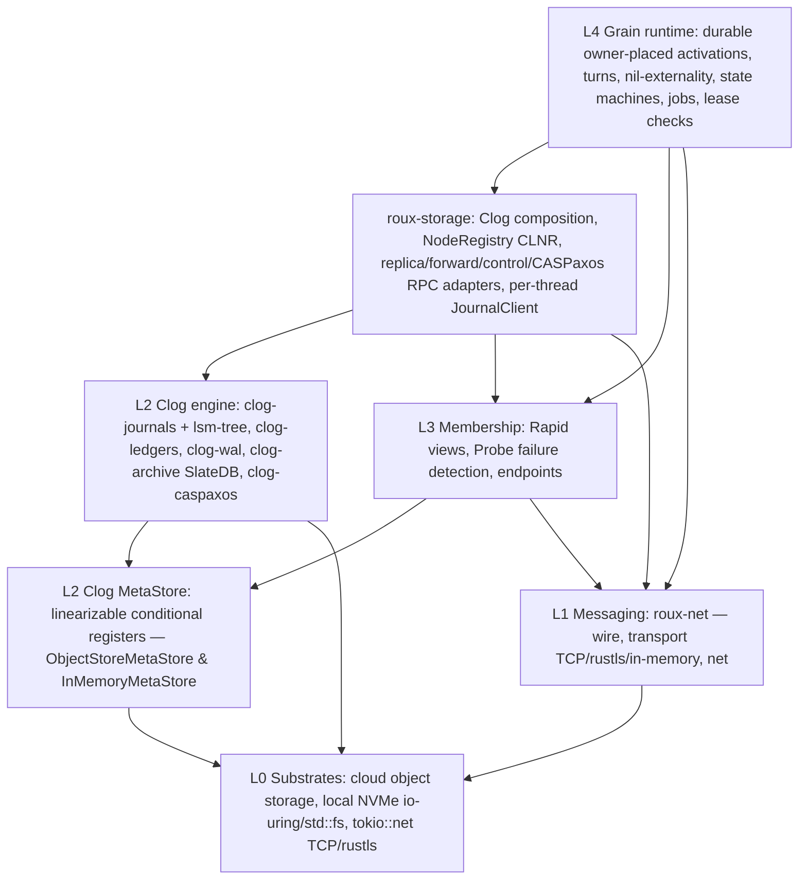

# Layers

Roux is built in layers on top of **Clog** (`clog-*`), a standalone Rust distributed journal storage engine. Each layer depends only on the guarantees of the layers below it, stated as explicit contracts. Clog crates (`clog-*`) depend on nothing in Roux, so Clog is specified, model-checked, and tested independently and composed into Roux through `roux-storage`.

Solid arrows show crate and contract dependencies. The dependency graph is strictly acyclic: `clog-*` defines narrow transport traits (`LedgerReplicaTransport`, `CasPaxosTransport`, controller delegates) that `roux-storage` implements over L1 Messaging (`roux-net`), and `roux-storage` feeds ephemeral liveness hints from L3 Membership into `clog-ledgers`' cluster controller.

## Contracts

| Layer | Provides | Assumes | Specification |
| --- | --- | --- | --- |
| L0 Substrates | Cloud object storage (per-object linearizable get, conditional put/replace, delete, list via `object_store`), local NVMe durable file I/O (`O_DIRECT`/`O_DSYNC` via Linux `io_uring`; portable `std::fs` for dev), and OS networking. An operation may fail with an ambiguous outcome. | Nothing | Modeled as given (`turmoil` + `slatedb-dst` + LazyFS). |
| L1 Messaging | Membership-free, authenticated RPC between processes (`InstanceId` + TCP/`rustls`, plus in-memory transport for tests). One connection per peer per direction; single length-delimited `Frame` enum; `Service \| Object` targets; High/Normal priority lanes; ordered, at-most-once delivery per `(sender process, dest_thread, lane)`. Implemented in `roux-net` (`wire`, `transport`, `net` modules) directly over `prost` + `protox` and `bytes::Bytes`. See [Messaging](messaging.md) and [Connectivity](connectivity.md). | L0 network; `bytes`, `prost` | `stateright` sans-I/O connection/framing model, property tests, and `turmoil` fault tests. Upper layers model L1 as lossy, reordering channels. |
| L2 Storage: Clog (`clog-*`) + `roux-storage` | Linearizable conditional registers (`clog-metastore`: `ObjectStoreMetaStore` over `object_store` conditional PUTs + `InMemoryMetaStore`, plus disk-native `clog-caspaxos` over Target `96`); dynamic dyadic `KeyRange` partitioning (`ledger-map`) with zero-copy splits, merges, handoffs, takeovers, and rolls; NVMe `LedgerQuorum` (`N=3/Q=2`) over multiplexed `clog-wal` replica storage (`ObjectLedgerStorage` deferred); general-purpose unversioned atomic journal messages (`RowKind::Message = 3`, `MessageChannel`, `LG-I15`, `LG-I16`, `ST12`); concrete SlateDB cold archive (`clog-archive`, `wal_enabled = false`, `(RowKey, Tag)` keys, atomic segment+watermark `WriteBatch` commits, single-pass `DrainScan` `SegmentMessageFolds` committing surviving `MessageProcessor` folds before advancing watermarks, `DbReader` + `foyer` cache, manifest-epoch drop fencing); specialized WAL-less `lsm-tree` (Fjall) local warm journal index embedded directly in `clog-journals` (`64 MiB` memtable + `30 s` periodic + clean-shutdown flushing, skipping `!is_archive_kind` rows, replayed from `clog-wal` / live ledgers on startup); per-key journals (`clog-journals`: `Append`/`Replace`, opaque `JournalVersion(Base, Count)` CAS admission, writer CRC-32C covering entry + attached `MessageRecord`s `JS-I11`, slot-ordered `MessageSession` `JS-I12`, pluggable `RoutingKey \|\| JournalKey` row keys defaulting to `xxhash32(key, 0) \|\| key`, forwarded reads/writes); pure control-plane decision engine (`clog-ledgers`); and minimal durable `NodeRegistry` (`CLNR`) + Roux Messaging adapters + generic message-channel registration (`register_message_channel`) + per-thread `JournalClient` bridge in `roux-storage`. Guarantees durable safety unconditionally without clocks. See [Storage](storage.md). | L0 storage; L1 Messaging (injected by `roux-storage`); L3 liveness hints for failure-triggered drains (liveness only) | `stateright` models + `Bug` mutants + `LinearizabilityTester`, `turmoil` + `slatedb-dst`, `proptest`, `miri`, and weekly LazyFS + `SIGKILL` + Elle real-process soak. |
| L3 Membership | An ordered sequence of cluster views (resyncs may skip intermediate views) decided by Rapid cut detection (`Probe` RPC) and Fast Paxos and persisted in a single `{cluster:N}/membership` `clog-metastore` register (`StoredView`, `M36`) before publication. Tracks ephemeral silo liveness, `MemberId = (NodeId, ProcessId)`, `InstanceId`, `NodeEndpoints`, and `View::live_on(NodeId)`; retains 0 defunct records; no extension mechanism (`M38`) and no leases (`M29` withdrawn -> `ST8`). Feeds failure-drain hints to `clog-ledgers`' cluster controller. Strictly separate from Clog's durable `NodeRegistry` (`CLNR`). See [Membership](membership.md). | L1 Messaging; L2 `clog-metastore` | `stateright` sans-I/O Rapid model + `Bug` mutants, `turmoil` simulation. |
| L4 Grain runtime | Durable, owner-placed single-activation virtual actors with single-threaded, reentrant turns; typed `GrainKey` / canonical `GrainId` mapped via pluggable `KeyRouter` to Clog `RowKey`; nil-externality (responses and outgoing messages release only after their Clog journal entries are durable); per-ledger replica-lease enforcement (`ST8`) for non-durable effect safety plus cooperative turn drain on Clog ledger handoffs; `Drop`-only volatile cleanup; durable state handles (`Value`, `Map`, `List`, `Queue`, `Set`, `Inbox`, `Outbox`, `DurableJobQueue`) folding Clog journal entries and snapshots; 1-RTT atomic self-reminders in `roux-jobs` via `GrainReminderCoordinator` + `ReminderMessageHandler`/`ReminderMessageProcessor` (`"roux.reminder"` channel registered into `roux-storage` at `roux-node` bootstrap, `R37`); timers; and Durable Jobs backed by partitioned `JobShard`/`JobCursor` grains and deterministic sealed `JobShard`s on ordinary Clog journals. See [Runtime](runtime.md). | L2 Storage (`roux-storage` / `clog-journals`, `LedgerMapView`, `LedgerLease`), L3 Membership (`View`), L1 Messaging | `stateright` runtime/nil-externality model + `turmoil` whole-cluster simulation. |

## Rules

- A specification for layer N includes layer N−1 only through its contract: an abstract state and the transitions the contract allows, including every failure the contract permits.
- Clog (`clog-*`) stays general-purpose and Roux-agnostic: Roux-specific wiring, RPC framing over `roux-net`, per-thread `!Send` `JournalClient` bridging, and grain concepts live in `roux-storage` and above.
- Every durable safety guarantee is established by Clog independently of clocks or membership; Clog's per-ledger replica leases (`ST8`) add bounded single activation for non-durable effects, while L3 Membership provides fast failure detection and routing views.
- Implementations follow the same crate boundaries: tests of a layer run against a simulated or in-memory contract of the layer below, and architecture tests enforce the Cargo dependency DAG and single-writer authorities.

