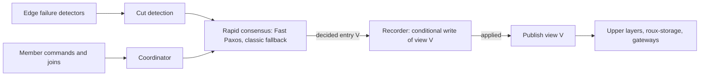
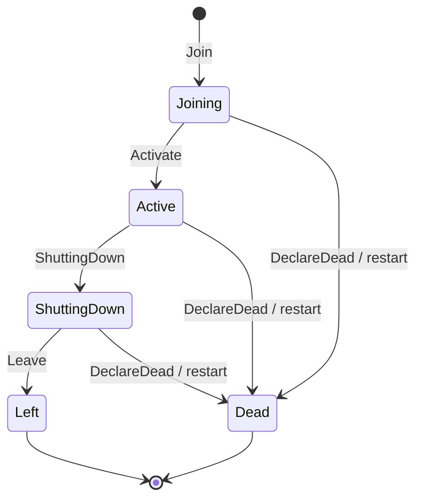

# Membership

Membership (layer L3, see [Layers](layers.md)) maintains the cluster's versioned sequence of views: which processes are members, and each member's status, endpoints, and format support. It detects failed members and removes them. Rapid decides each view, and a process publishes a view only once it is stored in one conditional register in `clog-metastore`. The overview's [Cluster membership](overview.md#cluster-membership) section summarizes the design; this document specifies it down to types, formats, and protocols.

Status: in design, revised after design review 2 and for Roux on Clog. Every decision is provisional: it records the working choice, its rationale, the complexity it adds, and what would change it, in [Decision records](#decision-records).

## Summary

**Contract.**

- **Views.** L3 gives upper layers a dense, totally ordered sequence of views (C1). Each process applies views in version order, and every view it publishes is the cluster's committed view at that version (C2).
- **Membership changes.** Removed members never return (C3). Crashed members are eventually removed (C4), and healthy members are not (C5). A process that sees its own removal stops (C6).

**How.**

- **Rapid decides, the register commits** (M27, M28, M36). Members agree on each next entry with [Rapid](https://www.usenix.org/conference/atc18/presentation/suresh): multi-observer cut detection and Fast Paxos. A recorder writes the resulting view to the `membership` register in `clog-metastore`, conditionally on the previous view. A view is published only once that write applies, and full-cluster restarts recover from the register.
- **No membership leases** (M29 withdrawn -> `ST8`). Per-ledger ownership leases live in L2 Clog's static ledger-replica ensembles (`storage.md §7`, `specs/range-handoff/`), so Rapid carries no lease promises, coordinators, or reconfiguration quiet periods; membership views act purely as liveness and routing inputs.
- **Process liveness, separate from Clog's node registry** (M37, M39).
  - A member is one process: `MemberId = (NodeId, ProcessId)` pairs Clog's durable `NodeId` with the version of the process's `Join`.
  - Clog's `NodeRegistry` holds durable node state, and membership holds none of it.
  - `roux-storage` turns membership's status changes into hints for `ClusterController` (`clog-ledgers`).
- **Formats** (M7). Values are Protocol Buffers compiled from `.proto` via `protox` + `prost-build` and checked with `roux-membership`'s `reject_unknown_wire_tags` verifier before `prost::Message::decode`. A reader stops on content it cannot interpret, and the format version rises only when every live member reads it.

## Contract

The L3 contract is a Rust trait, its types, and the guarantees below. Upper layers depend on nothing else.

- **Traits.** `Membership` and `JoiningMember`, the handles upper layers use; see [Rust interfaces](#rust-interfaces). Messaging does not depend on membership. It identifies peers by `InstanceId` and TLS, and services that need a caller's `MemberId` resolve it through their view ([Callers and fencing](#callers-and-fencing)).
- **Types.** `View`, `ViewUpdate`, `StatusChange`, and the identity types from `roux.id.v1`.
- **Guarantees.** C1 to C6. C7 (storage currency check), C8 (upper layers' batches), and C9 (Rapid peer leases, superseded by L2 ledger-replica leases `ST8`) are withdrawn.
- **Assumes.**
  - **L2 storage.** The conditional register `membership` from `clog-metastore` (`ObjectStoreMetaStore`, `InMemoryMetaStore`, or `clog-caspaxos`), keyed by cluster. Reads are durable and linearizable (MS-I1). A write applies only at the version it names; a write whose outcome is unknown applies at most once, possibly later (MS-I3); and every applied write gives the register a fresh version (MS-I5). The register's value fits within `ClusterConfig.max_members` ([Register](#register)).
  - **L1 messaging.** Authenticated connections between processes identified by `InstanceId`. Messages may be lost, delayed, or reordered, and are delivered at most once. Messaging carries no membership state.
  - **Clog's `NodeId`.** Each process has its node's 128-bit `NodeId` (the `LedgerStore`'s `wal/node`) before it joins. A node runs one process at a time, enforced by a lock on local disk.

### Guarantees

| ID | Guarantee |
| --- | --- |
| C1 | **Dense total order.** Views are numbered by consecutive versions, and genesis creates view 0. View `V+1` is view `V` with exactly one entry applied. Entry `V+1` commits when the `membership` register holds view `V+1`. |
| C2 | **Ordered observation.** Each process publishes views in increasing version order. Every view it publishes is the committed view at that version. It publishes view `V+1` next after view `V`, except after falling behind, when it loads the stored view instead (a **resync**). Each published view carries the status changes since the process's previous view: the entry's own, or after a resync, those derived by comparing the two views. |
| C3 | **No resurrection.** `MemberId`s are unique for the life of the cluster. A member that is `Dead` or `Left` in some view is never `Joining`, `Active`, or `ShuttingDown` in a later view. |
| C4 | **Completeness.** While a majority of members is available and the register accepts writes, a crashed member is eventually declared dead. |
| C5 | **Eventual accuracy.** Once the network and the members' executors stay healthy, a live member that every other member can reach is not declared dead. |
| C6 | **Self-fencing.** A process that observes itself defunct stops. |
| C7 | *Withdrawn in review 2.* |
| C8 | *Withdrawn with the extension mechanism (M38). A member's own commands still commit at most once each, in one entry ([Batches](#batches)).* |
| C9 | *Withdrawn (M29); replaced by L2 Clog ledger-replica leases ([Storage](storage.md), `ST8`, `specs/range-handoff/`).* |

## Architecture



1. **Detect.** Each member's K observers probe it. Alerts about failed, joining, and leaving members are broadcast and aggregated by cut detection.
2. **Decide.** Members agree on the next entry with Rapid's consensus. An entry holds the agreed membership cut and the batches submitted since the last entry.
3. **Commit.** A recorder writes view `V` to the `membership` register, conditionally on view `V−1`. The write is the commit point.
4. **Publish.** Every member applies entry `V` and publishes view `V` to upper layers.

## Decisions

Each decision's rationale, alternatives, complexity, undo cost, and revisit triggers are in [Decision records](#decision-records).

| ID | Decision | Status |
| --- | --- | --- |
| M1 | Rapid's detection defaults ([Parameters](#parameters)) | Decided |
| M2 | Checkpoints in the membership log | Withdrawn: the register holds the whole view (M36) |
| M3 | External clients and `Gateway` (18) ([Clients](#clients)) | Deferred past v1 |
| M4 | Independent, format-gated extensions | Withdrawn: no extensions remain (M38) |
| M5, M6 | Object layout and retention floor | Withdrawn: the register replaces the log |
| M7 | Protocol Buffers values, fail-stop on unknown content ([Formats](#formats)) | Decided |
| M8 | Identifier widths ([Identities](#identities)) | Decided; `NodeId` revised by M37 |
| M9 | Member lifecycle; 0 defunct records retained ([Member lifecycle](#member-lifecycle)) | Decided |
| M10 | Commands and validity ([Batches](#batches)) | Decided |
| M11, M12 | Orleans votes and probe rings | Withdrawn: Rapid's cut detection |
| M13 | Stall-only local health score ([Local health](#local-health)) | Decided; pause termination withdrawn |
| M14 | Decided entries reach members through consensus ([Recording](#recording)) | Decided |
| M15 | Joins through Rapid ([Join](#join)) | Decided |
| M16 | Cluster configuration ([Genesis and configuration](#genesis-and-configuration)) | Decided |
| M17 | Currency checks, delegation, attestations | Withdrawn (leases live in L2 Clog ledger replicas, `ST8`) |
| M18 | Wire messages and system targets (`Membership` 16, `Join` 17) ([Wire messages](#wire-messages)) | Proposed |
| M19 | Rust interfaces ([Rust interfaces](#rust-interfaces)) | Decided |
| M20 | Specifications ([Specification](#specification)) | Proposed |
| M21 | Peer authority for L1 | Withdrawn: messaging is membership-free (connectivity redesign) |
| M22 | Single `roux-membership` crate (`Membership` trait + concrete Rapid implementation) ([Implementations](#implementations)) | Decided |
| M23 | Fast CASPaxos membership | Removed (Rapid is the sole membership protocol) |
| M24 | Committed batches are always valid ([Recording](#recording)) | Decided |
| M25 | `last_write` | Withdrawn: batch sequence numbers (M30) |
| M26 | TLS key fixed per process ([Batches](#batches)) | Decided |
| M27 | Rapid agreement before the storage record ([Agreement](#agreement)) | Decided |
| M28 | Publish a view only once stored; the register arbitrates ([Recording](#recording)) | Decided |
| M29 | Rapid peer leases | Withdrawn (user): replaced by L2 Clog ledger-replica leases ([Storage](storage.md), `ST8`) |
| M30 | Batch sequence numbers and join instance IDs ([Batches](#batches)) | Proposed |
| M31 | Restart and bootstrap from the stored view ([Restart and bootstrap](#restart-and-bootstrap)) | Proposed |
| M32 | Membership's format version in `Join` ([Format versions](#format-versions)) | Proposed |
| M33 | Upper layers report unresponsive members ([Unresponsive members](#unresponsive-members)) | Proposed |
| M34 | Callers resolved by `InstanceId`; each membership service fences itself ([Callers and fencing](#callers-and-fencing)) | Decided |
| M35 | Sum types in every membership record and message ([Formats](#formats), [Wire messages](#wire-messages)) | Decided |
| M36 | One `membership` register holding the whole view; resync after falling behind ([Register](#register); Clog's open item C2) | Decided |
| M37 | Clog's UUID `NodeId` ([Identities](#identities)) | Decided (user) |
| M38 | No extensions | Decided (user) |
| M39 | Separate from Clog's node registry; status changes as hints ([Clog's node registry](#clogs-node-registry)) | Decided (user) |

## Parameters

| Parameter | Value | Status | Notes |
| --- | --- | --- | --- |
| Observers per member (K) | 10 | Decided | Capped at `N − 1` in small clusters. |
| High and low watermarks (H, L) | 9, 3 | Decided | Scaled with K when `K < 10`. |
| Probe interval and timeout | 1 s, 500 ms | Decided | Timeout scaled by `1 + score` while the prober is degraded. |
| Consecutive failed probes for an alert | 3 | Decided | |
| Alert batching window | 100 ms | Decided | |
| Local health period | 10 s | Decided | |
| Maximum join time | 5 min | Decided | |
| Recorder takeover | 2 s | Decided | See [Recording](#recording). |
| Maximum members | 2,000 | Proposed | Default cap in `ClusterConfig.max_members`; see [Register](#register). |

With these values, a crashed member is reported after about 3 seconds and confirmed by its observers within another second or two, after which Rapid commits its removal directly (any active ledger-replica lease on that member is fenced by Clog's quorum seal in L2, `ST8`).

## Identities

`roux.id.v1` defines the identity types once, for every layer.

| Type | Representation | Allocation |
| --- | --- | --- |
| `ClusterId` | `Id128`, random | Chosen at deployment. Keys the `membership` register (`{cluster}/membership`) and scopes every handshake. |
| `MembershipVersion` | `u64` | A view's version; genesis is version 0. |
| `NodeId` | `Id128`, random UUID | Clog's: created with the node's `LedgerStore`, persisted in `wal/node`, and fixed for the disk's life. Membership reads it at startup and never allocates one. |
| `ProcessId` | `u64` | The version of the process's `Join` entry, so a node's `ProcessId`s rise across its restarts. |
| `MemberId` | `{ node: NodeId, process: u64 }` | Ordered by `node`, then `process`. |
| `InstanceId` | `Id128`, random | Chosen by each starting process. It identifies the process to messaging for its whole life, before and after it has a `MemberId`. `Join` records it, so a view maps it to a `MemberId`. |

Status: Decided (M8, M37); `InstanceId` Proposed (M30).

## Member lifecycle



- `Joining`, `Active`, and `ShuttingDown` members are **live**: they are monitored and can be removed.
- `Dead` and `Left` members are **defunct** and are removed from the live set immediately upon commit (0 defunct records retained). A `MemberId` absent from the view with a `ProcessId` no greater than the view's version is defunct (`View::lookup` answers `Defunct`). `Left` still appears in `StatusChange` when an entry commits step-by-step so `roux-storage` and the runtime know the member drained itself.

Status: Decided (M9).

## Stored view

### Status changes

Each published view carries the status changes that led to it from the process's previous view. Upper layers and `roux-storage` consume them ([Clog's node registry](#clogs-node-registry)).

```rust
/// Each variant carries exactly what its transition needs; the previous status
/// is recorded only where more than one is possible.
pub enum StatusChange {
    Joined { member: MemberId },
    Activated { member: MemberId },
    ShuttingDown { member: MemberId },
    Left { member: MemberId },
    DeclaredDead { member: MemberId, was: LiveStatus },
    /// A restart's `Join` with the same `NodeId` replaced this live member.
    Replaced { member: MemberId, was: LiveStatus, by: MemberId },
}

pub enum LiveStatus { Joining, Active, ShuttingDown }
```

- **From an entry.** The changes are the entry's own, in the order applied. `Replaced` is the only way one process replaces another; a restart whose predecessor is already defunct produces only `Joined`.
- **From a resync.** The process compares its previous view `A` with the loaded view `B`, member by member, in `MemberId` order:
  - A member live in `B` but not in `A` yields `Joined`, followed by `Activated` or `ShuttingDown` when its status in `B` requires it.
  - A member live in both, with a later status in `B`, yields `Activated` or `ShuttingDown`.
  - A member live in `A` and absent from `B` yields `DeclaredDead`. Consumers may treat a `Left` member as dead, but must never treat a dead member as having left, so `DeclaredDead` is always the safe answer after a resync.
  - A replacement appears as `DeclaredDead` for the old member and `Joined` for the new one.
- **Net changes.** Changes derived across a resync are net changes: members that joined and became defunct within the gap do not appear. Consumers act on each member's current status, which the derived changes give exactly.

### Batches

An entry is one or more batches, applied in order, each whole. A batch's kind fixes who submits it and which commands it may hold, so a batch with the wrong commands for its origin cannot be encoded:

| Batch | Submitted by | Holds | Valid when | Effect |
| --- | --- | --- | --- | --- |
| `Genesis { config }` | The process that creates the register | Nothing else | Only in entry 0 | Creates view 0 with `config` and no members. |
| `Join { instance, configuration, node, endpoints, zone: Option<Zone>, format_version, tls_key_sha256 }` | Rapid, for one joining process | Nothing else | The entry's predecessor is `configuration`; `instance` is not in the view; `format_version` is at least the cluster's; the view has fewer than `max_members` live members | Creates member `(node, V)` as `Joining`, and replaces any live member with the same `NodeId` (`Replaced`). |
| `Member { member, seq, commands }` | A live member | `MemberCommand`s | `member` is live; `seq` is above the member's `last_batch`; each command is valid in order | Applies the commands and sets `last_batch = seq`. |
| `Cut { removals }` | Rapid's cut detection | `Removal { member, kind: Dead or Left }`, distinct members | Each member is live; `Left` only for a `ShuttingDown` member | `Dead` or `Left`. |

| `MemberCommand` | Valid when | Effect |
| --- | --- | --- |
| `Activate` | The batch's member is `Joining` | `Active` |
| `BeginShutdown` | The batch's member is `Active` | `ShuttingDown` |
| `Configure(ClusterConfig)` | The batch's member is `Active`; every live member reads the new format version, which does not decrease | Replaces `ClusterConfig`. |

- **Resubmission.** A member's batches carry a per-process sequence number, so a batch resent after a lost acknowledgement is invalid rather than duplicated. A joiner has no `MemberId` yet, so it is identified by its `InstanceId`: a second `Join` with the same instance is invalid, and the joiner finds its `MemberId` by its instance.
- **Joins target a version.** A `Join` is valid only as the successor of the configuration it names, because Rapid tags joins with their configuration. Without this rule, a stale `Join` from a crashed joiner could commit again after its instance's record was pruned; the core specification found this.
- **Validity is local to the view.** It depends only on the view a batch applies to, so every process evaluates it identically. Every committed batch is valid ([Recording](#recording)), so readers apply batches without re-validating them.
- **Status changes record their version** in the live member's `since`. Removed (`Dead` or `Left`) members are dropped from `live` immediately (0 defunct records retained).
- **Endpoints and TLS key are fixed for a process's life.** A process that changes address or rotates its key restarts and joins with a new `ProcessId`.
- **Votes are not stored.** Rapid's alerts and cut detection replace `Suspect`; the register records only decided removals.

Status: Decided (M10, M26, M30), revised for Rapid, sum types (M35), and Clog (M37, M38).

### Formats

The register's value is a `StoredView`: the whole view at one version, plus the entry that produced it. Values are Protocol Buffers messages in package `roux.membership.v1`, authored as `.proto` files under `schema/roux/membership/v1/`, compiled with `protox` + `prost-build` (`Z15`, `Z17`), and converted to strict Rust domain types via `TryFrom`. Before `prost::Message::decode`, readers run `roux-membership`'s local `reject_unknown_wire_tags` scanner (`Z7`) so unknown fields fail stop rather than being silently dropped. The register's key binds the value to its cluster, and `clog-metastore` stores each value durably and whole, so the value carries no envelope or cluster ID of its own.

Every type follows the [wire rules](wire-catalog.md#conventions) (M35):

- Alternatives with data are `oneof`s.
- A field's meaning never depends on another field.
- `optional` fields are Rust `Option`s, and every other field is required.
- A C-like enum's value 0 is a decode error.

```proto
syntax = "proto3";
package roux.membership.v1;

import "roux/id/v1/id.proto";           // MemberId { Id128 node; uint64 process }, Id128
import "roux/wire/v1/endpoints.proto";  // NodeEndpoints (L1, N8)

// The value of the `membership` register.
message StoredView {
  uint32 format_version = 1;            // Membership's format version for this value.
  uint64 version = 2;                   // This view's version.
  ClusterConfig config = 3;
  repeated LiveMember live = 4;         // Ascending MemberId.
  // tag 5 reserved (formerly defunct records; 0 retained in v1, M9).
  Entry entry = 6;                      // The entry that produced this view from version - 1.
}

message Entry {
  repeated Batch batches = 1;           // At least one; applied in order, each atomically.
}

message Batch {
  oneof kind {
    GenesisBatch genesis = 1;
    JoinBatch join = 2;
    MemberBatch member = 3;
    CutBatch cut = 4;
  }
}

message GenesisBatch {
  ClusterConfig config = 1;
}

message JoinBatch {
  roux.id.v1.Id128 instance = 1;
  uint64 configuration = 2;                  // The version this Join follows.
  roux.id.v1.Id128 node = 3;                 // Clog's NodeId, from wal/node.
  roux.wire.v1.NodeEndpoints endpoints = 4;  // Owned by L1 (N8); stored opaquely.
  optional string zone = 5;
  uint32 format_version = 6;                 // The highest membership format this process reads.
  bytes tls_key_sha256 = 7;                  // 32 bytes.
}

message MemberBatch {
  roux.id.v1.MemberId member = 1;
  uint64 seq = 2;                            // At least 1; above the member's last_batch.
  repeated MemberCommand commands = 3;
}

message MemberCommand {
  oneof kind {
    Activate activate = 1;
    BeginShutdown begin_shutdown = 2;
    Configure configure = 3;
  }
}
message Activate {}
message BeginShutdown {}
message Configure { ClusterConfig config = 1; }

message CutBatch {
  repeated Removal removals = 1;             // At least one; distinct members.
}
message Removal {
  roux.id.v1.MemberId member = 1;
  RemovalKind kind = 2;
}
enum RemovalKind {
  REMOVAL_KIND_UNSPECIFIED = 0;
  REMOVAL_KIND_DEAD = 1;
  REMOVAL_KIND_LEFT = 2;
}

message ClusterConfig {
  uint32 format_version = 1;                 // The membership format writers use.
  uint32 observers = 2;
  uint32 high_watermark = 3;
  uint32 low_watermark = 4;
  uint32 probe_interval_us = 5;
  uint32 probe_timeout_us = 6;
  uint32 failed_probes = 7;
  // tag 8 reserved (formerly promise_duration_us; removed with M29).
  uint32 max_join_time_us = 9;
  // tag 10 reserved (formerly defunct_retained; 0 retained in v1, M9).
  uint32 max_members = 11;
}

message LiveMember {
  roux.id.v1.MemberId id = 1;
  LiveStatus status = 2;
  uint64 since = 3;                          // Version of the entry that set the status.
  roux.id.v1.Id128 instance = 4;
  roux.wire.v1.NodeEndpoints endpoints = 5;
  optional string zone = 6;
  uint32 format_version = 7;                 // The highest membership format this process reads.
  bytes tls_key_sha256 = 8;
  optional uint64 last_batch = 9;           // Absent until the member's first batch commits.
}
enum LiveStatus {
  LIVE_STATUS_UNSPECIFIED = 0;
  LIVE_STATUS_JOINING = 1;
  LIVE_STATUS_ACTIVE = 2;
  LIVE_STATUS_SHUTTING_DOWN = 3;
}
```

Writers check the constraints that the types cannot express, and readers treat a violation as an invariant violation:

- `tls_key_sha256` is 32 bytes.
- A cut names distinct members.
- An entry holds at least one batch.
- A `Genesis` batch appears exactly in view 0's entry.
- A reader one view behind applies `entry` to its own view, and the result equals the stored view.

#### Format versions

Every process must apply every entry identically, so version tolerance is explicit (M32):

- **One version.** `ClusterConfig.format_version` is the membership format that writers use. Other layers rely on N−1/N+1 protobuf compatibility and protocol version negotiation.
- **Joins declare support.** A `Join` batch's `format_version` is the highest membership format the process reads.
- **Raising the version.** `Configure` raises it only when every live member reads the new version.
- **Readers stop on the unknown.** A reader stops, reports the incompatibility, and never applies a partial entry when it meets either of these:
  - a format version above its own;
  - a value that fails `reject_unknown_wire_tags`, `prost::Message::decode`, or domain `TryFrom` validation.

  In a correctly gated cluster no member meets such content. The stop rule turns a gating bug into a visible halt instead of divergent views.
- **Leaving a halt.** Operators restart the halted members with a build that reads the offending version. The entry is already committed, and gating does not undo it.

Status: Decided (M7), with the `Join` gate Proposed (M32).

### Register

Membership stores its state in one `clog-metastore` register, `membership`, whose value is the newest `StoredView` (M36, Clog's open item C2). Like Clog's `ledger-map` and `node-registry`, it is keyed `{cluster}/membership`.

- **One write per entry.** The recorder writes view `V` conditionally on the register version it read or wrote for view `V−1`. Each applied write commits one entry.
- **Reads.** A process reads the register at startup and when it falls behind. One read returns the whole current view, so there is nothing to replay, checkpoint, or trim.
- **Catching up.** A process at view `V−1` that reads view `V` applies the stored entry. A process further behind resyncs: it loads the stored view and derives the status changes ([Status changes](#status-changes)). A resync is a view change like any other. The process checks its own status in the loaded view and stops if it was removed (C6), and its lookups only move forward. The core specification checks both.
- **Size.** A live member's record is about 450 bytes, most of it endpoints, and no defunct records are retained. A view of `N` members is therefore about `0.45 × N` KB (about 900 KB at 2,000 members). Both v1 `MetaStore` backends (`ObjectStoreMetaStore` over `object_store` and `clog-caspaxos`) handle multi-megabyte values comfortably. `ClusterConfig.max_members` (default 2,000) bounds view size, and a `Join` beyond it is refused with `ClusterFull`. Coordinators therefore never decide a value larger than configured.
- **Write volume.** Every entry rewrites the whole view: about 450 KB per entry at 1,000 members. Rapid gathers the changes that arrive during one consensus instance into one entry. A rolling restart of 1,000 nodes in waves of 100 therefore writes about 20 entries, or about 9 MB.

Status: Decided (M36).

### Genesis and configuration

- **Startup.** Every process starts messaging first, then `roux-storage`, which opens `clog-metastore` and the node's `LedgerStore` and so gives the process its `NodeId`. With `clog-caspaxos`, the seeds' acceptors start before anything else. No step waits on membership, so a cluster with no live members can always reach its register.
- **Genesis.** A process that finds the `membership` register absent writes view 0 with a create-only write, which names no expected version. View 0 is a `StoredView` whose entry is one `Genesis` batch holding the cluster's configuration. The register decides between concurrent attempts: a loser's write mismatches, and the loser reads view 0. Any process may attempt genesis; with `clog-caspaxos`, only seeds do.
- **First members.** A process that finds no live member in the stored view bootstraps the first configuration under the [restart rule](#restart-and-bootstrap). The stored view has no live `NodeId`s, so a single process may start it, committing its own `Join` as entry 1. Concurrent first members race on the register, and the losers join through the winner.
- **Cluster-wide settings.** `ClusterConfig` holds what members must agree on: the format version, the maximum member count, and the detection parameters. `Configure` replaces it.
- **Node-local settings.** Seed lists.

Status: Decided (M16), revised for the register (M36).

## Agreement

Members agree on each entry with [Rapid](rapid.md) (formally checked in [`specs/rapid/`](../../specs/rapid/README.md)), implemented in pure sans-I/O Rust inside `roux-membership`.

### Monitoring and cut detection

- **Observers.** Each member is monitored by K = 10 observers, chosen from K rings hashed by `MemberId`, and monitors K subjects. Observers probe their subjects every second, through the pluggable edge failure detector.
- **Alerts.** After 3 consecutive failed probes, an observer broadcasts a `DOWN` alert about the subject. Joining and leaving members produce `UP` and `LEAVE` alerts from their observers. Alerts are batched for 100 ms.
- **Cut detection.** A member collects alerts per subject. A subject with at least L = 3 reports is unstable; at H = 9 it is stable. When at least one subject is stable and none is unstable, the member proposes the cut: every stable subject's change. This makes removals almost-everywhere agreed and keeps flapping links from removing members.
- **Local health.** A degraded member ([Local health](#local-health)) sends no `DOWN` alerts.

### Unresponsive members

Upper layers report a live member that misses their deadlines, such as an owner that does not complete a handoff, with `report_unresponsive(member)`. The reporting member sends `Unresponsive { member }` to the member's K observers, and each observer counts it as one failed probe of that subject. Reports repeated at the probe interval therefore drive the subject through the normal path: `DOWN` alerts from its observers, cut detection at H, and consensus. A degraded reporter ([Local health](#local-health)) sends no reports.

Status: Proposed (M33, L4 request).

### Consensus

- **Value.** Each consensus instance decides one entry: a membership cut (possibly empty) plus the batches submitted since the previous entry, assembled by the coordinator.
- **Fast path.** When at least `⌈3N/4⌉` members propose the same value, Fast Paxos decides in one round trip.
- **Classic path.** Otherwise the coordinator, the live member with the lowest `MemberId` (the next ones take over in order), runs classic Paxos over a majority. Submitted batches go to the coordinator, which merges them into the next value, so membership writes do not contend in storage (finding 34).
- **One instance at a time.** Instance `V+1` starts after entry `V` is durable.

Status: Decided (M27, user, review 2).

### Recording

- **Recorder.** The coordinator writes view `V` to the register, naming the register version of view `V−1`. If no member learns that view `V` is stored within 2 seconds, every member reads the register and, while it still holds view `V−1`, writes view `V` itself, with jitter. The outcomes:
  - **`Applied`.** Entry `V` committed, and the recorder sends `Durable { version: V }` to every member.
  - **`Mismatch`.** The register no longer holds view `V−1`. The recorder reads it: a stored view `V` holding the decided entry means entry `V` committed; anything else means the register won (below).
  - **Unknown outcome (an error).** The write applies at most once, and only at view `V−1`'s version (MS-I3). The recorder reads the register. If it still holds view `V−1`, the recorder retries the same write; otherwise it proceeds as for `Mismatch`.
- **The register is the commit point.** A view is published only after its write applies (M28). Every durable effect that follows a view, such as a Clog takeover driven by its status changes, therefore follows the view's durability. A full-cluster restart never recovers an older view than upper layers acted on.
- **The register arbitrates.** If view `V` holds a different entry, or the register has moved past `V` with an entry the process cannot confirm, the register wins. This happens only when a stale configuration races a restarted one ([Restart and bootstrap](#restart-and-bootstrap)).
  - Processes whose decision lost resync to the stored view, and the C6 check stops any process that the stored view removed.
  - Batch sequence numbers and join instance IDs in the stored view (M30) show submitters which of their batches committed, and they resubmit the rest.
- **Committed batches are always valid** (M24). The coordinator validates each batch against view `V−1` exactly as readers will, and consensus decides only on validated values built on `V−1`. A reader that finds an invalid committed batch has found a bug and stops.
- **Propagation.** Members learn each decided entry through consensus. They apply it once they learn that it is stored: from `Durable`, or from any message for configuration `V`, because instance `V+1` starts only after entry `V` is stored.
  - A member that missed the decision reads the register ([Register](#register)).
  - Every membership message carries its configuration version, and a member that sees a higher version catches up.
  - Upper layers learn newer versions from `NOT_HERE` responses and catch up the same way.

Status: Decided (M14, M24, M28), revised for the register (M36).

## Restart and bootstrap

- **Process restart.** A restarted process reads the register and contacts a live member from the stored view, or a configured seed. It joins through Rapid with its node's `NodeId`, replacing its predecessor.
- **Full-cluster restart.** When no member of the stored view answers, restarted processes bootstrap a new configuration from the stored view. A bootstrap may proceed only once restarted processes on a majority of the stored view's live `NodeId`s have gathered.
  - Their predecessors are certainly gone, because a node runs one process at a time, enforced by a lock on local disk.
  - The old configuration can therefore never again reach a majority, and two bootstraps cannot both gather one.
- **Arbitration.** If a stale member of the old configuration still writes, the register decides each version, and the losing side resyncs.

Status: Proposed (M31).

## Join

1. The process chooses an `InstanceId` and reads the register. It calls `Join` (17), carrying its node's `NodeId`, over an ordinary connection to a live member from the stored view or to a configured seed.
2. The contacted member forwards the request to the joiner's K observers. They probe the joiner and broadcast `UP` alerts, and cut detection and consensus add the joiner's `Join` batch to an entry.
3. The joiner learns its `MemberId` from the response, or by finding its `InstanceId` in a later view. Its connections stay as they are, and upper layers warm up.
4. It submits `Activate`.

- **Stuck joins.** A member in `Joining` for longer than the maximum join time is removed by its observers' alerts.
- **Graceful leave.** A member submits `ShuttingDown`, drains its work through the runtime and Clog handoffs, and leaves through Rapid's `LEAVE` alerts, which commit `Leave`.

Status: Decided (M15), revised for Rapid.

## Local health

Every 10 seconds, each member computes a degradation score from 0 to 8 from whole seconds of local executor stall (measured against wall-clock vs scheduled timer ticks). While its score is positive, a member scales its probe timeouts by `1 + score` and sends no `DOWN` alerts, so a locally stalled member does not falsely accuse healthy peers. (Rapid's H-of-K quorum rule already tolerates a minority of network-isolated observers without additional composite health signals.)

Status: Decided (M13). Pause termination is withdrawn: a paused member's per-ledger replica leases lapse in L2/L4 and those ranges suspend ([Storage](storage.md), [Runtime](runtime.md)).

## Callers and fencing

Messaging authenticates processes, not members, and never drops messages because of membership. Membership and the layers above it enforce membership semantics themselves:

- **Resolving callers.** A service that needs to know which member is calling resolves the connection's `InstanceId` through its view with `View::member_by_instance`. `Join` records each process's `instance` and `tls_key_sha256`, so a view binds an instance, its key, and its `MemberId`.
- **Lookups only move forward.** `View::lookup(member)` answers `Live`, `Defunct` (absent with `process ≤ V`), or `Unknown` (`process > V`). Across views applied in order, a member's answer only moves `Unknown` → `Live` → `Defunct`. The [specification](#specification) checks this. Upper layers use it, for example to close connections to defunct peers so their pending calls fail promptly.
- **Rapid fences by configuration.** Every probe, alert, and consensus message carries its configuration version. A member ignores consensus messages for another configuration, and counts alerts and votes only from senders that its view resolves to members of that configuration.
- **L2 leases fence grain effects.** A deposed range primary's effects are bounded at the sender by its per-ledger replica lease (`ST8`), not by membership or receivers. A message sent under a valid lease may arrive after takeover commits, exactly as a delayed message from a live primary would.
- **Joins accept any authenticated process.** Each `Join` names the configuration version it targets, and validity rules reject stale or duplicate joins ([Batches](#batches)).
- **Self.** A process that applies its own removal stops (C6).

Status: Decided (M34). It replaces the peer authority (M21).

## Clog's node registry

Membership and Clog's `NodeRegistry` (`CLNR`, the `node-registry` register) describe different things, and neither reads or writes the other's state (M39).

| | Membership (L3) | Clog `NodeRegistry` |
| --- | --- | --- |
| Identity | `MemberId = (NodeId, ProcessId)`: one process | `NodeId`: one node's disk, for its lifetime |
| State | Liveness, `InstanceId`, endpoints, TLS key hash, membership format version | Registration, generation monotonicity, `ArchiveStoreIdentity` pinning |
| Lifetime | Ephemeral: a member is removed from `live` once its process stops (0 defunct records retained) | Durable |
| Decided by | Rapid, stored in the `membership` register | Conditional read-modify-write of `node-registry` |
| Time | Probes | No clocks (per-ledger leases live in `LedgerReplica` RAM, `ST8`) |

- **Liveness hints.** `roux-storage` subscribes to views and passes each status change to `ClusterController` (`clog-ledgers`) as a scheduling hint. Hints affect only when Clog acts, and Clog's safety never depends on them. Proposed mapping, owned by `roux-storage`:

  | Status change | Hint |
  | --- | --- |
  | `Joined` | None: the process is not serving yet. |
  | `Activated` | The node can host ledger replicas and primaries. |
  | `ShuttingDown` | Drain: move the node's primaries and replicas away. |
  | `Left` | The node drained itself; take over anything it did not hand off. |
  | `DeclaredDead`, `Replaced` | Take over the old process's primaries. Ledger seals + `lease_remaining_ms` wait fence durable and volatile effects (`ST8`). |

- **Stalled owners.** When a handoff owner misses its deadline, `roux-storage` calls `report_unresponsive(member)` ([Unresponsive members](#unresponsive-members)) so Rapid evicts the stuck member from placement, while `TransitionExecutor` takes over immediately via quorum seal + `max(lease_remaining_ms)` wait without waiting for Rapid `DeclaredDead` (`ST8`).
- **Node to process.** `View::live_on(node)` gives the live member running on a `NodeId`, with its endpoints and `InstanceId`. `roux-storage` uses it to reach the node that Clog's `ledger-map` names.

Status: Decided (M39, user).

## Clients

External cluster clients and `Gateway` (Target 18) are deferred past v1 ([N21](messaging.md#n21-clients)). Applications expose HTTP/gRPC frontends directly from cluster nodes. Target 18 remains reserved so external gateway discovery (`GetView` / `WatchView`) can be added later without wire changes.

Status: Deferred past v1 (M3, N21).

## Wire messages

Membership's two v1 system targets are specified below as Protocol Buffers in package `roux.membership.v1`, following the [wire conventions](wire-catalog.md#conventions).

- **Method IDs.** Each target's request/response schemas are `.proto` files under `schema/roux/membership/v1/`, compiled with `protox` + `prost-build` (`Z15`). Method IDs are the table discriminants below, traveling in `Target::Service { interface, method }`; `Call.args` is the method's request message with no wrapper.
- **Outcomes.** A request's response is `Outcome::Ok` with the method's result message, or `Outcome::Err` with its error message. One-way methods have no response.
- **Lanes.** `Membership` (16) and `Join` (17) travel on L1's High lane. Membership reserves targets 18 to 31 (with 18 reserved for deferred `Gateway`).
- **Configurations.** Every `Membership` message names the configuration version it belongs to. A receiver ignores consensus messages for other configurations. It counts alerts and votes only from senders whose `InstanceId` its view resolves to members of that configuration ([Callers and fencing](#callers-and-fencing)). A receiver that sees a newer configuration catches up from the register.

### Membership (16)

Between members of one cluster, and from members to joiners for probes.

| ID | Method | Kind | Request | Ok | Err |
| --- | --- | --- | --- | --- | --- |
| 1 | `Probe` | Request | `Probe` | `ProbeAck` | — |
| 2 | `Alerts` | One-way broadcast | `AlertBatch` | | |
| 3 | `Unresponsive` | One-way, reporter to the subject's observers | `Unresponsive` | | |
| 4 | `ForwardJoin` | One-way, contacted member to the joiner's observers | `ForwardJoin` | | |
| 5 | `FastVote` | One-way broadcast | `FastVote` | | |
| 6 | `Phase1a` | One-way, coordinator to members | `Phase1a` | | |
| 7 | `Phase1b` | One-way, member to coordinator | `Phase1b` | | |
| 8 | `Phase2a` | One-way, coordinator to members | `Phase2a` | | |
| 9 | `Phase2b` | One-way broadcast | `Phase2b` | | |
| 10 | `Durable` | One-way broadcast, from the recorder | `Durable` | | |

```proto
syntax = "proto3";
package roux.membership.v1;

import "roux/id/v1/id.proto";           // Id128, MemberId
import "roux/wire/v1/endpoints.proto";  // NodeEndpoints

// ---- Probes and alerts

message Probe {
  uint64 configuration = 1;
}
message ProbeAck {
  uint64 configuration = 1;              // The responder's newest applied version.
}

message AlertBatch {
  uint64 configuration = 1;
  repeated Alert alerts = 2;             // At least one.
}
// Each alert names its subject the only way that subject can be named.
message Alert {
  oneof kind {
    UpAlert up = 1;
    DownAlert down = 2;
    LeaveAlert leave = 3;
  }
}
message UpAlert {
  JoinBatch join = 1;                    // The batch to commit if the joiner's cut is stable.
  uint32 ring = 2;                       // The observer's ring, below ClusterConfig.observers.
}
message DownAlert {
  roux.id.v1.MemberId member = 1;
  uint32 ring = 2;
}
message LeaveAlert {
  roux.id.v1.MemberId member = 1;
  uint32 ring = 2;
}

message Unresponsive {
  uint64 configuration = 1;
  roux.id.v1.MemberId member = 2;
}

// Sent by the member a joiner contacted; each observer probes the joiner and
// broadcasts an UpAlert once probes succeed.
message ForwardJoin {
  uint64 configuration = 1;              // Equals join.configuration.
  JoinBatch join = 2;
}

// ---- Consensus on the entry after `configuration` (Fast Paxos, classic fallback)

message FastVote {
  uint64 configuration = 1;
  Entry value = 2;
}
message Phase1a {
  uint64 configuration = 1;
  Rank rank = 2;
}
message Phase1b {
  uint64 configuration = 1;
  Rank rank = 2;
  optional Accepted accepted = 3;        // Absent if this member has accepted nothing.
}
message Phase2a {
  uint64 configuration = 1;
  Rank rank = 2;
  Entry value = 3;
}
message Phase2b {
  uint64 configuration = 1;
  Rank rank = 2;
  Entry value = 3;
}
message Accepted {
  Rank rank = 1;
  Entry value = 2;
}
// Ordered by round, then member. Round 1 is the fast round.
message Rank {
  uint32 round = 1;
  roux.id.v1.MemberId member = 2;
}

// The register holds view `version`; instance `version + 1` may start.
message Durable {
  uint64 version = 1;
}
```

- **Values are entries.** Consensus decides an `Entry` ([Formats](#formats)) built on view `configuration`: a `CutBatch` from cut detection, `JoinBatch`es from stable `UP` cuts, and the `MemberBatch`es submitted to the coordinator.
- **`Durable` is a hint.** Members also learn that a view is stored from messages for the next configuration, or by reading the register.

### Join (17)

Accepts any authenticated process, which need not be a member.

| ID | Method | Kind | Request | Ok | Err |
| --- | --- | --- | --- | --- | --- |
| 1 | `Join` | Request, joiner to a live member or seed | `JoinRequest` | `Joined` | `JoinRefused` |

```proto
message JoinRequest {
  roux.id.v1.Id128 instance = 1;             // The caller's InstanceId; must match the connection's.
  roux.id.v1.Id128 node = 2;                 // Clog's NodeId, from wal/node.
  roux.wire.v1.NodeEndpoints endpoints = 3;
  optional string zone = 4;
  uint32 format_version = 5;                 // The highest membership format this process reads.
  bytes tls_key_sha256 = 6;                  // 32 bytes; must match the connection's certificate key.
}

message Joined {
  roux.id.v1.MemberId member = 1;            // The new member; its process is the Join's version.
}

message JoinRefused {
  oneof reason {
    Incompatible incompatible = 1;
    ClusterFull cluster_full = 2;
  }
}
message Incompatible {
  uint32 format_version = 1;                 // The cluster's format version.
  uint32 supported = 2;                      // The joiner's highest readable version.
}
message ClusterFull {
  uint32 max_members = 1;
}
```

- **Building the batch.** The contacted member turns the request into a `JoinBatch`, setting `configuration` to its current version, and sends `ForwardJoin` to the joiner's observers. If the configuration changes before the join commits, it rebuilds the batch for the new configuration and forwards it again.
- **The response waits for the commit.** The member answers once the joiner's `Join` is in a stored view, or with `JoinRefused`, within the call's deadline. A joiner whose call times out retries with the same `InstanceId`, and finds its `MemberId` in the view if the earlier attempt committed.
- **Identity checks.** The member checks `instance` and `tls_key_sha256` against the connection, so a process can join only as itself.

### Gateway (18 — deferred)

Target 18 (`Gateway`) is reserved for post-v1 external client view discovery (`GetView` / `WatchView` returning `ClientView`) and is not implemented in v1 ([N21](messaging.md#n21-clients)).

- **Size.** Each request enum is as large as its largest variant. `Join` is used only off the hot path, and `Membership` variants hold only small values or an `Entry`, so nothing is boxed.
- **Views come from the register.** Joiners and restarted processes read the register directly, so no target transfers views between members.

Status: Proposed (M18), revised for sum types (M35), the register (M36), concrete schemas (user), and deferred `Gateway` (N21). `ClientLog` (19), `ViewTransfer`, `ConfirmRequest`, attestations, and pushes are removed.

## Rust interfaces

Contract and Rapid implementation live together in a single `roux-membership` crate; upper layers program against the `Membership` trait.

### Views

```rust
pub struct View { /* private */ }

impl View {
    pub fn cluster_id(&self) -> ClusterId;
    pub fn version(&self) -> MembershipVersion;
    pub fn config(&self) -> &ClusterConfig;
    pub fn member(&self, id: MemberId) -> Option<&LiveMember>;
    pub fn live(&self) -> impl Iterator<Item = &LiveMember>;
    /// The live member running on `node`, if any.
    pub fn live_on(&self, node: NodeId) -> Option<&LiveMember>;
    /// `Live`, `Defunct`, or `Unknown`; see [Callers and fencing](#callers-and-fencing).
    pub fn lookup(&self, id: MemberId) -> MemberLookup;
    /// The member a connection's peer instance has joined as, if any.
    pub fn member_by_instance(&self, instance: InstanceId) -> Option<&LiveMember>;
}

/// One step in a process's sequence of views (C2).
pub struct ViewUpdate {
    pub view: Arc<View>,
    /// The version this process published before `view`: `view.version() - 1`,
    /// or older after a resync.
    pub from: MembershipVersion,
    /// The status changes from `from` to `view`; see [Status changes](#status-changes).
    pub changes: Vec<StatusChange>,
}
```

### Service

```rust
/// The L3 contract, shared as `Arc<dyn Membership>`.
pub trait Membership: Send + Sync + 'static {
    fn view(&self) -> Arc<View>;
    /// A `ViewUpdate` for every view this process publishes after the current one (C2).
    fn subscribe(&self) -> LocalStream<'_, ViewUpdate>;
    fn local(&self) -> MemberId;

    /// Commits a `Configure` command (the admin path), at most once.
    fn configure(&self, config: ClusterConfig) -> LocalFuture<'_, Result<MembershipVersion, Error>>;

    /// Reports a live member that failed an upper layer's deadline (such as a
    /// handoff); see [Unresponsive members](#unresponsive-members).
    fn report_unresponsive(&self, member: MemberId);

    fn begin_shutdown(&self) -> LocalFuture<'_, Result<MembershipVersion, Error>>;
    fn leave(&self) -> LocalFuture<'_, Result<MembershipVersion, Error>>;
}

pub enum MemberLookup { Live, Defunct, Unknown }

pub trait JoiningMember {
    fn membership(&self) -> Arc<dyn Membership>;
    fn activate(self: Box<Self>) -> LocalFuture<'static, Result<Arc<dyn Membership>, Error>>;
}

/// The crate's one error type.
pub enum Error {
    Rejected(Rejection),
    /// This process has been removed (C6).
    Fenced,
    Stopped,
    Incompatible(Incompatible),
}

/// A membership format version above the highest this build reads.
pub struct Incompatible { pub format_version: u32, pub supported: u32 }
```

Storage and network failures are retried inside the implementation. Commands wait until they commit, and callers bound them with their own deadlines.

### Startup

```rust
pub struct JoinOptions {
    /// The node's `NodeId`, from its `LedgerStore` (`wal/node`).
    pub node: NodeId,
    pub endpoints: NodeEndpoints,
    pub zone: Option<Zone>,
    pub tls_key_sha256: [u8; 32],
    /// View 0's configuration, used if this process creates the cluster.
    pub genesis: ClusterConfig,
}

pub struct RapidMembership;
impl RapidMembership {
    pub async fn join<R: ConditionalRegister>(
        env: Env,
        net: Net,
        register: R,                       // `clog-metastore`'s `membership` register for this cluster.
        options: JoinOptions,
    ) -> Result<Box<dyn JoiningMember>, Error>;
}
```

The implementation wraps a sans-I/O core, which Stateright models (with mandatory `Bug` mutants), `turmoil` simulations, and conformance tests drive directly. Persistence-dependent actions (`Durable` broadcasts, `Joined` replies, and view application) are emitted only from the core's `synced()` transition after `{cluster:N}/membership` commits in `clog-metastore`, structurally preventing premature acknowledgments.

Status: Decided (M19), revised for Rapid and Clog (M36 to M38; lease methods removed with M29).

## Implementations

- **Single `roux-membership` crate.** The `Membership` trait is retained for testing/mocking upper layers, backed by one concrete Rapid implementation (with built-in `Probe` RPC failure detection; no pluggable `EdgeFailureDetector` trait or alternate CASPaxos membership protocol).
- **Storage.** Membership's state is the `membership` register in `clog-metastore`. `roux-storage` supplies it over `ObjectStoreMetaStore`, `InMemoryMetaStore`, or `clog-caspaxos`, and membership does not see which backend that is. When backed by `clog-caspaxos`, the seed voter set (`{cluster:N}/caspaxos-config`, see [Fast CASPaxos](fast-caspaxos.md#2-voter-reconfiguration)) is distinct from Rapid cluster members: during a seed-voter reconfiguration's brief Fence→Activate pause, `{cluster:N}/membership` register commits wait and retry until Activate while already-published views and L2 ledger-replica leases (`ST8`) continue uninterrupted.

Status: Decided (M22), revised for the register (M36) and YAGNI simplification.

## Specification

- **Stateright core model (in `roux-membership` tests, with mandatory `Bug` mutants).**
  - Models the recording and application of decided entries over an abstract `membership` register: the history of its writes, read only at the head. A stale-configuration writer races the recorder.
  - Also models batches with resubmission, joins, restarts, crashes, resyncs, and member lookups.
  - Checks C1 to C3, C6, the at-most-once commit of member commands, and that lookups only move forward, including across resyncs.
- **Rapid agreement.** Cut detection and consensus safety are verified directly against the sans-I/O core via Stateright and `turmoil` fault-injection tests (and formally in `specs/rapid/`).
- **The register** is Clog's: `clog-metastore`'s conformance kit checks MS-I1 to MS-I5.

C5 (accuracy) depends on timing, so deterministic `turmoil` simulation checks it.

Status: Proposed (M20).

## Decision records

Each record states the decision, the problem, the alternatives, why this one was chosen, the complexity it adds, what it would take to undo, and what evidence would change it. Every decision is provisional.

### M1. Parameters

- **Decision.** RapidCluster's defaults: K = 10, H = 9, L = 3, 1 s probes with 500 ms timeouts, 3 failures.
- **Problem.** Detection speed against false positives, and recovery time after a crash.
- **Alternatives.** Orleans' 5 s probes with 15 s timeouts.
- **Why.** Multi-observer cut detection tolerates faster probing without flapping. Recovery falls from about 32 s to about 5 s (finding 28).
- **Complexity and undo.** None; every value is configuration.
- **Revisit if.** Simulation or production shows false removals.

### M2. Checkpoints

- **Withdrawn** with Roux on Clog: the `membership` register holds the whole view, so there is nothing to replay or trim (M36).

### M3. Clients

- **Decision.** Deferred past v1 ([N21](messaging.md#n21-clients)). Applications expose HTTP/gRPC frontends directly from cluster nodes. Target 18 (`Gateway`) remains reserved on the wire so external clients can be added later without breaking cluster nodes.
- **Undo.** Adding `Gateway` (18) later needs no persisted format change.

### M4. Extensions

- **Withdrawn** with Roux on Clog (M38).

### M7. Formats

- **Decision.** Protocol Buffers values in the `membership` register (compiled via `protox` + `prost-build`), checked with `roux-membership`'s `reject_unknown_wire_tags` before `prost::Message::decode`, and fail-stop on unknown content or unsupported `ClusterConfig.format_version`.
- **Alternatives.** The previous 40-byte envelope. It was removed because the register's key binds the value to its cluster and the backend stores each value whole.
- **Why.** Every process must apply every entry identically across upgrades, even though `prost` itself drops unknown fields (`Z7`).
- **Undo.** Hard after release.

### M8. Identifier widths

- **Decision.** `roux.id.v1`: `ClusterId`, `InstanceId`, and `NodeId` as `Id128`; versions and `ProcessId` as `u64`. `NodeId` is Clog's (M37).
- **Why.** One definition for every layer, matching Clog's identities.

### M9. Member lifecycle

- **Decision.** `Joining → Active → ShuttingDown → Left`; any live status `→ Dead`; **0 defunct records retained** in `StoredView`.
- **Why `Left`.** It still appears in `StatusChange` on step-by-step commits so `roux-storage` and the runtime know the member drained its work itself.
- **Why 0 defunct records.** Correctness needs no defunct records: `View::lookup` answers `Defunct` for any absent `MemberId` with `process ≤ V`. Resyncs report absent formerly-live members as `DeclaredDead` (always the safe direction). Dropping defunct retention removes `DefunctMember`, `DefunctStatus`, `defunct_retained`, and pruning logic completely.

### M10. Commands

- **Decision.** Four batch kinds (genesis, join, member, cut) with three member commands and view-local validity; votes are not logged; endpoints and TLS key fixed per process.
- **Complexity and undo.** Low.

### M13. Local health

- **Decision.** Stall-only degradation score (whole seconds of local executor stall over a 10 s window) suppresses `DOWN` alerts and extends probe timeouts.
- **Why.** A locally stalled observer must not falsely accuse healthy peers; Rapid's H-of-K quorum rule already tolerates isolated observers without composite probe-receipt heuristics.

### M18. Wire messages

- **Decision.** Two v1 system targets: `Membership` (16) and `Join` (17), with `Gateway` (18) reserved/deferred.
- **Undo.** Easy before release.

### M19. Rust interfaces

- **Decision.** `Membership` and `JoiningMember` traits with `LocalFuture`; `ViewUpdate`s carrying status changes; and one `Error` enum with a typed `Incompatible`.
- **Undo.** Moderate: every upper layer uses the traits.

### M20. Specifications

- **Decision.** Stateright models (with mandatory `Bug` mutants) directly driving the sans-I/O Rapid core, plus `turmoil` fault-injection tests and `specs/rapid/`.
- **Why.** Model-checking the production Rust core directly eliminates spec-to-code drift.

### M21. Peer authority

- **Withdrawn** by the connectivity redesign: messaging no longer checks callers against membership. See M34.

### M22. Pluggability

- **Decision.** One `roux-membership` crate housing both the `Membership` trait and the concrete Rapid implementation with built-in `Probe` RPC failure detection, over one `clog-metastore` register.
- **Why.** Eliminates a speculative `EdgeFailureDetector` trait, separate `roux-membership-rapid` crate, and alternate CASPaxos membership protocol (`M23` removed).

### M24. Committed batches are always valid

- **Decision.** Consensus decides only values validated against the previous entry; readers stop on an invalid committed batch.
- **Why.** An invariant rather than a fallback; readers apply entries without re-validating.

### M26. TLS key binding

- **Decision.** `Join` records `tls_key_sha256`; rotation means restart.

### M27. Rapid agreement

- **Decision.** Rapid decides each entry before it is recorded in storage (user, review 2).
- **Problem.** Concurrent joins and contention among storage writers.
- **Alternatives.** Storage-arbitrated writers with Orleans-style votes (the previous design).
- **Complexity.** A Rust port of RapidCluster: cut detection, Fast Paxos, classic Paxos, coordinator election.
- **Undo.** Hard: joins and view agreement depend on it.

### M28. The register is the commit point

- **Decision.** A view is published only after the register holds it. The register arbitrates conflicting entries, and processes whose decision lost resync to the stored view.
- **Problem.** A full-cluster restart must never recover an older view than upper layers acted on.
- **Alternatives.** Publish decided views at once and make upper layers track durability.
- **Complexity.** One register write before each view takes effect.
- **Revisited for the register.** Losers previously stopped and rejoined as new processes. They now resync, which the core specification models, and the C6 check stops any process the stored view removed.
- **Revisit if.** View-change latency matters more than the write.

### M29. Peer leases (withdrawn -> `ST8`)

- **Withdrawn (user).** Rapid peer leases (`C9`, `RenewLease`/`PromiseRequest`, rules R1–R3, newcomer quiet periods) are replaced by **L2 Clog ledger-replica leases** (`ST8`, `storage.md §7`, `specs/range-handoff/`).
- **Why.** Every open ledger already has a static `N`-of-`Q` replica ensemble (`2Q > N`) and an existing quorum seal (`ReplicaReadTail { seal: true }`). Piggybacking RAM-only lease grants on `ReplicaWrite` + batched idle `ReplicaHeartbeat` eliminates all dynamic-membership reconfiguration complexity, isolates lease lapses per range, and decouples takeover safety completely from Rapid.

### M30. Batch sequence numbers and instance IDs

- **Decision.** Per-member batch sequence numbers and join instance IDs make resubmission safe.
- **Why.** Under consensus a submitter can lose the acknowledgement of a committed batch; sequence numbers make the retry invalid rather than duplicate. Replaces `last_write`.

### M31. Restart and bootstrap

- **Decision.** Bootstrap a new configuration only with restarted processes on a majority of the stored view's live nodes.
- **Why.** Prevents two live configurations from both reaching a majority and contending on the `membership` register.
- **Complexity.** A local-disk process lock.

### M32. Format version in `Join`

- **Decision.** `Join.format_version` and `ClusterConfig.format_version` gate membership's format. Other layers rely on N−1/N+1 protobuf compatibility and protocol version negotiation. Per-extension versions were removed with extensions (M38).
- **Why.** One upgraded writer can no longer halt older nodes.

### M33. Unresponsive members

- **Decision.** `report_unresponsive(member)` sends the report to the member's observers, each of which counts it as a failed probe.
- **Problem.** A live owner that never finishes a handoff must eventually be removed, because live owners are never force-sealed (review 2).
- **Alternatives.** Count reports at the reporter only (needs H reporters, which one stuck handoff does not produce); a separate removal command (bypasses cut detection's stability).
- **Complexity.** One message and one probe-failure source.
- **Risk.** A single reporter can remove a member that is healthy on the network but stuck in an upper layer; that is the intent, and local health keeps degraded reporters silent.
- **Revisit if.** False removals appear from slow but progressing handoffs.

### M34. Callers and fencing

- **Decision.** Services resolve callers from `InstanceId` through their view; Rapid fences by configuration version; per-ledger replica leases (`ST8`) fence grain effects at the sender.
- **Problem.** Messaging became membership-free, so receivers no longer drop messages from defunct senders.
- **Why.** A receiver-side check only narrowed a race the sender's ledger-replica lease already closes (`ST8`); each service already knows which configuration and members it trusts.
- **Complexity.** One lookup per service that needs a caller's identity.
- **Undo.** Easy: nothing persistent depends on it.

### M35. Sum types on the wire

- **Decision.** Membership's records and messages follow the user's wire rules: alternatives with data are `oneof`s, no field's meaning depends on another, optional fields are `Option`, and all others are required. Batches are a sum of `Genesis`, `Join`, `Member`, and `Cut`; status changes, alerts, and refusals are enums.
- **Problem.** "Make invalid state unrepresentable" (user). The previous schema let a batch's `seq` be 0 for joins, any origin carry any command, `last_batch` use 0 for "none", `StatusChange.from` be absent only for joins, and extension ID 0 mean membership.
- **Alternatives.** Keep flat messages and enforce the rules as validity checks.
- **Why.** The decoder rejects malformed shapes, so validity checks cover only what types cannot say: lengths, ordering, distinctness, and state-dependent rules.
- **Complexity.** A few more message types; one or two bytes per nesting level.
- **Undo.** Hard after release (persisted format); free now.
- **Does not fit.** Set constraints (distinct members in a cut, nonempty entries), byte lengths, and the agreement between a stored view and its entry stay validity rules.

### M36. The `membership` register (Clog's C2)

- **Decision.** One `clog-metastore` register, `membership`, holds the newest view and the entry that produced it, and each entry is one conditional write naming the previous view's register version. A process one view behind applies the stored entry. A process further behind resyncs to the stored view and derives its status changes by comparison. `ClusterConfig.max_members` keeps the value within the backend's limit.
- **Problem.** Membership's durable record moved from the retired shared log (`LogId(0)`) to `clog-metastore`. Its registers are conditional, never deleted, unlisted, and limited in size by their backends.
- **Alternatives.**
  - *Create-only `membership/{version}` registers with periodic checkpoints.* Registers are never deleted, so one register per entry grows without bound. Without listing, readers must probe forward to find the head. Checkpoints, a floor, and trimming would also return.
  - *A head register pointing to view objects in an object store.* Disk-native deployments with `clog-caspaxos` have no object store, and two writes per entry need their own crash ordering.
  - *A view split across several registers.* This is needed only beyond the backend's size limit, and a write across registers is not atomic.
- **Why.** One read gives the whole current state, so restart, join, and catch-up need no replay. One conditional write commits each entry, which matches how Clog stores `ledger-map` and `node-registry`. The snapshot policy, checkpoints, trimming, the `Trimmed` outcome, and `ViewTransfer` all disappear.
- **Cost.**
  - Every entry rewrites the whole view, about 450 bytes per member.
  - The backend's value limit bounds cluster size.
  - A process more than one view behind skips the views in between. C2 therefore guarantees ordered views rather than every view, and status changes across a resync are net changes. With extensions gone (M38), no consumer needs every entry.
- **Complexity and undo.** Low. Changing the layout later means migrating one value.
- **Revisit if.** Clusters exceed about 2,000 members, write volume matters at large clusters, or a consumer needs every intermediate view.

### M37. Clog's `NodeId`

- **Decision (user).** `NodeId` is Clog's random 128-bit UUID from the node's `LedgerStore` (`wal/node`). Membership never allocates one, and `Join.node` is required.
- **Problem.** Clog's ledger map, replicas, and node registry name nodes by UUID. A second node identity, membership's `u32` counter, would need a mapping.
- **Alternatives.** Keep the `u32` counter and map it to Clog's UUID.
- **Why.** One node identity across layers; `next_node_id` and its allocation rule disappear.
- **Cost.** `MemberId` grows from 12 to 24 bytes. Any authenticated process can name any `NodeId`, so its `Join` replaces whichever live member runs on that node; node certificates already authorize membership (S1).
- **Undo.** Hard after release.

### M38. No extensions

- **Decision (user).** Membership orders no upper-layer commands. The extension mechanism, C8, `submit`, and per-extension format versions are removed, and Clog owns `ledger-map` and `node-registry` in their own registers.
- **Problem.** Both users of the mechanism moved into Clog: the former ownership layer's range map became Clog's `ledger-map`, and the former journals layer's log registry became Clog's ledgers and `node-registry`.
- **Alternatives.** Keep a generic mechanism with no registered extensions.
- **Why.** A mechanism with no user is untested complexity. Without it, views hold no reducer state and resyncs need no replay.
- **Undo.** Easy: a new `Batch` variant can carry upper-layer commands again.
- **Revisit if.** An upper layer needs a state change that is atomic with a membership change.

### M39. Separation from Clog's node registry

- **Decision (user).**
  - Membership holds ephemeral process liveness, `MemberId`, and endpoints. Clog's `NodeRegistry` holds durable node state, and neither reads or writes the other.
  - `roux-storage` passes membership's status changes to `ClusterController` (`clog-ledgers`) as scheduling hints, and calls `report_unresponsive` for stalled handoff owners.
- **Problem.** Two registries of nodes risk two sources of truth.
- **Why.** The two have different lifetimes and responsibilities: Rapid handles ephemeral process liveness and routing views, while Clog owns durable node state, quorum ledger seals, and per-ledger replica leases (`ST8`). Clog's safety does not depend on membership.
- **Complexity.** One subscriber in `roux-storage`.
- **Undo.** Easy.
