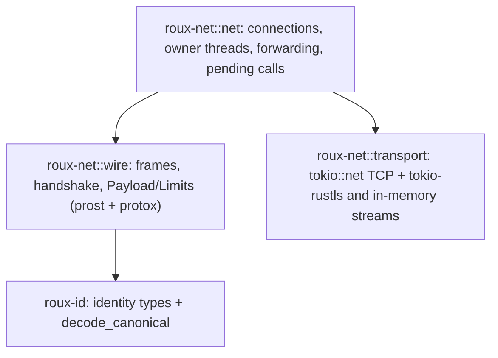

# Messaging

Messaging (layer L1, see [Layers](layers.md) and [Architecture](architecture.md)) is a membership-free, authenticated RPC system between cluster processes. Every service shares it: Clog's storage RPCs (the CASPaxos MetaStore, ledger replicas, journal forwarding, and cluster control, through `roux-storage` in L2), Rapid membership (L3), and grain calls (L4). Peers are processes, identified by their `InstanceId` and authenticated by mutual TLS (`rustls`). Buffers are standard `bytes::Bytes` / `bytes::BytesMut`, shared directly with L2 Clog, `prost`, `slatedb`, and `object_store` without wrapper crates or custom page pools. The payload and header format is [Serialization](serialization.md); the reasons messaging carries no membership are in [Connectivity](connectivity.md).

Status: every decision below is a working choice, revised for the [connectivity redesign](connectivity.md), [Roux on Clog](architecture.md), and the YAGNI simplification pass. Each record states the decision, the problem, the alternatives, why it was chosen, what would change it, its complexity, and what undoing it takes. Statuses are **Decided**, **Deferred**, and **Withdrawn**. [Review notes](#review-notes) lists what remains worth optimizing once measured.

## Summary

**Contract.** From one sender process to one destination thread, on one lane, requests and one-way messages are dispatched in send order, each at most once; some may be missing, none reordered. Each response completes the call that sent its request, at most once. A send that fails with `NotSent` had no effect. Every dispatched message names its authenticated peer (`InstanceId` + TLS key hash). L1 assumes only a network that loses, delays, duplicates, or corrupts bytes, and peers that crash. It has no membership clauses. See [Contract](#contract).

**Main decisions.**

| ID | Decision | Status |
| --- | --- | --- |
| [N6](#n6-internal-layering) | Single `roux-net` crate (internal `wire`, `transport`, `net` modules) over `bytes::Bytes`, `prost` + `protox`, and `roux-id` (no `roux-codec`, no `clog-buffers`) | Decided |
| [N12](#n12-connection-topology) | One connection type; each process dials each peer once; responses return on the request's connection; frames name their destination thread | Decided |
| [N13](#n13-owner-threads) | One owner thread on each side of a connection; the dialer's owner keeps the pending-call table | Decided |
| [N14](#n14-receive-and-send-buffers) | Standard `bytes::Bytes` / `BytesMut` per-connection buffers with user-space `rustls`; `io_uring` provided-buffer rings, incremental consumption, page pools, and kTLS deferred past v1 | Decided |
| [N2](#n2-handshake), [S1](#s1-identity-and-authentication) | Mutual TLS (`rustls`), then one round trip that checks the cluster, the protocol version, the expected instance, and the reading thread | Decided |
| [N1](#n1-frame-layout), [N22](#n22-frame-schema) | A length-delimited stream of `Frame = Request \| OneWay \| Response`, with payloads only in the variants that carry one; an outcome whose variant states whether the turn ran | Decided |
| [N28](#n28-targets) | A target is a service on the peer process, or an object at whichever process owns its key; each interface registers its kind, lane, and handler | Decided |
| [N29](#n29-admission) | Head-first streaming admission + `Response::hold(grant)` deferred past v1; v1 enforces Clog `CallBudget` in `roux-storage` handlers + caller FIFO lanes + 32 MiB frame limit | Deferred |
| [N23](#n23-interface-and-method-ids), [N24](#n24-identities) | Integer IDs for interfaces and methods; `ClusterId`, `InstanceId`, Clog's UUID `NodeId`, `ProcessId`, `MemberId`, `ThreadId`, and `MembershipVersion` in `roux.id.v1`; grain identities in the runtime | Decided |
| [N3](#n3-priority-lane) | `High` and `Normal` lanes; `High` carries Rapid traffic and lease promises only; Clog's storage RPCs share `Normal` | Decided |
| [N16](#n16-message-size) | 32 MiB payloads, so Clog's replica payload limit holds its largest batch | Decided |
| [N18](#n18-connection-lifecycle) | Connections keyed by peer instance and dialed by address; the newest wins; `close(instance)` for layers above | Decided |
| [N21](#n21-clients) | External clients, `ClientHello`, `Gateway` (18), and `Authenticator` deferred past v1 (wire tags reserved) | Deferred |
| [N15](#n15-zero-copy-sends) | `SEND_ZC` and `io_uring` zero-copy receive deferred past v1 | Deferred |
| [N17](#n17-peer-authority), [N26](#n26-restricted-connections), [N20](#n20-tls-with-shared-writers) | Membership checks in messaging, candidate connections, and shared TLS writers | Withdrawn |

**Costs worth watching.** Each message takes up to one in-process hop on each node: to the connection's owner when sending, and to the destination thread when receiving. One owner thread on each side carries all traffic between two processes in one direction. [Review notes](#review-notes) gives the remedy and the measurement that decides it.

## Contract

L1 provides to every layer above it:

- **Order.** Requests and one-way messages from one sender process to one destination thread, on one lane ([N3](#n3-priority-lane)), are dispatched in send order, each at most once. Some may be missing, lost when a connection fails; none are reordered or duplicated. Messages from different senders, to different threads, or on different lanes have no relative order.
- **Responses.** A response returns on its request's connection and completes the call that sent the request, at most once. A call whose connection closes before its response arrives fails with an unknown outcome.
- **Send outcomes.** A send that fails with `NotSent` had no effect ([N18](#n18-connection-lifecycle)).
- **Authenticated peers.** Every dispatched message names its connection's peer: a process `InstanceId` whose TLS certificate chains to the cluster's roots ([S1](#s1-identity-and-authentication)). The handler sees the peer's `InstanceId` and TLS key hash in its request context.

L1 assumes a network that can lose, delay, duplicate, or corrupt bytes, and peers that may crash at any time. Services fence themselves above it: Clog's MetaStore by ballots, its ledgers by seals and create-once registers, Rapid by configuration IDs, and grains by leases and Clog's range ownership.

## Architecture



A call from thread S of process A to thread D of process B:

1. S encodes the request frame, arguments included, into `bytes::Bytes` ([N14](#n14-receive-and-send-buffers)) and enqueues it on A's connection to B.
2. The connection's owner thread on A writes it to the socket ([N13](#n13-owner-threads)) and records the call in its pending-call table.
3. B's reading thread for A reads and decrypts (`rustls`) the length-delimited frame into `bytes::Bytes`, decodes the frame header, and forwards the frame (keeping its `Payload` as a zero-copy `Bytes` slice) to D's queue ([N12](#n12-connection-topology)).
4. D runs the request and enqueues the response on the same connection, which the reading thread writes.
5. A's owner reads the response, finds the call in its pending table, and completes it on S.

## Decisions

### N6. Internal layering

- **Status.** Decided; consolidated into one `roux-net` crate with internal `wire`, `transport`, and `net` modules over `bytes::Bytes`, `prost` + `protox`, and `roux-id`.
- **Decision.** L1 is one crate, `roux-net`, organized into three clean internal modules, each unit- and property-tested against the module below it. A leaf crate, `roux-id`, holds the identity types ([N24](#n24-identities)) and `decode_canonical` ([Z24](serialization.md#z24-canonical-encodings)) that every layer shares.

  | Module | Provides | Tested with |
  | --- | --- | --- |
  | `roux_net::wire` | Sans-I/O length-delimited frame encoder/decoder, handshake state machine, and L1 protobuf helpers (`Payload`, `Limits`, `prost` framing; [Serialization](serialization.md)). The decoder yields exactly the encoded frames for any split of the byte stream. | `proptest` over arbitrary chunking, golden vectors (`insta`) |
  | `roux_net::transport` | Ordered byte stream per connection, used by one thread, with `tokio::net` TCP + `tokio-rustls` and an in-memory/`turmoil` implementation for simulation. | One conformance suite on real `tokio::net` TCP + `tokio-rustls` and in-memory streams |
  | `roux_net::net` | The [L1 contract](#contract): owner threads, outbound/forwarding queues, pending calls, backoff, newest-wins. | `stateright` connection model + `Bug` mutants, `proptest` over lossy streams, `turmoil` simulation |
- **Problem.** Keep clean internal seams for sans-I/O framing, transport abstraction, and connection state without paying micro-crate boilerplate across `roux-wire`, `roux-transport`, `roux-net`, `roux-codec`, and `clog-buffers`.
- **Alternatives.** Splitting L1 into three separate crates (`roux-wire`, `roux-transport`, `roux-net`) plus `roux-codec` and `clog-buffers` (rejected: nothing outside `roux-net` imports `wire` or `transport` independently).
- **Why.** Internal Rust modules preserve the exact sans-I/O testing boundary with a fraction of the workspace surface, and standard `bytes::Bytes` + `prost` eliminate buffer and codec wrapper crates.
- **Would change it.** Another workspace crate needing `wire` or `transport` without `net`.
- **Complexity.** One crate, three internal modules.
- **To undo.** Splitting a module into a crate is mechanical.

### N12. Connection topology

- **Status.** Decided; responses moved onto the request's connection in the connectivity redesign.
- **Decision.** One connection type. The dialer sends requests and one-way messages; the acceptor sends only responses, on the same connection. Each process dials each peer process once, so two processes share two connections, one per direction; a client dials one gateway ([N21](#n21-clients)).
  - **Dialing side.** Thread `instance(peer) mod N` owns the connection to `peer`, where `instance(x)` is the low 64 bits of `x`'s `InstanceId` and `N` is the dialer's thread count.
  - **Accepting side.** A process reads all of one peer's connections on thread `instance(peer) mod T`, where `T` is its thread count, and that thread owns the connection. A `Hello` that arrives on another thread is answered `CODE_WRONG_THREAD` with the right thread's address ([N2](#n2-handshake)), so dialing a configured address costs at most one redirect.
  - **Forwarding.** Every request names its destination thread (`dest_thread`). The reading thread dispatches requests for itself and pushes the others onto the destination thread's FIFO queue, one per lane. A thread's response goes onto the connection's outbound queue, which the reading thread writes.
  - Because one connection and one reading thread carry everything from a sender, and the queues are FIFO, requests from a sender process to a destination thread keep their order ([Contract](#contract)).
- **Problem.** Every service, including those that run before or without membership (Clog's MetaStore and ledger replicas, Rapid joins), must share one RPC system and one connection per peer. Thread-per-core execution wants each message to run on its destination thread. At 1,000 nodes × 32 threads, per-thread connections would mean about 64,000 TLS sockets per node (review 2, finding 32).
- **Alternatives.** Responses on the reverse connection (the previous design: an acceptor needs the dialer's endpoints and a connection back before it can answer, which a joining process or client cannot provide); one connection per destination thread; one bidirectional connection per pair, carrying requests both ways (simultaneous dials need a tie-break).
- **Why.** Any process can call any other knowing only its address, every service shares the connection, and a node holds about two sockets per peer.
- **Would change it.** Benchmarks in two- to four-node clusters showing one owner thread saturating; the remedy is a fixed number of connections per peer, with requests mapped to a connection by destination thread, which keeps per-thread order.
- **Complexity.** One in-process hop per message on the receiving node, except when the reading thread is the destination (about `1/T` of messages), and one redirect on first contact through a configured address.
- **To undo.** Internal to `roux-net`; frames already carry `dest_thread`.

### N13. Owner threads

- **Status.** Decided; extended to both sides of a connection in the connectivity redesign.
- **Decision.** Each side of a connection has one owner thread ([N12](#n12-connection-topology)), which owns the socket and TLS stream and does all of that side's I/O. Other threads hand it frames through a lock-free queue:

  ```rust
  struct Outbound {
      /// Bits 0..48: queued Normal bytes. Bit 62: SCHEDULED. Bit 63: CLOSED.
      state: AtomicU64,
      normal: MpscQueue<Frame>,   // lock-free, FIFO
      high: MpscQueue<Frame>,     // N3: drained first, exempt from the byte bound
      space: WaitList,            // senders waiting for queued bytes to fall below the bound
      owner: ThreadHandle,        // wakes the owner's write task
  }

  struct Frame {
      bytes: bytes::Bytes,        // encoded frame (or head + payload Bytes slice, Z9)
      /// For a request: its ID, the calling thread, and the call's deadline,
      /// recorded in the pending-call table when the frame is written.
      call: Option<(u64, ThreadId, Deadline)>,
  }
  ```

  1. **Enqueue.** A sender takes the next request ID from the connection (`next_id: AtomicU64`, [N10](#n10-message-ids)), encodes the frame, and pushes it and adds its size to `state`. If `SCHEDULED` is clear, it sets it and wakes the owner; a sender on the owner thread schedules the write task directly. A sender whose frame would exceed the byte bound (32 MiB, [N16](#n16-message-size)) waits on `space` unless the queue is empty; a wait that reaches the call's deadline fails with `NotSent`, so a caller-side Clog budget is never held past it.
  2. **Write.** The owner drains `high`, then `normal`, into a batch of up to 64 frames or 256 KiB, writes it as one vectored write, and yields to its thread's scheduler before the next batch. When both queues are empty, it clears `SCHEDULED` and checks them again, so no frame is stranded.
  3. **Pending calls.** On the dialing side, the owner records each request it writes in its pending-call table: message ID to calling thread and deadline. It routes each response to the thread its entry names and removes the entry. It removes entries whose deadline has passed, and fails every entry with an unknown outcome when the connection closes. The table is local to the owner thread.

  Writing costs CPU on the owner thread.
- **Problem.** Every thread of a process sends to every peer over one connection, and responses must reach the thread that sent the request.
- **Alternatives.** Flat combining: whichever sending thread finds the connection idle writes it (withdrawn in review 2: raw sockets, cross-ring submission, Windows completion reposts, shared `unsafe` writer state, and a shared TLS session); a pending-call table shared by all threads (a concurrent map on every call); routing responses by a sending-thread field in the header (the previous design; the owner's table makes the field unnecessary).
- **Why.** One thread owns all I/O and TLS state for a connection, so stock `tokio::net::TcpStream` and `tokio-rustls` work unchanged on that core's `current_thread` reactor, and the pending-call table needs no synchronization.
- **Would change it.** Benchmarks showing wake-up latency or owner saturation dominate at the target rate.
- **Complexity.** A cross-thread queue push per message when the sender is not the owner, a wake-up when the owner is idle, and a cross-thread hop for each response to a thread other than the owner.
- **To undo.** Internal to `roux-net`.

### N14. Receive and send buffers

- **Status.** Decided; simplified to standard `bytes::Bytes` / `bytes::BytesMut` with user-space `rustls` for v1.
- **Decision.** Connections read and write standard `bytes::Bytes` / `bytes::BytesMut` buffers over `tokio::net` TCP streams wrapped in `tokio-rustls` (or in-memory/`turmoil` streams for simulation).
  - **Receive.** Each connection owns a reusable `BytesMut` receive buffer, reads length-delimited frames, freezes each frame into `bytes::Bytes`, and slices `Payload` and `bytes` fields zero-copy via `prost` (`#[prost(bytes = "bytes")]`). The exact same `Bytes` values cross into `roux-storage`, `clog-wal`, `lsm-tree`, SlateDB, and `object_store` with zero adapter layers.
  - **Send.** Senders encode frames into `BytesMut` and freeze them to `Bytes` (splicing pre-encoded `Payload` `Bytes` `>= 4 KiB` via vectored writes).
  - **Deferred optimizations (post-v1):** `io_uring` socket transport / provided-buffer rings (`IOU_PBUF_RING_INC`), cross-thread `Bytes::from_owner` page pools, `ChunkedBuf`, and kernel TLS (`kTLS` + `TLS_RX`/`TLS_TX` rekeying on Linux 6.14+) are deferred until end-to-end benchmarks prove `epoll` syscalls, socket copies, or user-space `rustls` are a bottleneck. Because the cross-layer type is already `bytes::Bytes`, all of those optimizations can drop in behind `roux-net::transport` later without changing any caller API or wire format.
- **Problem.** Keep payloads zero-copy across crate boundaries (`prost`, `tokio`, `slatedb`, `object_store`) without shipping thousands of lines of Linux-kernel-specific buffer-ring, page-pinning, and kTLS rekey machinery before measuring bottlenecks.
- **Alternatives.** Building per-thread 3-tier slab pools (`clog-buffers`), `IOU_PBUF_RING_INC` multishot receive rings, and kTLS TLS 1.3 rekey handling in v1 (high `unsafe` / kernel-version surface area before baseline throughput is even measured).
- **Why.** `bytes::Bytes` is idiomatic Rust, completely safe, portable across Linux/macOS/Windows, and preserves the exact zero-copy API needed to plug in pooled `Bytes::from_owner` or kTLS later if profiles justify it.
- **Would change it.** Physical-NIC benchmarks showing `BytesMut` allocation or user-space `rustls` decryption dominating CPU.
- **Complexity.** Minimal; zero `unsafe` in `roux-net`.
- **To undo.** Internal to `roux-net::transport`; wire format and public `Bytes` APIs are unchanged.

### N15. Zero-copy sends

- **Status.** Deferred past v1.
- **Decision.** v1 uses standard `tokio::io` vectored writes (`write_vectored`) over `bytes::Bytes`. `io_uring` `SEND_ZC` and zero-copy receive (`Linux 6.15` NIC header split) are deferred until physical-NIC benchmarks show kernel send copies matter on plaintext links.
- **Problem.** Avoid premature completion-notification and auto-disable machinery before measuring real network workloads.
- **To undo.** Internal to `roux-net::transport`.

### N7. Transport interface

- **Status.** Decided; scoped to TCP (`tokio::net` + `tokio-rustls`) and in-memory/`turmoil` for v1.
- **Decision.** TCP (with optional `tokio-rustls`) and in-memory/`turmoil` transports are built in. Unix domain sockets (`uds`) are deferred past v1. Each stream is used by one thread on its core's `current_thread` Tokio reactor and implements standard `tokio::io::{AsyncRead, AsyncWrite}`:

  ```rust
  pub type LocalFuture<'a, T> = Pin<Box<dyn Future<Output = T> + 'a>>;

  /// A connected, ordered, reliable byte stream, used by one thread.
  pub trait Stream: tokio::io::AsyncRead + tokio::io::AsyncWrite + Unpin {}
  impl<T: tokio::io::AsyncRead + tokio::io::AsyncWrite + Unpin> Stream for T {}

  /// A transport kind: "tcp" or "mem".
  pub trait Transport: Send + Sync + 'static {
      fn kind(&self) -> &'static str;
      /// Joins an endpoint's base and per-thread part into an address (N8).
      fn address(&self, base: &str, part: &str) -> String;
      /// Binds a listener on the calling runtime thread.
      fn listen(&self, address: &str) -> io::Result<Box<dyn Listener>>;
      /// Connects from the calling runtime thread.
      fn connect(&self, address: &str) -> LocalFuture<'static, io::Result<Box<dyn Stream>>>;
  }

  pub trait Listener {
      fn accept(&mut self) -> LocalFuture<'_, io::Result<Box<dyn Stream>>>;
  }
  ```

  TLS wraps a TCP `Stream` directly with `tokio-rustls`.
- **Problem.** Transports must be replaceable in deterministic simulation (`turmoil`) and integrate cleanly with `tokio-rustls`, `bytes::BytesMut`, and Rust's `Drop`-based cancellation.
- **Alternatives.** Completion-based owned-buffer traits (`compio`); shipping UDS and kTLS in v1 (unused in distributed cloud deployments).
- **Why.** Standard `tokio::io::{AsyncRead, AsyncWrite}` fits `tokio::net`, `tokio-rustls`, and `turmoil::net` directly with zero adapter overhead and preserves clean drop-based cancellation.
- **Would change it.** Physical-NIC profiling showing `epoll` socket syscalls dominating CPU (motivating an `io_uring` transport), a co-located multi-process deployment needing UDS, or benchmarks justifying kTLS.
- **Complexity.** Small.
- **To undo.** Internal to `roux-net::transport`.

### N8. Endpoint representation

- **Status.** Decided.
- **Decision.** Each runtime thread listens on its own endpoint, so the thread that accepts a connection reads it with no socket hand-off. A process describes its endpoints as:

  ```proto
  package roux.wire.v1;

  message NodeEndpoints {
    repeated TransportEndpoints transports = 1;   // in the process's preference order
  }
  message TransportEndpoints {
    string transport = 1;          // "tcp" or "mem"
    uint32 roles = 2;              // bit set: 1 = process peers (bit 2 reserved for deferred gateways)
    string base = 3;               // transport-defined, e.g. "10.0.0.5"
    repeated string threads = 4;   // indexed by ThreadId, e.g. "11111"
  }
  ```

  `Transport::address(base, part)` produces a dialable address; TCP produces `10.0.0.5:11111`. Addresses come from configuration (seeds, MetaStore CASPaxos acceptors), from a membership view (members' `NodeEndpoints`, stored opaquely by membership), or from a service's own configuration; a configured address names any one thread's endpoint. A dialer that knows the peer's `NodeEndpoints` dials the reading thread's endpoint directly ([N12](#n12-connection-topology)); otherwise the redirect in `HelloResult` gives it. The length of `threads` is the process's thread count, which the runtime uses to map a grain's row key to its thread ([Identities](identities.md)).
- **Problem.** Peers must reach a specific reading thread, and member records appear in every membership snapshot.
- **Alternatives.** One endpoint per process, with an accepting thread that hands sockets to reading threads (cross-thread socket hand-off adds reactor re-registration overhead); `SO_REUSEPORT` (Linux only, and the kernel, not Roux, picks the thread).
- **Why.** Reading load spreads across threads with no socket hand-off, in a few hundred bytes per process.
- **Would change it.** A deployment that can expose only one port per process.
- **Complexity.** One `address` method per transport.
- **To undo.** Changes a membership record field, under membership's versioning.

### N18. Connection lifecycle

- **Status.** Decided; keyed by `InstanceId` in the connectivity redesign.
- **Decision.** A connection is keyed by its peer's `InstanceId` and dialed by address:

  ```text
  Absent → Connecting → Handshaking → Open → Closed
               │              │
               └──── fail ────┴──→ Backoff → Absent
  ```

  - **On demand.** The first send to a peer creates the connection. A caller that names only an address learns the peer's `InstanceId` from `HelloResult`, and later sends use the connection keyed by it. Frames enqueued while the connection is being established wait in its queues and count against the byte bound.
  - **Send outcomes.** A frame that never reached the socket fails with `NotSent`, which proves it had no effect, so callers may resend it like `NotStarted::Unavailable`. A request handed to the socket has an unknown outcome if the connection closes before its response arrives.
  - **Backoff.** After a connection or handshake failure, sends to that peer fail with `NotSent` for a backoff that starts at 50 ms and doubles, with jitter, up to 2 seconds. A successful handshake resets it. `CODE_WRONG_TARGET` closes the connection without backoff: the caller resolves the peer again.
  - **Closing.** A connection closes on an I/O error, a protocol violation (a malformed frame, or a length over its limit), shutdown, or `close(instance)` from a layer above. Closing fails queued frames with `NotSent` and pending calls with an unknown outcome. The grain runtime calls `close(instance)` when membership reports a peer defunct, so calls to it fail promptly.
  - **Newest wins.** When a reading thread accepts a connection from a peer instance that already has an open connection to it, it closes the older one first, discarding its unread bytes. This clears half-open connections and keeps the [order](#contract): the older connection's unread requests are lost, never dispatched after the newer one's.
  - **Liveness.** TCP keepalive is on. Services decide liveness for themselves, for example Rapid's probes.

  ```rust
  /// The messaging API layers above use. Node-wide; callable from any runtime thread.
  pub trait Messaging: Send + Sync + 'static {
      /// Sends a request to `target` on `peer`, resolving to its response.
      fn call(&self, peer: &PeerAddr, request: Request) -> LocalFuture<'static, Result<Response, CallError>>;
      /// Sends a one-way message.
      fn send(&self, peer: &PeerAddr, message: OneWay) -> Result<(), NotSent>;
      /// Closes the connection to `instance`, failing its pending calls with an unknown outcome.
      fn close(&self, instance: InstanceId);
  }

  /// An instance, an address, or both.
  pub struct PeerAddr { pub instance: Option<InstanceId>, pub address: Option<String> }

  /// Mirrors N22's `Outcome`: `Ok` and `Err` outcomes return a `Response` carrying the method's `T` or `E`.
  pub enum CallError {
      NotSent,                        // never written: no effect
      NotStarted(NotStarted),         // the responder did not start the turn: no effect
      Unknown(UnknownReason),         // the turn may or may not have run
  }
  pub enum UnknownReason { Outcome(UnknownOutcome), ConnectionClosed }
  ```
- **Problem.** Callers must tell a call that certainly had no effect from one with an unknown outcome, failures must not hang callers, and processes that are not members, or do not know a peer's identity yet, must still be able to call it.
- **Alternatives.** Keying connections by `MemberId` (the previous design; joiners and MetaStore clients have none); resending queued frames on a new connection (duplicates; the model's `tlcMutantResendOnReconnect` shows it).
- **Why.** `NotSent` makes retries safe; deadlines and connection closure bound every wait; instances exist from process start.
- **Would change it.** Calls without deadlines hanging on a partitioned peer whose connection stays open; deadlines would then become mandatory.
- **Complexity.** Backoff state per peer.
- **To undo.** Local policy; no wire change.

### N2. Handshake

- **Status.** Decided; membership checks removed in the connectivity redesign, and `HelloResult` made a sum type in the wire-catalog review.
- **Decision.** Every connection runs TLS first, when configured, then one round trip:

  ```text
  dialer → acceptor   preamble: "ROUX" (4 bytes), min_version u16 LE, max_version u16 LE
  dialer → acceptor   Hello, length-delimited (N1)
  acceptor → dialer   preamble: "ROUX", min_version, max_version
  acceptor → dialer   HelloResult, length-delimited
  ```

  ```rust
  // Domain types for package roux.wire.v1 (generated from schema/roux/wire/v1/*.proto
  // via protox + prost-build and validated via TryFrom). Both types never change
  // shape across protocol versions, because they are exchanged before a version
  // is chosen.
  pub struct Hello {
      pub cluster_id: ClusterId,             // tag 1
      pub peer: Peer,                        // tag 2
      /// The instance the dialer expects; `None` when dialing a configured address.
      pub target: Option<InstanceId>,        // tag 3
  }

  pub enum Peer {
      Instance(InstanceId),                  // tag 1: a Roux process
      // tag 2 reserved for deferred external ClientHello (N21)
  }

  pub enum HelloResult {
      Accepted {                             // tag 1
          protocol_version: u16,             // tag 1: the highest version both support
          acceptor: InstanceId,              // tag 2
      },
      /// This peer is read on another thread, at `redirect`.
      WrongThread { redirect: String },      // tag 2 (redirect: tag 1)
      Rejected(HelloRejection),              // tag 3
  }

  pub enum HelloRejection {
      WrongTarget = 1,    // the acceptor is not the expected instance
      WrongCluster = 2,
      Incompatible = 3,   // no common protocol version
      Unauthorized = 4,   // the certificate or credentials do not authorize the peer
  }
  ```

  The acceptor reads the preamble and `Hello` within a 4 KiB limit and a 5-second deadline, and answers at once. It chooses the highest common version, checks `cluster_id`, checks `target` against its own `InstanceId`, authorizes the peer (a certificate chaining to the cluster's roots), and checks that it is the peer's reading thread. Either side closes the connection after any result other than `Accepted`, and messages flow only after it. From then on, each side sends only variants of protocol types that the chosen `protocol_version` includes ([Z22](serialization.md#z22-sum-types-and-required-fields)).
- **Problem.** Before any message flows, both sides must authenticate each other, agree on a protocol version, and confirm they reached the intended process and thread, for processes that may not be members yet.
- **Alternatives.** Checking the peer against membership and holding unknown peers (the previous design; it made messaging depend on membership, which needs messaging); negotiating the version in a separate round trip; a flat `HelloResult` with a code and fields that apply only to some codes (the previous design: a protocol version without `Accepted`, or a redirect without `WrongThread`, was representable).
- **Why.** One round trip, no dependency on any layer above, the same handshake for every service and client, and a result whose fields exist only when they mean something. The handshake types are frozen, so the dialer sends `Hello` before learning the chosen version.
- **Would change it.** A service needing the acceptor to vouch for something beyond identity and cluster.
- **Complexity.** Small.
- **To undo.** A protocol version.

### S1. Identity and authentication

- **Status.** Decided; membership binding moved out of messaging in the connectivity redesign.
- **Decision.** Mutual TLS. A process's certificate must chain to the cluster's trust roots and name the cluster in a subject alternative name, which authorizes it as a peer. Messaging passes the peer's `InstanceId` and the SHA-256 hash of its public key (SPKI) to every handler in its request context. Membership's `Join` records both, so a service that must know which member is calling resolves the `InstanceId` through its own view, and can compare the key hash. A process's key is fixed for its lifetime.
- **Problem.** Authenticate processes from the moment they start, before they have a `MemberId`, and let services that care bind them to members.
- **Alternatives.** Checking the key against membership in the handshake (the previous design); a certificate per `NodeId` (Clog creates the `NodeId` with the node's store, so certificates would be issued after each disk is provisioned, and processes without a store have none); a pre-shared cluster key.
- **Why.** Any process can authenticate as soon as it starts, and member binding stays with the layers that need it.
- **Would change it.** Keys rotating more often than processes restart, as with SPIFFE identities; services would then bind to a stable certificate name.
- **Complexity.** Two fields in each handler's request context.
- **To undo.** Not applicable.

### N1. Frame layout

- **Status.** Decided by the user (one message per frame); supersedes the 8-byte prefix with a separate header and body.
- **Decision.** After the handshake, a connection is a standard length-delimited Protocol Buffers stream:

  ```text
  varint  length   1 ..= 32 MiB + 64 KiB
  bytes   Frame    one roux.wire.v1.Frame (N22)
  ```

  `Hello` and `HelloResult` are the first message in each direction, in the same framing, as their own types ([N2](#n2-handshake)). There is no separate header and body: a body is a `Payload` field inside only the variants that carry one ([N22](#n22-frame-schema)). The reader checks the length before allocating and closes the connection when it exceeds the limit; while decoding, every field except a payload counts against a 64 KiB budget ([Z11](serialization.md#z11-decoding-limits)). A sender fails an oversized message with `NotSent`. Frames carry no checksum: TLS (`rustls`) authenticates encrypted connections, and TCP checksums plaintext ones.

  On receive, a frame is frozen into `bytes::Bytes` and its payload is a zero-copy `Bytes` slice ([N14](#n14-receive-and-send-buffers)). On send, the encoder writes the frame header and splices large pre-encoded payloads (`>= 4 KiB`) via vectored writes.
- **Problem.** Delimit messages in a byte stream, bound memory before reading, keep bodies undecoded until their handlers run, and make a body impossible where none belongs.
- **Alternatives.** An 8-byte prefix of header and body lengths, then a header and a body (the previous design: a body could accompany any header, so its presence was a rule to check, not a type); an envelope with a checksum.
- **Why.** One standard format, readable by any Protocol Buffers library, and a body exists only in the variants that carry one. A payload is a length-delimited field, so it stays a view of its pages until its handler decodes it.
- **Would change it.** Nothing foreseeable.
- **Complexity.** Small: a varint length and a header budget.
- **To undo.** A protocol version.

### N9. Frame encoding

- **Status.** Decided.
- **Decision.** The frame is a Protocol Buffers message, `roux.wire.v1.Frame`, compiled from `.proto` via `protox` + `prost-build` and encoded/decoded directly with `prost` in `roux-net::wire`. The connection fixes the peer; the frame carries everything that varies per message.
- **Problem.** Per-message metadata that evolves with the protocol, decoded safely from untrusted bytes.
- **Alternatives.** A hand-written fixed header with a presence bitmask, as Orleans uses.
- **Why.** One codec, fuzzed and schema-checked once.
- **Would change it.** Frame decoding above about 5% of CPU at the target rate.
- **Complexity.** None beyond the codec.
- **To undo.** A protocol version.

### N22. Frame schema

- **Status.** Decided by the user in the wire-catalog review (sum types, method in the target, no flattening, one message per frame, per-connection IDs, no resend count) and in the identities review (`Service | Object` targets with no partition on the wire, generic `Location`); `Request`'s fields renumbered so the payload comes last (Roux on Clog, [N29](#n29-admission)); `NotHere.view_version: MembershipVersion` became an opaque `version: u64`, because grain ownership now follows Clog's `LedgerMap`, not membership views. Nothing has shipped.
- **Decision.** A frame is exactly one of three shapes, and a body exists only where one belongs:

  ```rust
  // Domain types for package roux.wire.v1 (generated from schema/roux/wire/v1/*.proto
  // via protox + prost-build and validated via TryFrom). Protocol types are gated
  // by the negotiated protocol_version (Z22); unknown fields are dropped (Z7) and
  // unknown enum/oneof variants fail TryFrom conversion. In every message that
  // holds a payload, directly or nested, the field holding it has the highest
  // tag, so the payload is the frame's last field (N29).
  pub enum Frame {
      Request(Request),                      // tag 1
      OneWay(Call),                          // tag 2
      Response(Response),                    // tag 3
  }

  pub struct Request {
      pub id: u64,                           // tag 1: per connection (N10)
      pub deadline: Option<Duration>,        // tag 2: remaining time
      pub call: Call,                        // tag 3
  }

  /// What a request or one-way message asks the receiver to run.
  pub struct Call {
      pub dest_thread: ThreadId,             // tag 1: N12
      pub target: Target,                    // tag 2
      pub context: PropagatedContext,        // tag 3: N11
      pub args: Payload,                     // tag 4: the method's argument message (N23)
  }

  /// What the request is for (N28). Messaging never interprets `key` or `hint`.
  pub enum Target {
      /// The handler on the process at the other end of the connection:
      /// Rapid membership (16 to 17) and Clog's storage RPCs (96 to 100).
      Service {                              // tag 1
          interface: InterfaceId,            // tag 1
          method: MethodId,                  // tag 2
      },
      /// An object at whichever process owns its key: a grain, or a future
      /// keyed service.
      Object {                               // tag 2
          key: Bytes,                        // tag 1: the object's canonical identity; for grains, the GrainId encoding
          hint: Option<u64>,                 // tag 2: an instance hint; grains use their activation ID
          interface: InterfaceId,            // tag 3
          method: MethodId,                  // tag 4
      },
  }

  pub struct Response {
      pub id: u64,                           // tag 1
      pub outcome: Outcome,                  // tag 2
  }

  pub enum Outcome {
      /// The turn ran and returned `Ok`; the payload is the method's `T`.
      Ok(Payload),                                          // tag 1
      /// The turn ran and returned `Err`; the payload is the method's `E`.
      Err(Payload),                                         // tag 2
      /// The turn never started, so the call had no effect.
      NotStarted(NotStarted),                               // tag 3
      /// The turn may or may not have run.
      Unknown(UnknownOutcome),                              // tag 4
  }

  pub enum NotStarted {
      Overloaded { retry_after: Duration },                 // tag 1 (retry_after: tag 1)
      NotHere(Box<NotHere>),                                // tag 2 (rare and large: boxed)
      Unavailable,                                          // tag 3: shutting down, or range in transition
      Incompatible,                                         // tag 4: unknown target or method, or not callable by this peer
      ActivationFailed { detail: Box<str> },                // tag 5 (detail: tag 1; runtime R27)
  }

  pub struct NotHere {
      pub location: Option<Location>,                       // tag 1
      pub version: u64,                                     // tag 2: the handler's routing version; opaque to messaging
  }

  /// Where the target is now; the runtime maps a grain's `Location` to a `GrainAddress`.
  pub struct Location {
      pub member: MemberId,                                 // tag 1
      pub hint: Option<u64>,                                // tag 2
  }

  pub enum UnknownOutcome {
      DeadlineExceeded,                                     // tag 1
      Cancelled,                                            // tag 2
      Aborted { detail: Box<str> },                         // tag 3 (detail: tag 1)
  }
  ```

  A `Payload` is an encoded message kept as bytes until its handler decodes it ([Z23](serialization.md#z23-payload)). A response's `id` names its request, and the connection's pending-call table routes it to the calling thread ([N13](#n13-owner-threads)).

  Every process that calls or hosts an object kind knows that kind (grain types are declared beside their interfaces, runtime decision R29), so the sender and the handler each compute the object's owner from its key: for grains, the runtime derives Clog's `RowKey` from the canonical `GrainId` and finds the primary of the open ledger whose `KeyRange` holds it through `LedgerMapView` ([Identities](identities.md)). Messaging never interprets `key`.

  The target's handler, never messaging, produces `NotHere`: the runtime for grains, and the owning layer for any other object kind. When an `Object` request reaches a process that no longer owns the object's key, or no longer hosts the object, the handler answers `NotStarted::NotHere`, with `location` when it knows it and always with `version`, the version of the routing state it decided by. Messaging never interprets `version`: the runtime puts the version of Clog's `LedgerMap` there for grains, and another object kind's layer puts its own. A `Service` target is the process at the other end of the connection, so it cannot be the wrong one: `NotHere` never answers it, and a caller that receives it for a `Service` target treats it as `Incompatible`; Clog's own misrouting answers (`NotThisNode`, `Moved`) are results inside its storage RPCs. The caller resends to `location`, or once its own routing state has reached `version`, within the call's deadline and its own resend cap; frames carry no resend count. Calls are at-most-once (runtime decision R4): the caller's runtime resends only after `NotHere` or `Unavailable`. `ActivationFailed` is not resent, because the same activation would fail again until the caller's deadline.

  In memory, each enum is as large as its largest variant, so rare variants with large payloads are boxed (`NotHere`), and detail strings are `Box<str>` ([Z19](serialization.md#z19-type-mapping)).
- **Problem.** Route requests, correlate responses, and tell callers precisely whether a turn ran, without membership in messaging, and without representable combinations that no sender should produce.
- **Alternatives.**
  - A flat header with `kind`, a `oneof` target, and a `Status` code with fields that apply to some codes only, followed by a separate body (the previous design: it needed a list of malformed combinations, sentinel zeros such as `activation = 0`, `dest_thread` on responses, and a rule for when a body may follow).
  - A grain-specific target, `Grain { grain: GrainId, .. } | System { .. }` (the previous design: messaging knew about grains, and other keyed services needed new variants); a typed `Key` enum of every key kind (brings grains back into the lower layers); `Process | Bucket | Keyed`, with bucket-scoped services as their own variant (superseded by `Object`); a `Partition { WholeKey, Hash, Bucket }` field on objects (superseded: both sides know the object's kind, so both compute its owner, and the field cost 4 bytes per request). An ownership hint field may return later as an optional optimization, in the user's words: "We can add the bucket id back later as an optimization if we want."
  - `Request`'s deadline after its call (the previous numbering: the deadline followed the payload on the wire, so the reader could not admit a request before reading its payload).
  - `NotHere.view_version: MembershipVersion` (the previous field: it named one layer's state, while the handler routes by whatever its object kind uses, for grains Clog's `LedgerMap`).
  - The method as the variant tag of a per-interface request enum in the body (it limits method IDs to protobuf field numbers, excluding 19000 to 19999, which the user rejected).
  - `Completed` with a `Result<T, E>` body (one more level of nesting in every response).
  - Flattening the nested types into their parents with a `#[roux(flatten)]` attribute (saves about 2 bytes per level; the user rejected the attribute).
  - Repeating `Call`'s fields in `Request` and `OneWay` (saves 2 bytes per request, at the cost of two definitions of what a receiver runs).
  - A resend count on requests (the previous `hops`, then `resends`: the caller enforces its own cap, and the deadline bounds resends, so responders never needed it).
- **Why.** The user's principle that invalid states are unrepresentable ([Z22](serialization.md#z22-sum-types-and-required-fields)): whether a turn ran is a variant, not a code to interpret; `retry_after`, `location`, `version`, and every payload exist only where they apply; and method IDs are unrestricted. A target says whether a request is for the process itself or for an object at whichever process owns its key, which is all messaging needs: in the user's words, "not all message targets are grains", so grains are one kind of keyed entity, and their identity belongs to the runtime.
- **Would change it.** Frame bytes or decoding time showing up at the throughput target.
- **Complexity.** Nested types, at 1 to 2 bytes per level on the wire, and an ownership lookup per request on both sides.
- **To undo.** A protocol version.

### N10. Message IDs

- **Status.** Decided by the user in the wire-catalog review (finding 4); supersedes per-thread random IDs.
- **Decision.** Request IDs are per connection: each outbound connection keeps a counter, starting at 1, and every request on it takes the next value. They are encoded as varints, about 3 bytes for a busy connection. A sending thread takes the ID with one atomic increment when it encodes the request into its page ([Z9](serialization.md#z9-encoding-strategy)), and passes it to the owner with the frame. The owner records it in its pending-call table ([N13](#n13-owner-threads)). Responses and cancellations travel on the request's connection, so per-connection uniqueness is enough, and a new connection starts its counter again after the old one's pending calls have failed.
- **Problem.** Correlate responses with calls, and identify a call at its target for cancellation.
- **Alternatives.** A random seed per thread XORed with a counter, as Orleans' `MessageFactory` does (the previous design: 8 bytes per message, and unique across connections, which nothing needs now that responses return on the request's connection); the owner assigning IDs when it writes (the frame is already encoded by then, and a varint's length is not known in advance); a per-thread counter (collides in the connection's pending-call table).
- **Why.** About 5 bytes per message less than `fixed64`, and no randomness.
- **Would change it.** A need to identify calls across connections, for example cancellation sent on another connection.
- **Complexity.** One atomic increment per request on its connection.
- **To undo.** A protocol version.

### N11. Propagated context

- **Status.** Decided; simplified to `TraceContext` + optional `principal`.
- **Decision.** Each call's `PropagatedContext` carries W3C trace context in binary form and an optional principal string:

  ```proto
  message PropagatedContext {
    TraceContext trace = 1;
    optional string principal = 2;
  }
  message TraceContext {
    bytes trace_id = 1;              // Id128
    fixed64 parent_span_id = 2;
    uint32 flags = 3;                // W3C trace-flags
    string trace_state = 4;          // W3C tracestate, verbatim
  }
  ```

  The context flows to every call a turn makes and is limited to 4 KiB encoded. The connection's peer identity ([S1](#s1-identity-and-authentication)) is local to the handler and never travels in the context.
- **Problem.** Distributed tracing across grain hops and optional caller principal propagation without a speculative generic key-value bag.
- **Alternatives.** An arbitrary `map<string, bytes> values` with `ContextKey<T>` (dropped: no concrete v1 use beyond tracing and principal).
- **Why.** Binary trace context is compact, typed, and avoids an unbounded ambient bag.
- **Would change it.** A concrete requirement for additional propagated headers (additive optional fields).
- **Complexity.** Two fields and a 4 KiB limit.
- **To undo.** Additive protobuf fields.

### N28. Targets

- **Status.** Decided in the connectivity redesign; target kinds decided by the user in the identities review; system targets realigned for Roux on Clog and YAGNI simplification.
- **Decision.** Every interface registers with messaging once, with its ID, its kind, its lane, and its handler. Every authenticated cluster process may call every interface.

  ```rust
  pub struct Registration {
      pub interface: InterfaceId,           // below 1,024 for Roux's services, allocated per layer
      pub kind: TargetKind,
      pub lane: Lane,                       // High or Normal (N3)
      pub handler: Box<dyn Handler>,
  }

  pub enum TargetKind {
      /// Reached as a `Target::Service`. Senders pick the thread with this rule,
      /// for example MetaStore acceptors on thread 0.
      Service { thread: fn(MethodId) -> ThreadId },
      /// Reached as a `Target::Object`, on whichever process owns the key, at the
      /// thread its kind maps the key to; the sender and the handler compute both from the key.
      Object,
  }

  pub trait Handler {
      /// Handles one request on its destination thread. For objects, the
      /// handler's layer answers `NotHere` for objects it does not own.
      fn handle(&self, cx: RequestContext, request: Request) -> LocalFuture<'_, Response>;
  }

  pub struct RequestContext {
      pub peer: InstanceId,
      pub tls_key_sha256: [u8; 32],
      pub deadline: Option<Instant>,
      pub context: PropagatedContext,
  }
  ```

  A request whose target kind differs from its interface's registration, or that names an unknown interface or method, is answered `NotStarted::Incompatible` before any handler runs. Messaging puts `dest_thread` on the wire as the sender chose it, and never maps keys to owners or threads itself. Grain interfaces are object interfaces, registered by the runtime; Clog's storage RPCs are service interfaces, registered by `roux-storage`. The handler, never messaging, decides whether this process owns the object and answers `NotHere` when it does not. Every service uses the same frames, codec, deadlines, outcomes, and `NotSent` semantics. Interface IDs below 1,024 are allocated per layer in the [decision log](decisions.md) and listed in the [wire catalog](wire-catalog.md):

  | IDs | Owner | Interfaces | Lane |
  | --- | --- | --- | --- |
  | 0 to 15 | L1 Messaging, `roux.wire.v1` | 0 is invalid; 1 to 15 reserved for connection-level control | |
  | 16 to 31 | L3 Membership, `roux.membership.v1` | `Membership` 16, `Join` 17 (`Gateway` 18 reserved/deferred) | High |
  | 32 to 63 | Reserved | `Balancer` 32 and `Journals` 48 retired, replaced by Clog | |
  | 64 to 95 | L4 Runtime, `roux.runtime.v1` | `CallControl` 64 reserved/deferred | Normal |
  | 96 to 127 | L2 Clog storage (`roux-storage`), `roux.storage.v1` | `MetaStoreCasPaxos` 96, `LedgerReplica` 97, `JournalForward` 98, `ClusterControl` 99, `NodeControl` 100 | Normal |
- **Problem.** Rapid, Clog's MetaStore, ledger replicas, journal forwarding, and cluster control, and grains need RPC endpoints with their own addressing, thread placement, and priority.
- **Alternatives.** A separate protocol or connection per service; a Clog-specific transport beside messaging (duplicates connections, TLS, and handshakes).
- **Why.** One registration point gives every service the same transport and makes a target's kind checkable before any handler runs.
- **Would change it.** Adding external clients later (adds `client_callable: bool` back to `Registration`).
- **Complexity.** A registry and a lookup per request.
- **To undo.** Not applicable.

### N29. Admission

- **Status.** Deferred past v1.
- **Decision.** Head-first incremental protobuf decoding (`CallHead` + `Admission::admit` before buffering payload bytes + `Response::hold(grant)`) is deferred past v1.
  - In v1, `roux-net` enforces the 32 MiB frame size limit and 64 KiB header budget before decoding, and `roux-storage` enforces Clog's server-side `CallBudget` (`MaxReplicaCallBytes`, `MaxReplicaCalls`, forwarding budgets) inside its `LedgerReplica` (97) and `JournalForward` (98) handlers—returning `NotStarted::Overloaded` when exhausted—paired with caller-side FIFO budget lanes (`MaxNodeCallBytes`, `MaxNodeControlCalls`, `MaxForwardCallBytes`, `MaxForwardReadCalls`).
  - Because `Request` already keeps `args` at the highest tag, head-first streaming admission can be introduced inside `roux-net::wire` later without a wire break if overload benchmarks ever show handler-level refusal buffering too many rejected 32 MiB payloads.
- **Problem.** Avoid building a custom streaming two-phase protobuf decoder and cross-thread `Grant` lifetime plumb-line across `roux-net` before real overload profiles require it.
- **To undo.** Internal to `roux-net` and `roux-storage`.

### N23. Interface and method IDs

- **Status.** Decided; method placement decided in the wire-catalog review.
- **Decision.** Interfaces and methods have explicit integer IDs, which identify requests on the wire, and stable aliases for diagnostics and schema names:

  ```rust
  #[roux::grain_interface(id = 1024, alias = "shop.Cart", client)]
  pub trait Cart {
      #[roux(id = 1)] async fn add_item(&self, item: Item) -> Result<(), CartError>;
      #[roux(id = 2)] async fn checkout(&self) -> Result<Receipt, CartError>;
  }
  ```

  Application interface IDs start at 1,024; lower IDs are Roux's own services ([N28](#n28-targets)). Method IDs are unique within their interface. Removed IDs are reserved, never reused. The interface macro rejects duplicate method IDs; each interface emits an exported symbol named after its ID (`roux_interface_1024`), so two interfaces with one ID fail to link, and the registry checks again at startup. `cargo xtask schema` writes one committed `contracts.proto` for the application, checked by CI ([Z12](serialization.md#z12-schema-checks)).

  Method IDs are any `u32` from 1 up. A request names its interface and method in the frame's target ([N22](#n22-frame-schema)), and its `args` payload is the method's argument message alone: the interface macro generates one argument message per method, holding its parameters as fields numbered from 1. An `Ok` payload is the method's `T`, and an `Err` payload its `E`. An unknown interface or method is answered `NotStarted::Incompatible` before any turn starts. Roux's own services identify their operations the same way.
- **Problem.** Identify methods compactly on every request, and catch breaking interface changes before release.
- **Alternatives.** Alias strings on the wire; 32-bit hashes of aliases (no manual IDs, about one collision per thousand deployments at 3,000 aliases); per-connection interned tables.
- **Why.** The user's direction: smallest and fastest on the wire, with build-time uniqueness, like Orleans' `OrleansContracts.txt`.
- **Would change it.** Assigning IDs by hand proving a burden.
- **Complexity.** Users assign IDs; a macro, a link-time symbol, and an `xtask`.
- **To undo.** A wire change.

### N24. Identities

- **Status.** Decided; `InstanceId` added in the connectivity redesign; grain identities moved to the runtime in the identities review; `NodeId` became Clog's UUID, and `PartitionKey` and `Bucket` left, when the user aligned identities with Clog.
- **Decision.** `roux-id` defines the identity types every layer shares, once, in package `roux.id.v1`:

  ```proto
  package roux.id.v1;

  // Id128: `bytes` of exactly 16. ClusterId, InstanceId, and NodeId are Id128s.
  // NodeId: Clog's node identity, a random UUID created with the node's
  //   LedgerStore and persisted in wal/node.
  // ProcessId: uint64 (its Join's version). ThreadId: uint32.
  // MembershipVersion: uint64.

  message MemberId {
    bytes node = 1;                  // NodeId (Id128)
    uint64 process = 2;
  }
  ```

  Messaging identifies peers by `InstanceId`, random and chosen at process start. `MemberId` exists from the view where its process's `Join` commits, and is used by membership and the layers above; `Join` records the process's `InstanceId`. A `NodeId` names a node's disk for its lifetime, and Clog's `NodeRegistry` binds it to the process serving it. Clog's own identities (`LedgerId`, `KeyRange`, `RowKey`, `JournalVersion`) are Clog's types, in its own formats. `GrainId` and `GrainAddress` are the runtime's types, in its own package ([Identities](identities.md)): messaging carries a grain's canonical `GrainId` encoding only as `Target::Object.key`, and returns `Location` hints, which the runtime maps to `GrainAddress`es. Keys used as identities must have one encoding ([Z24](serialization.md#z24-canonical-encodings)).
- **Problem.** One compact, canonical definition of each identity, shared by every layer, including an identity that exists before membership, without grain or storage types in the layers below their owners.
- **Alternatives.** `GrainId` and `GrainAddress` in `roux.id.v1` (the previous design: messaging and ownership knew about grains); `MemberId` as messaging's peer identity (processes that are not members have none); `NodeId` as a `uint32` (the previous design: Clog already names each node's disk with a UUID, so a second node number would need a mapping); `PartitionKey` and `Bucket` (removed with Roux's fixed buckets: Clog routes each grain's `RowKey` through its dyadic key ranges, and cross-grain co-location is dropped in v1).
- **Why.** Each identity lives with the layer whose subject it is; in the user's words, "not all message targets are grains". One `NodeId` serves both Clog and membership.
- **Would change it.** Nothing foreseeable.
- **Complexity.** Minimal; a `MemberId` is about 15 bytes longer on the wire than with a `uint32` node.
- **To undo.** Moving types between packages renames them in schemas; encodings are unchanged.

### N3. Priority lane

- **Status.** Decided; the user kept two lanes for Roux on Clog, with Clog's storage RPCs sharing `Normal`.
- **Decision.** Each connection has two lanes, `High` and `Normal`. `High` carries only messages whose delay causes false failure detection or lease loss: Rapid's probes, cut detection, consensus, and view notifications, and lease promises. Everything else uses `Normal`, including Clog's storage RPCs (96 to 100): MetaStore, ledger replica, journal forwarding, and cluster control traffic. The owner drains `High` first, `High` frames are exempt from the byte bound, and receiving threads run `High` messages ahead of queued grain turns, without admission control. A `High` frame waits at most for the frame being written, up to 32 MiB, about 27 ms at 10 Gb/s, well within Rapid's timeouts and the 5-second lease. An interface's registration sets its lane ([N28](#n28-targets)).

  Storage and grain calls share `Normal`'s FIFO order. Clog's caller-side lanes in `roux-storage` cap what storage enqueues per destination node ([N29](#n29-admission)), and the connection's byte bound caps what is queued at once, so while storage saturates a link, a grain call waits behind at most 32 MiB of queued frames, about 27 ms at 10 Gb/s.
- **Problem.** Overload must never delay probes or lease promises into false suspicions or lapsed leases, and replication traffic must not starve other calls.
- **Alternatives.**
  - A separate connection for priority traffic.
  - One lane, relying on receive-side priority only, as Orleans does.
  - A third `Bulk` lane for ledger replica and journal forwarding traffic, sharing the socket with `Normal` by byte-weighted round robin (declined by the user: Clog's budgets already bound storage's share, and a third queue adds scheduling to every connection).
  - A second connection per peer for storage traffic (doubles sockets).
- **Why.** Delayed membership probes or consensus messages cause false failure detections and view churn, so priority is needed on the send side too. Two queues are cheaper than a second connection. FIFO keeps every `Normal` sender moving, and Clog's own budgets (including its replica control lane for seals and lease heartbeats) bound storage's backlog.
- **Would change it.** Benchmarks of `High` latency under bulk load: a separate connection if it still misses deadlines, one lane if it never does. Grain-call latency under replication load: a `Bulk` lane if storage backlogs dominate it.
- **Complexity.** A second queue per connection and per forwarding queue, and a bound exemption.
- **To undo.** Local to `roux-net`.

### N16. Message size

- **Status.** Decided; raised from 16 MiB by the user for Roux on Clog.
- **Decision.** Payloads are limited to 32 MiB by default, and the rest of a frame to 64 KiB, so a frame's length is at most 32 MiB + 64 KiB ([N1](#n1-frame-layout)). A sender fails an oversized message with `NotSent`; a reader closes a connection whose frame length exceeds the limit, and a decoder rejects a frame whose fields other than payloads exceed 64 KiB. The payload limit equals each connection's byte bound, and a frame always enqueues into an empty queue, so every admissible message eventually enqueues.

  The limit fits Clog's. `roux-storage` computes Clog's replica payload limit as `min(MaxNodeCallBytes / 2, MaxReplicaCallBytes / 4, L1 payload limit − 64 KiB)`, which is `32 MiB − 64 KiB` with Clog's defaults (64 MiB and 128 MiB). That holds Clog's largest batch—one journal row with a 65,535-byte key and a 16 MiB `MaxBodyBytes` body, plus up to `max_messages_per_write` (default 8) unversioned `RowKind::Message` rows (max `MessageChannel` length 64 bytes each, `max_message_bytes_per_write = 64 KiB`) and headers (`ST12`)—so a node with Clog's defaults passes Clog's start check that its limits nest. Larger application payloads go through durable storage, with the message carrying a reference.
- **Problem.** Bound memory per connection and head-of-line delay, while carrying Clog's largest replica call in one message: 32 MiB holds a 10 Gb/s link for about 27 ms.
- **Alternatives.** 16 MiB (the previous default: Clog's replica payload limit would become `16 MiB − 64 KiB`, below its largest batch, so nodes with Clog's defaults would refuse to start); per-interface limits, 16 MiB for grains and 32 MiB for storage (a limit per registration, checked at admission); lowering Clog's `MaxBodyBytes` to fit (Clog never shrinks a layer's capacity to fit a transport); 4 MiB; Orleans' 100 MB.
- **Why.** The simplest limit that matches Clog's defaults; matching the queue bound means no message can deadlock its sender.
- **Would change it.** Workloads needing larger payloads in calls; Clog's defaults changing; grain-call latency suffering from large frames.
- **Complexity.** Configuration.
- **To undo.** Configuration, within Clog's start check.

### N21. Clients

- **Status.** Deferred past v1.
- **Decision.** External clients (`ClientHello` at `Hello.peer` tag 2/3, `Gateway` target 18, pluggable `Authenticator`, and `client_callable` target flags) are deferred past v1. In v1, Roux nodes communicate with cluster peers over mutual TLS, and applications expose external HTTP/gRPC frontends directly from cluster processes. Wire tags for `ClientHello` and Target 18 remain reserved so external clients can be added cleanly on the same connection type later.

### N25. Verification plan

- **Status.** Decided; consolidated onto the shared Roux verification stack ([Testing](testing.md)).
- **Decision.**

  | Module | Properties | Technique |
  | --- | --- | --- |
  | `roux-net::wire` | For any byte stream split into reads of any sizes, the decoder yields exactly the encoded frames in order; lengths over 32 MiB + 64 KiB and headers over 64 KiB fail before decoding; round trips and handshake rules ([N2](#n2-handshake)). | `proptest` over frame sequences, chunkings, and arbitrary byte inputs; golden vectors (`insta`). |
  | `roux-net::transport` | Bytes arrive in order or the stream fails; short reads, resets, and `rustls` alerts surface correctly. | One conformance suite for TCP + `rustls` and in-memory streams with injected socket errors. |
  | `roux-net::net` | The [L1 contract](#contract): per-(sender, thread, lane) FIFO order with gaps, at-most-once delivery, pending-call routing, `NotSent` no-effect, newest-wins reconnects, and deadline-bounded send waits. | `stateright` connection state-space model with `Bug` mutants; `proptest` state-machine tests over lossy streams; `turmoil` deterministic simulation; `miri` on any lock-free queue primitives. |

  **Benchmarks.** `criterion` microbenchmarks for frame coding and outbound/forwarding queues, plus two- and ten-node benchmarks on Linux measuring throughput, CPU per call, p50/p99/p99.9 latency, `High`-lane latency under bulk load, and `Normal` grain-call latency under Clog replication load. Benchmarks decide whether to introduce pooled `Bytes::from_owner` pages, `kTLS`, `SEND_ZC`, or multiple connections per peer later.
- **Problem.** Verify every L1 guarantee with the smallest, highest-signal set of Rust-native tools.
- **Alternatives.** Maintaining separate Quint/TLC models, `loom`, `shuttle`, and `bolero` suites alongside `stateright` and `turmoil`.
- **Why.** `stateright` + `Bug` mutants, `proptest`, `turmoil`, and `miri` cover state-space races, chunking edge cases, network faults, and UB without leaving Cargo.
- **Would change it.** Adding `unsafe` lock-free structures or kernel buffer rings later.
- **Complexity.** Proportional to v1's mechanisms.
- **To undo.** Not applicable.

### N17. Peer authority

- **Status.** Withdrawn in the connectivity redesign.
- **Decision.** Messaging no longer consults membership. `PeerAuthority`, `PeerEvents`, the per-thread defunct table and dispatch check, `observe_version`, and handshake holding are gone. Senders enforce membership semantics before sending, under their leases (L3, L4), and services fence themselves ([Contract](#contract)). The grain runtime calls `close(instance)` when membership reports a peer defunct ([N18](#n18-connection-lifecycle)). See [Connectivity](connectivity.md#idea) for why a receiver-side check added nothing the sender-side lease does not already provide.

### N26. Restricted connections

- **Status.** Withdrawn in the connectivity redesign.
- **Decision.** Joining processes use ordinary process connections, authenticated by their certificate and identified by their `InstanceId`, and keep them after they join.

### N20. TLS with shared writers

- **Status.** Withdrawn in review 2.
- **Decision.** Superseded by owner threads ([N13](#n13-owner-threads)): each TLS stream is owned by one thread ([N14](#n14-receive-and-send-buffers)).

## Review notes

Optimizations deferred past v1, with the measurement that decides each:

1. **Connections per peer** ([N12](#n12-connection-topology), [N13](#n13-owner-threads)). One owner thread on each side carries all traffic between two processes in one direction. If two-node benchmarks show an owner saturating, map destination threads to a small fixed number of connections per peer.
2. **Buffer pooling, `io_uring` buffer rings, `kTLS`, and `SEND_ZC`** ([N14](#n14-receive-and-send-buffers), [N15](#n15-zero-copy-sends)). Introduce only if physical-NIC profiles show `BytesMut` allocation or user-space `rustls` dominating CPU. When enabling Linux `io_uring` networking, enforce the two kernel-boundary cautions from [Storage performance & resilience learnings §13](storage-performance-learnings.md#13-linux-io_uring-networking--wal-implementation-cautions-v8): set `MSG_NOSIGNAL` on every send SQE so peer disconnects never raise `SIGPIPE`, and invoke cancel-operation (`IORING_OP_ASYNC_CANCEL`) completion handlers for non-multishot ops so multishot disconnects never leak operation slots or hang shutdown.
3. **Head-first streaming admission (`N29`)** if overload benchmarks show handler-level `CallBudget` refusal buffering too many rejected 32 MiB payloads.
4. **One lane vs `Bulk` lane** ([N3](#n3-priority-lane)) if `High` latency under bulk load matches `Normal`, or if grain-call latency under Clog replication shows storage backlogs dominating it.
5. **An optional ownership hint on `Object`** ([N22](#n22-frame-schema)) if profiles show per-request `LedgerMapView` lookup overhead matters.
