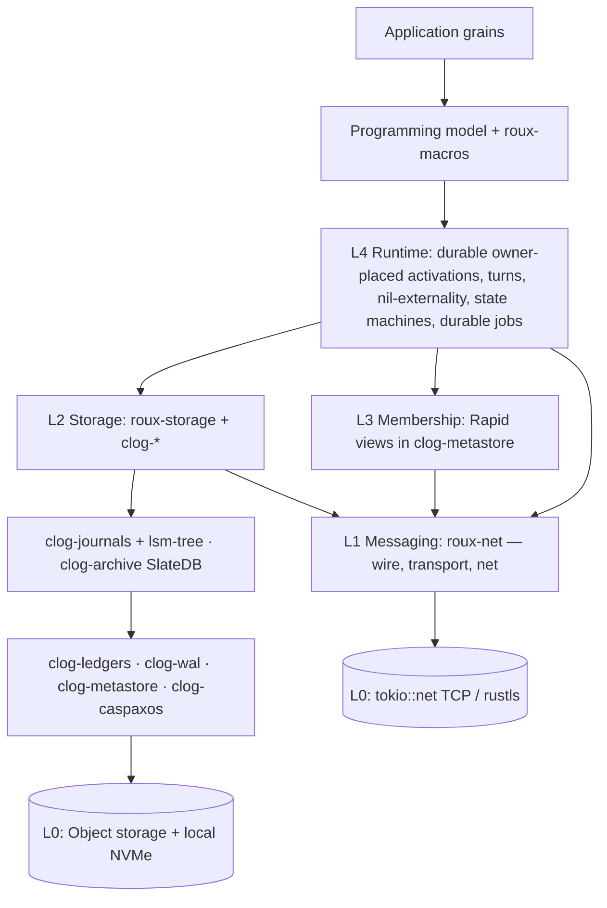

# Roux design overview

Roux is a distributed virtual-actor runtime written in Rust, built on top of **Clog** (`clog-*`) for durable storage, replication, partitioning, archiving, and journaling. All `clog-*` crates, plans, and specs (alongside RapidCluster/`roux-membership` and `clog-caspaxos`) live directly in the `roux` repository while keeping `clog-*` free of any dependency on `roux-*`. Clog replicates hot writes across local NVMe ledgers (`LedgerQuorum` `N=3/Q=2`) and drains closed ledgers into a cloud object-storage LSM archive (SlateDB on S3, Azure Blob Storage, or GCS), backed by either `ObjectStoreMetaStore` (conditional PUTs via `object_store`) or `clog-caspaxos`. Roux takes the parts of [Microsoft Orleans](https://github.com/dotnet/orleans) that matter most and builds a smaller, more elastic actor runtime on top of Clog.

This document summarizes the design. Detailed contracts live in [Architecture](architecture.md), [Layers](layers.md), [Storage](storage.md), [Clog spec](clog/README.md), [Fast CASPaxos](fast-caspaxos.md), [Identities](identities.md), [Connectivity](connectivity.md), [Wire catalog](wire-catalog.md), [Membership](membership.md), [Rapid](rapid.md), [Testing](testing.md), and the [decision log](decisions.md).

## Goals

- **Elastic.** Nodes join and leave at any time. Clog splits, merges, hands off, and rolls dyadic `KeyRange` ledgers with zero data copy between nodes, so grain ownership, journals, and job shards move and settle quickly.
- **Strongly consistent membership.** Rapid cut detection (`Probe` RPC) and Fast Paxos views persisted in `clog-metastore` provide fast failure detection, endpoint discovery, and liveness hints to Clog's controller.
- **Cloud-native tiered storage.** Local NVMe replicated ledgers (`clog-wal` + `LedgerQuorum` `N=3/Q=2`) and a WAL-less `lsm-tree` warm index drain into a cloud SlateDB archive (`clog-archive`), with `ObjectStoreMetaStore` (S3, Azure Blob, GCS, local FS via `object_store` conditional PUTs) or `clog-caspaxos` for linearizable metadata. Diskless `ObjectLedgerStorage` is deferred.
- **Fast.** Thread-per-core Tokio (`current_thread` + `LocalSet` per core), Linux `io-uring` inside `clog-wal`, message-oriented networking (`roux-net`), standard `bytes::Bytes` buffers, and standard Protocol Buffers via `prost` + `protox` (no `protoc`).
- **Durable by default.** Every grain is a durable, owner-placed single-activation virtual actor. Grain state, durable jobs, and inbox/outbox messaging all store their durable histories in Clog journals (`clog-journals`).
- **Clock-independent durable safety + ledger-replica leases.** Durable state never depends on clocks: Clog enforces fencing via ledger seals, MetaStore CAS, and `JournalVersion` admission. Single activation for non-durable effects relies on per-ledger quorum-intersecting replica leases (`ST8`, `specs/range-handoff/`) piggybacked on `ReplicaWrite`s and idle `ReplicaHeartbeat`s with bounded clock-rate drift and pauses.
- **Ergonomic.** Grain interfaces (traits) and grain implementations are separate. Procedural macros (`roux-macros`) generate proxies, invokers, and registration helpers.
- **Strictly layered.** `clog-*` crates depend on nothing in Roux; `roux-storage` wires Clog onto Roux's messaging and membership layers. See [Layers](layers.md).

## Targets

- **Cluster size.** Typically single-digit to low tens of nodes; supports up to about 1,000 nodes.
- **Activations.** Millions of active grains in a 10-node cluster.
- **Throughput.** 1 million requests per second per node for calls that write no durable state, on suitable hardware.
- **Baseline.** At least as scalable, fast, and cost-effective as Orleans on equivalent workloads, measured by a shared benchmark suite.

## Terminology

| Term | Meaning |
| --- | --- |
| Grain | A virtual actor, addressed by a canonical `GrainId` (grain type ID + canonical typed key bytes). It always exists logically and is activated on demand. |
| Activation | An in-memory instance of a grain on one node. |
| Node | A runtime host and cluster member: one process. Orleans calls this a silo. |
| `NodeId` | A node's durable 128-bit UUID, created with its Clog `LedgerStore` and persisted in `wal/node` for the disk's lifetime. |
| `ProcessId` | The membership version of the `Join` entry for the current process. Each restart gets a new `ProcessId`. |
| `MemberId` | `(NodeId, ProcessId)`. Unique for the life of the cluster. Membership maps it to the process's endpoints and metadata. |
| `InstanceId` | A random 128-bit process incarnation ID chosen at startup; identifies connections at L1 Messaging. |
| `ThreadId` | An ordinal from `0` to `N-1` naming one of a node's thread-per-core Tokio (`current_thread` + `LocalSet`) actor threads. Each runtime thread owns its network endpoints and activations. Clog's blocking/storage workers run on separate dedicated threads. |
| Endpoint | A transport address (TCP in production; in-memory in tests) per runtime thread. |
| `GrainAddress` | The location of an activation: `GrainId`, `MemberId`, an `ActivationId` unique within the process, and a `ThreadId` hint. |
| Membership version | The monotonic version of the committed Rapid membership view. |
| `KeyRange` | A Clog dyadic prefix interval `(Prefix, Depth)` over `RowKey = RoutingKey \|\| JournalKey` (default `xxhash32(key, 0) \|\| key`). `KeyRange`s are the unit of open ledger ownership and dynamic splits, merges, handoffs, and takeovers. |
| `LedgerId` | Identifies one live Clog ledger (`u64 >= 1`), allocated consecutively by `ledger-map` in `clog-metastore`. |
| `Journal` | A grain's durable append-only/snapshot history in `clog-journals`, keyed by canonical `GrainId` and guarded by opaque `JournalVersion(Base, Count)` CAS. |

## Architecture

See [Architecture](architecture.md) and [Layers](layers.md) for the full 5-layer stack and crate dependency DAG:

## Building blocks

Roux builds on Clog (`clog-*`) and existing, well-tested libraries wherever one fits:

| Concern | Library |
| --- | --- |
| Distributed storage, replication, partitioning, archiving, and journaling | Consolidated Rust `clog-*` crates (`clog-metastore`, `clog-caspaxos`, `clog-wal`, `clog-ledgers`, `clog-archive`, `clog-journals`) |
| Cold LSM archive (`clog-archive`) | [SlateDB](https://slatedb.io) directly (no pluggable archive trait; single instance per cluster, `wal_enabled = false`, `DbReader` + `foyer` cache on every node, atomic `(RowKey, Tag)` + watermark batches) |
| Local warm journal index | Pure-Rust WAL-less [`lsm-tree`](https://docs.rs/lsm-tree) (Fjall) embedded directly in `clog-journals` (replayed from `clog-wal` / live ledgers on startup; no generic state-DB trait) |
| Thread-per-core async runtime | [`tokio`](https://tokio.rs) (`current_thread` + `LocalSet` per core across Roux and Clog; raw [`io-uring`](https://docs.rs/io-uring) narrowly inside `clog-wal` on Linux, portable `std::fs` elsewhere) |
| Object storage access | [`object_store`](https://docs.rs/object_store) (powers `ObjectStoreMetaStore` conditional PUTs and SlateDB `clog-archive`) |
| TLS | [`tokio-rustls`](https://docs.rs/tokio-rustls) / [`rustls`](https://docs.rs/rustls) (`kTLS` deferred) |
| Ref-counted buffers | Standard [`bytes::Bytes`](https://docs.rs/bytes) (`AlignedBuf` in `clog-wal` for 4 KiB direct I/O) |
| Serialization | [`prost`](https://docs.rs/prost) + [`protox`](https://docs.rs/protox) + `prost-build` (pure Rust, no `protoc`, no wrapper crate) |
| Telemetry | [`tracing`](https://docs.rs/tracing), [OpenTelemetry](https://opentelemetry.io/docs/languages/rust/) |

`clog-*` traits use Rust `RPITIT + Send` and run local disk (`clog-wal`, `lsm-tree`) and object-store I/O on dedicated Tokio storage worker threads. `roux-storage` connects Roux's per-core `!Send` Tokio `LocalSet` actor threads to `clog-*` over bounded Tokio channels.

## Programming model

- A **grain interface** is a trait annotated with `#[roux::grain_interface(id = 17, alias = "shop.Cart")]`, and each method carries `#[roux(id = 1)]`. Methods are `async fn`s returning `Result<T, E>` with message types. Requests are identified on the wire by their interface and method IDs; IDs below 1024 are reserved for system targets. The macro generates a typed reference (proxy), a request enum, and a server-side invoker. `cargo xtask schema` writes an application-wide `contracts.proto`, committed to the repository, and CI rejects reused or unreserved IDs.
- A **grain** is a type annotated with `#[roux::grain]` that implements one or more grain interfaces. Every grain is durable and owner-placed (single activation); there are no stateless grains.
- **Typed canonical keys & pluggable key routing.** Each grain type declares a key type implementing `GrainKey: prost::Message + Default + Eq + Hash` (built-ins: string, `u64`, UUID), encoded as the canonical Protocol Buffers message `roux.runtime.v1.GrainId { grain_type, key }` (`<= 1 KiB`). Key types forbid floats and maps at compile time, and `decode_canonical` verifies exact round-trip re-encoding (rejecting unknown or duplicate fields, Z24). A pluggable `KeyRouter` maps `GrainId` to `(RoutingKey, JournalKey)` and Clog `RowKey = RoutingKey || JournalKey`, defaulting to `xxhash32(key, 0) || key`.
- Grain types are registered explicitly on `NodeBuilder` (no `linkme` link-time magic).
- Grains have a minimal activation lifecycle: construct (`Grain::new`), recover journal, run `on_activate`, serve turns, and release volatile resources via `Drop` on idle eviction, handover, or shutdown (no async `on_deactivate`).
- Activation-scoped, non-durable timers handle in-memory periodic work. [Jobs](#jobs) handle durable scheduling.
- Calls carry a deadline, local drop-based cancellation (remote `Cancel` RPC deferred), and an ambient call context (`TraceContext` + optional `principal`) across grain hops.
- **Nil-externality.** A grain sends a response, call, outbox message, or timer- or job-driven call only after every Clog journal write its turn depends on is durable. Callers therefore never observe state that a crash could lose. The runtime enforces this for every effect it carries; before effects outside the runtime, such as external I/O, a grain calls `ctx.persist().await`.
- **Lease-checked effects.** The runtime checks each range's open-ledger replica lease (`ST8`), less a guard band, before starting a turn and before releasing non-durable responses or messages. A range whose lease lapses suspends admission and drops volatile activations for that range until its lease renews (without affecting healthy ranges on the same node); the process terminates upon observing its own death in membership (`C6`). Durable journal writes are independently fenced by Clog (`JournalVersion` CAS, ledger seals, and MetaStore CAS) regardless of clocks.

## Scheduling

- Each activation runs one turn at a time on one thread, so grain state uses single-threaded interior mutability (`Cell`, `RefCell`, durable state handles) instead of locks. Grains are `Send` but need not be `Sync`, which lets an idle activation move between threads.
- Every grain is **reentrant**: requests interleave at `.await` points. Grain methods take `&self`, and grain code completes each state mutation within a synchronous borrow. Reentrancy removes call-cycle deadlocks and the configuration that Orleans uses to manage them.
- **Thread-per-core executor.** Each thread runs a single-threaded [`tokio`](https://tokio.rs) runtime (`current_thread` + `LocalSet`) on its own core, giving every core its own `epoll`/IOCP reactor, inbound connections, and activations (`spawn_local`). Tasks stay on the thread that spawned them, matching `turmoil` simulation's exact executor semantics.
- **Thread-addressed routing.** Each grain routes directly to `mix(row_key_hash) mod threads` on its primary node. Every `GrainAddress` carries the `ThreadId` running the activation, and senders cache location hints returned on replies and `NotHere`. Intra-node work stealing is deferred (R24).
- **Blocking and storage work.** `clog-wal` (Linux `io-uring` direct I/O; portable `std::fs` elsewhere), `lsm-tree` flushes/compactions, and cloud object-store I/O run on Clog's dedicated storage worker threads, isolated from actor threads via bounded Tokio channels in `roux-storage`. CPU-heavy compression runs on Tokio's blocking pool (`spawn_blocking`).
- **Environment interface.** Roux and Clog inject clock, randomness, transport, and storage seams for deterministic simulation (`turmoil` + `slatedb-dst`).

## Cluster membership

Membership (`roux-membership`, L3) provides strongly consistent, monotonically versioned cluster views and ephemeral liveness on top of `clog-metastore` (`ObjectStoreMetaStore` or `clog-caspaxos`):

- **Rapid cut detection and Fast Paxos.** Each member monitors `K = 10` peers on an expander graph via L1 `Probe` RPCs; alerts aggregate between `L = 3` and `H = 9` observers into multi-node cuts decided by Fast Paxos (with classic Paxos fallback) and persisted via a conditional write to a single `{cluster:N}/membership` register (`StoredView`: newest view plus its producing entry) in `clog-metastore` (`M36`). `StoredView` retains 0 defunct records; `View::lookup` classifies absent members with `p <= V` as `Defunct`. Local health suppression checks executor stalls only.
- **No membership leases (`M29` withdrawn -> `ST8`).** Ownership leases live per-ledger in L2 Clog's static replica ensembles rather than in Rapid, keeping membership free of lease coordinators, promise blocking, and reconfiguration quiet periods.
- **Identity.** A process is identified by `MemberId = (NodeId, ProcessId)`, pairing its durable Clog `NodeId` (UUID from `wal/node`) with the monotonic `ProcessId` assigned by its `Join` view. A `MemberId` declared dead never returns. `View::live_on(NodeId)` reports active members for a Clog node.
- **Separation from Clog `NodeRegistry`.** Membership tracks ephemeral process liveness and endpoints; Clog's durable `NodeRegistry` (`CLNR` in `clog-metastore`) tracks minimal storage node registration, generation monotonicity, and irreversible retirement floors. `roux-storage` feeds membership liveness changes into `clog-ledgers`' cluster controller as scheduling hints and calls `report_unresponsive` for stalled handoff owners.
- **Version propagation.** Committed views push directly to live members over High-lane `Membership` (16) RPCs; peers more than one view behind resync directly from the `{cluster:N}/membership` register (checking `C6` self-death).
- **Fencing.** A process that learns it was declared dead terminates (`C6`); a range whose ledger-replica lease lapses suspends admission and non-durable effects for that range until its lease renews.

## Time

Durable safety rests on Clog ledger seals, MetaStore CAS, and `JournalVersion` checks — never clocks. Time affects only liveness, scheduling accuracy, and non-durable lease bounds:

- **Local durations.** Timeouts, probe intervals, handoff deadlines, and drain periods use each node's monotonic clock.
- **Fenced durability, leased non-durable effects.** Clog journal writes and reads are fenced by storage and ledger seals under arbitrary clock skew or stalls. Non-durable effects (responses, messages, timers) are bounded by per-ledger replica leases (`ST8`), which assume clock-rate drift within `ρ` and pauses shorter than guard band `δ`.
- **Single-clock decisions.** Wall-clock decisions (job due times, inbox deduplication windows) use the owning node's clock.

## Networking

- **Membership-free L1 Messaging.** Messaging (`roux-net` with internal `wire`, `transport`, and `net` modules) sits below Clog and Membership. Connections authenticate peers with mutual TLS (`rustls`) and exchange `ClusterId`, `InstanceId`, `ThreadId`, and capabilities in a minimal handshake — no membership view or `MemberId` is required to connect, allowing Clog (`MetaStoreCasPaxos`, `LedgerReplica`, `JournalForward`, `ClusterControl`, `NodeControl`) and Membership (`Join`, `Membership`) to share the same connections from startup.
- **Connections per destination thread.** Between two nodes, each destination thread owns one inbound connection from the peer node (`N + M` connections for `N` and `M` threads). Sending threads append frames to the connection's send queues, drained in batches by the connection's owner thread over `tokio::net::TcpStream` + `tokio-rustls`.
- **Standard `bytes::Bytes`.** Message payloads use standard `bytes::Bytes` / `BytesMut`, flowing without unnecessary serialization copies from `prost` into `JournalForward`, `LedgerReplica`, `LedgerBatch`, `clog-wal`, `lsm-tree`, and SlateDB. Kernel provided-buffer rings, incremental written-prefix views, `SEND_ZC`, and custom slab page pools are deferred until benchmarks justify them.
- **Single `Frame` enum and `Service | Object` targets.** Each frame is a length-delimited `Frame` (`Request`, `OneWay`, `Response`). `Target` is `Service { interface, method }` (system services 16–17, 96–100) or `Object { key, hint, interface, method }` (grains). `NotHere { location, version }` applies only to `Object` targets and is answered by the target's handler (carrying Clog's `LedgerMap` version for grains).
- **Transports and security.** TCP with `tokio-rustls` on per-core Tokio, plus an in-memory/`turmoil` transport for tests and simulation (`kTLS` and Unix domain sockets deferred). Mutual TLS authenticates nodes against cluster trust roots.

## Flow control and overload

Each connection carries High and Normal priority lanes. Rapid membership probes, alerts, and consensus messages travel on the High lane and are dispatched inline, exempt from grain admission limits. Clog's replica control lane keeps `ReadTail` seals and idle `Heartbeat` lease renewals ahead of bulk storage traffic.

- **Clog storage budgets (`roux-storage`).** Frame-length pre-checks and per-connection 32 MiB byte bounds (`N16`) cap receive memory, while `roux-storage` enforces Clog's `MaxReplicaCallBytes`/`MaxReplicaCalls` (97) and forwarding budgets (98) alongside caller-side FIFO budget lanes (head-first incremental protobuf decoding `N29` is deferred).
- **Activations.** Each grain mailbox holds up to 10,000 requests (configurable); excess callers receive a retryable `Overloaded` response with a retry-after hint.
- **Threads.** CoDel-style admission rejects new grain requests when queue delay stays above 5 ms over a 100 ms window. Expired-deadline requests drop on dequeue.
- **Connections.** Node-wide payload limit and per-lane send queue bound are 32 MiB (`N16`), matching Clog's replica batch defaults and applying backpressure to callers (ending with `NotSent` at deadline) and TCP flow control to peers.

## Serialization

- **Protocol Buffers (`prost` + `protox`, no wrapper crate).** Roux encodes RPC messages, grain journal payloads, and snapshots with standard Protocol Buffers binary encoding (no groups) using `prost` directly. Internal schemas are `.proto` files compiled by pure-Rust `protox` + `prost-build` (no `protoc` binary) and validated into strict Rust domain types via `TryFrom`; application types use `#[derive(prost::Message)]` (and `#[derive(roux::GrainKey)]` for keys), and `cargo xtask schema` emits `contracts.proto` for `buf breaking`.
- **Closed polymorphism.** Variants are Rust enums encoded as `oneof`, and grain methods return `Result<T, E>` with concrete errors.
- **Unknown fields and canonical keys.** Unknown protobuf fields are dropped everywhere (`Z7`), relying on deploy-readers-before-writers (`S4`) for grain journals and `ClusterConfig.format_version` + `roux-membership`'s `reject_unknown_wire_tags` for membership fail-stop (`M7`). Canonical `GrainKey` types use `roux_id::decode_canonical` (`Z24`).
- **Standard `bytes::Bytes`.** Byte payloads use `bytes::Bytes`. Local calls move arguments without serialization.

## Partitioning, routing, and placement

- **Dyadic keyspace in Clog.** Clog's `ledger-map` (in `clog-metastore`) partitions the full keyspace of `RowKey = RoutingKey || JournalKey` (default `xxhash32(key, 0) || key`, pluggable via `KeyRouter`) into contiguous dyadic `KeyRange`s `(Prefix, Depth)`. Each `KeyRange` has one open `Ledger` with a primary `NodeId` and `N` replicas (`LedgerQuorum` `N = 3, Q = 2` on local NVMe).
- **Routing without a directory.** Every grain is durable and activates on the primary node of the open Clog ledger whose `KeyRange` contains its `RowKey`. Every node computes the primary purely from its cached `LedgerMapView.find(row_key)` and resolves `NodeId` to endpoints via Membership. Misrouted calls receive `NotHere` (grains) or are forwarded / return `Moved` (Clog journals) and refresh the view.
- **Dynamic load balancing and zero-copy transitions.** Clog's `ClusterController` monitors per-ledger load and balances the cluster by executing zero-copy `ledger-map` transitions: `handoff` (cooperative primary transfer), `takeover` (crash recovery), `split` (hot range split), `merge` (adjacent cold range merge), and `roll` (replica replacement / planned eviction). No data is copied between nodes during transitions; closed ledgers drain asynchronously into the shared SlateDB archive.
- **Single-activation coordination on handoff and crash.** Before completing a cooperative `handoff`, `split`, or `merge`, the outgoing primary stops admitting new turns for the departing `KeyRange`, drains in-flight turns, surrenders its local `LedgerLease`, and drops outgoing activations (0 ms wait); if an owner stalls or crashes, `TransitionExecutor` quorum-seals the closing ledger, waits `max(lease_remaining_ms)` before committing `LedgerMap` CAS (0 ms if the old primary has been dead for `> D`), and reports stalled owners to Rapid (`report_unresponsive`).

## Journaling and durable state

- **Clog Journals (`clog-journals`).** Each grain owns one Clog journal keyed by its canonical `GrainId`. Every write carries an expected `JournalVersion(Base, Count)` and commits atomically (`Append` or `Replace` snapshot; `Delete`/`Expired` deferred) through the range's primary ledger with CRC-32C integrity, optionally attaching validated unversioned messages (`RowKind::Message = 3`, `ST12`, `JS-I11`) in the same `LedgerBatch` slot.
- **Durable state machines.** Built-in durable state machines (`DurableValue`, `DurableMap`, `DurableList`, `DurableQueue`, `DurableSet`, `Inbox`, `Outbox`, and grain-local `DurableJobQueue`) fold `GrainEntry` commands and emit `GrainSnapshot` replacements on top of Clog journal entries. Journal storage treats entry bodies as opaque bytes.
- **Write hooks.** `prepare_write` runs before a journal batch commits; `on_write_completed` releases buffered responses, calls, and outbox effects only after Clog acknowledges durability (nil-externality).
- **Local NVMe ledgers + WAL-less `lsm-tree` warm index + SlateDB archive.**
  - **Hot writes:** Batched through group commit to `LedgerQuorum` (`N = 3, Q = 2`) replicas on local NVMe (`clog-wal`: Linux `io_uring` in production, portable `std::fs` in dev; `CLFL` WAL + `CLSC`/`CLSI` replica store). Diskless `ObjectLedgerStorage` is deferred.
  - **Warm local index:** Pure-Rust WAL-less `lsm-tree` (Fjall) embedded directly in `clog-journals` materializes recent journal state per open ledger on the primary node for fast activation loads, replaying from `clog-wal` / live ledgers on startup.
  - **Cold cloud archive:** Closed ledgers drain asynchronously into [SlateDB](https://slatedb.io) directly (`clog-archive`, single instance per cluster, `wal_enabled = false`, `(RowKey, Tag)` keys, atomic segment + watermark `WriteBatch` commits, `DbReader` + `foyer` cache on every node) on S3, Azure Blob Storage, or GCS. `2^k` sharding and RFC-0025 distributed compaction are deferred.
- **MetaStore deployments.** `clog-metastore` provides `ObjectStoreMetaStore` (conditional PUTs via `object_store` across S3, Azure Blob, GCS, and local FS, plus `InMemoryMetaStore` for tests), alongside disk-native `clog-caspaxos` over L1 Target `96`.

## Jobs

Durable jobs are at-least-once scheduled invocations of grain methods, combining two layers above Clog (`R32`, `R37`):

- **1-RTT atomic journal reminders and grain-local `DurableJobQueue` (`ST12`, `R37`):** As the first L4 consumer in `roux-jobs` built on L2's general-purpose atomic journal message system (`RowKind::Message = 3`), self-targeted reminders (`Inbox`, `Outbox`, and the outbox-style grain-local `DurableJobQueue` state machine) attach a `SetReminder` message on channel `"roux.reminder"` to the grain's journal write in one foreground quorum RTT. While the ledger stays open, the primary's `ReminderLedgerSession` timer heap dispatches ephemeral reminders with zero backing writes; reminders cleared within the same closed segment fold to empty with zero backing writes; surviving reminders in a drained segment publish one deterministic sealed `JobShard` per time bucket (`drain-{ledger:020}-{segStart:020}-{bucketUtcTicks:019}`) during `DrainScan`'s single pass before SlateDB advances the segment watermark (`LG-I16`).
- **Partitioned backing scheduler grains (`JobShard`, `JobCursor`):** Cross-grain jobs and drained-segment spillover reminders live in partitioned scheduler grains and deterministic sealed `JobShard`s backed by ordinary Clog journals (riding on Clog's dynamic `KeyRange` partitioning, replication, and failover). `JobCursor` drains ended windows strictly in order, closing each shard once its pending set and outbox are empty.

## Inbox and outbox

Durable, grain-scoped messaging for effectively-once command processing, following dotnet/orleans#10693:

- `Inbox` and `Outbox` are durable state machines inside the grain's own Clog journal, sharing the grain's atomic commit boundary.
- Outgoing messages commit atomically with the state change that produced them and retry at least once until acknowledged.
- The inbox deduplicates incoming messages by message ID within a bounded count window and commits inbox state atomically with the handler's turn (nil-externality guarantees no external effect escapes before durability), retrying failures with backoff and dead-lettering poison messages.
- `GrainReminderCoordinator` attaches an atomic 1-RTT `SetReminder` message (`R37`) whenever inbox/outbox work is pending and clears it when work drains, spilling to deterministic sealed `JobShard`s only when surviving across a closed segment drain.

## Elastic scaling

- **Join.** A new node starts its `LedgerStore` (`NodeId` in `wal/node`), joins Rapid membership, and registers in Clog's `NodeRegistry` (`CLNR`). `ClusterController` hands off or splits `KeyRange` ledgers onto it without copying data.
- **Graceful leave.** A draining node enters `ShuttingDown`, drains active grain turns while Clog hands off its ledgers (and rolls replicas off ephemeral NVMe if needed), and leaves membership.
- **Cheap moves.** Because Clog ledgers are replicated and closed ledgers drain to the shared LSM archive, moving a `KeyRange` requires only a `ledger-map` commit and lazy grain reload on the new primary.
- **Signals.** Nodes publish load metrics (activation count, queue depth, ledger write rate, CPU, memory) for external autoscalers.

## Clients and gateways (deferred)

External clients, `Gateway` (Target `18`), `ClientHello`, and pluggable client authentication are deferred past v1. The `Peer::Instance` and `Target::Service | Object` L1 contract stays ready for clients to plug in later without wire changes.

## Observability

`tracing` spans propagate across grain calls and `roux-storage` calls into Clog, exported through OpenTelemetry alongside metrics.

## Testing

Deterministic simulation is the primary testing strategy: `turmoil` and SlateDB's DST hooks (`MockSystemClock`, `DbRand`, `ObjectStore`, seeded Tokio `RngSeed`) run whole Roux-on-Clog clusters on virtual time from one seed with injected network, disk, crash, and object-store faults. `stateright` model-checks the real Rust sans-I/O protocol cores (with mandatory `Bug` mutants and `LinearizabilityTester`), paired with `proptest`, `miri`, `cargo-nextest`, `cargo xtask lint`, and a weekly LazyFS + `SIGKILL` + Elle real-process crash soak. See [Testing and simulation](testing.md).

## Storage outages

A deployment's durable storage (`clog-metastore` and active Clog ledgers/archive) is a hard dependency. While unavailable, journal writes, membership changes, and ledger transitions stall, and calls requiring durability fail at their deadlines. Safety invariants hold throughout, and the cluster resumes when storage recovers.

## Orleans features left out

Streams, transactions, multi-cluster, non-journaled persistence, stateless worker grains, reminders (replaced by durable jobs), grain call filters beyond a simple interception hook, non-reentrant scheduling, and the legacy grain directory.

## Decisions

Decisions made so far, and the questions still open, are tracked in the [decision log](decisions.md).
