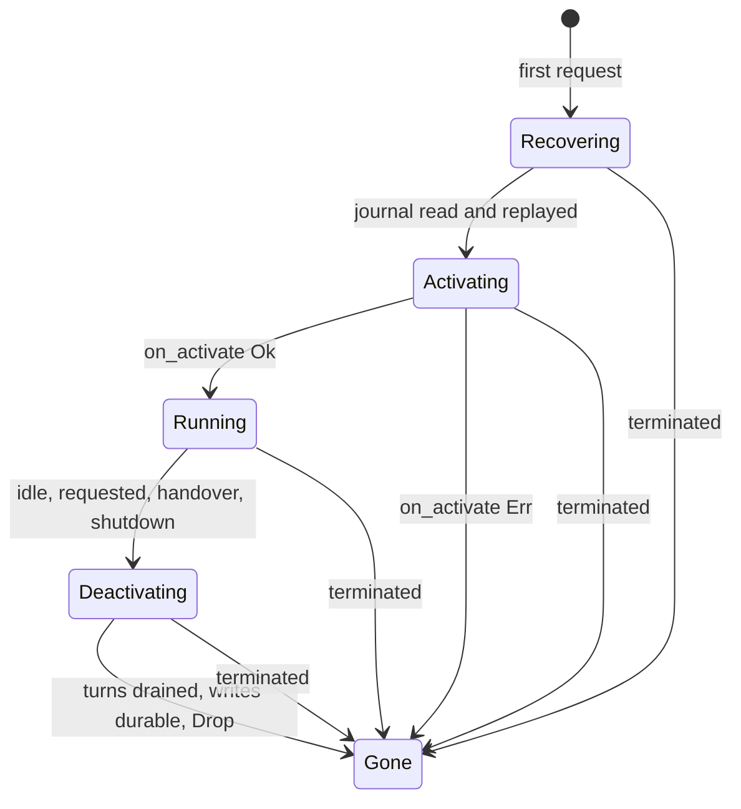

# Grain runtime and programming model

The grain runtime (layer L4) hosts activations, runs their turns, routes calls between grains, and makes every externally visible message depend only on durable state. It is built directly on Clog: every grain is durable and backed by one Clog journal, and Clog's ledger map decides where it runs. This document specifies the runtime's programming model down to Rust types, trait and method signatures, macro inputs and outputs, and wire and storage formats.

Status: in design. Each choice is marked **Decided**, **Proposed**, or **Undecided**; undecided choices carry a suggestion. Decisions are working choices: each records its rationale, the alternatives considered, the complexity it adds and what it would take to undo, and the evidence that would change it. The [decision table](#decisions) tracks them, and [Boundary questions](#boundary-questions) lists what the runtime needs from `roux-storage` and Clog.

## Summary

The runtime runs grain code. It guarantees that each activation runs one synchronous segment at a time, that every message the runtime sends depends only on durable Clog journal entries (nil-externality), and that the inbox, outbox, and durable jobs carry durable effects. It uses L2 Storage only through `roux-storage`'s journal client, `LedgerMapView`, range events, and per-ledger replica leases (`ST8`); L3 Membership only through views (endpoint/instance resolution) and `report_unresponsive`; and L1 Messaging only through its membership-free RPC system.

Main decisions:

- **Programming model.** Grain interfaces are traits with explicit `u32` interface and method IDs. Methods take `&self` and return `Result<T, E>`. Durable state handles (`DurableValue`, `DurableMap`, `DurableList`, `DurableQueue`, `DurableSet`, `Inbox`, `Outbox`) expose closure-scoped access, so no borrow crosses `.await` (R1). Grains are constructed synchronously, register state handles by explicit `StateId`, initialize in `on_activate` after recovery, and clean up via `Drop` (R6, R7). Applications register grain types explicitly on `NodeBuilder`.
- **Identity and routing.** Every grain is durable and owner-placed (no stateless grains). Each grain type declares a canonical key type (R8). A pluggable `KeyRouter` maps a grain's canonical `GrainId` to its `JournalKey` and `RoutingKey`, by default the `GrainId` bytes and their `xxhash32` (R36). Clog's `LedgerMapView` maps the row key `RoutingKey || JournalKey` to the primary node, which hosts the activation, on thread `mix(row_key_hash) mod threads`.
- **Durability.** Each activation stages commands in one buffer and writes them as one Clog journal entry, with one entry in flight per grain (R2, R30). A message records the entry its state depends on and is released once Clog accepts that entry (R3). Read-only calls with nothing in flight wait for nothing.
- **Snapshots.** A snapshot is a Clog `Replace` holding the whole state, written in place of an `Append` when Clog requests or requires one, or when the journal has grown past a threshold (R31).
- **Calls.** Calls run at most once. The runtime resends only requests that provably did not run (R4), and callers receive `Result<T, CallError<E>>` with `ran()` (R10). Deadlines propagate automatically; caller-side drop cancels locally while remote `CallControl` cancellation is deferred past v1 (R11, R23).
- **Failures.** A panic, or any Clog write outcome other than `Accepted`, `ReplaceRequired`, or a `Fenced` on a range this node still leads, terminates the activation; the next activation recovers from the journal (R14). When a range's ledger-replica lease lapses, the runtime suspends turns and effects for that range and drops its activations.
- **Handover.** Before a cooperative Clog `handoff`, `split`, or `merge` moves a range's primary off this node, the runtime drains the range's activations and only then lets `roux-storage` release the range (R6, R33).
- **Durable jobs and atomic journal reminders.** `roux-jobs` combines two complementary layers: (1) **atomic `SetReminder` journal messages** (`"roux.reminder"`, the first L4 consumer built on L2's general-purpose `RowKind::Message = 3` atomic message system `ST12`, `R37`) delivering 1-RTT foreground atomic state + self-reminder commits for `Outbox`, `Inbox`, and the outbox-style grain-local `DurableJobQueue` (zero backing writes when cleared within the same segment, primary in-memory timer heap while open, and deterministic time-bucketed sealed `JobShard` publishing during single-pass `DrainScan` on segment drain); and (2) **partitioned `JobShard` + `JobCursor` scheduler grains** backed by ordinary Clog journals for cross-grain scheduling and drained-segment spillover (`R25`, `R32`).

## Layer contract

The runtime provides:

- **Turns.** Each activation runs at most one turn segment at a time, on one thread. Turns interleave only at `.await` points.
- **Nil-externality.** Every response and every outgoing message depends only on durable journal entries.
- **Single activation.** At most one activation of a grain produces effects at a time: Clog's journal fencing guarantees it for journal writes, and each open ledger's quorum-intersecting replica lease (`ST8`), checked by the runtime, guarantees it for responses and messages.
- **Effectively-once messaging.** The inbox and outbox deliver and process each committed message effectively once within the deduplication window.
- **Jobs.** Each scheduled job runs at least once at or after its due time.

The runtime assumes these contracts, and uses nothing else from the layers below:

| Layer | Contract used by the runtime |
| --- | --- |
| L2 Storage: Clog `clog-journals` through `roux-storage` ([Storage](storage.md)) | Each journal is stored and routed under the row key `RoutingKey || JournalKey` that the runtime supplies; Clog never interprets either part. A journal's content is its last `Replace` payload, or nothing, followed by every later `Append` payload, read as a byte stream with no entry boundaries. Every write names an expected `JournalVersion`, which is opaque and compared only for equality, and is `Accepted(version, replace_requested)` only once durable and applied, when the expected version names the journal's current state. Writes may attach validated `JournalMessageRecord`s (`RowKind::Message = 3`, `JS-I11`) that commit atomically in the same `LedgerBatch` slot, invoke primary `MessageSession::on_batch_durable` in strict slot order before warm-state apply and `Accepted` (`JS-I12`), and drain per segment via single-pass `DrainScan` `SegmentMessageFolds` before SlateDB advances the segment watermark (`LG-I16`). Every write resolves to exactly one outcome; `Rejected`, `ReplaceRequired`, `Moved`, and `Fenced` have no effect and leave zero `RowKind::Message` rows, and `Ambiguous` may still land, at most once. A read reflects every entry accepted before it, and only decided entries. Entries are at most `MaxBodyBytes`. Writes and reads that reach a node which is not the key's primary are answered `Moved`. |
| L2 Storage: ledger map, range events, and leases (`roux-storage`) | `LedgerMapView::find(row_key)` names the open ledger whose `KeyRange` holds the row key, and its primary `NodeId`. Range events tell the runtime when this node starts and stops leading a range ([R33](#range-events-r33)), supplying a per-ledger `LedgerLease` checked locally with `lease.check(now)`: no successor ledger commits in `LedgerMap` before the closing ledger's replica lease has expired or been surrendered (`ST8`, `D` = 5 s, idle heartbeat 1.5 s, drift factor `F = 1 + ρ` with `ρ` = 10%, guard band `δ` = 1 s). Clog's journal fencing (ledger seals, MetaStore CAS, and version checks) holds without clocks. |
| L3 Membership | Totally ordered views mapping each `NodeId` to at most one active `MemberId`, its `InstanceId`, and its endpoints (`NodeEndpoints`, including the thread count). `report_unresponsive(member)` asks the failure detector to evict a member. |
| L1 Messaging ([Connectivity](connectivity.md)) | A membership-free, authenticated RPC system between processes, identified by `InstanceId`. `Service` and `Object` targets. At-most-once delivery, in order per sender process, destination thread, and lane, with possible gaps. A response returns on its request's connection. A send that fails with `NotSent` had no effect. `close(instance)` fails that peer's pending calls with an unknown outcome. Payloads are standard `bytes::Bytes` slices. |

## Outline

1. [Crates and layering](#crates-and-layering)
2. [Identity](#identity): typed keys, `GrainId`, journal and row keys, `GrainAddress`
3. [Grain interfaces](#grain-interfaces): `#[roux::grain_interface]` input and generated output
4. [Grain implementations](#grain-implementations): `#[roux::grain]`, construction, state declaration
5. [References and calls](#references-and-calls): call semantics, errors, outcomes, deadlines, cancellation, call context
6. [Activation lifecycle](#activation-lifecycle): routing, lease checks, range events, states, hooks, idle collection
7. [Scheduling and reentrancy](#scheduling-and-reentrancy): threads, safe state access across `.await`
8. [Durable state](#durable-state): staging, Clog writes, outcomes, snapshots, recovery, limits
9. [Nil-externality](#nil-externality): durability dependencies and gated release
10. [Inbox and outbox](#inbox-and-outbox)
11. [Durable jobs](#durable-jobs): `roux-jobs` scheduler grains
12. [Timers](#timers)
13. [Client API](#client-api)
14. [Interception](#interception)
15. [Formats](#formats): wire rules, system targets, grain journal records
16. [Specification](#specification): Stateright model and invariants
17. [Boundary questions](#boundary-questions)

## Crates and layering

| Crate | Contents |
| --- | --- |
| `roux-runtime` | Activations, turns, staging and release, routing, lease checks, range-event handling, timers, explicit `NodeBuilder` registration, internal message staging, durable state machines (`DurableValue`, `DurableMap`, `DurableList`, `DurableQueue`, `DurableSet`, `Inbox`, `Outbox`) |
| `roux-macros` | `#[roux::grain_interface]`, `#[roux::grain]`, `#[roux::grain_type]`, and `#[derive(roux::GrainKey)]` (no `linkme` link-time registration) |
| `roux-jobs` | Backing durable job scheduler grains (`JobShard`, `JobCursor`), cursor pump, deterministic sealed-shard publisher (`SealedJobShardPublisher`), L4 atomic-reminder channel (`ReminderMessageCodec`, `ReminderRecord`, `ReminderOptions`, `ReminderMessageHandler`, `ReminderLedgerSession`, `ReminderMessageProcessor` registered into `roux-storage` at `roux-node` bootstrap), `GrainReminderSource`, `GrainReminderCoordinator`, `JobRunContext` (`is_ephemeral_reminder`), outbox-style grain-local `DurableJobQueue`, and the job API |

The runtime reaches Clog only through `roux-storage`, which composes the `clog-*` crates, connects their `RPITIT + Send` storage workers to the runtime's per-core `!Send` Tokio `LocalSet` actors through bounded channels, and shares standard `bytes::Bytes` payloads with L1 Messaging (`roux-net`) without copies ([R34](#storage-bridge-r34)).

## Identity

### Typed keys (R8)

**Decided (user, [Identities](identities.md)).** Each grain type declares a key type. A key type is a `prost::Message` that implements `GrainKey`; its canonical encoding is the grain's identity.

```rust
/// A grain type's key.
pub trait GrainKey: prost::Message + Default + Eq + Hash {}

#[derive(Clone, PartialEq, Eq, Hash, prost::Message, roux::GrainKey)]
pub struct CartKey {
    #[prost(message, required, tag = "1")] pub user: UserId,
    #[prost(uint64, tag = "2")] pub cart: u64,
}

#[roux::grain(type_id = 42, alias = "shop.CartGrain", key = CartKey)]
pub struct CartGrain { /* .. */ }
```

- **Built-in keys.** `StringKey(String)`, `U64Key(u64)`, and `UuidKey(Uuid)`.
- **`GrainId`.** `roux.runtime.v1.GrainId { uint32 type = 1; bytes key = 2; }`, where `key` is the key type's canonical encoding, at most 1 KiB. Its encoding is canonical (`decode_canonical` checks canonical bytes), so equal grains have equal bytes.
- **Canonical keys.** `#[derive(roux::GrainKey)]` checks at compile time that every field is canonically encodable—rejecting floating-point numbers (`-0.0`, NaN payloads) and maps—and `decode_canonical` rejects non-canonical wire encodings (such as unknown or duplicate fields). Two equal keys therefore always have equal bytes.
- **Stability.** A type's key type is part of its identity. Adding an `Option` field to a key type keeps existing keys' bytes; any other change moves grains to other identities, and needs a new grain type or an explicit migration.

**Rationale.** In the user's words, users "frequently map their own types onto the underlying byte array used by the grain key". Typed keys make that mapping the framework's job. *Cost:* key types are restricted to canonical encodings. *Revisit if* applications need key fields the canonical rule excludes.

**Co-location by key fields withdrawn (user, Clog alignment).** The earlier `#[roux(partition)]` fields and `GrainKey::partition_key` are removed. Placement is chosen by the grain type's [key router](#key-routing-r36) instead, whose default spreads grains uniformly; a custom router can co-locate grains by giving them a shared routing prefix.

### Key routing (R36)

**Decided (user, [Identities](identities.md)): the mapping is pluggable; the default is `xxhash32`.** A key router maps a durable grain's canonical `GrainId` to the keys Clog stores and routes it by:

```rust
/// Maps a grain's identity to its Clog keys. Pure: every process maps a grain identically.
pub trait KeyRouter: Send + Sync + 'static {
    fn route(&self, grain: &GrainId) -> RoutedKey;
}

pub struct RoutedKey {
    /// Places the grain in Clog's keyspace: the row key's prefix.
    pub routing_key: RoutingKey,
    /// Names the grain's journal.
    pub journal_key: JournalKey,
}

/// The default: uniform spread, matching Clog's default row-key layout.
pub struct HashRouter;
impl KeyRouter for HashRouter {
    fn route(&self, grain: &GrainId) -> RoutedKey {
        let journal_key = JournalKey::from(grain.canonical_bytes());
        let routing_key = RoutingKey::from(xxhash32(journal_key.as_bytes(), 0).to_be_bytes());
        RoutedKey { routing_key, journal_key }
    }
}
```

- **Row key.** Clog stores and routes the journal under `RowKey = routing_key || journal_key`, at most 65,535 bytes, so routing keys in one cluster have a fixed length per router, and the journal key is recoverable from the row key.
- **Rules.** A router is pure and deterministic: it depends only on the `GrainId`. It is injective: distinct grains get distinct journal keys, and distinct row keys. Its tests check it against golden vectors.
- **Choosing one.** **Proposed (R36):** a grain type names its router, `#[roux::grain_type(.., router = TenantRouter)]`, defaulting to `HashRouter`. The router is part of the grain type's identity, like its key type: changing it moves every grain of the type to other row keys, so it needs a new grain type or an explicit migration of journals. Every process that calls or hosts the type links its router (R29).
- **Uses.** Custom routers give range-ordered prefixes (for example, by tenant), so a tenant's grains share `KeyRange`s and move together, or co-locate a group of grains on one primary. A router that concentrates load concentrates it on few ranges, which Clog then splits.

**Rationale.** Users choose how a grain becomes a row key without Clog learning anything about grains: Clog sees only row keys and splits, merges, archives, and routes them by its dyadic `KeyRange`s as before. The default keeps Clog's own layout. *Cost:* routers are trusted to be pure and injective; a faulty router can map two grains to one journal. *Revisit if* routers need inputs beyond the `GrainId`, such as configuration that can change.

### Row key and thread

**Decided (user, base 9a548fa).**

| From | To | Mapping | Who computes it |
| --- | --- | --- | --- |
| `GrainId` | `RoutingKey`, `JournalKey` | The grain type's [key router](#key-routing-r36); by default `xxhash32` of the canonical `GrainId`, and the canonical `GrainId` | The caller and the receiver |
| `RoutingKey`, `JournalKey` | `RowKey` | `routing_key || journal_key` | The runtime and Clog |
| `RowKey` | open ledger, primary `NodeId` | `LedgerMapView::find(row_key)` | The caller and the receiver |
| `NodeId` | `MemberId`, `InstanceId`, endpoints, thread count | The current membership view | The caller |
| `RowKey` | `ThreadId` | `mix(row_key_hash) mod threads`, with `row_key_hash` the `xxhash32` of the whole row key and `threads` the primary's advertised thread count | The caller and the receiver |

Hashing the whole row key, rather than its routing prefix, spreads grains that share a routing prefix across the primary's threads.

```rust
/// Where an activation runs, as the runtime caches it.
pub struct GrainAddress {
    pub grain: GrainId,
    pub member: MemberId,
    pub activation: Option<ActivationId>,
    pub thread: ThreadId,
}
```

- **Requests.** A grain call is L1's `Target::Object { key, hint, interface, method }`, with `key` the canonical `GrainId` encoding and `hint` the cached activation ID. Messaging never interprets the key. System targets use `Target::Service`.
- **Canonical bytes (Messaging Z24).** Before it looks up an activation or routes the key, the receiving runtime calls `decode_canonical` on the `Object.key` bytes, which decodes the `GrainId`, re-encodes it, and fails with `NotCanonical` if the bytes differ; such a request is answered `NotStarted(Incompatible)`. A request whose grain type this process does not link is answered `NotStarted(Incompatible)` too. Activation tables and journal keys therefore only ever hold canonical bytes, so two encodings of one grain can never reach two activations or two journals.
- **Who answers `NotHere`.** Messaging never interprets `key` or `hint`, so the runtime, as the `Object` target's handler, decides: it answers `NotHere` whenever this node does not currently lead the grain's row key ([Routing](#routing)).
- **Locations.** `NotHere` returns `Location { member, hint }`; the runtime maps it to a `GrainAddress` with the hint as the activation ID and the computed thread.

**Rationale.** A grain's activation and its journal are found by the same lookup, `LedgerMapView::find(row_key)` on the row key its router gives, so the activation always runs on the node that leads its journal's ledger, and every journal write is local to the primary. Routing needs no directory, and Clog's range transitions move both together.

**Undecided (R29), where grain types are declared.** Interfaces and implementations are separate crates, but every process that calls or hosts a grain type needs its ID, key type, and key router: callers to route, and hosts to decode keys and activate. Suggestion: declare grain types next to their interfaces, implement them elsewhere, and register implementations explicitly on `NodeBuilder` at startup (no `linkme` magic):

```rust
// In the interface crate, linked by callers and hosts. `router` defaults to `HashRouter`.
#[roux::grain_type(type_id = 42, alias = "shop.CartGrain", key = CartKey, implements(Cart))]
pub struct CartGrain;

// In the implementation crate, linked by hosts only.
#[roux::grain(CartGrain)]
pub struct CartGrainImpl { /* .. */ }

// At node startup.
node_builder.register_grain::<CartGrainImpl>();

// A caller.
let cart = ctx.grain::<CartGrain>(CartKey { user, cart: 7 });
cart.add_item(item).await?;
```

## Grain interfaces

**Decided (Messaging N23 and N5).**

```rust
#[roux::grain_interface(id = 17, alias = "shop.Cart")]
pub trait Cart {
    #[roux(id = 1)] async fn add_item(&self, item: Item) -> Result<(), CartError>;
    #[roux(id = 2)] async fn checkout(&self) -> Result<Receipt, CartError>;
}
```

- **Identities.** Interface IDs are `u32`s of at least 1,024 (lower IDs belong to system targets); method IDs are `u32`s of at least 1, unique within the interface. The target names both, as `Target::Object { .., interface, method }`. Removed IDs are reserved, never reused. The macro rejects duplicate method IDs, and `NodeBuilder::register_grain` rejects duplicate interface or grain type IDs at startup.
- **Signatures.** Every method is an `async fn` taking `&self` and returning `Result<T, E>` with concrete `T` and `E`. Arguments, `T`, and `E` are concrete `prost::Message` types (written with `#[derive(prost::Message)]` or generated from `.proto` via `protox` + `prost-build`), enums (encoded as `oneof`), or built-in containers. Polymorphism is closed: an enum lists its cases. Trait objects, generic message types, and open `Any` envelopes are rejected in v1.
- **Contracts file.** `cargo xtask schema` writes every interface into a committed `contracts.proto`. CI's `buf breaking` rejects reused IDs and incompatible signature changes.

**Rationale (Messaging's).** Explicit integer IDs keep wire identities stable across renames; closed polymorphism gives every type one schema that `buf breaking` can check; explicit `NodeBuilder` registration avoids linker-section portability hacks (`linkme`).

**Generated payloads (wire sum types, one message per frame).** The interface macro generates, per method, an argument `prost::Message` struct whose fields are the method's arguments in order, and one request enum per interface with one variant per method. The enum exists only in Rust: its discriminant travels as the frame's `Target::Object { .., method }`, and the frame's `Call.args` payload is the variant's argument message alone. A successful response is `Outcome::Ok(Payload)` holding `T`; an application error is `Outcome::Err(Payload)` holding `E`. A `Payload` is either received bytes (a zero-copy `bytes::Bytes` slice of the frame) or a typed value that `prost` encodes directly into `BytesMut` -> `Bytes`; generated proxies pass typed argument messages, and invokers pass typed `T` and `E`. For `Cart` above:

```rust
// Generated.
#[derive(Clone, PartialEq, prost::Message)]
pub struct CartAddItemArgs { #[prost(message, required, tag = "1")] pub item: Item }
#[derive(Clone, PartialEq, prost::Message)]
pub struct CartCheckoutArgs {}

pub enum CartRequest {
    AddItem(CartAddItemArgs),   // method 1
    Checkout(CartCheckoutArgs), // method 2
}

impl CartRequest {
    /// Builds the request from the target's method ID and the received `args` payload.
    fn decode(method: MethodId, args: &Bytes, limits: &Limits) -> Result<Self, Dispatch>;
}
```

The invoker builds the enum from `(method, args)` and matches it exhaustively. A request whose method ID is unknown is answered `NotStarted(Incompatible)` before any turn starts. Every argument is required: an argument that may be missing is declared as `Option<T>`.

*To be written: proxy, invoker, and registration output.*

## Grain implementations

### Construction and state declaration (R7)

**Decided.** A grain is constructed synchronously, registers its durable state handles in its constructor, and runs async initialization after recovery:

```rust
#[roux::grain(type_id = 42, alias = "shop.CartGrain", key = CartKey)]
pub struct CartGrain {
    items: DurableMap<Sku, u32>,
    cache: RefCell<Option<Summary>>,
    ctx: GrainContext<Self>,
}

impl Grain for CartGrain {
    fn new(ctx: &GrainContext<Self>) -> Self {
        CartGrain {
            items: ctx.state(StateId(1)),
            cache: RefCell::default(),
            ctx: ctx.clone(),
        }
    }

    async fn on_activate(&self) -> Result<(), ActivateError> {
        Ok(())
    }
}

#[roux::grain_impl]
impl Cart for CartGrain { /* interface methods */ }
```

- **Order.** The runtime calls `new`, reads the grain's Clog journal and replays it into the handles `new` registered ([Recovery](#recovery)), and then runs `on_activate` as the activation's first turn. No other turn starts before `on_activate` completes.
- **No reads before recovery.** `new` is synchronous and runs before recovery. A handle read before recovery completes panics in debug builds.
- **State IDs.** Each handle has an explicit `StateId(u32)`, unique within the grain type and never reused, like interface and method IDs. Recovery routes each command to its handle by `StateId`.
- **Services.** `ctx.service::<T>()` returns node-level services. A grain keeps a clone of its `GrainContext<Self>` when its methods need one. The context is typed by its grain, so APIs that call back into the grain, such as [timers](#timers), receive `&Self`.

**Rationale.** Recovery must know a grain's state machines before it replays the journal, and grain code must never observe unrecovered state. A synchronous constructor registers handles and cannot await, so it cannot read state before recovery; `on_activate` then runs on recovered state. Explicit `StateId`s keep journal records stable across field renames.
- *Alternatives.* Declarative `#[state(id = N)]` fields with a generated constructor; an async constructor receiving recovered state.
- *Cost and reversal.* Users assign and retire `StateId`s. Declarative fields can be added later as sugar over this constructor.
- *Revisit if.* `StateId` bookkeeping proves error-prone; then generate IDs from the macro with a committed lock file.

*To be written: `GrainContext` and the macro's registration output. The full `Grain` trait is in [Lifecycle](#lifecycle-r6).*

## References and calls

### Call semantics (R4)

**Decided.** Each call is delivered and executed at most once. The runtime never resends a request that may have run; effectively-once processing is the [inbox and outbox](#inbox-and-outbox)'s job.

- **Outcomes that prove a request did not run.** The callee's runtime returns `NOT_HERE`, `UNAVAILABLE`, and `OVERLOADED` only for requests whose turn never started. A turn that started and is then aborted (a drain timeout during handover, a panic, a failed write) yields `Unknown(Aborted)`. Locally, L1 fails a send that never reached the socket with `NotSent`.
- **Transparent resends.** The caller's runtime resends `NOT_HERE` to its `location` when present, or else once its `LedgerMapView` has reached the response's `version` and it has recomputed the route; `UNAVAILABLE` after a short backoff; and `NotSent` after L1's connection backoff; all while the deadline lasts and the call's resend count stays under the runtime's local cap. The count lives in the caller's pending-call state; frames carry none. Nodes never forward a misrouted request to another node; the caller resends it.
- **Overload.** `OVERLOADED` surfaces to the caller with its `retry_after` hint.
- **Ambiguous outcomes.** A deadline that passes after the request was sent, a closed connection, or the death of the target's host while the call is pending leaves the outcome unknown. When membership reports a peer defunct, the runtime calls L1's `close(instance)` on its connections, which fails the calls pending on them.

**Rationale.** Resending a request that may have run duplicates its effects, so the runtime resends only requests that provably did not run. That hides Clog range transitions and connection backoff from callers, which are routine in an elastic cluster, without weakening at-most-once.
- *Alternatives.* No transparent resends; automatic retries for methods marked idempotent (correctness rests on an unchecked annotation).
- *Cost and reversal.* A caller-side resend loop bounded by the deadline and a resend cap, and a rule on the callee. Removing resends moves retries into applications without changing the wire.
- *Revisit if.* Resends cause storms during rebalancing.

### Call errors (R10)

**Decided.** A proxy method for `async fn m(&self, ..) -> Result<T, E>` returns `Result<T, CallError<E>>`. Each variant corresponds to one case of the response's wire `Outcome` ([Wire catalog](wire-catalog.md)) or to one local event, so `ran()` is a direct mapping:

```rust
pub enum CallError<E> {
    // Outcome::Err, whose payload is e. Ran.
    Application(E),

    // Outcome::NotStarted. Did not run.
    Overloaded { retry_after: Duration },
    /// Resends of NotHere, Unavailable, or local NotSent ran out before the deadline or resend cap.
    Unavailable,
    /// The target does not host this interface or grain type, the request names an unknown
    /// method, or its key is not canonical.
    Incompatible,
    /// `on_activate` refused activation, or recovery found a corrupt or unreadable journal.
    ActivationFailed { detail: Box<str> },

    // Outcome::Unknown, or a local event after sending. Unknown.
    DeadlineExceeded,
    Cancelled,
    /// The callee's turn started and was aborted: drain timeout, panic, or failed write.
    Aborted { detail: Box<str> },
    /// The target's host was reported defunct, or its connection closed, while the call was pending.
    TargetDied,

    // Outcome::Ok or Outcome::Err whose payload failed to decode. Ran.
    Decode(Box<DecodeError>),
}

pub enum Ran { No, Yes, Unknown }

impl<E> CallError<E> {
    /// Whether the request ran. `Ran::No` means a retry cannot duplicate its effects.
    pub fn ran(&self) -> Ran;
}
```

Callers use `?` when their own error type implements `From<CallError<E>>`. Rare variants box their data, so `CallError<E>` is no larger than `E` or two words, whichever is larger.

**Rationale.** One flat type covers application and runtime failures, so call sites use a single `?`, and `ran()` states whether a retry is safe. Its variants follow the wire's `Outcome` one for one.
- *Alternatives.* `Result<Result<T, E>, CallError>` (`??` at every call site); requiring `E: From<CallError>` (runtime variants would leak into every application's wire schema).
- *Cost and reversal.* One generic enum, settled before the first release.

### Response outcomes

**Decided (wire sum types).** Every response header carries an `Outcome`, and the caller's runtime maps it:

| Wire `Outcome` | Payload | Caller |
| --- | --- | --- |
| `Ok(Payload)` | `T` | `Ok(t)`; a payload that fails to decode is `Decode` |
| `Err(Payload)` | `E` | `Application(e)`; a payload that fails to decode is `Decode` |
| `NotStarted(Overloaded { retry_after })` | None | `Overloaded` |
| `NotStarted(NotHere { location, version })` | None | Resent ([R4](#call-semantics-r4)); `Unavailable` when resends run out |
| `NotStarted(Unavailable)` | None | Resent; `Unavailable` when resends run out |
| `NotStarted(Incompatible)` | None | `Incompatible` |
| `NotStarted(ActivationFailed { detail })` | None | `ActivationFailed` |
| `Unknown(DeadlineExceeded)`, `Unknown(Cancelled)` | None | `DeadlineExceeded`, `Cancelled` |
| `Unknown(Aborted { detail })` | None | `Aborted` |

Elsewhere this document writes the `NotStarted` cases by their short names: `NOT_HERE`, `UNAVAILABLE`, `OVERLOADED`, and `INCOMPATIBLE`.

### Deadlines, cancellation, and call context (R11)

**Decided.** Deadlines travel in the request header as remaining durations, and caller-side cancellation drops the caller's future locally. Remote callee cancellation (`CallControl` 64) is deferred past v1 ([R23](#system-targets)).

- **Caller side.** Dropping a call future stops awaiting the response on the caller side; the runtime does not send a wire cancel frame in v1.
- **Before the turn.** A request whose deadline has passed before it is dequeued is dropped before its turn starts, so it never ran.
- **During the turn.** If a turn's deadline expires (or the activation is terminated on handover deadline / lease lapse / panic), the runtime drops the turn future at its current `.await`. Dropping the future runs the destructors of everything it holds synchronously on the activation's thread: guards and permits release, and `Drop` code may stage commands. The turn's completed segments and its destructors' commands are in the activation's staging buffer ([R2](#staging-r2)), so they commit like any other staged commands, and every message the activation creates afterwards depends on them ([R3](#durability-dependencies-r3)).
- **Deadlines.** The runtime polls each turn future with that turn's [`CallContext`](#call-context) installed as the current context. Outgoing calls made while it is polled inherit the earlier of its deadline and their own.
- **Multi-segment invariants.** Every `.await` in a grain method is a possible exit. Grain code keeps state consistent at each `.await`.

**Rationale.** Deadlines already bound runaway work and drop expired queued requests before they run. Deferring wire-level `CallControl` cancellation eliminates a system target, cross-node turn-abort tracking, and race conditions until production workloads demonstrate a need for remote cancellation.

### Call context

**Decided (Messaging N11).** A call context carries W3C trace context (`traceparent`, `tracestate`) and an optional authenticated `principal` string, and flows automatically to every call a turn makes. Arbitrary key-value baggage maps are omitted in v1.

```rust
/// The ambient context of a turn. Its propagated part travels in the request
/// header as Messaging's `PropagatedContext` message.
pub struct CallContext { /* deadline, trace context, principal */ }

impl CallContext {
    /// The context of the turn being polled on this thread.
    pub fn current() -> CallContext;
    /// The earliest deadline this turn inherited, if any.
    pub fn deadline(&self) -> Option<Instant>;
    /// The W3C trace context carried by this call, if any.
    pub fn trace_context(&self) -> Option<&TraceContext>;
    /// The optional authenticated principal string, if set.
    pub fn principal(&self) -> Option<&str>;
}
```

**Caller identity.** L1 identifies a connection's peer by its `InstanceId`. When the runtime needs a caller's `MemberId`, it resolves the `InstanceId` through its current membership view.

**Undecided (R22).** Whether the principal flows onward. Suggestion: it flows to every call the turn makes, like the rest of the context.

*To be written: `GrainRef` and call options.*

## Activation lifecycle

### Routing

**Decided (user).** Every grain in Roux is durable and owner-placed (stateless grains are removed entirely). To route a call, the caller runs the grain type's `KeyRouter` (`R36`) to compute `RowKey = routing_key || journal_key`, finds its open ledger and primary `NodeId` with `LedgerMapView::find`, resolves the primary's active `MemberId` and endpoints through the membership view, and sends to the primary on thread `mix(row_key_hash) mod threads`. When the primary is this node, the call runs locally. If the map names no open ledger for the row key, or the primary has no active member, the call waits and retries until its deadline, then fails as `Unavailable`.

**Receiver check.** On receiving an `Object` target, the runtime admits it only when this node currently [serves](#range-events-r33) the range holding the grain's row key. Otherwise it answers `NOT_HERE` with the primary its own `LedgerMapView` names as `location`, when that is another node, and its `LedgerMap` version as `version`. Messaging treats `version` as opaque; a caller whose map is older refreshes it to at least that version before resending.

**Rationale.** One routing model for all grains keeps activation ownership, journal locality, fencing, lease checks, and handover completely uniform: every grain runs where its journal's writes are local, and Clog's range transitions move both together without a directory.
- *Cost.* Every caller holds a `LedgerMapView`; a stale view costs one `NOT_HERE` and a refresh.

### Lease check points

**Decided (user, `ST8`).** Activations in a range run under that range's open-ledger replica lease (`LedgerLease`, delivered with `RangeEvent::Acquired`). The runtime calls `lease.check(now)`, a local comparison of its monotonic clock with the ledger lease expiry less the guard band `δ`, and acts only on `Ok`:

1. before it admits a turn;
2. before it hands a response or message to the transport.

The check adds no I/O. Turns that run timer callbacks, job invocations, and inbox handlers pass the same check points. Journal writes need no lease check: Clog fences them independently of clocks. Because every successful `ReplicaWrite` quorum automatically renews the ledger's lease (and batched `ReplicaHeartbeat` RPCs renew idle ledgers every 1.5 s), active ranges stay renewed with zero extra RPCs.

**Lapse (per-range blast radius).** When a range's `lease.check(now)` fails, the runtime suspends **that range** (other ranges on the node whose ledger replicas remain healthy keep running): it admits no turns and releases no messages in the lapsed range, and drops that range's activations immediately. Suspended turns, staging buffers, held messages, and timers for that range are discarded, and their callers see `DeadlineExceeded` or `TargetDied`. Requests that have not started stay queued. If the ledger's replica lease subsequently renews while `roux-storage` still reports this node as primary, queued requests start new activations, each recovering from the journal after its predecessor's in-flight write resolves. A process terminates when it observes its own death in membership (`C6`).

**Rationale.** Clog fences durable writes without clocks, but nothing else stops a paused or partitioned primary from responding after its successor has taken over. Because `Q_lease ∩ Q_seal ≠ ∅` on each ledger's static replica ensemble, sealing the closing ledger blocks further renewals and returns `lease_remaining_ms`, and `TransitionExecutor` waits `max(lease_remaining_ms)` before committing the successor in `LedgerMap` (`ST8`, `specs/range-handoff/`). Checking `lease.check(now)` where an activation admits work and where it releases effects keeps every non-durable effect inside the lease, provided no stall between a check and its action exceeds `δ`. Scoping leases per ledger isolates replica faults to the affected range and removes all lease complexity from Rapid membership. *Cost:* a monotonic clock read per check, two per call at most.

### Range events (R33)

**Decided (`roux-storage` contract).** `roux-storage` reports, for this node, each change in which `KeyRange`s it leads as primary, in ledger-map order:

```rust
pub enum RangeEvent {
    /// This node is the primary of the range's open ledger and its writer is ready.
    /// Every closing ledger moving off another primary either completed PrepareRelease
    /// (surrendering its local lease) or waited out `max(lease_remaining_ms)` after
    /// quorum seal before `LedgerMap` CAS committed, so the runtime serves immediately
    /// under `lease`.
    Acquired { range: KeyRange, ledger: LedgerId, lease: LedgerLease },
    /// A cooperative handoff, split, or merge will move the range's primary off this node.
    /// The runtime drains the range's activations and then completes the ticket; only then
    /// does roux-storage surrender the local lease and release the range.
    Releasing { range: KeyRange, deadline: Instant, ticket: ReleaseTicket },
    /// The range's ledger was closed under this node, by a seal it did not ask for: a takeover.
    Lost { range: KeyRange },
}
```

- **`Acquired`.** The runtime admits requests whose row keys fall in `range` immediately, checking `lease.check(now)` at the check points above. Clog's quorum seal already fences durable writes from any previous ledger, and ledger-replica leases (`ST8`, `specs/range-handoff/`) guarantee that every closing ledger moving off another primary either completed `PrepareRelease` (its L4 activations already terminated and its local `LedgerLease` was surrendered before `ticket.complete()`) or waited out `max(lease_remaining_ms)` after quorum seal before `LedgerMap` CAS committed (so its replica lease had already ended before `Acquired` fired).
- **`Releasing`.** The runtime stops admitting requests for grains in the range and answers new ones `NOT_HERE`. It deactivates each of the range's activations ([Lifecycle](#lifecycle-r6)), with the `deadline` as the drain timeout for running turns and durability waits together. At the deadline it terminates whatever remains: suspended turns are dropped, unreleased messages fail with `Unknown(Aborted)`, and queued requests are answered `NOT_HERE`. Once every activation of the range has terminated, it completes the `ticket`.
- **`Lost`.** The runtime drops the range's activations at once. Their writes are already fenced by Clog.
- **Splits and merges** that keep this node as primary of every resulting range release nothing: the runtime updates its range table with the new `(range, ledger, lease)` handles, and an in-flight write that Clog answers `Fenced` because its ledger rolled is resent ([R14](#write-outcomes-r14)).
- **Stalled outgoing primaries.** If an outgoing primary misses a cooperative transition's deadline, `ClusterController` calls membership's `report_unresponsive` (as a liveness hint) and falls back to an unplanned takeover: `TransitionExecutor` quorum-seals the closing ledger, waits `max(lease_remaining_ms)` on its monotonic clock, and commits `LedgerMap` CAS without waiting for Rapid `Defunct`.

**Rationale.** Ledger-replica leases unify durable and volatile fencing in Clog's existing static-ensemble quorum seal (`ST8`). Enforcing the seal-and-wait gate once at transition time keeps each ledger to one immutable primary `MemberId`, removes all Rapid `C9` lease rules and `Defunct` coupling from takeover, and lets `Acquired` serve immediately without predecessor wait lists in `LedgerMap` or L4.

### Lifecycle (R6)

**Decided.**



```rust
pub trait Grain: Sized + 'static {
    fn new(ctx: &GrainContext<Self>) -> Self;
    async fn on_activate(&self) -> Result<(), ActivateError> { Ok(()) }
}

/// Returned by `on_activate` to refuse activation.
pub struct ActivateError { pub message: String }
```

- **Activation.** The first request for a grain creates an activation: `new`, journal recovery, then `on_activate` as the first turn ([R7](#construction-and-state-declaration-r7)). Requests that arrive meanwhile queue. If `on_activate` returns an error, or recovery fails, the activation is discarded and its queued requests are answered `NotStarted(ActivationFailed { detail })`.
- **Deactivation (`Drop`-only).** The activation stops admitting turns; requests that arrive queue for the next activation, or are answered `NOT_HERE` if the grain's range has moved. Running turns finish within the drain timeout (the `Releasing` deadline for handover/shutdown, 2 seconds for idle or `ctx.deactivate()`) and are then dropped. The runtime then writes any staged commands, waits until every write is accepted and every held message is released, and drops the grain. There is no async `on_deactivate` hook: durable state is already written continuously by nil-externality, and non-durable resources clean up synchronously in `Drop`.
- **Idle collection.** An activation with no running or queued turns is idle; timers do not keep it active. It is collected after 15 minutes by default, configurable per grain type with `#[roux::grain(.., idle_after = "5m")]`. Each thread keeps its activations in coarse time buckets by last use (one per minute), so a collection tick touches only the expired bucket.

**Rationale.** Activations hold memory, so idle ones are collected; Orleans' 15-minute default balances reactivation cost (a journal read, usually served from Clog's warm state on the primary) against memory. Dropping async `on_deactivate` removes an extra best-effort async turn, its timeout edge cases, and a false sense of guaranteed cleanup during crashes or lease lapses; Rust's `Drop` handles synchronous resource release cleanly.

## Scheduling and reentrancy

### State access across `.await` (R1)

**Decided.** Grain methods take `&self`. Every grain is reentrant, so a turn suspended at `.await` may be followed by another turn of the same activation; grain state is therefore never borrowed across `.await`:

- **Volatile state** lives in `Cell` and `RefCell` fields. The `#[roux::grain]` macro emits `#[deny(clippy::await_holding_refcell_ref)]` on the grain's methods.
- **Durable state handles** expose closure-scoped access and command methods, never a guard:

  ```rust
  impl Counter for CounterGrain {
      async fn add(&self, n: u64) -> Result<u64, CounterError> {
          Ok(self.total.update(|t| { *t += n; *t }))
      }
      async fn get(&self) -> Result<u64, CounterError> {
          Ok(self.total.read(|t| *t))
      }
  }
  ```

  Collection handles take commands directly (`self.items.insert(k, v)`), and reads go through closures (`self.items.read(|m| m.get(&k).cloned())`).
- **`Send` bounds.** The grain type is `Send` and need not be `Sync`, so idle activations can move between threads if stealing is added. Turn futures need not be `Send`: an activation with a suspended turn stays on its thread.

**Rationale.** A borrow held across `.await` would be observed, or panic, in an interleaved turn. Closure-scoped access makes that impossible by construction, at no runtime cost.
- *Alternatives.* Guards staged on drop (protection only by lint); a `&mut Turn` token threaded through every method (noisy signatures).

### Thread assignment (R24)

**Decided (user, base 9a548fa).** A grain's activation runs on thread `mix(row_key_hash) mod threads` of its primary, where `row_key_hash` is the `xxhash32` of the whole row key and `threads` the primary's advertised thread count. Every node computes it from the row key, so no map is advertised. A request that arrives on another thread of the right node is handed to the computed thread within the process.

**Rationale.** A computed assignment needs no bucket-to-thread map, no cross-thread activation migration, and no thread hints to keep fresh. *Cost:* a hot grain cannot move off a busy thread within a node; Clog's range splits and handoffs balance between nodes. Work stealing of idle activations is deferred; grain types stay `Send`, so it can be added without changing user code.

### Long-running segments (R15)

**Decided.** The runtime adds nothing for long-running segments. Rust cannot preempt synchronous code. Applications split long work with `.await` points of their own or run it off-thread.

*To be written: turns, mailbox, admission.*

## Durable state

**Decided (Serialization Z7, Z15).** Every type stored through a durable state handle implements `prost::Message + Default`. Unknown protobuf fields are dropped on decode; rolling upgrades that introduce new fields, command variants, or `StateId`s ship readers to every node before any writer (`S4`), so no older node ever rewrites a newer snapshot with dropped fields.

### Staging (R2)

**Decided.** Staging is per activation. Under reentrancy, a suspended turn's staged changes are visible to interleaved turns as soon as its segment ends, so the meaningful atomic unit is the synchronous segment: the code between two `.await` points.

- **Staging buffer.** Each activation has one staging buffer, allocated from a per-thread pool when its first command is staged and returned when it is written, so idle activations hold none. Durable state handles apply each command to their in-memory state immediately and append it to the buffer.
- **Write triggers.** The activation writes its staged commands as one journal entry ([R30](#clog-writes-r30)) when:
  1. a message that depends on staged commands must be released: a response, an outgoing call, or an outbox send ([nil-externality](#nil-externality));
  2. grain code calls `self.ctx.persist().await`;
  3. the activation yields its thread with no runnable segment;
  4. the buffer exceeds its size cap (1 MiB by default).
- **Atomicity.** Entries are cut only between segments, so every command of one synchronous segment lands in the same entry. Consecutive segments may share an entry.

**Rationale.** Per-turn atomicity cannot hold under reentrancy: an interleaved turn reads a suspended turn's staged state, so it could never be rolled back alone. Coalescing segments into one entry minimizes entries.
- *Alternatives.* An entry per segment boundary; writes only on explicit `persist()` (collapses to this design).

### Clog writes (R30)

**Decided for v1 (follows Clog's Orleans composition).** Each activation has **at most one Clog write in flight**. It keeps the journal's current `JournalVersion`, read at recovery and replaced by each `Accepted` outcome's version.

- **Sending.** When a write trigger fires and no write is in flight, the activation encodes its staged commands as one `GrainRecord::Entry` ([Formats](#grain-journal-records)), and sends it through `roux-storage` as an `Append` with the current version as its expected version. Commands staged while a write is in flight wait in the buffer and go out, as one entry, when it resolves: group commit per grain.
- **Sequence numbers.** The activation numbers its entries locally, `1, 2, 3, …` from activation, and keeps `sent` (the last entry sent or accepted) and `accepted` (the last entry Clog accepted). These numbers are the runtime's own; Clog's versions are opaque.
- **Content digest.** The activation keeps a running XXH3-128 digest and length of its journal's accepted content: the recovered content, then each accepted payload, restarting at each accepted `Replace`. It lets the activation tell a version rebase from a lost race ([R14](#write-outcomes-r14)).
- **Payloads.** The record is encoded once into a `bytes::Bytes` buffer (`BytesMut::freeze()`) and handed to Clog without copying ([R34](#storage-bridge-r34)).

**Rationale.** Clog versions are opaque and compared only for equality, so a writer cannot name the expected version of an entry that follows one still in flight; Clog's own Orleans composition writes one entry in flight per journal for the same reason. Coalescing everything staged during a write into the next entry keeps throughput independent of write latency.
- *Cost.* A durable call that stages just after a write was sent waits for up to two writes.
- *Alternatives.* Pipelining several entries per grain, which would need Clog to expose the version that follows an in-flight entry; deferred past v1 (coordinator).
- *Revisit if* per-grain write latency dominates durable-call latency for hot grains.

### Write outcomes (R14)

**Decided (outcome mapping proposed for Clog).** A panic in grain code, or any write outcome below marked *terminate*, terminates the activation, and the grain's next activation rebuilds its state from the journal.

| Clog outcome | Meaning | Runtime action |
| --- | --- | --- |
| `Accepted(version, replace_requested)` | Durable and applied | Advance `accepted`, adopt `version`, release messages whose dependency it satisfies; latch `replace_requested` ([Snapshots](#snapshots-r31)) |
| `ReplaceRequired` | No effect; the archive refuses another `Append` | Write a `Replace` holding the whole state, including the refused entry's commands and everything staged since ([R31](#snapshots-r31)) |
| `Fenced` | No effect; the ledger rolled, split, or was sealed | If this node still leads the key's range, resend the same record, which lands at most once; otherwise terminate |
| `JournalMoved(owner)` | No effect; this node does not lead the key's range | Terminate; queued requests are answered `NOT_HERE` with `owner` |
| `Rejected(current)` | No effect; the expected version names no current state | Re-read the journal. If the read's content length and XXH3-128 digest equal the activation's running digest of its accepted content, the primary only rebased the key's version (Clog JS-I10): resend the same commands at the read's version, as Clog's Orleans composition does. Otherwise terminate: another writer moved the journal on |
| `Ambiguous` | Unknown; may still land, at most once | Terminate; the next activation's read decides |
| `JournalStoreUnavailable` | No effect; the key's ledger is out of quorum | Resend the same record after a backoff; held messages wait until their deadlines |

- **Panics.** The runtime catches a panic where it polls a turn, or where it runs a destructor of a dropped turn. A panic inside an `update` closure may leave in-memory state half-mutated and the segment's commands half-staged, so nothing the activation holds in memory is used again.
- **Termination.** The runtime stops admitting turns, drops every suspended turn, discards the staging buffer, and fails every unreleased message: callers receive `Unknown(Aborted)`. Requests still queued and not started are answered `UNAVAILABLE`, which callers resend. A new activation of the grain starts only after the terminated one's in-flight write has resolved; after `Ambiguous`, its read may or may not reflect that entry, and Clog's version check admits at most one of the entry and the new activation's next write.

**Rationale.** After a panic, in-memory state may be half-mutated; after a `Rejected` whose re-read shows other content, `Moved`, `Ambiguous`, or a `Fenced` on a range this node no longer leads, the activation's memory no longer matches the journal or it no longer owns the grain. In each case the journal is the only trustworthy state, so the simplest correct response is to discard memory and read it again. The outcomes with no effect that leave ownership unchanged are resent, as Clog allows.
- *Alternatives.* Fail only the panicking turn (later turns could observe and commit corrupt state); retry `Ambiguous` by re-reading in place (keeps the activation, but its in-memory state may already reflect the ambiguous entry, which the read may not).
- *Cost.* Recovery on the next call.

### Snapshots (R31)

**Proposed (Clog alignment).** A snapshot is a Clog `Replace` whose payload is one `GrainRecord::Snapshot` holding every state machine's full state. The activation writes a `Replace` instead of an `Append` as its next write, at a segment boundary, when:

1. Clog answered `ReplaceRequired`;
2. an `Accepted` outcome or the recovery read carried `replace_requested`; or
3. the journal's content since its last `Replace` exceeds a threshold (by default, twice the encoded snapshot size or 8 MiB, whichever is larger).

The `Replace` folds in-memory state, which includes the commands of the last write if it was refused and every command staged since. Its expected version is the activation's current version, so Clog accepts it only if every earlier write of the activation was accepted. Messages that depended on those commands are released when the `Replace` is accepted.

**Rationale.** Clog's version check makes a `Replace` just another entry in the chain: it lands only on the state the activation's memory extends, so it can never resurrect a refused command. That removes the earlier rule that snapshots wait until nothing is staged or in flight, and lets `ReplaceRequired` be answered without losing the refused entry. *Cost:* a `Replace` writes the whole state; the threshold bounds how often. *Revisit if* large grains write `Replace`s often enough to dominate their write bytes.

### Recovery

**Proposed.** An activation recovers with one `ReadAsync` of its routed key through `roux-storage`:

- **Result.** It adopts the read's `CurrentVersion`, latches `replace_requested`, and decodes the content stream as a sequence of length-delimited `GrainRecord`s: at most one `Snapshot`, first, then `Entry`s. Each command is applied to the handle its `StateId` names.
- **`JournalMoved(owner)`.** The activation is discarded and its queued requests are answered `NOT_HERE` with `owner`.
- **`JournalStoreUnavailable`.** The read is retried with backoff while any queued request's deadline lasts.
- **`JournalStoreCorrupt`, or a record that does not decode.** The activation fails with `ActivationFailed`; queued requests did not run.
- **Absent and deleted journals** recover as empty state.

### Deleting state (R35)

**Deferred past v1.** `delete_state()` (writing a Clog `Delete` tombstone and running primary expiry scans) is deferred past v1. Grains clear state logically through ordinary `Append` / `Replace` commands.

### Size limits

**Decided (Clog).** Every journal entry is at most Clog's `MaxBodyBytes`. A durable state handle checks a command's encoded size before applying it: a command that would bring the current segment's staged bytes past the limit panics with an `EntryTooLarge` message naming the grain type and `StateId`, which terminates the activation before the command touches memory. A snapshot over the limit cannot be written, so the grain keeps appending until Clog answers `ReplaceRequired`, which then terminates the activation with an `EntryTooLarge` error naming the grain type. Large data belongs in external storage referenced from state.

### Built-in durable state machines

`roux-runtime` ships seven durable state machines: `DurableValue<T>`, `DurableMap<K, V>`, `DurableList<T>`, `DurableQueue<T>`, `DurableSet<T>`, `Inbox`, and `Outbox`. (`CompletionSource` is deferred past v1.) All store owned values (`Bytes` fields decoded from received frames are copied when stored if needed so long-lived activations never pin oversized frame buffers).

## Nil-externality

**Decided (user).** A grain releases a response, or any other message, only after every journal entry its activation had staged when the message was created is durable. A call that writes nothing still waits for earlier staged entries it may have read.

**Rationale.** Callers never observe state that a crash could lose, so no caller acts on a write that later disappears. *Cost:* every write-dependent message waits for one Clog write ([Latency](#latency)).

### Scope

The runtime enforces nil-externality for every effect it carries: responses, grain calls, one-way messages, outbox sends, and job registrations. Effects that grain code produces by other means rely on the application:

- **External side effects.** Before grain code calls an external service with data derived from its state, it awaits `self.ctx.persist()`, which returns once everything the activation has staged is accepted.
- **Shared memory.** A value one activation passes to another through shared memory carries no durability dependency.

**Undecided (R20).** Suggestion: document both obligations, with `self.ctx.persist().await` as the single barrier; no runtime enforcement.

### Durability dependencies (R3)

**Decided.** Each activation tracks one watermark over its local entry numbers ([R30](#clog-writes-r30)):

- **Dependency.** When the activation creates a message (a response when a method returns, an outgoing call when it is issued, an outbox send), it records `dep = sent + 1` if commands are staged, since they will go out in the next entry, and `dep = sent` otherwise.
- **Release.** The message is released, through the [lease check](#lease-check-points), once `accepted >= dep`. Clog resolves the activation's writes one at a time, so every entry up to `accepted` is durable.
- **Reads.** A message whose `dep` is already accepted is released at once. After recovery `sent = accepted = 0`, so read-only calls wait only when the activation has writes in flight or staged.
- **Interleaving.** `dep` is fixed when the message is created, so entries that interleaved turns stage later never delay it.

The watermark is conservative: a read-only call also waits for unrelated writes in flight. It is sound when volatile state is derived from durable state, and costs one integer comparison per message.

**Review 2 finding 24 considered and declined (R26).** Per-handle dependency tracking is unsound whenever grain code derives volatile state from durable state, so the activation watermark stays (user).

### Linearizable reads

**Decided.** The ledger-replica lease (`ST8`) bounds a stale activation's responses under a timing assumption; Clog's fencing does not need one. A grain that needs a read linearizable without the timing assumption stages a write, such as a read counter, before responding: the response waits for Clog to accept it, which it does only while this node leads the grain's range.

### Latency

A call that only reads, on an activation with nothing staged or in flight, waits for nothing. A call that writes waits for one Clog write (or two if a write was already in flight): Clog's group commit plus a quorum (`N = 3, Q = 2`) of replicated NVMe `clog-wal` writes — sub-millisecond to a few milliseconds.

**Per-hop budget.** A request that writes on `k` grains in sequence waits for about `k` Clog writes. Read-only hops add nothing unless their grain has writes in flight. Applications that fan out work use the outbox, whose messages need no response.

## Inbox and outbox

**Decided.** `Inbox` and `Outbox` are durable state machines in the grain's own Clog journal, alongside the rest of its state, because the grain is the atomic commit boundary. The rest of their design belongs to the dedicated inbox and outbox design sessions.

- **Deduplication windows** are counted in messages, never in time (review 2, finding 39).
- **From the [specification](#specification).** A handler may start once its message's acceptance is in memory, without waiting for it to be durable; a handler's effect and its completion marker must be written in the same segment.
- **Reminding a deactivated grain (1-RTT atomic `SetReminder`, `R37`).** `Inbox` and `Outbox` register as `GrainReminderSource`s with the activation's `GrainReminderCoordinator` ([Atomic journal reminders](#atomic-journal-reminders-and-grain-local-durable-jobs-r37)). When message writes are supported (`ST12`), the runtime stages a self-only `SetReminder(grain_id, job_name, clamped_due?)` message (`RowKind::Message = 3` on channel `"roux.reminder"`) in the same journal `Append`/`Replace` as the inbox/outbox state mutation: **1 foreground quorum RTT** and **0 backing `JobShard` writes** when messages deliver and retire (`SetReminder(..., None)`) within the same segment. When a closed segment drains with surviving reminders (for example after a roll or primary crash), `ReminderMessageProcessor` (in `roux-jobs`) publishes one deterministic sealed `JobShard` per time bucket before SlateDB advances the segment watermark (`LG-I16`). When message writes are unavailable, `GrainReminderCoordinator` falls back to scheduling a backing `JobShard` job before the write. A spurious reminder finds nothing to do.

## Durable jobs

### Model (R32)

**Proposed (user direction: Orleans Durable Jobs above Clog).** `roux-jobs` stores durable jobs in ordinary grains backed by ordinary Clog journals. Clog indexes no wake-up times.

- **Shards.** Jobs live in `JobShard` grains, keyed `JobShardKey { window: u64, shard: u32 }`: `window` is the due time's window start, in Unix minutes rounded down to the window width `W` (1 minute by default), and `shard` is `xxhash32(target GrainId) mod S` (`S` = 16 by default). `W` and `S` are cluster settings fixed at creation. A shard is an ordinary durable grain, so its activation and journal ride on Clog's ranges, replication, and failover like any other grain.
- **Cursors and window closure.** Each shard index `s` has one `JobCursor` grain, keyed `JobCursorKey { shard: u32 }`, whose durable state is the last window it fully drained. Its timer walks windows from `cursor + 1` up to `now + lookahead` (2 minutes): it asks each `JobShard { window, s }` to fire its due jobs, and for the next ended window (`window == cursor + 1` with `window < current_window`) asks the shard to **close** before advancing `cursor` durably (`specs/jobs/`). A `JobShard` transitions durably to `closed = true` only when **both** its pending job set **and** its reschedule outbox are empty, and rejects any subsequent `schedule_job` with `WindowClosed` (causing the caller to retry into an open window `> cursor`). Closing strictly in ascending order with `outbox.empty()` guarantees no late schedule can strand behind `cursor` and every reschedule into a later window `w' > w` lands in an open shard. A cursor that was down for an hour therefore drains that hour's windows in order when it returns.
- **Pump.** Each node's job pump runs every `W / 2`, and calls `wake` on each `JobCursor` whose row key falls in a range this node leads. That is `S` calls per interval across the cluster, so cursors never stay deactivated.
- **Firing.** A shard calls each due job's target method as an ordinary grain call, in due order, under its own deadline. On success it stages the job's removal. On failure it reschedules the job with backoff into a later window's shard, through its outbox, so the move is effectively once. After the attempt limit, the job is kept as dead-lettered for inspection.
- **At least once.** A shard that crashes after a job's call succeeds and before its removal is accepted calls the job again. Handlers are idempotent, as in Orleans.

**Rationale.** Jobs stay ordinary grains, so they need no storage primitive, no job service, and no shard handover: Clog moves and replicates them like any grain, and Clog stays free of Roux concepts. Cursors make draining sequential and restartable, so no window is skipped across an outage. *Cost:* `S` cursor wakes per `W / 2` cluster-wide, and one shard activation per non-empty window and shard. *Alternatives:* a `wake_at` index inside the storage layer (rejected by the user); per-grain jobs in each grain's own journal (needs that index to wake deactivated grains). *Revisit if* `S` must change after creation, which needs a migration of pending shards.

### Job API (R25)

**Undecided.** Suggestion:

```rust
pub struct JobSpec<A: Message> {
    pub target: GrainId,
    pub interface: InterfaceId,
    pub method: MethodId,
    pub args: A,
    pub due: SystemTime,
}

impl<G: Grain> GrainContext<G> {
    /// Registers a job and returns once its shard has made it durable.
    pub async fn schedule_job<A: Message>(&self, job: JobSpec<A>) -> Result<JobId, CallError<JobError>>;
    pub async fn cancel_job(&self, id: JobId) -> Result<bool, CallError<JobError>>;
}

/// Names the job's shard and its entry there.
pub struct JobId { pub window: u64, pub shard: u32, pub id: u64 }
```

Scheduling is a call to the shard, not part of the calling turn's commit: a cross-grain job that must commit atomically with a grain's state is sent through the grain's outbox to the shard, which deduplicates by message ID, while self-targeted atomic jobs use `DurableJobQueue` below (`R37`).

### Atomic journal reminders and grain-local durable jobs (R37)

**Decided (`ST12`, `LG-I15`, `LG-I16`, `JS-I11`, `JS-I12`).** Atomic journal reminders are the first L4 consumer built on top of L2's general-purpose atomic journal message system ([`ST12`](storage.md#3a-atomic-journal-messages-rowkindmessage--3-and-single-pass-drainscan-folding-st12-lg-i15-lg-i16-js-i11-js-i12), formally verified at L2 in [`specs/message-drain/`](../../specs/message-drain/README.md)). Unversioned `RowKind::Message = 3` records on channel `"roux.reminder"` eliminate the second foreground durable I/O for self-targeted grain reminders (`Inbox`, `Outbox`, and grain-local `DurableJobQueue`) while preserving crash recovery through deterministic time-bucketed sealed `JobShard` publishing. All reminder types (`ReminderMessageCodec`, `ReminderRecord`, `ReminderOptions`, `ReminderMessageHandler`, `ReminderLedgerSession`, `ReminderMessageProcessor`, `SealedJobShardPublisher`, `GrainReminderSource`, `GrainReminderCoordinator`, and `DurableJobQueue`) live in **`roux-jobs` (L4)** and register into `roux-storage` (L2) at node bootstrap (`roux-node`) via L2's generic `register_message_channel(handler, processor)` seam:

- **Canonical `SetReminder` message codec (`ReminderMessageCodec` / `ReminderRecord` in `roux-jobs`, channel `"roux.reminder"`):**
  - Wire format v1 (little-endian, canonical, ~35–60 bytes, matching Orleans `"orleans.reminder"` layout):
    - Byte 0: `version = 1` (`u8`)
    - Byte 1: `flags` (`u8`): bit 0 = `HAS_DUE_TIME` (`0x01`), bits `1..=7` must be `0`
    - `target_grain_id`: varint length (`1..=1024`) + canonical `GrainId` bytes
    - `job_name`: varint length (`1..=256`) + strict UTF-8 non-blank bytes (rejecting empty or ASCII-whitespace-only)
    - `due_time_utc_ticks` *(present iff `HAS_DUE_TIME`)*: `i64` LE (`0 <= ticks <= MAX_UTC_TICKS`)
  - Procedural decode rejection order: `truncated` -> `bad-version` -> `bad-flags` -> `bad-varint` (grain ID len) -> `empty-grain-id` -> `grain-id-too-long` -> `truncated` (grain ID bytes) -> `invalid-utf8` / `bad-grain-id` -> `bad-varint` (job name len) -> `empty-job-name` -> `job-name-too-long` -> `truncated` (job name bytes) -> `invalid-utf8` -> `blank-job-name` -> `truncated` (ticks) -> `bad-ticks` -> `trailing-bytes`.
- **Open-ledger primary reminder handler (`ReminderMessageHandler` and `ReminderLedgerSession` in `roux-jobs`):**
  - Implements L2's generic `MessageHandler` for `"roux.reminder"` (`ReminderOptions`: `max_reminder_bytes_per_ledger = 4 MiB`, `max_concurrent_reminder_dispatches = 32`, `initial_retry_delay = 250 ms`, `max_retry_delay = 30 s`, `overdue_jitter_window = 5 s`).
  - Each open ledger `L` owns an isolated `ReminderLedgerSession` (`MessageSession`) backed by an indexed binary min-heap (`HashMap<(GrainId, Arc<str>), Entry>` holding `due_time: Option<i64>`, session-monotonic `generation: u64`, `heap_index`, `in_flight`, and `attempt`).
  - `on_batch_durable` decodes payloads and interns well-known job names outside the per-ledger lock, then under lock:
    - Present `due_time`: advances `generation`, resets `attempt = 0`, and upserts in place when `!in_flight` (when `in_flight`, defers heap re-insertion to dispatch completion).
    - `None` clear: removes a non-`in_flight` entry immediately; for an `in_flight` entry, clears `due_time = None` and advances `generation` while retaining the map slot until dispatch completes (eliminating ABA collisions and duplicate dispatches).
  - When live `memory_bytes > max_reminder_bytes_per_ledger`, the session flags `L` in `MessageHandler::collect_ledgers_needing_roll()`, polled unconditionally by `roux-storage`'s generic control loop to submit a routine ledger roll.
  - The per-ledger timer loop pops the earliest entry, marks `in_flight = true`, and dispatches up to `max_concurrent_reminder_dispatches` concurrent reminders with `JobRunContext { is_ephemeral_reminder: true, .. }`: on completion under lock, drops the entry if cleared while in flight, re-inserts at the newer `due_time` if `generation` advanced mid-dispatch, removes on `Completed`, updates on `RescheduleAt(next)`, or applies capped exponential backoff on transient error.
  - `MessageHandler::stop()` cancels timer loops and awaits in-flight dispatches when `roux-storage` calls `stop_message_handlers()` before `JournalStore` disposal (`storage.md §8`).
- **Per-segment reminder processor & deterministic sealed `JobShard` publishing (`ReminderMessageProcessor` and `SealedJobShardPublisher` in `roux-jobs`):**
  - `ReminderMessageProcessor` implements L2's generic `MessageProcessor` for `"roux.reminder"` inside `DrainScan`'s single segment pass. Its per-segment `MessageFold` maintains `HashMap<(GrainId, Arc<str>), i64>` with exact `memory_bytes` accounting (charged to `DrainScan`'s `DrainMemoryBytes` `ByteBudget`), decoding with `ReminderMessageCodec` (failing closed with `ArchiveCorruptError` on malformed payload/grain ID) and applying last-write-wins in slot order (`None` removes and reclaims memory).
  - On `commit()` (before SlateDB advances the segment watermark `0x00wm/{S}`):
    - **Zero surviving entries:** returns immediately with **zero** backing writes (fast reminders set and cleared within the same 16–64 MiB segment never touch backing storage).
    - **N surviving entries:** computes effective due times (future verbatim; overdue clamped to `now + deterministic_hash_jitter(target, job_name, overdue_jitter_window)`), groups entries by `ShardDuration` time bucket, sorts each bucket canonically by `(target, job_name)`, and publishes **one deterministic, idempotent, unowned `closed = true` sealed `JobShard` per non-empty bucket** (`drain-{ledger_id:020}-{segment_start:020}-{bucket_utc_ticks:019}`) via `SealedJobShardPublisher::publish_sealed_shard` (backed by conditional create-if-absent `CreateIfNotExists`, so racing drainers or crash retries coalesce on the identical shard ID with zero duplicate jobs and zero per-reminder `schedule_job` fanout). Each published bucket removes its entries from the fold and reclaims `memory_bytes` immediately so retries skip succeeded buckets. Newly created shards due within the lookahead window immediately wake the local cursor/adoption loop.
- **`GrainReminderSource` and `GrainReminderCoordinator` (`roux-jobs`):**
  ```rust
  pub trait GrainReminderSource {
      fn job_name(&self) -> &str;
      fn next_due_time(&self, now: SystemTime) -> Option<SystemTime>;
  }
  ```
  - Activation write capture keeps internal double-buffered message staging (`staged_messages` swapped synchronously into `in_flight_messages` before `JournalClient::encode_*_with_messages`; `Append` requires a non-empty delta, empty `Replace` with messages is allowed, and both buffers clear on reset/fence).
  - `GrainReminderCoordinator` emits at most one self-only `SetReminder(grain_id, source.job_name(), clamped_due?)` per source per journal write: clamps `due < now + recheck_delay` to `now + recheck_delay`, coalesces redundant later emissions while `last_emitted_due` is still ahead of `now` (resetting on `None`, recovery, or failed/`Ambiguous` write), emits `SetReminder(..., None)` when pending work clears, and seeds `had_pending_work` at recovery.
  - `JobRunContext::is_ephemeral_reminder` separates ephemeral open-ledger reminders from backing `JobShard` jobs: `GrainReminderCoordinator` tracks `(reminder_job_id, reminder_job_due)` exclusively for backing jobs (`!is_ephemeral_reminder`), adopting any earlier post-roll backing job while completing redundant later backing jobs (including cross-segment sealed shards whose reminder already completed on the open primary).
- **Outbox-style grain-local `DurableJobQueue` (`roux-jobs`, `R37`):**
  - Built-in durable state machine (`StateId`-registered in `Grain::new`, implementing `GrainReminderSource`) layered directly on `GrainReminderCoordinator` inside a grain's own journal:
    - Synchronous atomic `schedule(GrainJobRequest)` and `cancel(&job_id)` commit in the same journal entry as the turn's other state mutations (1-RTT, 0 backing writes when executed/canceled within the same segment), plus `get(&job_id)` and `pending_jobs()`.
    - Bounded by `DurableJobQueueOptions { max_pending_jobs, max_metadata_bytes_per_job }` well below `max_body_bytes`; O(1) earliest-due lookup via an ordered index + map; explicit `JobId` equivalence vs conflict (`DuplicateJobIdConflict` error).
    - Monotonic journaled `execution_generation` provides a post-`.await` `(job_id, execution_generation)` cancel/reschedule guard so a job canceled or rescheduled during its own async handler is never overwritten when the handler returns.
    - If a job handler returns an error or panics after staging dirty state, the runtime fences and terminates the activation so partial mutations never commit.
    - Formally modeled alongside `JobShard`/`JobCursor` in [`specs/jobs/`](../../specs/jobs/README.md).

## Timers

**Decided (R16).** Timers are activation-scoped, non-durable, and owned through an RAII handle; [durable jobs](#durable-jobs) cover durable scheduling.

```rust
pub struct TimerOptions {
    /// Delay before the first tick.
    pub due: Duration,
    /// Interval between the end of one tick and the start of the next; `None` fires once.
    pub period: Option<Duration>,
}

impl<G: Grain> GrainContext<G> {
    /// The callback receives the grain that owns this context.
    pub fn register_timer(
        &self,
        options: TimerOptions,
        callback: impl AsyncFn(&G) + 'static,
    ) -> TimerHandle;
}

/// Dropping the handle stops the timer.
pub struct TimerHandle { /* .. */ }
```

- **Ticks are turns.** Each tick runs the callback as a turn, with the same lease checks, durability gating, and panic handling.
- **No overlap.** The next tick is scheduled when the previous tick's turn completes.
- **Lifetime.** Dropping the handle stops the timer. Timers end with their activation and do not keep it from idle collection.

**Rationale.** Ticks as turns reuse every rule turns already follow. An RAII handle ties a timer's lifetime to its owner.

## Client API

**Deferred past v1 (Messaging N21, R17).** External cluster clients, `Gateway` (Target 18), and client-callable interface markers are deferred past v1. Applications expose HTTP/gRPC endpoints directly from Roux cluster nodes.

## Interception

**Withdrawn for v1 (R18).** The runtime emits its own `tracing` spans and metrics for every call, so v1 has no interceptor list.

## Formats

### Sum types on the wire (R27)

**Decided (user).** Every message and durable record the runtime owns follows four rules: alternatives that carry data are Rust enums, encoded as `oneof`; no field's meaning depends on another field's value; a field that may be absent is an `Option`, and every other field is required; and unknown variants follow the type's policy, given with each type below. No field uses a sentinel value.

**Method IDs travel in the target.** A request's method ID is the frame's `Target::Object { .., method }`, and its `Call.args` payload is the method's argument message alone; a response's payload is `T` or `E` alone. Method IDs are therefore not field numbers, and any `u32` of at least 1 is valid.

**Memory.** Runtime types box variants that are both large and rare, and use `Box<str>` for text detail.

**Rationale.** In the user's words: "make invalid state unrepresentable." *Cost:* a few bytes per nesting level.

### System targets

The runtime reserves system target IDs 64 to 95 in package `roux.runtime.v1`. Target `64` (`CallControl` / remote cancellation) is **deferred past v1** (R23); no runtime system targets are active in v1. Jobs use ordinary grain interfaces, not system targets. The inbox's delivery interface is decided with the inbox and outbox.

### Grain journal records (R28)

**Proposed.** Clog stores journal payloads as opaque bytes and reads a journal's content back as one byte stream, with no entry boundaries. Each payload the runtime writes is therefore one length-delimited record (a varint length followed by the encoded `roux.runtime.v1.GrainRecord` message, compiled from `.proto` via `protox` + `prost-build`), so the content stream is a sequence of records. Unknown protobuf fields are dropped ([Z7](serialization.md#z7-unknown-fields)); upgrades that add fields, record variants, `StateId`s, or command variants deploy readers to every node before writers ([S4](testing.md)).

```rust
/// Domain view of roux.runtime.v1.GrainRecord (one record of a grain's journal content).
pub enum GrainRecord {
    /// The payload of a `Replace`: every state machine's full state.
    Snapshot(GrainSnapshot),  // tag 1
    /// The payload of an `Append`: the commands of one or more segments, in order.
    Entry(GrainEntry),        // tag 2
}

pub struct GrainEntry {
    pub commands: Vec<StateCommand>, // tag 1
}

pub struct StateCommand {
    pub state: StateId,              // tag 1
    /// The state machine's own command enum, encoded.
    pub command: Bytes,              // tag 2
}

pub struct GrainSnapshot {
    pub states: Vec<StateSnapshot>,  // tag 1
}

pub struct StateSnapshot {
    pub state: StateId,              // tag 1
    pub snapshot: Bytes,             // tag 2
}
```

- **Order.** A `Snapshot` appears only first, from the journal's last `Replace`; every later record is an `Entry`. A content stream that breaks this, or a record that does not decode, fails recovery.
- **Unknown records, snapshot sections, and commands are rejected.** An unknown `GrainRecord` variant, unknown `StateId` (in either a `Snapshot` or an `Entry`), or unknown command variant fails recovery: skipping or blindly preserving unknown state risks silent drift. v1 has no manifests or version gating, so an upgrade that adds a record variant, `StateId`, or command variant ships in two steps: first a build that reads it, rolled out to every node, then a build that writes it.
- **Command enums.** Each built-in state machine's command type is an enum with one variant per operation.

## Specification

A Stateright model in `roux-runtime` (with mandatory `Bug` mutants, matching the workspace verification strategy in [Testing](testing.md)) models the Clog journal contract and per-ledger replica leases (`ST8`) through their contracts, and checks:

- **Nil-externality.** Every released message depends only on accepted entries, and what it reports holds in its sender's journal.
- **Turn exclusivity and segment atomicity.** At most one segment of an activation runs at a time, and every journal entry holds whole segments.
- **Effectively-once messaging.** The receiver's journal applies each outbox message's effect at most once, and only for messages the sender durably sent, across crashes, ambiguous writes that land late, and redeliveries.

Each invariant is paired with a `Bug` mutant that proves the check catches violations (including a mutant omitting Clog's version check so a late ambiguous write duplicates an effect).

## Boundary questions

Resolved with `roux-storage`, Clog, and Messaging:

1. **Range events.** Accepted as `roux-storage`'s contract: `Acquired { range, ledger, lease }`, `Releasing { range, deadline, ticket }`, and `Lost { range }` ([R33](#range-events-r33), verified in `specs/range-handoff/`).
2. **Ledger-replica leases & takeover (`ST8`).** Accepted: each open ledger's static replica ensemble maintains its quorum-intersecting lease via piggybacked `ReplicaWrite`s and idle `ReplicaHeartbeat`s; `TransitionExecutor` waits `max(lease_remaining_ms)` after quorum-sealing any non-cooperative closing ledger before committing `LedgerMap` CAS (skipping the wait when `PrepareRelease` succeeded). `Acquired` therefore serves immediately with no predecessor wait list and no Rapid `Defunct` gate.
3. **`NotHere` freshness.** Messaging's `NotHere` carries an opaque `version: u64`, which the runtime fills with its Clog `LedgerMap` version ([Routing](#routing)).
4. **Pipelined writes.** Not in v1: one write in flight per grain ([R30](#clog-writes-r30)), with no Clog change.
5. **Overview conflicts.** Fixed in the overview: a lease lapse suspends until the node observes its own death, work stealing is deferred (R24), and the inbox commits atomically with the turn.

Still to settle with `roux-storage`: the storage bridge below (R34).
### Storage bridge (R34)

**Proposed.** `roux-storage` gives each runtime thread a journal client:

```rust
/// One per runtime thread; not `Send`.
pub struct JournalClient { /* .. */ }

impl JournalClient {
    pub async fn read(&self, key: &RoutedKey) -> JournalReadOutcome;
    pub fn supports_message_writes(&self) -> bool;
    pub fn encode_append(&self, key: &RoutedKey, expected: &JournalVersion, payload: Bytes) -> Result<JournalEntryRecord, JournalArgError>;
    pub fn encode_append_with_messages(&self, key: &RoutedKey, expected: &JournalVersion, payload: Bytes, messages: &[JournalMessageRecord]) -> Result<JournalEntryRecord, JournalArgError>;
    pub fn encode_replace(&self, key: &RoutedKey, expected: &JournalVersion, snapshot: Bytes) -> Result<JournalEntryRecord, JournalArgError>;
    pub fn encode_replace_with_messages(&self, key: &RoutedKey, expected: &JournalVersion, snapshot: Bytes, messages: &[JournalMessageRecord]) -> Result<JournalEntryRecord, JournalArgError>;
    pub async fn write(&self, record: &JournalEntryRecord) -> JournalWriteOutcome;
    pub fn ledger_map(&self) -> &LedgerMapView;
    pub async fn wait_for_ledger_map(&self, min_version: u64) -> LedgerMapView;
    pub fn max_body_bytes(&self) -> usize;
}
```

Requests cross to Clog's `Send` futures over bounded channels, so a full channel delays a grain's next write rather than growing memory; a resend after `Fenced` or `JournalStoreUnavailable` reuses the same record, as Clog requires.

## Decisions

| ID | Question | Status | Choice or suggestion |
| --- | --- | --- | --- |
| R1 | Grain method receivers and state access | [Decided](#state-access-across-await-r1) | `&self` methods; volatile state in `Cell`/`RefCell`; durable state handles expose closure-scoped access and commands, never guards. |
| R2 | Staging | [Decided](#staging-r2) | One staging buffer per activation, written as one entry when a dependent message is released, on `persist().await`, when the activation yields, or at a size cap; a segment never spans two entries. |
| R3 | Durability dependencies | [Decided](#durability-dependencies-r3) | One watermark per activation over local entry numbers; released once Clog accepts the entry; immediate when nothing is staged or in flight. |
| R4 | Call semantics | [Decided](#call-semantics-r4) | At-most-once; the caller resends only `NOT_HERE`, `UNAVAILABLE`, and `NotSent` within the deadline and a local cap. |
| R5 | Stateless grains | Removed | Removed entirely; every grain is durable and owner-placed via `KeyRouter` -> `LedgerMapView::find(row_key)`. |
| R6 | Activation lifecycle | [Decided](#lifecycle-r6) | `Recovering`, `Activating`, `Running`, `Deactivating`; `on_activate`, `Drop`-only cleanup (no async `on_deactivate`); idle collection after 15 minutes. |
| R7 | Construction and state declaration | [Decided](#construction-and-state-declaration-r7) | Sync `Grain::new` registers handles by `StateId`; recovery; async `on_activate`; explicit `NodeBuilder` registration (no `linkme`). |
| R8 | Typed grain keys | [Decided (user)](#typed-keys-r8) | Canonical key types; `GrainId { type, key }`; `decode_canonical`; `#[roux(partition)]` removed. |
| R36 | Key routing | [Decided (user); per-type selection proposed](#key-routing-r36) | Pluggable `KeyRouter: GrainId -> (RoutingKey, JournalKey)`, `RowKey = routing_key || journal_key`; default `HashRouter` (`xxhash32` of the canonical `GrainId`); chosen per grain type and part of its identity. |
| R9 | Interface and method identities | [Decided (Messaging N23)](#grain-interfaces) | Explicit `u32` IDs; IDs below 1,024 reserved for system targets; committed `contracts.proto`. |
| R10 | Call errors | [Decided](#call-errors-r10) | `Result<T, CallError<E>>`, variants following the wire `Outcome`, with `ran()`. |
| R11 | Cancellation and deadlines | [Decided](#deadlines-cancellation-and-call-context-r11) | Local caller-side drop and deadline propagation through `CallContext::current()`; remote `CallControl` cancellation deferred past v1. |
| R12 | Durability gating of outgoing requests | [Decided](#durability-dependencies-r3) | Outgoing calls are messages, gated like responses. |
| R13 | Durable state machines | Decided (set); traits undecided | `DurableValue`, `DurableMap`, `DurableList`, `DurableQueue`, `DurableSet`, `Inbox`, `Outbox` in `roux-runtime` (`CompletionSource` deferred); closure-scoped reads and commands (R1), `StateId` (R7), full-state snapshots (R31), `prost::Message` state types. |
| R14 | Panics and write outcomes | [Decided](#write-outcomes-r14) | Terminate on panics, `Moved`, `Ambiguous`, `Fenced` on a range no longer led, and `Rejected` with changed content; resend `Fenced` (still leading), `JournalStoreUnavailable`, and `Rejected` after a mere rebase; answer `ReplaceRequired` with a `Replace`. |
| R15 | Long-running segments | [Decided](#long-running-segments-r15) | No runtime support. |
| R16 | Timers | [Decided](#timers) | `register_timer(TimerOptions { due, period }, async |g: &Self| ..) -> TimerHandle`. |
| R17 | Client API | [Deferred past v1](#client-api) | External clients and `Gateway` (18) deferred; cluster nodes expose HTTP/gRPC frontends directly. |
| R18 | Interception hook | [Withdrawn for v1](#interception) | Runtime spans and metrics. |
| R19 | Linearizable-read API | [Withdrawn](#linearizable-reads) | Stage any write before responding. |
| R20 | Nil-externality outside the runtime | [Undecided](#scope) | Document the obligations; `persist().await` is the barrier. |
| R21 | Synchronous sends from `Drop` | Deferred to the inbox and outbox sessions | Lazy `Call<T, E>` with `post()`. |
| R22 | Principal propagation | [Undecided](#call-context) | Flows onward like the rest of the context. |
| R23 | System targets 64 to 95 | [Deferred past v1](#system-targets) | `CallControl` (64) reserved/deferred; no active runtime system targets in v1. |
| R24 | Thread assignment | [Decided (user)](#thread-assignment-r24) | `mix(row_key_hash) mod threads`; stealing deferred; grains stay `Send`. |
| R25 | Job API | [Undecided](#job-api-r25) | `schedule_job` and `cancel_job` calls to the job's shard; atomic scheduling through the outbox. |
| R26 | Per-handle durability dependencies | [Declined](#durability-dependencies-r3) | Unsound; the activation watermark stays (user). |
| R27 | Wire and durable shapes | [Decided (user)](#sum-types-on-the-wire-r27) | Sum types on the wire; method IDs in the target; bare payloads; boxed rare variants. |
| R28 | Grain journal records | [Proposed](#grain-journal-records-r28) | Length-delimited `GrainRecord { Snapshot, Entry }` per Clog payload; unknown records, snapshot `StateId`s, and commands all reject on recovery. |
| R29 | Where grain types are declared | [Undecided](#typed-keys-r8) | `#[roux::grain_type(..)]` beside the interfaces; `#[roux::grain(Type)]` on the implementation; explicit `NodeBuilder` registration. |
| R30 | Clog writes | [Decided (v1)](#clog-writes-r30) | One write in flight per grain, versions from `Accepted`, group commit of everything staged meanwhile. |
| R31 | Snapshots | [Proposed](#snapshots-r31) | A full-state `Replace` written as the next write on `ReplaceRequired`, `replace_requested`, or a size threshold. |
| R32 | Durable jobs model | [Proposed](#model-r32) | `JobShard { window, shard }` (with durable `closed` seal requiring empty pending + empty outbox, rejecting late schedules with `WindowClosed`) and `JobCursor { shard }` grains on ordinary Clog journals; a per-node pump wakes cursors (`specs/jobs/`). |
| R37 | Atomic journal reminders & grain-local `DurableJobQueue` | [Decided](#atomic-journal-reminders-and-grain-local-durable-jobs-r37) | First L4 consumer in `roux-jobs` on L2's general-purpose atomic message system (`ST12`): `"roux.reminder"` channel (`RowKind::Message = 3`) via `ReminderMessageCodec`/`ReminderRecord`, `ReminderMessageHandler`/`ReminderLedgerSession` (open-ledger timer heap, `is_ephemeral_reminder = true`), `ReminderMessageProcessor` (single-pass `DrainScan` per-segment fold publishing 1 deterministic sealed `JobShard` per time bucket via `SealedJobShardPublisher`, 0 writes when cleared in-segment), registered into `roux-storage` at `roux-node` bootstrap via `register_message_channel`; `GrainReminderCoordinator` (1-RTT `Inbox`/`Outbox` reminders) and grain-local `DurableJobQueue` state machine with monotonic `execution_generation` cancel guard (`specs/message-drain/`, `specs/jobs/`). |
| R33 | Range events | [Decided](#range-events-r33) | `Acquired { range, ledger, lease }`, `Releasing { deadline, ticket }`, `Lost`; ledger-replica leases (`ST8`) + `PrepareRelease` let `Acquired` serve immediately (`specs/range-handoff/`). |
| R34 | Storage bridge | [Proposed](#storage-bridge-r34) | Per-thread `JournalClient` over bounded channels with `bytes::Bytes` payloads. |
| R35 | Deleting state | [Deferred past v1](#deleting-state-r35) | `ctx.delete_state()` / Clog `Delete` tombstones deferred past v1. |
| Q2 | Inbox deduplication window | [Decided (review 2)](#inbox-and-outbox) | Counted in messages. |
