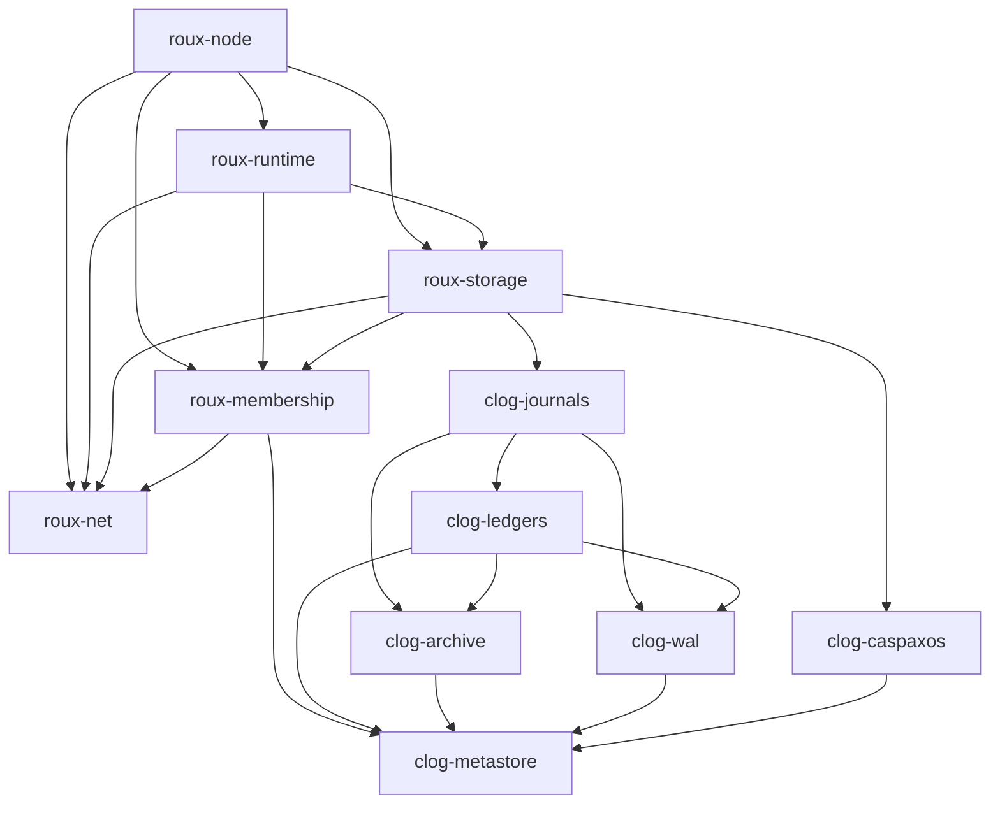
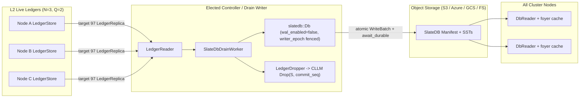

# L2 Storage (`clog-*` and `roux-storage`)

## Purpose and scope

Layer 2 provides Roux's durable storage engine and cluster storage composition. It is built from two parts in the same repository and Cargo workspace:

1. **Clog (`clog-*` crates):** the pure Rust storage engine — direct-I/O write-ahead log and multiplexed local replica store (`clog-wal`), linearizable conditional-register `MetaStore` (`clog-metastore` with `ObjectStoreMetaStore` + `InMemoryMetaStore`, plus `clog-caspaxos`), dynamic dyadic-`KeyRange` replicated ledgers and cluster control-plane policy (`clog-ledgers`), concrete SlateDB long-term archive (`clog-archive`), and single-key optimistic-CAS journals (`clog-journals`, embedding WAL-less Fjall `lsm-tree` directly for its derived warm index). `clog-*` has no dependency on any `roux-*` crate.
2. **Roux storage composition (`roux-storage`):** wires Clog into Roux's messaging (`roux-net`, system targets 96–100), ephemeral membership (`roux-membership`, `M39`), and thread-per-core grain runtime (`roux-runtime`, `R33`/`R34`/`R36`), while owning minimal `CLNR` node registry management, pluggable key routing (`KeyRouter`), `RangeEvent` lifecycle dispatch, and the `!Send` per-thread `JournalClient` bridge.

### Layer responsibilities and invariants

| Guarantee | Owner | Mechanism |
| --- | --- | --- |
| Durable linearizable control metadata (`ledger-map`, `node-registry`, `membership`) | `clog-metastore` (`ObjectStoreMetaStore`) or `clog-caspaxos` | Conditional single-register writes (`MS-I1`–`MS-I5`) |
| Single-writer ledger durability and seal finality | `clog-ledgers` + `clog-wal` | BookKeeper-style `N`-of-`Q` quorum writes (`N=3, Q=2`), create-once slot registers (`LR-I1`), irrevocable seals (`LP-I8`, `LG-I9`), local drop tombstones (`LR-I3`) |
| Dynamic range partitioning and ownership transitions | `clog-ledgers` | Dyadic `KeyRange` `CLLM` ledger map (`Bootstrap`, `Replace`, `Split`, `Merge`, `Drop`), lineage-ordered drops (`LG-I10`), irreversible retirement floors (`LG-I11`) |
| Complete history reads across live ledgers and archive | `clog-archive` (SlateDB) | SlateDB single-writer fenced drains, atomic `(rows, watermark, commit_seq)` batches, single-pass `DrainScan` message folding committing surviving `MessageProcessor` folds before advancing watermarks (`LG-I15`, `LG-I16`), `CLLM` drop watermark gating `DbReader` refresh (`HI-I1`–`HI-I4`) |
| Single-key optimistic CAS journals with end-to-end CRC-32C and atomic messages | `clog-journals` | Opaque `RowKey`, `JournalVersion(Base, Count)` admission, writer CRC-32C covering entry + attached `MessageRecord`s (`JS-I1`–`JS-I12`), slot-ordered `MessageSession` callbacks (`ST12`) |
| Non-durable single activation across handoff and crash takeover | `clog-wal` + `clog-ledgers` + `roux-storage` + `roux-runtime` | Per-ledger quorum-intersecting replica leases (`Q_lease ∩ Q_seal ≠ ∅`, piggybacked on `ReplicaWrite` + batched `ReplicaHeartbeat` when idle, RAM-only `boot_lease_horizon` on restart, `ReplicaReadTail { seal: true }` returns `lease_remaining_ms`); cooperative `PrepareRelease` drains L4 and surrenders the local lease for 0 ms wait (`ST8`, `R33`, `specs/range-handoff/`) |

### Decision summary

Decision IDs in this document use prefix `ST` (alongside base decision `C1` for SlateDB `clog-archive` and `M36`–`M39` / `N14`, `N16` / `R30`, `R33`, `R34`, `R36`).

| ID | Topic | Status | Decision |
| --- | --- | --- | --- |
| C1 | Archive store | Decided (user) | Standardize exclusively on SlateDB directly inside one concrete `clog-archive` crate (no pluggable archive trait or `ArchiveStoreKind` enum); 1 SlateDB instance per cluster (`wal_enabled = false`, fenced writer, `DbReader` + `foyer` cache on all nodes). `2^k` sharding and RFC-0025 distributed compaction are deferred. |
| ST1 | Monorepo workspace & DAG | Decided (user) | All `clog-*` crates, plans, and specs (plus RapidCluster and Fast CASPaxos) live in `ReubenBond/roux`, consolidated into 6 cohesive `clog-*` crates (`clog-metastore`, `clog-caspaxos`, `clog-wal`, `clog-ledgers`, `clog-archive`, `clog-journals`) with a strict acyclic DAG (`clog-*` ↛ `roux-*`). |
| ST2 | SlateDB key encoding & atomic drain | Decided | Order-preserving prefix-free keys `0x01 \|\| esc(RowKey) \|\| 0x00 0x00 \|\| Tag(20B)`; writer pulls closed segments via `LedgerReader` and commits rows, `\x00wm/{ledger_id}`, and `\x00meta/commit_seq` in one atomic `WriteBatch` (`await_durable = true`). |
| ST3 | Drop watermark fencing (`HI-I2`) | Decided | Roux baseline `CLLM` v1 records a monotonic scalar `archive_watermark: u64` (`commit_seq`); `clog-archive` single-flight refreshes `DbReader` whenever `observed_commit_seq < map.archive_watermark` before returning a prefix or `Absent`. |
| ST4 | Pluggable key routing contract | Decided (user, R36) | `KeyRouter::route(&GrainId) -> RoutedKey { routing_key, journal_key }`, `RowKey = routing_key \|\| journal_key`; `clog-journals` treats `RowKey` as opaque bytes (`1..=65,535` B) and computes no routing hash. |
| ST5 | Storage wire targets (96–100) | Decided | `roux.storage.v1` protobuf `Service` targets over L1 Messaging (`Lane::Normal`), bounded by `N16` 32 MiB frame/connection limits, handler budgets, and separate per-node caller FIFO budget lanes (`N29` head-first incremental decode deferred). |
| ST6 | Standard `bytes::Bytes` buffers | Decided (user, N14) | Standard `bytes::Bytes` / `BytesMut` shared natively across Messaging and Clog, plus `AlignedBuf` (`4 KiB` direct I/O) inside `clog-wal` and a small vectored `ChunkedBuf` helper. Custom slab pools, `io_uring` provided-buffer rings, incremental prefix views, and `SEND_ZC` are deferred until benchmarks justify them. |
| ST7 | Soft `ClusterController` election | Proposed | Deterministic soft election: lowest live `Active` `NodeId` in Rapid `View` ∩ `CLNR` runs `ClusterController` and opens the SlateDB `Db` writer; safety rests on `MetaStore` CAS and SlateDB `writer_epoch` fencing. |
| ST8 | Ledger-replica leases & cooperative handoff (`PrepareRelease`) | Decided (user) | Each open ledger carries a quorum-intersecting replica lease (`N=3, Q=2`, `D = 5 s`, idle heartbeat `1.5 s`, drift `ρ = 10%`, guard band `δ = 1 s`) maintained automatically by successful `ReplicaWrite` quorums and batched `ReplicaHeartbeat` RPCs (zero WAL writes; `boot_lease_horizon = boot_time + D` in RAM covers replica restarts). Sealing (`ReplicaReadTail { seal: true }`) refuses future writes/heartbeats and returns `lease_remaining_ms`; on unplanned takeover `TransitionExecutor` waits `max_{r ∈ Q_seal} lease_remaining_ms` before committing `LedgerMap` CAS (`0 ms` when the old primary has been dead/unrenewed for `> D`). For planned handoffs, `NodeControl::PrepareRelease` drives `RangeEvent::Releasing { deadline, ticket }`, surrenders the local lease on completion, and skips the wait (`0 ms`). Each ledger keeps a single immutable primary `MemberId`, and `RangeEvent::Acquired { range, ledger, lease }` serves immediately. |
| ST9 | Local warm index (`lsm-tree`, WAL-less) | Decided (user) | Drop RocksDB and drop generic `clog-state-db` abstractions; embed pure-Rust WAL-less Fjall (`lsm-tree` v3) directly in `clog-journals` behind a specialized warm journal index, skipping non-archive `RowKind::Message` rows, flushing by memtable size budget (`64 MiB`), periodic `flush_interval = 30 s` watermark checkpointing, and clean shutdown, persisting CRC-32C-checked `LedgerSegmentView` key-ordinal snapshots alongside watermarks to eliminate segment-rewind stalls on restart, and replaying from `clog-wal` / live ledgers on startup (following Enroute's WAL-less LSM strategy). |
| ST10 | Minimal `CLNR` & `MetaStore` backends | Decided (user) | `clog-metastore` provides `ObjectStoreMetaStore` (conditional PUTs via `object_store` across S3/Azure/GCS/FS) + `InMemoryMetaStore`, plus `clog-caspaxos` (Target `96`); per-cloud MetaStore crates (`clog-azure`, `clog-s3`, `clog-gcs`, `clog-fs`) are deleted. `CLNR` keeps only `NodeId`, `ProcessId`, `failure_domain`, `archive_store_id`, and `retired_revision` (endpoints live in Rapid `View`; StatefulSet ordinals, `RetireVolume`/`ScaleDown`, and diskless `ObjectLedgerStorage` are deferred). |
| ST11 | Clog format independence | Decided (user) | Roux's `clog-*` crates are algorithmically aligned with Clog without requiring byte-for-byte compatibility with C# Clog; metadata and control records (`CLLM`, `CLNR`, `CLSC`, `ArchiveStoreRecord`, wire targets) use idiomatic Rust + Protocol Buffers (`prost`/`protox`) where cleaner, while direct-I/O WAL frames (`CLFL`) and order-preserving LSM keys keep compact binary framing. |
| ST12 | Atomic journal messages (`RowKind::Message = 3`) & single-pass `DrainScan` folding (`LG-I15`, `LG-I16`, `JS-I11`, `JS-I12`) | Decided | General-purpose atomic journal message system usable for reminders, secondary index updates, CDC, audit, or any atomic outbox consumer: unversioned `RowKind::Message = 3` (4th value of `CLLB`'s 2-bit `RowKind`; `flags = 0x03 \|\| channel_len (u8, 1..=64) \|\| channel_bytes \|\| body_len (varint) \|\| body_bytes`; zero `KeyRange`, zero `VersionBefore`/`RowToken`/`Ordinal`, zero `LedgerSegmentDictionary` or `lsm-tree` index writes, zero `CLLB` header or `CLLM` changes) commits atomically in the same `LedgerBatch` slot as the journal row (`HasMessagesFlag = 0x80` on `JournalEntryRecord`). Primary `MessageSession::on_batch_durable` runs strictly in slot order after quorum durability, outside the admission lock, before warm-state apply and caller `Accepted`. `SegmentMessageFolds` folds `RowKind::Message` rows per closed segment during `DrainScan`'s single pass (sharing `DrainMemoryBytes`), committing surviving `MessageProcessor` folds before advancing SlateDB's watermark (`0x00wm/{S}`) so `LG-I16` holds directly from segment drain order. `roux-storage` exposes generic channel registration (`register_message_channel`), startup channel parity validation, roll-hint polling, and handler shutdown without knowing any upper-layer consumer. |

---

## 1. Workspace and specification layout (`ST1`)

All Clog engine crates, RapidCluster membership, Fast CASPaxos, plans, and golden vectors live in `ReubenBond/roux`. Cargo enforces the layer DAG at compile time, and `cargo xtask lint` verifies crate isolation, plane separation, single-drop-submitter authority, and absence of reverse edges.

### Crate layout



Notice the clean acyclic relationship between L2 and L3: `roux-membership` depends only on `clog-metastore` and `roux-net`, never on `roux-storage`. `roux-storage` depends on `roux-membership` to consume `ViewUpdate`s and call `report_unresponsive`. The process bootstrapper (`roux-node`) constructs the concrete `MetaStore` (`ObjectStoreMetaStore` or `clog-caspaxos` wired over L1 target `96`) first and passes it into both `roux-membership` and `roux-storage`.

| Crate | Layer | Role & owned formats/codecs |
| --- | --- | --- |
| `clog-metastore` | L2 (Clog) | Core IDs (`ClusterId`, `NodeId`, `LedgerId`, `KeyRange`), `MetaStore` trait, `ObjectStoreMetaStore` (`object_store` conditional `put_if_not_exists`/`put_if_match` across S3, Azure Blob, GCS, local FS), `InMemoryMetaStore`, fail-stop diagnostics (`FatalErrorSite`, exit codes `79..=115`) |
| `clog-caspaxos` | L2 (Clog) | Sans-I/O Fast CASPaxos proposer/acceptor core, SQLite durable acceptor & allocator stores, `CasPaxosTransport` trait wired to L1 target `96` |
| `clog-wal` | L2 (Clog) | `AlignedBuf` (`4 KiB` direct I/O), `CLFL` WAL (Linux `io_uring` in production, portable `std::fs` in dev), zero-stall staged preallocation (`prepare_file` / `publish_prepared_file` / `create_allocated_file`), group commit, `wal/node` persistence, and local multiplexed `LedgerStore` (`CLSC`/`CLSI` codecs, drop tombstones, catalog checkpoints, WAL release) |
| `clog-ledgers` | L2 (Clog) | `RowKind` (`Append=0`, `Replace=1`, `Delete=2`, `Message=3`), `RowToken`, `MessageChannel`, `CLLM` v1 / `CLLB` / `CLOE` codecs, `LedgerReplicaTransport` trait, BookKeeper `N`-of-`Q` `LedgerQuorum` (`N=3, Q=2`), `LedgerMapCommitter`, `LedgerWriter`/`LedgerReader`, `CallBudget`, and pure cluster control-plane policy (`Bootstrap`, `Replace`, `Split`, `Merge`, `Drop`, failure-triggered drains `OR-I23`, WAL-release rolls, retirement gates, load balancing) |
| `clog-archive` | L2 (Clog) | Concrete SlateDB cold archive (`slatedb`, single instance per cluster, `wal_enabled = false`), fenced drain writer, single-pass `DrainScan` + `MessageProcessor` / `MessageFold` / `SegmentMessageFolds`, `DbReader` + `foyer` cache, `(RowKey, Tag)` key codec, `LedgerDropper` integration |
| `clog-journals` | L2 (Clog) | Opaque `RowKey`, `JournalEntryRecord` (CRC-32C with `HasMessagesFlag = 0x80` atomic messages), `MessageRecord`, `MessageHandler`/`MessageSession`, `StoreParameters`, `JournalVersion(Base, Count)`, `JournalStore` (`Append`/`Replace`), `LedgerAdmission`, and specialized WAL-less `lsm-tree` (Fjall) warm journal index (skipping `!is_archive_kind` rows) |
| `roux-storage` | L2 (Roux) | Minimal `CLNR` node registry, `KeyRouter`/`RoutedKey`, L1 targets `96`–`100` (`prost` + `protox`), `ClusterController` soft election, L3 `M39` bridge, generic message-channel registration (`register_message_channel(handler, processor)`), startup parity check, generic roll-hint polling, handler shutdown (`stop_message_handlers`), L4 `RangeEvent` & `JournalClient` bridge (including atomic messages) |
| `xtask` (`dev/xtask`) | Tooling | `cargo xtask lint` enforcing Cargo DAG (`clog-*` ↛ `roux-*`, L0–L4 layering), plane isolation, single-drop-submitter, cross-crate dead `pub` items, workspace dependency inheritance; `cargo xtask schema` emitting `contracts.proto` |

Deleted/deferred by design: `clog-azure`, `clog-s3`, `clog-gcs`, `clog-fs` (replaced by `ObjectStoreMetaStore`), `clog-state-db`, `clog-rocksdb` (replaced by WAL-less `lsm-tree` in `clog-journals`), `clog-archive-slatedb` trait split, `clog-buffers`, `clog-archive-logs*`, `clog-ffi`, custom Windows IOCP WAL, and diskless `ObjectLedgerStorage` (deferred).

**Workspace discipline & I/O invariants:**
- **Type-enforced durability barriers:** Sans-I/O protocol cores (`clog-ledgers`, `clog-wal`, `clog-caspaxos`) only emit persistence-dependent acknowledgments from a dedicated `synced(durable_pos)` transition invoked after `fdatasync`/direct-I/O completion, making premature acknowledgment structurally impossible.
- **Zero-`mmap` & explicit residency:** Storage files (`clog-wal` segments, `lsm-tree` SSTs, `foyer` disk cache) are never memory-mapped (`mmap`), avoiding hidden thread stalls and `SIGBUS`. Synchronous and actor-thread code never blocks on remote object storage; cold reads hydrate via resumable async state machines with single-flight coalescing on storage threads.
- **Cargo profiles & lints:** Root `Cargo.toml` defines `[workspace.lints]` (strict Clippy restrictions: `unsafe_code`, `unwrap_used`, `expect_used`, `panic`, `indexing_slicing`, `as_conversions`, `large_futures`, `let_underscore_future`, `unchecked_time_subtraction`), `[profile.dev.package.*] opt-level = 3` for `stateright` and sans-I/O protocol crates, `[profile.lab]` (thin LTO + incremental), and `[profile.profiling]` (release + full debuginfo).

### Golden test vectors layout

```text
tests/
  shared-vectors/
    wal/          # CLFL golden vectors
    ledgers/      # CLLM v1, CLLB (incl. RowKind::Message = 3), CLOE, CLSC, CLSI golden vectors
    archive/      # SlateDB key encoding, ArchiveStoreRecord vectors
    journals/     # JournalEntryRecord (incl. HasMessagesFlag = 0x80), JournalVersion, HashRouter vectors
    storage/      # CLNR and roux.storage.v1 protobuf vectors
    jobs/         # ReminderMessageCodec and roux-jobs golden vectors
```

### Runtime and fail-stop discipline

- **Async model:** All `clog-*` crates use `RPITIT + Send` async traits on Tokio storage worker threads (running SlateDB and `object_store` natively on the same Tokio stack), while `clog-wal` runs on dedicated direct-I/O threads (using the `io-uring` crate directly on Linux and portable `std::fs` elsewhere) and `clog-journals`' embedded WAL-less `lsm-tree` (Fjall) runs its pure-Rust flushes/compactions on bounded blocking workers (`ST9`). `roux-storage` connects Roux's per-core `!Send` Tokio `LocalSet` actor threads to `clog-*` via bounded Tokio channels (§7).
- **Fail-stop on local storage faults:** Unrecoverable local storage errors (`clog-wal` write/fsync/read faults, local catalog/WAL corruption, `lsm-tree` fatal I/O errors) terminate the process immediately (`_exit` on Unix, `TerminateProcess` on Windows) with reserved exit codes `80..=115`, and invariant defects terminate with code `79`. Immediate process exit avoids partial unwinds and ensures a broken node never serves corrupt data or answers durable after a failed flush.

---

## 2. Buffers (`bytes::Bytes` and `AlignedBuf`, `ST6`, `N14`)

Standard [`bytes::Bytes`](https://docs.rs/bytes) / `BytesMut` is the single owned ref-counted byte-buffer representation shared natively across L1 Messaging (`roux-net`), `prost`, `clog-wal`, `clog-ledgers`, `clog-archive` (`slatedb`), `object_store`, and `clog-journals`, with no separate `clog-buffers` crate:

- **Direct I/O (`AlignedBuf` in `clog-wal`):** `clog-wal` owns a small `4 KiB`-aligned buffer type for Linux `O_DIRECT` WAL I/O, convertible to read-only `bytes::Bytes` via `Bytes::from_owner` when needed.
- **Vectored writes (`ChunkedBuf`):** Small internal `SmallVec<[Bytes; 4]>` helper implementing `bytes::Buf` + `&[IoSlice<'_>]` for vectored writes and splicing large payloads without linearizing multi-megabyte frames.
- **Deferred kernel zero-copy:** Per-thread multi-class page pools (`1 KiB`/`64 KiB`/`1 MiB`), cross-thread MPSC return queues, Linux `io_uring` socket provided-buffer rings with incremental written-prefix views (`IORING_CQE_F_BUF_MORE`), and `SEND_ZC` are deferred until benchmarks show standard `tokio::net` + `BytesMut` allocation/copying exceeds 5% CPU.

---

## 2a. Specialized local warm journal index (`ST9`, WAL-less `lsm-tree`)

Rather than mirroring Clog's generic `clog-state-db` / `StateDatabase` CRUD traits and shipping a C++ RocksDB dependency (`clog-rocksdb`), `clog-journals` directly embeds **`lsm-tree` v3** (the pure-Rust, WAL-less LSM core of Fjall) behind a specialized, domain-specific warm journal index:

- **WAL-less by design (following Enroute):** `clog-wal` + replicated `LedgerStore` already provide durability for every acknowledged journal write (`Q` of `N` replicas). Writing a second local WAL inside an LSM would double disk I/O and fsync overhead for a strictly derived index.
- **Startup recovery:** On node start, `clog-journals` opens its `lsm-tree` index under `{root}/index/` (or rebuilds from empty if missing/stale) and replays any uncommitted suffix from its live open/closed ledgers in `clog-wal` / `LedgerStore` up to each ledger's durable tail. Because the index is derived, it is never authoritative for durability.
- **Size-based, periodic (`30 s`), and clean-shutdown flushing:** Derived index flushes are driven by the `lsm-tree` memtable size budget (`64 MiB` write buffer), a default periodic `flush_interval = 30 s` watermark flush, and clean node shutdown (optionally disabling periodic flushes via `None`). Periodic 30 s flushes carry negligible steady-state cost while bounding post-crash (`SIGKILL` / VM power-off) replay to at most ~30 s of unindexed WAL slots rather than re-scanning gigabytes from slot 0.
- **Batched, bounded `LedgerApplyLoop` catch-up, priority foreground wake, & closed-ledger read-repair suppression (`JournalStateDatabase`):** `LedgerApplyLoop` bounds node-wide in-flight scan reads with a shared background semaphore (`max_concurrent_scan_reads = 32` across background deliveries) plus a dedicated **priority scan window (`16` permits)** for ledgers woken by foreground catch-up waiters (`WaitForReplicatedCatchUp` / `LedgerApplyLoop::wake`, covering both open and closed replicated ledgers) ahead of background open-ledger indexing, fetching consecutive slots via batched `LedgerReplica::ReadRange` RPCs (up to `128` slots / `1 MiB` per call, unpacked via zero-copy `Bytes::slice` without issuing speculative remote hedges against healthy local NVMe). Once the ledger map records a ledger `Closed(T)`, `LedgerReader` suppresses read-repair recovery writes on the local replica (every slot below `T` is already durable on `Q` replicas under `LP-I7` and the ledger is draining to drop; open-ledger read repair stays active). `LedgerApplier` provides an explicit `flush()` invoked at the end of each `LedgerApplyLoop` scan pass (when the scan reaches its target or stops on backpressure). Within a replicated scan pass, `JournalStateDatabase`'s applier buffers consecutive decided slots per ledger up to `1,024` rows or `1 MiB` and commits them in one atomic `lsm-tree` `WriteBatch` — flushing immediately when either bound is reached, when a catch-up waiter's target watermark is satisfied (both on waiter arrival and during `apply`), or on `flush`/`remove`. On graceful shutdown, `JournalStateDatabase::flush()` drains all remaining buffered replicated slot batches into the index before flushing durable SSTs. This prevents single-slot index-write bottlenecks when a rejoined node catches up closed predecessors while keeping steady-state and waiting reads unblocked.
- **Persisted active `LedgerSegmentView` key-ordinal snapshots (`ST9`, `LG-I13`):** `JournalStateDatabase`'s `LedgerApplier` persists optional, rebuildable CRC-32C-checked `LedgerSegmentView` snapshots (`segment_start`, `last_slot`, and `(ordinal, defining_slot, key_bytes)` dictionary entries) alongside each ledger's watermark in the local `lsm-tree` warm index (`load_segment_view` / `save_segment_view`, saved periodically every `15 s` when advancing and at the exact final watermark on graceful shutdown, and deleted on `drop_ledgers`). On restart, a restored snapshot at `watermark - 1` resumes `LedgerApplyLoop` directly at `watermark` with zero rewind; an earlier in-segment snapshot after a hard crash resumes at `last_slot + 1`; an absent, mismatched, or corrupt snapshot safely falls back to the `LG-I13` full segment rewind. *(Rationale: with 128 MiB open segments of ~40k slots each, restarting `LedgerApplyLoop` with an empty `LedgerSegmentView` forces `LedgerReader::scan` to rewind to slot 0 — ~8 GiB across 63 ledgers — just to rebuild a ~50 KiB in-memory dictionary, causing a 10–13.8 s stall on restart.)*
- **Descending key-index reads stopping at the first verified base via batched `ReadSlots` (`ArchiveReader` / `JournalStateDatabase`):** Because the local `lsm-tree` key index records every write to a key in a ledger without pruning pre-`Replace` entries (full-key hash-collision verification happens when reading the batch), indexed ledger reads MUST walk `KeyIndexEntry` slots **descending (newest -> oldest)** in bounded waves (`clamp(K, 16, 32)` entries per wave), fetching each wave's distinct `(defining_slot, row_slot)` set via **one batched scattered-slot `LedgerReplica::ReadSlots` call per wave** (`~32–64×` fewer RPCs during cold recovery and migration), resolving each entry's `defining_slot` when distinct for full-key collision verification, **stopping immediately** once a verified matching base row (`Replace`, `Delete`, or `Expired`) is decoded, and skipping older ledgers and the SlateDB archive store once a newer ledger yields a verified base. The collected `[base .. newest]` slice is then re-ordered chronologically before returning. *(Rationale: walking ascending from slot 0 causes `O(total historical writes in ledger)` single-slot reads; and even when walking descending, migrating hundreds of active grains onto a freshly rejoined node issues `grains × wave_size` — e.g., `400 × 32 = 12,800` — interleaved single-slot `Read` RPCs into the 128-slot `Read` lane, causing head-of-line FIFO starvation, `p99 = 12 s` spikes, hedge storms, and activation timeouts.)*
- **Specialized interface:** `clog-journals` owns only the exact operations journals need — per-ledger warm entry lookup/range scan, latest version/metadata tracking, and whole-ledger drop when a ledger is drained to SlateDB and dropped from `CLLM` — with no generic key-value database trait crate. Both live apply and predecessor scans skip `!RowKind::is_archive_kind(row.kind)`, so `RowKind::Message` rows write zero entries into `lsm-tree` (`LG-I15`).
- **Simulation & testing:** Because `lsm-tree` is pure safe Rust with no C++ FFI, `turmoil` deterministic simulation runs the real `lsm-tree` implementation directly on per-node temp/simulated directories, cross-checked against a simple `BTreeMap` reference model for crash/replay equivalence.

## 2b. Hot-path concurrency, allocation, and zero-copy discipline

Performance baselines from Clog (Row 5.4, `ReubenBond/clog#462`, L2/L3/L4 hot-path optimization passes, and the 11-round `v1 → v11` 3-node NVMe benchmark campaign synthesized in [Storage performance & resilience learnings](storage-performance-learnings.md)) established specific structural patterns that Roux adopts directly in `clog-wal`, `clog-ledgers`, `clog-journals`, and `roux-storage`:

- **L1 (`clog-wal` `LedgerStore` / `LiveReplica`) — exact per-replica slot claims (`LS-I7`):** Track in-flight slot mutations in a per-`LiveReplica` map (`HashMap<Slot, Option<Notify>>`) under the replica's state rather than hashing or striping locks across ledgers or modulo slot numbers. Uncontended writes insert `None` with zero waiter allocation; only exact `(replica, slot)` contention allocates a cancellation-safe waiter and releases the slot claim and in-flight-writer guard atomically. Distinct ledgers and distinct slots within a ledger enter `clog-wal` group commits concurrently. Decouple `TailSlotSpan = 1024` (slot-table freezing and tail preloading) from mutation concurrency.
- **L2 (`clog-ledgers` `LedgerQuorum` & `LedgerWriter`) — zero-copy fan-out and lean quorum coordination:**
  - Share one immutable `Bytes` payload across all `N` replicas via O(1) `Bytes::clone()`.
  - Coordinate quorum writes in a fixed-capacity inline slot array (`N <= 5`) with an atomic completion counter that resolves immediately at `Q` acknowledgments, and track stragglers via an atomic counter plus a lazy shutdown `Notify`.
  - Keep attempt 0 on a direct fast path (constructing backoff/retry state only on `Backpressure` or transient failure) and fast-path uncontended batch creation in `LedgerWriter`.
  - When a retry loop exits because cancellation fired concurrently with a transient I/O error, surface cancellation rather than leaking the stale transient error.
- **L3 (`clog-journals` `JournalStore`, `LedgerAdmission`, `ArchiveReader`) — inline fast paths, adaptive coalescing, and concurrency defaults:**
  - Route `JournalStore::route(key)` against a lock-free immutable snapshot (`Arc<[Served]>`) instead of acquiring a mutex per write.
  - In `LedgerAdmission`, drive an uncontended first batch inline on the caller task rather than unconditionally hopping through a channel + spawn, and represent per-key wait queues as `Empty | One(P) | Many(Vec<P>)` (or `SmallVec<[_; 1]>`) so uncontended writes allocate zero queue vectors.
  - **Adaptive proposal coalescing (`LedgerAdmission`):** When a ledger is idle (`outstanding == 0`), propose immediately with zero extra latency. While `outstanding >= 1` and `< sequencer_window` (and admission is neither draining for `PrepareRelease` nor blocking writers waiting for queue room), coalesce small queued writes into a single multi-row `LedgerBatch` until either an in-flight proposal finishes or unbatched entries reach `max_batch_entries` (`256`) or `min(64 KiB, max_batch_bytes)` (default `max_batch_bytes = 1 MiB`), at which point the next batch pipelines immediately up to `sequencer_window` — eliminating 1-row RPC amplification under moderate per-ledger concurrency.
  - **History-read concurrency (`max_concurrent_history_reads = 64`):** Allow 64 concurrent history reads per node (loads and owner reads combined, FIFO `CallBudget`, holding a slot only while reading the archive and live replicas) so cold journal activations, bulk population, and post-handoff warm-state reloads avoid serializing behind a narrow semaphore.
  - **Snapshot-request floor & bounded append chain (`REPLACE_REQUEST_MIN_BYTES = 64 KiB`, `REPLACE_REQUEST_MAX_APPENDS = 128`):** `is_replace_requested` requests compaction when `bytes_since_base > max(64 KiB, α * base_length)` (`α = 1`) **OR** `appends_since_base >= 128`. Combining the 64 KiB byte floor with a 128-append cap cuts small-payload compactions 4× relative to 32 while keeping cold recovery and migration tail reads bounded to at most 128 links (~64 average, fetched in 2–4 concurrent descending waves).
  - Keep `JournalEntryRecord` header fields inline with a `Bytes` payload reference, encode records directly into pre-sized `BytesMut` batch/wire buffers (`write_to`), and walk batch rows with O(1) `Bytes::slice` cursors.
  - Expose a `JournalWarmState::touch(entry_handle)` overload to refresh an already-looked-up warm entry without re-hashing `RowKey`.
  - In `ArchiveReader`, fast-path 0 open ledgers, 1 open ledger, single-chunk fold, and single-slot indexed fetches without heap map/vector allocations, walk key-index entries **descending (newest -> oldest)** fetching each wave's distinct `(defining_slot, row_slot)` set via one batched scattered-slot `ReadSlots` call per wave, stopping at the first verified matching base row (`Replace` / `Delete` / `Expired`) and skipping older ledgers and SlateDB once a newer ledger yields a verified base (§2a), and short-circuit folds on `Delete` / empty-body sentinels.
- **L4 (`roux-storage` transport & host dispatch) — stateless direct dispatch, dead-node fast-fail, and true zero-copy wire buffers:**
  - Expose stateless direct replica operations (`LedgerStore::write_replica`, `read_replica`, `read_replica_tail`) bypassing per-RPC handle/options wrappers.
  - **Dead-node & stopping-incarnation transport fast-fail:** On `N`-node clusters during degraded `Q`-of-`N` operation (graceful departure or crash where a dead replica remains in the ledger's `N`-replica ensemble), `LedgerReplicaTransport` checks its cached `CLNR` node registry and Rapid membership view (cached by reference/epoch on the peer state) before acquiring caller FIFO call budgets, copying payloads, or issuing an RPC. When the target `NodeId` has no `Active` registered host, or when a peer's resolved `(NodeId, HostIncarnation)` has already answered `NodeStopping` or transport-unavailable during the brief membership-gossip gap, the transport records the stopping/unavailable incarnation, triggers a single-flight rate-limited stale-cache registry re-read if needed, and fails fast locally as `Unavailable` with zero effect (clearing the stopping mark once the node registry advances to a newer active host incarnation) — eliminating per-batch RPC retries and exception storms against dead or stopping peers so healthy hosts sustain full or higher throughput.
  - **True zero-copy wire buffer framing:** Replica write payloads, single-slot `Read` replies, batched multi-slot `ReadRange` replies, and batched scattered-slot `ReadSlots` replies cross the wire with zero intermediate user-space copies — writing directly from shared immutable ref-counted `Bytes` (`Bytes::clone()` per peer) into the transport send buffer and reading directly from receive buffers into exact-sized `Bytes`, with deterministic RAII release on both send completion and drop-before-send (and forwarded `JournalEntryRecord` payloads encoded directly into exact-sized outbound `BytesMut` frames, avoiding fixed-size oversized pool-bucket padding or leaked pool buffers).
  - Admit replica writes and tail reads directly on the storage path, hopping back to the controlling actor only on ownership mismatch (`NotThisNode`).

## 2c. Zero-stall staged WAL preallocation (`clog-wal`, `WAL-I3`, `WAL-I7`)

With `preallocate_files = true`, zero-filling initializes WAL file blocks ahead of live writes so direct-I/O appends update neither file length nor unwritten-extent metadata (avoiding per-write metadata sync overhead on ext4/NTFS). `clog-wal` decouples zero-fill staging from file-number publication so write bursts and shutdowns never stall on zero-fill I/O:

- **Decoupled staging and `< 1 ms` publication (`WAL-I3`):**
  - `WalDirectory::prepare_file(preallocated_len, pace)` stages an unpublished, zero-filled temporary (`prealloc-{id}.tmp` under `wal/`) without assigning a file number or publishing a directory entry. It writes 4 MiB chunks through the page cache, syncs every `ZERO_FILL_SYNC_BYTES = 64 MiB` and at completion (minimizing device-flush contention with live `fdatasync`s), and advises Linux to drop the synced pages (`POSIX_FADV_DONTNEED`) so direct-I/O writes never trigger inline cache invalidation. Cancelling its shutdown token stops at the next chunk, closes the handle, and unlinks the temporary cleanly without reporting a storage failure; startup open deletes any leftover `*.tmp` files.
  - `WalDirectory::publish_prepared_file(prepared, file, header)` writes the 1-page `CLFL` header at offset 0 of a completed `PreparedWalFile`, syncs that page, verifies the storage can serve the file, atomically renames `prealloc-{id}.tmp` to `{file:020}.clfl`, flushes the directory, and opens the published file in `< 1 ms`. Consuming `prepared` makes subsequent drop a no-op; header, length, and name are durable on return (`WAL-I3`).
- **Pacing and hurry vs. cancel separation:**
  - Each open starts with a 4 MiB file (or `file_size`, if smaller) created via `create_file` and doubles each subsequent file up to `file_size`.
  - Background staging starts at **12.5%** (1/8 full) while file sizes are doubling and at **25%** (1/4 full) at steady `file_size`.
  - Before each zero-fill chunk, pacing spreads the remaining bytes over the projected time for the current file to reach **75%** (`PREPARE_READY_FILL`), capped at 1 s per wait. A dedicated **hurry token** (separate from the shutdown cancel token) is cancelled immediately when the current file crosses 75% or when a roll occurs, waking the paced fill at once to finish at full speed without cancelling staging.
- **Zero-stall rollover and early switch:**
  - **Staged file ready and fits `data_pages`:** `roll` publishes it via `publish_prepared_file` in `< 1 ms`.
  - **Staging still in flight during a write burst:** `roll` never blocks waiting for zero-fill; it cancels the hurry token so background staging finishes at full speed and rolls immediately into a `< 1 ms` `fallocate` (`create_allocated_file`, `allocated = true`) file. Once background staging finishes, the next fitting record switches early to the staged file via `publish_prepared_file` (replay truncates unused zero tail pages of earlier files).
  - **Single record larger than a ready staged file:** `roll` leaves the unpublished staged file available for the next normal roll and creates the oversized file directly via `create_allocated_file`, publishing zero skipped empty `.clfl` files.
  - **Faulted staging:** `roll` surfaces the failure and stops the log (`WAL-I8`).
  - **Bulk mode:** An EWMA (weight 1/8) of durable group bytes enters bulk mode at `>= 3 MiB` (suppressing new zero-fill staging and rolling directly to `create_allocated_file`) and leaves below `1 MiB` (staging an unpaced zero-filled file and switching early once ready).
- **Transitive `previous_files_durable` window check (`WAL-I7`):** A data page is submitted only when every page `W` or more before it in its file and every page of all earlier files in the current open is durable, preserving `WAL-I7` across consecutive fast rolls between allocated and staged files.

---

## 3. Concrete SlateDB Archive (`clog-archive`, `C1`, `ST2`, `ST3`)

Roux standardizes exclusively on SlateDB directly inside one concrete `clog-archive` crate (no pluggable `ArchiveStore` trait split or `ArchiveStoreKind` enum). Live Clog ledgers serve as level 0; closed segments drain into SlateDB over `object_store`; once a closed ledger is completely drained and durable in SlateDB, `LedgerDropper` removes it from `ledger-map` (`CLLM`).

### Topology



- **Single SlateDB instance per cluster (v1):**
  - One elected drain writer (co-located with the soft-elected `ClusterController`, `ST7`) opens `slatedb::Db` with **`wal_enabled = false`** (Clog's closed segments are already durably replicated on `Q` of `N` ledger replicas, so a second object-store WAL write would double write amplification and object-PUT latency with no durability benefit).
  - SlateDB's built-in manifest `writer_epoch` fencing (`Db::open` CAS on the SlateDB manifest) guarantees at most one active writer can commit flushes; a superseded writer fails immediately with `SlateDBError::Fenced` and steps down.
  - Every node opens a read-only `slatedb::DbReader` backed by SlateDB's `foyer` in-memory + optional local NVMe disk cache, serving point/prefix archive reads locally with zero coordination with the writer.
  - `2^k` fixed-prefix SlateDB sharding and SlateDB RFC-0025 distributed compaction are deferred until single-instance drain throughput saturates.

### Key and value layout (`ST2`)

All keys in SlateDB share a 1-byte namespace prefix:

| Namespace | Key layout | Value layout | Purpose |
| --- | --- | --- | --- |
| `0x00` Metadata | `0x00 || "meta/store"` | `ArchiveStoreRecord` UTF-8 text (`id`, `layout=slatedb-v1`, caller parameters) | Created once at cluster genesis; verified by every node's `ArchiveGate` (`OR-I8`, `OR-I20`) |
| `0x00` Commit seq | `0x00 || "meta/commit_seq"` | `u64` big-endian | Monotonic drain commit counter incremented atomically in every drain `WriteBatch` |
| `0x00` Watermarks | `0x00 || "wm/" || ledger_id_u64_be` | `watermark_slot: u64_be \|\| complete: u8 (0\|1) \|\| tail_t: u64_be` | Per-ledger drain progress (always a segment start, or `T` when `complete = 1`) |
| `0x01` Row data | `0x01 || esc(row_key) || 0x00 0x00 || tag_20b` | `kind: u8 (0=Append, 1=Replace) \|\| body` | Decided journal rows in exact `(RowKey, Tag)` order |

**Key encoding rules:**
- `esc(row_key)` escapes every `0x00` byte in `row_key` as `0x00 0xFF`, terminated by `0x00 0x00`. This encoding is **strictly prefix-free** and **order-preserving**: `row_key_a < row_key_b` iff `esc(row_key_a) || 0x00 0x00 < esc(row_key_b) || 0x00 0x00`, and no encoded key can be a prefix of another.
- `tag_20b` is `ledger_id_u64_be (8B) || slot_u64_be (8B) || row_index_u32_be (4B)` — exact ascending Clog `Tag` order.
- A read for `row_key` performs one SlateDB prefix scan over `[0x01 || esc(row_key) || 0x00 0x00, 0x01 || esc(row_key) || 0x00 0x01)`, yielding only `row_key`'s archived rows in ascending `Tag` order while preserving `KeyRange` SST block locality.
- **Key-length bound (`admits_key`):** SlateDB keys fit a `u16` length (`<= 65,535` bytes). `clog_archive::admits_key(row_key)` requires `1 + escaped_len(row_key) + 2 + 20 <= 65,535` (always satisfied by Roux's `GrainId <= 1 KiB` plus bounded `RoutingKey`).

**Why writer-pulled segment drains over primary-pushed drains:**
- Having the elected writer pull closed segments directly through `LedgerReader::scan_async` (reading from live replicas over target 97 `LedgerReplica`, reusing Clog's existing `MaxNodeCallBytes` budget, read-ahead cap, and CRC-32C verification) avoids adding a streaming upload RPC on `ClusterControl`, removes primary-crash drain handoff races, and handles closed ledgers whose primary died uniformly.
- For failure-triggered drains (`OR-I23`), a primary noticing only `Q` live replicas ends its open segment with `LedgerWriter::end_segment_async()` (marker at slot `m`) and reports `(ledger_id, m)` in `NodeReport` so the SlateDB writer prioritizes draining `[watermark, m)` ahead of routine drains. Routine drain concurrency is paced at `max_concurrent_drains = 2` per node plus `1` reserved slot for exposed `OR-I23` failure-triggered drains (`3` max concurrent drains per node) so failure-triggered drains do not saturate CPU cores during peer departure.

### Atomic segment drains and `HI-I2` drop watermarking (`ST2`, `ST3`)

1. **Draining a closed segment:**
   - The drain worker scans one closed segment `[start_slot, next_start)` of ledger `S` via a bounded-window `LedgerRangeReads` pipeline (`LedgerReader::scan_async`, inlining already-ready/cached reads as `PendingRead::Ready` rather than spawning per-slot tasks), walking rows via O(1) `Bytes::slice` views. It deduplicates and folds within-segment superseded rows (preserving the final `Replace` opener's exact `Tag` and all subsequent `Append`s) using a reusable contiguous key arena and open-addressing index table across drain cycles to avoid per-key heap allocations.
   - It constructs a single `slatedb::WriteBatch` containing:
     - `put(0x01 || esc(row_key) || 0x00 0x00 || tag, kind || body)` for each surviving command in the segment;
     - `put(0x00wm/{S}, { watermark: next_start, complete: is_closed_and_reached_T, tail_t })`;
     - `put(0x00meta/commit_seq, next_seq)` where `next_seq = writer_commit_seq + 1`.
   - It commits via `db.write_with_options(batch, WriteOptions { await_durable: true })` (with `wal_enabled = false`, SlateDB flushes the L0 SST and updates the SlateDB manifest durably before returning; concurrent segment drains on the writer coalesce into one L0 flush + manifest commit).
   - Because all three writes land in one atomic `WriteBatch` and are flushed durably together, no watermark or `commit_seq` can ever become visible without its segment rows, and re-draining the same segment after a writer crash is idempotent (overwriting identical immutable `(RowKey, Tag)` keys and advancing `commit_seq`).

2. **Dropping ledgers (`CLLM` v1 watermark):**
   - Once a closed ledger `S` has `complete = 1` at `tail_t = T` committed durably at `commit_seq = s`, `LedgerDropper` submits `LedgerMapChange::Drop { ledger: S, archive_watermark: s }` to `LedgerMapCommitter` (preserving lineage order `LG-I10`).
   - Roux's baseline `CLLM` v1 header includes a monotonic little-endian `archive_watermark: u64` field immediately before `ledger_count` (`new_wm = max(old_wm, drop_wm)`).

3. **Reading with `HI-I2` guarantee (`SlateDbArchive::read`):**
   - Each reading node caches `observed_commit_seq: AtomicU64` corresponding to its current `DbReader` manifest snapshot.
   - When `ArchiveReader::read(row_key, map)` calls `SlateDbArchive::read(row_key, map)`:
     1. If `observed_commit_seq < map.archive_watermark`, join or trigger a single-flight `DbReader` refresh, then read `0x00meta/commit_seq` from the refreshed `DbReader` and update `observed_commit_seq`.
     2. If after refresh `observed_commit_seq < map.archive_watermark`, return `ArchiveError::Corrupt` (the archive store rolled back or disagrees with `CLLM`).
     3. Scan `[0x01 || esc(row_key) || 0x00 0x00, 0x01 || esc(row_key) || 0x00 0x01)` on `DbReader`.
     4. Filter scanned entries by `map.no_longer_lists(tag.ledger_id)` (exact Clog `LedgerMapCoverage` predicate: rows of live listed ledgers are discarded here and read from the live ledgers by `ArchiveReader`).
     5. Fold retained entries in `Tag` order (restarting at `Replace`):
        - No retained entries -> `ArchiveRead::Absent`.
        - Retained entries -> `ArchiveRead::Read(ArchivePrefix { token: RowToken::ORIGIN, version_base: last_tag_20b, has_base, content })`.
     6. If SlateDB returns a stale-snapshot/missing-SST error during scan, return `ArchiveRead::Stale` so `ArchiveReader` refreshes and retries.

**Reclaiming superseded rows:**
- Superseded rows (entries strictly below a `Replace` opener whose `ledger_id` is already dropped) are safe to delete on the elected writer or via a SlateDB compaction filter keyed by a durable safe-dropped set, **always retaining the newest row's tag** so `VersionBase` never regresses (`HI-I4`).

**SlateDB API integration note (verified against `slatedb`):**
- `slatedb::DbReader` polls the manifest on `manifest_poll_interval`, exposes `manifest()`, `status()`, `subscribe() -> watch::Receiver<DbStatus>`, and `scan_prefix()`, and does **not** expose an explicit `DbReader::refresh()` method.
- When `observed_commit_seq < map.archive_watermark`, `clog-archive` performs a single-flight refresh by awaiting `subscribe()` for an imminent poll or opening a fresh `DbReader` sharing the same `Arc<dyn DbCache>` (`foyer`) block cache (zero cache cold-start), then re-reading `0x00meta/commit_seq`. Formally checked in [`specs/archive/slateArchive.qnt`](../../specs/archive/slateArchive.qnt).

---

## 3a. Atomic journal messages (`RowKind::Message = 3`) and single-pass `DrainScan` folding (`ST12`, `LG-I15`, `LG-I16`, `JS-I11`, `JS-I12`)

Clog provides a general-purpose atomic journal message system usable by any upper-layer consumer (reminders, secondary index updates, CDC, audit, or atomic outbox pipelines). Small typed messages ride as **unversioned `RowKind::Message = 3` rows** inside the same `CLLB` batch and quorum write as a journal entry, and drain in the same single-pass `DrainScan` over each closed segment with zero `CLLB` header changes, zero `CLLM` (`LedgerMap`) changes, and zero warm-index writes.

### Ledgers: unversioned `RowKind::Message = 3` and `MessageChannel` (`clog-ledgers`)

- **`RowKind`:** `Append = 0`, `Replace = 1`, `Delete = 2`, **`Message = 3`** (occupying the unused 4th value of `CLLB`'s 2-bit `KindMask` in row flags).
  - `RowKind::is_defined(kind)` accepts all four kinds (`0..=3`) in `clog-ledgers` (`BatchView`, `LedgerBatch`).
  - `RowKind::is_archive_kind(kind)` accepts only keyed archive kinds (`0..=2`); `JournalStateDatabase` / `lsm-tree` apply, `ArchiveReader`, `ArchiveRow::Live`, and SlateDB row encoding skip `!is_archive_kind` uniformly so `RowKind::Message` rows never enter `lsm-tree` or SlateDB SSTs (`LG-I15`).
- **`MessageChannel`:** Validated immutable ASCII channel/topic identifier matching `[a-z0-9._-]` of length `1..=64` bytes.
- **Unversioned `CLLB` row layout for `RowKind::Message = 3`:**
  ```text
  flags         (u8 = 0x03; Kind = Message, DefiningFlag = 0, bits 3..=7 = 0; 0x07 rejected as bad-row-flags)
  channel_len   (u8, 1..=64; 0 -> empty-message-channel, > 64 -> message-channel-too-long)
  channel_bytes ([u8], ASCII [a-z0-9._-]; invalid byte -> bad-message-channel)
  body_len      (varint)
  body_bytes    ([u8], body_len bytes)
  ```
  - Carries zero `KeyRange`, zero `VersionBefore`, zero `RowToken`, and zero ordinal.
  - `LedgerBatch::begin_message(channel, body_len, body_head)` writes a `RowKind::Message` row directly without checking `range.contains(...)`, touching `LedgerSegmentDictionary`, or consuming `max_segment_keys`.
  - `LedgerSegmentView` ignores `RowKind::Message` rows when maintaining segment dictionary entries and ordinals, and `ClusterController` imposes no split-depth cap.
- **Invariants:**
  - **`LG-I15`:** Every `RowKind::Message` row is protected by its batch's CRC-32C, decided atomically with its batch's slot and keyed rows, addressed by an unversioned `MessageChannel`, consumes zero segment-dictionary or `lsm-tree` index entries, and is excluded from SlateDB SSTs and all `ArchiveReader` journal folds.
  - **`LG-I16`:** Every segment `[a, b)` whose batches contain `RowKind::Message` rows validates and folds them into registered `MessageProcessor`s during `DrainScan` and commits every surviving channel fold durably before advancing SlateDB's watermark (`0x00wm/{S}`) past `b` (including message-only segments with zero archive rows), so no closed ledger is marked complete or dropped (`LG-I10`) before all its messages are durably drained.

### Journals: atomic messages, `JournalEntryRecord` framing, and 2-method session seam (`clog-journals`)

```rust
/// Validated passthrough message attached atomically to an Append, Replace, or Delete write.
pub struct MessageRecord {
    pub channel: MessageChannel,
    pub payload: Bytes, // 0..=MAX_PAYLOAD_LENGTH (65_536 bytes)
}

/// Registered once per MessageChannel on JournalStore.
pub trait MessageHandler: Send + Sync + 'static {
    fn channel(&self) -> &MessageChannel;
    /// Pure pre-admission payload validator; never performs I/O.
    fn validate(&self, payload: &[u8]) -> Result<(), InvalidDataError>;
    /// Opens isolated per-ledger state when LedgerAdmission starts serving a fresh ledger at slot 0.
    fn open_ledger(&self, ledger: LedgerId) -> Box<dyn MessageSession>;
    /// Optional roll hints for open ledgers whose in-memory session state exceeds its budget.
    fn collect_ledgers_needing_roll(&self) -> Vec<LedgerId> { Vec::new() }
    /// Stops background work (such as primary-side timers or dispatch loops) before JournalStore disposal.
    async fn stop(&self) {}
}

/// Owns per-ledger runtime state for one message channel on its primary.
/// Drop runs once, strictly after the last possible on_batch_durable (JS-I12).
pub trait MessageSession: Send + 'static {
    /// Invoked strictly in slot order outside LedgerAdmission's lock AFTER quorum durability,
    /// BEFORE warm-state Apply and BEFORE callers receive Accepted (JS-I12).
    /// Always called with non-empty `messages`; performs no blocking I/O.
    fn on_batch_durable(&mut self, slot: Slot, messages: &[MessageRecord]);
}
```

- **`JournalEntryRecord` wire layout (`JS-I5`):**
  - Bit 7 (`0x80`, `HAS_MESSAGES_FLAG`) of `JournalEntry`'s kind/flags byte signals attached messages.
  - When bit 7 is `0`, the layout is unchanged (`FIXED_MAX_HEAD_LENGTH = 56` fast path).
  - When bit 7 is `1`: permitted on `Append`, `Replace`, and `Delete`; rejected on `Expired` (`expired-messages`). Immediately after the fixed head fields and before `payload`:
    ```text
    message_count: u8 (1..=255; 0 rejected as empty-messages)
    repeat message_count times:
      channel_len:   u8     (1..=64)
      channel_bytes: [u8]   (ASCII [a-z0-9._-])
      payload_len:   varint (0..=65_536)
      payload_bytes: [u8]
    ```
  - **Procedural decode rejection order:** `expired-messages` -> `truncated` (`message_count`) -> `empty-messages` -> per entry: `truncated` (`channel_len`) -> `empty-message-channel` -> `message-channel-too-long` -> `truncated` (`channel_bytes`) -> `bad-message-channel` -> `truncated` (`payload_len`) -> `bad-varint` -> `message-payload-too-long` -> `truncated` (`payload_bytes`).
  - A single writer-computed CRC-32C covers `row_key || head || messages || payload`. Decoded message payloads are copied into one compact detached buffer sliced into `Arc<[MessageRecord]>` (preserving zero-copy `Bytes::slice` for `payload`), and `without_payload()` drops `payload` while preserving `messages` until `on_batch_durable` finishes.
- **Pre-admission validation and atomic batching (`JS-I11`, `JS-I12`):**
  - Pre-admission checks (returning `JournalArgError`, mapped to `ForwardWriteResponse::Refused { kind: Argument, .. }` on target `98` — never `Ambiguous`): every attached channel is registered, `messages.len() <= max_messages_per_write` (default `8`), `sum(payload.len()) <= max_message_bytes_per_write` (default `65_536`), every `handler.validate(payload)` returns `Ok(())`, and the single-entry batch fits within `min(max_batch_length, max_queued_bytes, max_proposal_bytes)`.
  - `JournalStore` startup checks include `max_messages_per_write` unversioned `RowKind::Message` rows (max channel length `64` + `max_message_bytes_per_write`) in `LedgerAdmission::largest_batch()` when handlers are registered; messages consume zero `max_segment_keys`.
  - `Rejected`, `ReplaceRequired`, `Moved`, and `Fenced` leave zero `RowKind::Message` rows in any ledger (`JS-I11`).
  - `TakeBatch` counts journal entries against `max_batch_entries`, counts archive rows against `max_segment_keys`, sizes headers with `total_rows = sum(1 + pending.messages.len())`, charges message wire bytes to `queued_bytes`, and writes each attached message via `batch.begin_message(&msg.channel, msg.payload.len(), &msg.payload)`.
  - Ordinary 0-message batches keep the synchronous fast-apply shortcut whenever `!entries.has_messages && message_callbacks_pending == 0`. Batches carrying messages (or arriving while `message_callbacks_pending > 0`) complete through the single-reader proposal completion loop: on `ProposalOutcome::Durable(slot)`, `on_batch_durable(slot, channel_messages)` executes strictly in slot order outside the admission lock for each channel with `>= 1` message in the batch (an unexpected panic/defect triggers fail-stop `FatalErrorSite` exit 79, fails the batch, and leaves warm state untouched), then acquires the lock to apply warm state and complete callers `Accepted`. Session cleanup (`Drop`) runs once at the first non-`Durable` outcome or loop exit, strictly after the last possible `on_batch_durable`; cooperative `PrepareRelease` + cancel-drain retains live sessions.
- **Cluster-wide `StoreParameters`, generic channel registration, and startup parity (`OR-I8`):**
  - Upper-layer compositions (such as `roux-node` wiring `roux-jobs` or other L4 consumers) register each channel into `roux-storage` via `register_message_channel(handler, processor)`. `roux-storage` remains completely agnostic to channel semantics and payload codecs.
  - `StoreParameters` derives `message-channels` (comma-separated ordinal-sorted registered channel names, `""` when empty), `max-messages`, and `max-message-bytes` directly from registered `MessageHandler`s and persists them in SlateDB `0x00meta/store` (`ArchiveStoreRecord`).
  - `ArchiveGate` validates `message-channels` agreement **before** passing the gate (a mismatch refuses `ArchiveGate` permanently and triggers handoff of ledgers on the mismatched node); node startup also asserts exact set equality between registered `MessageHandler`s and registered `MessageProcessor`s (`validate_message_channel_parity`).

### Archive: single-pass `DrainScan` message folding (`clog-archive`)

```rust
// In clog-archive (control plane, alongside DrainScan and ByteBudget)
pub trait MessageProcessor: Send + Sync + 'static {
    fn channel(&self) -> &MessageChannel;
    fn begin_segment_fold(
        &self,
        ledger: &LedgerMetadata,
        segment: LedgerSegmentId,
    ) -> Box<dyn MessageFold>;
}

pub trait MessageFold: Send + 'static {
    fn memory_bytes(&self) -> usize;
    /// Folds one RowKind::Message row's borrowed payload (valid for the duration of the call).
    /// Fails closed with ArchiveCorruptError on malformed payload.
    fn add(&mut self, slot: Slot, row_index: u32, payload: &[u8]) -> Result<(), ArchiveCorruptError>;
    /// Resets accumulated state when DrainScan retries an OverBudget segment alone.
    fn clear(&mut self);
    /// Idempotently commits the segment's accumulated state before the segment watermark advances.
    /// Performs zero backing writes when the fold is empty.
    async fn commit(&mut self) -> Result<(), MessageDrainCommitError>;
}
```

- **Single-pass `SegmentMessageFolds` inside `DrainScan`:**
  - `SlateDbDrainWorker` accepts optional registered `MessageProcessor`s and owns a per-segment `SegmentMessageFolds` accumulator inside `DrainScan`.
  - During `DrainScan`'s single sequential pass of closed segment `[a, b)`, every `RowKind::Message` row is validated against registered `MessageProcessor`s (an unknown/malformed channel or payload fails closed with `ArchiveCorruptError`), passed to `fold.add(slot, row_index, &row.body)`, and its `memory_bytes()` delta is charged to `DrainScan`'s **existing `ByteBudget` (`DrainMemoryBytes`)** — no second scan, no second budget, and no separate coordinator or barrier trait.
  - On `OverBudget`, `DrainScan`'s existing reset clears both archive rows and message folds (`fold.clear()`), acquires the whole `DrainMemoryBytes` budget alone, and rescans `[a, b)` cleanly.
  - Once `DrainScan` finishes segment `[a, b)`, `SlateDbDrainWorker` commits surviving `SegmentMessageFolds` (`commit()`) **before** committing the atomic SlateDB `WriteBatch` that advances `0x00wm/{S}` to `b` (including message-only segments where archive row count is `0` and `has_messages == true`, and covering `complete = 1` when `b == T`).
  - Crash recovery resumes from SlateDB's durable watermark `0x00wm/{S}` without re-scanning `[0, a)`. When a ledger closes with `watermark == T`, every segment `[0, T)` already committed its messages before advancing `watermark`, so `SlateDbDrainWorker` commits `complete = 1` directly and `LG-I16` holds automatically from segment drain order.

Formally checked in [`specs/message-drain/messageDrain.qnt`](../../specs/message-drain/messageDrain.qnt) (safety invariants, weak-fairness liveness, witnesses, and guard-disabling mutants).

---

## 4. Pluggable key routing contract (`ST4`, `R36`)

`GrainId` maps to Clog's `RowKey` through a pluggable `KeyRouter` defined at the `roux-storage` / `roux-runtime` boundary (settled in `runtime.md @ c6fafe7`). Clog itself never inspects grain types, never hashes keys, and never interprets the internal boundary between `RoutingKey` and `JournalKey`.

### Types and default implementation

```rust
/// Maps a grain's canonical identity to its Clog routing and journal keys.
/// Pure and deterministic: every process in the cluster maps a GrainId identically.
pub trait KeyRouter: Send + Sync + 'static {
    fn route(&self, grain: &GrainId) -> RoutedKey;
}

/// Fixed-prefix routing placement plus journal identifier.
/// Clog stores and routes the journal under `RowKey = routing_key || journal_key`.
#[derive(Clone, Debug, PartialEq, Eq, Hash)]
pub struct RoutedKey {
    pub routing_key: RoutingKey,
    pub journal_key: JournalKey,
}

impl RoutedKey {
    /// Materializes Clog's opaque RowKey (`routing_key || journal_key`).
    pub fn to_row_key(&self) -> RowKey { /* .. */ }

    /// Hash over the full RowKey used by L4 for primary thread assignment:
    /// `ThreadId = mix(row_key_hash) mod threads`.
    pub fn row_key_hash(&self) -> u32 {
        xxhash32(self.to_row_key().as_bytes(), 0)
    }
}

/// Default router: uniform spread across Clog's dyadic KeyRanges.
pub struct HashRouter;
impl KeyRouter for HashRouter {
    fn route(&self, grain: &GrainId) -> RoutedKey {
        let journal_key = JournalKey::from(grain.canonical_bytes());
        let routing_key = RoutingKey::from(xxhash32(journal_key.as_bytes(), 0).to_be_bytes());
        RoutedKey { routing_key, journal_key }
    }
}
```

### Invariants between Runtime, `roux-storage`, and `clog-journals`

1. **Determinism & purity:** `KeyRouter::route(&GrainId)` depends solely on the `GrainId` bytes (no clock, topology, or mutable configuration). Every caller and host running the grain type produces identical `(RoutingKey, JournalKey)` and `RowKey` bytes.
2. **Injectivity (uniqueness):** Across all grain types in a cluster, distinct `GrainId`s map to distinct `RowKey`s (ensured when `JournalKey` embeds the canonical `GrainId` and `RoutingKey` has fixed length per router, or when `(RoutingKey, JournalKey)` is prefix-free). Because Clog keys journals solely by `RowKey`, a non-injective router would alias two grains onto one journal.
3. **Length bounds:** `1 <= RowKey.len() <= 65,535` (enforced by `clog-ledgers` `CLLB` encoding) and `clog_archive::admits_key(&row_key)` (`1 + escaped_len(row_key) + 22 <= 65,535` for SlateDB). With Roux's `GrainId <= 1 KiB`, `RoutingKey` budgets up to 1 KiB keep `RowKey <= 2 KiB`, leaving ample room for SlateDB key escaping and `LedgerBatch` segment dictionaries.
4. **Cluster-wide consistency & schema immutability:** A grain type's `KeyRouter` is part of its durable identity (`#[roux::grain_type(..., router = TenantRouter)]`, `R36`). Changing a type's router moves its grains to different `RowKey`s and requires a new grain type or explicit journal migration.
5. **Clog opacity:** `clog-journals`, `clog-ledgers`, and `clog-archive` accept `RowKey` as opaque non-empty bytes. Dyadic `KeyRange` splitting/merging (`CLLM`), `LedgerMapView::find(&row_key)`, `LedgerBatch` segment dictionaries, and SlateDB `(RowKey, Tag)` prefix scans work unchanged for both `HashRouter` and custom ordered/co-locating routers (such as tenant-prefix routers).
6. **Thread assignment decoupling:** Per `runtime.md`, L4 computes `ThreadId = mix(xxhash32(row_key, 0)) mod threads` over the **entire** `RowKey`, not `routing_key`, so grains intentionally co-located under a shared `RoutingKey` prefix still spread across the primary node's threads.

---

## 5. L1 Messaging boundary (`roux.storage.v1`, targets 96–100, `ST5`)

`roux-storage` implements Clog's five inter-node RPC services as L1 Messaging `Target::Service` interfaces in package `roux.storage.v1`. All five run on `Lane::Normal`, obey `wire-catalog.md` encoding rules (Rust sum types as `oneof`, closed enums with `0` rejected, every non-`Option` field required, durations in `_us`, 128-bit IDs as `Id128`), and fit inside L1's 32 MiB frame payload / per-lane send-queue bound (`N16`).

### Wire target summary

| ID | Service | Methods | Server-side budget | Caller-side FIFO budget |
| --- | --- | --- | --- | --- |
| `96` | `MetaStoreCasPaxos` | `Read(1)`, `CompareAndSwap(2)`, `Prepare(3)`, `Accept(4)`, `ReadDigest(5)`, `ReadKeys(6)` | Bounds incoming value `<= MaxMetaStoreValueBytes` (4 MiB) + acceptor queue capacity | Per-seed call limit + `AttemptTimeout` failover |
| `97` | `LedgerReplica` | `Write(1)`, `Read(2)`, `ReadSlice(3)`, `ReadTail(4)`, `Heartbeat(5)`, `ReadRange(6)`, `ReadSlots(7)` | `MaxReplicaCalls` & `MaxReplicaCallBytes` enforced in handler (returning `Backpressure` when full) | Three replica lanes per node (local and remote): `Write` (`MaxNodeCalls`, `MaxNodeCallBytes`), `Read` (`MaxNodeCalls`, `MaxNodeCallBytes`), and `Control` (`MaxNodeControlCalls = 8`) for `ReadTail` and `Heartbeat` |
| `98` | `JournalForward` | `Write(1)`, `Read(2)`, `ReadPage(3)`, `ReleaseSnapshot(4)` (one-way) | `MaxForwardInboundBytes` on `Write`; `max_concurrent_history_reads = 64` & `MaxForwardedReadBytes` snapshot pins on `Read` | Write lane (`MaxForwardCallBytes`) + first-page read lane (`MaxForwardReadCalls`); later pages unqueued |
| `99` | `ClusterControl` | `RegisterNode(1)`, `CommitLedgerMap(2)`, `Report(3)`, `RequestRoll(4)`, `HandOff(5)`, `RetireNode(6)`, `GetStatus(7)` | Bounds control-plane call concurrency and message size (`<= 4 MiB`) | Bounded per-controller control timeout (`< K` control intervals) |
| `100` | `NodeControl` | `PrepareRelease(1)`, `ExecuteTransition(2)`, `ReportPressure(3)` | Bounds control message size (`<= 1 MiB`) | Bounded per-node transition timeout (`TransitionTimeout`) |

### Admission and budget lanes

- **Server-side overload rejection:** L1's frame-length pre-check (`<= 32 MiB`) and per-connection receive/send byte window (`N16`) cap raw socket buffering; `roux-storage` handlers check `MaxReplicaCalls`/`MaxReplicaCallBytes` (Target `97`) and `MaxForwardInboundBytes`/`MaxConcurrentHistoryReads` (Target `98`) before touching `LedgerStore`, answering `Backpressure`/`Throttled` when full (caller retries with jittered exponential backoff 10 ms doubling to 1 s). Head-first incremental protobuf decoding (`N29`) and `Response::hold(grant)` are deferred until memory profiling shows connection-level backpressure is insufficient.
- **Separate FIFO lanes prevent circular wait and head-of-line blocking:**
  - Before entering a remote node's FIFO lane, copying payloads, or issuing an RPC, `LedgerReplicaTransport` checks the cached `CLNR` registry and Rapid membership view (cached by reference/epoch on the peer state): if the target `NodeId` has no `Active` registered host, or if the resolved `(NodeId, HostIncarnation)` was marked stopping/unavailable after a `NodeStopping` refusal or transport-unavailable failure during the membership-gossip gap, it requests a stale-cache registry re-read if needed and fails fast locally as `Unavailable` (no budget acquired, no effect; cleared once the node registry advances to a newer active host incarnation, §2b).
  - Each peer transport handle caches its destination `NodeId`'s five independent `CallBudget` FIFO queues directly (three replica lanes — `Write`, `Read`, and `Control` — for both local and remote replicas, plus two forwarding lanes, avoiding per-RPC map lookups). Uncontended `CallBudget::try_enter_lease()` acquires synchronously with zero clock reads (`Instant::now()` and deadline timers run strictly on the contended slow path) and releases through a stack-allocated RAII `CallBudgetLease` (`Drop` guard):
    1. **Replica write lane** (`MaxNodeCalls`, `MaxNodeCallBytes`): `LedgerReplica::Write` (including recovery writes). Isolated from replica reads so background catch-up and drain scans never head-of-line block foreground quorum writes.
    2. **Replica read lane** (`MaxNodeCalls`, `MaxNodeCallBytes`): `LedgerReplica::Read`, `ReadSlice` (single-slot byte range), `ReadRange` (batched consecutive multi-slot range, up to `128` slots / `1 MiB` per RPC), and `ReadSlots` (batched scattered-slot indexed recovery reads, up to `1 MiB` per RPC) for both local and remote replicas; local reads count as a call and reserve zero bytes, and local NVMe `ReadRange` / `ReadSlots` run directly without issuing speculative remote hedges against healthy local storage. Whole remote `Read` calls initially reserve `MaxReadReplyBytes = 1 MiB` (retrying with `actual_len` on `TooLarge`); `ReadRange` reserves `max_bytes` (default `1 MiB`) and unpacks consecutive `[u32 LE len][bytes]...` slots via zero-copy `Bytes::slice`; `ReadSlots` reserves `max_bytes` (default `1 MiB`), packs all present ascending slots into one zero-copy `[u64 LE slot][u32 LE len][bytes]...` buffer while skipping missing/faulty/oversized slots, and in `LedgerQuorum::read_slots` queries the preferred replica first and falls back to a surviving peer in **one** batched `ReadSlots` RPC for any remaining missing slots (no per-slot hedges; respects closed-ledger read-repair suppression; single-slot fallback only for oversized/backpressure edge cases).
    3. **Replica control lane** (`MaxNodeControlCalls = 8`): `LedgerReplica::ReadTail` (including seals) and `LedgerReplica::Heartbeat` (batched idle lease renewals). Never waits behind large writes or reads, keeping failover and idle lease renewal fast.
    4. **Forward write lane** (`MaxForwardCallBytes`): `JournalForward::Write`. Isolated from replica calls so a forwarded write never blocks the replica writes needed to commit it.
    5. **Forward read first-page lane** (`MaxForwardReadCalls`): `JournalForward::Read` (first page). Subsequent `JournalForward::ReadPage` calls for an already-pinned snapshot bypass the lane (at most one 1 MiB page in flight per pinned snapshot) so later pages cannot deadlock behind new first-page reads waiting for that snapshot's budget.
- **Cancellation and unknown outcomes:** Cancelling a caller future ends the caller's wait immediately without waiting for wire teardown; if the request already left its FIFO lane, the outcome is unknown (`LedgerReplicaUnavailable` / `Ambiguous`). Definite refusals (`NotThisNode`, `Refused`, `Backpressure`, `Dropped`, `Sealed`, `TooLarge`, `OutsideBatch`) travel inside typed reply enums; transport errors or undecodable replies map to unknown outcomes (or `InvalidData` for malformed replies).

### Concrete `roux.storage.v1` wire schemas

All messages below live in `schema/roux/storage/v1/*.proto` (`package roux.storage.v1`), compiled with `protox` + `prost-build` (`Config::bytes(["."])`, zero `protoc`) and validated into the Rust domain sum types below via `TryFrom` (`Z15`, `Z22`). Protocol evolution uses N−1/N+1 protobuf fields gated by L1 handshake `protocol_version` (`S4`).

#### Target 96: `MetaStoreCasPaxos`

Because L1 Messaging is membership-free (authenticating peers by cluster TLS certificate and `InstanceId`), `MetaStoreCasPaxos` is callable directly on seed connections during startup and genesis before Rapid Membership activates.

```rust
// Target::Service { interface: 96, method } — validated domain types over roux.storage.v1 protos
pub struct CasPaxosReadRequest {
    pub cluster: Id128,   // tag 1
    pub register: String, // tag 2
}

pub enum CasPaxosReadResponse {
    NotFound, // tag 1
    Found {   // tag 2
        version: String, // tag 1
        value: Bytes,    // tag 2 (payload last)
    },
}

pub struct CasPaxosCasRequest {
    pub cluster: Id128,                   // tag 1
    pub register: String,                 // tag 2
    pub expected_version: Option<String>, // tag 3; None = create if absent
    pub value: Bytes,                     // tag 4 (payload last, <= 4 MiB)
}

pub enum CasPaxosCasResponse {
    Applied { version: String },              // tag 1
    Mismatch,                                 // tag 2
    RejectedBeforeMutation { reason: String }, // tag 3
}

// Seed-to-seed Fast CASPaxos consensus RPCs (methods 3..6)
pub struct Ballot {
    pub round: u64,       // tag 1
    pub proposer_id: u32, // tag 2; 0 = fast ballot
}

pub struct AcceptedState {
    pub ballot: Ballot, // tag 1
    pub version: u64,   // tag 2
    pub value: Bytes,   // tag 3 (payload last)
}

pub struct CasPaxosPrepareRequest {
    pub key: Bytes,     // tag 1: "{cluster:N}/{register}"
    pub ballot: Ballot, // tag 2
}

pub enum CasPaxosPrepareResponse {
    Promise { accepted: Option<AcceptedState> }, // tag 1
    Conflict { promised_ballot: Ballot },        // tag 2
}

pub struct CasPaxosAcceptRequest {
    pub key: Bytes,     // tag 1
    pub ballot: Ballot, // tag 2
    pub version: u64,   // tag 3
    pub value: Bytes,   // tag 4 (payload last)
}

pub enum CasPaxosAcceptResponse {
    Accepted,                             // tag 1
    Conflict { promised_ballot: Ballot }, // tag 2
}

// Method 5: ReadDigest -> paginated (key, ballot, version) summaries for peer repair
// Method 6: ReadKeys   -> batch fetch of full AcceptedState for divergent keys
```

#### Target 97: `LedgerReplica`

```rust
// Target::Service { interface: 97, method }
pub struct ReplicaCallHeader {
    pub target_node: NodeId,  // tag 1; verified against local wal/node
    pub ledger: LedgerId,     // tag 2
    pub window: u32,          // tag 3
    pub contiguous_tail: u64, // tag 4
}

pub enum ReplicaRefusalKind {
    // 0 = UNSPECIFIED, rejected at TryFrom
    Argument = 1,
    ArgumentOutOfRange = 2,
    NodeStopping = 3,
}

pub struct ReplicaRefused {
    pub kind: ReplicaRefusalKind, // tag 1
    pub message: String,          // tag 2
}

pub struct ReplicaCorrupt {
    pub slot: Option<u64>, // tag 1
    pub message: String,   // tag 2
}

// Method 1: Write
pub struct ReplicaWriteRequest {
    pub head: ReplicaCallHeader, // tag 1
    pub slot: u64,               // tag 2
    pub recovery: bool,          // tag 3
    pub payload: Bytes,          // tag 4 (payload last; non-empty, <= 32 MiB)
}

pub enum ReplicaWriteResponse {
    /// Durable write accepted; `lease_ms` is the replica's in-memory lease grant
    /// duration `D` for this open ledger (`0` on `recovery == true` writes).
    Written { lease_ms: u32 }, // tag 1
    Sealed,                    // tag 2
    Dropped,                   // tag 3
    Backpressure,              // tag 4
    NotThisNode,               // tag 5
    Refused(ReplicaRefused),   // tag 6
    Corrupt(ReplicaCorrupt),   // tag 7
}

// Method 2: Read (whole batch)
pub struct ReplicaReadRequest {
    pub head: ReplicaCallHeader, // tag 1
    pub slot: u64,               // tag 2
    pub max_reply_bytes: u32,    // tag 3
}

// Method 3: ReadSlice (single-slot byte range [offset, offset + length))
pub struct ReplicaReadSliceRequest {
    pub head: ReplicaCallHeader, // tag 1
    pub slot: u64,               // tag 2
    pub offset: u32,             // tag 3
    pub length: u32,             // tag 4 (> 0)
}

pub enum ReplicaReadResponse {
    Data { payload: Bytes },            // tag 1 (payload last)
    Missing,                            // tag 2
    Dropped,                            // tag 3
    Backpressure,                       // tag 4
    NotThisNode,                        // tag 5
    Refused(ReplicaRefused),            // tag 6
    Corrupt(ReplicaCorrupt),            // tag 7
    TooLarge { batch_length: u32 },     // tag 8
    OutsideBatch { batch_length: u32 }, // tag 9
}

// Method 6: ReadRange (batched multi-slot range [from, below), packed as repeated [u32 LE len][bytes])
// Unpacked via zero-copy `Bytes::slice` on the reader; local NVMe reads run directly without
// speculative remote hedges against healthy local storage.
pub struct ReplicaReadRangeRequest {
    pub head: ReplicaCallHeader, // tag 1 (carries target_node, ledger, window, contiguous_tail)
    pub from: u64,               // tag 2 (inclusive start slot)
    pub below: u64,              // tag 3 (exclusive end slot)
    pub max_slots: u32,          // tag 4 (default 128)
    pub max_bytes: u32,          // tag 5 (default 1 MiB)
}

pub enum ReplicaReadRangeResponse {
    Batch {
        first_slot: u64,                  // tag 1
        count: u32,                       // tag 2 (0 when first slot missing or exceeds max_bytes)
        first_slot_too_large_length: u32, // tag 3 (non-zero iff count == 0 and first slot > max_bytes)
        packed: Bytes,                    // tag 4 (payload last; repeated [u32 LE len][bytes] frames)
    }, // tag 1
    Dropped,                 // tag 2
    Backpressure,            // tag 3
    NotThisNode,             // tag 4
    Refused(ReplicaRefused), // tag 5
    Corrupt(ReplicaCorrupt), // tag 6
}

// Method 7: ReadSlots (batched scattered-slot read for descending key-index recovery waves)
// Returns all present requested slots in ascending order up to `max_bytes`, skipping missing,
// faulty, or oversized slots, packed as repeated `[u64 LE slot][u32 LE len][bytes]` frames and
// unpacked via zero-copy `Bytes::slice`. `LedgerQuorum::read_slots` queries the preferred replica
// first and falls back to a surviving peer in one batched `ReadSlots` RPC for any remaining
// missing slots (no per-slot hedges; respects closed-ledger read-repair suppression; single-slot
// fallback only for oversized/backpressure edge cases).
pub struct ReplicaReadSlotsRequest {
    pub head: ReplicaCallHeader, // tag 1 (carries target_node, ledger, window, contiguous_tail)
    pub slots: Vec<u64>,         // tag 2 (non-empty strictly ascending distinct slots)
    pub max_bytes: u32,          // tag 3 (default 1 MiB)
}

pub enum ReplicaReadSlotsResponse {
    Batch {
        count: u32,    // tag 1 (number of packed slots returned)
        packed: Bytes, // tag 2 (payload last; repeated [u64 LE slot][u32 LE len][bytes] frames)
    }, // tag 1
    Dropped,                 // tag 2
    Backpressure,            // tag 3
    NotThisNode,             // tag 4
    Refused(ReplicaRefused), // tag 5
    Corrupt(ReplicaCorrupt), // tag 6
}

// Method 4: ReadTail (contiguous tail read or idempotent seal)
pub struct ReplicaReadTailRequest {
    pub head: ReplicaCallHeader, // tag 1
    pub seal: bool,              // tag 2
}

pub enum ReplicaReadTailResponse {
    Tail {
        contiguous_tail: u64,    // tag 1
        is_sealed: bool,         // tag 2
        /// Populated when `is_sealed == true`: remaining milliseconds until
        /// `max(granted_lease_until, boot_lease_horizon)` expires on this replica's
        /// monotonic clock (0 if already expired).
        lease_remaining_ms: u32, // tag 3
    }, // tag 1
    Dropped,                                        // tag 2
    Backpressure,                                   // tag 3
    NotThisNode,                                    // tag 4
    Refused(ReplicaRefused),                        // tag 5
    Corrupt(ReplicaCorrupt),                        // tag 6
}

// Method 5: Heartbeat (batched idle lease renewal across all idle open ledgers on a replica)
pub struct ReplicaHeartbeatRequest {
    pub target_node: NodeId,     // tag 1
    pub ledgers: Vec<LedgerId>,  // tag 2 (non-empty)
}

pub enum LedgerHeartbeatOutcome {
    Granted { ledger: LedgerId, lease_ms: u32 }, // tag 1
    Sealed { ledger: LedgerId },                 // tag 2
    Dropped { ledger: LedgerId },                // tag 3
}

pub enum ReplicaHeartbeatResponse {
    Results { outcomes: Vec<LedgerHeartbeatOutcome> }, // tag 1
    Backpressure,                                      // tag 2
    NotThisNode,                                       // tag 3
    Refused(ReplicaRefused),                           // tag 4
}
```

#### Target 98: `JournalForward`

```rust
// Target::Service { interface: 98, method }
pub enum JournalRefusalKind {
    // 0 = UNSPECIFIED, rejected at TryFrom
    Argument = 1,      // pre-admission argument/validation error (incl. invalid MessageRecord; never Ambiguous)
    InvalidRecord = 2, // failed JS-I5 CRC-32C / key verification at ingress
}

// Method 1: Write (forwarded verbatim JournalEntryRecord)
pub struct ForwardWriteRequest {
    pub target_node: NodeId, // tag 1
    pub row_key: Bytes,      // tag 2; opaque RowKey (1..=65,535 B)
    pub record: Bytes,       // tag 3 (payload last; verbatim entry record)
}

pub enum ForwardWriteResponse {
    Accepted { version: String, replace_requested: bool }, // tag 1
    Rejected { current_version: String },                  // tag 2
    ReplaceRequired,                                       // tag 3
    Moved { owner: Option<NodeId> },                       // tag 4
    Fenced,                                                // tag 5
    Ambiguous,                                             // tag 6
    Throttled,                                             // tag 7
    NotThisNode,                                           // tag 8
    Refused { kind: JournalRefusalKind, message: String }, // tag 9
    Unavailable,                                           // tag 10
}

// Method 2: Read (returns <= 1 MiB inline, or pins a snapshot for paged reads)
pub struct ForwardReadRequest {
    pub target_node: NodeId, // tag 1
    pub row_key: Bytes,      // tag 2
}

pub enum ForwardReadResponse {
    Found { // tag 1
        version: String,              // tag 1
        exists: bool,                 // tag 2
        content_length: u64,          // tag 3
        replace_requested: bool,      // tag 4
        continuation: Option<Id128>,  // tag 5; present iff content_length > first_page.len()
        first_page: Bytes,            // tag 6 (payload last, <= 1 MiB)
    },
    Moved { owner: Option<NodeId> },                       // tag 2
    Busy,                                                  // tag 3
    NotThisNode,                                           // tag 4
    Refused { kind: JournalRefusalKind, message: String }, // tag 5
}

// Method 3: ReadPage
pub struct ForwardReadPageRequest {
    pub target_node: NodeId, // tag 1
    pub snapshot: Id128,     // tag 2
    pub offset: u64,         // tag 3
}

pub enum ForwardReadPageResponse {
    Page { bytes: Bytes },                                 // tag 1 (payload last, 1 B..=1 MiB)
    Expired,                                               // tag 2
    NotThisNode,                                           // tag 3
    Refused { kind: JournalRefusalKind, message: String }, // tag 4
}

// Method 4: ReleaseSnapshot (OneWay)
pub struct ReleaseSnapshotRequest {
    pub target_node: NodeId, // tag 1
    pub snapshot: Id128,     // tag 2
}
```

#### Target 99: `ClusterControl` & Target 100: `NodeControl`

```rust
// Target 99: ClusterControl (soft-elected ClusterController singleton)
// Every response wraps a NotController { hint: Option<NodeId> } variant so callers
// redirect immediately during controller failover.
pub struct RegisterNodeRequest {
    pub node: NodeId,             // tag 1
    pub process: ProcessId,       // tag 2
    pub failure_domain: String,   // tag 3 (<= 64 bytes)
    pub archive_store_id: Id128,  // tag 4
}

// Method 1: RegisterNode -> Registered(revision) | Stale | WrongArchiveStore
//                         | Refused | NotController
// Method 2: CommitLedgerMap(LedgerMapChangeMsg) -> Applied(epoch) | Superseded(epoch)
//                                                | Refused | Rejected(reason) | NotController
//           (Note: Drop changes are submitted internally by the controller's LedgerDropper;
//            external Drop RPCs are rejected.)
// Method 3: Report(NodeReportMsg) -> ReportReply { map_epoch, .. } | NotController
//           NodeReportMsg carries: node, process, report_seq (>= 1), disk_pressure,
//           per-ledger primary load (bytes/s), unserved ledgers, drained_cleanly ledgers,
//           exposed_segments (ledger_id, marker_slot for OR-I23 failure-triggered drains),
//           corrupt_replicas, handing_off, archive_gate_ready, catch_up_ready
//           (true once LedgerApplyLoop::is_initial_catch_up_complete flips true across all
//            ledgers listed on this node at startup; gates routine BalancePrimaries only).
// Method 4: RequestRoll { node, ledger } -> Ack | NotController
// Method 5: HandOff { node, process } -> Ack | NotController
// Method 6: RetireNode { node } -> Ack | NotController
// Method 7: GetStatus -> ClusterStatus | NotController
// (StatefulSet ordinals, replace_node, ScaleDown, RetireVolume, GetRetirement deferred.)

// Target 100: NodeControl (per-node controller, runs on exclusive transition scheduler)
// Method 1: PrepareRelease (cooperative drain before planned handoff, ST8)
pub struct PrepareReleaseRequest {
    pub target_node: NodeId, // tag 1
    pub ledger: LedgerId,    // tag 2
    pub range: KeyRangeMsg,  // tag 3
    pub deadline_us: u64,    // tag 4 (relative budget in microseconds)
}

pub enum PrepareReleaseResponse {
    Released { contiguous_tail: u64 }, // tag 1
    TimedOut,                          // tag 2
    AlreadyClosed,                     // tag 3
    NotThisNode,                       // tag 4
}

// Method 2: ExecuteTransition (Bootstrap | Replace | Split | Merge)
pub struct ExecuteTransitionRequest {
    pub target_node: NodeId,                // tag 1
    pub transition: TransitionMsg,          // tag 2
    /// Closing ledgers whose outgoing primary completed `PrepareRelease::Released`
    /// (allowing `TransitionExecutor` to skip the `lease_remaining_ms` sleep after
    /// quorum-sealing). Any other closing ledger moving off another primary waits
    /// `max_{r in Q_seal} lease_remaining_ms` before committing `LedgerMap` CAS (`ST8`).
    pub cooperative_ledgers: Vec<LedgerId>, // tag 3
}

pub enum ExecuteTransitionResponse {
    Applied { epoch: u64 },    // tag 1
    Superseded { epoch: u64 }, // tag 2
    Refused,                   // tag 3
    Rejected { reason: u32 },  // tag 4
    Declined,                  // tag 5
    NotThisNode,               // tag 6
}

// Method 3: ReportPressure (OneWay or Ack)
pub struct ReportPressureRequest {
    pub target_node: NodeId,  // tag 1
    pub replica_node: NodeId, // tag 2
    pub under_pressure: bool, // tag 3
}
```

---

## 6. L3 Membership boundary (`M39`, `ST10`)

Roux keeps **ephemeral liveness** (Rapid Membership in `{cluster:N}/membership`) strictly separate from **durable storage node identity and retirement** (Clog `NodeRegistry` `CLNR` in `{cluster:N}/node-registry`):

- **Rapid Membership** owns `MemberId = (NodeId, ProcessId)`, `NodeEndpoints`, failure detection (`K=10, H=9, L=3`), and ephemeral lifecycle (`Joining -> Active -> ShuttingDown -> Left | Dead`). It holds no leases; per-ledger ownership leases live directly in Clog's ledger replicas (`ST8`), so Rapid views act purely as liveness and scheduling inputs to `ClusterController`. Process manifests are omitted in v1.
- **Clog `NodeRegistry` (`CLNR`)** owns the durable set of storage `NodeId`s, monotonic process generation (`ProcessId`), `failure_domain`, cluster-wide SlateDB `archive_store_id` pinning, and irreversible `retired_revision` floors (`OR-I3`, `OR-I4`, `LG-I11`). Unlike Orleans' `CLNR`, Roux's `CLNR` omits `silo_endpoint` because every process resolves `NodeId -> (MemberId, InstanceId, NodeEndpoints)` from Rapid's `View::live_on(node_id)`. StatefulSet ordinals, `replace_node`, and diskless flags are deferred.

### Translating Rapid `ViewUpdate` to `clog-ledgers` controller (`M39`)

`roux-storage` subscribes to `Membership::subscribe()` receiving ordered `ViewUpdate { view, from, changes: Vec<StatusChange> }` (resyncs may skip intermediate views, so handlers also reconcile against `view` state):

| Rapid `StatusChange` | `roux-storage` action |
| --- | --- |
| `Joined(member)` | None (member is not yet `Active`; registration proceeds through `ClusterControl::RegisterNode`). |
| `Activated(member)` | Mark `member.node` eligible in the cluster controller (if registered and not retired in `CLNR`) for urgent `Departure`, `Takeover`, `Split`, `Roll`, and `Repair` transitions immediately (`OR-I5`), while gating **only** routine `BalancePrimaries` on `NodeReport.catch_up_ready` (`LedgerApplyLoop::is_initial_catch_up_complete` flips `true` once every ledger listed on the node at startup completes its first catch-up pass `Reached`/`Dropped` or leaves the map; a `false -> true` transition triggers a controller pass immediately). Routine balancing handoffs stay paced at `max_concurrent_transitions = 2` (with `max_concurrent_hand_offs = 32` for departures and `max_concurrent_repairs = 64` for replica repairs) so a rejoining node warms up without blocking migrating grains in `WaitForReplicatedCatchUp` or fencing a third of the cluster's ranges at once; re-evaluate soft `ClusterController` election (`ST7`). |
| `ShuttingDown(member)` | Mark `member.node` as departing in the cluster controller (no new primaries or fresh replicas placed, except that a degraded `Departure` handoff in an `N`-node cluster may keep an active non-retired, non-diskless departing node's existing replica slot under `OR-I5`; trigger cooperative `PrepareRelease` + `Replace` handoff for its open ledgers, ordering candidate current replicas by `(under_disk_pressure, primary_count, node_id)` — or `(primary_count, node_id)` for object-store ledgers — so departing ledgers split evenly across surviving nodes); step down `ClusterController` if `member.node` was elected. |
| `Left(member)` | Member departed cleanly; any residual open ledgers it still led are replaced; if `member.node` was a replica of an open ledger, start the grace-period timer `G` before rolling the replica off (preventing churn on rolling restarts). |
| `DeclaredDead(member)` | Immediately treat `member` as `Defunct`: (1) trigger takeover `Replace` for every open ledger led by `member` (ordering candidate current replicas by `(under_disk_pressure, primary_count, node_id)` — or `(primary_count, node_id)` for object-store ledgers — rather than fixed replica-array order so takeovers balance evenly across surviving nodes; quorum-sealing each ledger; if `member` has been unresponsive for `> D`, every replica reports `lease_remaining_ms == 0` so takeover commits with 0 ms extra wait); (2) trigger `OR-I23` failure-triggered segment end + priority SlateDB drain on any open ledger reduced to `Q` live replicas; (3) call `roux-net`'s `close(instance)` to fail outstanding replica/forward calls immediately; (4) re-evaluate soft `ClusterController` election (`ST7`). |
| `Replaced { old, new }` | Same as `DeclaredDead(old)` for `old.instance` (old incarnation's sequencer lifetimes are gone; its open ledgers become `Unserved` and are taken over onto `new.node` once `new` activates). |

### Stalled outgoing primaries (`M39`, `ST8`)

During a cooperative handoff (`PrepareRelease` on target 100), if the outgoing primary `member_a` fails to complete `PrepareRelease` by `deadline` (or stops responding):
1. `ClusterController` calls `Membership::report_unresponsive(member_a)` (`M39`) so Rapid evicts a genuinely wedged node from cluster placement.
2. `ClusterController` falls back to an unplanned takeover (`ExecuteTransition` without `ledger` in `cooperative_ledgers`) — **without waiting for Rapid `Defunct`**: `TransitionExecutor` quorum-seals the closing ledger, waits `max_{r ∈ Q_seal} lease_remaining_ms` on its monotonic clock so `member_a`'s replica lease is guaranteed expired, and then commits `LedgerMap` CAS. The destination primary's L4 runtime serves `RangeEvent::Acquired { range, ledger, lease }` immediately (`R33`).

---

## 7. L4 Runtime boundary (`R33`, `R34`, `R36`)

### Ledger-replica leases (`ST8`, `specs/range-handoff/`)

Durable write safety and volatile single-activation safety are unified in each open ledger's static `N`-of-`Q` replica ensemble (`N = 3, Q = 2`, `2Q > N`), with zero dependency on Rapid leases:

- **Parameters:** replica grant duration `D = 5 s`, idle heartbeat interval `1.5 s` (`≈ D / 3`), bounded clock-rate drift factor `F = 1 + ρ` (`ρ = 10%`, so primary lease length is `D / F ≈ 4.5 s`), and L4 guard band `δ = 1 s` (leaving `~3.5 s` usable before renewal, i.e., two full idle heartbeat opportunities before lapse).
- **Renewal (zero WAL writes):**
  - **Active ledgers (free piggyback):** Every non-recovery `LedgerReplica::Write` accepted by an unsealed replica `r` updates in-memory `granted_lease_until[L] = max(granted_lease_until[L], r_now + D)` and returns `Written { lease_ms: D }`.
  - **Idle ledgers (batched heartbeat):** For open ledgers that have not completed a quorum write within `1.5 s`, the primary sends one batched `LedgerReplica::Heartbeat(Vec<LedgerId>)` per peer replica node on the replica control lane. Each unsealed replica extends `granted_lease_until[L]` in RAM and returns `Granted { ledger, lease_ms: D }` (or `Sealed` / `Dropped`).
  - **Primary lease update:** The primary records `t_send` on its monotonic clock before sending. Once `Q` replicas grant duration `D` for that write or heartbeat round (and the ledger has not been surrendered via `PrepareRelease`), the primary advances `L`'s local `LedgerLease` expiry to `max(prev, t_send + D / F)`.
- **Replica crash/restart safety (zero WAL writes):** On `LedgerStore` process startup, before opening Target `97`, the replica latches `boot_lease_horizon = boot_time + D` in RAM. Because `granted_lease_until` is RAM-only, a replica that crashes and restarts within `D` of granting a lease conservatively bounds any pre-crash grant using `max(granted_lease_until[L], boot_lease_horizon)`. Durable `is_sealed` flags (`LP-I8`) survive restart via `clog-wal`.
- **Revocation = quorum seal (`ReplicaReadTail { seal: true }`):**
  - On seal, replica `r` durably persists `is_sealed = true` (refusing all future writes and heartbeats for `L`) and returns `lease_remaining_ms = max(0, max(granted_lease_until[L], boot_lease_horizon) - r_now)`.
  - Because `2Q > N`, every seal quorum `Q_seal` intersects every lease quorum `Q_lease` in at least one replica `r`.
  - **Unplanned takeover:** `TransitionExecutor` sleeps `max_{r ∈ Q_seal} lease_remaining_ms` on its monotonic clock **before** committing `LedgerMap` CAS (`L -> L'`). Because the primary already divided `D` by `F`, under any bounded clock drift (`v_max / v_min ≤ F`) the commit completes at real time `T_commit ≥ T_seal + (D - v_max·T_seal) / v_max = D / v_max ≥ T_P_exp` — no extra `* F` multiplier is needed on the sealer side. When a primary died `> D` ago (typical Rapid detection time), every replica reports `lease_remaining_ms == 0` (**0 ms extra wait**).
  - **Planned cooperative handoff (`PrepareRelease`):** Outgoing primary drains L4, drops volatile state, **permanently surrenders its local `LedgerLease` on `L`**, calls `stop_admitting(L)`, and replies `Released`. `TransitionExecutor` still quorum-seals `L` and recovers its tail, skipping the `lease_remaining_ms` sleep (**0 ms planned handoff**).
- **Chained takeovers & per-ledger blast radius:** Because `L`'s replica lease is already expired or surrendered *before* `L` becomes `Closed` in `LedgerMap`, `LedgerMap` carries no predecessor wait list and arbitrary takeover chains (`A -> B -> C`) hold by induction. Each open ledger owns an independent `LedgerLease` handle, so a replica stall affecting one ledger suspends only that range in L4 rather than the entire node.

### `RangeEvent` lifecycle (`R33`, `ST8`)

`roux-storage` emits `RangeEvent`s to L4 Runtime strictly in `LedgerMap` epoch order, reflecting changes in which `KeyRange`s this node leads as primary:

```rust
pub enum RangeEvent {
    /// This node is the primary of the range's open ledger and its LedgerWriter is ready.
    /// L4 serves immediately, gating turns and non-durable effects on `lease.check(now)`:
    /// every closing ledger moving off another primary either completed PrepareRelease
    /// (surrendering its local lease) or waited out `max(lease_remaining_ms)` after
    /// quorum seal before `LedgerMap` CAS committed.
    Acquired { range: KeyRange, ledger: LedgerId, lease: LedgerLease },
    /// A cooperative handoff or cross-node split/merge will move this range off this node.
    /// Runtime drains activations in `range` and completes `ticket`; only then does
    /// roux-storage surrender `ledger`'s local lease, stop admitting, and answer PrepareRelease.
    Releasing { range: KeyRange, deadline: Instant, ticket: ReleaseTicket },
    /// This range's ledger was closed or sealed under this node without a cooperative
    /// PrepareRelease (a crash/partition takeover). Runtime drops activations immediately.
    Lost { range: KeyRange },
}
```

**Cooperative handoff sequence (`ST8`):**

```mermaid
sequenceDiagram
    participant CC as ClusterController
    participant A_S as Old Primary (roux-storage)
    participant A_R as Old Primary (L4 Runtime)
    participant B_S as New Primary (roux-storage)
    participant B_R as New Primary (L4 Runtime)

    CC->>A_S: NodeControl::PrepareRelease(S, range, deadline)
    A_S->>A_R: RangeEvent::Releasing { range, deadline, ticket }
    A_R->>A_R: Finish in-flight turns, flush writes to S, drop activations
    A_R-->>A_S: ticket.complete()
    A_S->>A_S: Surrender local LedgerLease(S), LedgerWriter::stop_admitting(S)
    A_S-->>CC: PrepareReleaseResponse::Released { contiguous_tail }
    CC->>B_S: NodeControl::ExecuteTransition(Replace(S -> S'), cooperative=[S])
    B_S->>B_S: Quorum-seal S (skip lease_remaining sleep), recover tail, CommitLedgerMap(CLLM)
    B_S->>B_R: RangeEvent::Acquired { range, ledger: S', lease }
    Note over CC,B_S: On PrepareRelease timeout/failure: CC calls Membership::report_unresponsive(A) and<br/>dispatches unplanned Replace; B_S quorum-seals S, waits max(lease_remaining_ms), then commits CLLM.
```

**Edge cases preserved cleanly:**
- **Lost while releasing:** If `A`'s `PrepareRelease` times out and another node seals `S` while `A` is still in `Releasing`, `A`'s `LedgerWriter` / `Heartbeat` observes `Sealed` and `roux-storage` emits `RangeEvent::Lost { range }` immediately (and `A`'s local `LedgerLease` expires before `S'` commits in `LedgerMap`).
- **Controller crash mid-handoff:** `A` remembers ledgers drained cleanly (`drained_cleanly` in `NodeReport`) and answers repeated `PrepareRelease` calls for an already-drained open ledger idempotently with `Released`. If `A` also crashes or becomes unreachable, the new controller falls back to unplanned takeover (quorum-seal + `max(lease_remaining_ms)` wait).
- **Same-primary Split / Merge:** When `A` splits or merges a range and remains primary of the resulting range(s), no `Releasing` event fires for sub-ranges staying on `A`; `Acquired { range, ledger, lease }` updates L4 with the new `(range, ledger, lease)` mapping once the new writer(s) are ready. For a cross-node `Merge(L1, L2 -> L3)`, each closing ledger moving off another primary independently either completed `PrepareRelease::Released` or waits `max(lease_remaining_ms)` after its quorum seal before `L3` commits.

### Per-thread `!Send` `JournalClient` bridge (`R34`)

Roux's L4 grain runtime runs per-core `!Send` Tokio `current_thread` + `LocalSet` executors, while Clog runs `RPITIT + Send` async tasks on dedicated Tokio storage workers (keeping actor threads isolated from disk, LSM, and object-store work). `roux-storage` connects them with one `!Send` `JournalClient` handle per runtime thread:

```rust
/// One per Tokio actor thread; !Send.
pub struct JournalClient { /* bounded mpsc sender to storage worker + arc-swap LedgerMapView */ }

/// Validated message record attached atomically to a journal write (`JS-I11`).
pub struct JournalMessageRecord {
    pub channel: MessageChannel,
    pub payload: Bytes, // <= 65_536 B
}

impl JournalClient {
    pub async fn read(&self, key: &RoutedKey) -> JournalReadOutcome;
    pub fn supports_message_writes(&self) -> bool;
    pub fn encode_append(
        &self,
        key: &RoutedKey,
        expected: &JournalVersion,
        payload: Bytes,
    ) -> Result<JournalEntryRecord, JournalArgError>;
    pub fn encode_append_with_messages(
        &self,
        key: &RoutedKey,
        expected: &JournalVersion,
        payload: Bytes,
        messages: &[JournalMessageRecord],
    ) -> Result<JournalEntryRecord, JournalArgError>;
    pub fn encode_replace(
        &self,
        key: &RoutedKey,
        expected: &JournalVersion,
        snapshot: Bytes,
    ) -> Result<JournalEntryRecord, JournalArgError>;
    pub fn encode_replace_with_messages(
        &self,
        key: &RoutedKey,
        expected: &JournalVersion,
        snapshot: Bytes,
        messages: &[JournalMessageRecord],
    ) -> Result<JournalEntryRecord, JournalArgError>;
    pub async fn write(&self, record: &JournalEntryRecord) -> JournalWriteOutcome;
    pub fn ledger_map(&self) -> &LedgerMapView;
    pub async fn wait_for_ledger_map(&self, min_version: u64) -> LedgerMapSnapshot;
    pub fn max_body_bytes(&self) -> usize;
}
```

**Bridge invariants:**
- **Zero-copy payloads:** `encode_*` computes the `JournalEntryRecord` CRC-32C synchronously on the caller's actor thread over the caller's `bytes::Bytes` (`JS-I5`) and checks preconditions (`!empty` for `Append`, `<= max_body_bytes`, `admits_key`) immediately. `write` hands the `JournalEntryRecord` (retaining its `Bytes` refcount) across a bounded channel to `JournalStore`, and `read` returns `Bytes` / `ChunkedBuf` chunks back across a oneshot channel — zero payload copies across the thread boundary.
- **Bounded channels & backpressure:** Each runtime thread's bridge channel has a fixed capacity (default 256 in-flight ops, paired with Clog's `MaxQueuedBytes` and `MaxProposalBytes`). A full channel awaits asynchronously, applying backpressure to grain writes without unbounded heap growth. Under R30, each grain activation keeps at most one Clog write in flight.
- **Cancellation semantics (`conventions.md §3`):** Dropping a `read` or `write` future on an actor thread drops only the reply receiver; an already-enqueued `write` continues to completion inside `JournalStore` (leaving its outcome unknown to the cancelled caller, never corrupting `LedgerWriter` slot ordering `LG-I12`). `read` propagates cancellation into `ArchiveReader` so abandoned cold reads release their `max_concurrent_history_reads` (`64`) slot promptly.
- **`LedgerMapView` & `NotHere.version` (coalesced watch propagation):** `ledger_map()` exposes a lock-free snapshot (`ArcSwap<LedgerMapSnapshot>`) carrying `version() -> u64` (the `CLLM` epoch) and `find(row_key) -> Option<LedgerOwner>`. Updates from `MetaStore` / `NodeControl` propagate as coalesced latest-snapshot notifications (a single multiplexed watch/notification signal per thread or peer, never unbounded per-version or per-key streams) so lagging consumers jump directly to the latest `LedgerMapSnapshot` without exhausting bounded channels or tearing down connections. When a grain caller receives `NotHere { version }`, it calls `wait_for_ledger_map(version)` (triggering a single-flight `CLLM` refresh if behind) before resending.

---

## 8. Node lifecycle: startup, genesis, and graceful shutdown

### Local disk layout

```text
{root}/
  cluster           # 32 lowercase hex digits: ClusterId claim (immutable once created)
  wal/
    node            # 16-byte NodeId UUID (minted once per volume, fsynced with directory)
    *.clfl          # clog-wal CLFL direct-I/O segments (creates, data, seals, drops; prealloc-*.tmp cleaned on open)
    catalog.*       # clog-wal LedgerStore CLSC checkpoints
  slots/{handle}/   # CLSI slot-index checkpoints for live replicas
  index/            # WAL-less lsm-tree (Fjall) derived local warm journal index
  caspaxos/         # (seed nodes only) acceptor.db + proposer.db + SQLite WALs
{cache_root}/       # (optional volatile NVMe) foyer disk cache for SlateDB DbReader
```

`cluster`, `wal/node`, `wal/*.wal`, and `caspaxos/` (on seeds) are authoritative; `catalog.*`, `slots/`, `index/`, and `{cache_root}/` are derived and rebuildable.

### Startup order (joining an existing cluster)

1. **Local stores (`clog-wal`, `lsm-tree`, optional `clog-caspaxos`):** Open `{root}/cluster` and `{root}/wal/` (recovering `NodeId`, WAL, catalog, and drop tombstones); open `{root}/index/` (WAL-less `lsm-tree`) and replay any unindexed tail from local live ledgers in `clog-wal`; if configured as a `clog-caspaxos` seed, open `{root}/caspaxos/{acceptor,proposer}.db` with directory fsyncs.
2. **L1 Messaging (`roux-net`):** Mint a fresh process `InstanceId`, bind `NodeEndpoints`, and register targets `96` (if seed), `97` (`LedgerReplica`), `98` (`JournalForward`), `99` (`ClusterControl`), `100` (`NodeControl`), plus L3/L4 targets.
3. **`MetaStore` client (`clog-metastore` / `clog-caspaxos`):** Construct the configured `MetaStore` (`ObjectStoreMetaStore` over `object_store` or `CasPaxosMetaStore` targeting seed endpoints over target `96`).
4. **Replica reconciliation & target 97 serving:** Latch `boot_lease_horizon = boot_time + D` in RAM (`ST8`), read `{cluster:N}/ledger-map` (`CLLM`), drop any local replica revoked by the map, and open the serving gate for `LedgerReplica` (97). Replica serving never waits on Rapid or SlateDB (`OR-I20`), keeping quorums available during archive outages or cluster restarts.
5. **L3 Membership join (`roux-membership`):** Call `Membership::join`, obtaining `ProcessId`, `MemberId = (NodeId, ProcessId)`, and initial Rapid `View`.
6. **Node registration (`CLNR`):** Resolve the elected `ClusterController` from Rapid `View` (lowest live active `NodeId`) and submit `ClusterControl::RegisterNode` (99), recording `(NodeId, ProcessId, failure_domain, archive_store_id)` in `{cluster:N}/node-registry`. A joining node registers with the `archive_store_id` already recorded in `CLNR` so it joins through an archive outage (`OR-I20`).
7. **L3 Activate:** Call `Joining::activate()`, transitioning to `Active` in Rapid.
8. **Background `ArchiveGate` (`clog-archive`):** Open read-only `DbReader` + `foyer` cache, read `0x00meta/store`, and verify `archive_store_id` matches `CLNR` and `message-channels` matches the node's registered `MessageHandler` set **before** passing `ArchiveGate`, followed by write-path caller parameters (`max-body-bytes`, `max-messages`, `max-message-bytes`, key-format compatibility). Until the gate passes, `JournalStore` answers `Moved(None)` and drains stay paused; a permanent mismatch logs a critical alert and triggers handoff of any ledgers on this node (`OR-I8`, `OR-I20`).
9. **Soft `ClusterController` & SlateDB writer (`ST7`):** If this node is the lowest live active `NodeId` in Rapid `View` ∩ `CLNR`, start `ClusterController`, open the fenced `slatedb::Db` writer (`wal_enabled = false`), recover `writer_commit_seq` from `0x00meta/commit_seq`, wire all registered `MessageProcessor`s into `SlateDbDrainWorker`'s single-pass `DrainScan`, and start segment drains + `LedgerDropper`.
10. **Journals & L4 Runtime:** Validate exact set equality between registered `MessageHandler`s and `MessageProcessor`s (`validate_message_channel_parity`), start `JournalStore` with all registered `MessageHandler`s, `LedgerWriterRegistry`, `JournalClient` thread bridges, unconditional roll-hint polling across all registered `MessageHandler::collect_ledgers_needing_roll()` hooks, report any `Unserved` ledgers from a prior incarnation for takeover, and begin emitting `RangeEvent`s to L4 Runtime.

### Cluster genesis (first boot)

1. Seed nodes (or the initial node on `ObjectStoreMetaStore`) complete steps 1–3, minting durable `NodeId`s in `wal/node` and establishing `MetaStore` access.
2. The genesis node runs Rapid `Genesis` to create `{cluster:N}/membership` (`StoredView` version 1).
3. Observing `{cluster:N}/node-registry` absent, the genesis node opens `slatedb::Db` (`wal_enabled = false`), creates `0x00meta/store` (`ArchiveStoreRecord` with random 128-bit `archive_store_id`, `layout=slatedb-v1`, and cluster caller parameters) and `0x00meta/commit_seq = 0` atomically, then conditionally creates `{cluster:N}/node-registry` (`CLNR` revision 1, `expected_version = None`) pinning that `archive_store_id`.
4. The genesis node activates in Rapid, assumes `ClusterController`, and executes the `Bootstrap` transition in `{cluster:N}/ledger-map` (`CLLM` v1 epoch 1) once at least `N` active storage nodes (or 1 node in single-node dev mode) have registered, opening the initial ledger(s) covering `KeyRange::ALL`.

### Graceful shutdown order

1. **Enter `ShuttingDown`:** Call `Membership::begin_shutdown()`. `ClusterController` observes `StatusChange::ShuttingDown` and marks this node `Departing` (excluding it from new primary placement and fresh replica placement; only degraded `Departure` placement under `OR-I5` may keep its existing replica slot on an `N`-node cluster).
2. **Cooperative primary handoff (including degraded `Q`-of-`N` placement, `OR-I5`):** Decline new transitions and start no new drains, while **continuing to serve cooperative `NodeControl::PrepareRelease` (`ST8`)** so successors perform 0 ms cooperative `PrepareRelease` + `Replace` handoffs. Repeat `ClusterControl::HandOff(node, process)` every control interval until `LedgerMapView` shows this node primary of zero open ledgers, or until fewer than `Q = (N + 1) / 2` other live active diskful nodes remain (exiting immediately during whole-cluster shutdown or when `< Q` other active nodes exist; for deferred object-store ledgers or drain-all, at least 1 other active node). Incoming `PrepareRelease` calls drain L4 activations cleanly via `RangeEvent::Releasing` + `ReleaseTicket` and surrender each ledger's local lease.
   - **Balanced primary selection & degraded `Departure` placement (`OR-I5`):** For every departing or takeover handoff, candidate current replicas are ordered by `(under_disk_pressure, primary_count, node_id)` (and `(primary_count, node_id)` for deferred object-store ledgers) rather than fixed replica-array order, spreading handoffs evenly across surviving nodes instead of piling onto one node. On clusters with `>= N` other live active non-leaving executors, the stopping node is excluded before any fallback runs. When fewer than `N` but at least `Q = (N + 1) / 2` other live active non-diskless nodes exist (for example, a 3-node cluster with `N = 3, Q = 2`), degraded `Departure` placement selects all available live non-leaving executors (`>= Q`, primary first) and fills the remaining slots from active, non-retired, non-diskless `current` replicas of the closing ledger in their order — declared `Dead` replicas first, then active gracefully leaving (`Departing` / `HandingOff`) replicas. Retired and diskless nodes are never kept (`OR-I4`). Once the stopping node leaves and grace `G` expires (with `>= N` live nodes available), routine repair rolls the dead replica slot out.
3. **Cancel background drains & step down controller / SlateDB writer:** Immediately after cooperative handoff completes, cancel all in-flight background drains (drains are idempotent and will run on surviving replicas or after restart), stop scheduling new transitions and drains, close admission, and wait at most `min(transition_timeout, 5 s)` for already-admitted in-flight transitions and prompt drain cancellation unwind (`DrainsEnded`), then close `slatedb::Db` cleanly if this node was the elected writer. *(Rationale: waiting up to `transition_timeout` = 30 s for large background SSTable drains exhausts container termination grace periods, starving `JournalStateDatabase::flush()` and `LedgerStore` final checkpoints and forcing the restarted node to re-index gigabytes of WAL from slot 0 on rejoin.)*
4. **Drain in-flight Clog work & close journals:** Run `stop_message_handlers()` (invoking `MessageHandler::stop()` on every registered handler and awaiting in-flight primary-side dispatch) first, then stop `JournalStore` admission, wait up to `TransitionTimeout` for in-flight proposals to decide against `LedgerWriterRegistry` (dropping every `MessageSession` once after its last possible `on_batch_durable`, `JS-I12`), stop `LedgerWriterRegistry`, stop `LedgerReader`, and close `DbReader` + `foyer` cache.
5. **Leave Rapid:** Call `Membership::leave()` (commits `Left` to `{cluster:N}/membership`).
6. **Close L1 & local stores:** Close targets `97`–`100` serving gates, run a bounded (`5 s`) `JournalStateDatabase::flush()` (draining all buffered replicated slot batches into the `lsm-tree` index before flushing durable SSTs) and close `clog-journals`' `lsm-tree` index, write final `LedgerStore` checkpoints and close `clog-wal`, then close `clog-caspaxos` (running configured `Restart` or `Departure` repair mode on seed nodes).

---

## 9. Verification and deterministic testing

L2 verification follows `docs/design/testing.md` (`V1`, `V3`), centering on a lean, non-overlapping Rust verification stack:

| Property / seam | Verification tool(s) | What it proves |
| --- | --- | --- |
| BookKeeper ledger quorum, seals, recovery (`LP-I1`–`LP-I16`, `LG-I1`–`LG-I13`) | `stateright` (on real sans-I/O cores with mandatory `Bug` mutants, `doomed`-replica pruning, `[profile.dev.package.*] opt-level = 3`) | No acknowledged slot lost or overwritten; seal finality; lineage-ordered drops; drop tombstones beat deposed writers; type-enforced `synced()` prevents premature acks |
| Real-process crash & integration linearizability | Weekly soak: `planted-bugs`-first Stateright random walks + [LazyFS](https://github.com/dsrhaslab/lazyfs) + `SIGKILL` multi-process suite checked by [Elle](https://github.com/jepsen-io/elle) / `LinearizabilityTester` | Unsynced page-cache drops on `SIGKILL`, partitions, `SIGSTOP` stalls, and overlapping membership/disk-loss/rejoin faults preserve strict linearizability across real kernel/fsync/wiring boundaries |
| SlateDB drain fencing & `HI-I2` drop watermark (`ST2`, `ST3`) | `turmoil` + `slatedb-dst` (`MockSystemClock`, `DbRand`, `ObjectStore`, seeded Tokio `RngSeed`) | Concurrent/partitioned writers fenced by `writer_epoch`; atomic `(rows, \x00wm/{S}, \x00meta/commit_seq)` commits; `DbReader` refresh never returns `Absent` or stale prefix for any dropped ledger; crash at any object-PUT boundary recovers cleanly |
| Fast CASPaxos MetaStore (`MS-I1`–`MS-I5`) | `stateright` (`LinearizabilityTester`) + `turmoil` over target `96` | Durable linearizable conditional registers across fast/classic recovery, partitions, and seed restarts |
| Ledger-replica leases & cooperative handoff (`ST8`, `R33`) | `specs/range-handoff/` (Quint, 7 mutants) + `stateright` + `turmoil` whole-cluster sim (L1+L2+L3+L4) | Quorum-intersecting replica leases under bounded clock drift (`D / F`), `boot_lease_horizon` across replica restarts, seal-gated `max(lease_remaining_ms)` wait before `CLLM` CAS, zero-wait `PrepareRelease` drain + lease surrender, zero dual-active turns or closed-ledger effects |
| Atomic journal messages & single-pass `DrainScan` folding (`ST12`, `LG-I15`, `LG-I16`, `JS-I11`, `JS-I12`) | `specs/message-drain/` (Quint, safety + liveness + witnesses + mutants) + `stateright` + `turmoil` + `proptest` | Atomic journal + unversioned `RowKind::Message` slot commit; zero `LedgerSegmentDictionary` or `lsm-tree` index writes; strict slot-order `on_batch_durable` before warm-state apply and `Accepted` with single post-final `Drop`; single-pass `DrainScan` folding committing surviving `MessageProcessor` folds (incl. message-only segments) before SlateDB watermark advance; deterministic idempotent durable sink commits across racing drainers; 0 sink writes when a segment's fold clears to empty |
| Local WAL & replica crash safety (`CLFL`, `CLSC`, `CLSI`) | `proptest` + crash-state fault injection + LazyFS | Every durable answer survives arbitrary power loss; staged `prepare_file` / `publish_prepared_file` and unpublished disposal preserve `WAL-I3` across every crash state; consecutive rolls preserve transitive `WAL-I7` (`previous_files_durable`); corrupt frames trigger fail-stop, never silent data loss |
| Cross-thread boundaries (`AlignedBuf`, L1 send queues, `JournalClient` channels) | `miri` (for `unsafe` / aliasing) | No use-after-free, refcount leak, lost wakeup, or data race across actor <-> storage worker boundaries |
| Wire & durable codecs (`CLFL`, `CLLM` v1, `CLLB`, `CLNR`, `roux.storage.v1`, `KeyRouter`) & warm index | Golden vectors (`tests/shared-vectors/`), `proptest` | Canonical round-trips, exact rejection reasons, no OOM/panic on malformed input, `lsm-tree` WAL-replay parity against a `BTreeMap` reference model |

---

## Open questions and follow-ups

1. **Soft `ClusterController` election vs dedicated MetaStore lease (`ST7`):** Using Rapid `View` ∩ `CLNR` lowest `NodeId` needs zero extra MetaStore writes and relies on `MetaStore` CAS + SlateDB `writer_epoch` for safety; revisit only if view churn causes noticeable SlateDB writer re-opens in large clusters.
2. **Superseded-row GC in SlateDB:** v1 can ship with writer-side point/range deletes of superseded dropped-ledger rows on drain (or defer aggressive compaction-filter GC until storage amplification is measured), since append-mostly journal workloads supersede rows infrequently.
3. **Stand-alone specs, performance learnings, & formal models:** Normative Clog invariants and outcomes live in [`docs/design/clog/`](clog/README.md); empirical `v1 → v11` benchmark performance & resilience learnings live in [`docs/design/storage-performance-learnings.md`](storage-performance-learnings.md); Fast CASPaxos protocol and operations live in [`docs/design/fast-caspaxos.md`](fast-caspaxos.md); formal Quint models live in [`specs/ledger-protocol/`](../../specs/ledger-protocol/README.md), [`specs/ledgers/`](../../specs/ledgers/README.md), [`specs/fast-caspaxos/`](../../specs/fast-caspaxos/README.md), [`specs/archive/`](../../specs/archive/README.md), and [`specs/message-drain/`](../../specs/message-drain/README.md).
4. **Deferred `ObjectLedgerStorage` & whole-cluster drain-all (`ST10`):** When diskless `ObjectLedgerStorage` is introduced post-v1, whole-cluster drain-all before instance-releasing stops must follow Clog's hardened two-phase protocol (`OR-I2`, `OR-I4`, `OR-I19`): (a) persist `drain_all_revision > 0` durably in `CLNR` (making `StartDrainAll` idempotent while active); (b) execute a Phase 1 `retirement_floor >= max(latest_retired_revision, drain_all_revision)` fence in `CLLM` before rolling open `Nodes` ledgers to `ObjectStore` (allowing any live active node as handoff target and prioritizing active departure/handoff over `is_retired`); (c) complete Phase 2 with a single atomic `CompleteDrainAll(expected_drain_all_revision)` gated on `map.retirement_floor >= registry.drain_all_revision`, zero remaining `Nodes` ledgers (open or closed), and `!registry_behind`, atomically retiring all active diskful nodes and clearing `drain_all_revision`; and (d) evaluate drain-all readiness in linearizable map-then-registry order (`OR-I19`).
