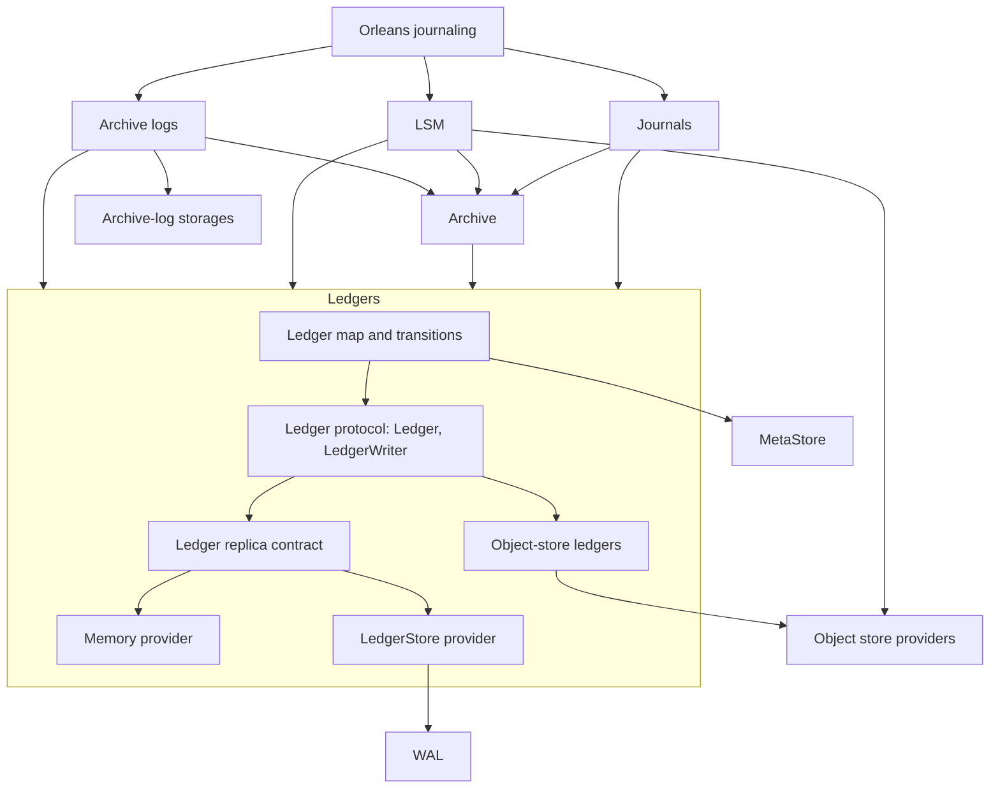

# Clog specification

Clog stores **journals**, fine-grained per-key logs of entries, for applications co-hosted with it. Writes are
replicated on Clog hosts (live ledgers) and drain into an archive store: an LSM tree in cloud object storage (the
LSM), or one log per key on Azure append blobs in Orleans Journaling's own layout (archive logs), for which the live
ledgers are a replicated write-ahead log. Its building blocks (a local write-ahead log, replicated registers,
sequenced ledgers, a ledger map, and a history across the live ledgers and the store below them) are general purpose;
the Orleans composition uses them as the storage for Orleans Journaling.

This document is the overview. It motivates the design, shows how the components interact, and names the
component which owns each end-to-end guarantee. The component files specify each layer's contract, requirements,
data types, invariants, faults, formats, and verification. The system files hold everything defined once.

**Reading path.** Read this overview and the system model first, then the components bottom up (§2.2), then the
Orleans composition. Each component's upward contract states its guarantees; its downward requirements state its
preconditions; its mechanism section specifies the protocol.

| System file | Contents |
| --- | --- |
| [Glossary](glossary.md) | Every term, with the file which owns it |
| [System and fault model](system-model.md) | Processes, nodes, disks, clocks, the failures tolerated, and the assumptions |
| [Identity and addressing](identity.md) | Cluster, node, ledger, key, and journal identities |
| [Outcomes and errors](outcomes.md) | Every operation outcome and error class, by layer |
| [Format registry](formats.md) | Every durable format and wire protocol, with its golden vectors |
| [Conventions](conventions.md) | Buffers, time, cancellation, integrity, retries, admission and close |
| [Invariants](invariants.md) | Each invariant, its owning section, enforcing code, and evidence |
| [Verification](verification.md) | Testing methodology, oracles, models, diagnostics, gates, and qualification boundaries |
| [Build and packaging](build-packaging.md) | Target frameworks, compiler policy, dependencies, artifacts |
| [Deferred work](deferred.md) | Optimizations and extensions, each with the condition to revisit it |

This tree is the normative current design. Rationale and material rejected alternatives sit with the owning
mechanism. Components and invariants which are specified but not yet implemented are marked *Not yet in code*;
§5 lists them. The [engineering principles](../engineering-principles/README.md) govern how the system is
designed, verified, and written. For the incremental bottom-up Rust rewrite targeting Roux, see the non-normative
[Rust migration plan](../rust-migration-plan.md).

**Maintenance.** A change to behavior, a contract, an invariant, a format, a dependency rule, or a resource or
failure guarantee updates the owning sections in the same change, with the glossary, outcomes, formats, and
invariant evidence where affected.

## 1. Motivation

Orleans Journaling stores each grain's state as a journal: an ordered sequence of entries (`Append`, `Replace`,
`Delete`), each write conditioned on the journal's version, its ETag. The workload has millions of journal activations
per day, most of which find no journal; appends under 1 KiB, about 32 per activation; snapshots under 16 MiB, which is
the default bound on every entry body (`MaxBodyBytes`); and few reads, because an active grain keeps its state in
memory.

Clog serves it from the live ledgers and an archive store, one per cluster:

- **Live ledgers.** Each entry is replicated to the local disks of `N` nodes (3 by default) and acknowledged once `Q`
  (2) of them have fsynced it. Latency is near the larger of a local fsync and a cross-zone round trip plus a
  remote fsync.
- **LSM.** Background drains move each ledger's rows into immutable objects in object storage, and
  compactions merge them. Object-store requests scale with ledgers and drain windows, not with journals.
- **Archive logs.** Background drains write each journal's commands to its own log on Azure append blobs, in Orleans
  Journaling's own layout, which plain Orleans can read: one conditional write per journal per closed segment of a
  ledger. The live ledgers are then a replicated write-ahead log in front of that store.

The keyspace is divided into dyadic ranges, each owned by one **ledger** at a time. A ledger's primary admits
entries for its range; a grain activates on its journal's primary, which answers existence checks and reads from
local state. Ranges move between nodes by recovering a ledger and writing one register: failover, planned handoff,
splits, and merges copy no data, because a key's history includes every live ledger which held it.

## 2. Architecture

### 2.1 Control plane and data plane

**The control plane** decides who stores and serves what, and changes it. It is off the request path.

- **Ledger map** (one [MetaStore](components/metastore.md) register): the live ledgers, each with its ID, dyadic
  range, replica nodes (`N`, odd, with quorum `Q = (N + 1) / 2`), window `K`, primary claim, and status (`Open`, or
  `Closed` at its recovered tail `T`), and a retirement floor. It changes only through the map committer, by
  conditional write, for transitions, drops, and floor raises, and each write assigns the IDs of the ledgers it opens
  ([Ledgers](components/ledgers.md)).
- **LSM manifest**, on a cluster whose archive store is the LSM (an object, replaced by conditional writes): the
  committed sections and a watermark per ledger. Drain and compaction changes reach it through the manifest committer
  ([LSM](components/archive-lsm.md)). Archive logs keep no manifest: the ledger map records their drains' order, and
  drain markers their progress ([archive logs](components/archive-logs.md)).
- **Node registry and membership** ([Orleans](compositions/orleans.md)).
- **Committers**: every write of the ledger map, the manifest, and the node registry passes through one, which
  applies each change only under its commit rule and puts concurrent changes in one conditional write.
- **Controllers** (policy): placement and balancing, failure detection and takeover, split and merge, drain and
  compaction scheduling, drops, and sweeping. They choose each transition and the node which executes it.
- **Executors and workers**: each transition's executor, in the process which becomes primary, recovers the
  ledgers it closes and creates the sequencers of those it opens; stateless drain, compaction, and sweep workers run
  next to their data. Both submit their changes to the committers.

**The data plane** moves entries. Every host runs it beside the application.

- **Primary**, one per ledger lifetime: admits entries with the version check, batches, sequences, and appends,
  ending its ledger's segments.
- **Replicas**, `N` per ledger in the nodes' LedgerStores, which share one WAL per node: acknowledge at `Q`
  fsyncs; the contiguous tail lets each serve decided entries locally.
- **Readers**: tail checks, ledger reads, and history reads across the live ledgers and the archive store.
- **Archive store objects**: the LSM's immutable runs, or archive logs.
- **Caches**: warm journal state, key indexes, Bloom filters, a local block cache, and each process's views of the
  ledger map and the manifest.

The request path reads the control plane only through cached views and never writes it (§2.5). Writes and hot
reads continue while the MetaStore or a control-plane process is unavailable; transitions, drains, and therefore
ledger drops wait for them.

**Types by plane.** Each layer keeps its data-plane types in its root namespace and its control-plane types in its
`.Control` namespace. A type is an interface only when it is a grain contract, an I/O boundary with several providers
or a double the verification needs, or a group-committed value's commit rules and per-batch decision, which
parameterize the one group committer ([conventions §6](conventions.md#6-retries-and-idempotency)); every other type is a
concrete class, which other layers use directly:

| Layer | Data plane | Control plane |
| --- | --- | --- |
| Ledgers | `Orleans.Durable.Storage.Engine.Ledgers`: `LedgerMapView`, `Ledger`, `LedgerWriterRegistry`, `LedgerWriter`, `LedgerReader`, `LedgerApplyLoop` | `Orleans.Durable.Storage.Engine.Ledgers.Control`: `TransitionExecutor`, `LedgerMapCommitter`, `ReplicaReconciler`, `ObjectLedgerSweeper` |
| Archive | `Orleans.Durable.Storage.Engine.Archive`: `ArchiveReader`, `IArchiveStore` | None |
| Object stores | `Orleans.Durable.Storage.Engine.ObjectStore`: `IObjectStore` | None |
| LSM | `Orleans.Durable.Storage.Engine.Archive.Lsm`: `LsmArchiveStore`, `ManifestView`, `TailCache`, `BlockCache` | `Orleans.Durable.Storage.Engine.Archive.Lsm.Control`: `DrainWorker`, `CompactionWorker`, `ManifestCommitter`, `LedgerDropper`, `Sweeper` |
| Archive logs | `Orleans.Durable.Storage.Engine.Archive.Logs`: `LogArchiveStore`, `IArchiveLogStore` | `Orleans.Durable.Storage.Engine.Archive.Logs.Control`: `ArchiveLogWriter`, `ArchiveLogDrainWorker`, `ArchiveLogSweeper` |
| Journals | `Orleans.Durable.Storage.Engine.Journals`: `JournalStore` | None |
| Orleans composition | `Orleans.Durable.Storage`: the journal storage adapter, the router, placement, `IJournalStoreGrain`, `NodeRegistryResolver`, the replica transport | `Orleans.Durable.Storage.Control`: `IClusterControllerGrain`, `INodeControlGrain`, `NodeRegistryCommitter` |
| Orleans composition | None | `Orleans.Durable.Storage.Engine.Cluster.Control`: the controllers' decisions, `ClusterController`, `NodeController`, `Placement`, and the policies |

The control plane uses the data plane: an executor recovers through `Ledger` and serves through `LedgerWriterRegistry`,
and workers read through `LedgerReader` and `ArchiveReader`. No data-plane type references a control-plane type or a
`.Hosting` type, and no data-plane type calls a write of a control register or a drained log:
`IConditionalRegister.WriteAsync`, `IObjectStore.ReplaceAsync` or `DeleteAsync`, `IArchiveLogStore.AppendAsync`,
`OpenAsync`, or `DeleteGenerationAsync` (§2.5). Wiring code, in a layer's `.Hosting` namespace, names both
planes. Each register has one committer, a group committer which batches concurrent changes
(`LedgerMapCommitter`, `ManifestCommitter`, `NodeRegistryCommitter`), each the group committer (`GroupCommitter`,
in `Orleans.Durable.Storage.Engine.GroupCommit`) under its value's commit rules; the composition decides where it runs
and how changes reach it ([Orleans §5.6](compositions/orleans.md#56-controllers)).

**Serialized writes, conditional safety.** The composition routes every change of the ledger map, the manifest,
and the node registry through one committer per register, so changes do not conflict and concurrent changes share
one write.
Safety rests on the conditional writes: every committer applies a change only under its commit rule, so two
committers, such as a briefly duplicated controller, admit at most one of any two conflicting changes.

### 2.2 Building blocks, bottom up

- **[Buffers](components/buffers.md).** Reference-counted, zero-copy owned buffers (`ArcBuffer`), including
  page-aligned buffers for direct I/O.
- **[WAL](components/wal.md).** A page-oriented write-ahead log of independently durable records, with a
  CRC-32C on every page and torn or corrupt pages reported in band, over portable file I/O, Linux io_uring, or a
  deterministic simulated storage.
- **[Ledger replicas](components/ledger-replicas.md).** The replica contract: durable create-once registers addressed by
  slot, with durable seals and a retained contiguous tail. Providers: memory and the
  [LedgerStore](components/ledgerstore.md), which the Orleans composition reaches on other nodes over grain calls.
- **[LedgerStore](components/ledgerstore.md).** One store per node multiplexes every ledger replica the node
  holds through one WAL, keyed by ledger ID.
- **[Ledger protocol](components/ledger-protocol.md).** BookKeeper's ledger protocol over a ledger's `N` replicas: each
  process's `Ledger` keeps the ledger's known contiguous tail, and reads the ledger, checks its seal, and recovers it
  through its `LedgerQuorum`, with quorum writes, a known contiguous tail below which one replica answers a read, and
  BookKeeper's ledger recovery; the primary's `LedgerWriter` appends through an in-process sequencer, which grants slots
  within a window `K` and completes them in order. Below `Ledger`, an internal storage seam (`ILedgerStorage`) has two
  implementations: the quorum, and an object-store ledger.
- **[Object-store ledgers](components/object-ledgers.md).** A diskless ledger: one copy of a ledger's batches in a cloud
  object store, written by its primary, fenced by in-band seals (one object per slot) or by tag-conditioned appends
  (Azure append blobs), with the local disk only a cache. Both layouts (per-slot and append) and the local cache are in
  code.
- **[Object store](components/object-store.md).** The object storage seam: objects created once or replaced by version,
  read by range, by properties, and in ordered listings, and appendable objects extended by length-conditioned appends,
  sealed, and replaced by tombstones. Providers: memory, file system, Azure Blob Storage, Amazon S3, and Cloud Storage.
- **[MetaStore](components/metastore.md).** Conditional registers for small, critical metadata: the ledger map
  and the node registry. Providers: in-memory, Fast CASPaxos, and cloud conditional stores.
- **[Ledgers](components/ledgers.md).** The live ledgers: ledgers owning dyadic key ranges, keyed rows and batches,
  segments whose rows name each key once and carry its opaque version and archive token, tags which order every key's
  rows, the ledger map, and the transitions which change it, over the ledger replicas above.
- **[Archive](components/archive.md).** The history of a key across the live ledgers and the archive store they
  drain into, its read, the archive store contract which the LSM and archive logs implement, with its pure token
  functions (`Plan`, `Admits`, `Holds`, `IsReplaceRequested`), and the coverage under which a closed ledger leaves the
  map.
- **[LSM](components/archive-lsm.md).** An archive store: the LSM tree in object storage, with the manifest, drains,
  whole-segment drains, compaction with generic row kinds, ledger drops, clock-free garbage collection, and caches.
- **[Archive logs](components/archive-logs.md).** An archive store: one log per key on Azure append blobs in Orleans
  Journaling's layout, written by segment drains with one conditional write per key per segment, fenced by position
  and generation, with drops on drain completion and a clock-free sweeper.
- **[Journals](components/journals.md).** Journals over rows: entry kinds, opaque versions and rebases, admission on
  the primary with archive-token planning, write outcomes, reads, tombstone expiry, warm state, and each node's derived
  journal index (`IJournalIndex`, backed by WAL-less atomic-flush RocksDB or memory).

### 2.3 Compositions

- **[Orleans journaling](compositions/orleans.md).** Each silo is a node: it hosts the node's LedgerStore and
  replica endpoint, the primaries of its ledgers, and the grains of their keys, and it executes transitions and
  runs drains and compactions. Replica traffic between silos goes over Orleans grain calls. The controller grain is
  the cluster's control plane: it hosts the committers and runs the policies.

### 2.4 Layer diagram

Arrows point from user to dependency, and from the ledger replica contract to its providers. The LSM and archive logs
depend on the Archive, whose `IArchiveStore` they implement; the composition constructs one of them per cluster. Buffers
and `Orleans.Durable.Storage.Engine.Threading`'s admission gate ([conventions
§11](conventions.md#11-admission-and-close)) and FIFO call budget (`CallBudget`, [ledger-replicas
§2.2](components/ledger-replicas.md#22-iledgerreplicatransport)) sit beneath every layer, and so do
`Orleans.Durable.Storage.Engine.GroupCommit`, the group committer which the ledger map's, the manifest's, and the node
registry's committers bind ([conventions §6](conventions.md#6-retries-and-idempotency)), reaching only the buffers and
the admission gate, and `Orleans.Durable.Storage.Diagnostics`, the process's fatal-error handler. Every local storage
seam reports a failed operation to it, and each component which owns a write-ahead log reports a defect which would
leave its memory out of step with that log ([conventions
§14](conventions.md#14-local-storage-failures-stop-the-process)).

### 2.5 Dependency rules

- Dependencies point down only. A lower layer's contract, implementation, tests, and formats name nothing from a
  higher layer. The fatal-error types (`Orleans.Durable.Storage.Diagnostics`, in `Orleans.Durable.Storage.Diagnostics`)
  are the shared base, whose assembly references no project and no package. Its registry of fatal-error sites
  (`FatalErrorSite`) is the one deliberate exception to the first rule: it names a site in each layer above it, since
  one registry keeps every exit code unique.
- A layer has an abstractions component only for interfaces which several providers implement in technology packages
  (`ILedgerReplica`, `IConditionalRegister`, `IObjectStore`); a layer with one implementation is concrete, and the
  layers above use its types directly. An abstractions component shares its layer's namespace and the Engine's assembly.
  `IArchiveStore` stays in `Orleans.Durable.Storage.Engine.Archive`, since the layers which implement it use the
  Archive, and `IArchiveLogStore` in `Orleans.Durable.Storage.Engine.Archive.Logs.Abstractions`, since its providers are
  the layer's memory storage and `Orleans.Durable.Storage.AzureStorage`'s.
- The ledger protocol reaches its replicas only through the replica contract, and the LSM its objects only through the
  object store contract. Each layer's memory provider shares the layer's component, for tests and simulation, in a
  namespace of its own: no type in a `Orleans.Durable.Storage.Engine.Ledgers` namespace outside
  `Orleans.Durable.Storage.Engine.Ledgers.Memory` references a type in `Orleans.Durable.Storage.Engine.Ledgers.Memory`,
  no type in a `Orleans.Durable.Storage.Engine.ObjectStore` namespace outside
  `Orleans.Durable.Storage.Engine.ObjectStore.Memory` references a type in
  `Orleans.Durable.Storage.Engine.ObjectStore.Memory`, and no type in a `Orleans.Durable.Storage.Engine.Archive`
  namespace outside `Orleans.Durable.Storage.Engine.Archive.Memory` references a type in
  `Orleans.Durable.Storage.Engine.Archive.Memory`.
- Each layer separates its planes by namespace (§2.1): data-plane types in the layer's namespace, control-plane types in
  its `.Control` namespace, and wiring which names both in its `.Hosting` namespace. No type in a data-plane namespace
  of Ledgers, the Archive, its LSM and archive logs, Journals, or the Orleans composition references a type in a
  `.Control` namespace or calls `IConditionalRegister.WriteAsync`, `IObjectStore.ReplaceAsync`,
  `IObjectStore.DeleteAsync`, `IArchiveLogStore.AppendAsync`, `IArchiveLogStore.OpenAsync`, or
  `IArchiveLogStore.DeleteGenerationAsync`, and no type in a data-plane or `.Control` namespace references a type in a
  `.Hosting` namespace.
- Each register has one writer. Within those layers, only `LedgerMapCommitter` and `NodeRegistryCommitter` call
  `IConditionalRegister.WriteAsync`, only `ManifestCommitter` calls `IObjectStore.ReplaceAsync`, only `Sweeper` and
  `ArchiveLogSweeper` call `IObjectStore.DeleteAsync`, only `ArchiveLogWriter` calls `IArchiveLogStore.AppendAsync` and
  `OpenAsync`, only `ArchiveLogSweeper` calls `IArchiveLogStore.DeleteGenerationAsync` or deletes under
  `durable-storage/`, and only `ReplicaReconciler` calls `ILedgerStore.DropReplicaAsync`. `ObjectLedgerSweeper` also
  calls `IObjectStore.DeleteAsync`, under the object-store ledgers' `ledgers/` namespace, and alone calls
  `IAppendableObjectStore.ReplaceWithTombstoneAsync`; `ObjectLedgerStorage` and `AppendObjectLedgerStorage`, on the
  data plane, only create, read, list, append, and seal there ([object-store ledgers](components/object-ledgers.md)).
  A ledger
  leaves the map only with its archive store's evidence of coverage, so only the store's drop submitter, the LSM's
  `LedgerDropper` or archive logs' `ArchiveLogDrainWorker`, constructs `LedgerMapChange.Drop`, which the Orleans
  composition's wire converter only rebuilds where a drain worker's drop reaches the controller grain (LSM-I3, LOG-I3,
  [HI-I2](components/archive.md#5-invariants)). The Archive and Journals reference neither store: Journals reaches the
  archive store only through the Archive's contract, reading through `ArchiveReader` and planning tokens through the
  store's pure functions (`Plan`, `Admits`, `IsReplaceRequested`, `AdmitsKey`), which
  `Orleans.Durable.Storage.Engine.Archive` defines. Journals depending on `Orleans.Durable.Storage.Engine.Archive` is
  the one place a layer above Ledgers calls the archive contract's functions on its write path: they are pure, do no
  I/O, and their parameters are fixed per cluster (HI-I3).
- Ledgers names no archive or journal concept: each defining row carries two opaque per-key values its writer's caller
  supplies, the archive token and the version's base, which Ledgers stores and lends verbatim, and a count it advances
  per row ([ledgers §2.2](components/ledgers.md#22-rows-batches-and-tags)).
- Generated serializers stay in the composition which owns their protocol and out of domain abstractions.
- Each layer validates only the invariants it owns. A provider's naming, limits, and retries stay at its
  boundary.
- Technology packages (`Orleans.Durable.Storage.FileSystem`, `Orleans.Durable.Storage.AzureStorage`,
  `Orleans.Durable.Storage.S3`, `Orleans.Durable.Storage.GoogleCloud`, `Orleans.Durable.Storage.CasPaxos`, and
  `Orleans.Durable.Storage.RocksDb`) group one technology's providers for several layers, each in an assembly
  of its own, and depend only on layer contracts, through the Engine's public types: those layers' abstractions, for
  `Orleans.Durable.Storage.FileSystem` the WAL, whose file-system seam makes names durable, and for
  `Orleans.Durable.Storage.RocksDb` Journals' `IJournalIndex` contract. No technology package reads the Engine's
  internals.
- The Engine (`Orleans.Durable.Storage.Engine`) compiles the managed layers, their contracts, and the controllers'
  decisions, and references no technology package and no Orleans assembly. Several components share it, so `internal`
  no longer separates them: a component uses another's non-public types and members only under that component's
  grant, and the one grant across assemblies is the composition's, through the Engine's `InternalsVisibleTo`.
- Compositions depend on layers; layers depend on no composition. The composition decides where each committer
  and worker runs and how requests reach it.

`Orleans.Durable.Storage.Architecture.Tests` enforces these rules over components: a layer's contract or implementation,
the shared base or helpers, a technology package, or a composition, each compiled into one of §2.6's assemblies. A
component claims the types of its namespaces; where an abstractions component shares its layer's namespace, the shared
helpers the fatal-error types', or the composition the controllers' `.Control` namespace, `ComponentMembers.txt` lists
the types each claims. One table (`Components.cs`) gives each component its assembly, its dependencies, its kind (layer,
technology package, or composition), whether it is a contract, the external assemblies it takes, and the components
which may use its internals, each grant with its use. Each project references only the assemblies of its components'
dependencies and reaches every assembly its components reach, and every compiled type's type and member references stay
within its component's reach: the components it reaches, the platform's assemblies and the technologies of what it
reaches, a technology package's only contracts, and another component's non-public types and members only under that
component's grant, each use resolved to its declaration by signature. A grant lies within one assembly, or goes to the
composition through an `InternalsVisibleTo` which backs it. The table has no cycle and no layer which reaches a
composition. The rules read types rather than projects, so they hold where several components share one assembly, and
each runs over planted violations which it must report exactly. The tests also check that no type the planes table
(§2.1) names is declared outside its cell's namespace, and, once §5 no longer lists the layer as not yet in code, that
each is declared.

### 2.6 Project map

The production code is nine assemblies, each one project under `src`, which compile the components the second table
names:

| Assembly | Components | References |
| --- | --- | --- |
| `Orleans.Durable.Storage.Diagnostics` | `Orleans.Durable.Storage.Diagnostics`: the fatal-error types (`FatalError`, `FatalErrorHandler`, `FatalErrorSite`, `CrashedProcessException`), ordinary IL which a simulation loads unrewritten ([verification §7.1](verification.md#71-clockwork)) | None |
| `Orleans.Durable.Storage.Engine` | Every managed layer with its contracts: buffers, threading, group commit, the WAL, Ledgers, LedgerStore, the MetaStore, the Archive with the LSM and archive logs, and Journals (with `IJournalIndex` and its in-memory provider); the shared helpers (`Orleans.Durable.Storage.Engine`: `Backoff`, `DecodeRejection`, `FileSystemAnswers`); and the controllers' decisions (`Orleans.Durable.Storage.Engine.Cluster.Control`) | Diagnostics; `Polly.Core`, `System.IO.Hashing` |
| `Orleans.Durable.Storage.FileSystem` | `Orleans.Durable.Storage.FileSystem` | Engine |
| `Orleans.Durable.Storage.AzureStorage` | `Orleans.Durable.Storage.AzureStorage` | Engine; the Azure SDK |
| `Orleans.Durable.Storage.S3` | `Orleans.Durable.Storage.S3` (S3 and DynamoDB) | Engine; the AWS SDK |
| `Orleans.Durable.Storage.GoogleCloud` | `Orleans.Durable.Storage.GoogleCloud` | Engine; the Google Cloud SDK |
| `Orleans.Durable.Storage.CasPaxos` | `Orleans.Durable.Storage.CasPaxos` | Engine; `Orleans.Consensus.CasPaxos.Grpc` |
| `Orleans.Durable.Storage.RocksDb` | `Orleans.Durable.Storage.RocksDb`: Journals' WAL-less, atomic-flush RocksDB journal index (`RocksDbJournalIndex`) and the dedicated threads its blocking calls run on | Engine; RocksDB |
| `Orleans.Durable.Storage` | `Orleans.Durable.Storage`: the Orleans composition, its hosting, routing, placement, replica transport, and grains, the controllers' grains among them | Engine; Orleans |

The controllers' decisions compile into the Engine rather than the composition: they name no Orleans type and decide
over the Engine's layers, and in the Engine a simulation of them loads no Orleans assembly (§2.7). Each assembly's
package ID is its name in the `Microsoft.Orleans.*` family, `Microsoft.Orleans.Durable.Storage.Engine` among them
([build and packaging §6](build-packaging.md#6-orleans-source-tree-preparation)).

| Layer or role | Contracts | Implementations |
| --- | --- | --- |
| Fatal-error handler | `Orleans.Durable.Storage.Diagnostics` | |
| Shared helpers | `Orleans.Durable.Storage.Engine` (the Engine's root namespace) | |
| Buffers | `Orleans.Durable.Storage.Engine.Buffers` | |
| Admission, close, and call budgets | `Orleans.Durable.Storage.Engine.Threading` | |
| Group commit | `Orleans.Durable.Storage.Engine.GroupCommit` | |
| WAL | `Orleans.Durable.Storage.Engine.Wal` | |
| Ledgers | `Orleans.Durable.Storage.Engine.Ledgers.Abstractions` (the ledger replica contract) | `Orleans.Durable.Storage.Engine.Ledgers` (the ledger protocol: `Ledger`, `LedgerQuorum`, `LedgerWriter`, `Sequencer`; the memory provider, in `Orleans.Durable.Storage.Engine.Ledgers.Memory`; the ledger map and its transitions; object-store ledgers, `ObjectLedgerStorage` and `ObjectLedgerStore` in `Orleans.Durable.Storage.Engine.Ledgers.Objects` over `Orleans.Durable.Storage.Engine.ObjectStore.Abstractions`, and `ObjectLedgerSweeper`); `Orleans.Durable.Storage.Engine.Ledgers.Store` (LedgerStore) |
| Object stores | `Orleans.Durable.Storage.Engine.ObjectStore.Abstractions` (`IObjectStore`, `IAppendableObjectStore`) | The memory and file-system object stores; `Orleans.Durable.Storage.AzureStorage`, `Orleans.Durable.Storage.S3`, `Orleans.Durable.Storage.GoogleCloud` |
| MetaStore | `Orleans.Durable.Storage.Engine.MetaStore.Abstractions` | `Orleans.Durable.Storage.Engine.MetaStore` (memory); `Orleans.Durable.Storage.FileSystem`; `Orleans.Durable.Storage.CasPaxos` (over `Orleans.Consensus.CasPaxos.Grpc`, from `vendor/fast-caspaxos`); `Orleans.Durable.Storage.AzureStorage`, `Orleans.Durable.Storage.S3`, `Orleans.Durable.Storage.GoogleCloud` |
| Archive | `Orleans.Durable.Storage.Engine.Archive` (`IArchiveStore`) | `Orleans.Durable.Storage.Engine.Archive` (`ArchiveReader`; the memory store, in `Orleans.Durable.Storage.Engine.Archive.Memory`; the drains' shared scan and memory bound, `DrainScan` and `ByteBudget`, in `Orleans.Durable.Storage.Engine.Archive.Control`) |
| LSM | `Orleans.Durable.Storage.Engine.Archive.Lsm` | `Orleans.Durable.Storage.Engine.Archive.Lsm` (the archive store; memory object store); `Orleans.Durable.Storage.FileSystem` (file-system object store); `Orleans.Durable.Storage.AzureStorage`, `Orleans.Durable.Storage.S3`, `Orleans.Durable.Storage.GoogleCloud` (object stores) |
| Archive logs | `Orleans.Durable.Storage.Engine.Archive.Logs.Abstractions` (`IArchiveLogStore`), `Orleans.Durable.Storage.Engine.Archive.Logs` | `Orleans.Durable.Storage.Engine.Archive.Logs` (the archive store; the memory archive-log storage; the chunk layout's `ChunkArchiveLogStore` over `IObjectStore`); `Orleans.Durable.Storage.AzureStorage` (`AzureArchiveLogStore`, Orleans Journaling's Azure layout) |
| Journals | `Orleans.Durable.Storage.Engine.Journals` (`IJournalIndex`) | `Orleans.Durable.Storage.Engine.Journals` (`JournalStore`, `JournalStateDatabase`, and the memory journal index in `Orleans.Durable.Storage.Engine.Journals.Memory`); `Orleans.Durable.Storage.RocksDb` (`RocksDbJournalIndex`) |
| Orleans journaling | | `Orleans.Durable.Storage`, including its replica transport and the grains; `Orleans.Durable.Storage.Engine.Cluster.Control` (the controllers' decisions and `ControlOptions`, which name no Orleans type, in the Engine) |

Every namespace of a production project lies within a root of a component the project compiles, and the Engine's
folders follow its namespaces: `Ledgers/Store` holds `Orleans.Durable.Storage.Engine.Ledgers.Store`. Every namespace of
any other project starts with the project's name. A layer's `.Control` namespace spans its abstractions and
implementation components. Shared test sources use `Orleans.Durable.Storage.Testing`; shared sample sources use
`Orleans.Durable.Storage.Samples.Hosting`. The simulation kit (`tests/Orleans.Durable.Storage.Simulation`) and the
simulation tests run on Clockwork's `Microsoft.Orleans.Testing.Simulation` packages, built from `vendor/Clockwork`.

### 2.7 Design rationale

**A minimal, verifiable core.** Journal state is a pure function of decided history. A small core defines and
protects that history: ledgers, the ledger map, the manifest, and their commit rules. Everything materialized
from it (warm state, indexes, Bloom filters, snapshots, caches, single-replica reads) is an optimization, correct
exactly when it returns the fold of the history, and the core's slow path is the oracle for each.

**Registers below sequencing.** Durable single-value registers compose by replication before sequencing chooses
positions; a shared-log append interface chooses its own positions, which makes it the wrong boundary for replica
arbitration. The ledger protocol sequences one register per append, and Ledgers batches rows above it.

**One register for ownership.** The ledger map decides every range's owner in one conditional write, so
ownership changes are atomic and need no per-key records. The independent MetaStore keeps transitions available
when a primary is not, and consensus stays off the data path: appends pay quorum writes, not consensus rounds.

**Generic keyed layers below journals.** Ledgers and the archive stores keep keyed rows whose kinds (`Append`,
`Replace`, `Delete`) say how a row composes with earlier rows, and whose versions and archive tokens are opaque to them.
Journals map onto them, and the safety core is verified once, independently of journal semantics.

**One history, a store chosen per cluster.** The live ledgers drain into one archive store: the LSM, whose object-store
requests scale with ledgers and which answers absence without I/O, or archive logs, which keep each key's commands in
one log which plain Orleans can read, and need no manifest or compaction. The Archive defines a
key's history across the live ledgers and either store, and owns the coverage condition on which ledgers drop, so
Journals reads one history and each store keeps its own drains and garbage collection ([archive, design
rationale](components/archive.md#design-rationale)).

**Planes separated by namespace.** The data plane keeps serving while the control plane is slow, unavailable, or
moving between hosts, and how the control plane is hosted (which process commits, which work is handed to other
processes) stays free to change. Separate namespaces make the request path's dependencies explicit and checkable on
concrete types as well as interfaces: it reads cached views and references no control-plane type. Interfaces mark
only the boundaries they serve, a grain contract or an I/O boundary with several providers, so a plane needs no
interface of its own.

**Concrete layers.** A layer with one implementation exposes concrete classes, and tests use them over in-memory
providers. An interface and an abstractions project per layer were rejected: with no second implementation, they
only add a second name for every type. Layers stay separate components where the dependency direction protects
something, such as the keyed core knowing nothing of journals.

**Assemblies by deployment, components by dependency.** An assembly is what a host deploys and what a native or
cloud dependency rides with, so the assemblies follow deployment: one Engine of managed layers, which every host loads,
one assembly per technology package, so a host takes only the SDKs and native libraries it configures, and the
composition, which alone takes Orleans. Within the Engine, components keep the layering: the rules of §2.5 read
compiled types, so a downward dependency, a plane's separation, and a register's one writer hold as they did between
projects, and a grant names each use of another component's internals. RocksDB's native library sets its storage apart
from the Engine, and the fatal-error types stay ordinary IL in an assembly of their own, which a simulation loads
unrewritten. A provider reads no Engine internal: each crossing is a public contract which states its fail-stop or
ownership guarantee, so the Engine's internals stay free to change. One assembly per layer was rejected: two dozen
packages which always deploy together, whose project references enforced only what the component rules now check.

**The controllers' decisions in the Engine.** The decisions are control-plane policy over the Engine's layers and name
no Orleans type, so they compile into the Engine, and the composition's controller grains host them. In the
composition's assembly they would bring Orleans and its hosting stack into every simulation of a decision, with about
four hundred references which escape the simulation's scheduler, which verification §7.1 forbids. The approved
organization placed the controller policies in the composition; the decisions' placement departs from it for that
guarantee ([implementation plan, decision 19](../implementation-plan.md#decisions)).

**Serialized commits over conditional writes.** One committer per register removes conflicts and batches
concurrent changes into one write; conditional writes keep safety independent of how many committers run. The
owning files record the rejected alternatives ([Ledgers](components/ledgers.md#design-rationale),
[LSM](components/archive-lsm.md#design-rationale), [Orleans](compositions/orleans.md#design-rationale)).

## 3. Guarantees and their owners

| Guarantee | Statement |
| --- | --- |
| Atomic | An entry is wholly present or absent. |
| Validated | An entry is accepted iff it applies after the owner's applied state and its in-flight entries, and rejected only when it applies to no state they can leave ([JS-I1](components/journals.md#5-invariants)); a CRC-32C computed by the writer is verified where the entry enters the primary, and the batch's CRC-32C protects its row from there. |
| Durable | Acknowledged only once `Q` replicas fsynced it and the owner applied it; it survives `Q − 1` replica losses until drained, then has the archive store's durability. On an object-store ledger, once the object store acknowledged its write: it has the store's durability throughout, a single zone's on a single-zone store ([object-store ledgers](components/object-ledgers.md)). |
| Linearizable per journal | A read which starts after an acknowledgement reflects it, until a later accepted entry supersedes it. Nothing is ordered or atomic across journals. |
| Definite outcomes | `Accepted`; `Rejected(CurrentVersion)`, decided against durable state; `ReplaceRequired`, `Moved`, `Throttled`, and `Fenced` have no effect, and all but `ReplaceRequired` may be retried as they are; `Ambiguous` asserts nothing ([Journals §2.2](components/journals.md#22-writes)). No crash revokes an answer. |
| Safety basis | Seals, conditional metadata writes, and quorums. Clocks, membership, routing, and caches affect liveness and speed only. |

Lampson summarizes the end-to-end argument: "Error recovery at the application level is absolutely necessary for
a reliable system, and any other error detection or recovery is not logically necessary but is strictly for
performance" (*Hints for Computer System Design*, §4). Each guarantee has one end-to-end owner; lower mechanisms
establish its preconditions or improve performance.

| Guarantee | Owner and check | Lower-layer mechanisms |
| --- | --- | --- |
| A written register is durable and holds one entry | Ledger replicas: create-once registers ([LR-I1](components/ledger-replicas.md#5-invariants)) | WAL record durability ([WAL-I1](components/wal.md#5-invariants)) |
| A seal is final | A recovery's end has every lower position on `Q` replicas, and the writer's ordered completion keeps any slot at or above `T` from completing ([LP-I7](components/ledger-protocol.md#5-invariants), [LP-I8](components/ledger-protocol.md#5-invariants)) | Seals on `N − Q + 1` replicas; a close records only a completed recovery's end ([LG-I9](components/ledgers.md#5-invariants)); dropped replicas refuse every operation and are never re-created ([LR-I3](components/ledger-replicas.md#5-invariants), [LG-I7](components/ledgers.md#5-invariants)) |
| One owner per key | Ledgers: open ranges partition the keyspace, and each opening write closes every overlapped open ledger ([LG-I1](components/ledgers.md#5-invariants), [LG-I2](components/ledgers.md#5-invariants)) | MetaStore conditional writes ([MS-I1](components/metastore.md#5-invariants)) |
| One total order per key | Ledgers: monotonic ledger IDs and tags ([LG-I3](components/ledgers.md#5-invariants), [LG-I6](components/ledgers.md#5-invariants)) | In-order completion; recoveries before closes ([LG-I4](components/ledgers.md#5-invariants)) |
| Each entry applies at most once, in version order | Journals: admission by expected version over the history ([JS-I1](components/journals.md#5-invariants)); versions unique for a key's lifetime, across rebases ([JS-I10](components/journals.md#5-invariants), [HI-I4](components/archive.md#5-invariants)) | One proposer per ledger ([LG-I5](components/ledgers.md#5-invariants)); each row's version from its defining row ([LG-I13](components/ledgers.md#5-invariants)) |
| Every row resolves to its key | Ledgers: created batches decided in slot order, and every reference names a key defined earlier in its segment ([LG-I12](components/ledgers.md#5-invariants)) | Decided slots form a prefix ([LP-I3](components/ledger-protocol.md#5-invariants)); recovery copies batches verbatim ([LP-I7](components/ledger-protocol.md#5-invariants)) |
| Payload integrity | Journals: writer-computed CRC-32C, over the row key and the record, verified where it enters the primary, which writes the row from the verified record ([JS-I5](components/journals.md#5-invariants)); from there the batch's CRC-32C, verified by every reader of the batch | WAL page CRC-32C ([WAL-I2](components/wal.md#5-invariants)); block, section, and trailer CRC-32Cs in the LSM; each store's transport checksums, computed from the verified batch pages. Archive-log content carries no Clog checksum at rest, and the primary's memory between verifying a record and encoding its batch is unchecked ([verification §13](verification.md#13-qualification-boundaries)) |
| Acknowledged entries are durable | Journals: acknowledge only `Durable` batches ([JS-I2](components/journals.md#5-invariants)) | Quorum writes on `Q` fsynced replicas ([LP-I4](components/ledger-protocol.md#5-invariants)) |
| Draining and dropping lose no row | Archive: a ledger drops only once the archive store covers it ([HI-I2](components/archive.md#5-invariants)) | LSM: watermark-conditional drains and drops only of complete ledgers ([LSM-I1](components/archive-lsm.md#5-invariants), [LSM-I3](components/archive-lsm.md#5-invariants)) and exact drain outputs ([LSM-I2](components/archive-lsm.md#5-invariants)); archive logs: lineage-ordered segment drains, writes fenced at their token's position, and drops only after every segment is complete ([LOG-I1](components/archive-logs.md#5-invariants) to [LOG-I3](components/archive-logs.md#5-invariants)); every stored token replays `Plan` ([HI-I4](components/archive.md#5-invariants)) |
| Compaction preserves every journal | LSM: the drop rule and input-conditional commits ([LSM-I5](components/archive-lsm.md#5-invariants)) | Row kinds from Journals |
| Garbage collection deletes nothing needed | LSM: list, then snapshot, then delete under permanently false conditions ([LSM-I6](components/archive-lsm.md#5-invariants)); archive logs: delete a generation's base only once a properties read shows a higher current generation, never a log, and a dropped ledger's markers after a map read ([LOG-I2](components/archive-logs.md#5-invariants), [LOG-I6](components/archive-logs.md#5-invariants)) | Unique names ([LSM-I7](components/archive-lsm.md#5-invariants), [LOG-I5](components/archive-logs.md#5-invariants)) |
| Reads include acknowledged writes | Journals on the owner ([JS-I3](components/journals.md#5-invariants)); the history read ([HI-I1](components/archive.md#5-invariants)) | Reads below a contiguous tail, and through the primary's open check for an open ledger ([LG-I8](components/ledgers.md#5-invariants)); map before manifest |
| Caches answer as the history would | Journals ([JS-I6](components/journals.md#5-invariants), counted only through their positions: [JS-I9](components/journals.md#5-invariants)) | The slow path as oracle |
| Entries reach their owner | Not a safety property: `Moved` answers and the version check keep misrouting safe | Cached maps, routing, grain placement |
| Disk pressure bounds admitted growth | Orleans: node budgets gate admission ([Orleans](compositions/orleans.md#59-resource-governance)) | Ledger rolls and drops |

## 4. How the layers work together

### 4.1 Write path

1. A grain writes journal `J` at its expected version `v`, its ETag. Its silo encodes the entry once, computing its
   CRC-32C. The grain is normally placed on the primary of `J`'s range, so the entry stays local; otherwise the silo
   forwards the encoded entry to the primary its cached map names, or answers `Moved`.
2. The primary verifies the entry's CRC-32C and admits it only if `v` is the journal's version on its warm state plus
   its in-flight entries. An entry which applies to no state a prefix of those entries can leave is answered `Rejected`
   with the applied `CurrentVersion`, and nothing is appended; any other entry waits for the in-flight entries'
   outcomes. An `Append` the archive store's limits refuse is answered `ReplaceRequired`. A key without warm state is
   first loaded from its history, and one with no live rows rebases its version on the archive's version base.
3. The primary batches admitted entries of many journals into one batch of rows and appends it through its ledger's
   `LedgerWriter`; a key's first row in the ledger's open segment defines it, carrying its version before the row and
   its archive token, which the primary plans with the archive store's `Plan`, and its later rows there name it by
   ordinal. The in-process sequencer grants a slot, and the writer writes one DATA register through the ledger's
   `Ledger` to `N` node replicas, each recorded in its node's WAL. The batch is `Durable` once `Q` replicas fsynced it
   and every lower slot completed.
4. The primary's apply loop applies the batch to its warm state and completes each entry `Accepted`. A batch at or
   above a recovered tail is absent, and its entries are resent to the new primary; an entry whose ledger left the
   map before its outcome was learned is `Ambiguous`.

### 4.2 Read path

1. The primary confirms its ledger is still open with a seal check of `Q` replicas begun after the read, and
   waits until it has applied through its contiguous tail.
2. It answers from warm state: an absent journal from its key indexes, caught up to each live ledger's decided end, and
   the archive store's `Absent` answer to `ArchiveReader.ReadStoreAsync`, with no object-store I/O on the LSM once its
   range's section metadata is preloaded, and one read of the key's log on archive logs; otherwise the archive's prefix
   and the live rows it does not hold, from its local replica below the contiguous tail.

Any process can compute the same answer on the slow path: read the ledger map, then the archive store, then fold
the store's prefix and each live ledger's rows of the key which the prefix does not hold.

### 4.3 Recovery

- **Process crash.** The WAL finalizes the crash region and the LedgerStore replays its WAL from its checkpoints.
  Warm state, which lives for one primary claim, is rebuilt lazily, and key indexes catch up from their durable
  watermarks.
- **Primary failure.** A controller sends a takeover to a live node, which executes it: the node seals the
  ledger's replicas and recovers its end `T`, which decides every in-flight batch (`Durable` below `T`, absent
  above), and submits one map change which closes the ledger at `T` and opens a successor over the same range. The
  new primary loads each key's state when the key is first touched.
- **Replica failure.** A ledger's acknowledged entries survive `Q − 1 = (N − 1) / 2` lost replicas, and its
  writes and recovery continue while at most that many are unavailable. A roll onto live nodes restores
  redundancy.
- **Archive store outage.** The live ledgers keep accepting writes; drains, compactions, and ledger drops wait, and
  node disk budgets throttle admission if the outage lasts.
- **Cluster restart.** Each node recovers its LedgerStore and identity; controllers take over every ledger
  whose primary did not survive.

### 4.4 Transitions

A controller chooses each transition from its view of the ledger map and sends it to the node which becomes
primary. That node's executor seals the open ledgers the transition closes, creates the sequencers of those it
opens, and submits one map change; the map committer applies it in one conditional write, which may carry other
transitions' changes, records each closed ledger's recovered end, and assigns the opened ledgers' IDs. The node
serves each opened ledger once its map view lists it; replicas come into being with their first writes or seals.

- **Replace.** Close `S` at `T`; open a successor over the same range: a takeover; a planned handoff, which moves
  the primary and runs as a takeover does, the old primary helping once its next append meets the seal; or a roll,
  to change replicas, `N`, or `K`, or to end a long-lived ledger so that it drains and its WAL is released.
- **Split.** Close `S`; open its two children. **Merge.** Close two open siblings; open their parent.
- **Drop.** Once the archive store holds every row of a closed ledger and every older ledger overlapping it has left
  the map, one map change removes it, and its replica nodes drop their replicas.

Each process serves what its map view lists: replies to transitions and commits carry a verdict, with the deciding
value's epoch for `Applied` and `Superseded`, and a lost reply is survived by retrying, since the map, not the reply,
decides what applied.

### 4.5 Archive stores and garbage collection

**LSM.** Drains copy each closed segment of a ledger, from its watermark, into sections of a new object and submit a
change which commits iff the watermark is unchanged, raising it to the next segment's start. Compactions merge sections,
dropping rows a newer `Replace` or `Delete` supersedes, and submit a change which commits iff every input is still
listed. The manifest committer applies the changes submitted within one commit interval in one conditional replace. The
sweeper lists the store, reads the manifest, and deletes objects which are unreferenced and can never become referenced,
one sweep after a sweep of its own first found them so.

**Archive logs.** A ledger drains only once every older ledger overlapping it has dropped, and its closed segments
drain in order, so each key's commands reach its archive log in tag order. A segment's drain makes one write per key it
touches, at the position the key's token names: an append run, fenced by its offset and generation, or, for a segment
which holds a `Replace` or `Delete` of the key, an opener which creates the next generation once. A failed condition
costs one properties read, which decides whether the write is held, resumes, or meets corruption, so a retried or racing
drain lands nothing twice. A completed segment leaves a marker, and the drain which completes a closed ledger submits
its drop. The sweeper deletes superseded generations' bases and dropped ledgers' markers; logs are never deleted.

No correctness decision consults a clock; the commit interval paces writes only.

### 4.6 Resources and progress

Node disk budgets drive pressure: a primary's node under pressure answers `Throttled` before admission, while reads,
drains, and transitions continue. A node's WAL is released below the first file of its oldest live replica, once two
catalog checkpoints cover the drops below it, so controllers roll long-lived ledgers and drain closed ones lowest
ID first. The owner is [Orleans resource governance](compositions/orleans.md#59-resource-governance). In-flight memory
follows byte budgets, not slot counts: entries queued for a batch (`MaxQueuedBytes`), batches created and not yet
decided (`MaxProposalBytes`), payloads outstanding to each node (`MaxNodeCallBytes`, a FIFO queue with a deadline), and
calls a replica host holds (`MaxReplicaCallBytes`) ([conventions §7](conventions.md#7-payload-size)).

## 5. Implementation status

The specification describes the target design; parts not yet implemented are marked *Not yet in code*:

| Part | Status |
| --- | --- |
| Buffers, the WAL, the Ledgers layer's replica contract with its memory provider, and LedgerStore, the ledger protocol (`Ledger`, `LedgerQuorum`, `LedgerWriter`), MetaStore | Implemented, read repair, byte-range forwarding, and explicit contiguous-tail writes among it (row 5.1 of the [implementation plan](../implementation-plan.md)), and the learn of a tail from the local replica (row 5.2 C); the changes these files mark *Not yet in code* are not; `Ledger` and the append path stay internal, and `LedgerWriter`, `LedgerTail`, and `SequencerInstanceId` are public with Ledgers' members |
| Outcomes as unions | Implemented ([conventions §15](conventions.md#15-outcomes-unions-and-errors)): the decoders, the WAL's reads, the MetaStore's writes, the ledger replica's answers, and the ledger protocol's appends, reads, seal checks, and recoveries |
| Large payloads | Implemented ([conventions §1](conventions.md#1-buffers-and-ownership)), bodies always inline within `MaxBodyBytes` (row 5.2 A of the [implementation plan](../implementation-plan.md)) |
| Ledgers | The replica contract and its providers are in code (row above), as are keys and ranges, rows, tags, and the batch codec with its segments, ordinals, markers, and the versions and tokens of defining rows (rows 1.1, 1.6, and 1.7 of the [implementation plan](../implementation-plan.md)), and the ledger map: its `CLLM` codec, `LedgerMapView`, and `LedgerMapCommitter` with its commit rule (row 1.2), and the primary's proposals and open check and the reader (row 1.3: `LedgerWriter`'s `ProposeAsync` and `ConfirmOpenAsync`, `ProposalOutcome`, `OpenCheckOutcome`, `LedgerReader`, `LedgerRead`, `LedgerTail`, and `LedgerTailRead`), and `LedgerWriterRegistry`, transitions through `TransitionExecutor`, and `ReplicaReconciler` (row 1.4), and slots at batch creation, `MaxProposalBytes`, `LedgerSegmentView`, and the scan's rewind (row 1.7), and a reader's read repair (row 5.1), and a node's `LedgerApplyLoop`, which delivers the ledgers it replicates to its `LedgerApplier` as resolved rows below the tails it learns and each closed ledger's `T` (row 5.2 C), modeled by `LedgerMap.qnt` and `LedgerDrop.qnt` |
| Archive | Specified. In code: the store contract (`IArchiveStore` with its reads, `ArchivePrefix`, `ArchiveContent`, `ArchiveWrite`, `ArchiveCommand`, the pure members over `ArchivePlan`, the store's record with `ArchiveStoreMismatchException`, `ArchiveStoreIdentity`, and `ArchiveCorruptException`), `ArchiveReader` with concurrent live-ledger scans sharing a `K`-place window (row 5.2 B), key-indexed point reads through `ArchiveKeyIndex` and `ArchiveStoreRead.Absent.Bounds` per-ledger scan starts (row 5.2 D), merged by `Holds` with the chain check (HI-I4), which report whether they are linearizable, and first touch (`ArchiveStoreAnswer`), and the memory store with its tokens and `Drain` (rows 2.2 and 2.4) |
| Object stores | Specified ([object store](components/object-store.md)). In code: `IObjectStore` in `Orleans.Durable.Storage.Engine.ObjectStore.Abstractions` (rows 3.9, 7.2, and 7.2b of the [implementation plan](../implementation-plan.md)), with empty objects, `GetPropertiesAsync`, and listings from a start name, over its memory, file-system, Azure, S3 (general-purpose and `--x-s3` directory-bucket mode), and Cloud Storage providers; and `IAppendableObjectStore`, over the memory, file-system, and Azure providers |
| LSM | Specified and modeled (`Archive.qnt`). In code: the object store contract with its memory and file-system providers, the manifest's format, view, and committer (row 2.1 of the [implementation plan](../implementation-plan.md)), and the run object's format, writer, and reader (row 3.1), and the LSM's archive store `LsmArchiveStore`, ledger drops, `ArchiveOptions`, and drains of whole closed segments within the archive's drain memory budget (row 3.2), and compaction under the grid geometry and the drop rule, `CompactionWorker` (row 3.3), with its per-child pushes (row 3.3b), and the Azure Blob, S3, and Cloud Storage object stores, which run the conformance suite on their emulators (row 3.5), with the writers' CRC-32C on every upload (row 3.5b), and the sweeper with its one-sweep grace and the file-system store's reclamation of its temporary files (row 3.4), and the store's prefixes, empty token, tag version base, pure members, and record (row 2.4), the section metadata cache with its preloads (row 5.3 A), and the volatile-disk block cache (row 5.3 B) |
| Archive logs | Specified and modeled (`ArchiveLogs.qnt`, whose traces the drain simulation's validate). In code: the stateless `IArchiveLogStore`, its memory storage, `ArchiveLogNames`, the classifier, `ArchiveLogWriter`, `LogArchiveStore` with its position tokens, pure members, and store record, and `AzureArchiveLogStore` with its fake transport and fidelity suite, which passes on a live account (row 3.6); segment drains with markers, `ArchiveLogDrainBlockedException`, drops, and the sweeper (row 3.7); the silo's archive gate, `ArchiveLogGate`, as the evidence the drain worker and the sweeper take, and the composition's control layer: the nodes' request shares within the budget (OR-I21), the drainers' undrained keys, drains, drops, and blocked keys, and the sweeper on the controller grain's silo (row 4.9's B); and the composition's names, `orleans-journal-1`, by which Orleans' own Azure provider reads Clog's logs, read-only, as their fold on the fake transport, Azurite, and a live account, in `Orleans.Durable.Storage.Interop.Tests` (row 4.9's C); and the silo's wiring of the gate, the drains, and the sweeper over `AzureArchiveLogStore` (row 4.9); and the chunk layout over any `IObjectStore`, `ChunkArchiveLogStore` (row 3.9) |
| Object-store ledgers | Specified ([object-store ledgers](components/object-ledgers.md)). In code (rows 7.1, 7.1b, 7.2b, 7.3, 7.3b, 7.4, 7.5, and 7.6 of the [implementation plan](../implementation-plan.md)): the ledger storage seam ([ledger-protocol §2.7](components/ledger-protocol.md#27-ledger-storage)), `ILedgerStorage`, which `LedgerQuorum` implements and `Ledger` holds, and `LedgerLocation`, with `CLLM`'s replica count of 0 for a ledger in the object store, and the controller's, the reconciler's, and the node's single switch on it; the ledger storage contract's spec, `LedgerStorageSpec`, with the quorum's recording oracle, and its model, `AtomicLedger.qnt`, which the ledger protocol refines (row 7.1b); the per-slot object-store ledger, `ObjectLedgerStorage` over `ObjectLedgerStore` with its store record, `PrefixedAppendableObjectStore`, `ObjectLedgerCache`, and `ObjectLedgerSweeper`, which `LedgerReader` opens for a ledger in the object store, with the ledger storage spec over it (row 7.3); the `ObjectLedger` formal model, `ObjectLedger.qnt`, refining `AtomicLedger` for both per-slot and append layouts (rows 7.3b and 7.4); `S3ObjectStore` directory-bucket mode for S3 Express One Zone, verified by `ObjectStoreSpec` and `LedgerStorageSpec` over the unordered fake (row 7.2b); the Azure append layout, `AppendObjectLedgerStorage` over `CLOE` v1 extents (`ObjectLedgerExtentFormat`, `ILedgerStorage.ReadRangeAsync` with 8 MiB ranged reads, `CLOE` golden vectors, `ledgers-object-extent` fuzz target, and `LedgerStorageSpec` over the appendable stores, row 7.4); the Orleans composition wiring (`ControlOptions.LedgerPlacement`, `ObjectLedgerWindow`, `ObjectStoreRequestsPerSecond`, `DurableStorageOptions.ObjectLedgers`, diskless silos without `Root`, `CLNR` `object_ledger_store_id` and `diskless`, `ObjectLedgerSweeper` host wiring, multi-silo mixed-cluster tests, and mixed-location Clockwork simulations, row 7.5); and row 7.6's per-precondition fidelity suites and live-account harnesses (`S3ObjectLedgerFidelityTests`, `S3ExpressObjectLedgerFidelityTests`, `GcsObjectLedgerFidelityTests`, `AzureAppendableObjectFidelityTests`), four-way metamorphic equivalence (`ObjectLedgerMetamorphicTests`), and dry-verified in-memory microbenchmarks (`ObjectLedger*Benchmarks`). Not yet in code: `MaxSegmentAge` rolling for object-store ledgers; live-account qualification runs and live per-provider latency measurements (row 7.6) await cloud credentials |
| Journals | Specified; the row key, versions and their text form, the entry record codec with its vectors and fuzz target, the fold of a history read with the rebase, and admission on the primary by version, with rows of native content, `Expired` by version and retention, token planning, and `ReplaceRequired`, and `JournalStore` over `ArchiveReader` with its loads, owner reads, replace requests, and startup checks, and the Journals simulation with its oracles, are in code (rows 2.3a and 2.3b of the [implementation plan](../implementation-plan.md)), under a fault plan of process and node crashes and restarts, partitions, pauses, lost and duplicated messages and answers, media damage, unknown ledger map outcomes, duplicate committers, and interrupted executors (row B.12), together with tombstone expiry's scan (row 3.4b), `JournalStateDatabase`'s durable per-node key indexes and tombstones wired into `LedgerApplyLoop` and `ArchiveReader` with JS-I9 catch-up and one shared non-replicated predecessor scan (row 5.2 D), and per-claim `JournalWarmState`, `ArchiveReader.ReadStoreAsync` first-touch/owner reads and preloaded zero-object-store absence answers, cold tombstone expiry over the key indexes, warm-state `BytesSinceBase` snapshot requests (§8.7), and the Clockwork simulation covering restarts with lagging durable watermarks, takeovers/handoffs, LSM compactions and key forgetting, evictions, and mutants (row 5.2 E) |
| Orleans composition | Specified, including its replica transport (implementation plan row 4.7). In code: the silo's node over its LedgerStore, the node registry (`CLNR` codec, `NodeRegistryCommitter`, `NodeRegistryResolver`), `RegisteredNodePlacement`, and registration through `IClusterControllerGrain` (row 4.1); the replica transport, `OrleansLedgerReplicaTransport`, with `ILedgerStoreGrain`, its replica host, and the silo's serving gate (row 4.7, with forwarding lanes in row 4.2 and quiet-machine Server-GC socket baselines in row 5.4, [row 5.4 performance baselines](../performance/row-5-4-baselines.md)); the controller's and nodes' decisions, `ClusterController`, `NodeController`, and `Placement` (row 4.3, B1); the controller and node control grains, the silo's Ledgers runtime, and the sweep host (row 4.3, B2); node retirement and cluster restart, resource governance, the durability repair, and the placement policies (row 4.4); the archive-log control layer, its request shares, drains, and sweeps over the silo's archive gate (row 4.9's B), and the archive store's selection, the silo's registration with the registry's or the record's identity, its background check of the record behind the silo's archive gate, and the public, bindable configuration (row 4.9); and the journaling adapter (row 4.2): the Journals in the silo; the node grain, its wire messages, and the owner's forwarded-read snapshots; the router, its forwarding lanes, and Orleans journal storage; and `JournalPlacement` and `DurableStorageStatus`; the re-placement of journaled grains by live migration (row 4.5); object-store ledgers in mixed clusters, diskless silos without `Root`, `CLNR` object-ledger store ID and diskless flag, `ObjectLedgerSweeper`, and `ObjectStoreRequestsPerSecond` sharing (row 7.5); and whole-cluster drain-all before an instance-releasing stop (`StartDrainAllAsync`, `CancelDrainAllAsync`, `GetDrainAllAsync`, row 4.8 B) |
| Verification infrastructure | Models, golden vectors, snapshots, CsCheck properties, contract suites, the linearizability checker, seeded simulation, the simulation kit on Clockwork, crash-state enumeration of the LedgerStore's, the WAL's, and the file-system MetaStore's file-system writes, leak checks, decoder fuzzing (for the WAL, file-system MetaStore, LedgerStore, ledger map, batch, LSM, entry record, node registry, and archive-log token and metadata formats), and Stryker.NET mutation testing are implemented, as are the conformance kit (verification §4.1), trace validation of the ledger, archive-log, ledger map, and LSM models (§5.1), and the archive simulation's guard mutants of `Archive.qnt` (row B.16 of the [implementation plan](../implementation-plan.md); [verification §13](verification.md#13-qualification-boundaries) records `snapshot-before-list`'s boundary); guard mutants for the other models' simulation oracles are not yet in code |
