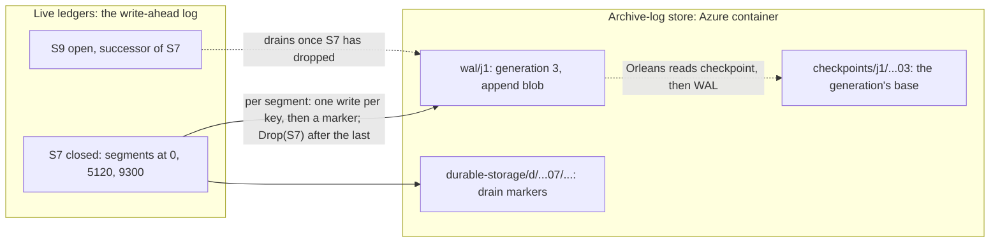

# Archive logs

## 1. Purpose and scope

Archive logs are an archive store ([archive](archive.md)) which keeps each key's drained commands in one **archive
log**: a per-key log in an **archive-log store**, such as Azure append blobs in Orleans Journaling's own layout. The
ledgers accept and order each key's commands, and an archive log is a deterministic replay of them. A drain flushes one
closed ledger segment at a time and makes one conditional write per key of the segment, which lands only at the
position the key's archive token names; a closed ledger whose every segment is held leaves the ledger map. The live
ledgers are then a replicated write-ahead log in front of the archive-log store: they acknowledge each entry at `Q`
fsyncs, and drains carry it below within one segment.

Archive logs own:

- the archive-log store contract (`IArchiveLogStore`), its memory store, and its classifier of failed conditions;
- the archive implementation over archive logs, `LogArchiveStore`: its private token encoding, the pure functions
  `Plan`, `Admits`, `AdmitsKey`, `Holds`, and `IsReplaceRequested`, history reads, and absence;
- archive-log names (`ArchiveLogNames`) and Clog's objects under `durable-storage/`: the store's record and the drain
  markers;
- drains into archive logs, by whole segments in lineage order, their progress markers, and the evidence on which a
  drained ledger drops;
- the sweeper of superseded generations' bases and of dropped ledgers' markers;
- per-key drain failures which block a ledger's drain, and their operator procedure;
- the stores' layouts: Azure append blobs (`AzureArchiveLogStore`, in `Orleans.Durable.Storage.AzureStorage`), and chunk
  objects over any object store with create-once writes.

[The Archive](archive.md) owns `History(k)`, its read, the archive contract (`ArchivePrefix`, `ArchiveWrite`, tokens,
the pure functions' contracts, and the store's record), and HI-I1 to HI-I4; [Ledgers](ledgers.md) owns rows,
segments, tags, the ledger map, and drops; the writers of rows own their meaning and the token chain they store in
defining rows ([JS-I10](journals.md#5-invariants)).

Code: `Orleans.Durable.Storage.Engine.Archive.Logs` and `Orleans.Durable.Storage.Engine.Archive.Logs.Abstractions`, both
in namespace `Orleans.Durable.Storage.Engine.Archive.Logs`, with the control-plane types in
`Orleans.Durable.Storage.Engine.Archive.Logs.Control`. `Orleans.Durable.Storage.Engine.Archive.Logs.Abstractions` holds
`IArchiveLogStore` and its value types, which the memory store, `ChunkArchiveLogStore`, and `AzureArchiveLogStore`
implement.
`Orleans.Durable.Storage.Engine.Archive.Logs` holds the data plane: `MemoryArchiveLogStore`, the chunk layout's
`ChunkArchiveLogStore` and `ChunkArchiveLogContainer`, `ArchiveLogNames`, the token codec, the classifier, and `LogArchiveStore`.
`Orleans.Durable.Storage.Engine.Archive.Logs.Control` holds `ArchiveLogWriter`, which makes each key's write,
`ArchiveLogDrainWorker`, and `ArchiveLogSweeper`. `AzureArchiveLogStore` lives in `Orleans.Durable.Storage.AzureStorage`
and is configured by the Orleans composition ([orleans §5.13](../compositions/orleans.md#513-archive-log-store)). The
code implements the stateless contract of §3 (row 3.6 of the [implementation
plan](https://github.com/ReubenBond/clog/blob/6ffb29aa96d2e4d48fc9c34f80790493e548af96/docs/implementation-plan.md)):
the memory store, the token codec, the classifier, `ArchiveLogWriter`, `LogArchiveStore` over them with its tokens, pure
members, and store record, and `AzureArchiveLogStore` with its fake transport and fidelity suite; and the segment
drains, markers, drops, and sweeper (row 3.7): `ArchiveLogDrainWorker` and `ArchiveLogSweeper`, modeled by
`test/Durable.Storage/specs/archive-logs/ArchiveLogs.qnt`, whose traces the drain simulation's validate. A drain of an
open ledger's closed segments writes its openers too, which supersede only writes already held, since the drain runs
only once every older overlapping ledger dropped, and `Holds` judges by position, so a reader whose map value still
lists an older ledger finds its rows held, superseded or applied (design rationale, *Open ledgers' openers*). The
Orleans composition's control layer is in code (row 4.9's B): the silo's archive gate, `ArchiveLogGate`, which the drain
worker and the sweeper take; each node's share of the request budget, within it but for OR-I21's transients, and the
undrained keys of the ledgers it owes a drain; its drains and drops with their blocked keys; and the sweeper on the
controller grain's silo ([orleans §5.6](../compositions/orleans.md#56-controllers),
[§5.13](../compositions/orleans.md#513-archive-log-store)); and the composition's names, `orleans-journal-1`, which
plain Orleans reads the logs by, as the interop tests check (row 4.9's C); and the silo's wiring of the gate, the
drains, and the sweeper, over `AzureArchiveLogStore` or a store the silo's services supply (row 4.9); and the chunk
layout over any `IObjectStore` (row 3.9, §7.4), which a silo's services supply as a `ChunkArchiveLogContainer`.

### Design rationale

**One log per key, in Orleans' own layout.** A key's drained commands lie together, so a cold read is one request, or
two once the key has a checkpoint. On Azure each log is Orleans Journaling's own pair of blobs, `wal/{id}` and
`checkpoints/{id}/{g}`, so a plain Orleans deployment reads Clog's logs, read-only, with its own Azure provider. A drain
makes one write per key per segment, so requests scale with the keys a segment touches; the LSM's scale with ledgers
instead ([archive, design rationale](archive.md#design-rationale)). An Orleans deployment needs no object store,
manifest, or compaction.

**The ledgers order; the store only fences replay.** The ledgers decide each key's commands and their order, and a
segment fixes each key's write: its kind, its commands' lengths, and the token it starts from. The store's condition
therefore only has to make each write land once, at the position its token names, and never after a later one
(LOG-I1). An append run is one `Append Block` conditioned on the offset it starts at and the generation it extends; an
opener creates the next generation once, conditioned on the generation it starts from. No write reads the log first. A
design which read each log before writing it, to learn the version a conditional write needs, was rejected: it costs a
read per key per drain, or a cache of handles whose misses download whole logs.

**Positions, not records.** A key's token encodes the log's position `(g, r, P, b)`: its generation, the rows its base
folds, the length of its write-ahead blob, and that blob's committed blocks. The store returns all four with every read
and properties read, from the blob itself, so the token needs no record of its own. A position record written after each
append run (`durable_pos`), which would have kept a durable per-key version through a drop, was rejected: it costs a
second request per key per segment, makes drop evidence wait on it, and needs its own monotonicity invariant, for a
continuity no one needs ([journals](journals.md) rebases versions on the archive's token instead).

**Base rows in the position.** An opener's base folds the key's rows of its segment from the opener on, and the rows
the opener superseded before it, so one segment's rows give a key several states, each a cut of the segment, which
`ArchiveRead.Through` names. A reader whose tail lies inside a held segment plans the write of the rows below its tail,
and its plan differs from the drained write's, so it reads again rather than take the log for its own cut. `r`, the
count of the key's rows the base folds, the superseded ones, the opener, and its later appends, makes every state of a
key's chain a distinct token, as `Plan` requires ([archive §3](archive.md#3-requirements-downward)), which a law over
generated openers and appends checks. The base's length alone was rejected: two openers in one segment, `R₁, A`
and `R₂`, can fold to bases of one length.

**A generation tag as well as the offset.** `appendpos` alone would let a straggler drain land on a newer generation of
the same length, so every append is also conditioned on the generation's index tag, and every opener on the tag of the
generation it starts from. ETags alone were rejected: they change with every append, so a write conditioned on one
needs a read first. Per-generation WAL names would need no tags, but Orleans reads only `wal/{id}`; they are the right
choice if Orleans readability is dropped.

**A failed condition costs one properties read.** A condition fails for a racing drain, a straggler, or a retry whose
first attempt landed. One properties read then decides the write's outcome by a pure classifier (§8.3), the same
function `Holds` evaluates, so the write path and the read path agree on what a log holds. A log which was behind the
write when its condition failed reaches the write's start when its predecessor lands before the read; the writer then
issues the write once more, and a second such read is a contradiction, since positions only grow. Treating the first
as a contradiction too was rejected: racing writers reach it whenever a write's predecessor lands between its failed
condition and its read (§10).

**One write per token, a caller demand.** Every write from one `(key, token)` is identical in kind, opener, content,
and packing: a segment fixes each key's write (§8.1), the writer of rows stores each key's token chain in its defining
rows (JS-I10), and the store's record fixes the packing for the cluster's life (HI-I3). The store's conditions fence
positions, not bytes, so the contract states the demand (§3), and the store checks it where that costs no request on
the write path: a checkpoint which already exists must have the opener's base's length and MD5, which one properties
read of it checks, and the write-ahead blob records the base's MD5, which every read of the base checks. Comparing each
append's bytes was rejected: it costs a read per landed unit.

**A first generation no write landed in is absent.** A key's first append run creates generation 1 and then appends,
so a crash between the two leaves `(1, 0, 0)` with no opener, which holds no write. `LogArchiveStore` reads it as
`Absent`, whose token is `Origin`, the one every key's first row stores, so a prefix's token depends only on the writes
its log holds (§8.4). An empty `Delete` from `Origin` also reaches `(1, 0, 0)`, with an opener, and reads as a prefix.

**Units are physical.** A token's `b` is the write-ahead blob's committed block count, which the conditions, the
classifier, and every read check. Re-blocking a write-ahead blob, as a copy, AzCopy, or a restore which rewrites blocks
does, is unsupported: a restore preserves the block structure and restores the `durable-gen` tag (§6), and a log whose
blocks or tag disagree with its metadata is a contradiction, which the writer throws as corruption.

**Every opener writes a checkpoint.** A `Replace` or a `Delete` creates the next generation with a checkpoint holding
its base, empty for a `Delete`, followed by the segment's later appends, and records its kind in the write-ahead blob's
metadata. Every opener is then the same two requests, every generation an opener created has exactly one checkpoint,
and a reader tells a `Replace`'s generation from a `Delete`'s by the recorded kind alone. Writing a `Delete`'s later
appends to the write-ahead blob instead was rejected: it gives openers two shapes, two token rules, and two classifier
paths for no request saved.

**Whole segments, in order, with markers.** A segment fixes each key's write, so racing drains of it make identical
writes, and its keys' writes are independent. Segments of a ledger drain strictly in order, so a key's earlier segments
are held before its next write. Draining partial segments, or a ledger's segments in parallel, was rejected: it loses
the deterministic per-key write and complicates drop evidence when one segment's opener supersedes another's appends.
A completed segment creates a small marker, so a restarted drain resumes after it rather than re-checking every key.

**Lineage-ordered drains instead of a manifest.** A drain of ledger `S` runs only while the ledger map lists no ledger
with a lower ID which overlaps `S`, the drop rule's own condition ([LG-I10](ledgers.md#5-invariants)). The older ledgers
have then dropped, so each is wholly held (HI-I2), and the ledger map and the markers record the drains' order and
progress. A manifest of watermarks, as the LSM keeps, would add a register and a committer whose only reader would be
the drop.

**Open ledgers' openers.** On the LSM a `Replace` of an open ledger may supersede only once its ledger completes, since
a reader's map may still list the ledgers whose rows it supersedes and the manifest's merge holds by tag ([archive LSM
§1](archive-lsm.md#design-rationale)). Archive logs need no such rule: a drain of an open ledger's closed segment writes
its opener as soon as the segment closes. Each key's tokens form one chain, and `Holds` judges a write by the log's
position on that chain, not by tag, so a reader whose map value still lists an older ledger finds that ledger's rows
held by a later generation, applied or superseded, and its fold is the same. The lineage rule's job is narrower: a
drain runs only once every older overlapping ledger dropped, so a write's predecessor is held, and a
`PredecessorMissing` means corruption. A reader whose tail lies inside the opener's segment plans a write the base
rows tell apart from the drained one, and reads again. `ArchiveLogs.qnt` drains an open ledger's opener, with a write
after it in its segment, and checks this with `StaleReaders`, `ReadsAtTheirCut`, and `NoLostCommand`.

**A lagging read may run ahead.** A reader whose tail meets none of the key's rows in the ledgers its map lists, while
the log holds a later segment of an open ledger, has no write to plan, so no token shows it the log is past its cut.
Such a read is never linearizable: a linearizable read's tail is the primary's own, which every drained segment closed
below. For a read which is not linearizable, `Through` is therefore a lower bound, and its content a real prefix of the
key's history through at least `Through` ([archive §2.2](archive.md#22-history-reads)); a linearizable read, which
Journals' loads use, stays exact. Holding every lagging read to its cut was rejected: it needs a row of the key to plan
from, or a forward to the primary, for a cut no caller of a non-linearizable read relies on. `ArchiveLogs.qnt`'s
`ReadsAtTheirCut` checks both, and its `lagging-read-as-linearizable` mutant holds a lagging read to its cut.

**The lineage check reads the process's view.** A drain judges `Waiting` and `Dropped` from its process's map view,
which needs no read, and reads the map only when the view has not yet passed `S` in `NextLedgerId`. A view which lags
answers `Waiting` where a fresh one would let the drain run, never the reverse, since the map never lists a lower ID
again; the composition refreshes its view on its cadence. Reading the map on every drain was rejected: a MetaStore read
per drain, for an answer the next drain gives anyway. The map value answers the check itself,
`LedgerMapValue.OlderOverlapping`, which it computes for every listed ledger on its first call and keeps, since the
rule is the Ledgers layer's (LG-I10); the worker forgets the ledgers a newer value no longer lists when it first reads
that value. A scan of the map per drain cost `O(n)` for each of a node's drains, `O(n²)` a round over a map of `n`
ledgers, for answers which change only with the map; a cache of the answer in the worker, keyed by the value's epoch,
was rejected for relying on equal epochs naming one value rather than holding once per value by construction.

**A segment of markers alone gets no marker.** A segment with no rows holds no write, and the drain passes it within
its call without a request; a restarted drain passes it again, at no cost. A marker for it would cost a create for each
idle ledger's marker batch.

**Resumption may lie below the markers.** A worker resumes from the end it reached itself, which another process's
drains may have passed; it then drains complete segments again and finds every write held, and every marker it creates
exists. Reading the markers before each segment was rejected: a listing per segment to save a properties read per key
in a race the cadence makes rare.

**Each request is paced.** A drain admits each key's write within `DrainRequestsPerSecond` by the requests
`ArchiveLogWriter.PlannedRequests` plans for it, the writer's own packing, so the two cannot drift. The writer counts
the requests it issued, its properties reads and retries among them, and the drain charges the excess to the pacer as
debt, which delays its next admission; the marker's create, the listing of a ledger's markers at the drain's resume,
and the marker reads are paced too. A drain which admitted
by plan alone undercounted by about half under racing drains and re-drains, and fed throttling back unpaced. The rate's
default is finite, 1,000 a second, so an unconfigured node cannot take an account's whole budget.

**`DrainMemoryBytes` is a hard bound, one policy for both stores.** A drain charges each row's body and entry, and each
key once, to `DrainMemoryBytes`, growing its lease without waiting; one which would pass the free budget releases its
lease, waits for the whole budget, and scans again, alone. A segment whose footprint passes the whole budget fails with
`DrainMemoryExceededException`, which names the ledger and the segment and which the composition alerts on: a defined
error, rather than memory past its bound. Both stores share one implementation, `DrainScan` in
`Orleans.Durable.Storage.Engine.Archive.Control`. An earlier draft let an oversized segment drain past the budget, which
made the bound depend on `MaxSegmentBytes`, a writer setting which may differ between processes. The per-key and
per-command charges, 512 and 160 bytes, are estimates from the types' layouts, not a measurement
([deferred](../deferred.md#measured-drain-memory-charges)).

**The sweeper names a log by its listed key hash.** A properties read checks the log's key hash, as every read does,
so the listing returns each checkpoint's recorded `durable_key` with its name (on Azure, `include=metadata`), and the
sweeper reads with it. A listing whose bases name two hashes, or a hash which does not parse, leaves the log in place
and is counted and logged. A properties read which skipped the check for the sweeper alone was rejected: it would add
an unchecked read path to the contract.

**The sweeper streams its listing.** A listing is ordered by name, and a checkpoint's name ends in a fixed-width
`/{g:D20}`, so a log's checkpoints are contiguous but for its nested logs' (Orleans' journal IDs are arbitrary strings,
so `a` and `a/b` both name logs). The sweeper walks the listing as a trie, with a stack of the logs still open, and
judges a log once the listing passes its prefix, so its memory is bounded by the names' nesting, not the store's size;
it sweeps the markers concurrently, after its own map read, and deletes in parallel. Grouping the whole listing in a
dictionary held about 135 GB after a year at the spec's workload. A sweep lists one slice, at most `PagesPerSweep`
pages, and the next resumes after it from the store's continuation, carrying the stack of open logs, so each sweep's
cost stays bounded, about one sweep interval's listing for ten million bases, however large the store grows; a full
listing per sweep grew with the store, past the cadence at about 10 million keys. The continuation is the store's own,
opaque to the sweeper, `List Blobs`'s marker on Azure, so any store which pages its listing can resume it: a
durable position in the names' order, valid whatever is created or deleted meanwhile, which the kit pins for each store.
A sweep which fails resumes from its slice's start rather than the pass's, so a transient failure costs one slice's
listing, not a whole pass's, at the price of judging the logs open across the slice's start on fewer of their bases.
Drains
recording the logs they superseded, so a sweep costs one read per opener, are
[deferred](../deferred.md#sweeping-by-recorded-openers).

**A drain checks each key's chain.** Within one call, a drain carries each key's `Plan` of its write in a segment and
compares the token the key's write in the next segment stores with it: a mismatch blocks the drain with `Corrupt`
before any write of the segment lands, in Release builds too (HI-I4). A writer which stored a stale token would
otherwise make a write the store classifies `Held`, and its ledger would drop with the commands lost, which no later
reader could notice. The check costs one token per key of a segment.

**A failed segment stops at its first failure.** A drain admits no more of a segment's writes once one fails, lets those
in flight settle, and throws; the worker remembers the keys it saw held in that segment, so the next attempt re-issues
only the others, and every attempt reports the blocked cause. Re-issuing every key's write on every retry of a
blocked segment cost a failed condition and a properties read per key, about two requests per key per attempt.

**A vanished marker is evidence.** A marker which a listing named and a read then finds absent was deleted by the
sweeper, which deletes only a dropped ledger's markers: the drain reads the map and answers `Dropped`, or, when the
map still lists the ledger, blocks with `CorruptMarker`. A marker whose content does not parse, ends at or before its
start or past `T`, or names a slot which starts no segment blocks with `CorruptMarker` too; its remedy is to delete it.

**A damaged segment names no key.** A lost decided batch makes the rest of its segment unresolvable (ledgers §6), so
the drain cannot tell which keys the remainder would write; `ArchiveLogDrainBlockedException` then names the ledger and
the segment, with no key or log.

**The drop is the worker's.** Only the worker which answered `Complete` for `S` builds `Drop(S)`, through
`SubmitDropAsync`, so the evidence and the drop stay in one type, which the plane rules name beside the LSM's
`LedgerDropper`. The worker remembers a drop which applied until a map value no longer lists `S`: the process's view
lags the drop by up to its refresh, and each drain in that window would otherwise list the ledger's markers, find it
complete, and submit the drop again.

**Logs are never deleted.** A `Delete` opens a new, empty generation, so a straggler drain of an older segment meets a
newer generation and lands nothing. Deleting the log on a `Delete` was rejected: a straggler which then met an absent
log could re-create generation 1 with older commands. The cost is one small log per key ever written; reclaiming them
needs a fence against stragglers ([deferred](../deferred.md#reclaiming-expired-archive-logs)).

**Bodies are inline.** Every row carries its body ([ledgers](ledgers.md)), so a drain writes bytes it already holds,
from the verified batch pages, and archive logs keep no blob objects: no copy into the log, no blob lifecycle, and no
race between a sweeper and a reader of a blob.

**Blocks of up to `MaxAppendBytes`.** An append run packs a key's appends of a segment into as few blocks as fit, so it
is usually one request. One block per command, so that the block count counted commands, was rejected: about 32 times
the requests at the spec's workload, for a count nothing needs. Azure's 50,000-block limit is met by asking for a
`Replace` at 40,000 blocks and refusing an `Append` past 49,900, so a grain snapshots long before the refusal.

**A direct Azure store, not an `IJournalStorage` client.** `AzureArchiveLogStore` calls the Azure SDK, and all
knowledge of Orleans' layout is in that one type, pinned by an interop test which reads Clog's logs with Orleans' own
provider on every Orleans version bump, since Orleans' layout constants are internal. A positional provider interface
added to Orleans was rejected: it would tie each change to an Orleans release. Azure Table journal storage has no
offset or generation fence, so archive logs do not support it.

**Chunk objects as the portable baseline.** On a store with create-once writes alone, such as S3 or GCS, each append
run is one immutable chunk and each generation one base object, both created at most once and identical across racing
drains. Plain Orleans cannot read them. S3 Express One Zone's offset appends and GCS Rapid Storage's `write_offset`
would be native alternatives; neither is built until a deployment wants it.

**The chunk layout lists before it creates.** Create-once is its only condition, so a create alone fences nothing: a
straggler's chunk on a generation the log has not reached, or an opener's base on a generation it does not follow,
would land and later read as the log's, where Azure's conditions land nothing. A write therefore lists the log and
creates only at its own position, and lists again to decide; an object which lands late then lands in a generation
which exists, where it is the same write's or below the current generation. Creating first and deciding by the listing
alone was rejected: a `ConditionFailed` write's object would surface once the log reached its generation. A
compare-and-swap register per log was rejected as a second object written on every write, where a listing costs a read.

**The chunk layout's base carries its own header.** `IObjectStore` keeps no metadata, so the opener's kind, rows,
tombstone, the content's MD5, and the key hash lie in a checksummed header before the base's content, and the key hash
lies in the base's name as well, so the sweeper's listing names each base's key without a read. A key's first append
run creates an empty base of generation 1 with no kind, which marks the generation for readers and for the sweeper,
whose listing then names it and reclaims generation 1's chunks once an opener has replaced it.

**48 chunks, a request at 32.** A cold read costs the listing, the base, and one request per chunk, so the request at 32
bounds it at 34 below the request; the 16 chunks above it are the headroom for the segment starts among one key's
in-flight entries (archive §3), each of which adds one chunk on this layout.

**The archive gate before any drain or sweep, in the types.** A drain writes markers and a sweep deletes under
`durable-storage/`, so either, run against another store than the registry's or in another format, would write or delete
what that store's drops rest on. Each takes the silo's gate evidence, `ArchiveLogGate`, which only
`ArchiveLogGate.PassAsync` makes after the record's identity, its store fields, and its parameters pass, rather than an
`IObjectStore` and an `IArchiveLogStore`, so a composition cannot build either before the gate passes. The gate holds
both stores and the keys' log names, taken from the one `LogArchiveStore` whose record it checks: the logs and
`durable-storage/` share the container, which is `LogArchiveStore`'s construction contract, and a worker naming logs by
a scheme other than the record's, which an option once allowed, would complete drains into logs no reader reads and drop
their ledgers. The gate only reads the record, so a joining silo pointed at an empty container or at another store's
creates nothing there. A check inside each worker was rejected: it would read the record again at every construction,
and a caller-side check is an ordering no test of the worker can establish.

**No cluster claim on archive logs.** A container belongs to the clusters configured on it, each under its own store
prefix (§9), as each LSM store does ([archive LSM §9](archive-lsm.md#9-providers-and-implementations)), and nothing in
the store enforces that the prefixes differ. A cluster claim, `durable-storage/cluster`, was built and then removed by
the project owner's decision, as overly complicated: one conditional create of the cluster's identity before a new
cluster's first registration created or adopted the store's record, which refused a container another cluster claimed
([#288](https://github.com/ReubenBond/clog/issues/288)). It guarded only the misconfiguration of two clusters on one
container, and it added an object, a write, and a refusal path to every new cluster's start, a check to the archive
gate, and an exclusion to the sweeper. The owner's decision keeps clusters apart instead by a short prefix of each
cluster's own, computed once at configuration, with no request and no refusal path; plain Orleans reads under it through
its provider's naming options (§7.3).

**A key which cannot be written blocks its ledger.** A key's writes land in segment order, so a key whose write keeps
failing, such as one whose log is corrupt, holds its ledger's drain, its drop, and its descendants' drains until an
operator acts, and the drain names it with `ArchiveLogDrainBlockedException` (§6). Skipping the key was rejected: its
commands would be lost when the ledger dropped.

**`Content-MD5`, not `x-ms-content-crc64`.** Every Azure write carries `Content-MD5`, as the LSM's uploads do ([archive
LSM §1](archive-lsm.md#design-rationale)); the service and Azurite both check it on `Append Block` and `Put Blob`. The
SDK sends a CRC64 only inside a structured message, whose acknowledgement it then requires on every answer it does not
classify as an error, and it classifies the 409 a conditional create meets as none, so a store taking that 409 as
`ConditionFailed` would throw instead. The CPU cost of MD5 against CRC64 is a [deferred
measurement](../deferred.md#azure-upload-checksums).

**No Clog checksum at rest beyond the base's.** Settled at design sign-off: the transit MD5 guards each request, the
base's MD5, which the write-ahead blob records, guards each base at rest, and Azure's own storage guards the appends.
A checksum per block, checked on every read, was rejected: Orleans' readers would not check it, and it costs a
metadata write per append.

**The record pins the names.** `ArchiveLogLayout` carries the store's name rule, the version of the rule by which
`AdmitsName` answers (`azure-blob-2` on Azure, `any` in memory), and `ArchiveLogNames` the version of its mapping from
keys to names (`hex-1` by default); the store's record records both (§7.5). `AdmitsKey` is then a pure function of the
record like the other members (HI-I3), and a process whose rule or mapping changed is refused, rather than admitting
keys an older process refused or naming a key's log anew.

**One retry layer.** The Azure SDK retries each request under the options the composition sets, honouring
`Retry-After`, and the writer retries a call which still threw once, without jitter, so a request's attempts are the
client's, at most doubled. A writer with its own several retries above the SDK's, as an earlier draft had, multiplied
the attempts under throttling. A retry budget per drain is not built: the drains' request rate bounds their load
(§8.6).

**Each body sent once.** The archive container's client sends `Expect: 100-continue` for bodies over 1 MiB, so a write
whose condition fails sends no large body, and an opener whose base exceeds 1 MiB first reads whether its checkpoint
exists, so a straggler sends no base the store would refuse. A read is one `Get Blob` read through to its end, which
the SDK resumes under the response's ETag when its body breaks; ranged reads, which an earlier draft made of a large
blob, fetched the first response whole and then discarded it. A generation whose base is empty, as every `Delete`'s
with no later appends is, records the empty base's MD5, and a read of it gets no checkpoint.

**`format` is the record's.** A reader does not compare a blob's `format` metadata with the store's own: the store's
record fixes the `format` caller parameter for the cluster's life (§7.5), and Orleans, not Clog, interprets it.

**What plain Orleans sees after a `Delete`.** Orleans' own `Delete` deletes the journal's write-ahead blob, so plain
Orleans reads a deleted journal as absent; after a Clog `Delete`, and after an `Expired`, which is an empty `Delete`
opener, with no appends after it in its segment, it reads a journal which exists and is empty, and its catalog keeps
listing it while the log remains, which is indefinitely while expired logs are not reclaimed. The fold is the same,
which read-only readability needs, and the difference is accepted: it is recorded as an observation of Orleans which the
interop tests pin (§7.3), not a promise of Clog's, so a later Orleans build may change it without breaking Clog's
contract. Deleting the blobs on a `Delete` was rejected, since the log is the key's history, which later appends extend,
and a missing log reads as a key never written.

**Plain Orleans finds the composition's names.** The mapping from a journal's row key to its log's name is production
code of the composition, `OrleansJournalLogNames`, scheme `orleans-journal-1`, which the store's record pins. The
interop tests write through it and nothing else, and plain Orleans finds the logs by its own derivation from each
journal's identity, so the tests check the composition's naming against Orleans', where a test of a mapping of their
own would prove nothing about the logs a cluster writes. The mapping is the inverse of the row key's format,
`JournalRowKey.TryDecode`, which the format's owner, Journals, defines beside `Encode`, so the format has one
authority. A mapping which names no log for a key, as this one for a key which is no journal's row key or an identity
under `durable-storage/`, declines it, and the store does not admit it, rather than the mapping throwing at admission;
the set of keys a scheme declines is part of the scheme. `hex-1` stays the layer's default for keys of no composition.

**Azure names are printable ASCII.** An opener's write-ahead blob records its checkpoint's name in its `checkpoint`
metadata, as Orleans' layout does, and metadata travels in HTTP headers, which hold only ASCII: a client refuses to send
another character before the service sees the request. A log whose name is not ASCII could append, but its first opener
would fail on every retry, blocking its drain. Azure's name rule, `azure-blob-2`, therefore admits only printable
ASCII, and a journal whose identity is not ASCII is refused before admission. Orleans' own provider records the same
metadata, so it fails the first snapshot of such a journal, which the interop tests pin: the rule refuses only journals
plain Orleans cannot checkpoint either. Naming the checkpoint by an ASCII escape of the identity, which Orleans would
follow through the metadata, was rejected for now: it would admit journals Orleans' own provider cannot hold, and make
the sweeper and the fake's checks unescape every checkpoint's name.

**Clog's metadata is private.** The `durable_*` names are reserved to Clog: plain Orleans reads none of them as its
manifest, which the interop tests check, and they are not part of the interop contract, so a reader other than Clog may
not interpret them, and a write not Clog's, which plain Orleans' read-only access excludes (LOG-I6), would leave them
stale. The tests pin only that Orleans leaves them out of its manifest.

**Read-only readability, not migration.** A plain Orleans deployment reads Clog's logs with read-only access, to
inspect a cluster or read its journals without Clog. A one-way migration, in which plain Orleans takes over the
container and writes to it, is out of scope: Orleans' writes would not keep Clog's metadata, tags, or conditions, and
LOG-I6 stands.

**A test project of the composition's own.** The interop tests live in `Orleans.Durable.Storage.Interop.Tests`, which
references the composition, whose names they read the logs by, and so takes Orleans as the composition's tests do
(build-packaging §2), and links the fake transport, the vectors, and the emulator host from `test/Durable.Storage/shared`;
`just emulators` runs it beside `Orleans.Durable.Storage.Cloud.Tests`. Putting them in
`Orleans.Durable.Storage.Cloud.Tests`, with a named exception to the rule that only the composition's projects take
Orleans, was rejected: the exception admitted any Orleans package into the cloud stores' tests, and the oracle is the
composition's interop, not the stores'.

## 2. Contract upward

The contract has two planes. The **data plane**, in namespace `Orleans.Durable.Storage.Engine.Archive.Logs`, serves
reads: archive logs (§2.1) and the archive implementation (§2.2). The **control plane**, in namespace
`Orleans.Durable.Storage.Engine.Archive.Logs.Control`, changes archive logs: drains (§2.3) through `ArchiveLogWriter`,
and the sweeper (§2.5). No data-plane type references a control-plane type, writes an archive log, or deletes a stored
object ([README §2.5](../README.md#25-dependency-rules)).

### 2.1 Archive logs

The archive log of key `k` is the archive-log store's log named `ArchiveLogNames.Of(k)` (§7.1). Its state is a sequence
of **generations**, of which the highest is current. An **opener** creates a generation once, with its **base**: the
opener's content, empty for a `Delete`, followed by the key's later `Append`s of its segment. Every generation then
holds the **appends** of the append runs which extended it. Generation 1 may instead begin with a key's first append
run, with no base. Its **position** is `(g, r, P, b)`: the generation; its **base rows**, the count of the key's rows
its base folds, the rows its opener superseded in its segment, the opener, and the opener's later appends, 0 for a
generation with no opener; the length of the write-ahead content; and the units it was written in (committed blocks on
Azure, chunks on the chunk layout). A log no drain has written is absent; a drain never deletes one.

A key's write for a segment (`ArchiveWrite`, [archive](archive.md)), which carries the token it starts from, lands as
one of:

- an **opener**, when the segment holds a `Replace` or `Delete` of the key: the next generation, opened by the last such
  row, whose base is that row's content followed by the key's later `Append`s of the segment;
- an **append run**, otherwise: the key's `Append`s of the segment, appended to the current generation in order; from
  `Origin`, a run on generation 1 from length 0.

The log's **content** is its current generation's base, when it has one, followed by its appends: the fold-preserving
replay of every command of `k` the log holds, each applied or superseded. A prefix's `HasBase` is true exactly when a
`Replace` opened the current generation, an empty `Replace` included. Its `Tombstone` is present exactly when a
`Delete` with a tombstone opened the current generation and nothing followed it: no later `Append` in its base and no
append since (`P = 0`). An empty `Delete`, Journals' `Expired`, records none.

No archive log is named under the reserved prefix `durable-storage/`, which holds the store's record
`durable-storage/store` and the drain markers `durable-storage/d/{S:D20}/{start:D20}` (§7.5).

### 2.2 Archive implementation

`LogArchiveStore` implements `IArchiveStore` and the archive's pure functions ([archive](archive.md)):

| Member | Outcomes |
| --- | --- |
| `ReadAsync(key, map)` | From one read of `k`'s log begun after the call (§8.4): `Absent` when the log is absent, or holds no write (generation 1 at `(1, 0, 0)` with no opener, which a first run's create alone leaves), or when `AdmitsKey(k)` is false, without I/O; `Stale` when the store answers `Stale`; otherwise `Read(ArchivePrefix)`, with `Token` and `VersionBase` both the encoding of the log's position (§7.2); `HasBase` true when a `Replace` opened the current generation (on Azure, `durable_kind = replace`; on chunks, the generation's `base` object records a `Replace`); `Tombstone` the opener's tombstone while nothing followed it (on Azure, `durable_tomb` present, an empty checkpoint, and `P = 0`); `Content` the log's content; and the position as the prefix's coverage. `ArchiveCorruptException` when the log contradicts itself, its base differs from the MD5 its generation records, or it names another key. |
| `StoreRecordAsync(parameters)` | The store's record, `durable-storage/store`, which the first call creates with a random ID, the store's own fields, and `parameters`, the caller's opaque `key=value` parameters (§7.5); a later call reads it, throws `ArchiveStoreMismatchException` ([archive §4](archive.md#4-data-types)) naming the first store field which differs from the store's own, and otherwise answers it with the caller parameters it holds, for the caller to compare ([archive §2.4](archive.md#24-selecting-the-store)). |
| `Plan(write)` | The key's token after `write`, from the token it carries (§7.2), with the store's packing (§8.2): an append run on generation `g` from `(g, r, P, b)`, `Origin` being a run on generation 1 from `(1, 0, 0, 0)`, gives `(g, r, P + Σℓ, b + units)`; an opener from generation `g`, `Origin` being `g = 0`, gives `(g + 1, s + 1 + a, 0, 0)`, with `s` the rows it superseded (`ArchiveWrite.Superseded`) and `a` its later appends; an empty write gives its own token. Distinct states of a key's chain have distinct tokens. An incremental fold, `Begin(token)`, `Add(command)`, `End()`, equal to the whole `Plan`. A malformed token throws `ArchiveCorruptException`. |
| `Admits(write, command)` | False when `write` is an append run whose packed units, grown by `command`, would exceed the store's `MaxUnits` (49,900 on Azure); otherwise true. An opener's appends land in its base and always admit. |
| `AdmitsKey(key)` | Whether the store can name `k`'s log: the store's `AdmitsName` of the name the mapping gives it, by the store's name rule (§7.1); on Azure, false when its Orleans-style blob names, `wal/{id}` and `checkpoints/{id}/{g:D20}`, would exceed 1,024 characters or 254 segments, one below the 255 Azure accepts, a URI would rewrite them, or they are not printable ASCII. |
| `Holds(prefix, write, i)` | Whether the prefix's position holds the first `i` commands of `write`, applied or superseded (§8.3). |
| `IsReplaceRequested(token)` | Whether the token's units reach the store's `ReplaceRequestUnits`: 40,000 blocks on Azure, 32 chunks on the chunk layout. |
| `MaxAppendBytes` | The store's largest `Append`: 100 MiB on Azure; unbounded on the chunk layout. |

Every answer reflects durable state ([conventions §13](../conventions.md#13-durable-answers)). The pure functions do no
I/O, and the store fields they depend on are the store's record's (§7.5), fixed for the cluster's life (HI-I3).

### 2.3 Drains: `DrainAsync(S, below)`

`ArchiveLogDrainWorker.DrainAsync(S, below)` drains, in slot order, each segment of ledger `S` from its first undrained
segment which is closed below `below`: a segment followed by a decided batch with the segment-start flag below
`below`, or, when `S` is closed and `below` is its `T`, every segment below `T`. `below` is at most a contiguous tail of
the ledger learned after the call, or `T`. It answers `ArchiveLogDrainOutcome`:

| Outcome | Meaning |
| --- | --- |
| `Drained(Below)` | Every segment of `S` which starts below `Below` is complete: closed, and every key's write held (LOG-I3). `Below` is the start of the first segment not yet complete, which starts at or past `below`, or whose replicas answered backpressure past the scan's retries. |
| `OpenSegment(From)` | Every segment of `S` which starts below `From` is complete, and the segment at `From` is open at `below`: no decided batch below `below` starts a later segment, and `below` is not the closed ledger's `T`. A later drain takes it once a later segment starts below a tail it learns. |
| `Complete` | `S` is closed and every segment of `S` below `T` is complete. The caller submits `Drop(S)` (§2.4). |
| `Waiting(Older)` | The ledger map lists `Older`, a ledger with a lower ID whose range overlaps `S`; the drain wrote nothing. |
| `Dropped` | A ledger map value shows `S` dropped: `S` is below its `NextLedgerId` and not listed, so a drain completed it; or this worker's drop of `S` applied while the process's view still lists it (§2.4). |

A drain starts a segment only after the previous one is complete (§8.1). A segment with no rows, a marker batch alone,
holds no write, and the drain advances past it without a request, leaving no marker. At the first key's write of a
segment which throws, the drain admits no more of its writes, waits for those in flight to settle, and then throws that
exception; its progress stays at the segment's start, so a later drain of `S` writes the segment again, re-issuing only
the keys the worker has not seen held, and every write which landed is decided `Held`. A key whose write no retry can
make succeed ends the drain with `ArchiveLogDrainBlockedException` (§6), on every attempt. Before any write of a
segment lands, the drain checks each key's stored token against its `Plan` of the key's write in the previous segment
of the same call, and blocks with `Corrupt` on a mismatch (HI-I4).

The worker tells its composition what it learns as it drains, for the policy of §8.6: `OnSegmentScanned`, an optional
observer, receives each scanned segment with rows as a `LedgerSegmentKeys`, its key count, so a node which did not write
a ledger learns its segments' sizes; and `Progress(S)` is a count, which only grows while `S` drains, of the keys held
and segments completed, so a long segment's drain shows progress before it completes. The worker never blocks on either.
Its rate, when the composition gives a `RequestsPerSecondSource`, is read before each request, so a share whose deadline
passes applies to the next request, not to the next drain.

### 2.4 Drops

On `Complete`, the caller submits `Drop(S)` to the ledger-map committer ([ledgers §2.6](ledgers.md#26-transitions))
through the worker's `SubmitDropAsync(S, commit)`, which builds the drop only for a ledger its drain answered
`Complete`.
The drain's held writes are the coverage HI-I2 asks for, and the drop's rule holds, since no listed ledger with a lower
ID overlaps `S` and the map never lists one again. A drop which finds `S` already removed finds its goal. A caller whose
submission fails submits it again, or a later drain of `S` answers `Complete` again. Once a submission applies, the
worker remembers the drop until a map value no longer lists `S`, and a drain of `S` meanwhile answers `Dropped` with no
request, so a caller whose view lags the drop neither drains nor drops `S` again; a drop the committer refused, or
whose submission threw, is not remembered. A caller runs at most one drain of `S` at a time, and submits its drop only
after the drain which answered `Complete`, so the worker's memory of `S` follows one drain at a time.

### 2.5 Sweeping: `SweepAsync()`

`ArchiveLogSweeper.SweepAsync()` deletes two kinds of garbage (§8.5), and it is the only component which deletes
anything in the archive-log store or under `durable-storage/` (LOG-I6):

- **Superseded bases.** It streams the store's generation bases in name order, each with the key hash it records, and
  deletes the base of generation `g` of a log only once a properties read of the log, made after the listing with that
  key hash, shows its current generation above `g` (LOG-I2). This removes the bases later openers superseded and the
  orphans a straggler opener re-created below the current generation. Each sweep lists one slice, at most
  `PagesPerSweep` pages, and the next resumes after it (§8.5).
- **Markers of dropped ledgers.** Concurrently, it lists `durable-storage/d/`, then reads the ledger map, and deletes
  the markers of each ledger `S` which the map shows dropped, `S` below its `NextLedgerId` and not listed.

It never deletes a log's current generation, a log's write-ahead object, or the store's record.

## 3. Requirements downward

**Archive-log store** (`IArchiveLogStore`), per log, from every store. It is stateless: each call stands alone.

| Member | Outcomes |
| --- | --- |
| `Layout` | The store's `ArchiveLogLayout`: its name, its packing (blocks or chunks), `MaxAppendBytes`, `MaxUnits`, `ReplaceRequestUnits`, and `NameRule`, the version of `AdmitsName`'s rule. |
| `AdmitsName(name)` | Whether the store stores a log of that name under exactly the names it forms, by its name rule (§7.1); a write or read of another name throws `ArgumentException`. |
| `ReadAsync(name)` | `ArchiveLogRead`: `Absent` when the log is absent; `Stale` when the log changed during the read, or an object it names is gone; otherwise `Read(Position, Opener?, BaseLength, Content)`, as of one linearizable state of the log: its position; the opener which created the current generation, none for a generation a key's first run created; the length of its base; and its content, the base followed by the appends, as an `ArcBuffer` its caller owns. `HasBase` (a `Replace` opened the generation) and `Tombstone` (the opener's, while nothing followed it) derive from them. `ArchiveLogCorruptException` when the log's objects break their format (§7.3), its base differs from the MD5 its generation records, or it names another key. |
| `GetPropertiesAsync(name)` | `ArchiveLogProperties?`: the log's position and its current generation's opener metadata, as of one linearizable state; null when the log is absent. `ArchiveLogCorruptException` as for `ReadAsync`. |
| `AppendAsync(name, from, run)` | Appends `run`, a sequence of packed units, unit by unit, each only while the log is at generation `from.Generation` with the length at which the unit starts. `from` is the write's starting position, `Origin` for a key's first write. A run from `Origin` first creates the log at generation 1, with its metadata, only when the log is absent, and then appends as a run on generation 1 from length 0; a run from any other position never creates the log. `ArchiveLogWriteOutcome`: `Applied` once every unit is durable; `ConditionFailed` when a unit's condition fails, having landed the units before it and nothing after. |
| `OpenAsync(name, from, opener, content)` | Creates generation `from.Generation + 1` with base `content` and the opener's metadata (its kind, key hash, tombstone, base rows, and the base's MD5), only once: its base first, only when absent, and an existing base must have `content`'s length and MD5, else `ArchiveLogCorruptException`; then its empty write-ahead object, only while the log's current generation is `from.Generation` (absent, when that is 0). `ArchiveLogWriteOutcome`: `Applied` once both are durable; `ConditionFailed` when the write-ahead object's condition fails. On the chunk layout the base is the generation's only object (§7.4): an existing base answers `ConditionFailed`, after its check, and `Applied` means the opener's base is the highest. |
| `ListGenerationsAsync(continuation)` | Sweeper only. A stream of pages of `(name, generation, key hash)`, one per stored generation base, in the ordinal order of the bases' names, `{name}/{g:D20}` on Azure and in memory and `{name}/{g:D20}/base-{h:x16}` on the chunk layout (§7.4), with the key hash the base records, every one which existed throughout the listing and possibly ones created or deleted during it, which are hints; each page carries the store's opaque continuation, none after the last page, and a listing of no bases is one empty page. A continuation names a position in the ordinal order of the bases' names, after its page's last base and at or before the next one's; it stays valid indefinitely, whatever bases are created or deleted meanwhile, and a listing from it returns the bases whose names lie after that position; a listing given none starts from the first base. Objects whose names do not parse strictly are not listed; a base whose recorded key hash does not parse is listed with none, so the sweeper keeps its log. |
| `DeleteGenerationAsync(name, generation)` | Sweeper only. Deletes the base of `generation` and, on the chunk layout, its chunks; absent afterwards, and an absent object succeeds. Its caller has observed the log's current generation above `generation`. |

Content crosses as a `ReadOnlySequence<byte>`, one per unit or base, which the callee reads only during the call; its
caller keeps the `ArcBuffer`s behind it for retries ([conventions §1](../conventions.md#1-buffers-and-ownership)). Each
write carries the store's transport checksum, computed by the store from the content it is given. A write the store
refuses for a reason no retry removes, such as a name or body it cannot store or a log at its block limit, throws
`ArchiveLogRefusedException`.

**Callers' demand: one write per token.** Every write from one `(name, from)` is identical in kind, opener, content, and
packing. A segment fixes each key's write (§8.1), the writer of rows stores each key's token chain in its defining rows
(JS-I10), and the store's record fixes the packing (HI-I3), so archive logs meet it; the store's conditions fence
positions, not bytes, and rest on it. A store checks it where that costs nothing on the write path: an opener's
existing base by its length and MD5, and each read's base by the MD5 its generation records.

A call which throws leaves its outcome unknown: each unit's condition lets it land at most once, at its position, and a
retry of a landed unit fails its condition. `ConditionFailed` asserts nothing about why: its caller reads the log's
properties and classifies (§8.3). Every answer reflects durable state ([conventions
§13](../conventions.md#13-durable-answers)). The Azure store meets this contract under the preconditions of §9.1.

**Object store** ([object store](object-store.md#2-contract-upward), `IObjectStore`): Clog's objects under
`durable-storage/` (§7.5), created once with `CreateAsync`, read, listed, and deleted by the sweeper. On Azure it is the
same container as the logs; on the chunk layout it holds the logs too.

**Archive** ([archive](archive.md)): the archive contract, HI-I1 to HI-I4, and `ArchiveReader`, which reads the live
rows a prefix does not hold by `Holds`.

**Ledgers** ([ledgers](ledgers.md)): `LedgerReader.ScanAsync`, which rewinds to a segment's start, and the
`LedgerSegmentView` it lends, with each key's resolved rows, defining token, and versions; segments closed by evidence
and created batches decided in slot order (LG-I12); the cached `LedgerMapView`; the ledger-map committer for `Drop(S)`;
consecutive IDs (LG-I3); tags which order each key's rows (LG-I6); drops in lineage order (LG-I10); and reads below a
contiguous tail (LG-I8).

**Callers.** The writer of rows stores each key's token chain in its defining rows (JS-I10), keeps every `Append`
non-empty and within `MaxAppendBytes`, writes no row of a key `AdmitsKey` refuses, and refuses an `Append` which
`Admits` refuses, so no write exceeds `MaxUnits`. A composition supplies an injective `ArchiveLogNames` mapping which
names nothing under `durable-storage/`, supplies the caller parameters of the store's record, opens both stores under
its cluster's store prefix, unique within the container by an operator precondition which nothing checks (§9), and gives
no other writer write access to that prefix (LOG-I6).

## 4. Data types

| Type | Definition |
| --- | --- |
| `IArchiveLogStore` | The archive-log store contract (§3). |
| `IArchiveLogContainer` | The container of a cluster's archive logs, which a provider registers: `OpenLogs(prefix, format)` opens the keys' logs under the store prefix, the layout writing the composition's journal format where it records one, and `OpenObjects(prefix)` the object store of Clog's objects under the same prefix in the same container, so a composition takes both from one registration and opens them with no request. Azure's is `AzureArchiveLogContainer`, over one client of its container; `MemoryArchiveLogContainer` keeps each prefix's logs in a memory store of its own and Clog's objects under the prefix in one shared object store. |
| `ArchiveLogName` | A log's name as its store forms it, with the xxHash64 of its key, which every write records and every read checks (§7.1). |
| `ArchiveLogNames` | The injective mapping from keys to `ArchiveLogName`s, and the reserved names under `durable-storage/`. |
| `ArchiveLogPosition` | `(Generation, BaseRows, Length, Units)`, each a `u64`; `(0, 0, 0, 0)` is `Origin`, the position of an absent log. The typed form of a token (§7.2). |
| `ArchiveLogLayout` | A store's layout name, as the store's record names it; its packing (`Blocks` or `Chunks`); `MaxAppendBytes` and `MaxUnits`, null when unbounded; `ReplaceRequestUnits`; and `NameRule`, of `[a-z0-9-]`, the version of the rule by which the store's `AdmitsName` answers. The chunk packing and the null limits are ahead of need, for row 3.9. |
| `ArchiveLogOpener` | An opener's metadata: its kind (`Replace` or `Delete`), tombstone, and base rows, written once with its generation. |
| `ArchiveLogRead` | `Absent`, `Stale`, or `Read(Position, Opener?, BaseLength, Content: ArcBuffer)`, with `HasBase` and `Tombstone` derived, which owns its content, at most `int.MaxValue` bytes; its caller disposes it. |
| `ArchiveLogProperties` | A log's position and its current generation's opener metadata. |
| `ArchiveLogWriteOutcome` | `Applied` or `ConditionFailed`, from `AppendAsync` and `OpenAsync`. |
| `ArchiveLogConditionOutcome` | `ArchiveLogWriter.WriteAsync`'s verdict (§8.2): `Held` or `PredecessorMissing`. Corruption throws `ArchiveCorruptException`. |
| `ArchiveLogAppendConditionOutcome`, `ArchiveLogOpenerConditionOutcome` | The classifier's verdicts (§8.3), one per write kind: an append run's `Held`, `Resume(Unit)`, or `PredecessorMissing`; an opener's `Held`, `Retry`, or `PredecessorMissing`. A contradiction throws `ArchiveCorruptException`. |
| `ArchiveLogCorruptException`, `ArchiveLogRefusedException` | A store's corruption of a log (§7.3), which the writer and `LogArchiveStore` report as `ArchiveCorruptException`; and a store's refusal of a write no retry changes (§3). |
| `ArchiveLogDrainBlockedException` | Control plane. A drain stopped at a key whose write no retry can make succeed, with the key, its log's name, the ledger, the segment, and the cause, an `ArchiveLogDrainBlockedCause` (§6); a `Damaged` segment and a `CorruptMarker` name no key or log. |
| `ArchiveLogDrainBlockedCause` | Control plane. `Corrupt`, `Damaged`, `Refused`, or `CorruptMarker` (§6); `Unspecified` is no cause. |
| `DrainMemoryExceededException` | Control plane, `Orleans.Durable.Storage.Engine.Archive.Control`, shared with the LSM. A segment whose footprint passes the whole `DrainMemoryBytes`, naming the ledger and the segment. |
| `ArchiveLogDrainOutcome` | Control plane. `Drained(Below)`, `OpenSegment(From)`, `Complete`, `Waiting(Older)`, or `Dropped` (§2.3). |
| `ArchiveLogOptions` | `DrainConcurrency` (64); `DrainMemoryBytes` (512 MiB), a hard bound (§8.1); `DrainRequestsPerSecond`, the node's share of the cluster's request budget, which the composition sets (§8.6), 1,000 unless it does; the worker's `RequestsPerSecond` takes each share the controller reassigns, or its `RequestsPerSecondSource`, read before each request, gives it. No option names the keys' logs: the worker takes its names from the archive gate. |
| `ArchiveLogSweepResult` | Control plane. One sweep's counts: the bases its slice listed, the logs it read, the bases it deleted, the markers it listed and deleted, the logs it left unreadable, and the bases it skipped, whose key hash did not parse or disagreed; and whether its slice reached the listing's end (`BasesEnded`). |
| `ArchiveLogGate` | The silo's archive gate on archive logs ([orleans §5.13](../compositions/orleans.md#513-archive-log-store)) and its evidence: `PassAsync(store, identity, parameters)` checks the store's kind against `identity` before any request, reads the record (§7.5) without creating it and checks its ID, an absent record refused, and only then checks the record's store fields, the naming scheme among them, and its caller parameters, refusing with `ArchiveStoreMismatchException` naming the field (`kind`, `id`, or the record's); it answers the evidence, with the store's `Logs`, `Objects`, and `Names`, and its `Record`, which only it makes and which `ArchiveLogDrainWorker` and `ArchiveLogSweeper` take, their stores and names only from it, so no drain writes and no sweep deletes before every check passed. It binds the two stores as far as `LogArchiveStore`'s construction contract, both in one container, holds. |

## 5. Invariants

| ID | Invariant |
| --- | --- |
| LOG-I1 | A key's write for a segment lands, counting in the log, only at its token's position. An append run lands only on generation `g` at length `P₀`, through `appendpos` and the generation tag; from `Origin`, on generation 1 at length 0. An opener lands only as the creation of the generation after the one its token names, through that generation's tag. A chunk counts only once the chain reaches it. Each write lands at most once. |
| LOG-I2 | A log's position only grows. A base is created once. The write-ahead object names a checkpoint only after the checkpoint exists. A checkpoint or chunk of generation `g` is deleted only after the current generation is observed above `g`, and never one the current generation names. |
| LOG-I3 | A segment is complete only once it is closed and every key's write is held. Segments of a ledger complete in order. `Complete(S)` follows its last segment, and `Drop(S)` follows `Complete`. |
| LOG-I4 | Retired: archive logs hold no blob references. The number is not reused. |
| LOG-I5 | Names are injective, avoid `durable-storage/`, and fit the store's bound; on the chunk layout a log's objects lie exactly two components below its name, so a name which extends another's keeps its objects apart. |
| LOG-I6 | Only Clog's drains write a log's objects, and only the sweeper deletes them. Plain Orleans has read-only access. Restoring an older version of a log is a qualification boundary: it loses the writes of segments that have dropped. |

LOG-I1 and LOG-I2 make each log the replay of its key's commands through its last held write: each write lands once, at
the position its token names, and a position only grows, so a log read after a ledger map value holds every write of
every ledger that value no longer lists, and `Holds` decides exactly which live rows a reader still needs (HI-I1).
LOG-I3 is archive logs' half of HI-I2. LOG-I5 keeps each log to one key; Azure's names may nest, since Orleans' journal
IDs are arbitrary strings, and the sweeper parses each checkpoint's name by its fixed-width generation (§7.1, §8.5).
LOG-I6 keeps every other writer away from the positions the conditions rest on. Each rests on the store's conditions of
§3 or on the order of the ledger map, so it holds for any number of drains, retries, and stragglers.

## 6. Faults, concurrency, and cancellation

- **Racing drains.** Two drains of one segment make identical writes. The first lands; the second's conditions fail,
  and its properties read classifies each write `Held`. A straggler drain of a dropped ledger meets newer positions and
  lands nothing.
- **Unknown outcomes.** A request which fails is retried by the store's client, and a call which still throws by the
  writer, once, as it is (§8.2), unless its caller cancelled it or the store refused it. Each unit lands at most once,
  so a retry which meets its own earlier landing fails its condition and is classified `Held` or `Resume`.
- **A crash mid-write.** A crash between an append run's units leaves a prefix of the run landed; the next drain of the
  segment classifies `Resume` and completes it. On Azure, a crash between an opener's base and its write-ahead object
  leaves the base alone: the next drain's opener finds the base, the same bytes, creates the write-ahead object, and
  answers `Applied`, with nothing to classify. On the chunk layout the base is the generation, so the next drain's
  opener finds the log at its generation and answers `ConditionFailed`, which the caller classifies `Held` (§8.3).
- **A failed segment.** A drain ends at the first segment with a failed write: it admits no more of the segment's
  writes, lets those in flight settle, and its progress stays at that segment's start; the worker remembers the keys it
  saw held, so its next attempt re-issues only the others (§8.1).
- **Crash mid-drain.** Writes which landed stay; a later drain of the ledger, in this process or another, resumes at the
  first unmarked segment and finds them `Held`. A crash between `Complete` and the drop costs a second drain of `S`,
  which finds every segment marked and answers `Complete` again.
- **Store unavailable.** Drains, the sweeper, first touches of journals which are not warm, and cold reads wait; the
  live ledgers keep accepting writes, so closed ledgers stay live and their nodes' disks fill until the composition
  throttles ([orleans §5.9](../compositions/orleans.md#59-resource-governance)).
- **Readers racing writers.** A read whose resumed body sees the write-ahead object change, or whose checkpoint the
  sweeper deleted after a newer generation appeared, answers `Stale`, and `ArchiveReader` reads the map and the log
  again (HI-I1).
- **Corruption.** A log whose objects break their format (§7.3), whose key hash names another key, whose base differs
  from the MD5 its generation records or from a second opener's base, whose position lies inside a packed unit or past
  an opener's starting position on its own generation, or whose properties contradict its token's chain is
  `ArchiveCorruptException`; the drain or read stops for that key, and the writer lands nothing more on the log.
- **Blocked keys.** A key whose write no retry can make succeed stops every drain of its ledger at the same segment,
  with an `ArchiveLogDrainBlockedCause`:
  - `Corrupt`: its log is corrupt, its predecessor is missing although every older ledger dropped, or its stored token
    differs from the `Plan` of its write in the previous segment (HI-I4);
  - `Damaged`: a decided batch of the segment is lost, which makes the rest of the segment unresolvable ([ledgers
    §6](ledgers.md#6-faults-concurrency-and-cancellation)), so every key whose write the segment's remainder would
    decide blocks;
  - `Refused`: the store refuses the write for a reason no retry removes;
  - `CorruptMarker`: a drain marker of the ledger does not parse, ends at or before its start or past `T`, names a slot
    which starts no segment, or vanished while the map still lists its ledger; it names no key.

  The drain worker throws `ArchiveLogDrainBlockedException` with the key, its log's name, the ledger, the segment, and
  the cause; other failures throw as themselves, and the next drain retries them. The ledger's drop, its descendants'
  drains, and the WAL they hold wait for the key, and the composition reports it with a metric and a critical log
  ([orleans §5.9](../compositions/orleans.md#59-resource-governance)). The other writes of the segment complete as
  usual.
- **Operator procedure.** For a blocked key, the operator reads the key, the log, the ledger, the segment, and the
  cause from the report, and then:
  1. For a corrupt log, restores the log's newest valid version from the store's own recovery, such as Azure Blob
     versioning or soft delete; the next drain classifies against it. The restore preserves the write-ahead blob's
     block structure, which a token's units count, and sets its `durable-gen` tag to its `wal_generation`, which a
     version restore does not restore; re-blocking the blob, as a copy does, is unsupported. A version older than the
     log's last held write lacks the writes of segments whose ledgers dropped, and those commands of the key are lost
     (LOG-I6).
  2. For a damaged segment, follows the procedure for a range whose ledger lost its quorum
     ([deferred](../deferred.md#recovering-a-range-after-a-ledger-loses-its-quorum)).
  3. For a refused write, moves the cluster to a store which accepts the key's log; no change of the store in place
     exists ([deferred](../deferred.md#changing-the-archive-store-of-a-live-cluster)).
  4. For a corrupt marker, deletes it; the next drain resumes from the highest marker left, or from the ledger's start,
     and finds every write it repeats held.

  A key which no procedure restores is a qualification boundary
  ([verification §13](../verification.md#13-qualification-boundaries)).
- **Cancellation.** Cancelling a drain leaves some keys' writes landed, as an exception does, and no marker for the
  segment. Cancelling a write leaves its outcome unknown: each unit landed or not, at its position.

## 7. Formats

### 7.1 Names

`ArchiveLogNames.Of(k)` is injective and names nothing under `durable-storage/`. A composition supplies it, under a
scheme the store's record pins (§7.5); a mapping may name no log for a key, which the store then does not admit
(`AdmitsKey`), so no write ever needs its name. The Orleans composition's scheme, `orleans-journal-1`
(`OrleansJournalLogNames`), maps each journal's row key to the journal's identity, `{id}`, the name Orleans' own Azure
provider derives for that journal's blobs ([orleans §5.13](../compositions/orleans.md#513-archive-log-store)), and names
no log for a key which is no journal's row key or for an identity under `durable-storage/`. The default scheme, `hex-1`,
names a key `k/` and its lowercase hexadecimal; it serves the layer's tests and simulations, whose keys belong to no
composition. With the key's xxHash64 (seed 0), the name forms the `ArchiveLogName` the store uses.

**Azure.** The log `{id}` is the append blob `wal/{id}` and the block blobs `checkpoints/{id}/{g:D20}`, `g` the
generation in 20 decimal digits. No name falls under `durable-storage/`. The name rule `azure-blob-2` admits exactly the
`{id}` whose blobs Azure stores under the names Clog forms: at most 991 characters, so `checkpoints/{id}/{g:D20}`, the
longer name, fits Azure's 1,024; printable ASCII, U+0020 to U+007E, since the write-ahead blob's `checkpoint` metadata,
an HTTP header, carries a checkpoint's name, and no backslash, which a URI turns into a slash; and at most 252
`/`-separated segments, so a checkpoint's name has at most 254, one below the 255 Azure accepts, each non-empty and not
ending in `.`, since a URI collapses `.` and `..` and may drop a trailing dot, which would alias another log's blobs.
The writer of rows refuses any other key before admission (`AdmitsKey`). Orleans' own provider bounds `{id}` at 979
characters, since its checkpoint names end in a GUID, so plain Orleans cannot checkpoint a few names Clog admits, which
its read-only use never does. The generation's fixed width makes every name parse back to one log and generation: a
checkpoint name's last component is its generation, and everything between `checkpoints/` and that component is its log.

**Chunks.** The log `{name}` is the objects exactly two components below `{name}/` (§7.4), so a log whose name extends
another's keeps its objects apart. The name rule `chunks-1` admits an object name of at most 157 characters, so a base's
name fits the object store's 200, outside `durable-storage/`.

### 7.2 Tokens

A token is the position `(g, r, P, b)` of §2.1, private to `Orleans.Durable.Storage.Engine.Archive.Logs`: `Origin` is
the empty token, and any other is a version byte, 1, followed by `g`, `r`, `P`, and `b` as unsigned LEB128 varints in
their shortest form, `g` and `P` below 2⁵⁶ and `r` and `b` below 2³⁵; at most 27 bytes. A decoder rejects, with
`ArchiveCorruptException` and a reason, a wrong version (`bad-version`), an overlong or unterminated varint
(`bad-varint`), trailing bytes (`trailing-bytes`), `g = 0` (`zero-generation`), a field past its bound (`out-of-range`),
`b = 0` with `P > 0` or `b > 0` with `P = 0` (`bad-units`), and `b > P` (`units-above-length`). Each encoding is
canonical, so byte equality is token equality. Within a key's chain tokens strictly increase on `(g, P)`: an opener
raises `g`, and an append run raises `P`, since every `Append` is non-empty. Distinct writes from one token give
distinct tokens: two openers from one token whose bases fold different counts of the key's rows differ in `r` (design
rationale). `VersionBase` equals the token, and never repeats while the log exists.

The store's position is the token's: on Azure `g` is the write-ahead blob's `wal_generation`, `r` its
`durable_base_rows` or 0, `P` its length, and `b` its committed block count; on the chunk layout `r` is the base's
recorded rows and `b` counts the current generation's chunks.

### 7.3 Azure layout

Each log uses Orleans Journaling's own layout: the write-ahead blob `wal/{id}`, an append blob holding the current
generation's appends, and, for each generation an opener created, the checkpoint `checkpoints/{id}/{g:D20}`, a block
blob holding its base, empty for a `Delete` with no later appends. Orleans reads a log as its checkpoint, when the
write-ahead blob names one, followed by its write-ahead blob. A generation 1 which a key's first append run created has
no checkpoint. Under a cluster's store prefix every blob name, the checkpoint a write-ahead blob names among them,
begins `{prefix}/`, as Clog's objects do ([orleans §5.13](../compositions/orleans.md#513-archive-log-store)); plain
Orleans reads them with its provider's own naming options set to the same names, `GetWalBlobName` giving
`{prefix}/wal/{id}` and `GetCheckpointBlobName` `{prefix}/checkpoints/{id}/…`, and `AzureArchiveLogStore` admits a log
name only when its blobs' names, prefix and all, fit Azure's bounds.

**Plain Orleans' reading.** A plain Orleans deployment with read-only access, its own `AzureBlobJournalStorage` over the
cluster's container, reads each journal by the name `orleans-journal-1` gives its log as the fold of the writes the log
holds, byte for byte, in the store's `format`, and a `JournaledStateManager`'s own journal, written by Clog as a
snapshot and the appends after it, recovers to the writer's state, in each of Orleans' journal formats. Where
Clog's reader and Orleans' could part, these are observations of Orleans at the pinned build, which the interop tests
pin (`Orleans.Durable.Storage.Interop.Tests`, §10), not promises of Clog's:

- A `Delete`, and an `Expired`, an empty `Delete` opener, with no appends after it in its segment, leave an empty
  checkpoint and an empty write-ahead blob, which plain Orleans reads as an existing, empty journal: its read completes
  with the store's format and its metadata read answers. Orleans' own `DeleteAsync` deletes the write-ahead blob, after
  which it reads the journal as absent. Both fold to no state (`ADeleteReadsAsAnExistingEmptyJournal`,
  `AnExpiredReadsAsAnExistingEmptyJournal`, `OrleansOwnDeleteLeavesNoJournal`).
- Orleans' catalog lists a journal by its write-ahead blob, so it lists the journals Clog deleted or expired as long as
  their logs remain, which is indefinitely while reclaiming expired logs is deferred
  ([deferred](../deferred.md#reclaiming-expired-archive-logs)) (`OrleansListsDeletedAndExpiredJournals`).
- An opener torn between its two requests, its checkpoint of `g + 1` landed and its write-ahead blob still at `g`, or
  absent, is invisible: the write-ahead blob names the checkpoint of `g`, if any, so plain Orleans reads the log as the
  opener's predecessor left it, whole, and reads the new generation only once the opener's retry re-creates the
  write-ahead blob, for every opener kind and predecessor (`ATornOpenerReadsAsItsPredecessor`).
- Orleans reads `format`, `checkpoint`, `checkpoint_offset`, and `wal_generation` as its manifest, finding them under
  names in any case, as Azure keeps them, and no other name: every other name, Clog's and any caller's, it reports among
  the journal's caller-owned properties, and a `wal_generation` is an opaque value to it, so Clog's decimal generations
  read as Orleans' own GUIDs do (every case's read, and `TheMetadataVectorsReadAsTheirBaseAndAppends`). Orleans relies
  on a log's `wal_generation` never repeating, and Clog's strictly increase, one per opener, and never repeat while the
  log exists. The `durable_*` names are a prefix reserved to Clog and private to it, outside the interop contract: a
  reader other than Clog may not rely on them, and after any write not Clog's they may be stale. `durable_tomb` holds
  the 8 bytes of a `Delete`'s tombstone, the journal's deletion time, which is not sensitive.
- Orleans' provider, on its default initialisation, creates its container if absent, which read-only access refuses with
  403 even when the container exists; a read-only deployment gives the provider a container factory which creates
  nothing, as the tests do (`OrleansDefaultInitialisationFailsWithReadOnlyAccess`).
- Orleans' own provider records a checkpoint's name in the write-ahead blob's `checkpoint` metadata, an HTTP header, as
  Clog does, so it appends to a journal whose identity is not ASCII and fails that journal's first snapshot before the
  service sees it; Clog's name rule refuses such a journal before admission (§7.1, Design rationale), and a journal
  whose identity holds upper case, white space, and the characters a URI escapes reads as its fold
  (`ANonAsciiIdentityIsRefusedAsOrleansOwnSnapshotOfItFails`, `AJournalWhoseIdentityABlobNameEscapesReadsAsItsFold`).

| Name | On | Value |
| --- | --- | --- |
| Metadata `format` | Both | The `format` caller parameter of the store's record (§7.5) |
| Metadata `checkpoint` | WAL | The name of the current generation's checkpoint, present exactly when an opener created the generation |
| Metadata `checkpoint_offset` | WAL | `0`, present exactly when `checkpoint` is, as Orleans writes it |
| Metadata `wal_generation` | WAL | `g` in decimal, which strictly increases and never repeats while the log exists |
| Index tag `durable-gen` | WAL | `{g:D20}`, which every write's condition checks |
| Metadata `durable_kind` | WAL | The opener's kind, `replace` or `delete`, present exactly when an opener created the generation; `HasBase` is `durable_kind = replace` |
| Metadata `durable_tomb` | WAL | The opener's tombstone, 16 lowercase hexadecimal digits, present exactly on a generation a `Delete` with a tombstone opened |
| Metadata `durable_base_md5` | WAL | The MD5 of the generation's base, 32 lowercase hexadecimal digits, present exactly when `checkpoint` is; a reader checks the checkpoint's bytes against it, and reads no checkpoint when it is the empty base's |
| Metadata `durable_base_rows` | WAL | The base rows `r`, in decimal from 1 to 2³⁵ − 1, present exactly when `checkpoint` is |
| Metadata `durable_key` | Both | The key's xxHash64, 16 lowercase hexadecimal digits; every reader checks it |

Metadata and the tag are written only when a generation is created, so no append rewrites them. A reader reports
`Tombstone` from `durable_tomb` only while the checkpoint is empty and `P = 0`: the opener's own later appends, or a
later append run, end it. A reader rejects, with `ArchiveCorruptException` and the first reason in this order: a name
present twice, or in two cases (`duplicate-name`), since Azure's metadata names are case-insensitive; a missing or
malformed value of the table, in table order (`bad-{name}`); `checkpoint`, `durable_kind`, `durable_base_md5`, and
`durable_base_rows` not all present or all absent (`kind-mismatch`); a `wal_generation` above 1 with no opener, since
only an opener creates a later generation (`opener-missing`); `durable_tomb` without `durable_kind = delete`
(`tomb-mismatch`); a `wal_generation` other than the tag's, where a write's response reports it (`generation-mismatch`);
a `checkpoint` which names another log or generation (`checkpoint-mismatch`); and a `durable_key` other than its key's
(`key-mismatch`). Golden vectors pin the metadata of each write kind (`metadata.json`) and each rejection
(`metadata-rejections.json`, [formats](../formats.md)).

### 7.4 Chunk layout

`ChunkArchiveLogStore`, over one `IObjectStore` under the cluster's store prefix, with create-once writes only, for
object stores which append to no object, as S3 and Cloud Storage do not. The log `{name}` is the objects exactly two
components below `{name}/`:

- `{name}/{g:D20}/base-{h:x16}` holds generation `g`'s base, `h` the key's xxHash64 in 16 lowercase hexadecimal digits:
  a `CLAB` header and then the base's content. An opener creates it, with its kind, tombstone, and base rows in the
  header; a key's first append run creates generation 1's, empty with no kind.
- `{name}/{g:D20}/{P₀:D20}` holds one append run, created once, starting at length `P₀` of generation `g`'s appends:
  the run's bytes and then their CRC-32C in 4 little-endian bytes, which a reader checks, since an object store answers
  no checksum of what it keeps. A chunk with no content before its trailer is `truncated`, and one whose content does not
  match it `bad-crc` (`chunks.json`).

`CLAB` 1, a 60-byte header in little-endian order:

| Offset | Field |
| --- | --- |
| 0 | Magic `CLAB` |
| 4 | Version, 1 |
| 5 | The opener's kind: 0 none, a key's first append run; 1 `Replace`; 2 `Delete` |
| 6 | Flags: bit 0 marks a tombstone, only on a `Delete` |
| 7 | Reserved, 0 |
| 8 | The key's xxHash64 |
| 16 | The base rows `r`: 0 for kind 0, from 1 to 2³⁵ − 1 otherwise |
| 24 | The tombstone, 0 when no flag marks one |
| 32 | The content's length, 0 for kind 0 |
| 40 | The content's MD5 |
| 56 | The CRC-32C of bytes 0 to 55 |

A decoder rejects, with the first reason in this order: fewer than 60 bytes (`truncated`); another magic (`bad-magic`);
another version (`bad-version`); a header failing its CRC-32C (`bad-crc`); a kind above 2 (`bad-kind`); a flag other
than bit 0, or a reserved byte set (`bad-flags`); a tombstone flag on another kind, or a tombstone with no flag
(`tomb-mismatch`); rows off their kind's range (`bad-rows`); kind 0 with content (`none-with-content`); a length other
than the content's (`bad-length`); and content not hashing to the MD5 (`bad-md5`). Golden vectors pin each kind and
rejection (`chunk-bases.json`, [formats](../formats.md)). A reader, which knows the generation, also rejects a base above
generation 1 which records no opener (`opener-missing`), since only an opener creates one, as Azure's reader does, and
a base whose listed length is below 60 bytes (`truncated`) before it reads one. The encoder asserts in Debug builds that
each base it writes decodes to its fields, since a base is created once and kept.

The log's current generation is the highest with a base, and its appends are that generation's chunks chained by offset
from 0, stopping at the first gap, so a chunk counts as held only once the chain reaches it, and a write lands (LOG-I1)
when it counts in the log, whatever objects a straggler leaves outside it. Positions follow Azure's: `r` is the base's
recorded rows, `P` the chain's length, the chunks' contents without their trailers, and `b` its chunks; an opener gives
`(g', r, 0, 0)`, and every append run adds one chunk, `(g, r, P₀ + ℓ, b + 1)`. `HasBase` is true when the base records a
`Replace`; `Tombstone` is the base's recorded tombstone while the base holds no content and the generation has no chunk.

**Writes.** A write lists `{name}/`, which is strongly consistent on Azure, S3, and Cloud Storage, and creates its
object, only when absent, only while the listing shows the log at the write's position: an append run's chunk at the
end of its generation's chain, and an opener's base on the generation it starts from, or on none from `Origin`. It then
lists again: an append run holds once the current generation's chain reaches its chunk, and an opener once its base is
the highest. A run from `Origin` on an absent log first creates generation 1's empty base. So an object which lands late,
a straggler's or a retry's, lands only in a generation which exists: at its chain's end, where it is the same write's by
the callers' demand, or in a generation a newer one has replaced, which no reader reads. A create which meets `Exists`,
and a listing which shows the log past the write's position, answer `ConditionFailed`, which the caller classifies
(§8.3); an opener which finds the log at or past its generation checks its generation's base, when one is listed,
header and all, against its own unless a key's first run created it, which records no write. `Applied` on an opener
means its base is the highest the second listing shows. A chunk past the layout's `MaxUnits` is refused with
`ArchiveLogRefusedException`, which blocks the key's drain (§8.1): admission keeps a key below the limit only as far as
the segment starts among its in-flight entries fit the headroom, which nothing bounds by construction
([journals §8.1](journals.md#81-admission)). A write costs a listing, a create, and a listing; a run from `Origin` one
create more.

**Reads.** A read lists `{name}/`, reads the current generation's base whole, checks its header, key hash, and MD5,
reads the chain's chunks by their listed lengths and checks each one's CRC-32C, and lists `{name}/` again: a listing
names every object which existed throughout it but may miss one created during it, so one listing can miss a newer
generation's base and name a straggler's chunk created after it, a state the log never held. A read whose second listing
shows another generation, or whose object listed and then deleted is gone, answers `Stale`. A properties read lists,
reads the base's header, and lists again, starting over until both listings show one generation. A listing which shows
two bases of one generation, or a base whose name or header names another key, is `ArchiveLogCorruptException`.

**Sweeping.** `ListGenerationsAsync` lists the store and names every base, in the ordinal order of the bases' names,
outside `durable-storage/`, with the key hash its name records; a continuation is its page's last base's name. Ordinal
order of `{name}/{g:D20}/base-{h:x16}` differs from that of `{name}/{g:D20}` only between logs whose names extend
another's, and a log's bases still come before every name its own `{name}/` does not begin (§3). `DeleteGenerationAsync`
deletes the generation's chunks and then its base, so a sweep which fails between them lists the base again. A straggler
chunk which lands in a generation whose objects the sweeper already deleted is a generation with chunks and no base:
the listing names it just before its log's next base, with that base's key hash, and the sweeper deletes it as a
superseded base, since a log's generations list in ascending order and a generation's chunks list before its own
base. A straggler's base below the current generation, or a retry's chunk there, creates a deleted name again, with the
content it held ([object store §2.4](object-store.md#24-the-callers-demand)); readers read only the current generation,
so no read rests on a re-created name. A sweep resumed from a continuation lists the store from the name after it,
`ListAsync`'s start name, so a full pass lists each page once.

**Layout.** `chunks`: one chunk per append run, of any length (`MaxAppendBytes` unbounded); `MaxUnits` 48 chunks;
`IsReplaceRequested` from 32, so a cold read makes at most 34 requests below the request and 50 at the limit; 16 chunks
of headroom between them for the segment starts among one key's in-flight entries, one chunk each
([archive §3](archive.md#3-requirements-downward)). The name rule `chunks-1` admits a name which is an object name of at
most 157 characters, so its bases' names fit 200, outside `durable-storage/`. A log's objects lie exactly two components
below `{name}/`, so a log whose name extends another's with `/`, even by 20 digits, keeps its objects apart. Plain
Orleans cannot read these logs.

### 7.5 Clog's objects

**Store's record** (`durable-storage/store`, [archive §2.4](archive.md#24-selecting-the-store)), created once, in the
store record's format ([archive §7](archive.md#7-formats)): its ID, its layout, and archive logs' store fields:

| Field | Value |
| --- | --- |
| `layout` | `azure-append-blob`, `chunks`, or `memory` |
| `max-append-bytes` | `MaxAppendBytes`, in decimal, or `unbounded` |
| `max-units` | `MaxUnits`, in decimal, or `unbounded` |
| `replace-request-units` | `ReplaceRequestUnits`, in decimal |
| `name-rule` | The layout's `NameRule`: `azure-blob-2` on Azure, `chunks-1` on the chunk layout, `any` in memory |
| `name-scheme` | The version of the composition's `ArchiveLogNames` mapping: `orleans-journal-1` for the Orleans composition, a journal's identity (§7.1); `hex-1` for the default, `k/` and the key in lowercase hexadecimal |

The caller's parameters follow, each as `caller.{key}`. The store records them verbatim and answers them, as a map apart
from its own fields, for the caller to compare; it gives them no meaning, except that the Azure layout writes the
`format` parameter as each blob's `format` metadata. A process whose store fields differ from the record's is refused by
the store (§2.2), as for a store of another kind or ID ([orleans OR-I20](../compositions/orleans.md#51-invariants)), so
`Plan`'s meaning is fixed for the cluster's life (HI-I3); one whose caller parameters differ, by its own check
([archive §2.4](archive.md#24-selecting-the-store)). Since the Azure layout writes the process's own `format` into each
blob, a process drains into archive logs, and sweeps them, only once its check finds the record's caller parameters
its own, so every blob carries the recorded format ([orleans OR-I8](../compositions/orleans.md#51-invariants),
[§5.13](../compositions/orleans.md#513-archive-log-store)).

**Drain marker** (`durable-storage/d/{S:D20}/{start:D20}`), created once when a segment's drain completes: `{S}` the
ledger ID and `{start}` the segment's first slot; its content is the slot after the segment's last, in 20 decimal
digits.

## 8. Mechanism and policy

### 8.1 Drain

1. When this worker's drop of `S` applied (§2.4), answer `Dropped` before reading anything. Otherwise take the
   process's map view's value. When it shows `S` dropped, `S` below its `NextLedgerId` and not listed, answer
   `Dropped`; when it neither lists `S` nor has passed `S` in `NextLedgerId`, it is older than `S`, and the drain reads
   the map. When it lists a ledger with a lower ID which overlaps `S`, answer `Waiting` with the lowest such ID. The map
   never lists a lower ID again, so the check holds for the rest of the drain, and a view which lags answers `Waiting`
   at worst. The value answers the lowest older overlapping ledger itself (`LedgerMapValue.OlderOverlapping`), computed
   once per value for every ledger it lists; and, when the value is newer than any a drain read before, the worker first
   forgets every ledger it no longer lists.
2. Find the first segment not yet complete: the end this worker last reached for `S` in this process, which another
   process's drains may have passed, or else the content of the highest marker under `durable-storage/d/{S:D20}/`, or
   else slot 0. A marker which does not parse, ends at or before its start or past `T`, or names a slot which starts no
   segment blocks the drain with `CorruptMarker`; a marker the listing named and its read finds absent sends the drain
   to the map, which answers `Dropped` when `S` dropped and blocks with `CorruptMarker` otherwise.
3. For each segment from there, in order, while it is closed below `below`:
   1. Charge the bytes it reads, each row's body and entry and each key once, to the node's `DrainMemoryBytes`, shared
      by every drain of the process through `DrainScan` (`Orleans.Durable.Storage.Engine.Archive.Control`), as the LSM's
      drains do: the first charge waits while the bytes are taken, and later ones grow it without waiting; a drain which
      cannot grow releases its bytes, waits for the whole budget, and scans again alone, and a segment which passes the
      whole budget fails with `DrainMemoryExceededException`. A row an opener superseded returns its body's charge.
   2. Scan the segment from its start (`LedgerReader.ScanAsync`), preferring a local replica below the contiguous tail,
      and compute each key's write from its resolved rows: an `ArchiveWrite` carrying the token of its defining row,
      the opener or append run, and the commands' bodies as pages lent from the verified batches. A segment with no
      rows holds no write: the drain advances past it with no request and no marker. A key's write is built by
      `ArchiveWriteBuilder`, the history read's merge's own, so the two agree (HI-I1).
   3. Check each key's chain: when the call drained the key's write in the previous segment, the token the key's write
      stores must equal that write's `Plan`, else the drain blocks with `Corrupt` before any write of the segment lands
      (HI-I4).
   4. Write each key the worker has not seen held in this segment through `ArchiveLogWriter` (§8.2), at most
      `DrainConcurrency` at once over every drain of the worker, each admitted within the node's
      `DrainRequestsPerSecond` by the requests `ArchiveLogWriter.PlannedRequests` plans for it: two for an opener or a
      key's first run, otherwise one per block. The writer counts the requests it issued, its retries, properties reads,
      and the existence read of an opener whose base passes 1 MiB among them, and the drain charges any excess to the
      rate as debt. At the first write which throws, admit
      no more, wait for those in flight to settle, and throw that exception, as `ArchiveLogDrainBlockedException` when
      no retry removes its cause (§6): an `ArchiveCorruptException` or a `PredecessorMissing` blocks with `Corrupt`, an
      `ArchiveLogRefusedException` with `Refused`, and a batch which breaks its format while the scan reads it with
      `Damaged`.
   5. Once every key's write is held, create the segment's marker, within the rate; `Exists` is the same marker. The
      segment is complete (LOG-I3), and the worker forgets its held keys.
4. Answer `Complete` when `S` is closed and every segment below `T` is complete; otherwise `OpenSegment` at the first
   segment not yet complete when it is open at `below`, and `Drained` at it otherwise, which this worker remembers for
   `S`. The worker forgets its drains of `S` once its drop
   applies, remembering the drop until a map value no longer lists `S` (§2.4), and forgets `S` once a map value shows
   it dropped.

A predecessor which a listed lower-ID overlapping ledger may hold answers `Waiting(Older)` at step 1, and segments of
`S` complete in order, so when a write is classified `PredecessorMissing` every older write of the key is held (HI-I1,
HI-I2): the log lacks a write it held, and the drain throws `ArchiveLogDrainBlockedException` with cause `Corrupt`.
Every unheld write's stored token must therefore equal the log's position when the write lands, which the
classifier enforces where the writer classifies, issuing a write again only from its own start and throwing a
contradiction otherwise, anchoring the chain checker of HI-I4 at the archive's position for the earliest unheld write.

### 8.2 Writing a key

`ArchiveLogWriter.WriteAsync(name, write, content)` decodes the token `write` carries, which throws
`ArchiveCorruptException` when malformed, and plans the write's requests from it with no I/O:

- **An append run** from `(g, P₀, b₀)`, or from `Origin` on generation 1 from `(1, 0, 0)`, packs the key's appends
  greedily, in command order, into units of up to `MaxAppendBytes`; no `Append` exceeds it, so no command spans units.
  On Azure each unit is one block; on the chunk layout the whole run is one chunk. It calls `AppendAsync(name, from,
  units)`.
- **An opener** from `(g, P₀, b₀)`, or from `Origin` with `g = 0`, calls `OpenAsync(name, from, opener, content)`,
  where `content` is the opener's body, empty for a `Delete`, followed by the later appends' bodies.

On `Applied` the write is held. On `ConditionFailed` the writer reads the log's properties once and classifies them
(§8.3): `Held` ends the write; `Resume(u)` appends from unit `u`; `PredecessorMissing` returns to the drain (§8.1); and
a contradiction throws `ArchiveCorruptException`. A read at the write's own start, an opener's `Retry` or a run's
`Resume(0)` on its first pass, issues the write once more, since its predecessor landed after its condition failed; a
second is a contradiction. A call which throws is retried once, as it is, after `ArchiveLogWriterOptions.Delay`
(100 ms), beneath the store client's own retries, which are the one retry layer (§6); a call the caller cancelled, a
refusal (`ArchiveLogRefusedException`), and corruption are not, while a transport's own timeout is. The writer holds no
state between calls. Each other pass resumes the run past the unit whose condition failed, so a write ends after at
most one pass per unit and one more, an opener's after two: termination is structural, with no attempt cap.

The content the drain passes is the batch pages' own bytes, from which the store computes its transport checksum, so
no intermediate copy exists between the verified batch and the store (JS-I5).

### 8.3 Deciding a failed condition

The classifier is a pure function of a write, its packed unit boundaries, and a properties read `(g_L, P_L, b_L)`, an
absent log reading as none. Each write kind has its own table.

**An append run** on generation `g` from `(g, P₀, b₀)` to `P₁`, with unit boundaries `P₀ = q₀ < q₁ < … < q_m = P₁`, a
run from `Origin` being one on generation 1 from `(1, 0, 0)`:

| Properties read | Verdict |
| --- | --- |
| Log absent | Throws `ArchiveCorruptException` when the run starts from `Origin`, which creates the log; otherwise `PredecessorMissing` |
| A run from `Origin`, `g_L = 1`, and the generation an opener's | Throws `ArchiveCorruptException`: a key has one first write |
| `g_L > g` | `Held` |
| `g_L = g`, `P_L = P₁` and `b_L = b₀ + m`, or `P_L > P₁` and `b_L > b₀ + m` | `Held` |
| `g_L = g`, `P_L ≥ P₁`, and `b_L` otherwise | Throws `ArchiveCorruptException` |
| `g_L = g`, `P_L = q_u` with `u < m`, and `b_L = b₀ + u` | `Resume(u)` |
| `g_L = g`, `P_L` strictly inside a unit, or `b_L` other than the packed count at `q_u` | Throws `ArchiveCorruptException` |
| `g_L < g`, or `g_L = g` with `P_L < P₀` | `PredecessorMissing` |

**An opener** from `(g, P₀)` to `g' = g + 1`, `Origin` being `g = 0`:

| Properties read | Verdict |
| --- | --- |
| Log absent | Throws `ArchiveCorruptException` when `g = 0`, whose condition fails only on an existing log; otherwise `PredecessorMissing` |
| `g_L ≥ g'` | `Held` |
| `(g_L, P_L, b_L) = (g, P₀, b₀)` | `Retry` |
| `g_L = g` with `P_L ≥ P₀`, otherwise | Throws `ArchiveCorruptException` |
| `g_L < g`, or `g_L = g` with `P_L < P₀` | `PredecessorMissing` |

Each table's rows partition its domain: exactly one matches each read. Logs are never deleted, so a log is absent only
before a key's first write. A `Retry`, or a `Resume(u)` with `u` at or before the unit whose condition failed, follows a
condition which failed while the log was behind the write; positions only grow, so it can follow only the write's first
pass, at `u = 0`, and the writer throws it as a contradiction otherwise (§8.2). `Holds(prefix, write, i)` is the same
function over the prefix's position, `Origin` for an absent log: an append run's first `i` commands are held when
`g_L > g`, or `g_L = g` and `P_L` reaches `P₀` plus their lengths, so a prefix at `(1, 0, 0)` holds none of a first
run's commands; an opener's first `i` commands, `i > 0`, when `g_L ≥ g'`.

### 8.4 History reads and absence

`ReadAsync(key, map)` answers `Absent` without I/O for a key `AdmitsKey` refuses, which has no rows. Otherwise it reads
`k`'s log once (`IArchiveLogStore.ReadAsync`), which checks the key hash, and answers `Absent`, `Stale`, or the prefix
of §2.2; a log at `(1, 0, 0)` with no opener, which a first run's create alone leaves, holds no write and answers
`Absent`. The map value it receives was read before the call, so the log holds every write of every ledger the map no
longer lists (HI-I1, HI-I2). One read answers a journal's first touch whether or not the journal exists; a log whose
current generation an `Expired` opened reads as an empty prefix with no base and no tombstone, whose fold is empty like
a never-written key's.

On Azure the read is one `Get Blob` of the write-ahead blob, which returns its content, length, committed block count,
metadata, and ETag from one version, read through to its end; when its body breaks, the SDK resumes it from where it
broke with `If-Match` on the response's ETag, and a 412 answers `Stale`. The position's `g` comes from `wal_generation`,
since reads return no tags. When the generation's base is not empty, the reader then reads its checkpoint and checks
its bytes against `durable_base_md5`, and a 404 answers `Stale`: a newer generation replaced it and the sweeper deleted
it. Plain Orleans throws in that race, a qualification boundary for plain-Orleans readers.

### 8.5 Garbage and sweeping

Drains only create and append; only the sweeper deletes (LOG-I6), and it deletes no log.

- **Superseded bases.** The sweeper streams the store's generation bases (`ListGenerationsAsync`), which on Azure lists
  every blob under `checkpoints/` with its metadata, without a delimiter since a log's name may hold `/`, and parses
  each name and its `durable_key` strictly (§7.1, §7.3). The listing is in name order, and a checkpoint's name ends in a
  fixed-width `/{g:D20}`, so one log's checkpoints are contiguous but for its nested logs', `checkpoints/a/…` holding
  `checkpoints/a/b/…` within it. The sweeper walks it as a trie: it keeps a stack of the logs still open, pushes a log
  whose name starts within the top one's `{log}/`, and judges each log once the listing passes its prefix, so it holds
  only the open logs' bases. Every generation an opener created has its own base, so a log which lists one base holds
  only its current or an in-progress generation, and is passed without a read or a slot, and the sweeper reads the
  properties of each log listing two or more, named with the key hash its bases record, up to `DeleteConcurrency` reads
  at once; a log whose bases record two hashes, or a hash which does not parse, or whose read finds it corrupt, keeps
  its bases, and the sweeper counts and logs it. It deletes the bases below the current generation the read shows, never
  the current one, and none of a log whose read finds it absent (LOG-I2), up to `DeleteConcurrency` (16) deletions at
  once, holding only the work in flight. A straggler opener which re-creates a deleted base below the current generation
  leaves an orphan, which a later sweep deletes the same way. A sweep lists at most `PagesPerSweep` pages, 2,000 by
  default, a slice of ten million bases at Azure's 5,000 a page: the next sweep resumes from the store's continuation
  after the slice, with the logs it left open on the stack, so a log whose bases straddle two slices is judged whole,
  and the sweep after the listing's end lists from its start. A sweep which fails leaves the next to list its slice
  again from the continuation the slice started at, with no log open: a log whose bases straddle the slice's start is
  then judged on the bases the new slice lists alone, which deletes fewer, never one LOG-I2 forbids, since each deletion
  still follows a properties read after the listing, and the next pass deletes the rest. A sweeper runs one sweep at a
  time, and refuses another while one runs.
- **Markers.** Concurrently with the bases, the sweeper lists `durable-storage/d/` first, then reads the ledger map, and
  deletes each marker of a ledger the map shows dropped. A marker created after the listing is not considered; a dropped
  ledger is never drained again but by a straggler, whose marker a later sweep deletes.
- **Logs** are never deleted: a `Delete` opens an empty generation, so a straggler can bring nothing back. Reclaiming
  the logs of expired keys is [deferred](../deferred.md#reclaiming-expired-archive-logs).

### 8.6 Policy

- **Segments and drain order.** `LedgerWriter` ends each segment at `MaxSegmentBytes`, `MaxSegmentKeys`, its segment
  age, the ledger's close, or before a failure-triggered drain ([ledgers](ledgers.md)). A closed segment of an open
  ledger drains once its last slot is below the contiguous tail (LG-I8), and a closed ledger drains to `T`, lowest ID
  first, once no listed ledger with a lower ID overlaps it; it drops at `Complete`. An open ledger with a listed
  predecessor waits for the predecessor's drop, which follows its drain at once.
- **Requests per write.** On Azure an append run costs one request per packed block, usually one; an opener, and a
  key's first write, two. A failed condition adds one properties read. A journal's first touch costs one read, or two
  once its log has a checkpoint. At the spec's workload of about a million journals written a day, each once per hourly
  segment, drains make about a million requests a day, about $150 a month at Hot LRS list prices ($0.05 per 10,000
  writes), and about 5,800 markers. The chunk layout costs two listings and a create per write, and a create more for a
  key's first write.
- **Cold reads.** One request, or two sequential once a key has a checkpoint; on the chunk layout a listing, the base,
  and a request per chunk: up to 32 below the replace request, 48 at the limit.
- **Index tags** cost $0.03 per 10,000 a month and accumulate with the journal population, since logs are never
  deleted: about $1.1k a month after a year at a million new journals a day.
- **Sweeps.** One slice of the listing of `checkpoints/`, at most `PagesPerSweep` (2,000) pages of 5,000 names, about 10
  minutes at 0.3 s a page, and one listing of `durable-storage/d/` per sweep, and one properties read per log listing
  two or more bases. A slice takes about the default 10-minute `SweepInterval` only at that page latency, an estimate: a
  slower page makes each sweep outlast its interval, and a faster one leaves the interval idle; measuring it on a live
  account is [deferred](../deferred.md#measured-sweep-page-latency). At the spec's workload a store holds about 365
  million checkpoints after a year if none were swept, and a hot workload's openers keep about one superseded checkpoint
  per opener between sweeps: the listing is then about 73,000 sequential pages, which the sweeps cover in about 37
  slices, about 6 hours of listing over about as many sweep intervals, while the walk holds only the logs on its stack,
  a few kilobytes. Markers, about 5,800 a day at the spec's workload and up to about 5 million on a hot one, are listed
  and deleted concurrently, 16 deletions at once, about 1.5 hours a day at 15 ms each. A sweep which outlasts its
  cadence starts the next one late; sweeping by recorded openers is
  [deferred](../deferred.md#sweeping-by-recorded-openers). One sweeper per cluster on a cadence; more sweepers are safe.
- **Throughput.** A node's drains write at most `min(DrainConcurrency / latency, DrainRequestsPerSecond)` keys a
  second. An append run takes about 15 ms at p50, so `DrainConcurrency` 64 alone would allow about 4,200; an Azure
  storage account serves about 20,000 requests a second, which every node's drains and first touches share, so the
  composition caps the drains at a cluster budget and assigns each node a share by its undrained keys, the shares never
  summing above the budget ([orleans §8.1](../compositions/orleans.md#81-resource-and-request-cost-model)). At the
  default budget of 10,000 requests a second over 30 nodes, about 333 a second each, a node sustains about 1.2 million
  key writes an hour, and a segment's drain takes:

  | Segment | Keys | Drain time at 333 requests a second |
  | --- | --- | --- |
  | The spec's workload | 174 to 5,555 | 0.5 to 17 s |
  | 64 MiB of distinct 1 KiB keys | About 60,000 | About 3 minutes |
  | 256 MiB of distinct 1 KiB keys | About 240,000 | About 12 minutes |

  A hot ledger of distinct keys can therefore outrun its drains: its closed segments queue, its WAL grows, and disk
  pressure throttles its admission ([orleans §5.9](../compositions/orleans.md#59-resource-governance)).
- **Drain latency.** A row reaches its log within one segment plus its drain: the size threshold or the segment age,
  after the ledger's predecessors have dropped. A predecessor whose drain keeps failing holds its descendants' drains,
  their WAL, and their map entries until it succeeds, which the composition reports ([orleans
  §5.9](../compositions/orleans.md#59-resource-governance)).
- **Replace requests.** A key's token reaches `ReplaceRequestUnits` long before `MaxUnits`: a hot key on a 16 MiB/s
  ledger with 64 MiB segments gains a block about every 4 seconds, so it reaches the request after about 44 hours and
  the refusal after about 55; segments which `MaxSegmentKeys` ends early shorten both in proportion. At hourly segments
  the request is about 40,000 segments away.

## 9. Providers and implementations

| Store | Project | Notes |
| --- | --- | --- |
| Memory | `Orleans.Durable.Storage.Engine.Archive.Logs` (`MemoryArchiveLogStore`) | Tests and simulation: Azure's model of generations, offsets, blocks, and conditions, in process, with configurable limits and injectable failures. Its logs last only as long as its process. |
| Azure append blobs | `Orleans.Durable.Storage.AzureStorage` (`AzureArchiveLogStore`) | Orleans Journaling's layout (§7.3, §9.1); `MaxAppendBytes` 100 MiB, `MaxUnits` 49,900, `ReplaceRequestUnits` 40,000, name rule `azure-blob-2` (§7.1). |
| Chunk objects | `Orleans.Durable.Storage.Engine.Archive.Logs` (`ChunkArchiveLogStore`, `ChunkArchiveLogContainer`), over `IObjectStore` in `Orleans.Durable.Storage.Engine.ObjectStore.Abstractions` | The chunk layout (§7.4): `MaxAppendBytes` unbounded, `MaxUnits` 48, `ReplaceRequestUnits` 32, name rule `chunks-1`, over the memory, file-system, Azure, S3, and Cloud Storage object stores. A sweep resumed from a continuation lists the store from its start until `ListAsync` takes a start name (row 7.2). |

`LogArchiveStore`, `ArchiveLogWriter`, `ArchiveLogDrainWorker`, and `ArchiveLogSweeper` each have one implementation
over `IArchiveLogStore`, which tests use over the memory store.

**One cluster per store prefix.** The composition opens each cluster's logs and Clog's objects under a short store
prefix of its own, `{prefix}/`, through the container's `IArchiveLogContainer`, and records the prefix with the store's
ID, as on the LSM ([archive LSM §9](archive-lsm.md#9-providers-and-implementations), [orleans
§5.13](../compositions/orleans.md#513-archive-log-store)). Clusters configured on one container under distinct prefixes
keep disjoint logs, records, and drain markers. That each cluster's prefix is unique within its container is the
operator's precondition, which the store does not check (Design rationale, *No cluster claim on archive logs*): the
derived default makes a clash of distinct service IDs negligible, about `n²/2⁵¹` for `n` clusters, and keeping a
configured prefix unique is the operator's job. Two clusters under one prefix share its logs and its drain markers.
Their ledger maps assign the same ledger IDs, so one cluster's drains find the other's markers and may take a segment as
drained which they never wrote, and its drops then lose that segment's commands; each cluster's drains write logs the
other's tokens also position, so their writes fail each other's conditions or land in each other's chains; and each
cluster's sweeper deletes the other's markers whose ledgers its own map shows dropped. Nothing refuses the second
cluster at its start: its first silo finds the store's record and adopts it.

### 9.1 Azure append blobs (`AzureArchiveLogStore`)

`AzureArchiveLogStore` calls the Azure Blob SDK directly, pinned to service version 2022-11-02 or later, and holds all
knowledge of Orleans' layout. Its requests:

| Write | Requests | Conditions |
| --- | --- | --- |
| Opener from `(g, P₀)` | 1. `Put Blob` of checkpoint `g'`: the opener's content, empty for a `Delete`, then the following appends, concatenated, at most `int.MaxValue` bytes, with its MD5 as `x-ms-blob-content-md5`; over 1 MiB, a `Get Blob Properties` of the checkpoint first, which skips the `Put Blob` when it exists. 2. `Put Blob` re-creating an empty write-ahead blob with its tag and metadata, naming the checkpoint and recording `durable_kind`, `durable_base_md5`, and `durable_tomb` for a tombstoned `Delete`. | 1: `If-None-Match: *`; a 409 `BlobAlreadyExists` is checked by one `Get Blob Properties`, whose length and MD5 must be the base's, else `ArchiveLogCorruptException`. 2: `If-Match: *` and `x-ms-if-tags: "durable-gen" = '{g:D20}'`, or `If-None-Match: *` when `g = 0`; the tag alone would let the `Put Blob` create an absent write-ahead blob (precondition 3), so a failed opener's properties read finds the log absent and decides it `PredecessorMissing` (§8.3). |
| An append run from `Origin` | 1. `Create` the append blob with tag `durable-gen = '{1:D20}'` and its metadata. 2. As an append run on generation 1 from length 0. | 1: `If-None-Match: *`; a 409 goes to the append, whose own condition decides. |
| Append run | `Append Block` per packed block | `appendpos` = the block's start, `x-ms-if-tags: "durable-gen" = '{g:D20}'`, `Content-MD5` |

Only a condition's own answers are `ConditionFailed`: 412 `ConditionNotMet` or `AppendPositionConditionNotMet`, 409
`BlobAlreadyExists` on a create, and 404 `BlobNotFound` on a write to an absent blob. A refusal no retry removes, such
as `BlockCountExceedsLimit`, `InvalidBlobType`, an invalid name, a body too large, a missing container, or a missing
permission, throws `ArchiveLogRefusedException`; any other failure reaches the writer, which retries it once.
`GetPropertiesAsync` is one `Get Blob Properties`, and `ListGenerationsAsync` lists `checkpoints/` with
`include=metadata`, each checkpoint's `durable_key` its key hash, a page per `List Blobs` response, whose `NextMarker`
is the page's continuation. `appendpos` alone would let a straggler land on a newer generation of the same length, so
the tag also fences the generation, and an opener's conditions let it create only the generation after the one its token
names, and only over an existing write-ahead blob. The composition configures the container's client with
`AzureArchiveLogStore.ConfigureClientOptions`, which sends `Expect: 100-continue` for bodies over 1 MiB.

**Assertions.** Each block's `x-ms-blob-append-offset` and `x-ms-blob-committed-block-count` equal their packed values;
a blob's committed blocks never exceed its length; and a new generation's metadata equals the opener's, checked against
the properties read which classifies it. Reads return no tags, so a tag which disagrees with `wal_generation` shows only
as a contradiction of the classifier, which the writer throws as corruption; naming it `generation-mismatch` with a
`Get Blob Tags` is not built.

**Integrity.** Every write carries `Content-MD5`, computed from the verified batch pages it sends, so Azure refuses
bytes damaged in transit: an `Append Block` the store's own, a checkpoint's `Put Blob` the SDK's, over the same bytes.
Reads run over TLS. At rest, each base is checked against `durable_base_md5` on every read; nothing Clog-specific
protects the appends (§1, design rationale).

**Access.** The silo identity reads and writes the container and its blobs' index tags (the `tags/write` data action,
which Storage Blob Data Owner grants). Plain Orleans deployments have read-only access (LOG-I6). Accounts with a
hierarchical namespace are unsupported, since they have no blob index tags.

**Preconditions,** each confirmed by a test (§10) on a live account at milestones, and on Azurite where it models
them:

1. `x-ms-if-tags` is evaluated atomically with `Append Block` and with `Put Blob`.
2. A `Put Blob` which sets `x-ms-tags` never exposes new content under old tags.
3. On an absent blob, `x-ms-if-tags` fails an `Append Block` and a `Get Blob Properties` with 404 `BlobNotFound`,
   and a `Put Blob` under it alone creates the blob; with `If-Match: *` a `Put Blob` fails with 412 `ConditionNotMet`
   and creates nothing, and on an existing blob is the tag condition alone (3b).
4. `Append Block` honours `appendpos` together with `x-ms-if-tags`.
5. `Append Block` accepts 100 MiB, the `MaxAppendBytes` recorded for Azure.
6. The silo identity may write blob index tags, and the account has no hierarchical namespace.
7. `Get Blob` returns content, length, committed block count, and metadata from one version, and so does `Get Blob
   Properties`, the classifier's one read (7b); the read path takes `g` from `wal_generation`, since reads return no
   tags, and the tag carries the conditions.
8. Orleans' journal formats are concatenable, so a checkpoint holding a `Replace` payload followed by `Append` payloads
   reads as the same state.

Azurite 3.37.0 models all but two, whose Azurite cases pin what it does instead: beside `If-Match: *` it ignores
`x-ms-if-tags`, so such a `Put Blob` fails on an absent blob but lands under another generation's tag (3b), and
precondition 1's Azurite case races re-creations under the tag alone; and its `Get Blob`, racing an append, may report
a committed block count other than its content's (7), so that case, and 7b's, read between appends. The opener's tag
condition beside `If-Match: *` is therefore established by the live run and the fake transport, not by Azurite. Each
case also asserts its failures' error codes, and further cases pin the checksums and names the store
relies on: an `Append Block` whose MD5 differs is refused with 400 `Md5Mismatch`, an existing checkpoint answers 409
`BlobAlreadyExists`, a `..` segment names another blob, and a name of 255 segments is a blob's, while one of 256 the
live service refuses with 400 and no error code and Azurite stores. The name rule's bound of 254 keeps a deliberate
margin of one below the 255 the service accepts, so the rule holds whether the service enforces its documented 254 or
the 255 it accepts. Live runs are recorded in [verification §10](../verification.md#10-integration-end-to-end-and-soak):
the first found precondition 3, as first stated, false, since the service answers an absent blob as Azurite does, and
the opener's re-creation gained `If-Match: *`.

## 10. Verification

- **Oracles.** The history fold of the decided rows (versions, tokens, and content), compared with each prefix plus the
  live rows `Holds` keeps, over every store; the chain checker of HI-I4 (`TokenChainChecker`, in `test/Durable.Storage/shared/Archive`)
  after every simulation step, with the classifier's contradictions where the writer classifies an unheld write; and
  the classifier tables of §8.3, encoded independently and enumerated over every case of small domains (`g_L` against
  `g` and `g'`; `P_L` at and between unit boundaries and at, below, and above an opener's `P₀`; `b_L` right and wrong;
  an absent log), each table written as the spec's rows of (predicate, verdict), which exactly one row matches at
  every point, over runs of 1 to 4 units; and checked on the states a store reaches through the writer, a key's chain
  landed through each write and partly through the next.
- **Laws** (CsCheck). A write is not held before it lands and is held after; `Holds` is monotone in the position, and
  the held commands of a write form a prefix; `Plan(write)` is strictly above the write's token in the provider's order
  for every admitted non-empty write, and equals it for an empty one (HI-I3); `Plan` stays within `MaxUnits` for every
  write `Admits` grew, over generated layouts; the incremental fold equals the whole `Plan`; and token encoding
  round-trips and is canonical; distinct states of a key's chain, over generated openers and appends, have distinct
  tokens (`ArchiveStoreContract`, every store), and a reader whose tail lags inside a held segment, after an opener or a
  `Delete` with appends after it, or two openers, reads again (`LogArchiveStoreTests`). A vector pins `Holds((1, 0, 0),
  first run, 1) = false`, with a mutant which treats a first run as an opener; `Holds` at every unit boundary of
  generated runs is its definition, and the merge property's cut points, a drain crashed after any request, kill a
  mutant which ignores the count.
- **Vectors.** `tokens.json` (the encodings of both layouts, canonical forms, and each malformed token by reason),
  `metadata.json` (`durable_kind`, `durable_tomb`, `durable_key`, Orleans' keys, and each write kind's full set), and
  `metadata-rejections.json` (each reason of §7.3, and inputs which break two rules, which pin the order), checked
  against the codecs in both directions; and the store's record, accepted and rejected ([formats](../formats.md)).
  `StoreRecordAsync` tests refuse a mismatch of each store field, `name-rule` and `name-scheme` among them, with a
  mutant which ignores one field, and the contract's tests a caller parameter's, through the caller's check (rows 3.6,
  4.9).
- **Fuzzing.** The targets `archive-log-token` (the codec in `Orleans.Durable.Storage.Engine.Archive.Logs`),
  `archive-log-chunk-base` and `archive-log-chunk` (the chunk layout's base decoder and chunk check there), and
  `archive-log-metadata` (the metadata reader in
  `Orleans.Durable.Storage.AzureStorage`), in `test/Durable.Storage/fuzz/Orleans.Durable.Storage.Fuzz.Archive.Logs`,
  which instruments both assemblies; the base and metadata targets' oracles are independent readings of §7.4's and
  §7.3's first rule. `ArchiveLogsCorpusReplayTests` in `Orleans.Durable.Storage.Engine.Archive.Logs.Tests` replays the
  corpora on every change.
- **Store contract.** One Accordant spec of `IArchiveLogStore` runs over the memory store, `ChunkArchiveLogStore` on
  the memory and file-system object stores, under the spec's chunk-layout option and the fault-injecting object store
  (`ArchiveLogStoreConformanceTests`), and a fake Azure transport which
  Clockwork schedules on every change (row 3.6). It injects failures before and after a request lands, requests which
  land after their own retry or after their call gave up, server errors after a write landed, bodies which break
  mid-read, retries which meet their own landing (409 or 412), clients with no retries, properties reads which fail,
  and crashes mid-run and between an opener's two requests; replays earlier writes as stragglers do, and explores a
  straggler set to depth 5; allows `Stale` only on a read a write overlapped, `ConditionFailed` on a landed write
  only under faults, and `ConditionFailed` on a run with a shorter prefix landed only under faults or beside a
  concurrent write, which may land between the run's requests; lets each request of a write whose call gave up land
  apart, at any later point; pins a write between a concurrent run's units, and an abandoned write's first request
  landing alone, with fixed orderings; checks after every request of the fake what §7.3 keeps of each blob; and checks
  that each fault fired.
- **Chunk layout** (row 3.9). Crash-state enumeration of `ChunkArchiveLogStore` over the file-system object store's
  recorded file system, every state judged by the store spec (`ChunkArchiveLogCrashStateTests`); the `IArchiveStore`
  suite over it, its logs beside the store's record in one object store (`ChunkLogArchiveStoreContractTests`); the
  bases' page contract; the layout's unit boundaries and a write split across 16 segment starts from 31 chunks, which
  ends at the 48-chunk limit (`ArchiveLogPlanTests`); `chunk-bases.json` in both directions; and its objects' names, the
  chain's gap, `Stale` reads, each corruption a reader reports, nested logs, and the sweeper's deletion
  (`ChunkArchiveLogStoreTests`), whose `creates-before-listing` mutant, which creates without listing first, lands a
  straggler's chunk and base in a generation the log had not reached, and whose `skips-read-recheck` mutant, which
  answers a read from its first listing, answers a generation the log had left with a straggler's chunk in it when that
  listing misses the newer base; the refusal past `MaxUnits`, a straggler's chunk in a swept generation listed and
  reclaimed, an opener past its generation checking its base, `opener-missing`, short bases, and chunks which fail
  their trailer. On the emulators (`CloudChunkArchiveLogConformanceTests` in `Orleans.Durable.Storage.Cloud.Tests`,
  `just emulators`), the store spec runs over the chunk layout on S3 through LocalStack, on Cloud Storage through its
  testbench and fake-gcs-server, and on Azure through Azurite, in sequences, concurrent groups, and through the
  transport's transient faults, with the bases' page contract.
- **Racing writers** (row 3.6). Two or three writers of one key's chain, each re-issuing earlier writes and abandoning
  calls in flight, over the memory store and the fake transport, and under Clockwork's schedule: every `Held` answers a
  log which holds the write, no generation is created twice, no write is corrupt, and a last writer finds the chain
  held, after which the log is the fold of the chain, and stays so once every request still in flight lands.
- **Azure fidelity** (row 3.6). One test per precondition of §9.1 (`AzureArchiveLogFidelityTests` in
  `Orleans.Durable.Storage.Cloud.Tests`), on Azurite under `DURABLE_STORAGE_EMULATORS=1` and on a live account, whose
  blob service endpoint `DURABLE_STORAGE_AZURE_LIVE` holds, at milestones, each backend's result a test case of its own,
  each live case skipping, naming the variable, while it is unset. The live cases authenticate with Microsoft Entra ID
  through `DefaultAzureCredential`, which takes the Azure CLI's sign-in on a workstation and a workload identity in CI,
  and whose identity holds Storage Blob Data Owner on the account, the built-in role which may write blob index tags.
  Precondition 8's test checks the storage's half, that a checkpoint and the appends after it read back as their
  concatenation, and the Orleans interop tests check Orleans' replay of it (row 4.9). The Azurite leg runs with
  `just emulators`, and the live leg with `DURABLE_STORAGE_AZURE_LIVE` set, both at milestones; each live run is
  recorded in [verification §10](../verification.md#10-integration-end-to-end-and-soak). Verify snapshots pin each
  request's conditions, service version, and the full metadata set after each write kind, over the fake transport.
- **Orleans interop** (row 4.9). `Orleans.Durable.Storage.Interop.Tests` reads Clog's logs, which `ArchiveLogWriter`
  writes in the composition's names (`orleans-journal-1`), with Orleans' `AzureBlobJournalStorage`, registered as a
  plain deployment registers it, through a client of its own with read-only access: on the fake transport, one which
  passes only `GET` and `HEAD`; on Azurite, an account SAS; on a live account, a user delegation SAS of the container,
  each with read and list permissions. `OrleansArchiveLogInteropTests` reads after a first write, a first write of a
  journal whose identity holds upper case, a space, and the characters a URI escapes, an opener whose checkpoint
  concatenates appends, an empty `Replace`, runs split across blocks, a journal of several MiB, which spans the buffers
  of each layer, a `Delete`, a `Delete` followed by appends in its segment and in a later run, an `Expired`, and an
  opener of each kind, from each predecessor, torn between its checkpoint and its write-ahead blob, and over
  `metadata.json`'s write-ahead metadata, each beside its checkpoint and an appended block; the oracle is byte equality
  with the fold's content, the store's format key, Orleans' manifest names alone read as its manifest, and, for the
  vectors, Clog's own reader of the same blobs. `OrleansStateReplayTests` captures a `JournaledStateManager`'s journal
  of a `DurableDictionary` and a `DurableValue`, a snapshot and the appends after it, in each of Orleans' journal
  formats, JSON lines and Orleans' binary, writes it through `ArchiveLogWriter` as an opener and an append run, and
  recovers it through plain Orleans to the writer's state. Further cases pin §7.3's observations: Orleans' own `Delete`,
  in a container of its own with write access; its catalog's listing; its default initialisation under read-only access;
  and its snapshot of a journal whose identity is not ASCII, which Clog refuses before admission. The store packs blocks
  of 8 bytes, so runs split. After each write and read, the fake's checks of what archive logs keep, and its strict
  refusal of any condition it does not model, must hold; the fake, as a client's socket handler does, refuses a request
  with a header which is not ASCII. Each case runs on the fake transport on every change, on Azurite under
  `DURABLE_STORAGE_EMULATORS=1`, and on a live account under `DURABLE_STORAGE_AZURE_LIVE`, each backend's result a test
  case of its own, and on every Orleans version bump, since Orleans' layout constants are internal. A random-sequence
  property writes sequences of append runs and openers of each kind, with appends after them and superseded rows, over
  three journals through `ArchiveLogWriter` from the tokens `LogArchiveStore` plans, and reads each journal after every
  write: on the fake transport on every change, 100 fresh cases under CsCheck, whose failure names its seed, which
  replays it only through `DURABLE_STORAGE_TEST_SEED`, and at milestones on Azurite and the live account, twelve cases
  drawn in turn from one seed which the run records in its output, a failing case naming its own seed, which replays it
  on its backend through `DURABLE_STORAGE_TEST_SEED`. `OrleansJournalLogNamesTests` checks the composition's mapping: a
  CsCheck property over identities drawn across the Unicode scalar range, biased toward upper case, white space, `.` and
  `/` segments, `%`, `+`, `#`, `?`, U+FEFF, and supplementary characters, that each journal's row key names its log by
  exactly its identity, which case-folding, trimming, and segment-collapsing mutants each fail; a companion property
  that a row key with a byte of its hash changed, or truncated within its UTF-8, never names that journal's log; and
  that no other key is named. `JournalEntryCodecTests` checks `JournalRowKey.TryDecode` as `Encode`'s inverse.
- **Drains.** Deterministic simulation (`ArchiveLogDrainSimulationTests`) of racing and straggler drains, concurrent
  drains of one worker, crashes mid-segment whose straggling writes land after the crash, unknown outcomes, failed
  segments, blocked keys, restarts from markers, row-less segments, stale-map reads of held rows, splits, merges, and
  drops, with the Archive's oracle and the chain and version checkers after every read, LOG-I1 and LOG-I2 before every
  request of the store, and LOG-I3 at every drop's submission, where the log's fold must be the reference history's
  through a cut past the ledger's rows (HI-I1 to HI-I4, LOG-I1 to LOG-I3); a counter per path, each taken on the corpus.
  Scripted steps force, with the faults off until each reaches its path, a straggler landing after its ledger's drop, a
  crash between a segment's writes, a key's write which fails on every attempt, and a refused key; each step's drain
  must then complete and drop its ledger once the faults stop, as a node's next drain does. Another reads held rows on
  a stale map: a key's open ledger holds a drained segment while the map lists it, the reader's view reads the map, and
  a ledger over a range which holds no key is replaced, so the read answers held rows from a view the map has passed.
  A lineage step splits a ledger, merges its children, and splits the merged ledger: a child of the merged ledger,
  closed, must answer `Waiting` on the merged ledger, and the merged ledger `Waiting` on an older ledger which does not
  overlap that child. A `marks-unheld` mutant, which the drop check flags at the failed write, an `ignores-lineage`
  mutant as the lineage step's worker, which its check flags, and a writer which stores a token from the wrong parent
  fail it on every seed. Example tests of `DrainAsync` (`ArchiveLogDrainWorkerTests`): a segment still open at `below`
  is not drained and answers `OpenSegment`; a marker-only segment is passed without a write; markers resume a restarted
  drain; a crash between `Complete` and the drop answers `Complete` again; `Waiting`, `Dropped`, and each blocked cause
  but `Damaged`, whose mapping from a batch the scan rejects is *not yet tested*, a corrupt marker by each of its causes
  among them; a defining row whose token lies behind its key's previous write blocks with `Corrupt`; a retry of a failed
  segment writes only its keys not yet held; a worker answers `Dropped` for a ledger whose drop it applied while its
  view still lists it, remembers no drop which did not apply (`ADropWhichDidNotApplyIsNotRemembered`), and forgets a
  dropped ledger; the drain concurrency, request rate, and pacing debt; and the drain memory at the budget, one byte
  over it, and two drains taking turns. A property checks that `PlannedRequests` equals the requests a write issues
  without faults, `LedgerMapValueTests.OlderOverlappingNamesEachLedgersLowestOlderOverlappingLedgerAsAScanDoes` that the
  value's answer to the lineage check is a scan's, and `RequestPacerTests` the pacer on a fake clock. A segment drained
  alone is the unit tests' (the simulation's segments are too small to reach it).
  `ArchiveLogDrainWorkerTests.AClosedLedgerUnderBackpressurePastItsRetriesDrainsNothingUntilItsReplicasAnswer`: a closed
  ledger whose replicas answer `Backpressure` past the scan's retries answers `Drained` at its start, writes nothing,
  and cannot drop, then completes with markers over every row once they answer.
- **Model.** `test/Durable.Storage/specs/archive-logs/ArchiveLogs.qnt` models per-segment writes, base rows, racing and
  straggler drains, requests which land after their drainer crashed, unknown outcomes, progress markers, drops, the
  sweeper, readers on a stale map and at a lagging tail, and a loader which reads the map, reads the archive, and
  rebases; each `Create`, `Append Block`, and `Put Blob` is one action, so crash cut points match model states. Its
  invariants and the mutants which break each:
  - `NoLostCommand`: `replace-over-newer`, `checkpoint-overwrite`, `delete-removes-log`, `partial-segment-drain`,
    `segments-out-of-order`, `wait-as-held`, `complete-early`, `404-as-held-without-properties-read`;
  - `NoUndecidedCommand`: `drain-past-tail`, which drains a segment not yet closed below the contiguous tail;
  - `HoldsSound`: `append-without-generation-fence`, `append-without-offset-fence`, `first-run-as-opener`;
  - `ReferencedExist`: `wal-before-checkpoint`, `gc-at-or-above-current`, `referenced-missing`, `no-zero-pad`;
  - `VersionsUnique`, which checks the loader's rebase: `rebase-with-live-rows`, `rebase-from-map-after-archive`,
    `rebase-on-stale-token`;
  - `ReadsAtTheirCut`, a reader whose tail lies at or below the open ledger's decided tail, folding only the rows below
    it, answers exactly its cut when its tail is the decided one, and otherwise a real prefix of the history through at
    least its cut: `lagging-read-as-linearizable`, which holds a lagging read to its cut;
  - `StaleReaders`, a reader whose stale map lists any superset of the listed ledgers still folds to the history, the
    merge by `Holds` marking the dropped ledgers' rows held;
  - `NoFalseCorruption`, a drain blocks only on a real contradiction: `drain-ignores-lineage`, which drains a ledger
    before its older overlapping one dropped.

  A fourth history puts an opener with an append after it in the open ledger's first segment, which drains while the
  ledger is open. A straggler's request may land after its drainer crashed. The cases run on every change, each
  exhaustively within a few minutes. Three drainers racing the first history with stragglers run exhaustively on every
  change with the sweeper and the loader off, as a seeded simulation with both on, and exhaustively with the sweeper on
  in the nightly workflow (`-Nightly`), a run of hours which `just check-full` leaves out.

  Trace validation checks the drain simulation's traces against it: `ArchiveLogTraceTests` records one key's history
  over a closed ledger and its successor, drained by two racing drainers which crash and restart, as the model's
  actions, with the run's decided ledgers as the model's constants, and `just archive-log-traces` replays each trace
  with `quint test`, checking every action enabled, every invariant, and the log's position after each store request
  against the model's, with the ledger's decided tail from the ledger writer and its close from `ReplaceAsync`; a
  blocked drain is a violation. Its negative controls are a copy which repeats an action, and a trace a `marks-unheld`
  drain records, whose every create fails: both must fail ([verification §5.1](../verification.md#51-trace-validation)).
  CI runs it as the `archive-log-traces` job.
- **Sweeper.** Tests (`ArchiveLogSweeperTests`) delete a base only once a properties read after the listing shows a
  higher generation, never the current one, nor an in-progress opener's above it, which a mutant deleting without the
  read does, and an orphan a straggler re-created; keep a corrupt log's bases, a log's whose bases record two key hashes
  or one which does not parse, and an absent log's; sweep nested log names each whole from the streamed listing; and
  delete a marker only once a map read after the listing shows its ledger dropped, never the store's record. A reader
  racing a sweep, on the fake Azure transport, answers `Stale` and reads again. Each sweep lists one slice and the next
  resumes after it, a log whose bases straddle two slices judged whole
  (`EachSweepListsOneSliceAndTheNextResumesAfterIt`); a failed sweep's successor lists its slice again from its start
  and deletes exactly the listed bases below each log's current generation
  (`AFailedSweepsSuccessorListsItsSliceAgainFromItsStart`); a second sweep while one runs is refused; the sweep host's
  sweeps keep their sweeper, each slice resuming from the last one's continuation
  (`ControlHostTests.ArchiveLogSweepsResumeEachSliceWhereTheLastEnded`); and the listing's page contract holds over the
  memory store, the fake Azure transport, which honours `marker` and `maxresults` and returns a real `NextMarker`, and
  Azurite (`TheBasesListingMeetsItsPageContract`, the kit's `ArchiveLogPageContract`). The drain simulation lists pages
  of one to three bases, a page a sweep, from a stream of its own. The Azurite case
  `ListGenerationsReturnsEachCheckpointsKeyHash` checks the listing's key hashes and order on the service, and the fake
  transport returns metadata only for `include=metadata`.
- **One cluster per store prefix.** Stores under two prefixes of one fake container keep to their own blobs, reads, and
  listings, an opener naming its checkpoint under its prefix, and a prefix shortens the names a store admits
  (`AzureArchiveLogStoreTests.StoresUnderTwoPrefixesOfOneContainerKeepToTheirOwn`); plain Orleans reads a cluster's
  journals under its prefix through its own naming options
  (`OrleansArchiveLogInteropTests.AJournalUnderTheClustersStorePrefixReadsThroughOrleansPrefixedNames`); and two
  clusters sharing one container keep each to its own prefix
  (`OrleansControllerTests.TwoClustersSharingOneBucketKeepEachToItsOwnPrefix`). That prefixes are unique is an operator
  precondition, which nothing checks and no test establishes.
- **Architecture.** Only `ArchiveLogWriter` calls `AppendAsync` and `OpenAsync`, only `ArchiveLogSweeper` calls
  `DeleteGenerationAsync` or deletes under `durable-storage/`, and the data plane references no control-plane type;
  `Orleans.Durable.Storage.Engine.Archive.Logs.Abstractions` references only `Orleans.Durable.Storage.Engine.Buffers`.
- **Leaks and mutation.** Every test class of `Orleans.Durable.Storage.Engine.Archive.Logs.Tests` holds an
  `ArcBufferLeakCheck`, through corrupt reads, failed and resumed writes, and partly consumed reads, including response
  streams on the fake transport, and the simulation's driver checks its runs' pages at teardown.
  `Orleans.Durable.Storage.Engine.Archive.Logs` is a core Stryker project, and `Orleans.Durable.Storage.AzureStorage`'s
  mutation run includes `Orleans.Durable.Storage.Engine.Archive.Logs.Tests` and
  `Orleans.Durable.Storage.Simulation.Tests`, whose tests kill the store's mutants of checkpoint metadata naming another
  key, a block answered at another offset, committed blocks past the length, and a body which breaks mid-read.
