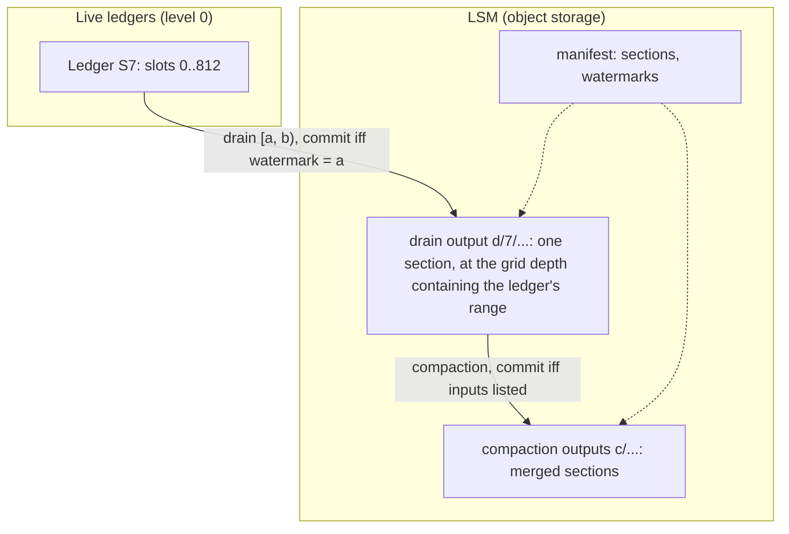

# Archive LSM

## 1. Purpose and scope

The LSM is an archive store ([archive](archive.md)): an LSM tree of immutable objects in cloud object storage, with
the live ledgers ([ledgers](ledgers.md)) as its level 0. Drains copy each ledger's decided rows, a whole closed
**segment** at a time ([ledgers §2.2](ledgers.md#22-rows-batches-and-tags)), into **sections** of immutable objects;
compactions merge sections; a **manifest** object, replaced by conditional writes, lists the committed sections and
each ledger's **watermark**, always a segment start. Once a closed ledger's watermark reaches its recovered tail `T`,
the LSM holds all of its rows and the ledger leaves the ledger map. A cluster whose archive store is archive logs
([archive logs](archive-logs.md)) runs no LSM.

The LSM owns:

- the object store contract its providers implement;
- partitions, sections, the manifest, and watermarks;
- the drain, compaction, and their commit rules, including which rows compaction may drop;
- the manifest's committer;
- the LSM's archive store, `LsmArchiveStore`: each key's prefix, assembled from its rows in the LSM of the ledgers the
  read's map value no longer lists, which is its coverage; absence answers; and the LSM's pure members, its empty token
  and its tag version base ([archive §3](archive.md#3-requirements-downward));
- its evidence for the coverage under which a closed ledger leaves the ledger map
  ([archive §2.3](archive.md#23-coverage-and-drops));
- garbage collection, which deletes unreferenced run objects without clocks;
- the section index, Bloom filter, and block caches.

[The Archive](archive.md) owns `History(k)`, its read, and the contract of tokens and prefixes. [Ledgers](ledgers.md)
owns rows, tags, segments, the ledger map, and transitions. [Journals](journals.md) owns the meaning of rows and writes
them; the LSM needs only each row's kind and body.

Code: `Orleans.Durable.Storage.Engine.ObjectStore.Abstractions` (`IObjectStore`, which the provider packages implement),
`Orleans.Durable.Storage.Engine.Archive.Lsm` (manifest view and committer, drain, compaction, the archive store,
sweeper, caches, and the memory object store), and the object store providers in `Orleans.Durable.Storage.FileSystem`,
`Orleans.Durable.Storage.AzureStorage`, `Orleans.Durable.Storage.S3`, and `Orleans.Durable.Storage.GoogleCloud`.
Data-plane types use namespace `Orleans.Durable.Storage.Engine.Archive.Lsm` and control-plane types
`Orleans.Durable.Storage.Engine.Archive.Lsm.Control` (§2). In code: the object store contract, the memory and
file-system providers, and the manifest's format, view, and committer (row 2.1 of the [implementation
plan](https://github.com/ReubenBond/clog/blob/6ffb29aa96d2e4d48fc9c34f80790493e548af96/docs/implementation-plan.md)),
the run object's format, its writer, and its reader (row 3.1), and the archive store's reads, ledger drops,
`ArchiveOptions`, and drains of whole closed segments within the archive's drain memory budget (row 3.2), the sweeper
with the file-system store's reclamation of its temporary files (row 3.4), and the store's prefixes, its empty token,
its tag version base, its pure members, and its record (row 2.4), compaction (rows 3.3 and 3.3b), the cloud object
stores (rows 3.5 and 3.5b), the section metadata cache with its preloads (row 5.3 A), and the volatile-disk block cache
(row 5.3 B).

### Design rationale

**Reads merge by tags, not by depth.** Every row carries its tag, which orders every key's history. A read merges
every section which may hold the key, in tag order, whatever its partition's depth, so the partition tree
affects only cost: drains, compactions, and pushes cannot reorder a history.

**Partitioning independent of the live ledgers, with work following live-ledger ownership.** Aligning LSM partitions
to ledger ranges would rewrite immutable data whenever ownership changes. Dyadic partitions align with dyadic
ledger ranges whenever both use the same depth, and the owner of a range compacts its partitions and caches
their blocks, which keeps locality without coupling layouts.

**Geometry is policy.** Each section records its partition, and reads, commits, drops, and sweeps depend on no other
property of the tree, so every geometry is correct, and the geometry of §8.8 (its grid step, section size, and
sections per partition) changes only cost. The grid step is fixed for a cluster's life, since pushes from one grid
would land between another's depths; changing it on a live cluster is
[deferred](../deferred.md#changing-the-grid-step-on-a-live-cluster).

**A tiered grid for an append-mostly workload.** Most journals are written while their ledger is live and never
again, and rows are rarely superseded, so compaction reclaims little space. It bounds the sections a read probes and
keeps sections near a target size. Partitions sit on a grid of depths, multiples of 4 key bits; a partition holds at
most 16 sections and pushes them into its 16 children once they total 1 GiB, and otherwise merges its smaller
sections in place (§8.8). A cost model of drains and compactions gives the costs of §8.8's scale estimates. Four
alternatives were rejected:

- **Leveling**, or lazy leveling with one section per partition at the bottom grid depth, rewrites that depth's data
  on every arrival to reclaim superseded rows this workload rarely has: a write amplification of 24 to 89 in the
  model.
- **A grid step of 8 bits**, 256 children per partition, halves the write amplification, but a partition then holds
  up to 256 sections, a read probes about 376 at the 99th percentile, the Bloom filters need 18.5 bits per key, and
  each push moves 16 GiB unless sections shrink to 4 MiB, about 3 million of them at 12 TB.
- **A fixed first depth** suits one cluster size: at depth 8 a 3-node cluster split each drain 32 ways, 117,000
  sections at 0.5 TB, and at depth 4 a 30-node cluster's reads probed twice as many sections. A drain instead lands at
  the grid depth containing its ledger's range, which follows the cluster's size.
- **Draining open ledgers every minute** writes sections of about 90 KiB and makes merges in place rewrite them over
  and over (§8.8). Draining an open ledger releases no WAL, which rolls and drops release.

**Drains of whole closed segments.** The ledger writer ends a segment at `MaxSegmentBytes`, 64 MiB, at `MaxSegmentAge`,
an hour from the segment's first batch with rows, when the ledger closes, or before a failure-triggered drain ([ledgers
§2.4](ledgers.md#24-primary-ledgerwriter)), and a drain copies one closed segment once it lies below the contiguous
tail, so an open ledger drains at 64 MiB undrained or once its oldest undrained row is an hour old, and a closed ledger
drains at once. A segment holding only a marker never ends by age or size, and its drain advances the watermark without
writing an object. The age bound limits how long a decided row relies on the live replicas alone to an hour, which
bounds what a loss beyond the system model's `Q − 1` replicas could take
([deferred](../deferred.md#recovering-a-range-after-a-ledger-loses-its-quorum)). At the scale of §8.8 the age bound
triggers first: it multiplies drain objects twelvefold, to about 5,800 a day, and adds one merge in place for each byte,
which §8.8 counts; both stay small next to the timer's. Whole segments keep every watermark at a segment start; a
segment's end is durable, a flagged batch or, on an idle ledger, an empty marker batch, so every process drains to the
same boundaries. Draining to the contiguous tail inside a segment was rejected: the archive's prefix would hold part of
a key's write for the segment, which neither its empty token nor its watermarks could describe.

**An empty token and a tag version base.** The LSM's coverage of a key is the ledgers its read's map value no longer
lists, the same for every key, so it needs no per-key token: `Plan` returns the empty token, `Admits` and `AdmitsKey`
admit, and `Holds` reads the map value the prefix carries. A rebase still needs a version base which advances with every
row the LSM stores
([archive §8.3](archive.md#83-version-bases-and-rebases)); every row's tag already does
([LG-I6](ledgers.md#5-invariants)), and compaction keeps a key's newest row of a complete ledger, so the base is the
tag of the last row of the prefix, which sections already hold. A version field per stored row was rejected: it would
change the section format for a value the tag already gives. The token clause of HI-I4 checks nothing on an empty
token; the stored versions are the chain's cross-check until a layout plans tokens, which the LSM never needs. A
defining row which stores a non-empty token would be a writer's programming error, since the store planned the empty
one, so a drain asserts each defining row's token in Debug builds, through `StoredTokens`, which the memory store
shares, rather than refusing the segment at run time, and checks no version, which the reader checks.

**A prefix of the dropped ledgers, not of the watermarks.** A prefix holds the key's rows of the ledgers its read's map
value no longer lists, `LedgerMapValue.NoLongerLists`, a ledger below its `NextLedgerId` which it does not list, and
`Holds` holds exactly their writes, one predicate deciding both (`LedgerMapCoverage`); the reader scans every listed
ledger whole, the LSM's rows of it included. Ledgers drop in lineage order (LG-I10), only once complete (LSM-I3), and a
successor's ID exceeds its parents' ([ledgers §5](ledgers.md#5-invariants)), so the held rows are a prefix of each key's
history in tag order, which the merge requires. A `Holds` by watermark, holding a listed ledger's segments below its
watermark, was rejected: completions follow no lineage, so a ledger may be complete while an older one of the same
range is not, and the held rows would then not be a prefix of the key's history. Whole-segment drains put every
watermark at a segment start, so a write's segment could judge one, but the lineage reason stands, and the prefix and
`Holds` read the map value alone. The cost: the store decodes and discards its rows of listed ledgers, and a read scans
every listed ledger's batches
holding the key from slot 0, the replicas' reads the same as any rule which scans them; a read copies each body it
keeps into its own buffer ([archive §4](archive.md#4-data-types)), so it holds its key's own bytes, not the batches'.

**Supersede only by a complete ledger.** A drain of an open ledger copies rows below the drainer's contiguous tail,
which may pass the tail another process's reader reaches. A `Replace` or `Delete` of that ledger in a section, compacted
with rows of a dropped ledger, would drop rows which such a reader, scanning the open ledger only below its own tail and
holding the dropped ledger only through the prefix, still needs: it would fold a state the key never had. So a row
supersedes older rows in a compaction only once the manifest the compaction reads shows its ledger complete, which the
committing manifest does too, since completeness is permanent (LSM-I1, LSM-I5). A reader whose map lists that ledger
open while its store's view shows it complete answers `Stale` (`PredatesView`), and one whose map lists it closed scans
it to its recovered tail, past the superseding row. Draining only closed ledgers, or reporting the open ledger's
watermark so the reader raises its tail, were rejected: the first holds the open ledger's rows in the replicas alone for
its whole life, and the second puts a manifest bound in every read. The same hazard reaches archive logs once row 3.7
drains open ledgers' segments ([archive logs](archive-logs.md#1-purpose-and-scope)).

**One manifest object, sized for 10 TB.** The manifest holds about 120 bytes per section, and §8.8 estimates its size
and its changes a day; one object replaced by one committer carries the first version, and §8.8 states when an
archive reaches its limit. A small root over immutable pages, each listing one range's sections, waits for larger
archives ([deferred](../deferred.md#manifest-size-root-and-pages)).

**Metadata at the object's end.** A run object is its sections' blocks, then each section's block index and Bloom
filter, then the trailer, which lists each section's blocks, row count, tag span, and the positions of its block index
and Bloom filter. A `SectionRef` records the object's tail, from its first block index to its end, so a cold history
read is one GET for the tail, then one per block it needs, and a preload or a sweep is one GET per object. The tail is
its sections' block indexes and Bloom filters and the trailer: at §8.7's estimate, about 0.02% of the archive's bytes,
some 2 GB at 10 TB. Every part carries its own CRC-32C, so a reader verifies only the parts it reads. The trailer ends
with its own length, so an object's last 8 bytes locate it for a reader which knows the object's length, from a listing
(§3), but holds no `SectionRef`. Neither the writer's block splits nor its filter sizing is canonical to the decoder:
the decoder accepts any layout which meets the rules of §7, and the vectors pin the writer's. A section-at-a-time
layout, each section's index and filter after its blocks, was rejected: a cold read of one key then needed a GET for the
trailer and another for its section's metadata.

**Bodies inline in sections.** Every row's body is inline, bounded by its writer's admission policy ([journals
§8.1](journals.md#81-admission)), so a section holds each row whole, and a prefix is assembled from the
blocks a read already fetches. The LSM keeps no object per row and no list of such objects, so the sweeper decides only
run objects, each by its own reference condition (§8.5).

**A continuation flag per block.** A block index entry records whether its block's first key continues the previous
block's last, which the writer knows as it starts the block. A point read for a key which starts a block then skips the
previous block, which an index of first keys alone could not rule out. A flag costs one byte per block, about 0.0004%
of a 256 KiB block.

**Block size and bits per key are the writer's.** A reader needs a block's length, which the block index records, and a
Bloom filter's hash count and length, which the filter records; it needs neither the block size nor the bits per key
the writer chose, so neither is recorded, and a change of either setting (§8.7) applies to the sections written after
it.

**The writer checks every object it writes.** Before it returns an object, the writer decodes it whole and compares it
with its input: each row's key, tag, kind, and body, through a 128-bit digest of the rows in order; each section's row
count; and the Bloom filter against every input key. A mismatch is a defect, raised as `InvalidOperationException`
before anything is uploaded. The decode is one pass over bytes already in memory, and an object which read back to other
rows would put them in every history which reads it, so the check runs in every build.

**A drain output's condition bounds its tags.** Every section of a drain output `Drain(S, a)` holds rows of `S` at
slots `a` and above, which the decoder checks (`condition-mismatch`, §7), so a committed drain cannot carry rows
outside the range its condition names. A drain output's name `d/{S}/{a}/{id}` repeats its condition, and a reader which
reads its trailer checks that the two agree, since the sweeper decides from the name's scope which ledger's completion
releases the object (§8.5).

**Objects below 2 GiB.** A run object holds at most 231 − 1 bytes, so every offset within it and every part
fits a buffer's `int` length and one upload. A drain splits its rows across objects to fit (§8.1), and a compaction
splits an output section which would pass it, as a child's whose keys cluster, across objects (§8.2); options
validation keeps `(k + 1) × s`, which bounds a merge in place, within it. A reader which meets a
range past the bound reports it as `InvalidOperationException`, a bound the caller broke, not as corruption.

**Listings carry lengths.** S3, Azure Blob Storage, and Google Cloud Storage listings return each object's size, and
the file-system and memory stores hold it, so `ListAsync` yields each name with its length (§3). The sweeper uses the
length to read an unreferenced object's trailer without a `SectionRef`: its last 8 bytes, then the trailer.

**256 KiB blocks.** A cold read pays 10 to 30 ms for an object store's first byte, against about 3 ms to transfer
256 KiB, so larger blocks add little latency; they trade a smaller block index (about 40 bytes per block, about 50 MB
per node of 30 at 10 TB) for block-cache space spent on neighbouring keys. 64 KiB blocks quadruple the index, and
1 MiB blocks cache mostly other journals' rows. With the block cache of §8.7 configured, reads serve verified blocks
from the local volatile disk and fetch only misses from the object store; without a block cache directory, each cold
read fetches a whole 256 KiB block from each section whose metadata does not exclude its key.

**A drain's memory is the archive's.** A drain holds its whole segment's rows in memory, their bodies retained from the
batches' pages and each key shared with the segment view's key table, one array per key, sorts them, and writes them
into objects of about `s`, the section size, one object at a time, all committed by one change, so the watermark moves
past the segment at once. `ArchiveOptions.DrainMemoryBytes`, 512 MiB by default, bounds every drain's memory together,
a bound the worker enforces itself, as compaction does `CompactionBudgetBytes`: its scan charges a byte budget for each
row as it reads it, the row's footprint in memory and its projected length in an object, so the charge covers the
rows and the one encoded object at a time. A drain whose next charge would pass what the budget has free releases what
it holds, waits for the whole budget, and scans the segment again alone; a drain which holds nothing waits for its first
charge. A segment whose rows alone pass `DrainMemoryBytes` fails its drain with `DrainMemoryExceededException`, which
names the ledger and the segment, a defined error the composition alerts on rather than an `OutOfMemoryException`.
The scan, its charges, and this policy are `DrainScan` in `Orleans.Durable.Storage.Engine.Archive.Control`, which
archive logs' drains share ([archive logs, design rationale](archive-logs.md#design-rationale)), and the worker counts
the segments it drained alone. Options below `s` are rejected at startup, since a drain holds an object of about `s`. A
bound from the ledger writer's `MaxSegmentBytes` was rejected: a segment passes it by its last batch, a row's footprint
in a run object may pass its batch length several times over, since a row which references its key in a batch carries
the whole key and its tag in a section, and the archive would trust a writer's setting, as no ledger reader does.
Waiting for more while holding rows was rejected, since two drains which each hold half the budget would wait on each
other forever; releasing and rescanning alone costs one extra read of a large segment. Objects end between rows at about
`s` rather than at the object bound: a drain object is then a section compaction plans with, and holding one object at a
time bounds drain memory by the segment's rows and one object. Splitting between rows rather than between keys always
progresses: a key's rows in one segment may span two sections, which a read merges by tag as it merges any sections, and
a key whose rows alone pass `s` still drains. Streaming each object's encoding into its upload was not done, since an
object store's create takes the whole content; a drain budget below the segment, cutting a segment's rows by slot, was
rejected, since a watermark inside a segment breaks LSM-I2. A segment drains whole or not at all: a read which answers
backpressure is retried from the slot the scan reached, with bounded jittered backoff, keeping the rows already read and
the segment view, since a segment's rows reference keys its earlier batches define; past the retries, the drain answers
`Backpressure`, and the next drain reads it again from its start.

**Two drains of one segment never supersede each other.** Every watermark is a segment start and every drain takes the
whole segment at its start, so two drains from one watermark reach the same end, and the later commit finds its goal
and answers `Applied`, its upload unreferenced garbage, which the sweeper reclaims once the watermark passes its start.
A drain is answered `Superseded` only by a rule a whole-segment drain never fails, so `Superseded` is a programming
error: the worker asserts against it in Debug builds, the Quint model checks `NoDrainSuperseded`, and the deterministic
simulation holds every superseded drain a violation of LSM-I2. The worker still records the answer as §2.3 states,
since the committer gives it, so a Release build which met one would only drain the segment again.

**A failure-triggered drain is the composition's loop.** When a range's live replicas fall to `Q`, the composition
([orleans §5.6](../compositions/orleans.md#56-controllers)) has the ledger's writer end the open segment with a marker
at `m`, then calls `DrainAsync` with the bound `m + 1`, a contiguous tail the marker's durability shows (LG-I8), until a
drain's `b` reaches `m`; it reads no batch past the marker, since the segment which starts at `m` is not closed below
`m + 1`. An LSM entry point for the loop was rejected: it only wrapped `DrainAsync`, and the composition already owns
the trigger, its retries, and its alert.

**A worker submits its drain's change itself.** `DrainAsync` takes the commit as a delegate, as `LedgerDropper` does,
and records the committer's answer before it returns: its next start moves forward to the change's `Below` on
`Applied`, and to a value at least as new as the deciding one on `Superseded`. A commit which throws leaves the change
pending, and the next drain of the ledger submits the same change again, uploading nothing, which the committer decides
(§2.9). A worker which completed a ledger answers `Covered` from then on with no I/O. A caller which submitted the
change
and handed the answer back (`Record`) was rejected: a crash or a lost answer between the two left the worker draining
again from its old start, uploading an object only to be superseded, and the two calls spread one decision across two
owners.

**A map older than the manifest view is stale.** A reader's map value or a drainer's metadata may predate a ledger's
close while the manifest it meets already shows the ledger complete: the ledger closed, drained to `T`, and completed
after the map was read, and another reader's newer map advanced the shared view. `ManifestValue.Watermark` answers no
bound for such a ledger; the archive store answers `Stale`, and the history read starts again with a fresh map, as
[archive §8.1](archive.md#81-history-reads) does for every stale cache, and the drain answers `Covered`, since a
complete ledger needs no drain. Treating it as corruption was rejected: it is a normal race, which the history reader
met whenever two reads with maps of different ages shared one view. Contradictions no race explains stay corrupt: a
closed ledger's watermark past its `T`, and a complete ledger's entry whose watermark is not `T` (§2.2).

**Manifest reads shared, and the view adopted at a bounded rate.** A store whose view does not cover a map value first
joins a manifest read in flight in its process, and reads afresh only when that value does not cover it; a `Stale`
answer joins the same way, and reads afresh only when the joined value still lists the missing section. Each process
thus reads the manifest once per change it must observe, however many reads meet it. Between such reads the store
adopts its process's newer `ManifestView.Current`, which drains and commits there advance, at most once per
`ArchiveOptions.ViewAdoptionInterval` (30 s), so the view trails compactions by about that much and a read rarely meets
an object a sweep deleted. Adopting the newest value on every read was rejected: each advance resets the per-epoch
coverage check and evicts tails, a cost on every read of a busy process, while a bounded lag costs only the occasional
`Stale` re-read which §8.8 estimates.

**A read fetches in parallel and decides in order.** A read starts the tail fetch of every section containing its key at
once, then the row reads of every section whose metadata does not exclude the key, and takes the answers in the view's
section order, so a cold read costs two round trips, not two per section, and the first missing object in that order
decides its `Stale` answer as a sequential read would. The cached tails of the preloaded ranges stay while their
objects are listed, and those reads load on demand outside them live within `ArchiveOptions.TailCacheBytes` (256 MiB)
and leave once unread (§8.7), with a gauge of the bytes held; a tail found corrupt stays cached as corrupt while its
entry stays, since its object never changes, so later reads fail at once without fetching it again.

**One drop submitter, which decides every answer.** Outside the Ledgers layer only `LedgerDropper` constructs
`LedgerMapChange.Drop` ([README §2.5](../README.md#25-dependency-rules)), so every drop rests on its evidence check
(LSM-I3), which `Orleans.Durable.Storage.Architecture.Tests` enforces. A pass submits its drops together, awaits each,
and decides every one which answered (the applied drops it returns, each rejection recorded once) before it rethrows the
first exception, so one unknown outcome never discards the others' answers; it refreshes its map view once, at the
pass's end. `Superseded` and `Refused` cannot answer the drop of a ledger a map value lists closed: a closed ledger
stays closed until its drop, which the drop's goal then holds, and a removal never grows the map, so either is a defect:
a debug assertion and an error logged.

**Section metadata preloaded for owned ranges.** An absence answer runs at every new journal's first touch, so a
section whose metadata loads on demand puts one object read, 10 to 30 ms, on the creations which meet it first. Each
process instead loads the metadata of its owned ranges' sections before answering from a manifest which lists them.

**Stateless workers, one committer, conditional commits.** Workers upload their outputs and return a change, which their
caller submits to the manifest committer; it applies a drain only at the watermark it started from and a compaction only
while all its inputs are listed. Any number of workers and committers can therefore race without leases or fencing: at
most one of each set of competing changes applies. The composition runs one committer for the manifest, so changes do
not conflict and concurrent ones share one manifest replace; that serialization serves performance and liveness, and
safety stays in the conditional replace. Two alternatives were rejected. Workers replacing the manifest themselves and
retrying on conflict make every node's drains race on one object, each attempt rewriting it whole. A lease for one
writer would put a clock on the safety path.

**Rejected: content-named, idempotent drain objects** (BtrLog §4.1: every node derives the same object name for a
range and creates it with a conditional PUT, so racing drainers dedupe). A derived name is reused by every upload
of its range, which LSM-I7 forbids: the sweeper deletes an object once no commit can reference it, and a reused name
could be uploaded and committed again after that deletion. Each upload instead takes a fresh random name, and the
sweeper reclaims a losing drainer's object.

**Clock-free sweeping, with a one-sweep grace for cost.** Each object records the condition under which a commit could
reference it, and that condition only ever changes from true to false. The sweeper deletes an object once a manifest
read after its listing neither references it nor satisfies its condition (LSM-I6), and safety rests on that rule alone.
Grace periods on the safety path, as in Iceberg, Delta Lake, and SlateDB, would put a clock there. The sweeper adds a
grace as a cost optimization: it deletes an object only once an earlier sweep of its own found it deletable too,
unreferenced with its condition false, and the deleting sweep evaluates the condition again. Its marks live in its
memory, so the first sweep after a restart deletes nothing. A mark is permanent evidence, since a false condition stays
false and an object never re-enters the manifest (LSM-I7); one which a sweep found merely unreferenced would be none,
since an upload in flight is unreferenced while its condition holds. The grace costs one sweep interval of garbage, and
it helps only readers whose manifest view advances within that interval: such a view no longer lists the compaction
inputs a sweep deletes, so it meets no missing object, while a view which advances only on a drop still answers `Stale`
once (§8.8). A timed view refresh was rejected: it reads every silo's manifest whether or not anything compacted, about
as much as the `Stale` re-reads it avoids, and no refresh period prevents a sweep from deleting inputs a compaction
removed just before it ([deferred](../deferred.md#stale-reads-after-sweeps)).

**Integrity checked at upload and at read, not at commit.** Every upload carries the provider's integrity checksum,
so the store keeps only the bytes the worker wrote, and every read of a run object verifies its trailer against the
section the manifest names, so a damaged or mismatched object is `ArchiveCorruptException` wherever it is read. The
manifest committer therefore reads no object. A committer which read each new object's trailer before applying its
change was rejected: it puts one object read per drain on the controller's serialized path, and the end-to-end
checks already cover corruption.

**Changes derive from values their workers read.** Every change the committer receives derives from a manifest value its
worker read, under the derivation rule (§3). The manifest only advances past that value, so one pass of a batch in
submission order leaves each change with its goal or a failed rule, and a failed rule is a permanent one: a drain's
watermark has passed its start, or a compaction's input is gone. A `Superseded` answer then stays true when a held
replace lands. Folding a batch in passes until none applies was rejected: it serves only a change no worker derives, one
which another change of its batch enables, and on such a change a replace whose outcome is unknown could answer
`Superseded` while the held replace, which applied it, lands later.

**An empty `Delete` drops only on positive evidence.** Its drop needs every older row of its key absent outside the
compaction, so the worker treats every unknown as an older row: a section whose object is gone, a filter's false
positive, and a lower-ID ledger whose range its map value does not give, which it requires the manifest value to show
complete. The map value and the manifest value may then be read in either order, and a lagging view only delays a drop.
Reading the rows of each outside section which may hold the key, to rule out a filter's false positive, was rejected:
it adds object reads to a rare case for a 0.12% chance of reclaiming one row sooner.

**A compaction holds one output partition at a time.** A push's merged rows reach its children in key order, so the
worker compacts one output partition at a time: for each child, it reads only the blocks of each input which may hold
the child's keys, located by the block index's first keys as a key's read locates them, merges them, and uploads the
child's section as an object of its own before it reads the next child's. At the defaults a push then holds about one
child's inputs and output, about 130 to 200 MiB, about an eighth of its whole input; the store's own retry of a failed
request resends one child's 64 MiB rather than the push's 1 GiB, though a failed upload which reaches the worker
redoes the push; and the sweeper reclaims each child's object once that child compacts, rather than once every sibling
has. The cost is about 272 reads a push rather than 17, its boundary blocks read twice, about 6% more input, and about
15 more objects a push, about 900 a day at §8.8's scale. A merge in place has one output partition, its own, so it
reads each input whole and writes one section, up to about 1 GiB; most are far smaller, a few drains' worth, and its
upload is one request, so it stays as it is. The size which triggers a push is no ceiling: a backlog, or a parent's
push whose keys cluster in one child, grows a partition's total, and one parent's push fills its children together. A
compaction therefore takes its inputs up to `2 × F × s` (§8.2), which a partial push permits, since reads merge by tag
and the sections it leaves count as outside it; and the worker, which owns the memory, holds a per-process budget,
which each output partition charges an estimate of the memory its reads hold, its blocks' bytes and its rows' objects,
before it reads them, and releases once its section is uploaded, so the budget bounds memory rather than bytes read,
sibling pushes interleave their children within it, none holds part of it while it waits for more, and an output
partition which passes it runs alone. One object for a push's whole output was rejected: it held the push's inputs and
its output together, about 1 GiB. So were multipart and streamed uploads through `IObjectStore`: they bound an upload's
memory but not the merge's, and add a protocol to every provider. A merge which streams each input block by block,
which would bound a merge in place too, and a cursor per input which reads each boundary block once, wait
([deferred](../deferred.md#streaming-compaction-merges)).

**Corruption is detected and reported.** An object the writer verified and the store accepted with its checksum can be
found corrupt later only when the store lost acknowledged bytes, a writer outside Clog changed it, or Clog has a
defect; each breaks an assumption of the system model ([system-model §4](../system-model.md#4-assumptions)), so durable
corruption lies outside the fault model, and Clog's duty is to detect it and never read it as data. A push finds
corruption as it reads each child's blocks, and checks each input's totals only once it has read every child's, so a
corrupt input can fail a push after earlier children's objects are uploaded. Those objects name inputs which stay
listed, since no compaction of the corrupt partition commits, so no sweep reclaims them, and each retry would add up to
a push's output more. The worker therefore confirms corruption on a read past the caches before it reports it, counts
it, and the composition holds the partition in memory for its controller's activation (§8.8), which bounds the garbage
to one attempt per activation. A durable hold in the manifest, which would bound it across activations, and repair
tooling wait ([deferred](../deferred.md#durable-corrupt-partition-hold-and-repair)). Deleting the attempt's objects
from the worker was rejected: only the sweeper deletes (LSM-I6), deciding each object from a snapshot, and a create
whose outcome is unknown could still land after it.
**Every answer of the file-system object store rests on a flush.** A read, a versioned read, an answer that an object is
absent, and a listing flush the store's directory after they observe it and before they answer (§9), so each rests on
durable entries whichever process made them. A read of an object other than the manifest which the process has
already seen durable answers without another flush: callers replace only the manifest and never use a name again
(§3, LSM-I7), so the object keeps that durable content until it is deleted, and the block reads of run objects, most of
the store's reads, cost no directory sync. A flush before the read was rejected: it misses a publication which lands
between the two.

**One lock for the file-system object store.** Replaces and deletes hold one lock file for the store. A lock file per
object was rejected: removing a lock file races with a process which has it open, so every deleted object would leave
its lock file behind, and the sweeper deletes every object once; replaces write only the manifest, so one lock costs no
concurrency the archive uses.

**One conditional write per cloud upload.** Each cloud store lands an object through one conditional write, so a write
lands whole or not at all and a retry is that write again: S3 through one `PutObject` and Azure through one `Put Blob`,
which take up to 5 GiB and 5,000 MiB, more than any object holds (§3); Cloud Storage through a resumable session, the
only upload its .NET client offers, whose condition the service checks when the session finalizes the object. Azure's
staged blocks, which its SDK uses above a threshold, were rejected: they add an upload path which the single request
never needs and buffer up to a block per concurrent transfer in the SDK. S3's multipart upload was rejected: it adds an
upload state which outlives a failed call, and which the bucket bills until a lifecycle rule or a caller aborts it.
Streaming an object through `IObjectStore`, or uploading it in parts, so a writer never holds a whole run object, was
rejected for the same reasons, and because a stream cannot be replayed, which would move the SDKs' retries into Clog;
per-child pushes, one object per child partition of about 64 MiB (§8.2), bound a writer's memory instead
([deferred](../deferred.md#streaming-or-multipart-object-uploads)).

**The writer's CRC-32C reaches the store.** A page which changes after its writer verified it is never accepted with a
matching checksum. The run object writer takes each object's CRC-32C and then runs its read-back check over the same
bytes, so a page changed before the CRC fails the check, and one changed after it fails at the store; there is no window
between them. The manifest encoder takes the CRC-32C over its finished encoding. Both pass it on `CreateAsync` and
`ReplaceAsync`, and every provider checks the bytes it keeps against it, in every build: S3 and Cloud Storage send it as
the object's checksum (`x-amz-checksum-crc32c`, `crc32c`), which the service checks, in place of a pass of their own;
the file-system store checks the bytes it wrote to its temporary file before it publishes them; and the memory and
simulated stores check their copy. Azure's `Put Blob` takes no CRC-32C, and making the writer compute a provider's
algorithm (MD5 or CRC64) was rejected, so the store checks the writer's CRC-32C over the bytes the SDK reads to compute
its `Content-MD5`, before any request, and the MD5 the service checks covers exactly the bytes whose CRC-32C matched.
The store computing CRC-32C and MD5 in one pass and handing the MD5 to the SDK was rejected as well: the SDK takes a
precalculated checksum only as CRC64. Until the shared committer of #216 decodes the manifest's encoding back in
Release builds, after its CRC-32C is taken, the manifest's CRC-32C covers the bytes the encoder wrote, and only Debug
builds verify that they decode as the value. The parameter is nullable and required at every call site, so each
caller states whether a writer verified its bytes: the store record, which no writer verifies, passes `null`, and the
store then checks with its own checksum.

**Changed content stops the process.** A store which refuses content for its writer's CRC-32C answers
`ObjectContentChangedException`, the one type every provider raises for it; S3's `BadDigest`, Cloud Storage's checksum
400, and Azure's `Md5Mismatch` map to it when the store reaches its service over TLS, which carries the bytes intact
or not at all, so a refusal of a checksum computed in the process means the bytes changed in the process. Over plain
HTTP they may have changed in transit instead, so there the refusal is an `IOException`, an unknown outcome; plain HTTP
serves emulators and development endpoints. It means the process's memory changed after verification, through
a use-after-free or a memory fault, which may have damaged other in-flight state, write-ahead log pages among it. The
drain worker, the compaction worker, and the manifest committer therefore report it as a defect through the fatal-error
handler, under the shared defect code (`FatalErrorSite.Defect`, [conventions
§14](../conventions.md#14-local-storage-failures-stop-the-process)), and count it
(`orleans.durable.storage.archive.object_content_changed`), so the process stops. Treating it as an unknown outcome and
retrying was rejected: a retry re-encodes into fresh buffers, so it would succeed and hide the defect.

**Azure uploads carry `Content-MD5`.** The service and Azurite both check it on `Put Blob`, so the same request is
verified on the emulator and in production. Its CPU cost against the service's CRC64 is unmeasured, and a measurement
is deferred ([deferred](../deferred.md#azure-upload-checksums)).

**A Cloud Storage upload's answer is read back.** A client which loses a resumable session's final answer asks the
session for its state and reports the object the answer names. Google's Cloud Storage testbench answers a session whose
final request failed its condition with an object no write stored, and the service documents no answer for that case,
so `Created` or `Applied` from a recovered session could assert a write which did not land. The store therefore answers
an upload only once a read of the generation it names shows the content's length, crc32c, and MD5, and otherwise
throws, leaving the outcome unknown, which the contract allows. The read costs one metadata request per upload, small
beside the upload itself. Trusting the session's answer was rejected: a wrong `Applied` on the manifest would lead its
committer to answer changes which no value holds. A 412 is likewise confirmed: testbench answers a damaged upload with
412, so the store answers `Exists` or `Mismatch` only once a read of the object's metadata shows the state the answer
asserts, and a 404 means an object is absent only once a listing shows the bucket exists.

**Retries are the SDKs'.** Each cloud store uses its client's built-in retries where they cover an operation, and
relies on each operation's idempotency: reads and listings change nothing, creates and replaces are conditional, so a
retry which meets its own landing fails its condition and answers `Exists` or `Mismatch`, and a delete removes a name
no later write reuses but the manifest's, which no caller deletes (LSM-I7). Cloud Storage's client covers too little:
it repeats only a request its caller marks idempotent, only on a failed status, and no download, so its store repeats
its reads, listings, and deletes itself, which nothing a repetition finds can make wrong, and never an upload. A retry
layer of Clog's own above every SDK was rejected: it would retry a call whose outcome the SDK already reported as
unknown, which the contract leaves to the caller.

**No cluster claim on the LSM.** A store and its prefix belong to one cluster by the operator's precondition (§9), and
nothing in the store enforces it. A cluster claim, one conditional create of a claim object with the cluster's identity
before the first registration creates or adopts the store's record, refusing a store another cluster claimed, was
rejected, as archive logs' `durable-storage/cluster` ([#288](https://github.com/ReubenBond/clog/issues/288)) was removed
([archive logs, design rationale](archive-logs.md#design-rationale)): it guards only that misconfiguration, and it would
add a write and a refusal path to every new cluster's start. The project owner's decision keeps clusters apart instead
by a short store prefix of each cluster's own, "which could be the cluster id, but ideally it should be short", computed
once at configuration with no request and no refusal path (§9): clusters which share a bucket under distinct prefixes
never meet, so only a clash of prefixes, which the hashed default makes negligible, is left to the operator. A claim
stays [deferred](../deferred.md#lsm-cluster-claim) until a deployment shares one prefix or the misconfiguration is
reported.

## 2. Contract upward

The contract has two planes. The **data plane**, in namespace `Orleans.Durable.Storage.Engine.Archive.Lsm`, serves
reads: sections (§2.1), the cached manifest view (§2.2), the archive store (§2.5) with its prefixes and pure members
(§2.8), and the object store (§3). The **control plane**, in namespace
`Orleans.Durable.Storage.Engine.Archive.Lsm.Control`, changes the manifest, the store, and the ledger map: the drain and
compaction workers (§2.3, §2.4), the drop submitter `LedgerDropper` (§2.6), the sweeper (§2.7), and the manifest
committer (§2.9). The control plane uses the data plane; no data-plane type references a control-plane type ([README
§2.5](../README.md#25-dependency-rules)). `IObjectStore`, in `Orleans.Durable.Storage.Engine.ObjectStore.Abstractions`,
is the one interface the layer uses, because several providers implement it; every type of the layer is a concrete
class, and `LsmArchiveStore` implements the Archive's `IArchiveStore`.

### 2.1 Partitions and sections

A **partition** is a dyadic range ([ledgers §2.1](ledgers.md#21-keys-and-ranges)). A **section** is a sorted run of
rows, all with keys in its partition, stored as a byte range of one object:
`(object, offset, length, partition, tag span)`, with the position of the object's tail. A section's rows are sorted by
key, then tag, and each carries its tag, its kind, and its body, inline (§7). A partition may hold sections and also
have descendants holding sections; a key's sections are those whose partition contains it, at every depth.

### 2.2 Manifest view

Each process reads the manifest through its `ManifestView`, a cached, read-only copy.

| Member | Postconditions |
| --- | --- |
| `Current` | The newest manifest this process has read, or whose replace by this process returned `Applied`, with its object version. A replace whose outcome is unknown never updates it. |
| `ReadAsync()` | The current manifest and its object version, read linearizably ([§3](#3-requirements-downward)) after the call began; updates `Current`. Calls made while a read is in flight share the next read, which begins once that one completes. An absent manifest reads as `ManifestValue.Absent` with no version; bytes which break the manifest's format (§7) are `ArchiveCorruptException`, with the rejection inside. |
| `RefreshAsync(epoch)` | Completes, with the snapshot it reached, once `Current` has at least `epoch`, reading only while it is older; concurrent calls share reads. |
| `JoinAsync()` | The snapshot of the read in flight when the call began, once it completes; with none in flight, a read begun after the call, as `ReadAsync` does. |
| `ManifestValue.IsComplete(S)` | `S < DrainedBelow`, or `S` is marked complete: the LSM holds every row of `S`. |
| `ManifestValue.SectionsContaining(key)` | Every section whose partition contains `key`, at every depth, in position order: one lookup per depth the sections' partitions sit at, which allocates only when several depths hold sections containing `key`. |
| `ManifestValue.Watermark(S)` | For a ledger `S` the ledger map lists, given its map entry: `T(S)` when the entry is closed and the value shows `S` complete; when it shows `S` incomplete, the recorded watermark, or 0 (`RecordedWatermark(S)`). Rows of `S` below it are in the LSM, and it is a segment start of `S` or `T(S)` (LSM-I2). `null` when the entry lists `S` open and the value shows it complete: the map value predates `S`'s close, and its caller treats it as stale. A closed ledger's recorded watermark past its `T`, or the watermark of a complete ledger's entry other than its `T`, is `ArchiveCorruptException`. |

The manifest holds the committed sections, `watermark[S]` and a completion flag for each ledger at or above
`DrainedBelow`, `DrainedBelow` itself, and an epoch which every manifest replace increments once. An absent manifest
reads as epoch 0, `DrainedBelow` 1, and no watermarks or sections. Only the manifest committer replaces it
([§2.9](#29-manifest-commits)).

### 2.3 Drain: `DrainAsync(S, below, commit)`

`DrainWorker.DrainAsync(S, below, commit)` copies one whole closed segment of ledger `S` ([ledgers
§2.2](ledgers.md#22-rows-batches-and-tags)), the decided rows with `a ≤ slot < b`, into new objects of one section
each, of about the section size, at the partition the policy of §8.8 chooses (§8.1), submits the change
`Drain(S, a, b, sections, b = T)` through `commit` (the manifest committer's `CommitAsync`, §2.9), and answers
`DrainOutcome`. `a` is the segment's start, the worker's start for `S`, and `b` its end: the slot of the next decided
batch which starts a segment, below `below`, or `T` when `below` is `T` and no later segment starts before it. `below`
is the slot below which the drain may read: at most a contiguous tail of the ledger learned after the map read
([LG-I8](ledgers.md#5-invariants)), or `T` for a closed ledger.

| Outcome | Meaning |
| --- | --- |
| `Drained(Drain(S, a, b, sections, complete), Outcome)` | The worker scanned the segment at `a` from its start, in slot order, to its end `b`, uploaded its rows, none for a segment holding only a marker, submitted the change, and answers the committer's `Outcome`; `complete` is `b = T`. While `b < below`, the caller drains again. |
| `OpenSegment(a)` | The segment at `a` does not close below `below`: no decided batch below it starts a later segment, and `below` is not `T`. Nothing is uploaded or submitted; the caller drains again once a later segment starts below a tail it learns. |
| `Covered` | The LSM already holds the rows below `below`: a manifest value the worker took shows `S` complete, whether or not the caller's map entry, which may predate `S`'s close, lists it open; or `a` is past `below`, or at it with nothing to complete. Nothing is uploaded or submitted. |
| `Dropped`, `Backpressure` | The ledger scan's answers ([ledgers §2.5](ledgers.md#25-reads-ledgerreader)): `S` has left the map, or backpressure, past the scan's bounded retries from the slot it reached, kept the scan from reaching the segment's end, which asserts nothing and is repeated later, since a segment drains whole. Nothing is uploaded or submitted. |

`a` is the worker's start for `S` in this process, which only moves forward: the `Below` of its last `Applied` drain of
`S`; on its first drain of `S` here, the watermark in its process's manifest view's current value, read from the
manifest
when the view holds none; and after a `Superseded` drain, the watermark in a value at least as new as the one which
decided it. A stale `a` is safe: the drain commits only while `S` is incomplete and `watermark[S] = a` (LSM-I1). A
`below` past a contiguous tail or `T` is `ArgumentOutOfRangeException`, and a batch at `a` without the start flag, a
watermark inside a segment, is `ArchiveCorruptException` (LSM-I2). `Applied` means the LSM holds the rows below `b`, by
this drain or a competing one, which took the same segment; `Superseded` means another drain moved the watermark from
`a` without reaching `b`, or completed `S`, after which no attempt of this drain commits, which a drain of a whole
segment from a watermark at a segment start never meets (§1, Two drains of one segment never supersede each other), so
Debug builds assert it never answers. Either way the sweeper decides whether the uploaded object is referenced.

A drain holds its segment's rows within `ArchiveOptions.DrainMemoryBytes` (§1, A drain's memory is the archive's): a
segment whose rows alone pass it fails the drain with `DrainMemoryExceededException`, which names `S` and the segment's
start, uploads and submits nothing, and is repeated by every later drain of the segment, so the composition alerts on
it. A failure-triggered drain (§8.1) is the composition's loop over `DrainAsync` with `below = m + 1`, `m` the marker's
slot, until a drain's `b` reaches `m`.

**Single-pass message draining (`LG-I15`, `LG-I16`).** `DrainWorker` accepts an optional
`IEnumerable<IMessageProcessor>? messageProcessors = null`. During segment scanning (`Segment.Add`), every
`RowKind.Message` row's channel is validated against the registered `IMessageProcessor`s and folded into that segment's
per-channel `IMessageFold` (charging fold memory to `DrainScan`'s `ByteBudget`, which resets folds via `Clear()` on an
`OverBudget` → `Alone` rescan), throwing `ArchiveCorruptException` on any unregistered channel or malformed payload;
`RunObjectFormat` retains its `kind > RowKind.Delete` guard so message rows never enter LSM run objects. Before
committing `ManifestChange.Drain(..., complete: segment.End == T)`, `DrainAsync` commits
`await segment.CommitMessagesAsync(ct)` alongside `UploadAsync` (including when `segment.Count == 0 && segment.HasMessages`
for message-only segments), adding zero extra manifest commits and zero second-pass ledger reads.

An exception from `commit` leaves the change's outcome unknown and the change pending: the worker's next drain of `S`
submits the same change again, uploading nothing, and answers what the committer decides. Any other exception leaves the
drain undone, and an object it uploaded is garbage. A worker forgets `S` once a drain answers `Dropped`, or `Covered`
with `S` complete; once its own drain completed `S`, it answers `Covered` with no read or upload.
A drain of a closed ledger to `T` marks it **complete**. `DrainedBelow` advances past every complete ledger ID
contiguous from it; ledger IDs are consecutive ([LG-I3](ledgers.md#5-invariants)), so every ID below it was a
ledger, and is complete.

### 2.4 Compaction: `CompactAsync(partition, manifest, map)`

`CompactionWorker.CompactAsync(partition, manifest, map)` compacts `partition`'s sections in `manifest`, a value its
caller read or saw applied (the derivation rule, §3), with `map`, a ledger map value read from the register or one
whose replace returned `Applied`: the geometry of §8.8 chooses the inputs, a push of the partition's sections or a
merge in place of those smaller than `s`, up to `2 × F × s`, and the output partitions, its children or itself. One
output partition at a time, in key order, it merges the inputs' rows of that partition, drops rows under the reducer's
rules ([§8.2](#82-compaction)), which consult the sections `manifest` lists outside the inputs and the live ledgers
`map` lists, and uploads the partition's section as a compaction output of its own; then it answers a
`CompactionOutcome`:

| Outcome | Meaning |
| --- | --- |
| `Compacted(Compaction(inputs, outputs))` | The outputs, a section of each output partition which kept rows, each in an object of its own (§8.2), are uploaded, and the caller submits the change, which replaces the inputs with the outputs, to the manifest committer (§2.9): `Superseded` means an input is no longer listed. |
| `NothingToCompact` | `manifest`, or the value a fresh read after a gone input gave, holds no compaction of the partition: at most `k` of its sections, or, at the deepest grid depth, where it never pushes, fewer than two smaller than `s`. Nothing is read or uploaded. |

An input whose object is gone was removed by a newer value and then swept (LSM-I6), or deleted while listed. The worker
reads the manifest afresh through its process's manifest view: a value which still lists that input's section shows a
listed object deleted, `ArchiveCorruptException`, as the archive store's reads treat one (§2.5), which the worker counts
(§8.2); otherwise it plans the partition's compaction again from the fresh value, at most three plans in all, past
which it fails with an `IOException`, an unknown outcome. The outputs uploaded before a miss, of the output partitions
before it, are garbage, which no change names.

`CompactionWorker.OverfullPartitions(manifest, options)` lists the partitions for which the geometry chooses a
compaction, those whose compactions the composition assigns (§8.8). The worker shares its process's tail cache with
the archive store (§8.7), and holds the process's compaction budget (§8.2). An `ArchiveCorruptException` from a push may
follow uploads of earlier output partitions' objects, which name inputs that stay listed, so the sweeper reclaims them
only once a commit removes one of the inputs. The worker throws it only for corruption a read past the caches confirms
(§8.2); durable corruption lies outside the fault model, and the caller holds the partition for as long as it keeps its
own state, which bounds the garbage to one attempt each time (§8.8).

### 2.5 Archive store

`LsmArchiveStore` implements `IArchiveStore` ([archive §3](archive.md#3-requirements-downward)): the LSM's prefix of a
key `k` is the fold of `k`'s rows, in every committed section whose partition contains `k`, of the ledgers the read's
map value no longer lists, which is its coverage. The history read scans each live ledger containing `k` from slot 0, as
on every store, so it sees every live row of `k`, none of which `Holds` holds.

| Member | Outcomes |
| --- | --- |
| `ReadAsync(key, map)` | From the store's view (§8.3), a manifest value which shows complete (`IsComplete`) every ledger `map` no longer lists (LSM-I4). `Absent` when no section containing `k` holds a row of it: the cached section metadata (Bloom filters and block indexes) of every such section excludes it, or the sections read hold none; for a key in a preloaded range no object-store request but the manifest read and metadata loads of §8.3, unless a load failed; for any other key, each object's first tail read too; and when the sections read hold no row of `k` in a ledger `map` no longer lists. Otherwise `Read(ArchivePrefix)`, the prefix §8.6 assembles from `k`'s rows, in every section containing `k`, of the ledgers `map` no longer lists, after verifying each object's tail, with `map` as its coverage (§2.8). `Stale` when `map` lists open a ledger containing `k` which the view shows complete: `map` predates the ledger's close, and the reader reads the map again. `Stale` also when an object the view names is absent and a manifest read after the miss no longer lists its section: a compaction removed it after the view was read; the read becomes the view. An absent object which that read still lists is `ArchiveCorruptException`, since a listed object is never deleted (LSM-I6). |
| `StoreRecordAsync(parameters)` | The store's record, the root object `store` (§2.8), which the first call creates with a random ID, the layout `lsm`, no other store field, and `parameters`, the caller's opaque `key=value` parameters, when it is absent; a create which finds it exists reads the winner's. A record whose layout or store fields differ from the LSM's throws `ArchiveStoreMismatchException` ([archive §4](archive.md#4-data-types)); its caller parameters are answered, for the caller to compare ([archive §2.4](archive.md#24-selecting-the-store)). |
| Pure members | `Plan`, `Admits`, `Holds`, `IsReplaceRequested`, `MaxAppendBytes`, and `AdmitsKey` (§2.8). |

`LsmArchiveStore` also offers `PreloadAsync(ranges)`, outside the store contract, which the composition calls on the
store it constructs: it sets the key ranges whose section metadata the process keeps loaded, replacing the previous set,
and loads at once the metadata of the current view's sections in them (§8.7); later views load only their new sections.
A store with no view yet takes its manifest view's current value as its view, loading it so. The task completes once
the loads have, whatever each ended with. Metadata outside the ranges leaves the cache by its eviction (§8.7).

Reads use the store's view, which covers every ledger the caller's map value dropped, and answer `Stale` when a cache
proves stale (§8.3); an object which contradicts the manifest is the Archive's `ArchiveCorruptException`, as is a
manifest which breaks its format (§2.2).

### 2.6 Dropping ledgers

A closed ledger leaves the ledger map by the change `Drop(S)` ([ledgers §2.6](ledgers.md#26-transitions)), submitted to
the ledger-map committer only once `IsComplete(S)` holds in a manifest value the submitter read, or whose replace
returned `Applied` (LSM-I3); a value whose replace has an unknown outcome is no evidence. This is the LSM's evidence
of coverage ([HI-I2](archive.md#5-invariants)). Drops follow each key's lineage ([LG-I10](ledgers.md#5-invariants)). The
composition submits them ([Orleans §5.6](../compositions/orleans.md#56-controllers)) through
`LedgerDropper.DropCompleteAsync(commit)`: from its process's `ManifestView.Current`, which holds only values the
process read or applied, and its `LedgerMapView.Current`, it submits `Drop(S)` for every closed ledger the manifest
value shows complete and which no listed ledger with a lower ID overlaps, as the map value's
`LedgerMapValue.OlderOverlapping` answers once per value ([ledgers §2.3](ledgers.md#23-ledger-map)), in passes: each
pass submits its drops
together, decides every one which answers, refreshes the map view once to the epoch of those which applied, and then
throws the first exception a submission raised, if any; the next pass submits the drops they unblocked. A drop the map
committer rejects is a defect ([ledgers §2.6](ledgers.md#26-transitions)): a debug assertion, an error logged, and no
later submission of it; so is a `Superseded` or `Refused` drop, which no drop of a listed closed ledger earns. Outside
the Ledgers layer only `LedgerDropper` constructs `Drop` ([README §2.5](../README.md#25-dependency-rules)). Each replica
node then drops its replica once its view revokes it. A drop is idempotent: one which finds `S` already removed finds
its goal.

### 2.7 Garbage collection: `SweepAsync()`

`Sweeper.SweepAsync()` runs one sweep: it lists the store's run objects, then reads the manifest, then deletes each
listed run object which the manifest does not reference and whose reference condition is false in it (LSM-I6), once an
earlier sweep of the same sweeper found the same; it marks each such object no earlier sweep found (§8.5). It answers
`SweepResult(Referenced, Pending, Marked, Deleted, Unreadable)`, counting each distinct listed name once: the objects
the manifest references, the unreferenced ones whose condition holds, those it marked, those it deleted, and the
unreferenced ones whose condition it could not read, which it leaves in place (§8.5). A sweeper runs one sweep at a
time: a call while another runs is `InvalidOperationException`. A manifest which breaks its format is
`ArchiveCorruptException`; an exception from the object store ends the sweep, the marks it made stand, and an object
whose delete failed stays marked. Its host runs sweeps at least one sweep interval apart (§8.8).

### 2.8 Prefixes and tokens

The LSM's members of the archive contract ([archive §3](archive.md#3-requirements-downward)):

| Member | The LSM's answer |
| --- | --- |
| `ArchivePrefix.Token` | Empty (`Origin`): the LSM tracks no per-key position. |
| `ArchivePrefix.VersionBase` | The tag `(ledger, slot, index)` of the prefix's last row, encoded as 20 bytes: the ledger `u64`, the slot `u64`, and the index `u32`, little-endian, as sections encode tags (§7), pinned by `test/Durable.Storage/shared-vectors/archive/version-bases.json`. Tags are unique and increase in each key's acceptance order ([LG-I6](ledgers.md#5-invariants)), and compaction keeps a key's newest row of a complete ledger and every row after it (LSM-I5), so each base names one state of the key, and, among reads whose map lists no ledger holding a row of the key, it advances with every row the LSM stores and never repeats while the LSM holds the key. |
| `ArchivePrefix.HasBase` | True when the key's base is a `Replace`, an empty one included (§8.6). |
| `ArchivePrefix.Tombstone` | The body of the key's base when the base is a `Delete` with a non-empty body and no `Append` follows it (§8.6). |
| `ArchivePrefix.Content` | The prefix's content (§8.6). |
| Coverage | The read's map value, which the prefix shares; `Holds` reads which ledgers it no longer lists, and nothing else does. A reader scans each listed ledger whole, from slot 0, and `Holds` holds none of its rows. |
| `Plan(write)` | The write's token, which is empty, for every write: `Begin` keeps no state. |
| `Admits(write, command)` | Admits every command. |
| `Holds(prefix, write, i)` | For a write of segment `(S, start)`: `i = 0`, or the coverage no longer lists `S`: it lies below the coverage's `NextLedgerId` and the coverage does not list it, so the ledger dropped, complete (LSM-I3), and the prefix holds its rows, applied or superseded (HI-I2). A ledger at or past `NextLedgerId`, which a later map may list, is not held, and its rows are not in the prefix. |
| `IsReplaceRequested(token)` | Never. |
| `MaxAppendBytes` | Unbounded: the caller's own limit alone bounds a body. |
| `AdmitsKey(key)` | Admits every key. |

The LSM has no `Plan` parameters of its own. Its store's record is the root object `store`, in the record format of
[archive §7](archive.md#7-formats): its ID, the layout `lsm`, no other store fields, and the caller's parameters,
recorded and compared verbatim ([archive §2.4](archive.md#24-selecting-the-store)).

### 2.9 Manifest commits

`ManifestCommitter` replaces the manifest, and every drain and compaction goes through it. The composition runs
one for the manifest ([Orleans §5.6](../compositions/orleans.md#56-controllers)).

| Member | Outcomes |
| --- | --- |
| `CommitAsync(change)` | `Applied(Epoch)`: the manifest at `Epoch`, a value written or read after the change was submitted, holds the change's goal. `Superseded(Epoch)`: the change's goal is absent from that value and its commit rule fails against it; no attempt of it applies from then on. An exception when the object store stays unavailable, or when a replace whose outcome is unknown was written for the change's batch and the manifest's next read shows neither the change's goal nor, for a change that replace did not carry, its permanently failed rule, or that read fails: the outcome is unknown, and submitting the same change again decides it. `ArchiveCorruptException` when the manifest's bytes break its format's rules and no replace of the batch carried the change; on the read after a replace whose outcome is unknown, or after a mismatch, a change a replace of the batch carried fails instead with an unknown outcome (`GroupCommitOutcomeUnknownException`) whose inner exception is the corruption. `InvalidOperationException` when the fold or its answers fail, or a value does not decode as itself, a committer defect, for a change no replace of the batch carried, nothing written for it; a change a dispatched replace carried fails with an unknown outcome around the defect instead. Cancelling ends only the caller's wait: the change stays in its batch and may apply. `DisposeAsync` closes admission, answers queued changes with `ObjectDisposedException`, cancels the read or replace in flight, whose changes are answered `ObjectDisposedException`, their outcome undecided, and completes once every admitted change has its answer. |

| Change | Commit rule, against the value it replaces | Applying it | Goal |
| --- | --- | --- | --- |
| `Drain(S, a, b, sections, complete)` | `S ≥ DrainedBelow`, `S` not complete, and `watermark[S] = a` (LSM-I1) | Adds the sections; sets `watermark[S] = b`; when `complete` (`b = T(S)`), marks `S` complete; advances `DrainedBelow` past every complete ID contiguous from it and removes their entries | `S < DrainedBelow`, or `watermark[S] ≥ b` and, when `complete`, `S` is marked complete |
| `Compaction(inputs, outputs)` | Every input is listed (LSM-I5) | Removes the inputs; adds the outputs | Its outputs are listed, or, when it has none, no input is listed, so `Applied` for a compaction without outputs says only that its inputs are gone |

A drain's goal, once present, stays present, because watermarks and `DrainedBelow` never decrease and completeness is
permanent: no drain of a complete ledger commits, so none makes it incomplete again. A drain covers at least one slot,
`a < b`, unless it only completes its ledger: a drain of no slots, `a = b`, is complete and adds no sections. A drain
which copies no rows still marks its ledger complete. A compaction's goal turns false only once a later compaction
consumes its outputs, so a resubmission may then read `Superseded` although an earlier attempt applied; callers act on
`Superseded` only in ways which are safe either way, since the sweeper decides every object by the manifest. Under the
derivation rule (§3), once a change's rule fails against a value at or after the one it derives from, it fails against
every later value, so a `Superseded` change never applies later. Each replace increments the epoch once, whatever number
of changes it applies.

**Group commit.** The committer reads the manifest when it first needs it, then batches concurrent submissions and
merges identical ones. It decides a batch by folding it in submission order over the value it last read or wrote: each
change whose goal is absent and whose rule holds against the result of the changes before it applies to that result.
Under the derivation rule (§3) every change derives from a value at or before that one, so the result holds each
change's goal or fails its rule for good. One conditional replace writes the result, and the committer answers every
change of the batch from the value that replace produced, once it lands. It answers a change only from a value read or
written after the change was submitted: a value it wrote answers only the changes submitted before its replace began,
since a change submitted during the replace may derive from a newer value a competing committer wrote, and a batch which
applies nothing against an older value re-reads the manifest and decides again. A mismatch re-reads the manifest and
decides the whole batch again against the value read. A replace whose outcome is unknown ends its batch with one read
([conventions §6](../conventions.md#6-retries-and-idempotency)): the committer re-reads the manifest, answers each
change whose goal the value read shows, and each change the held replace did not carry whose permanently failed rule it
shows, and fails every other change of the batch with the replace's exception, its outcome unknown. A change the held
replace carried is answered only `Applied`, or fails: its rule held against the fold's result, not against the value
read, so the held replace may still apply it, or applied it before a later change, such as a compaction of its outputs,
removed its goal from the value read. Every `Superseded` answer rests on a permanently failed rule, which no later
landing undoes, so the committer answers it without fencing a held replace first. A failed read fails the batch with the
replace's exception, and one which finds the manifest corrupt fails each change a replace of the batch carried with an
unknown outcome around the corruption, and every other change with the corruption. One replace is in flight at a time,
and each starts at least a configured interval after the previous one completed, which the composition sets no shorter
than the store's per-object write rate allows; changes submitted meanwhile join the next batch. The committer decides
every change from the manifest alone and reads no object: the upload's integrity checksum and every reader's trailer
check (§7) cover a damaged or mismatched object. The committer names no composition: the composition chooses where it
runs and how submissions reach it. The manifest's commit rules (`ManifestCommitRules`) parameterize the register group
committer which the ledger map's and the node registry's committers share ([conventions
§6](../conventions.md#6-retries-and-idempotency)).

## 3. Requirements downward

**Object store** (`IObjectStore`), whose one contract, the callers' demand the LSM meets among them, [object
store](object-store.md#2-contract-upward) states. The LSM's own rules of its objects: only the manifest is replaced, and
every other object is created once with at least one byte, keeps its content and length until the sweeper deletes it,
and is never written again (LSM-I7; *Callers*, below). The committer reads the manifest after a mismatch; a worker whose
create of a fresh random name answers `Exists` met its own attempt, since no other upload draws the name. Run objects
and the manifest's encoding are held whole as `ArcBuffer`s, so a provider which retains one takes a lease rather than a
copy of its bytes. The manifest meets the store's rule on versions ([object store §2.1](object-store.md#21-iobjectstore))
through its epoch: every value a replace writes carries the next epoch, so no value repeats; a resubmission rewrites
identical bytes only at the same epoch, against the same expected version, where at most one of the writes applies.

**Ledgers** ([ledgers](ledgers.md)): `ScanAsync`, which reads a segment from its start, and `ReadTailAsync`, the seal
check, for drains; the cached `LedgerMapView`; LG-I1 through LG-I13, in particular consecutive ledger IDs (LG-I3), on
which `DrainedBelow` rests, and segments which close by a later flagged batch or by `T` and are decided in slot order
(LG-I12), on which whole-segment drains rest.

**Archive** ([archive](archive.md)): the `IArchiveStore` contract the LSM's archive store meets; HI-I2, which
LSM-I3 establishes for the LSM; and HI-I3 and HI-I4, which §2.8 meets for the LSM.

**Callers.** Every manifest replace goes through the manifest committer. The **derivation rule**: every change a worker
submits derives from a manifest value it read, or whose replace returned `Applied`: a drain of `S` starts at a watermark
no greater than the one that value records for `S`, or the value shows `S` below `DrainedBelow`, and a compaction's
inputs are sections that value lists. Watermarks never decrease and an input, once removed, never returns, so a drain's
or a compaction's failed rule stays failed, on which the committer's answers rest (§2.9, [conventions
§6](../conventions.md#6-retries-and-idempotency)). Only the manifest is replaced: every other object is created once and
keeps its content until the sweeper deletes it, and its name is never used again (LSM-I7). Archive logs' chunk
layout, the store's other caller, creates a name the sweeper deleted again only with the content it held: a straggler's
or a retry's write in a superseded generation ([archive logs §7.4](archive-logs.md#74-chunk-layout)). The file-system
provider answers a read of a name it has seen durable without a flush (§9), so after another process deletes and
re-creates the name, the read may answer before the re-creation is durable; archive logs read no re-created name. A
replace never writes
content the object held before its current content (Versions, above). A `Drop(S)` is submitted only once a manifest
value the submitter read, or whose replace returned `Applied`, shows `S` complete (§2.6). A failure-triggered drain
first has the ledger's writer end the open segment ([ledgers §2.4](ledgers.md#24-primary-ledgerwriter)), and drains to
the batch which ends it once that batch is decided.

## 4. Data types

| Type | Definition |
| --- | --- |
| `ObjectName` | 1 to 200 ASCII characters, `/`-separated components of `[a-z0-9_-]`, none empty ([identity §11](../identity.md#11-lsm-object-names)); a listing prefix is the start of a name. Run objects are `{kind}/{scope}/{id}`: `d` drain output with scope `{S}/{a}`; `c` compaction output with scope its first output partition's text form, a bounded digest which the section's `Partition` carries in full; `{id}` a random 128-bit value, so names are never reused (LSM-I7). The root objects, below the cluster's store prefix, are `manifest` and `store`, the store record ([archive §2.4](archive.md#24-selecting-the-store)), created once; the LSM keeps no cluster claim (Design rationale, *No cluster claim on the LSM*). |
| `ObjectVersion` | The token a versioned read or an applied replace returns, compared for equality only; it may be a digest of the content (§3, [identity §9](../identity.md#9-versions)). |
| `ObjectCreateOutcome`, `ObjectReplaceOutcome` | `Created` or `Exists`; `Applied(Version)` or `Mismatch` ([conventions §15](../conventions.md#15-outcomes-unions-and-errors)). |
| `VersionedObject` | `(Content, Version)`: an object's whole content, which the caller owns, and its version. |
| `ObjectRange` | `(Offset, Length)`: a non-empty byte range of an object, ending at or below 263 − 1. |
| `SectionRef` | `(Object, Offset, Length, Partition, MinTag, MaxTag, Tail: ObjectRange)`, `Tail` the object's tail, from its first block index to its end (§7). Sections order by object name, then offset. |
| `ManifestValue` | `(Epoch, DrainedBelow, Watermarks: S → ManifestWatermark(Below, Complete), Sections: SectionRef[])`. An absent manifest reads as `(0, 1, {}, [])`. A ledger at or above `DrainedBelow` has an entry only while the archive holds rows of it, so no entry is at slot 0 and incomplete, and the entry of `DrainedBelow` is incomplete; sections are in order, each position once. |
| `ManifestSnapshot` | `(Value, Version)`: a manifest value with the object version it was read or written at, none for the absent manifest. |
| `ManifestChange` | Control plane. `Drain(S, From, Below, Sections, Complete)`, `From ≤ Below`, and `From < Below` unless `Complete` with no `Sections`; or `Compaction(Inputs, Outputs)` (§2.9). |
| `ManifestCommitOutcome` | Control plane. `Applied(Epoch)` or `Superseded(Epoch)`: the verdict and the epoch of the manifest which decided it. |

## 5. Invariants

| ID | Invariant |
| --- | --- |
| LSM-I1 | Watermarks and `DrainedBelow` never decrease, and a complete ledger stays complete. A drain of `S` over `[a, b)` commits iff `S ≥ DrainedBelow`, `S` is not complete, and `watermark[S] = a`, and raises it to `b`. |
| LSM-I2 | A drain output of `S` over `[a, b)` holds exactly `S`'s decided rows with slots in `[a, b)`, each in a section whose partition contains its key; `[a, b)` is one whole closed segment of `S`, `a` its start and `b` the start of the next segment or `T(S)`, so every watermark is a segment start or `T(S)`. |
| LSM-I3 | A ledger leaves the ledger map only when it is closed and complete: `watermark[S] = T(S)`. |
| LSM-I4 | The LSM's archive store answers a read, `Absent` included, only from a manifest value which shows complete (`IsComplete`) every ledger the caller's ledger map value no longer lists, with that map value as its coverage, its prefix the key's rows of exactly those ledgers; answers `Stale` when an object it needs is missing or the map value lists open a ledger the manifest value shows complete. With HI-I1, a history read over the LSM includes every row decided before it began. |
| LSM-I5 | A compaction commits iff every input is still listed, and its outputs preserve every key's fold. A row is dropped only if a newer `Replace` or `Delete` of its key in the inputs, of a ledger the manifest value the compaction reads shows complete, supersedes it, or, for an empty `Delete` of such a ledger, if no older row of its key lies outside the compaction, in a committed section or undrained in the live ledgers. A `Delete` with a tombstone is kept until a newer such `Replace` or `Delete` supersedes it. Each output's trailer records exactly the compaction's inputs. |
| LSM-I6 | The sweeper deletes an object only if a manifest read after its listing neither references it nor satisfies its reference condition; every reference condition changes only from true to false. |
| LSM-I7 | The LSM's object names are never reused; a commit references only completed uploads; an object never re-enters the manifest after leaving it. |
| LSM-I8 | Retired: sections hold every body inline, and the LSM keeps no blob objects. The number is not reused. |

LSM-I1 and LSM-I2 make the rows of each ledger move into the LSM exactly once, in prefix order. LSM-I3 keeps every
decided row in the history, which is the LSM's half of HI-I2. LSM-I4 is the LSM's half of HI-I1, which makes
reads linearizable. LSM-I5 keeps compaction from changing any history's
fold. LSM-I6 and LSM-I7 keep every object a commit or a read can still need. LSM-I3 makes the LSM's `Holds` exact
(§2.8): a ledger the map no longer lists is complete. Each invariant rests on a commit rule
checked in a conditional replace, or on the sweeper's order of listing and reading, so it holds for any number of
workers and committers, with any views. LSM-I3 rests instead on the drop's submitter, which judges completeness only
from a manifest value it read or saw applied (§2.6).

## 6. Faults, concurrency, and cancellation

- **Racing workers.** Competing drains of one ledger commit at most one per watermark; competing compactions
  over overlapping inputs commit at most one. Losers' objects are garbage. With one committer for the manifest,
  such races cost only the losers' uploads, never a conflicting replace.
- **Unknown commit outcome.** The committer ends the batch with one read of the manifest, answering what it decides and
  failing the batch's other changes (§2.9). A caller whose submission failed submits the same change again.
- **Lost or delayed uploads.** A commit names only objects whose creates returned `Created`, or `Exists` for the fresh
  random name the worker drew, which only its own attempt can hold (LSM-I7). A delayed
  create of an abandoned object lands as garbage, which a later sweep deletes once its condition is false and an
  earlier sweep found it so (§8.5).
- **Object store unavailable.** Drains, compactions, sweeps, and reads of the LSM wait; the live ledgers keep
  accepting writes, so closed ledgers stay live and their nodes' disks fill until the composition throttles
  ([Orleans resource governance](../compositions/orleans.md#59-resource-governance)).
- **Stale caches.** A reader whose manifest names a deleted object, or whose ledger map names a dropped ledger,
  re-reads both (LSM-I4).
- **Corruption.** A CRC-32C mismatch in a block, block index, Bloom filter, or trailer, or a trailer which does
  not list the section the manifest names or disagrees with its object's name, is `ArchiveCorruptException`. An upload
  the store rejects for its checksum fails, and its worker's call throws; a later drain or compaction uploads again
  under a new name.
- **Cancellation.** Cancelling a worker before it submits its change leaves garbage. Cancelling a commit stops
  the caller waiting; a submitted change may still apply, and submitting it again decides it.

## 7. Formats

The run object's and the manifest's layouts are below, with their golden vectors ([formats](../formats.md)).

**Run object** (`d/…` and `c/…`, `CLAR` version 1): its sections' data blocks, then each section's block index and
Bloom filter, then a trailer. A section's blocks hold rows `(key, tag, kind, body)` sorted by key and tag, each body
inline; its block index records each block's length, whether its first key continues the previous block's last, and its
first key; its Bloom filter covers the section's keys and records its hash count. The trailer lists each section's
blocks, partition, tag span, row count, and the positions of its block index and Bloom filter; records the object's
reference condition, `(S, a)` for a drain output and, for a compaction output, the input sections, exactly the inputs of
its commit's `Compaction(inputs, outputs)`, which the sweeper deletes once the output is listed (§8.5); and ends with
its own length and CRC-32C. The writer checks, before it returns the object, that the object reads back to its input
under every rule below. The object's **tail** runs from its first block index, the **metadata offset**, to its end;
every `SectionRef` records it.

Every integer is little-endian. Each data block, block index, Bloom filter, and the trailer ends with the CRC-32C of its
own bytes before it. The sections' blocks lie back to back from offset 0 to the metadata offset, each section's from
its offset; each section's block index and then its Bloom filter follow, in section order, and a filter ends where the
next section's block index starts, or, for the last section, where the trailer starts. A key is its `u16` length and
its bytes; a tag is its ledger `u64`, its slot `u64`, and its index `u32`; a partition is its depth `u32` and its
`⌈depth / 8⌉` prefix bytes, as the manifest's are. A run object holds at most 231 − 1 bytes.

| Part | Fields, in order |
| --- | --- |
| Row | Key; tag; kind `u8` (0 `Append`, 1 `Replace`, 2 `Delete`, the values a batch uses, [ledgers §7](ledgers.md#7-formats)); body length `u32` and bytes |
| Data block | Rows, up to the CRC-32C; CRC-32C |
| Block index | Block count `u32`; each block's length `u32`, continuation flag `u8` (1 when its first key is the previous block's last, else 0), and first key; CRC-32C |
| Bloom filter | Hash count `u8`; the filter's bytes, the rest before the CRC-32C; CRC-32C |
| Trailer | Magic `CLAR`; version `u32`, 1; section count `u32`; metadata offset `u64`; then each section's blocks' offset and length (`u64` each), partition, lowest and highest tags, row count `u64`, the offsets in the object of its block index and Bloom filter (`u64` each); the condition's kind `u8`, then for a drain (0) the ledger `u64` and the watermark `a` `u64` it started from, or for a compaction (1) the input count `u32` and each input section's object name (a `u8` length and its ASCII bytes) and offset `u64`, in order of object name, then offset; the trailer's length `u32`; CRC-32C |

The writer's encoding is the one the vectors pin. It writes each section's rows in order of key, compared bytewise, then
tag, and starts a new block before a row when the block holds a row and the row would make it longer than the block
size, so a row longer than the block size has a block of its own. Over a section of `n` distinct keys at `b` bits per
key, the filter holds `⌈n·b / 8⌉` bytes, `m` bits, and `k = max(1, round(b · ln 2))` hashes, rounding half to even; a
key sets, and the filter admits it only if it has set, the bits `(h₁ + i·h₂) mod m` for `i` from 0 to `k − 1`, where
`h₁` and `h₂` are the low and high 32 bits of the key's XXH3 64-bit hash (seed 0, `System.IO.Hashing.XxHash3`) and bit
`j` is bit `j mod 8`, from the least significant, of byte `⌊j / 8⌋`. A section takes its block size and bits per key
from the writer's settings (§8.7), from 1 byte and from 1 to 64 bits; a reader needs neither. The writer is
incremental: it takes each section's rows in order and keeps, beside the object's bytes, each section's block index
entries and the 8-byte hash of each distinct key for its filter.

A reader reads a whole object as its trailer, then each section's block index and Bloom filter in order, then each
section's blocks in order. It reads each part's fields in order, checks the part's CRC-32C before its fields, checks
each field to end within the part (`body-truncated`) and then against its own rules as soon as it is read, and rejects
the first rule the bytes break, with its reason code in `Data["orleans.durable.storage.decode.reason"]`:

| Reason | Rule |
| --- | --- |
| `truncated` | The trailer holds at least 16 bytes: its magic, version, length, and CRC-32C |
| `bad-magic` | The trailer's magic is `CLAR` |
| `bad-version` | The trailer's version is 1 |
| `length-mismatch` | The trailer's length is its own; read from an object's last 8 bytes, it is at least 16, at most the object's length, and at most `MaxTrailerLength`, 1 MiB, which no writer passes |
| `crc-mismatch` | A part's CRC-32C matches its bytes |
| `body-truncated` | Each field ends within its part |
| `no-sections` | The trailer lists at least one section |
| `bad-section-layout` | The metadata offset is at most the trailer's offset; the first section's block index starts at the metadata offset, each later one at least 4 bytes after the previous Bloom filter, and each Bloom filter at least 4 bytes after its block index, each leaving at least 4 bytes for itself and each part after it before the trailer |
| `sections-not-contiguous` | Each section's blocks start where the previous section's ended, the first at 0, and the last end at the metadata offset |
| `bad-section-range` | Each section's blocks hold at least one byte and end at or before the metadata offset |
| `bad-partition` | Each partition is at most 524,280 bits deep and sets no bit past its depth |
| `bad-tag` | Each tag's ledger is at least 1, its slot at most 263 − 2, and its index at most 231 − 1 |
| `tags-unordered` | A section's lowest tag is at most its highest |
| `no-rows` | Each section's row count is at least 1 |
| `bad-condition` | The condition's kind is 0 or 1; a drain's ledger is at least 1 and its watermark at most 263 − 1; a compaction has an input, each at an offset at most 263 − 1 |
| `bad-object-name` | Each input's object name is an object name (§4) |
| `inputs-unordered` | Each input lies after the previous one, by object name and then offset |
| `condition-mismatch` | In a drain output `Drain(S, a)`, each section's lowest and highest tags are of ledger `S` and its lowest tag's slot is at least `a` |
| `trailing-bytes` | The trailer's body and each block index end with their last field |
| `no-blocks` | The block index lists at least one block |
| `blocks-mismatch` | Each block holds at least 5 bytes, and the blocks' lengths sum to the section's |
| `bad-continuation` | Each continuation flag is 0 or 1, and the first block's is 0 |
| `empty-key` | Each key holds at least one byte |
| `keys-unordered` | Each block's first key is at least the previous block's |
| `first-key-outside-partition` | Each block's first key lies in its section's partition, so the blocks a range's read locates by their first keys hold its rows |
| `bad-filter` | The hash count is 1 to 64, and the filter holds at least one byte |
| `unknown-kind` | Each row's kind is 0, 1, or 2 |
| `index-mismatch` | Each block's first row has its block's first key in the index, and, when the previous block was read, the block's continuation flag is whether that key is the previous block's last row's |
| `rows-unordered` | Each row of a section lies after the previous one, by key and then tag |
| `key-outside-partition` | Each row's key lies in its section's partition |
| `tag-outside-span` | Each row's tag lies within its section's tags |
| `filter-miss` | The Bloom filter admits each key of its section |
| `row-count-mismatch` | A section holds its trailer entry's row count |
| `tag-span-mismatch` | A section's lowest and highest rows' tags are its trailer entry's |

A section's entry, condition, and layout rules (`no-sections` through `condition-mismatch`) are the trailer's; a row's
checks against its section (`index-mismatch` through `filter-miss`) follow its last field; and a section's totals
(`row-count-mismatch` and `tag-span-mismatch`), which the reader accumulates as it checks each row, follow its last
block. A read of one key's rows reads the tail and only the blocks whose keys may hold the key, checking each under the
same rules but `filter-miss` and the section's totals, and stops at the first row past the key; a reader which skips a
block skips the order check across it. A read of one range's rows, as a push reads one child's, reads the blocks whose
first keys lie in the range and the last block whose first key lies below it, checking each under the same rules but
the section's totals, and stops at the first row past the range; the compaction checks each input's totals over the
rows of all its ranges' reads, once it has read every range. The partial decoders, of the trailer alone and of the
tail, apply the rules of the parts they read. The vectors are
`test/Durable.Storage/shared-vectors/archive/run-objects.json` and `run-object-rejections.json`, which
`generate_run_objects.py` beside them writes from its own reading of these rules, and the `archive-run-object` fuzz
target judges the decoder by an independent reading of them, and its reads of each section's halves by the whole read
([verification §6.1](../verification.md#61-decoder-fuzzing)).

Every read of a run object, by a history read, a compaction, or the sweeper, first verifies the object's trailer: its
CRC-32C, and, for a section the manifest references, that the trailer's metadata offset is the `SectionRef`'s tail
offset (`tail-mismatch`), that it lists the section at the `SectionRef`'s offset, length, partition, and tag span
(`section-not-listed`), and that its condition agrees with the object's name (`name-mismatch`): a drain output's name
`d/{S}/{a}/…` with `Drain(S, a)`, and a compaction output's scope with its first section's partition. A failure is
`ArchiveCorruptException`, whose reason is the decoder's or one of these three, and the sweeper leaves such an object
in place. A range past 231 − 1 bytes is `InvalidOperationException`. A process reads each object's tail at
most once: concurrent first reads of an object share one fetch, and the verified tail joins the section metadata cache
(§8.7). A reader which knows an object's length but holds no `SectionRef`, as the sweeper does from a listing, reads
the object's last 16 KiB, or the whole object when it is shorter, which holds every trailer but the longest, and reads
the trailer again only when the length its last 8 bytes give passes them; a listed length past 231 − 1 bytes
is `ArchiveCorruptException` (`length-mismatch`), since the listing is the store's word about the object. A writer
refuses a trailer past `MaxTrailerLength`, which bounds what a corrupt length can make a reader fetch.
**Manifest** (`manifest`, `CLAM` version 1): a 16-byte header, the magic `CLAM` followed by the version, the body's
length, and the CRC-32C of the body, each a little-endian `u32`; then the body, whose integers are little-endian:

| Field | Encoding |
| --- | --- |
| Epoch | `u64`, at least 1 |
| `DrainedBelow` | `u64`, at least 1 |
| Watermarks | A `u32` count, then each entry in ascending ledger order: the ledger `u64`, the watermark `u64` (at most 263 − 1), and the completion flag `u8` (0 or 1) |
| Sections | A `u32` count, then each section in order of object name, then offset: the object name, a `u8` length and its ASCII bytes; the offset and length, `u64` each; the partition, its depth `u32` and its `⌈depth / 8⌉` prefix bytes; the lowest and highest tags, each the ledger `u64`, the slot `u64`, and the index `u32`; the tail's offset and length, `u64` each |

The encoding is canonical: a value has one encoding, and decoding accepts only it, so every accepted input encodes back
to its own bytes. Nothing encodes epoch 0, which only the absent manifest has. A rejection is an `InvalidDataException`
whose `Data["orleans.durable.storage.decode.reason"]` names the first rule the bytes break as a reader meets them: the
header's `truncated` (fewer than 16 bytes), `bad-magic`, `bad-version`, `length-mismatch` (the header's body length
differs from the bytes which follow), and `crc-mismatch`; then each body field's rule as soon as that field is read,
before the next field (so a tag's ledger is judged before its slot is read), with `body-truncated` where the body ends
inside a field: `zero-epoch`, `zero-drained-below`, `watermark-below-drained`, `watermarks-unordered` (not strictly
ascending), `slot-out-of-range` (a watermark past 263 − 1), `bad-complete-flag`, `empty-watermark` (at slot 0
and incomplete), `complete-at-drained-below`, `bad-object-name` (§4), `bad-section-range` (empty, or ending past
263 − 1), `bad-partition` (deeper than a key's 524,280 bits, or a prefix bit set past its depth), `bad-tag`
(ledger 0, slot past 263 − 2, or index past 231 − 1), `tags-unordered` (the lowest above the
highest), `bad-tail-range` (an empty tail, or one ending past 263 − 1), `sections-unordered` (not strictly
after the previous section's object and offset), and `trailing-bytes`. The vectors are
`test/Durable.Storage/shared-vectors/archive/manifest.json` and `manifest-rejections.json`, and the `archive-manifest`
fuzz target judges the decoder by an independent reading of these rules ([verification
§6.1](../verification.md#61-decoder-fuzzing)). The encoder writes the fields across buffer pages and fills the header
last, and the decoder reads a `ReadOnlySequence<byte>` in place, so a manifest of any size, many pages long, encodes and
decodes ([conventions §1](../conventions.md#1-buffers-and-ownership)).

## 8. Mechanism and policy

### 8.1 Drain

1. Read the ledger map. Take the start `a`: this worker's pending change of `S`, if its commit threw, which it submits
   again at step 4 with no scan or upload; else the `Below` of its last `Applied` drain of `S`; on its first drain of
   `S`
   in this process, `watermark[S]` in the manifest view's current value, or in a manifest read when the view holds none;
   after a `Superseded` one, in a value at least as new as the one which decided it (`ManifestView.RefreshAsync`); a
   segment start (LSM-I2). The start only moves forward. A value which shows `S` complete, or an `a` past `below`, or at
   it with nothing to complete, answers `Covered`; a closed ledger's `a` past `T` is `ArchiveCorruptException`.
   Find the segment's end `b`: the slot of the next decided batch of `S` which starts a segment, when that slot lies
   below a contiguous tail learned after the read (`ReadTailAsync`), usually its known contiguous tail; or `T` when `S`
   is closed and no later segment starts before it. Until the segment closes below the tail, there is nothing to drain:
   the drain answers `OpenSegment(a)`.
2. Scan the segment `[a, b)` from its start (`ScanAsync`), preferring a local replica below the contiguous tail. The
   batch at `a` starts a segment, or the manifest is corrupt (LSM-I2); the scan stops at the next batch which starts
   one. Every `RowKind.Message` row is matched to its registered `IMessageProcessor` and folded into its segment
   `IMessageFold` (or rejected with `ArchiveCorruptException` on an unregistered channel or malformed payload), charging
   its fold memory to `DrainScan`'s `ByteBudget` without entering LSM sections (LG-I15, LG-I16). A read
   which answers backpressure is retried from the slot the scan reached, with bounded jittered backoff, keeping the
   rows already read; backpressure past the retries, before the segment's end, answers `Backpressure`, since a segment
   drains whole. Each row is charged to the drain memory budget as it is read (§1, A drain's memory is the archive's).
   Each defining row's stored token is empty, the LSM's `Plan` (HI-I4), which Debug builds assert.
3. Sort the rows by key and tag and upload them, one object at a time, each of one section at the partition §8.8
   chooses: an object ends before the row whose projected length would pass `s`, the section size, which lies below
   the object bound (§7), and the rows go on in another, so the change carries as many sections as objects. Commit all
   folded segment messages (`CommitMessagesAsync`) before step 4 (including when a segment holds only messages and zero
   archive rows; LG-I16).
4. Commit: submit `Drain(S, a, b, sections, b = T)` through `commit` to the manifest committer, which applies it iff
   `S ≥ DrainedBelow`, `S` is not complete, and `watermark[S] = a` on the value it replaces (§2.9): it adds the
   sections, sets `watermark[S] = b`, marks `S` complete when `b = T`, and advances `DrainedBelow` past complete IDs,
   dropping their entries from the watermark table. Record the answer: `Applied` moves the start to `b`, or marks `S`
   complete; `Superseded` never answers a whole-segment drain, which Debug builds assert, and the worker would take the
   next start from a value at least as new as the deciding one. An exception keeps the change pending for step 1.

A segment with no rows, a marker alone, uploads nothing: its drain commits `Drain(S, a, b, [], b = T)`, which advances
the watermark past it. A ledger's segments drain one at a time, in order, each from the watermark the previous one
left. A failure-triggered drain first has the ledger's writer end the open segment, with an empty marker batch on an
idle ledger ([ledgers §2.4](ledgers.md#24-primary-ledgerwriter)), and once the marker at slot `m` is decided, the
composition calls `DrainAsync` with `below = m + 1`, a contiguous tail the marker's durability shows (LG-I8), until a
drain's `b` reaches `m`, reading no batch past the marker, rather than draining to the contiguous tail. Drains of
different ledgers commit independently; a group commit carries every change submitted since the previous replace, and
each replace starts at least the commit interval after the previous one completed (§2.9).

In code, the caller passes as `below` a contiguous tail its reader learned, or `T` for a closed ledger, and the worker
finds the segment's end by its scan: the first batch past `a` with the start flag, which ends the scan there, or `T`
when the scan reaches it. It holds the segment's rows in a rented array, each key shared with the segment view's key
table, sorts them in place, and writes them through the incremental `RunObjectWriter` under fresh random names
`d/{S}/{a}/{id}`, projecting each object's length as its fixed parts (`RunObjectFormat.DrainOutputFixedLength`) and each
row's footprint (`MaxRowFootprint`: its encoding, block CRC-32C, block index entry, and Bloom filter bits), and releases
each object's rows once it is written.

### 8.2 Compaction

Rows of one key are merged in tag order. Under the row kinds ([ledgers §2.2](ledgers.md#22-rows-batches-and-tags)):

- a row with a newer `Replace` or `Delete` of its key among the inputs, of a ledger the manifest value shows complete,
  is dropped; one of a ledger not yet complete, which an open ledger's drain wrote, supersedes nothing, since a reader
  of the open ledger may stop below it (§1, Supersede only by a complete ledger);
- an empty `Delete` of a complete ledger, an expiry, is dropped only if no older row of its key exists outside the
  compaction: no
  committed section outside the inputs whose partition contains the key holds a lower tag of it (checked through each
  section's Bloom filter and block index), and every live ledger with a lower ID whose range contains the key is
  complete (such a ledger is closed, because the `Delete`'s ledger closed it or a successor of it);
- every other row is kept, a `Delete` with a tombstone among them, which stays the key's base with its tag, so the
  key's version base and tombstone survive (§2.8).

New rows of a key always receive higher tags than every existing row, and rows move only from the live ledgers into
sections, so an empty `Delete`'s drop decided at upload remains valid at commit. Compaction consults no clock: expiry
is an owner's decision, written as an empty `Delete` in the live ledgers ([Journals
§8.6](journals.md#86-tombstone-expiry)). A key whose newest row is an empty `Delete` which compaction drops reads
`Absent` afterwards, the caveat of [archive §8.3](archive.md#83-version-bases-and-rebases). A history read still folds
to the key's state: an `Absent` answer holds no row, so the reader takes every live row of the key, the `Delete`
among them while its ledger is listed, and that ledger leaves the map only after every lower-ID ledger overlapping it
([LG-I10](ledgers.md#5-invariants)), whose rows the `Delete` supersedes.

The worker decides the empty `Delete`'s drop from the manifest value its inputs come from and the caller's ledger map
value:

- **Sections outside.** Each section the value lists whose partition contains the key (`SectionsContaining`), other
  than the inputs, whose lowest tag lies below the `Delete`'s, must exclude the key by its Bloom filter or block index,
  read from its object's verified tail. The worker fetches the tails of a key's outside sections at once, through the
  process's tail cache (§8.7), and decides in the view's order. An object gone since the value was read leaves the
  question open, and the row stays; an object which breaks its format or contradicts the manifest is
  `ArchiveCorruptException`, which fails the compaction, since corruption is never read as an unknown.
- **Live ledgers.** Every ledger with an ID below the `Delete`'s ledger which the value does not show complete must be
  listed by the map with a range which excludes the key; one the map does not list, or a `Delete` of a ledger at or
  above the map's `NextLedgerId`, keeps the row. So the decision holds whichever of the map and the manifest was read
  first: a ledger's range never changes, and completeness, once shown, is permanent (LSM-I1).

The worker fetches every input's verified tail, all at once, through the process's tail cache, and then compacts one
output partition at a time, in key order: a push each child one grid step deeper, and a merge in place its own
partition. For each output partition it reads, from every input at once, the rows whose keys lie in it: a merge in
place each input whole, and a push, for each input, the blocks whose first keys lie in the child's range and the last
block whose first key lies below it, in one ranged read, none when no block may hold the child's keys (§7). It merges
them in order of key, then tag; two inputs which hold a row of one key under one tag are `ArchiveCorruptException`. It
writes the kept rows, in that order, into a section of the output partition, closing an object once the next row would
take its projected length past the object bound (§7), each row's `RunObjectFormat.MaxRowFootprint` and the section's
fixed parts, and uploads each object under a fresh name `c/{partition}/{id}` after its section's partition, its trailer
naming every input, before it reads the next output partition. Each output partition's section is then an object of its
own, unless its rows pass the object bound, as a child's whose keys cluster may; the projection overstates small rows,
so even a merge in place may span two objects. Once it has written every output partition, the worker checks each
input's row count and tag span over all its reads against its trailer entry (`row-count-mismatch`,
`tag-span-mismatch`, through the format's own totals), since a push reads no input whole; an input none of whose
blocks any output partition reads, which the block index's first keys rule out (`first-key-outside-partition`), would
fail it too. A push which finds corruption, in a block, two inputs' rows under one tag, an outside section's tail, or
an input's totals, throws `ArchiveCorruptException` after the earlier output partitions' objects are uploaded; they are
garbage which no commit removes. Before it throws, the worker reads the suspect object's tail and the section again,
past the tail and block caches, once: corruption found again is durable, which it counts in the counter
`orleans.durable.storage.archive.lsm.compaction.corrupt`, on `ArchiveMetrics`' meter, and throws; a section which now
verifies was a transient read fault, an `IOException`; and an object now gone is a gone input (§2.4). The composition
then holds the partition for its controller's activation (§8.8), so one attempt's objects per activation are all it
leaves (§8.5).

**Memory.** The worker holds one output partition's input rows while it merges them, releasing each once written, and
that partition's output, so a compaction holds about one output partition's reads at a time: a push at the defaults
about one child's, some 64 MiB of input and 64 MiB of output, about 130 to 200 MiB with the rows' own objects; a merge
in place its inputs' total, below `F × s`, 1 GiB, at the defaults. A compaction takes its inputs in position order up
to `2 × F × s`, skipping each section which would pass that cap and always taking the first, so a merge in place holds
at most that, 2 GiB at the defaults, at the deepest grid depth, where partitions never push, and a push's child as much
when every key lies in it, unless one section passes the cap alone: a parent's push whose keys cluster in one child, or
a backlog of compactions behind drains, grows a partition's total, and the sections a compaction leaves count as
outside it and compact next. Each process's worker holds a budget of memory, `ArchiveOptions.CompactionBudgetBytes`,
2 GiB by default. Each output partition charges it, before it reads, an estimate of the memory its reads hold: for each
input, the bytes of the blocks it reads, and for the rows those blocks hold, their share of the section's row count,
180 bytes each for the row's objects and its key's array header, and the average of the block index's first keys'
lengths for its key; the first output partition charges the inputs' tails too, which the compaction holds throughout.
An output partition acquires its charge, or the whole budget when the charge passes it, in arrival order, and releases
it once its section is uploaded. Its rows move from their input pages to its output as it writes them, so a process's
compactions hold about the budget at most; an output partition which passes the budget runs alone; sibling pushes,
which one parent's push makes due together, interleave their children within it; and no compaction holds part of the
budget while it waits for more. The default matches the largest compaction, `2 × F × s`, which a merge in place at the
deepest grid depth or a push whose keys cluster in one child can reach.
Commit: submit `Compaction(inputs, outputs)` to the manifest committer, which removes the inputs and adds the
outputs iff every input is still listed on the value it replaces (§2.9). A compaction without outputs, every row of
its inputs dropped, reads `Applied` once no input is listed, which a competing compaction's commit also brings about.

### 8.3 History reads

`ArchiveReader` reads the ledger map, then the store, and scans the live ledgers ([archive
§8.1](archive.md#81-history-reads)); the LSM's part, `LsmArchiveStore.ReadAsync(key, map)`:

1. Take the store's view, which shows complete every ledger `map` no longer lists (below), and the view's
   `Watermark(S)` (§2.2) for each live ledger `map` lists whose range contains `k`. A ledger `map` lists open which the
   view shows complete answers `Stale`: `map` predates its close, and the history read starts again with a fresh map.
2. Fetch the tail of each section containing `k`, all at once, from the cache or the store, verifying each (§7), and
   consult each in the view's order, skipping sections whose Bloom filter or block index excludes `k`; answer `Absent`
   when every section is skipped. Otherwise read `k`'s rows from every section not skipped, all at once. The first
   absent object in the view's order answers `Stale` once a manifest read after the miss no longer lists its section,
   and the history read starts again with a fresh map and manifest. `Absent` when the sections read hold no row of `k`;
   two sections which hold a row under one tag are `ArchiveCorruptException`.
3. Assemble the prefix from the rows of the ledgers `map` no longer lists, `LedgerMapValue.NoLongerLists` (§8.6), with
   `map` as its coverage, which `Holds` reads by the same predicate; `Absent` when there are none. When the store holds
   zero rows of `k` in any section, the `Absent` answer carries per-ledger bounds
   (`ArchiveStoreRead.Absent.WithBounds`): the view's `Watermark(S)` for each incomplete listed ledger `S` whose range
   contains `k` and whose watermark is positive. Complete ledgers are excluded because compaction may drop or supersede
   a complete ledger's rows (so seeing zero rows in the store does not imply the complete ledger held none). Each such
   watermark is a segment start (LSM-I2), so an unindexed first touch scans only from that slot on.

The view covers the map: a ledger leaves the map only once it is complete (LSM-I3), and watermarks never decrease and a
complete ledger stays complete (LSM-I1), so a manifest which shows complete every ledger the map no longer lists, as any
manifest read after the map does, covers each of them.

Without a key index, the history read scans each live ledger from its `Absent` bound (or slot 0); with an
`ArchiveKeyIndex`, `ArchiveReader` point-reads only `k`'s indexed slots ([archive §8.1](archive.md#81-history-reads),
[Journals §8.3](journals.md#83-warm-state)).

**The store's view.** Each process's `LsmArchiveStore` keeps one manifest value, its view, read through the
process's `ManifestView` (§2.2), so a read reads no manifest per call. A read keeps the view while it shows complete
every ledger the read's map value no longer lists: every ledger from the view's `DrainedBelow` below the map's
`NextLedgerId` which the map does not list, checked once per map epoch while the view stays, before any newer value is
consulted, since an older map value drops only ledgers a newer one drops too. A map value which dropped a ledger the
view does not show complete advances the view: to the `ManifestView`'s current value when that is newer and covers the
map, else to the value of a manifest read in flight (`ManifestView.JoinAsync`) when it covers the map, and otherwise to
a manifest read (`ManifestView.ReadAsync`) begun after the map value was read; any other map change keeps the view. A
manifest read after the map value which still shows a dropped ledger incomplete contradicts LSM-I3, which is
`ArchiveCorruptException`. A `Stale` answer for a missing object joins a read in flight, reads afresh only when the
joined value still lists the section, and makes the read its view. At most once per
`ArchiveOptions.ViewAdoptionInterval` (30 s), a read first adopts the `ManifestView`'s current value when it is newer,
so the view trails the process's newest value by at most that long. When the view advances, the tails of objects it no
longer lists leave the cache. Before a newer manifest value replaces the view, the process loads the section metadata of
the sections the value lists and the view did not, whose partitions overlap a preloaded range (§8.7), and reads waiting
for the view wait for those loads too; a load which fails lets the view advance, and its sections' metadata loads when a
read first needs it. A read pairs the view with the map value it covers, reading an
object's tail only the first time the process meets it, which for a key in a preloaded range happened before the view
advanced, unless that load failed. An `Absent` answer's caller finds the rest of `k`'s history in the live ledgers of
that map value.

### 8.4 Dropping ledgers

A closed, complete ledger is dropped by the composition's `Drop(S)` (§2.6), which `LedgerDropper` submits oldest first
along each key's lineage ([LG-I10](ledgers.md#5-invariants)), and which removes it from the map; each replica node then
drops its replica once its view revokes it ([ledgers §8.5](ledgers.md#85-replica-lifecycle-on-a-node)). Its live-ledger
disk space is released when its node's WAL retention passes it ([LedgerStore](ledgerstore.md#86-drop)).

### 8.5 Garbage collection

| Object | A reference is created by | Condition | Deletable when unreferenced and |
| --- | --- | --- | --- |
| Drain output of `S` from `a` | A drain commit | `S ≥ DrainedBelow`, `S` not complete, and `watermark[S] = a` | `S < DrainedBelow`, `S` complete, or `watermark[S] > a` |
| Compaction output | A compaction commit | Every input still listed | Some input no longer listed |

The sweeper lists the `d/` and `c/` prefixes first, then reads one manifest, through its process's `ManifestView`, and
decides each listed object against that snapshot; no condition names the ledger map, so a sweep reads none. Listing
first matters: an object uploaded after the snapshot can name inputs committed after it, which the snapshot would
misread
as removed. A compaction output's inputs are in its trailer, exactly its change's inputs (LSM-I5), which the sweeper
reads only for unreferenced compaction outputs, from the length the listing gives, in one read of the object's tail
(§7); the trailer must agree with the object's name. An unreferenced drain output's condition is its name's. One
predicate, `ManifestCommitRules.ConditionIsFalse`, decides a condition for the sweeper and for the committer's
`Superseded` answer, and a change's rule never holds where its output's condition is false. The sweeper keeps each
compaction output's inputs by object name, in a map of its own, while a listing names the object, since objects never
change, so it reads each trailer once; the process's `TailCache`, which evicts by size, would not keep that promise,
and the sweeper reads unreferenced outputs, which readers and compactions do not. It decides each distinct listed name
once, then reads trailers and deletes objects up to 16 at a time, every decision resting on the one listing and
manifest read.

**The grace.** An object which a sweep finds deletable, unreferenced with its condition false, the sweep marks; a later
sweep of the same sweeper deletes a marked object once it finds it deletable again, and marks those it finds for the
first time. The sweeper keeps its marks in memory and drops those of objects no longer listed, so a sweeper which
restarts deletes nothing in its first sweep. A marked object is never referenced again: its condition was false in an
earlier manifest and stays false, and an object never re-enters the manifest (LSM-I7), which a debug assertion checks.
The grace is a cost optimization, not part of safety (§1, Clock-free sweeping): each deletion still rests on its own
sweep's listing and manifest read (LSM-I6). It is counted in sweeps, so the host runs a sweeper's sweeps at least one
sweep interval apart (§8.8), and a sweep decides each distinct listed name once, so a listing which names an object
twice cannot mark and delete it in one sweep.

An unreferenced object whose condition the sweeper cannot read is **unreadable**: a compaction output whose trailer
fails a rule of §7, a CRC-32C or a name it disagrees with among them, or whose listed length passes the longest run
object, or a name under `d/` which names no drain's ledger and watermark. The sweeper leaves it in place, logs it as an
error, decides the rest of its listing, and counts it in its result's `Unreadable`, so one stays visible until the
corruption is resolved. It keeps no corrupt read, and reads such a trailer again on its next sweep, so a fault of one
read never makes an object unreadable for good.

Each sweep records its result on the meter `Orleans.Durable.Storage.Engine.Archive.Lsm`: the gauges
`orleans.durable.storage.archive.lsm.sweep.referenced_objects`, `.pending_objects`, and `.unreadable_objects`, the
counters `orleans.durable.storage.archive.lsm.sweep.marked_objects` and `.deleted_objects`, and the histogram
`orleans.durable.storage.archive.lsm.sweep.duration` (s), so a sweeper which marks but never deletes, as one restarted
every sweep would, shows.

A compaction which found an input corrupt may leave its earlier output partitions' objects (§8.2). Their condition stays
true while the corrupt inputs stay listed, so the sweeper keeps them until a repair removes an input; the composition
attempts such a partition's compaction no more in its controller's activation (§8.8), so they are one attempt's outputs,
a push's at most, per activation.

### 8.6 Prefix assembly

`LsmArchiveStore` assembles a key's prefix (§2.8) from its rows in the sections it read of the ledgers its read's map
value no longer lists, in tag order:

1. The **base** is the last `Replace` or `Delete` among the rows, or none; the rows before it are superseded.
2. The content is the base's body when it is a `Replace`, then the body of each `Append` after the base, concatenated
   in tag order as `ArcBuffer` pages the prefix owns. A row's body is the command's native content, so nothing is
   stripped. A `Delete` base contributes no bytes.
3. `HasBase` is true when the base is a `Replace`, whatever its body's length. The tombstone is the base's body when the
   base is a `Delete` with a non-empty body and no `Append` follows it.
4. The version base is the tag of the last row, encoded as §2.8 states; the token is empty.

Compaction drops only rows a later row of a complete ledger supersedes and empty `Delete`s with nothing older (LSM-I5),
so a prefix assembled after a compaction has the same content, `HasBase`, tombstone, and version base as one assembled
before it, unless the key's only rows were dropped, when the key reads `Absent`, or the superseding row is in a ledger
the read's map still lists, which the reader scans whole, so the prefix followed by the live rows folds to the same
state.

### 8.7 Caches

- **Section metadata.** Each process caches verified tails, each an object's trailer and its sections' block indexes and
  Bloom filters, keyed by object name. Names are never reused, so entries need no invalidation. Concurrent misses for
  one object share one fetch. `LsmArchiveStore.PreloadAsync` (§2.5) loads at once the metadata of every section its view
  lists whose partition overlaps a preloaded range, and each time the store's view advances (§8.3) the process loads
  that of the sections the new value lists and the previous one did not; metadata of other sections loads on its first
  read. An entry leaves the cache once its section is no longer listed, or no longer overlaps a preloaded range and has
  gone unread. A preload whose read fails leaves its entries to load on demand, and one which finds corruption leaves
  the reads which need the section to answer `ArchiveCorruptException`. The cache runs its eviction as a pass over the
  store's view each time the view advances and each time a preload names its ranges: the pass removes the entries of
  objects the view no longer lists, and the entries outside the preloaded ranges which no read used since the pass
  before, a read being a store read or a compaction's, not a load ahead of reads. An entry outside the ranges also joins
  the cache only while such entries hold at most `ArchiveOptions.TailCacheBytes` (256 MiB), its bytes counted from its
  object's tail range, and otherwise serves the reads which shared its fetch and leaves: no ownership bounds the keys a
  process reads outside its own ranges, through another node's journals or a compaction's outside sections, so those
  entries have a bound of their own, while those of the preloaded ranges, which the absence answers rely on, have none
  but the ranges' metadata itself. That grows with the archive's bytes in the node's ranges, not with its reads: at the
  default shape (256 KiB blocks of about 40 index bytes each, 14 Bloom bits per key, keys of 32 KiB) a section of the 10
  TB archive, about 140,000 sections of about 70 MB on average (§8.8), carries about 11 KB of block index and 4 KB of
  Bloom filter, and a node of 30 primary of its share of the ranges preloads about 4,700 sections, about 70 MB, the
  Bloom filters and block indexes the section settings below estimate. A node which takes over another's ranges holds
  theirs too until balancing hands them back. The gauge `orleans.durable.storage.archive.tail_cache.size` (meter
  `Orleans.Durable.Storage.Engine.Archive.Lsm`) reports the bytes held. A fetch which fails or finds the object absent
  leaves the cache, and one which finds the tail corrupt stays as any other entry does, since the object never changes.
  The cache is the process's `TailCache`, which its archive store and its compaction worker share, so a compaction's
  drop rule reads the outside sections' tails the store already holds.
- **Drain memory.** `ArchiveOptions.DrainMemoryBytes` (512 MiB, at least `s`) bounds the rows and encoded objects of
  a process's drains together, which each drain charges as it scans (§1, A drain's memory is the archive's); the
  composition bounds how many drains it starts at once.
- **Section settings.** `ArchiveOptions.SectionBlockBytes` (256 KiB) and `ArchiveOptions.BloomBitsPerKey` (14) set the
  sections a process writes. 14 bits per key give a false-positive rate of about 0.12%, so about 2.6% of absence answers
  read a block when they probe 22 sections, the 99th percentile of §8.8's estimate. Each Bloom filter records its hash
  count (`round(bits × ln 2)`, 10 at 14 bits) and the block index each block's length, so a reader needs neither
  setting, and a changed setting applies to the sections written after it. At 10 TB and 32 KiB per key, a node of 30
  holds about 18 MB of Bloom filters and 50 MB of block indexes for the ranges it owns.
- **Block cache.** Each host caches verified LSM run-object blocks on its local volatile disk in `BlockCache`, keyed by
  `(object, blockOffset, blockLength)` when `ArchiveOptions.BlockCachePath` is set (a fully qualified directory path;
  `null` disables the cache) and `ArchiveOptions.BlockCacheBytes` is positive (default 16 GiB; `0` disables the cache;
  at least `2 × BlockCacheRegionBytes` when positive). Storage is a log of append-only region files `r-{id:x16}.reg`
  bounded by `ArchiveOptions.BlockCacheRegionBytes` (default 64 MiB; range `[4 KiB, 1 GiB]`): each region begins with a
  24-byte verified header (magic, format version, region ID, queue tag, CRC-32C) followed by framed block entries
  (magic, object name, block offset, block length, header CRC-32C, block payload, payload CRC-32C). Eviction is FIFO
  by region with S3-FIFO admission: the region budget splits into a `Small` queue (~10%, at least 1 region) and a `Main`
  queue (~90%, at least 1 region), plus a bounded `Ghost` set of recently evicted `Small` keys. A new block enters
  `Small` (or `Main` directly if its key is in `Ghost`); when a `Small` region evicts in FIFO order, entries accessed
  since admission promote to `Main` while untouched entries leave into `Ghost`; when a `Main` region evicts in FIFO
  order, entries with positive frequency reinsert into `Main` with decremented frequency (capped at 3) and zero-frequency
  entries are evicted. Every hit verifies its framing, length, and CRC-32C before returning an `ArcBuffer`; a corrupt
  cached block is invalidated, counted, treated as a miss, and re-fetched from the object store (and compactions confirm
  any corruption past both caches before answering `ArchiveCorruptException`, §8.2). Compaction inputs read through the
  cache without admission (`admitToCache: false`): hits are served without bumping frequency and misses are not admitted,
  preventing scans from polluting the cache. Drain and compaction outputs write their newly encoded blocks through to
  the cache after uploading (`RunObjectWriter`), so recently drained or compacted blocks start warm. On restart,
  `BlockCache` scans existing `*.reg` files in `BlockCachePath`, validates each region header and entry CRC-32C,
  recovers valid blocks into its in-memory index, and removes or ignores corrupt or truncated region files and trailing
  records; any miss reads the object store. All file I/O goes through the WAL's storage seam (`WalFileSystem`), which
  reports a failed operation to the fatal-error handler so a failure of the volatile disk stops the process
  ([conventions §14](../conventions.md#14-local-storage-failures-stop-the-process)). On the meter
  `Orleans.Durable.Storage.Engine.Archive.Lsm`, `ArchiveMetrics` records
  `orleans.durable.storage.archive.block_cache.hits`, `.misses`, `.evictions`, `.corrupt`, and `.size` (By).

### 8.8 Policy

- **Drain order.** Drain closed ledgers lowest ID first, so `DrainedBelow` advances and the watermark table stays small.
  Drain each closed segment of an open ledger once it lies below the contiguous tail; the ledger's writer ends a segment
  at `MaxSegmentBytes`, 64 MiB by default, or once its first batch with rows is older than `MaxSegmentAge`, an hour by
  default, whichever comes first ([ledgers §2.4](ledgers.md#24-primary-ledgerwriter)). A closed ledger, a WAL-release
  roll's included, drains its remaining segments at once, in order.
- **Geometry.** Partitions sit on a grid of depths, the multiples of `b` key bits, so each has `F = 2^b` children one
  grid step deeper; `b` is fixed for a cluster's life. A drain writes one section at the deepest grid depth containing
  its ledger's range. A partition which holds more than `k` sections compacts, with `k ≥ F`, which option validation
  checks: when its sections total at least `F × s` bytes, it **pushes** them, merging them into a section for each
  child, each in an object of its own; otherwise it **merges in place** only its sections smaller than `s`, into one
  section of the same partition.
  Either takes its sections in position order up to `2 × F × s` (§8.2), and the next compaction takes those it left.
  Fewer than `F` sections hold `s` or more when they total less than `F × s`, so a merge in place takes at least two
  sections and, when the cap takes every one and no drain lands meanwhile, leaves at most `k`. A partition at the
  deepest grid depth never pushes, and holds no compaction with fewer than two sections smaller than `s`. A push gives
  each child about `s` when keys spread evenly, one child at a time (§8.2), and splits a child's section across objects
  only past the object bound (§7). Options validation requires `(k + 1) × s`, which bounds a merge in place, within it.
  Depth grows with data, and a dense range grows deeper than a sparse one. `s` is `ArchiveOptions.SectionBytes`, a
  setting of its own, independent of the ledgers' `MaxSegmentBytes`, and it also caps drain outputs (§8.1). The
  defaults are `b = 4`, `k = F = 16`, and `s = 64 MiB`, so a partition pushes at about 1 GiB, and an archive of 10 TB
  on a 30-node cluster, whose ledgers sit at depth 8, uses grid depths 8, 12, and 16.
- **Scale.** The estimates the rest of the specification cites, for 32 GB drained a day by 240 ledgers on 30 nodes,
  from a cost model of drains and compactions over uniformly spread keys:
  - *Drains.* Each ledger receives about 5.6 MB an hour, so `MaxSegmentAge` ends its segments first: about 5,800 drain
    objects a day, of about 5.6 MB each, against about 480 a day if segments ended only at 64 MiB, and about 350,000 a
    day, of about 90 KiB, on a one-minute timer, whose merges in place give a write amplification near 140.
  - *Compaction.* About 535 merges in place and 60 pushes a day; compaction writes about 1.2 MB/s, and each drained
    byte is written about 4.2 times in all at 10 TB, against 2.8 with 64 MiB drains. A push reads its 17 inputs one
    child at a time: 17 tail reads, often cached, and a ranged read of each input for each of 16 children, about 272
    reads against 17 for whole sections, its boundary blocks twice, about 6% more input; and it writes 16 objects of
    about 64 MiB, about 15 more than one object for the push, so pushes add about 900 objects a day to the archive's
    6,400 drain and compaction outputs, and each child's upload is one request of about 64 MiB.
  - *Manifest.* About 6,400 changes a day, one every 14 s, which group commits carry. At 10 TB the archive holds about
    140,000 sections and the manifest about 17 MB, so replaces write about 1.2 MB/s; a read probes at most about 22
    sections at the 99th percentile. A push's outputs no longer share an object name, so a decoded manifest holds about
    100,000 to 120,000 more name objects than when a push wrote one object, about 12 to 16 MB more in each process's
    memory, twice that while a refresh holds two values; the encoding, which writes a name per section, is unchanged.
  - *Growth.* The archive holds every journal's history until its owner expires it
    ([Journals §8.6](journals.md#86-tombstone-expiry)): about the ingest times the retention, or, with journals kept
    for good, 32 GB a day, which reaches the one-object manifest's limit of about 10 TB in about ten months.
  - *Manifest reads.* Each process reads the whole manifest once after a restart, sharing the read among its drain
    workers and readers, and each silo once after a map change which drops a ledger its store's view does not show
    complete: about 40 drops a day, mostly WAL-release rolls, so at 10 TB about 30 silos × 40 × 17 MB, about 20 GB a
    day of reads within the region, each parsed in well under a second. A store's view which still lists compaction
    inputs a sweep deleted re-reads once, on its first `Stale` answer, when no newer value reached its process first:
    with hourly sweeps, about 30 silos × 24 × 17 MB, about 12 GB a day more without the sweeper's grace. With it (§8.5),
    a sweep deletes compaction inputs one to two sweep intervals after the compaction which removed them, so only a view
    which no newer value reached in that window re-reads: with about 40 drops a day, each of which refreshes every
    silo's view, at random times, about 9% of silos, about 1 GB a day, more when drops cluster, as WAL-release rolls do
    ([deferred](../deferred.md#stale-reads-after-sweeps)).
  - *Sweeps.* A sweeper which starts without its trailer map, after its host restarts, reads the trailer of each
    unreferenced compaction output once, in one read of its last 16 KiB; referenced objects and drain outputs cost it no
    read. Its first sweep deletes nothing, and the grace keeps garbage one sweep interval longer: with hourly sweeps,
    about 4.3 GB of compaction outputs at 1.2 MB/s, 0.04% of 10 TB, and a few hundred marks. A sweep lists every run
    object, about 140,000 at 10 TB, and holds the listing, about 40 MB, until it decides; at about 270 deletes an hour,
    16 at a time, it takes well under a minute, and a backlog of tens of thousands, after the sweeper was off, under
    an hour.
- **Workers.** The node which owns a range's open ledger drains it and compacts the partitions whose lowest key it
  owns, writing outputs through its block cache. Any node may run any worker, and two compacting one partition at once
  are safe: at most one commits (LSM-I5), and the sweeper reclaims the other's outputs. A worker compacts from a
  manifest
  value at least as new as the one which listed the partition: an assignment carries the controller's manifest epoch,
  and the assignee calls `ManifestView.RefreshAsync(epoch)` before it compacts, so its inputs are rarely superseded.
- **Commits.** The composition runs one manifest committer, a `ManifestCommitter`, and submits every worker's
  change to it, so changes do not conflict and concurrent ones share a replace. Its interval between replaces is at
  least the store's per-object write interval: about one second for Google Cloud Storage. From each value the committer
  applies, the composition learns which partitions hold a compaction (`CompactionWorker.OverfullPartitions`, those of
  more than `k` sections for which the geometry chooses one), and assigns each at most once until its compaction's
  outcome is decided, so a partition listed again while its compaction runs gains no duplicate (row 4.3). A partition
  whose compaction answered `ArchiveCorruptException`, confirmed past the caches (§8.2), or found an input's object gone
  which a manifest read afresh still lists (§2.4), is assigned no more in the controller's activation, and a critical
  event names the partition and what was found corrupt: each attempt would leave up to a push's output which no sweep
  reclaims while the corrupt inputs stay listed (§8.5). Durable corruption lies outside the fault model
  ([system-model §4](../system-model.md#4-assumptions)), so the hold lives in memory, and a controller's move may
  attempt the partition once more.
- **Sweeps.** One sweeper per cluster, hourly; more sweepers are safe. Its host is a long-lived service which outlives
  many sweeps, not a grain which deactivates between them, since a sweeper deletes only what an earlier sweep of its
  own marked: one which lives for less than two sweeps deletes nothing. The host runs the sweeper's sweeps at least one
  sweep interval apart, and, beside a file-system object store, calls its `ReclaimTemporaryFiles` on the same cadence
  (§9).
- **Options are copied when validated.** `ArchiveOptions` is a settable options record, which a composition binds from
  configuration, so each component which takes it (the drain and compaction workers, the tail cache, the block cache,
  and the store) copies it before validating it and holds that copy: what it checked is what it runs with, whatever its
  caller changes later.

## 9. Providers and implementations

Each type except `IObjectStore` has one implementation, which tests use over the memory object store. The object
store's contract and its appendable objects are [object store](object-store.md)'s; this section states each provider's
creates, replaces, reads, listings, and deletes. Data plane:
`ManifestView`, `LsmArchiveStore`, `TailCache`, and `BlockCache` over `IObjectStore`. Control plane: `DrainWorker`,
`CompactionWorker`, `Sweeper`, and `ManifestCommitter` over `IObjectStore` and the group committer, and `LedgerDropper`
over the ledger map and manifest views. Object store providers:

| Provider | Project | Notes |
| --- | --- | --- |
| Memory | `Orleans.Durable.Storage.Engine.ObjectStore.Memory` | Tests and simulation; content is copied in process, so a create needs no checksum of its own, and the copy is checked against a writer's CRC-32C. Its objects last only as long as its process. |
| File system | `Orleans.Durable.Storage.FileSystem` | One flat directory; atomic no-replace creates and atomic replace of `manifest`, each durable before it answers (below); content stays in process until written, and the bytes written are checked against a writer's CRC-32C before they are published (below). |
| Azure Blob Storage | `Orleans.Durable.Storage.AzureStorage` (`AzureBlobObjectStore`) | One `Put Blob` per write, whatever its length: `If-None-Match: *` creates with `Content-MD5`, which the SDK computes before the request leaves, over bytes the store checks against the writer's CRC-32C as the SDK reads them; `If-Match` replace on the ETag, the version. |
| Amazon S3 | `Orleans.Durable.Storage.S3` (`S3ObjectStore`) | One `PutObject` per write: `If-None-Match: *` creates with `x-amz-checksum-crc32c`, the writer's CRC-32C or else one the store computes before the request leaves; `If-Match` replace on the ETag, the version; the payload is unsigned over HTTPS; directory buckets (`--x-s3`) use the hierarchical layout and opaque ETags of [object-store.md §9.2](object-store.md#92-s3-directory-buckets). |
| Google Cloud Storage | `Orleans.Durable.Storage.GoogleCloud` (`GoogleCloudStorageObjectStore`) | `ifGenerationMatch=0` creates with the object's `crc32c`, the writer's CRC-32C or else one the store computes before the upload leaves, and the client's `X-Goog-Hash` on the final request, in 16 MiB requests; `ifGenerationMatch` replace on the generation, the version; each upload's answer and each 412 confirmed by a metadata read, and each 404 by a one-object listing of the bucket (below). |

**Manifest committer.** A fold looks a section up by a hash of the sections its batch removed and added and a binary
search of the listed ones, and merges the batch's sections into the listed ones once, at its end, so a batch adding `A`
sections to a manifest of `N` folds in `O(N + A log A)` beyond its lookups. Before a replace the committer checks, in
Debug builds, that the value it writes decodes as itself, and that every `Superseded` answer's rule fails for good.
Until the shared committer of #216 decodes the manifest's encoding back in Release builds, after its CRC-32C is taken,
the manifest's CRC-32C covers the bytes the encoder wrote, which only Debug builds verify (Design rationale, *The
writer's CRC-32C reaches the store*).

**Cloud object stores.** Each keeps the object `name` as `{prefix}{name}` in one container or bucket (except S3
directory buckets (`--x-s3`), which encode `name` into a hierarchical key layout under `{prefix}`,
[object-store.md §9.2](object-store.md#92-s3-directory-buckets)), which exists
before the store is used, under a prefix which is empty or ends in `/`, and takes its service's client, built by its
host, so the Azure container client serves the archive logs' store too. A create or replace is one conditional write
whose request carries the content's checksum (Design rationale, *One conditional write per cloud upload*). A service's
refusal of a write's bytes for their checksum (Azure's 400 `Md5Mismatch`, S3's 400 `BadDigest`, and Cloud Storage's
400 naming the crc32c or MD5) throws `ObjectContentChangedException` when the store reaches the service over HTTPS, and
`IOException`, an unknown outcome, over plain HTTP, where the bytes may have changed in transit (Design rationale,
*Changed content stops the process*). A read is
one ranged download, which fills pooled pages from the response; the store checks the range the service answered
against the `Content-Range` it reports, through one check every provider shares: a range which passes the object's end
gets the bytes up to that end from the service, and the store then throws `EndOfStreamException`, while a range which
starts elsewhere than requested, or more bytes than requested, is a service fault, which throws `IOException`. A
versioned read is one download, whose ETag or generation is its content's, and a body shorter than the object it names
throws `IOException`. A listing pages through the service's listing by prefix, skipping a name which maps to no object
name, and a delete succeeds for an absent object. Every answer rests on the service's documented semantics (§3): each
answers a write once it is durable and serves reads, conditions, and listings with read-after-write consistency. Each
store uses its client's built-in retries where they cover an operation, which every operation tolerates (Design
rationale, *Retries are the SDKs'*): Azure.Core's and the AWS SDK's repeat every request, on a failed status and on a
transport failure alike. Cloud Storage's client repeats a request only on a failed status, never on a transport failure
such as a lost answer, and only one its caller marks idempotent (`GetObject` by default), never a download, so the Cloud
Storage store turns its client's retries off and repeats its idempotent operations itself (below).

- **Azure.** A write is one `Put Blob` of up to 5,000 MiB, so the host sizes the client's per-try network timeout
  (`RetryOptions.NetworkTimeout`) for an upload of the largest object. A read answers 404 `BlobNotFound` or
  `ContainerNotFound` as the object's absence, since no object lies in a container which does not exist; a delete
  answers `BlobNotFound` as absence. A request the service refuses for a reason no repetition changes, any other 404, a
  400 other than `Md5Mismatch`, a 401, or a 403, throws `ObjectStoreRefusedException`, a definite failure with no
  effect, which its caller reports rather than retries; 408, 409, 412, 429, a 5xx, and a failed transport leave the
  outcome unknown.
- **S3.** The store requires an endpoint which honours `If-None-Match` and `If-Match` on `PutObject` and validates
  `x-amz-checksum-crc32c`, as Amazon S3 does, and does not probe it: an endpoint which takes the header without checking
  it would keep bytes which changed after their writer verified them. Over HTTPS it leaves the payload unsigned, since
  the CRC-32C covers it and signing would hash every byte again; over HTTP it signs. S3 refuses a conditional write
  which races another of the same key with 409 `ConditionalRequestConflict`, after which the call throws, leaving its
  outcome unknown. For S3 Express One Zone directory buckets (`--x-s3`), keys, ordered listing over unordered
  `ListObjectsV2`, and opaque ETags follow [object-store.md §9.2](object-store.md#92-s3-directory-buckets).
- **Cloud Storage.** An upload is sent in 16 MiB requests and answers `Created` or `Applied` only once a read of the
  generation it names shows the content's length and MD5 and the crc32c the upload carried. A failed condition answers
  `Exists` only once a read shows the object present, and `Mismatch` only once it shows the object at another
  generation, present where the call expected none, or absent where it expected one; otherwise the call throws. A 404
  answers that an object is absent, or completes a delete, only once a listing of at most one object under the store's
  prefix shows the bucket exists (Design rationale, *A Cloud Storage upload's answer is read back*). The store repeats
  each idempotent operation which fails with a 5xx, a 429, a 408, or a transport failure, a lost answer among them, up
  to three times after its first attempt, Azure.Core's default count, waiting between its step and twice its step, 100
  ms doubling to at most 2 s ([conventions §6](../conventions.md#6-retries-and-idempotency)), so an outage still fails
  the call within seconds; its caller's cancellation ends the waits. A read, a versioned read, and a metadata read
  change nothing, and each repetition downloads into pages of its own; a listing repeats the page it asked for by its
  token, and the bucket check its one page; a delete names an object no caller writes again (LSM-I7), so a repetition
  after a lost answer finds the object absent, whose 404 completes the delete as the lost answer would have. An upload
  is never repeated: its condition and the read of its answer decide it, or the call throws with its outcome unknown.
  The store's identity needs `storage.objects.get`, `storage.objects.create`, `storage.objects.delete`, and
  `storage.objects.list` on the bucket, which `roles/storage.objectUser` grants, and no bucket permission: the bucket
  check lists objects rather than reading the bucket, which would need `storage.buckets.get`.

**One cluster per store prefix.** A composition places each cluster's store under a short store prefix of its own within
the bucket, container, or file-system store's directory the host configures, `{prefix}/`, which it records with the
store's ID ([archive §2.4](archive.md#24-selecting-the-store), [orleans
§5.13](../compositions/orleans.md#513-archive-log-store)): the Orleans composition derives it from its service ID, 10
base32 characters of its SHA-256, or takes the one its operator configures, and refuses to start a silo which would
derive it from a service ID Orleans gives by default, `default` or `dev`, which unrelated deployments share. Clusters
configured on one bucket therefore keep disjoint manifests, records, and objects. The same prefix holds the cluster's
archive logs, where Orleans' provider
can read under it ([archive logs §9](archive-logs.md#9-providers-and-implementations)), and its object-store ledgers'
`{prefix}/ledgers/` ([object-store ledgers §1](object-ledgers.md)). That each cluster's prefix is unique within its
bucket is the operator's precondition, which the store does not check (Design rationale, *No cluster claim on the LSM*):
two distinct service IDs derive one prefix with probability 2⁻⁵⁰, so `n` clusters on one bucket clash with probability
below `n²/2⁵¹`, and keeping a configured prefix unique is the operator's job. Two clusters under one prefix share one
manifest, whose ledger IDs each cluster's own ledger map assigns: one cluster's drains advance or complete the other's
watermarks, `DrainedBelow` and its drops follow the other's map, compactions merge the two clusters' sections, each
cluster's history reads answer the other's rows, and each cluster's sweeper deletes the other's uploads which the shared
manifest does not reference. Nothing refuses the second cluster at its start: its first silo finds the store's record,
adopts it as any cluster's first registration does ([archive §2.4](archive.md#24-selecting-the-store)), and registers
its ID in its own node registry (OR-I20).

The host provides each container or bucket with these settings, which the stores do not probe: object versioning off
(Azure blob versioning, S3 bucket versioning, Cloud Storage object versioning), soft delete off, and no retention of
non-current versions, or a lifecycle rule which deletes non-current versions promptly; otherwise a deleted object stays
billed and the sweeper reclaims nothing. The stores run the object store conformance suite and its contract examples
on their emulators at milestones, and their request conditions, checksums, and answers to each service status run on
every change against canned responses (§10).

**File-system object store.** Every object is a file in the store's one directory, named `+` followed by its object name
with each `/` written as `+`, so no operation creates a directory, and no file name is a Windows device name (`nul`,
`con`, `aux`, `prn`, `com1`–`com9`, `lpt1`–`lpt9`) or holds the `~` of an NTFS short name, which could otherwise name
another object's file (`segmen~1`, the short name of `ledger~abc~def`). Object names hold no `.`, and every other file
does: a write's temporary file is `{file}.{guid:N}.tmp`, and `store.lock` is the store's lock. The store refuses a name
whose temporary file's name would pass 255 bytes, the longest file name the file systems it runs on hold; every object
name, at most 200 characters ([identity §11](../identity.md#11-lsm-object-names)), fits. A listing skips every file
whose name maps to no object name, so a stray file never fails it. The store's directory is durable before the store
opens, as a node root is. On Windows the directory lies on NTFS with POSIX delete
semantics (Windows 10 version 1903 and later, Windows Server 2022), so an unlink removes the name at once although a
versioned read holds the file open, and the flush after it makes the absence durable; the store relies on it and does
not probe it. An object's version is the lowercase hexadecimal SHA-256 of its content, so its file holds exactly its
bytes, and an object which holds earlier content again holds its earlier version again (§3). Every answer rests on
durable entries, under the flush rules of [system model
§5.3](../system-model.md#53-local-storage-wal-ledgerstore-journal-index-block-cache):

- **Create.** It writes the content to a temporary file in the directory and flushes it, then checks the content
  against its writer's CRC-32C, deleting the temporary file and refusing the write on a mismatch, so the bytes it wrote
  are those the writer verified: the write reads the content in place, so a page changed before or during it fails the
  check. It then publishes the file under the name
  without replacing an existing file (a no-replace move on Windows, a hard link on POSIX), removes the temporary name,
  and flushes the directory, then answers `Created`. A name which exists answers `Exists` after that flush, so a name
  another process published but has not yet flushed is reported only once durable. A create takes no lock: its
  no-replace publication is atomic against every other change of the name.
- **Replace.** Under the store's lock, `store.lock` held through `WalFileSystem`'s exclusive lock (the handle's sharing
  mode on Windows, `flock(2)` elsewhere), which excludes every process on the host, it hashes the object's file in
  pooled chunks and flushes the directory, so the version it compares is durable, then answers `Mismatch` on a
  difference. Otherwise it writes a temporary file, preallocated to the content's length, flushes it, checks the content
  against its writer's CRC-32C as a create does, renames it over
  the object, or publishes it without replacing when it expected no object, and flushes the directory, then answers
  `Applied`.
- **Delete.** Under the store's lock, which orders the unlink against a replace's check and rename, it unlinks the
  file; it then flushes the directory, outside the lock, before it completes.
- **Reads and listings.** A read, a versioned read, an answer that an object is absent, and a listing flush the
  directory after they observe it and before they answer, so the flush covers every publication or unlink they saw,
  whichever process made it; they create nothing. A read which finds an object other than the manifest whose publication
  the process has already seen durable, through its create's answer or an earlier read's flush, answers without a flush,
  since only the manifest is replaced (§3). A ranged read opens its file through `WalFileSystem`'s `OpenFile` and fills
  its buffer page by page through that handle, so a read of any size takes one open and the handle's reads. The handle
  shares reading and writing but not deletion, so on Windows a delete or a rename over the file waits out the read; a
  published file never changes, so the read sees one content. A versioned read reads the file whole through
  `ReadFileAsync`, whose handle shares reading, writing, and deletion, so it overlaps a ranged read's handle and a
  replace's version check. On Windows an unlink marks its file's deletion pending before the deleting handle closes,
  and meanwhile the name stays and an open of it answers access denied. A read's open waits that out as contention
  ([wal §9](wal.md#9-providers-and-implementations)), so a read concurrent with a delete answers the object's content
  or its absence. A listing takes each object's length through `WalFileSystem`'s `EnumerateFilesWithLengths`: on
  Windows from the directory's enumeration, which opens no file, so a pending deletion leaves its name a hint;
  elsewhere by opening each object's file, leaving out one unlinked since the enumeration. A listing's names beyond
  those which existed throughout it are hints.
- **Shared flushes.** Concurrent operations share directory flushes: one runs at a time, and the operations which
  observed while it ran share the next, which starts once it completes and so after each of their observations. A
  flush costs a directory sync, which caps a store whose every read flushed alone at a few hundred to a few thousand
  reads a second on Windows and macOS.
- **Temporary files.** A crash or a fail-stop between a write's temporary file and its publication or removal leaves
  the file behind, and fail-stop makes such crashes routine
  ([conventions §14](../conventions.md#14-local-storage-failures-stop-the-process)); after a hard-link publication one
  keeps a deleted object's bytes on disk. Listings skip temporary files, so the store reclaims its own, as their owning
  component ([formats §5](../formats.md#5-local-storage-layout)), and the sweeper works through `IObjectStore` alone.
  `ReclaimTemporaryFiles()` runs as the store opens, in its constructor, and whenever its host calls it, on the
  sweeper's cadence (§8.8). It lists the directory's temporary files, `{file}.{guid:N}.tmp` beside an object's file,
  judging each name before it allocates, with their last-write times, opening none, and deletes each whose last write
  is older than `FileSystemObjectStoreOptions.TemporaryFileAge` (an hour, and at least ten minutes), measured to the
  store's `TimeProvider`'s wall-clock time; a file which another process removed during the listing is skipped. Each
  deletion is one attempt through `WalFileSystem.TryDeleteFileWrittenBefore`, which holds the file against every other
  handle from the check of its last write to its deletion: on Windows it opens the file sharing nothing, checks the last
  write on that handle, and deletes through it, so a writer's rename which lands meanwhile meets a sharing violation
  rather than giving the file the name the deletion then removes, and an open writer's handle refuses the reclamation,
  which leaves the file for a later pass; elsewhere an unlink removes only the temporary name. A refusal is logged and
  counted in `orleans.durable.storage.filesystem.object_store.temporary_files.refused` (meter
  `Orleans.Durable.Storage.FileSystem`), and each deletion in `.reclaimed`. A reclamation flushes nothing, since a later
  pass repeats a deletion a crash loses. A write whose temporary file a reclamation deletes behaves alike on every
  platform: its publication finds no file, so the create or replace throws `FileNotFoundException`, its outcome unknown,
  having published nothing, and stops no process. No answer named the file, so every answer stands: the age is a
  liveness bound only, which keeps a reclamation from meeting a write in flight, and safety does not rest on any clock.
- **Failures.** Every file-system call goes through the WAL's `WalFileSystem`, which reports a failed operation to the
  fatal-error handler, stopping the process, and waits out a rename or deletion which another process's open handle
  briefly refuses on Windows ([conventions §14](../conventions.md#14-local-storage-failures-stop-the-process)), so
  its callers see only its answers.

## 10. Verification

- **Model.** [`Archive.qnt`](../../../specs/archive/Archive.qnt) checks one key's history in a closed ledger and its
  open successor with `Append`, `Replace`, and `Expired` rows, each ledger cut into segments, racing drain workers which
  drain whole closed segments, an open ledger's once a later segment starts, and compaction workers, drops in lineage
  order once complete, the sweeper, and readers which take the map, then the manifest, and fold the prefix of the
  ledgers their map no longer lists followed by each listed ledger from slot 0, the open one to a tail which may lag
  any drain. Invariants and mutants: `ReferencedExist` (LSM-I6, LSM-I7; mutants `sweep-drain`, `sweep-compaction`,
  `snapshot-before-list`); `FoldPreserved` (LSM-I5; mutants `drop-ignoring-sections`, `drop-ignoring-live`);
  `WatermarksMonotone` (LSM-I1; mutant `stale-drain`); `WatermarksAtSegmentStarts`, every watermark a segment start or
  `T` (LSM-I2; mutant `lsm-mid-segment-watermark`, a drain which stops inside a segment); `ReadsCorrect` (LSM-I4,
  LSM-I5; mutants `ignore-missing`; `hold-by-watermark`, the rejected merge, which out-of-order completion breaks;
  `supersede-by-open`, a compaction whose open ledger's `Expired` supersedes a dropped ledger's rows; and
  `no-predates-check`). [`LedgerMap.qnt`](../../../specs/ledgers/LedgerMap.qnt)
  checks LSM-I3 (`AckedInHistory`, mutant `drop-undrained`) and the map-before-manifest order of LSM-I4
  (`ReadsSeeAcked`, mutant `manifest-before-map`). The
  [ledger model](../../../specs/ledger-protocol/README.md) checks LSM-I2's bound for drains of an open ledger: a drain
  takes only positions below a contiguous tail it learned, which are decided (`BelowTailDecided`, mutant
  `drain-max-stored`, a drain to one replica's highest DATA position).
- **Not modeled.** Partitions and the geometry of §8.8 (the model has one key); `DrainedBelow`. Unreadable objects,
  the sweeper's trailer map, and its grace are covered by the tests below, not the model; the grace only withholds
  deletions the model's sweeper may make. Under the grace, a deletion rests on the deleting sweep's own listing and
  manifest read, which follow the listing that marked the object, so a sweeper which read the manifest before listing
  would mark wrongly but never delete wrongly; the model's `snapshot-before-list` and a `SweeperTests` example over a
  compaction output, which marks it under that mutant, pin the order ([verification
  §13](../verification.md#13-qualification-boundaries)).
- **Committers in the models.** The model's workers commit each change by one conditional step, as each
  committer's replace does; a group commit is a sequence of such steps in one replace, so serializing commits
  through one committer changes no modeled step.
- **Trace validation.** `ArchiveTraceTests` records an LSM simulation of one key beside another over a closed ledger
  and its open successor, with racing drainers which crash and restart, racing compactors which push and merge, two
  committers, a sweeper which restarts, drops, and history reads, over `SimulatedObjectStore`'s faults, and maps each
  request's effect at the store onto `Archive.qnt`'s actions ([verification §5.1](../verification.md#51-trace-validation)).
  `just archive-traces` replays each seed's trace with `quint test`, checking every invariant after each step, each
  upload's rows, the manifest's watermarks and references after each replace, and each read's answer against the fold
  of the decided history at its cut, over seeds 1 to 20 by default. A compaction output maps to the model's
  `compactKeep`, which uploads the rows the output holds when they hold every row the reduction keeps: a compactor
  which judged by an older manifest value, or by the code's rule, which keeps an empty `Delete` while an older ledger
  containing its key is incomplete where the model drops it once no older row is undrained, keeps more, and
  `FoldPreserved` and `ReadsCorrect` judge what it kept. The model's own step takes `compactKeep` too, with the rows a
  worker judging by older knowledge keeps, so the exhaustive cases check that keeping more stays safe
  ([LSM model](../../../specs/archive/README.md#compactions-which-keep-more)). Five trace mutants, each one
  changed step of a validated trace, are refused at that step while the replay before it passes: `referenced-delete`
  (`ReferencedExist`, LSM-I6), `over-dropping-compaction` (`FoldPreserved`, LSM-I5), `lowered-watermark`
  (`WatermarksMonotone`, LSM-I1), `mid-segment-drain` (`WatermarksAtSegmentStarts`, LSM-I2), and `wrong-read`
  (`ReadsCorrect`, LSM-I4, LSM-I5). The traced scenario keeps to the model's two ledgers of one key, so `ArchiveDrainSimulationTests`'s
  four keys, splits, and later replaces are not traced ([verification §13](../verification.md#13-qualification-boundaries)).
- **Properties.** CsCheck properties over random change sequences from an absent manifest: for a drain or
  compaction derived from a value `vᵢ` as a worker derives it, a rule which fails against a later `vⱼ` fails
  against every value after `vⱼ`; a drain's goal, once present, stays present; a fold leaves every change of its
  batch with its goal or a failed rule; and the production rules and fold agree, on every change and value, with a
  reference reading of the §2.9 table which shares no code with them (`ManifestCommitRulesTests`,
  `test/Durable.Storage/shared/Archive/Lsm/ManifestReference.cs`). Examples show `IsComplete(S)` after the drain which
  completes `S`, whether or not `DrainedBelow` passes `S`.
- **Committer conformance.** A history oracle of `ManifestCommitter.CommitAsync` runs in deterministic simulation
  (`ManifestCommitterSimulationTests`): two committers share one manifest in the kit's `SimulatedObjectStore`, which
  fails requests, leaves outcomes unknown, lands writes late, and answers a retried write's own landing as `Mismatch`,
  and workers commit changes derived from manifest values they read. The oracle keeps the value of every applied replace
  and judges each outcome by the reference reading of §2.9: `Applied` only when the goal holds, and `Superseded` only
  when the goal is absent and the rule fails, in the value of the epoch the answer names, which is at or after every
  replace applied before the change was submitted; a `Superseded` change's sections never enter the history; and the
  history holds one value per epoch, from 1 without a gap, keeps LSM-I1, and never lists a removed section again
  (LSM-I7). Each committer makes the other's cached value lag; a mutant which answers from its cached value fails on
  every seed of ten, and each seed's violations replay. `SimulatedManifestCommitterConformanceTests` runs generated
  histories of two committers over a scripted manifest store in Clockwork simulations with preemption-bounded schedule
  exploration over each round of concurrent proposals, covering reloads, applied mismatches, unknown outcomes, delayed
  landings, and read failures, and catches `ChecksVersionBeforeReplacingStore` (a store answering `Applied` from an
  earlier version check) with one preemption ([verification §4.1](../verification.md#41-the-conformance-kit)). *Not yet
  in code*: the same oracle through the composition's transport.
- **Tests.** Every provider passes one object store conformance suite, with appendable objects on every provider which
  has them: the memory, file-system, simulated, fault-injecting, and Azure stores. The kit's `SimulatedObjectStore`
  passes it with unknown outcomes, each case in a simulation of its own (`SimulatedObjectStoreConformanceTests`): each
  request the store fails answers nothing, whether it was lost, applied, or lands later, and the spec judges every
  answer against what those writes may have done. Its concurrent windows, Accordant's to depth two, run under every
  schedule within one preemption, which catch a store that checks a conditional write's condition in one request and
  writes in a second ([verification §4.1](../verification.md#41-the-conformance-kit)). The memory store, healthy and
  behind the fault-injecting store, also passes it each case in a simulation of its own under its seeded schedule
  (`SimulatedMemoryStoresConformanceTests`), and so does `FileSystemObjectStore` over the recorded file system, whose
  concurrent windows run explored, its reads and writes yielding to the scheduler
  (`SimulatedFileSystemObjectStoreConformanceTests`). A listing concurrent with creates and deletes names every object
  no concurrent call changes, and of the others only those the calls create or delete (`ObjectStoreConformanceTests`).
  The cloud stores run the suite on their emulators, which `Orleans.Durable.Storage.Cloud.Tests` starts through the
  AppHost when `DURABLE_STORAGE_EMULATORS` is 1 (`just emulators`, Release and Debug, where an emulator which fails to
  start fails the run): random sequences and concurrent groups, with and without a transport double which fails requests
  before they land or loses their answers after, judged with unknown outcomes, objects across buffer pages, and the
  contract's examples (`CloudObjectStoreConformanceTests`); and examples of a request refused before it lands, which the
  client's retry lands, of a create and a replace whose answers are lost, which answer from their own landing, of a
  failed condition whose answer is lost, which never answers `Applied`, of a stalled send after its call is cancelled,
  of a download broken while the object is replaced, and of a versioned read's page sizes
  (`CloudObjectStoreFaultTests`). The S3 SDK's retry quota is one token bucket per endpoint for the whole process, which
  the other tests' faults would drain, so each test's S3 client takes no quota, and its retries depend on its own
  requests alone; a create whose answer is lost still retries once another client of the endpoint has emptied the quota
  (`ALostAnswerIsRetriedWhenOtherClientsEmptiedTheRetryQuota`). On every change, against canned responses, each store
  refuses the contract's invalid arguments and a cancelled call without a request, sends its conditions and checksum,
  maps each service status to its outcome, checks a ranged read's served range, and follows every listing page
  (`CloudObjectStoreStubTests`). Crash-state enumeration covers the file-system provider's creates, replaces, deletes,
  reads, and listings ([verification §7.5](../verification.md#75-crash-state-enumeration)): the provider runs over the
  recorded file system, through both publish paths (a no-replace move and a hard link), with either of two store
  instances over the same directory crashed at each of its operations and the other live, and the Accordant
  `IObjectStore` spec (§3.1 of [verification](../verification.md#31-contract-specs)) judges every answer given before
  each crash point against the state after it. Mutants which skip the flush before `Created`, `Exists`, an absent ranged
  read, a versioned read (present and absent), a listing, a delete's completion, a replace's version check, or the
  `Mismatch` of a replace which lost its publication to a concurrent create each fail, and every crash state they leave
  is allowed once the answer the flush protects is judged unknown, so each revokes that answer. Mutants which skip a
  temporary file's flush, on the create path and on both replace paths (from no object, and renaming over one), leave a
  published object whose content no write stores. Examples against the operating system's file system leave no temporary
  file and no open handle, an existing create, refused replaces, and a cancelled wait for the lock among them; the store
  reclaims, as it opens and when called, the temporary files past a 30-minute age, the manifest's among them, keeps one
  exactly at the age and deletes it a second later, keeps objects, the lock, and names which only resemble a temporary
  file's (a suffix of 32 characters which are not hex, another file's prefix, an upper-case name), and leaves no handle
  open; an age below ten minutes is refused; a store whose opening reclamation meets a missing directory reports it as a
  listing failure and throws; on Windows a handle held open refuses a reclamation, which counts the refusal and deletes
  the file on the pass after the handle closes, and a rename attempted between the reclamation's open and its deletion
  meets a sharing violation, leaving neither name; and a create, a replace from no object, and a replace over one whose
  temporary file a reclamation deletes before publication throw `FileNotFoundException`, publish nothing, and report no
  failure. A crash-state workload leaves a create's temporary file after its hard link; the store which the restarted
  process opens past the file's age deletes it, flushing no directory, and every answer holds in every crash state,
  those after the unlink among them, as the recorded file system carries each file's last-write time. Contract examples
  store names whose files could shorten to one another's and Windows device names; and the file-system store's version
  names content where the memory store's names a write. `ArchiveDrainSimulationTests` interleaves drains, compactions,
  drops, transitions, sweeps, and reads in deterministic simulation: one node's writer process proposes rows, half its
  `Delete`s empty, and replaces or splits ledgers over a map register which leaves outcomes unknown, its writer ending
  small segments by size, keys, and age, and with markers at random, some just before a close, so some segments hold a
  marker alone; two drainer processes, each with its own lagging map view, drain whole closed segments, one at a grid
  step of one bit and the other at four with a section size of a few rows, so some segments split across objects,
  through two committers over the kit's `SimulatedObjectStore` with unknown outcomes and delayed landings, with commit
  answers lost and workers restarted over their process's stale manifest view; two compactor processes race to compact
  the overfull partitions of the manifest values they take, pushing and merging in place over sections of 64-byte
  blocks, so a push's children share blocks and keys' rows span them, through either committer, each reading the map and
  then the manifest, the manifest and then the map, or taking its process's lagging values of both; a `LedgerDropper`
  drops complete ledgers and the node's `ReplicaReconciler` their replicas; two sweeper processes sweep alongside the
  other workers, restarting now and then, which loses their marks, and after each of the first two rounds one sweeps
  twice while a drain's commit is held, its upload unreferenced, with the store's faults and backpressure off until the
  variant's path is taken: in the first the commit then applies, and in the second a competing drain of the same segment
  moves the watermark past the upload first; the sweepers' listings and deletes fail at random; replica reads answer
  backpressure at random, which drains' scans retry from the slot they reached; and two reader processes read through
  `ArchiveReader` and read the store directly with map values older and newer than its view. Every history read meets
  the HI-I1 oracle over the reference of decided rows; every store answer's prefix folds exactly, from its base in the
  store, the rows of the ledgers its map dropped, none of a ledger past the map though the store answers from state
  newer than its map, a leading empty `Delete` missing only when a compaction dropped it as its key's base and the
  manifest value the store read by lists no section holding it while one at a lower epoch did, so the view postdates
  both its drain and its removal; every drop is submitted while the durable manifest shows its ledger complete (LSM-I3);
  every drain change takes one whole segment, from a segment start to the next or to `T`, with no segment starting
  between, by the decided ledger's segment starts, which a scan of each closed ledger records before a drop may take its
  replicas and of each open ledger at the run's end, every answer that a segment is open finds no decided start between
  its start and its bound, no drain is superseded, and every incomplete ledger's watermark in the manifest's history is
  a segment start (LSM-I2), which the `lsm-mid-segment-watermark` mutant, whose drainers drain to their bound inside a
  segment, breaks on the mutants' seed; the manifest's history keeps LSM-I1, lists no removed section again (LSM-I7),
  and removes exactly the inputs of uploaded compactions, each with every input listed before, none after, and every
  output after (LSM-I5); every delete removes an object which the manifest durable at that instant neither references
  nor could, by the reference reading of §2.9 applied to the change behind the object (the drain change submitted with
  it, or for a drain upload whose change was never submitted one from its name, and a compaction output's inputs from
  the change its compaction answered, which its landed trailer must name exactly, or from the trailer of an output whose
  compaction failed), and which no later manifest references (LSM-I6), and no write of its name lands after it (LSM-I7);
  a compaction which finds an input gone does so only once the manifest no longer lists it; the first completed sweep
  after a restart deletes nothing; no sweep finds an object unreadable; and a final phase with every fault off completes
  and drops every closed ledger, runs ten scripted steps and five fixed expiry schedules, then sweeps twice, leaving
  only objects the manifest references or could, and then each key's linearizable read is its whole history. The
  scripted steps force paths by construction rather than by the seed: a dropper pass over a complete closed ledger whose
  map write's request the register loses, which fails; a drain of an open ledger whose replicas all answer backpressure
  past the scan's retries, which answers Backpressure; a segment of two rows drained at a section size of one byte,
  which splits across two objects in one change; a sweep whose listing fails, which fails; a push of a partition with
  rows in both children, one input of which holds blocks of both, so a child reads a strict subset of that input's
  blocks, whose second child's upload fails after its first child's object is uploaded, after which a push of the same
  sections compacts; a worker restarted with a manifest view read before another worker drained the segment at the
  view's watermark, whose first drain takes the same segment and finds it drained, answering `Applied` through the
  committer which carried the other's, and whose next applies; a drain whose commit applied and whose answer is lost,
  which fails, and whose worker's next drain submits the same change again, which applies; a drain of a closed ledger,
  once it completed, through the open metadata a lagging view lists, which answers `Covered`; and a reader whose store's
  view predates a ledger's drain and whose map lists that ledger closed after it dropped, whose scan of the dropped
  replica answers `Dropped`, so it reads again; and a drain from a manifest view read before a closed ledger completed,
  run once the ledger dropped and its replicas went, which answers `Dropped`. The schedules: an empty `Delete` with
  nothing older outside drops, and a fresh store answers the rows after it; an empty `Delete` drains from a closed
  ledger, which then drops, and compacts away, and a store whose view predates its drain reads its key with the map
  after, answering without it, and with the map from before the ledger closed, answering `Stale`; and an empty `Delete`
  stays over an older row undrained in a closed ledger, over one pushed below its partition, and over one in a ledger
  which completed and dropped after the manifest value the compaction reads. The expiry schedules, the held-commit
  schedule, and the restart step each end the open segment with a marker and drain to it, as a failure-triggered drain
  does, in a loop over `DrainAsync` with the bound just past the marker. The scenario counts the paths the scripted
  steps, the schedules, and the held-commit and read-across-a-drop steps take apart from the random rounds', so a
  scripted step which forces a path does not hide a random one which no longer reaches it. The corpus check requires
  every counted path, among them drains which found their segment drained by another, commit epochs answering one drain
  carried and another's duplicate, resubmitted pending drains, lost answers, restarted workers whose first drain found
  its segment drained, open segments, segments holding only a marker, failure-triggered drains ending at their marker's
  slot, segments split across objects, backpressure, stale maps answering `Stale` and `Covered`, the map register's
  unknown outcomes and the dropper's failures, and applied compactions, pushes, merges in place, compactions superseded
  by a racing one, compactions which failed, pushes reading a strict subset of an input's blocks, pushes failing after a
  child's upload, compactions with outputs which dropped rows, which dropped an empty `Delete` as its key's base, and
  store answers without it, and marks, deletes of drain outputs once their ledger dropped below `DrainedBelow`,
  completed, or drained past them, deletes of compaction outputs once an input was no longer listed, deletes of objects
  a compaction removed, uploads kept while their condition held, both held-commit variants, failed sweeps, and sweeper
  restarts; and it requires the random rounds themselves to take failed sweeps, duplicate drains, segments split across
  objects, open segments, and segments holding only a marker, the last of which each round's writer guarantees: its
  first proposal is followed by a durable marker and its ledger's close. Every change runs one seed, which takes every
  counted path, and exploration runs more, the mutants among them. `ThreeReplicasDrainWholeDecidedSegments` runs the
  corpus seeds with three replicas a ledger, so a batch is decided once two hold it and a close recovers the decided
  ledger, under every oracle, the decided starts among them. Two mutants fail on the corpus seed, with the compactors
  and sweeps off: `uncovered-drop`, a store which reads with its caller's previous map value, misses a dropped ledger's
  row in the read oracle, and `drop-on-unknown`, which drops a ledger whose completing drain's commit failed, breaks the
  LSM-I3 check; they are validated on a workload without sweeps. Each of `Archive.qnt`'s ten remaining Quint mutants
  disables its production guard and fails on every seed: `sweep-drain` (`Sweeper.SweepDrainMutant`) runs the
  held-commit schedule, whose in-flight rounds repeat until the held commit applies, deleting the held drain upload
  before the commit references it and breaking `SweepCheck` (LSM-I6); `sweep-compaction`
  (`Sweeper.SweepCompactionMutant`) holds a compaction's commit across two sweeps, deleting the held compaction output
  before the commit references it and breaking `SweepCheck` (LSM-I6); `stale-drain`
  (`ManifestCommitter.StaleDrainMutant`) skips the drain watermark check on an incomplete ledger when a stale drain
  change arrives after a newer segment has already drained, lowering the watermark and breaking `ManifestCheck`
  (LSM-I1); `lsm-mid-segment-watermark` (`DrainWorker.DrainsInsideSegmentsMutant`) drains to a bound inside a segment,
  breaking `WholeSegmentCheck` (LSM-I2); `ignore-missing` (`LsmArchiveStore.IgnoreMissingMutant`) skips a missing
  section object instead of answering `Stale` after a compaction and sweep remove an old view's section, breaking
  `StoreOracle` (LSM-I4); `hold-by-watermark` (`LsmArchiveStore.HoldByWatermarkMutant`) holds rows by manifest
  watermarks rather than `LedgerMapCoverage`, returning a completed-but-unlisted-later successor ledger's rows before
  its predecessor drops and breaking `ReadOracle` and `StoreOracle` (LSM-I4); `supersede-by-open`
  (`CompactionWorker.SupersedeByOpenMutant`) lets an incomplete open ledger's `Replace` or `Delete` supersede a dropped
  ledger's row during compaction, breaking `StoreOracle` for a reader whose open tail lags the drain (LSM-I4, LSM-I5);
  and `no-predates-check` (`LsmArchiveStore.SkipPredatesCheckMutant`) skips `PredatesView` when a reader's stale map
  lists open a ledger the manifest shows complete, breaking `StoreOracle` (LSM-I4). The eleventh Quint mutant,
  `snapshot-before-list`, cannot delete wrongly under the sweeper's two-sweep grace and is recorded as a qualification
  boundary ([verification §13](../verification.md#13-qualification-boundaries)). Each expiry mutant runs once, on the
  one fixed schedule which meets it and without the random rounds: `uncovered-expiry`, a store which reads with the map
  value from before the `Delete`'s ledger dropped, answers without the `Delete` from a view which predates its drain,
  which the store oracle flags though a compaction dropped it; `drop-ignoring-live`
  (`CompactionWorker.DropIgnoringLiveMutant`), `drop-ignoring-sections`
  (`CompactionWorker.DropIgnoringSectionsMutant`), and `drop-trusting-unlisted`, which judge an empty `Delete` as though
  every lower ledger, or every unlisted one, were complete, or as though no section lay outside the partition, fail the
  read or store oracle; and `never-drop` leaves the required drop path untaken. Every scripted mutant schedule also runs
  under `Mutant.None` as a positive control. Compaction examples (`CompactionWorkerTests`) cover a push of
  every section into an object for each child, named after the child and naming its inputs; a push of `k + 1` sections
  at the default grid step into 16 objects, each one section of exactly its child's rows, named after its child and
  naming every input, through one tail read for each input and, for each input and child, one ranged read of exactly the
  child's block and the one before it, each child's lease holding its estimated memory, the first's the tails too, while
  its object uploads; sibling pushes on one worker taking turns child by child under a budget no two children fit at
  once; a child past the budget taking it whole; a push over blocks of three rows whose key spans three blocks from one
  holding the previous child's last key, whose empty child reads its boundary block and uploads nothing, and whose child
  of expired keys uploads nothing; a merge in place of only the sections smaller than `s`; the geometry's boundaries, `F
  × s` pushing and one byte fewer merging in place, the cap of `2 × F × s` skipping the sections which would pass it,
  and a partition at the deepest grid depth; `OverfullPartitions` in position order, each once, with none which holds no
  compaction; a partition of at most `k` sections compacting nothing; superseded rows dropped, each key's last `Replace`
  or `Delete` kept, a tombstoned one among them, with its prefix unchanged; an empty `Delete` dropped when no older row
  lies outside, and kept for an older row in an ancestor's, a descendant's, or a section a merge in place leaves, for an
  outside section whose object is gone or whose Bloom filter admits the key with no row of it, and for a lower-ID ledger
  containing its key which is incomplete, unlisted, or at or past the map's next ID; an input gone which a fresh read
  still lists as corruption, counted, one it no longer lists planned again from the fresh value, and inputs which keep
  vanishing failing after three plans as an `IOException`; two inputs holding a row under one tag, and an input's or an
  outside section's trailer failing its CRC-32C, each in the first output partition, as corruption with nothing
  uploaded; an input whose trailer entry gives one row more or fewer, a higher highest tag, or a lower lowest tag than
  its rows, with a tail which verifies, as corruption a push's totals find, and two of them which a merge in place's
  whole read finds; outputs past the object bound across several objects, each named after its section's partition; two
  racing compactions of one partition, whose outputs take distinct names, of which one commits; a failed input read, a
  failed second upload, and a cancellation, each releasing every row and the budget; a push failing at its fifth child
  by a failed upload, a failed block read, an input gone, or a corrupt block, which leaks no page, leaves the budget
  whole, and returns no change, the garbage it leaves exactly its four earlier children's objects, each one section
  naming every input; and the worker's validation. `RunObjectPropertyTests` check, down to four bits below each
  section's partition, that the blocks the block index names for a range are those holding its rows and at most the one
  before them, that their span is their bytes, and that a range's read gives exactly its rows; `RunObjectReaderTests`
  cover `ReadRangeAsync`'s disjoint, containing, half, corrupt, and absent cases; and the compaction property samples
  blocks of 1, 40, and 100 bytes and 256 KiB. `ByteBudgetTests` grant requests in arrival order and a cancelled wait's
  successors, and grow a lease without waiting only while no request waits. Store examples (`LsmArchiveStoreTests`)
  cover absence which reads no block, rows trimmed to their last `Replace` or `Delete` and watermark bounds, a closed
  complete ledger's bound at its `T`, a view which predates a drop and reads the manifest once for a map which dropped
  the ledger, a store over the committer's view which adopts its value without a read, the coverage check once per map
  epoch, a map which predates a ledger's completion reading `Stale` with a racing read on a newer map, a dropped ledger
  shown incomplete as corruption, `Stale` once a removed object's section is gone and corruption while it is listed, a
  tail fetched once, shared by concurrent reads, fetched again after a failure, kept as corrupt, and fetched for each
  read with no room, a view which adopts a newer value only once per interval, a row under one tag in two sections as
  corruption, and the store ID, created once or read from a racing creator; drop examples (`LedgerDropperTests`) drop
  complete ledgers oldest first along a lineage, nothing without a manifest value, a failed drop submitted again after
  the pass decides the others, a rejected or superseded drop as a defect, and racing droppers dropping a ledger once;
  the Archive's IArchiveStore contract suite runs over the store (LsmArchiveStoreContractTests). Example tests cover a
  drain which copies no rows and completes its ledger, a compaction with no outputs, a resubmission in the same batch as
  its original, a mismatch and a change derived from a competing committer's value, unknown outcomes which land before
  or after the re-read, after each of which the committer ends the batch with that read, answering the changes it
  decides and failing the others, a `ManifestView` which ignores a replace whose outcome is unknown, shares one read
  among the calls made during another, and lets a caller join a read in flight, and the interval between replaces,
  measured from completion; and (`DrainWorkerTests`) a drain of a closed segment and a completed ledger answering
  `Covered` with no I/O, a closed ledger whose last segment holds only a marker and one with no batch completing without
  an object, a `Superseded` answer through the delegate, which raises a Debug assertion, after which the next drain
  starts from a refreshed view, a defining row which stores a token, which raises a Debug assertion, a commit which
  throws resubmitted without an upload, an answer lost after the commit applied, decided by resubmission or, for a fresh
  worker over a stale view, by the duplicate's `Applied` and then progress, a dropped ledger, a stale map's ledger
  `Covered` and a watermark past `T` corrupt, bounds past the decided end refused, and a split child's partition at one
  and four grid bits. A CsCheck property (`DrainPropertyTests`) holds that the projected length bounds the encoded
  object, that a compaction output's projected length bounds the encoded object, and that a drain's section sits at the
  deepest grid depth containing its ledger's range. The manifest's golden vectors, the Verify snapshots of their
  decodings, CsCheck properties of the round trip and of every mutated encoding against the fuzz target's independent
  reading of the rules, and the `archive-manifest` fuzz target's corpus replayed by `ArchiveCorpusReplayTests` cover the
  format (§7).
- **Geometry.** A CsCheck property (`CompactionPropertyTests`), each case in a page leak scope, drives random drains of
  rows of every kind, empty `Delete`s among them, at grid depths, over six ledgers of random ranges, each complete or
  undrained and listed by the map or not, and compactions of overfull partitions under the policy of §8.8, at grid steps
  of one and two bits, and holds that each compaction takes the inputs and writes the outputs the geometry gives,
  restated apart from the code, the cap among it; that the partition holds at most `k` sections afterwards when the cap
  took every input, no drain landing meanwhile; that no output holds a row its key's last `Replace` or `Delete` among
  the
  inputs supersedes; and that every key's content, `HasBase`, tombstone, and version base, folded as §8.6 states over
  its sections and its undrained rows, are unchanged, unless its last row was an empty `Delete` and it reads absent.
  Option validation refuses `k < F` and `(k + 1) × s` past the object bound, naming the option.
- **Run objects.** The run object's golden vectors, which `generate_run_objects.py` writes from its own reading of §7,
  decode to their values and encode back from them, and its rejection vectors cover every reason, with vectors which
  break two rules showing which a reader meets first, and list the reasons in §7's order, which a test compares with the
  table; the trailer and tail decoders agree with the whole decode on every rejection vector. Verify snapshots render
  both. CsCheck properties write random sections, under random block sizes and Bloom settings and several sections to an
  object, and read every row back whole, by key through `RunSectionMetadata.Candidates`, which a linear scan of the
  block index confirms, and through a `SectionRef` over the memory object store; a key absent from a section reads no
  block, by a counting store. Rows which pack a block to exactly its size share one block, one byte more splits them,
  and every block but a row longer than the block size fits it. Every mutated object, with its checksums as mutated or
  recomputed, is judged field by field as the fuzz target's independent reading of the rules judges it, by the whole
  decoder and the partial ones, reaching a floor of the reasons the mutations reach on every seed; the rejection vectors
  cover every reason (`RunObjectPropertyTests`). A seeded filter's false-positive
  rate lies near the rate its bits per key give. The writer refuses rows out of order or outside the partition or the
  drain, invalid settings and conditions, and calls out of order. The `archive-run-object` fuzz target's corpus,
  hand-made seeds which the generator writes, is replayed by `ArchiveCorpusReplayTests`. Reads through a `SectionRef`
  which names another offset, length, partition, tag span, or tail raise `ArchiveCorruptException` with its reason, as
  does an object shorter than its `SectionRef`; an absent object reads as absent, and a range past the object bound
  raises `InvalidOperationException` (`RunObjectReaderTests`).
- **Segments and prefixes.** The shared `IArchiveStore` conformance suite ([archive §10](archive.md#10-verification))
  runs over `LsmArchiveStore`, with its pure members' laws and the history fold. Drains in deterministic simulation take
  only whole closed segments, each once and in order, so every watermark the manifest's history records is a segment
  start or `T`; a mutant which drains to the contiguous tail inside a segment fails, as the model's
  `lsm-mid-segment-watermark` does (`ArchiveDrainSimulationTests`). A property drains random segments, which markers end
  after random batches, under random section sizes, and holds that the drains take each whole closed segment once, in
  order, each change from a segment start to the next with none between, by the decided ledger's starts, its sections
  holding exactly the segment's rows, each object within the section size unless it holds one row and no object ending
  where the next row would still have fitted, and that the drain after the last finds the open segment
  (`DrainPropertyTests`). Examples (`DrainWorkerTests`) drain an open ledger's segment once a marker closes it, find the
  marker's segment open until a later one does, drain a segment holding only a marker without an object, end a
  failure-triggered drain's loop at its marker's slot, reading nothing past it, though a later segment is closed, drain
  a closed ledger's segments in order to `T`, split a segment past the section size across objects in one change, at
  exactly the boundary, reading its key back in order, leave the first object garbage when the second upload fails,
  resume a scan after backpressure from the slot it reached, the closing start among them, drain nothing under
  backpressure past the retries before a segment's end, scan again alone a drain past the memory another drain holds,
  fail a segment past the drain memory alone with `DrainMemoryExceededException` naming it, commit one of two drains of
  one segment, the other's upload unreferenced, and refuse a watermark inside a segment as corrupt, which the mutant
  records. `NodeControllerTests` hold that an open segment is not due again until its start lies below the known
  contiguous tail. Prefix assembly over random rows of a
  key, with `Replace`s,
  tombstoned and empty `Delete`s, and `Append`s, equals the history fold's content and tombstone, its `HasBase` is true
  exactly when the base is a `Replace`, and its version base is the 20-byte encoding of the last row's tag; after
  compactions which drop superseded rows and empty `Delete`s, the content, tombstone, and version base are unchanged,
  unless the key reads `Absent`. `Holds` holds a write exactly when the read's map value no longer lists its ledger, and
  a listed ledger's rows, complete or not, and one's past the map's `NextLedgerId`, stay out of the prefix
  (`LsmArchiveStoreTests`, the conformance suite's generated maps). A `Replace` of an open ledger drained past a
  lagging reader's tail supersedes nothing in a compaction, and the reader's prefix and its rows below its tail fold to
  the key's state at its cut, until the ledger completes (`CompactionWorkerTests`); the merge property and the history
  reader run over the LSM (`LsmArchiveMergePropertyTests`, `LsmArchiveReaderTests`). Sweeper examples
  (`SweeperTests`) delete an upload whose commit found its segment drained by another, an abandoned one, and the uploads
  of a ledger completed meanwhile one
  sweep after a sweep first marks them, keep the referenced drain outputs, and delete nothing in a restarted sweeper's
  first sweep; keep an upload whose commit is in flight unmarked across sweeps; under the mutant
  which sweeps every unreferenced drain upload, keep an upload it marked once its commit lands before the next sweep, which
  evaluates it again; read the manifest after listing, through the view the committer shares, so a drain committed
  during the listing is referenced and a compaction output over an input committed during it is pending, where the
  mutant which reads the manifest first finds the one pending and marks the other; decide compaction outputs by their
  trailers' inputs, each listed at its position, deleting one whose input is gone, one of whose two inputs is gone, and
  one naming a listed object at another offset, reading each trailer once across sweeps in one read and no drain
  output; leave unreadable objects, a name under `d/` which names no drain and sorts first, one which names none, a
  compaction output whose trailer fails its CRC-32C, one whose trailer holds a drain's condition, and one whose listed
  length passes the longest run object, count them in the result and the gauge, mark and then delete the garbage listed
  after them, and read each corrupt trailer again on the next sweep; count nowhere an object another sweeper deleted
  after the listing; keep a mark whose delete failed for the next sweep; and refuse a sweep while another of the same
  sweeper runs. `CompactionWorkerTests` sweeps around two racing compactions of one partition: before either commits,
  both compactions' outputs are pending; once one applies and the other is superseded, the inputs the first removed
  and the second's outputs are marked and then deleted, and the first's outputs stay. A property holds that a change's
  rule never holds where its output's condition is false (`ManifestCommitRulesTests`); a trailer which gives a length
  past `MaxTrailerLength` is corrupt (`RunObjectReaderTests`); and every operation of the seam which shares a site
  reports its failure there, a missing directory's among them (`LocalStorageFailureTests`).
- **Preload and settings.** `SectionMetadataCacheTests`, over sections of two partitions:
  `APreloadLoadsItsRangesSectionsAtOnceAndAnAbsentKeyThenFetchesNothing`, a preload which loads its range's sections
  alone, after which an absent key in it makes no object-store request and every read matches a store which caches
  nothing; `AViewAdvanceLoadsTheNewSectionsInItsRangesBeforeTheViewChanges`, an advance which a read of the other range
  brings, the view unchanged when the new section's load arrives, held, and advanced once it is released, and an absent
  key in the preloaded range then fetching nothing; `AFailedLoadLetsTheViewAdvanceAndACorruptOneAnswersCorruption`, a
  failed load which lets the view advance and loads on a read's need, and a corrupt preload which answers
  `ArchiveCorruptException` with no further fetch; `AnUnreadOnDemandEntryLeavesAndAPreloadedOneStays`, an on-demand
  entry kept by a read and gone after a pass without one, a preloaded entry fetched once however long it goes unread,
  and one whose range a later preload drops gone at the next pass; and `AnUnlistedObjectsEntryLeaves`. Each mutant of
  `MetadataCacheMutant` (an advance which installs before its loads, one which loads nothing, an eviction of preloaded
  entries, of no unread entry, and of no unlisted one) fails its test by its message.
  `OrleansControllerTests.EachSiloPreloadsTheRangesItsNodeIsPrimaryOf`: each silo's preloaded ranges follow the open
  ledgers its node is primary of, once balanced and after a silo's stop hands its ledgers off. After a change of block
  size and Bloom bits per key, reads and absence answers over a mix of sections written before and after it match the
  history oracle.
- **Block cache.** `BlockCacheTests`, over `RecordingFileSystem` (each case in a page leak scope, in Release and
  Debug), cover S3-FIFO admission (`Small` → `Main` promotion on eviction of accessed entries, untouched entries moving
  to `Ghost`, `Ghost` hits admitting directly to `Main`, `Main` second-chance reinsertion with decremented frequency,
  and FIFO region eviction keeping total bytes within `BlockCacheBytes`), with every mutant of `BlockCacheMutant`
  (`SkipsSmallPromotion`, `IgnoresGhostAdmission`, `SkipsMainReinsertion`, `EvictsNewestRegionFirst`,
  `SkipsPayloadCrcVerification`, `AdmitsCompactionInputs`) caught by its dedicated test; per-block CRC-32C rejection on
  corrupted cached blocks, invalidation and refetch from the object store, and compaction confirming corruption past
  both caches before answering `ArchiveCorruptException`; drain and compaction write-through of newly written blocks and
  compaction inputs bypassing admission without bumping frequency; a CsCheck metamorphic property checking that a
  cached `LsmArchiveStore` agrees with an uncached store across random fills, evictions, and S3-FIFO promotions and
  demotions; crash and restart recovery across valid, corrupt, and truncated region files and trailing records; and
  `WalFileSystem` storage failures reporting to `FatalErrors` (`conventions §14`). `ArchiveOptionsTests` checks the
  bounds and path validation of `BlockCachePath`, `BlockCacheBytes`, and `BlockCacheRegionBytes`.
- **Integrity.** On each cloud provider's emulator, a create whose bytes a transport double alters after the checksum is
  computed is refused with the service's error (Azure 400 `Md5Mismatch`, S3 400 `BadDigest`, Cloud Storage 400), an
  unknown outcome over the emulators' plain HTTP: the create fails, no object exists, and the create then succeeds
  (`CloudObjectStoreFaultTests.AnUploadDamagedAfterItsChecksumIsRefused`); on Google's testbench, which answers a
  damaged upload with 412, the create throws, leaves no object, and never answers `Exists`
  (`ADamagedUploadNeverAnswersExists`). A create or replace whose writer's CRC-32C does not match its content is
  refused, with `ObjectContentChangedException` from the store's own check and as an unknown outcome from a service over
  plain HTTP, and leaves the object as it was, and the content's own CRC-32C then writes it: on the memory and
  file-system stores, the latter leaving no temporary file, through the shared contract example
  (`ObjectStoreContract.AWrongCrc32CIsRefusedAndLeavesTheObjectAsItWas`), and on each emulator
  (`CloudObjectStoreFaultTests.AWriteWhoseCrc32CIsWrongIsRefusedAndLeavesTheObjectAsItWas`), where LocalStack's handling
  of a refused replace is pinned ([verification §13](../verification.md#13-qualification-boundaries)). Against canned
  responses, S3 sends the writer's value, over HTTPS unsigned and with no checksum of its own, Cloud Storage sends it
  and compares its read-back against it, Azure refuses a wrong one before any request, and each service's checksum
  refusal maps to `ObjectContentChangedException` over HTTPS and to `IOException` over plain HTTP
  (`CloudObjectStoreStubTests`). The one CRC-32C helper matches the Castagnoli check value and `System.IO.Hashing`
  across pages, and a byte changed after the run object writer's check or the manifest encoder's CRC is refused by the
  store, whose writer's CRC-32C still names the verified bytes (`ObjectStoreChecksumsTests`); the writers' CRC-32C is
  that of their bytes (`RunObjectPropertyTests`, `ManifestPropertyTests`), and drains, compactions, and manifest commits
  pass it on every create and replace
  (`DrainWorkerTests.AnOpenLedgerDrainsToItsTailAndTheNextDrainStartsFromTheLastApplied`,
  `CompactionWorkerTests.AFullPartitionPushesEverySectionIntoItsChildren`). A drain, a compaction output, or a manifest
  replace refused for changed content reports the shared defect and stops the process (`DrainWorkerTests`,
  `CompactionWorkerTests`, `ManifestCommitterTests`). In simulation, creates whose content changed are refused, with
  their answers lost, while every oracle holds and no manifest references a refused object; a refusal a writer hears
  stops its process; and a store which kept changed content is flagged by the manifest check
  (`ArchiveDrainSimulationTests`). History reads, compactions, and sweeps over an object whose trailer fails its
  CRC-32C, or lists the manifest's section at another offset, length, partition, or tag span, or disagrees with the
  object's name, raise `ArchiveCorruptException` and return no rows; a mutant reader which skips the trailer check
  fails. Concurrent first reads of one object fetch its tail once. A committer test over a counting object store shows a
  commit reads and replaces only `manifest`.
- **Plane separation and one writer.** `Orleans.Durable.Storage.Architecture.Tests` (`PlaneSeparationTests`) checks that
  no type in a data-plane namespace references a type in `Orleans.Durable.Storage.Engine.Archive.Lsm.Control` or a
  `.Hosting` namespace, and that no data-plane type calls `IObjectStore.ReplaceAsync` or `DeleteAsync`, through the
  interface or a class which implements it (`DataPlaneTypesCallNoControlPlaneWrite`); that only `ManifestCommitter`
  replaces and only `Sweeper` deletes (`OnlyEachRegistersCommitterCallsItsWrite`); and that each type the planes table
  names is declared in its cell's namespace, required once §5 of the
  [specification](../README.md#5-implementation-status) lists the LSM as in code. Each check skips while the layer has
  no type in code.
