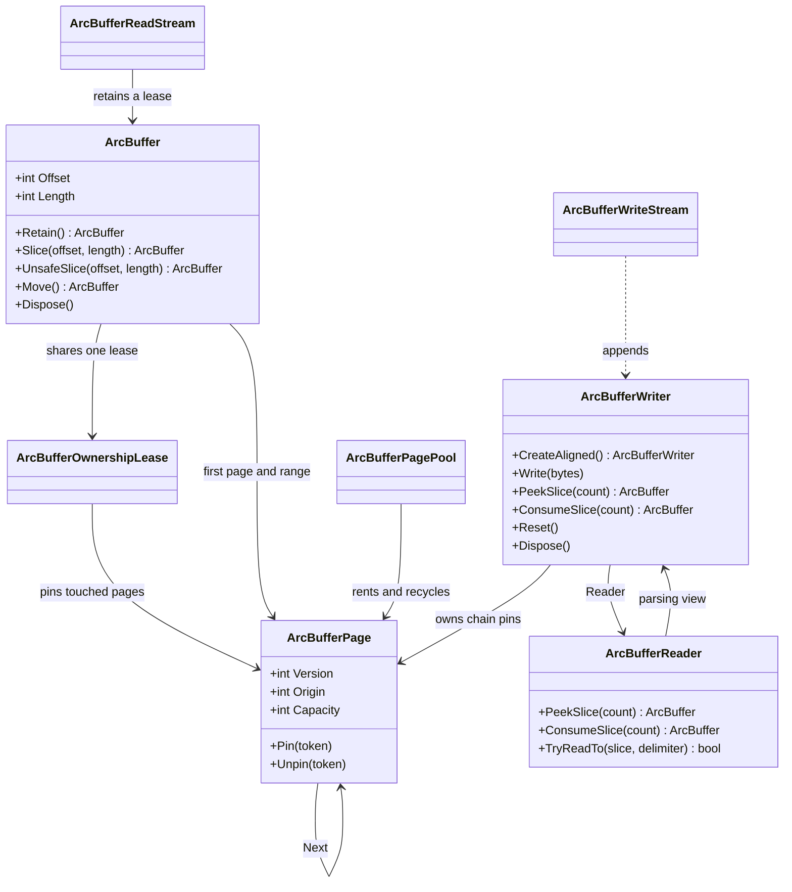
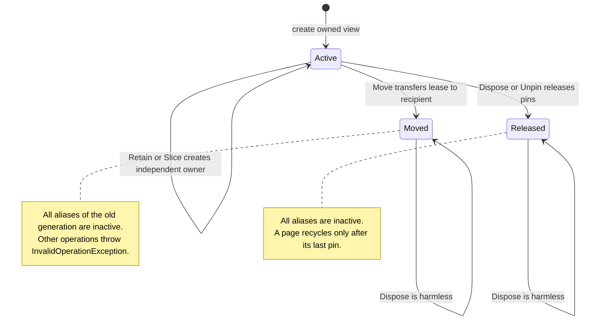

# Buffers

## 1. Purpose and scope

`Orleans.Durable.Storage.Engine.Buffers` (namespace `Orleans.Durable.Storage.Engine.Buffers`) provides
reference-counted, zero-copy owned byte buffers shared by every layer. `ArcBufferWriter` builds a chain of pooled pages;
`ArcBuffer` is an owned view of a byte range of such a chain; the pages come from pooled size classes, one of which
holds page-aligned 4 KiB pages carved from pinned slabs, which direct I/O submits unchanged. A payload crosses layers,
storage SDKs, and transports as an `ArcBuffer` without being copied. The types are adapted from Orleans'
`ArcBufferWriter` and maintained as Clog code with their own tests.

A large payload crosses an API as an `ArcBuffer` where the callee may keep it or the API returns it, and as a
`ReadOnlySequence<byte>` where the callee only reads it until the operation completes; small, bounded values cross as
`ReadOnlyMemory<byte>` or arrays ([conventions §1](../conventions.md#1-buffers-and-ownership)).
`Orleans.Durable.Storage.Engine.Buffers` sits beneath every layer and depends on no other Clog project.

### Design rationale

Ownership belongs below storage and transport: those layers need the same bytes to outlive an asynchronous
operation without copying them or depending on one another. A value-type view keeps passing buffers cheap;
its shared lease makes ordinary struct copies aliases, not extra owners. Independent lifetime is explicit
through `Retain` or `Slice`, and `Move` transfers that lifetime without repinning. Treating every struct copy
as an independent owner would require an unobservable reference-count increment at assignment; treating
every alias as independently disposable would double-release pages.

The aligned class supplies pinned, disjoint page windows directly to storage. It is separate from the
general-purpose pool so page alignment and address stability are properties of the allocation, not a copy
performed at the I/O boundary. Minimum and large classes retain their different allocation/retention
policies; forcing every small payload into an aligned page would spend 4 KiB per small allocation.
This is a buffer mechanism, not a log format or a durability guarantee.

## 2. Contract upward

### Ownership model

- A **page** (`ArcBufferPage`) holds a reference count and a version. Pinning increments the count and unpinning
  decrements it. When the count reaches zero, the page's length and next link reset, its version increments, and it
  returns to its size class's pool (an external page instead detaches from its array). In Debug builds a pooled page
  is filled with a poison byte as it returns, so a read through a sequence or stream after the page returns to its
  pool, and before it is rented again, sees the poison rather than plausible bytes.
- An **`ArcBuffer`** value is a view (first page, that page's version, offset, length) plus an **ownership lease**.
  Creating a lease pins every page its range touches; a zero-length range pins its first page. Releasing the lease
  unpins those pages once.
- `ArcBuffer` is a struct, so copies of a value are **aliases** sharing one lease. Disposing any alias releases the
  lease, after which every alias is **inactive**.
- `Retain` and `Slice` create a new, independent lease with its own pins. `UnsafeSlice` creates an alias of the source's
  lease: it adds no pins, and it is valid only while the source is active.
- `Move` hands the lease to a new value under the next lease generation without touching any reference count; the
  source value and all its aliases become inactive.
- The default value owns nothing and is the empty payload
  ([conventions §1](../conventions.md#1-buffers-and-ownership)). Every member which reads bytes answers as for an
  empty buffer: `Length` and `Offset` are 0, `CopyTo` copies nothing, `AsReadOnlySequence()` is empty, `ToArray()`
  returns an empty array, and the enumerators yield nothing. `Retain()`, `Move()`, and `Slice` and `UnsafeSlice` of
  `(0, 0)` return the default value, and `Dispose` does nothing. `First`, which names a page, and `Unpin`, which
  releases a lease, throw `InvalidOperationException`. Every zero-length buffer reads alike, and code treats the
  default value as it treats any other zero-length buffer.

### `ArcBuffer`

| Member | Behavior |
| --- | --- |
| `Wrap(ReadOnlyMemory<byte>)` | An owned view over array-backed memory, without copying; the array stays referenced until the buffer is released, and no holder changes it meanwhile. Empty memory returns the default value; non-array memory throws `ArgumentException`. |
| `First`, `Offset`, `Length` | The first page, the offset into it, and the byte count. |
| `Retain()` | An independently owned view of the same bytes. |
| `Slice(offset)`, `Slice(offset, length)` | An independently owned view of a sub-range; a range outside the buffer throws `ArgumentOutOfRangeException`. |
| `UnsafeSlice(offset, length)` | An alias of a sub-range under this buffer's lease. |
| `Move()` | Transfers ownership to the returned value; this value becomes inactive. |
| `Dispose()` | Releases the lease if this value is active; otherwise does nothing. |
| `Unpin()` | Releases the lease; throws `InvalidOperationException` when it was already moved or released. |
| `CopyTo(Span<byte>)` | Copies every byte and returns the count; a shorter destination throws `ArgumentException`. |
| `CopyTo(ArcBufferWriter)`, `CopyTo<TBufferWriter>(ref TBufferWriter)` | Appends every byte to a writer. |
| `AsReadOnlySequence()` | A `ReadOnlySequence<byte>` over the pages, valid until the buffer is released. It checks the buffer's validity once, when it is built, and holds no lease: a read through it after the release goes unchecked ([conventions §1](../conventions.md#1-buffers-and-ownership)). A single-page range builds no segment objects; a range of `n` pages builds `n` of about 48 bytes each. |
| `ToArray()` | A new array holding the bytes. |
| `GetEnumerator()`, `SpanSegments`, `MemorySegments`, `ArraySegments` | The contiguous pieces, page by page, without copying. |

Every member of an inactive value except `Dispose` throws `InvalidOperationException`.

### `ArcBufferWriter`

| Group | Members | Behavior |
| --- | --- | --- |
| Creation | `ArcBufferWriter()`, `ArcBufferWriter(int expectedLength)` | The first page comes from the minimum class, or is sized for an expected write of `expectedLength` bytes, at most the largest large page (§8); a writer which expects more allocates each later page at that size. |
| | `CreateAligned()` | Every page comes from the aligned class. A size hint above `AlignedPageSize` throws `ArgumentOutOfRangeException`; spans and memory never exceed one page. |
| Writing | `GetSpan(sizeHint)`, `GetMemory(sizeHint)`, `AdvanceWriter(count)` (`IBufferWriter<byte>.Advance`) | Standard buffer-writer protocol; a hint above the current page's free space, or any hint once the page is full, moves to the next page, allocating it with that hint. A hint above the largest large page throws `ArgumentOutOfRangeException`, since no page holds it. |
| | `Write(ReadOnlySpan<byte>)`, `Write(ReadOnlySequence<byte>)` | Copies bytes in, across pages as needed. |
| | `WriteAt(offset, value)` | Overwrites unconsumed bytes in place without moving the write position. |
| | `Truncate(length)` | Shortens the unconsumed bytes to `length` and unpins the pages after the new end. |
| | `ReplenishBuffers(List<ArraySegment<byte>>)` | Adds writable segments until the list reaches its capacity, skipping a tail page with at most 512 bytes free. |
| Reading | `Length` | The unconsumed byte count. |
| | `Peek(Span<byte>)`, `Peek(in Span<byte>)` | Copies unconsumed bytes without consuming them; the second returns the contiguous first-page span when it is long enough. |
| | `PeekSlice(count)` | An owned buffer over the next `count` bytes, not consumed. |
| | `ConsumeSlice(count)` | An owned buffer over the next `count` bytes, consumed. |
| | `AdvanceReader(count)` | Consumes bytes; the writer unpins each fully consumed page which is not its write page. |
| | `Reader` | An `ArcBufferReader` over this writer. |
| Import | `AppendPinned(ArcBuffer)` | An empty writer takes a retained view of the input's pages; the caller keeps ownership of the input. The writer is then read-only: writing members throw `InvalidOperationException`. |
| Lifecycle | `Reset()` | Releases every page and starts again with one empty page of the same class, as the writer was created: the expected length survives `Reset`. |
| | `Dispose()` | Releases the writer's pins; repeated calls do nothing. Every other member then throws `ObjectDisposedException`. |

The writer holds one pin per page; buffers it hands out hold their own, so pages outlive the writer while any buffer
references them. Counts outside the unconsumed bytes throw `ArgumentOutOfRangeException`.

### `ArcBufferReader`

A struct view of a writer's unconsumed bytes: `Length`, `Peek(in Span<byte>)`, `Peek(long offset)` (one byte;
`ArgumentOutOfRangeException` outside the bytes), `PeekSlice(count)`, `ConsumeSlice(count)`,
`TryReadTo(out ArcBuffer slice, byte delimiter, bool advancePastDelimiter = true)` (consumes up to the delimiter, or
returns `false` and consumes nothing), `IsNext(ReadOnlySpan<byte>, bool advancePast = false)`, `Consume(Span<byte>)`
(`InvalidOperationException` when fewer bytes remain), and `Skip(count)`.

### `ArcBufferPage`

Pages are the substrate of the writer and the lease. Consumers read them, for example to submit an aligned page's
window to storage: `Array`, `Origin` (where the page starts in `Array`; non-zero only for aligned pages), `Capacity`,
`Length`, `IsAligned`, `IsMinimumSize`, `IsValid`, `Version`, `Next`, and the readable and writable span, memory, and
array-segment views. `Pin(token)`, `Unpin(token)`, and `CheckValidity(token)` take the version the caller observed.
Memory over minimum and aligned pages is created over pinned arrays, so pinning that memory costs nothing.

### Stream adapter

The stream adapter, public for the cloud provider packages `Orleans.Durable.Storage.AzureStorage`,
`Orleans.Durable.Storage.S3`, and `Orleans.Durable.Storage.GoogleCloud`, which compile apart from the Engine and read
none of its internals, hands pooled pages across a storage SDK's `Stream` boundary: the stream reads from and writes to
the pages themselves, and an SDK which buffers or rereads a stream's bytes copies them as it would any stream's.

- **`ArcBufferReadStream`** is a read-only, seekable `Stream` over an `ArcBuffer`, through which a provider uploads.
  It retains its own lease on the buffer (`Retain`) and releases it when it is disposed, so the caller may release
  the buffer it passed at once. Its length and seek bounds come from that buffer's immutable byte count; reads,
  seeks, and length queries share the disposal lock so the lease stays active until each completes.
  Its reads, seeks, `Length`, and `Position` throw `ObjectDisposedException` after
  disposal, and a read races disposal safely (BUF-I2), so an SDK read after the provider disposed the stream,
  such as a send which outlives its cancelled call, fails rather than sending other bytes. A read continues from a
  cursor over the buffer's pages (the page, and the offset within it) where the previous one stopped, so reading a
  payload of `s` segments in `r` reads takes `O(s + r)` segment steps whatever the reads' sizes; a seek moves the
  cursor from the first page. `Write` and `SetLength` throw `NotSupportedException`.
- **`ArcBufferWriteStream`** is a write-only `Stream` which appends to an `ArcBufferWriter`, through which an SDK which
  writes a download to a stream fills pooled pages; its writes throw `ObjectDisposedException` after disposal. The
  writer stays its caller's. `ArcBufferWriteStream.CopyFromAsync` reads a stream to its end straight into a writer's
  memory, for a provider which holds the response's stream.

## 3. Requirements downward

None within Clog. The pools rely on the .NET pinned object heap (`GC.AllocateUninitializedArray<byte>(pinned: true)`)
and on `ArrayPool<byte>.Shared`.

## 4. Data types

| Type | Kind | Role |
| --- | --- | --- |
| `ArcBuffer` | `readonly struct`, `IDisposable` | Owned view of a byte range across pages; the default value is the empty payload |
| `ArcBuffer.PageSegment` | `readonly struct` | `(Page, Offset, Length)` with `Span`, `Memory`, and `ArraySegment` views |
| `ArcBuffer.SpanEnumerator`, `MemoryEnumerator`, `ArraySegmentEnumerator` | structs | Page-by-page enumeration of a buffer |
| `ArcBufferWriter` | `sealed class`, `IBufferWriter<byte>`, `IDisposable` | Appends to and consumes from a page chain |
| `ArcBufferReader` | `readonly struct` | Parsing view of a writer |
| `ArcBufferPage` | `sealed class` | One pooled, reference-counted, versioned page |
| `ArcBufferPagePool` | internal | The size classes and their free lists |
| `ArcBufferOwnershipLease` | internal | The pins and generation shared by a value's aliases |
| `ArcBufferPageAccounting` | internal | Observes the pages rented under one execution context and their returns; leak checks derive from it |
| `ArcBufferReadStream` | `sealed class`, `Stream` | Read-only `Stream` over a buffer, on which it holds its own lease |
| `ArcBufferWriteStream` | `sealed class`, `Stream` | Write-only `Stream` which appends to a writer |

The lifecycle below is for one **value's lease generation**, not the underlying page. A retained or sliced
value starts a separate active lifetime; moving leaves the recipient active under the next generation.

Size classes:

| Class | Page capacity | Backing memory | Pool retention |
| --- | --- | --- | --- |
| Minimum | 1,024 bytes (`ArcBufferWriter.MinimumPageSize`) | Its own array on the pinned object heap | Every returned page |
| Large | The size hint rounded up to a power of two, at most 1 MiB | An array rented from `ArrayPool<byte>.Shared` | At most one page per power-of-two capacity; the rest return to `ArrayPool` |
| Aligned | 4,096 bytes (`ArcBufferWriter.AlignedPageSize`) at a 4,096-aligned address | A window of a pinned slab of 257 × 4 KiB: 256 pages plus one page of alignment slack | Every returned page; slabs live for the process |
| External | The wrapped array's range | The caller's array (`ArcBuffer.Wrap`) | Not pooled |

## 5. Invariants

- **BUF-I1 — An owner releases exactly once.** An ownership lease unpins its pages exactly once, however many aliases
  dispose it and from however many threads. Disposing an inactive value does nothing; `Unpin` of an inactive value
  throws. `Move` changes which value owns the lease without pinning or unpinning a page.
- **BUF-I2 — A slice keeps its pages alive.** A buffer from `Retain`, `Slice`, `PeekSlice`, `ConsumeSlice`, or `Wrap`
  pins every page its range touches (a zero-length buffer other than the default value pins its first page) until it
  is released. Its bytes stay readable after the writer, the source buffer, and every other view are disposed or reset,
  and a page returns to its pool only when no lease or writer pins it. An `ArcBufferReadStream` serializes its reads
  with its disposal, which releases its lease: a read completes before the lease is released, or throws
  `ObjectDisposedException`, so no read copies from a page the stream released.
- **BUF-I3 — Aligned pages stay pinned while referenced.** An aligned page is a 4,096-byte window, aligned to 4,096
  bytes, of a slab on the pinned object heap. The slab never moves, is never freed, and lends its windows only to the
  aligned class, so memory which storage was handed for I/O keeps its address and is never reused by another class.
- **BUF-I4 — Stale access fails.** A page which returns to its pool takes a new version. Every access through a view
  holding the old version, or through a page whose reference count is not positive, throws
  `InvalidOperationException` instead of observing a recycled page. A `ReadOnlySequence<byte>` from
  `AsReadOnlySequence()` holds neither a view nor a lease, so BUF-I4 does not reach reads through it; a borrowed
  sequence is valid only until its callee's operation completes
  ([conventions §1](../conventions.md#1-buffers-and-ownership)), and Debug builds' poisoned pages
  ([§2](#ownership-model)) expose a read through one after its buffer's release.

## 6. Faults, concurrency, and cancellation

- **Misuse** is detected and thrown rather than tolerated: an inactive value, a stale page version, or a non-positive
  reference count throws `InvalidOperationException`; a disposed writer throws `ObjectDisposedException`; out-of-range
  counts and offsets throw `ArgumentOutOfRangeException`.
- **Concurrency.** Page reference counts change atomically. Lease operations (`Dispose`, `Unpin`, `Move`, `Retain`,
  `Slice`, `UnsafeSlice`) serialize on the lease, so concurrent disposal by many aliases releases once (BUF-I1). An
  active buffer may be read from many threads. An `ArcBufferWriter` has one user at a time; the buffers it hands out
  may be read and released on any thread. The pools are concurrent.
- **Immutability.** A writer appends after its unconsumed bytes and consumes from their front, so consumed bytes never
  change. `WriteAt` and `Truncate` act on unconsumed bytes, which a `PeekSlice` view shares; a caller changes them
  only where it holds no such view.
- **Leaks.** Pages have no finalizers: a buffer which is never released keeps its pages pinned out of the pool. A test
  sets an `ArcBufferPageAccounting` as current in its execution context; each page rented from the pool, or wrapped
  around an array, there is reported to its `OnRented`, and the page's return reaches its `OnReturned` from whichever
  thread releases the last pin. Until an accounting is created, renting a page reads one static flag. The leak checks
  derive from it, count and trace in test code, and assert at teardown
  ([verification §11.1](../verification.md#111-leak-checks)).
- **Cancellation.** Not applicable; every operation is synchronous.

## 7. Formats

None.

## 8. Mechanism and policy

| Constant | Value | Purpose |
| --- | --- | --- |
| `ArcBufferWriter.MinimumPageSize` | 1,024 bytes | Capacity of a minimum-class page |
| `ArcBufferWriter.AlignedPageSize` | 4,096 bytes | Capacity and address alignment of an aligned page |
| Aligned pages per slab | 256 (+1 page of slack) | Slab allocation granularity |
| Large pages retained per capacity | 1 | Bounds memory held by the large class |
| Largest large page | 1,048,576 bytes (1 MiB) | Caps a writer's pages; bounds the large class's pages and what the pool retains, about 2 MiB in all |
| Poison byte | `0xDD` | In Debug builds, fills each pooled page as it returns to its pool (§2) |
| `ReplenishBuffers` skip threshold | 512 bytes free | Avoids handing out nearly full pages |

A write which overflows a page continues on the next page, from the writer's class. Large pages come only from an
expected length: `ArcBufferWriter(int expectedLength)`, or a `GetSpan` or `GetMemory` size hint above 1,024 bytes
which moves to a new page. Aligned slabs are never returned to the runtime, because storage may have handed their
addresses to the kernel (BUF-I3).

An expected length is capped at the largest large page, and a writer created with a larger one allocates each later
page at the cap, so a payload of any length is a chain of pages of at most 1 MiB, the pool keeps at most one page of
each power of two up to the cap, and rounding to a power of two stays within `int`.

## 9. Providers and implementations

None.

## 10. Verification

All tests are in `Orleans.Durable.Storage.Engine.Buffers.Tests`.

| Invariant | Evidence |
| --- | --- |
| BUF-I1 | `ArcBufferTests.OrdinaryAliasesShareOneDisposableOwnership`, `ConcurrentAliasDisposalUnpinsEveryPageExactlyOnce`, `MoveInvalidatesEveryOrdinaryAliasWithoutRepinning`, `RetainFailureRollsBackEveryPagePin`; `ArcBufferWriterTests.DoubleDisposeArcBuffer_IsSafe`, `DoubleFree_ThrowsAndBufferCanBeResetAndDisposed`, `NoMemoryLeak_ReferenceCountReturnsToZero`; `ArcBufferLeakCheckTests.ARetainedSliceIsOutstandingUntilItIsReleased`, `AWrappedArrayIsOutstandingUntilItsLeaseIsReleased`, `BackgroundWorkInheritsTheCheckAndAnyThreadMayRelease`, `AScopeCountsItsOwnPagesAndRestoresItsParent`; every Buffers test class returns the pages it rented ([verification §11.1](../verification.md#111-leak-checks)) |
| BUF-I2 | `ArcBufferTests.RetainOwnsIndependentPagePins`, `EmptySliceRetainsPageAfterSourceIsDisposed`, `ZeroLengthAliasesShareOneLeaseAndRetainIsIndependent`, `AppendPinnedRetainsDataAfterSourceIsDisposed`; `ArcBufferWriterTests.SliceDispose_DoesNotAffectOriginalBuffer`, `AppendPinned_DestinationOutlivesSource`, `UnsafeSlice_DoesNotPinPages`; `ArcBufferReadStreamTests.AReadAfterTheCallerReleasedItsBufferReadsThePayload`, `AReadRacingDisposalReturnsThePayloadOrThrows`; `ArcBufferLeakCheckTests.ARetainedSliceIsOutstandingUntilItIsReleased`, `AFieldInitializerCheckCountsTheTestsPages`; every Buffers test class returns the pages it rented ([verification §11.1](../verification.md#111-leak-checks)) |
| BUF-I3 | `ArcBufferAlignedPageTests.AlignedPagesAreDisjointAlignedWindowsOfPinnedSlabs`, `AlignedPageViewsAddressOnlyTheirOwnWindow`, `AlignedWriterProducesAlignedPagesWithTheWrittenBytes`, `ReleasedAlignedPagesReturnToTheAlignedClass`, `ResetKeepsTheWriterAligned` |
| BUF-I4 | `ArcBufferTests.ReturnedPageCannotBeObservedThroughAStaleAlias`; `ArcBufferWriterTests.UseAfterFree_ThrowsException`, `UnpinWithInvalidToken_Throws`, `CheckValidityWithInvalidRefCount_Throws`, `DoubleFree_And_UseAfterFree_Guards`; in the Debug leg, `ArcBufferWriterTests.AReadThroughASequenceAfterItsBuffersReleaseSeesThePoison`, for each pooled size class |

`ArcBufferTests` covers the default value: `WrapOfEmptyMemoryReturnsTheDefaultValue`,
`TheDefaultValueReadsAsAnEmptyBuffer`, `TheDefaultValueRetainsMovesAndSlicesToItself`, and
`TheDefaultValueHasNoPageOrLeaseAndDisposingItDoesNothing`. `ArcBufferReadStreamTests` covers the stream adapter:
seeks and reads across pages; a read after the caller released its buffer and the pool reused its pages, and a seek
back and reread after that (`AReadAfterTheCallerReleasedItsBufferReadsThePayload`, which a stream without its own lease
fails), and its reads, seeks, length, and position after the stream's disposal, which throw; reads racing disposal,
each of which returns the payload or throws `ObjectDisposedException` (`AReadRacingDisposalReturnsThePayloadOrThrows`);
a payload of 256 segments read 1, 7, and 4,096 bytes at a time, whose steps the Debug leg counts as exactly one per
segment (`AMultiSegmentPayloadReadInSmallChunksStepsLinearlyThroughItsSegments`); and the write stream and
`CopyFromAsync`.
`ArcBufferWriterTests` covers the writer protocol, the pools, and the cap on large pages
(`AWriterWhichExpectsMoreThanTheLargestPageWritesPagesOfTheLargestSize`, whose writer expects `int.MaxValue` bytes,
`OnlyAWriterWhichExpectsMoreThanTheLargestPageAllocatesItsLaterPagesThere`, across `Reset`,
`AHintAboveTheLargestPageIsRefused`, and `RepeatedHintsBeforeAnAdvanceLeaveNoEmptyPageInTheChain`; its `Dispose`
checks that the large class holds no page above the cap), and
`ArcBufferLeakCheckTests` the page accounting: attribution in the renting execution context and the work it starts,
returns from any thread, nested checks, scopes, per-case scopes, and `Run`, each of which restores the accounting it
replaced, and the rental call sites a failing check reports.
