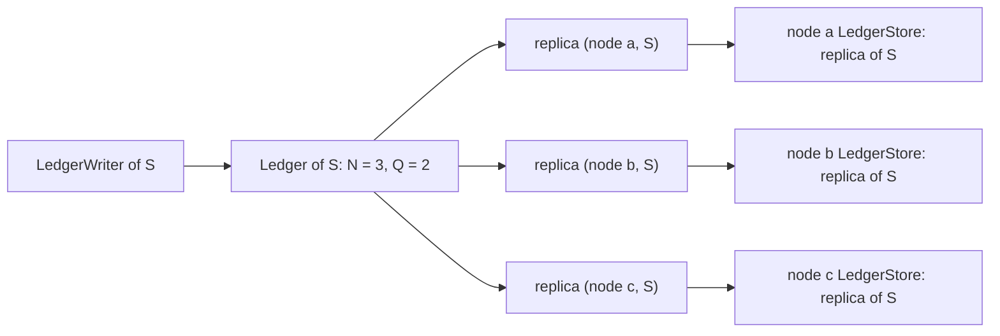
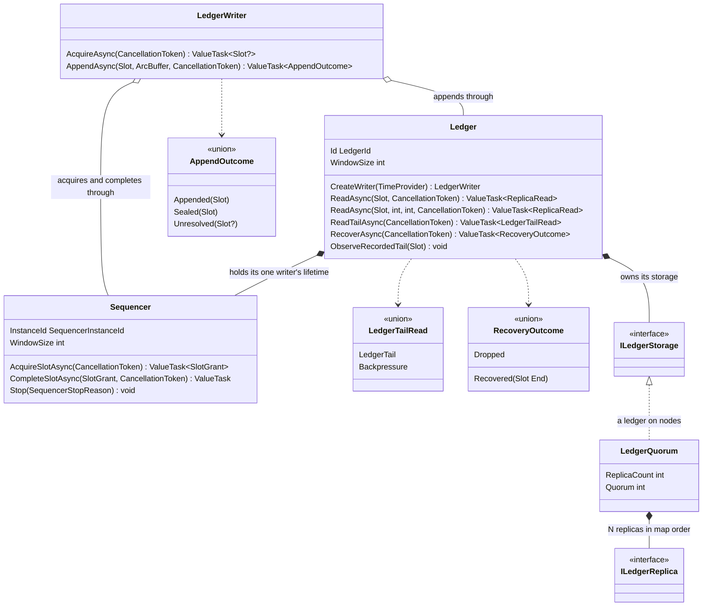
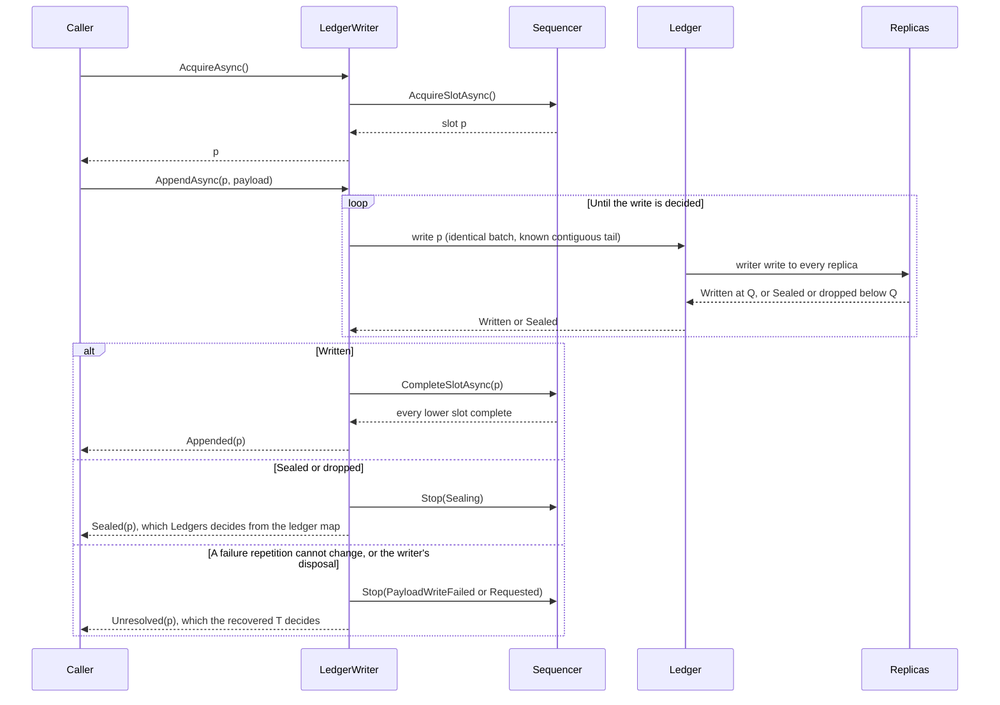
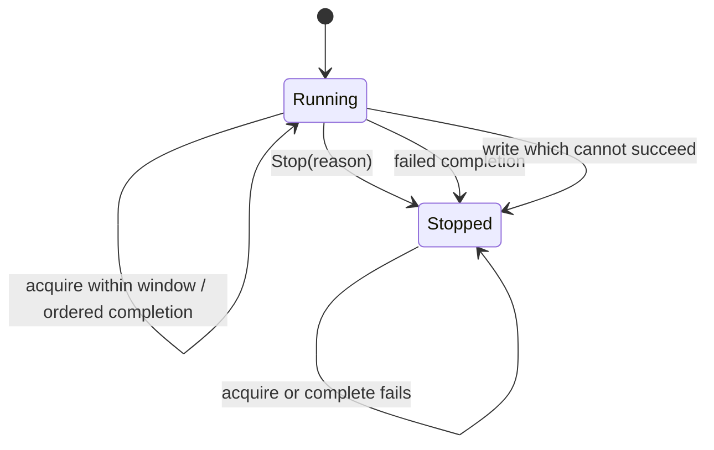
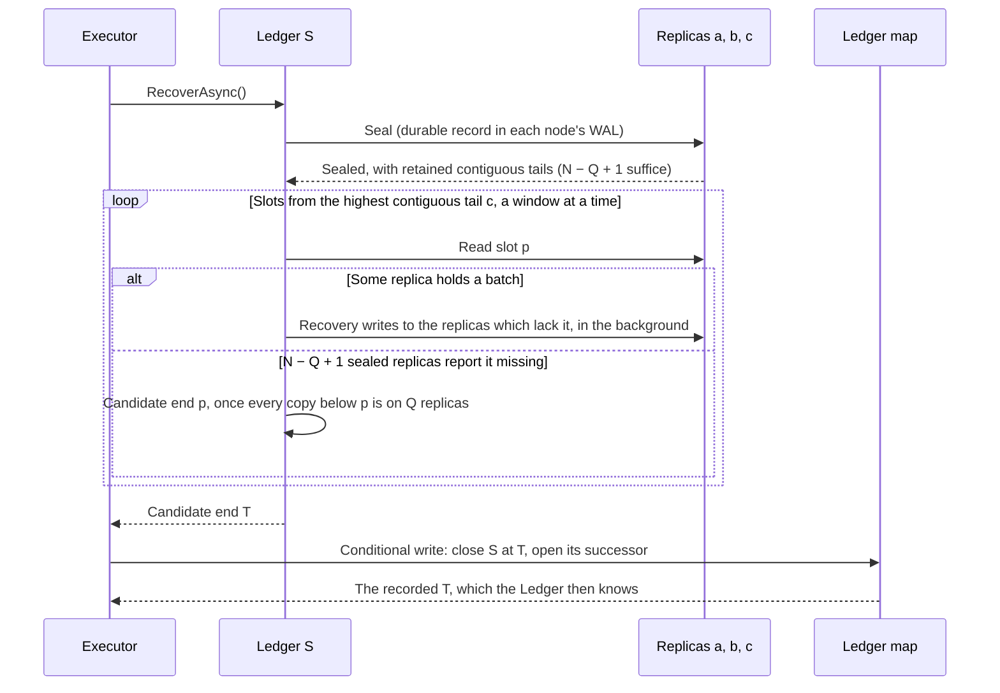

# Ledger protocol

## 1. Purpose and scope

The ledger protocol writes, reads, seals, and recovers one [ledger](ledgers.md) over its `N` replicas: Apache
BookKeeper's ledger protocol with one writer, implementing a Delos Loglet, whose appends a soft-state sequencer orders
as in the LogDrive paper (research/papers/logdrive/paper.md, §4). Three classes carry it. A process holds one `Ledger`
per ledger it uses, which keeps the ledger's known contiguous tail and reads the ledger, checks its seal, and recovers
it through its `LedgerQuorum`, the quorum operations over the ledger's [replicas](ledger-replicas.md); the ledger's
primary holds its `LedgerWriter`, which appends to it through one sequencer lifetime.

> "The AtomicLog is a stateless client-side library that interacts with two components: the LogDrive and a
> shared, soft-state sequencer object. The sequencer supports a simple acquireSlot / completeSlot API."
> (research/papers/logdrive/paper.md, §4)

The ledger protocol owns:

- slot assignment: one append acquires one sequencer slot and writes one batch at that slot;
- the bounded window `K` of slots in flight;
- in-order completion, which linearizes appends;
- quorum writes: a writer write is written once `Q` replicas answered written;
- the ledger's known contiguous tail, one per `Ledger`, which it learns from the writer's completions and window, its
  replicas' answers, recovery's `c`, its callers, and the ledger map's recorded `T`, and carries with every replica
  operation, explicitly while idle (§8.2);
- the append path's handling of storage outages, seals, and sequencer failures;
- reads, the seal check, and recovery: the Loglet's `read`, `checkTail`, and `seal`, after BookKeeper's ledger
  recovery;
- sequencer lifetimes, each owned by its `LedgerWriter`.

[Ledgers](ledgers.md) owns everything which depends on the ledger map: which process is the primary, when to
recover, the recorded `T`, and the outcome of an append which met a seal or could not complete
([ledgers §8.2](ledgers.md#82-appends)). The [replica contract](ledger-replicas.md) owns each replica's answers.

A ledger's storage sits below an internal seam, `ILedgerStorage` (§2.7): the quorum over `N` replicas this file
specifies, or one copy in an object store ([object-store ledgers](object-ledgers.md)). The sequencer, the window,
in-order completion, and writer lifetimes stay above it, shared by both.

The mapping to BookKeeper is direct: a ledger has one writer, its primary; a replica is the ledger's storage on one
bookie; `Ledger` is the ledger handle over an ensemble of `N` replicas with write quorum `N` and ack quorum `Q`
(`E = Qw = N`, no striping); the contiguous tail is the last add confirmed plus one; and the
[ledger map](ledgers.md) is the ledger metadata, which records the ledger's **recovered tail** `T` when a transition
closes it. Recovery returns a **candidate end**; only the map's conditional write makes one `T`.

The ledger's **contiguous tail** is, while the ledger is open, its writer's completed prefix: one above the last slot
the writer completed, all of them completing in order once `Q` replicas answered their writes written. Once the
ledger is closed, it is the recorded `T`. Every slot below it holds a batch on `Q` replicas, and it never exceeds `T`;
a batch a losing recovery copied at or above `T` does not raise it. Every replica operation carries the `Ledger`'s
**known contiguous tail**, a lower bound of the ledger's contiguous tail, which each replica retains
([LR-I6](ledger-replicas.md#5-invariants)).

Code: `Orleans.Durable.Storage.Engine.Ledgers` (`Ledger`, `LedgerQuorum`, `LedgerWriter`, `Sequencer`, `AppendOutcome`,
`LedgerTailRead`, `LedgerWriteOutcome`, `RecoveryOutcome`), over the replica contract in
`Orleans.Durable.Storage.Engine.Ledgers.Abstractions`. `LedgerWriter` is public with the members Ledgers adds over the
append path ([ledgers §2.4](ledgers.md#24-primary-ledgerwriter)), and `LedgerReader` holds one `Ledger` per ledger per
process, built from the ledger's `LedgerMetadata`, which is LG-I7's sender check ([ledgers
§2.5](ledgers.md#25-reads-ledgerreader)), and `LedgerWriterRegistry` holds each writer in its primary's process
([ledgers §2.4](ledgers.md#24-primary-ledgerwriter)). A read below the known contiguous tail asks one replica at a time,
hedges within a budget, repairs a preferred replica which lacked the batch, and forwards a byte-range read's range (§8.3,
§8.4; rows 4.1b and 5.1 of the [implementation plan](https://github.com/ReubenBond/clog/blob/6ffb29aa96d2e4d48fc9c34f80790493e548af96/docs/implementation-plan.md)), and an idle writer writes its
contiguous tail explicitly (§8.2).

### Design rationale

**One append, one slot, one batch.** One append gets one scalar slot and writes one batch; ordered slot completion is
its linearization point. This keeps the protocol's safety argument independent of batching, which belongs to
[Ledgers](ledgers.md). The soft-state sequencer holds no payloads and is not replicated: losing it ends appends to that
ledger, and a takeover replaces the ledger through the ledger map. One positive window `K` bounds both outstanding
slots and recovery's reads; the ledger map records it, and a replica refuses an operation of another window. The
operational default is 64.

**Separate classes, one owner each.** Every process which uses a ledger reads it, checks its seal, and may recover it,
and only the primary's process appends. `Ledger` holds what every process needs, and `LedgerWriter` holds the sequencer
and the append path, so a process without the writer has no way to append and none to stop another's lifetime. The
writer appends through its `Ledger` and never disposes it; the writer owns its `Sequencer`, which nothing else reaches.
Each is a sealed class with one implementation, over the replica contract's one interface, so no caller branches on a
provider and no type test chooses a path.

**The quorum composes the replicas.** `LedgerQuorum` holds the ledger's replicas, `Q`, and `K`, and runs every replica
operation: the writer's writes, reads, the seal check, and recovery (§8.3). It keeps no contiguous tail: each operation
carries the tail its `Ledger` passes, and the seal check and recovery return what the replicas answered, so the
quorum's decisions depend on its replicas' answers alone, and its tests run it over memory or recording replicas.
`Ledger` composes it with the known contiguous tail, which it raises from those answers (§8.2). One class holding both
the replicas and the tail is the alternative: it would test the quorum's counting only through the tail's evolution.

**The sequencer lives in the primary's writer.** Acquiring and completing a slot cost no network round trip, an
acquisition never has an unknown outcome, and only the primary's process can append, which makes the sequencer the
primary's claim ([ledgers §8.3](ledgers.md#83-the-primarys-open-check)). A sequencer served over the network would add
a round trip to every append and an ambiguous acquisition which only a recovery resolves. A `Ledger` creates its one
writer and that writer's lifetime, which draws a fresh instance ID, so a claim names one lifetime by construction, and
no registry resolves a lifetime across processes. The `Ledger` holds the lifetime, so its own recoveries and seal
checks stop it (LP-I14) without relying on callers to route them through the writer.

**One known contiguous tail per `Ledger`.** The writer's evidence (its completions and its window), its callers' tails,
its replicas' retained tails, recovery's `c`, and the map's `T` are one fact about the ledger, so one value per `Ledger`
holds them, and its quorum keeps none: every read, seal check, write, and recovery in a process carries the greatest
tail the process knows. It rises only from evidence that every lower slot holds a decided batch (LP-I11). A candidate
end is not such evidence, since a losing recovery may end above the recorded `T`; recovery's `c`, the greatest
contiguous tail among its seal answers, is.

**Whole ledgers.** Live-ledger space is reclaimed by dropping a whole ledger once the LSM holds its rows ([archive LSM
§8.4](archive-lsm.md#84-dropping-ledgers)), so a ledger keeps every slot until its drop, and recovery starts from the
known contiguous tail alone.

**BookKeeper's ledger protocol.** One writer, durable per-replica seals, recovery by forward reads, and a close
recorded in conditional metadata are BookKeeper's answer to the problem a ledger has: end a single writer's log at a
point every reader agrees on, without losing an acknowledged entry, while the writer may still be running. BookKeeper
calls a replica's seal its fence.

> "When a bookie receives a fence message for a ledger, the fenced state of the ledger is persisted to disk. Once
> we receive a response from at least (Qw - Qa)+1 bookies from each write quorum in the ensemble, the ledger is
> fenced." "It then starts reading forward in the ledger, one entry at a time, replicating all entries it sees to
> the entire write quorum for that entry. Once it can no longer read any more entries, it updates the state in the
> metadata to CLOSED, and sets the last entry of the ledger to the last entry it wrote."
> (Apache BookKeeper, *The BookKeeper protocol*, "Closing a ledger as a reader")

Jack Vanlightly's TLA+ specifications of the protocol (`Vanlightly/bookkeeper-tlaplus`, which
[`test/Durable.Storage/specs/ledger-protocol`](../../../specs/ledger-protocol/README.md) adapts) found that BookKeeper 4.13 counted
`NoSuchEntry` answers from recovery reads which did not fence: an unfenced bookie which answered absent could still
accept the writer's entry and complete an ack quorum after the ledger closed below it. Recovery here counts an absent
answer only from a replica whose seal answer it held when it sent the read (LP-I7), which makes every negative final,
as BookKeeper's fix of fencing recovery reads does. The same work defines quorum coverage, which Clog uses for the
seal, for recovery's negatives, and for the seal check: `N − Q + 1` replicas have a property exactly when no `Q`
replicas lack it.

**A seal ends the writer.** The ledger ends as a BookKeeper ledger does: an executor seals its replicas and recovers a
candidate last slot, and Ledgers records one candidate, `T`, in the map write which closes it. Concurrent recoveries
may end at different slots, so a candidate is not a fact about the ledger until the map records it: a `Ledger` learns
`T` from Ledgers, and never raises its known contiguous tail from a candidate. An append whose write meets a seal is
unknown, as BookKeeper's `LedgerFenced` is: it may already be on `Q` replicas, so only `T` decides it. The append path
therefore stops its sequencer and reports the slot, and Ledgers decides it from the map: `Durable` below `T`, `Fenced`
at or above.

> "It is important to note that when you get a ledger fenced message for an entry, it doesn't mean that the entry
> has not been written. It means that the entry may or may not have been written, and this can only be determined
> after the ledger is recovered. In effect, LedgerFenced should be treated like a timeout." (Apache BookKeeper,
> *The BookKeeper protocol*, "Closing a ledger as a reader")

**One recovery path.** `Ledger.RecoverAsync`, the Loglet's `seal`, takes no argument. Every sealer, a primary rolling
its own ledger or an executor taking one over, seals the replicas and recovers from the highest contiguous tail it or
they know, so one recovery path decides every candidate end. In the writer's process the `Ledger` stops its writer's
lifetime first (LP-I14), so the process appends nothing to a ledger it is sealing, and a primary which completed every
append recovers from its exact contiguous tail and ends at its first read. Safety never rests on that stop: a seal
fences the writer whether or not it stopped (LP-I8).

**Quorum and coverage.** One writer gives each slot one batch, so the protocol needs no arbitration between competing
values: `Q` replicas holding a writer write decide it, any copy of a decided slot is its batch, and sealing, not a
competing create, ends the writer. `Q` is therefore any size from 1 to `N`; it trades write latency against the losses
an acknowledged batch survives (`Q − 1`). Recovery uses only the ledger's own replicas: it seals `N − Q + 1` of them and
copies each batch it finds to `Q`, so it needs `max(Q, N − Q + 1)` live replicas, and a ledger tolerates
`min(N − Q, Q − 1)` failed replicas for both writes and recovery. The majority `Q = (N + 1) / 2` over an odd `N` gives
the most, `(N − 1) / 2`; an even `N` gives no more than `N − 1` replicas do. Ledgers always constructs a `Ledger` with
it, deriving `Q` from the ledger's `N` ([ledgers §4](ledgers.md#4-data-types)). `Q = N` would let one dead replica
block the recovery, and so the roll, which replaces it. The default is `N = 3`, `Q = 2`. A leader, consensus round, or
two-round register write on every append is unnecessary under the single-writer precondition; consensus stays in the
control plane, in the ledger map's conditional writes.

**Holes and known contiguous tails.** A replica which missed a write holds a hole there, which a reader passes by
reading another replica. Single writers give each slot one batch, so any copy of a decided slot is the decision, and a
`Ledger` can read a decided slot from one replica. The writer knows which slots are decided, because its completed
slots form a prefix and its window bounds the distance from every slot it grants; it carries that prefix with every
operation, as a BookKeeper writer passes its last add confirmed with every entry, and sends it explicitly while idle,
as BookKeeper's explicit last add confirmed does. Replicas retain it, so a reader learns it from a replica, and recovery
starts from the highest a seal coverage reports. Only the writer and the map's recorded `T` originate a contiguous
tail; a `Ledger` and its recovery forward and retain it, so every retained value is a fact about the ledger, and none
passes `T`. A retained value is soft state: losing it costs a read from more replicas, never safety. Replicas which
accept only appends that extend their own log (Raft's log-matching rule) would also prevent holes, but make
uncommitted entries overwritable and turn every replica into a protocol participant; reading another replica on the
rare hole keeps replicas passive.

**Reads below the tail ask one replica.** A decided slot's batch is the same on every replica which holds it (LP-I10),
so a read below the known contiguous tail needs one answer with a batch, and asks one replica at a time, the caller's
node's first (§8.3, §8.4). Applies, hot reads, and drains read this way
([orleans §5.7](../compositions/orleans.md#57-membership-and-replica-placement)), so each decided batch crosses the
network at most once per reader in the common case (`LedgerReaderTests.ADecidedReadCopiesItsBatchFromOneReplica`). A
read at or above the tail asks every replica, since its `Missing` needs `Q` answers. Asking every remaining replica at
once after the first fails was rejected: it sends up to `N − 2` extra copies per hole or failure, where asking one at a
time costs at most one hedge delay.

**Hedges are bounded.** A hedge adds a replica call when the replicas are already slow, so §8.4 bounds hedges by a
fixed delay over the whole replica call, one pending hedge, a budget per `Ledger`, and the cancellation of the reads a
decided read no longer needs, so that hedges do not add the load which delays them. Polly's hedging strategy, which
`LedgerQuorum` would otherwise use, was rejected: it answers with one attempt's outcome, while a read which finds no
batch answers by §6.4's rule over every replica's answer, it has no budget, and its per-execution context would add an
allocation to every read.

**Read repair at the preferred replica.** A read below the tail which passes its preferred replica's hole or corrupt
batch copies the batch it found elsewhere with a recovery write, which keeps an existing batch and writes a missing or
corrupt one ([LR-I5](ledger-replicas.md#5-invariants)). The slot is decided, so an intact batch is its one value and the
copy writes nothing a replica may not hold. A recovery write keeps what it stores for the ledger's life, so both read
repair and recovery copy only a batch the quorum's batch verifier accepts, the batch format's CRC-32C in production ([ledgers
§7](ledgers.md#7-formats)): bytes damaged after the replica which sent them checked them would otherwise become a copy
the replica stores as intact, which no later recovery write replaces and every later read rejects. The preferred replica
is the one on the reader's node, so the repair restores the slot's redundancy on the replica that node reads from, and
its later reads of the slot stay local. The read answers without waiting for the repair, whose answer asserts nothing,
and a skipped repair leaves the slot for a later read, so the quorum keeps at most `K` repairs in flight and one per
slot, and skips the rest. Repairing every replica which answered without a batch was rejected: a reader then writes to
other nodes on its read path, and re-replicating a decided slot to every replica is recovery's work, which a roll runs.
A byte-range read holds only its range, so it forwards the range and repairs nothing.

**Explicit contiguous-tail writes through the seam.** The writer knows when it is idle and which completions no write
carried, so it decides when to write its tail, and the storage decides how: the quorum sends it to every replica, which
retains it (LR-I6), and a storage whose readers learn nothing from it ignores it (§2.7). A seal check was rejected
as the vehicle: it waits for `Q` answers whose tails and seal the idle writer does not need, and in the object store
it costs a request per idle period. A timer inside the quorum was rejected too: it would need the front's completions,
which the seam would then carry on every one.

**A learned tail from the local replica.** A replica node's apply loop needs a contiguous tail below which every slot
is decided, not the greatest one or the seal, so it learns one from the replica on its own node, which the writer's
writes and explicit contiguous-tail writes reach (LR-I6): one local read, no network, and no seal check, whose `Q`
answers would cost every replica node `N` remote calls per learn. A replica which missed the latest write answers a
lower tail, which is safe, and the next learn raises it. A learn of every replica taking the greatest tail, as
BookKeeper's `readLastAddConfirmed` does, was rejected: the apply loop's node holds a replica, and reading the others
adds remote calls to learn what the next local learn will. On the object store, whose readers learn nothing from an
explicit write, a learn answers the tail its caller knows (§2.7).

**Slots in request order.** The sequencer grants acquisitions in the order of their requests, so a primary which
proposes its batches in order has them take ascending slots, and Ledgers decides them in that order: Journals admits
each entry against the prefixes of the entries in flight before it ([journals §8.1](journals.md#81-admission)). A
window which reopens to racing waiters was rejected: it would let a later proposal take a lower slot, and the accepted
order of a key's entries would differ from their admission order.

**Acquire, then append.** The slot is acquired before the payload exists, and the payload appended at it later, for a
caller which encodes each payload against the payloads at earlier slots, as
[Ledgers](ledgers.md#22-rows-batches-and-tags) does. Such a caller rests on three facts this protocol provides. Slots
are granted in request order. A ledger's decided slots form a prefix: slots complete in order (LP-I3), and no slot at or
above `T` completes (LP-I8), so every decided slot lies below the contiguous tail or `T` and every slot below them is
decided. And recovery copies each decided payload verbatim and never creates, re-encodes, or reorders one (LP-I7), so a
payload which depends on an earlier slot's is decided only when that earlier one is. A caller which acquires a slot and
never appends at it holds back every later completion, so it stops the lifetime instead (LP-I13), and the ledger ends at
or below that slot.

**Storage outages and stopped sequencers.** Storage outages repeat the identical write instead of recovering, since a
slot holder is the only writer of its slot. A stopped sequencer or a failed completion is different: the slots its
lifetime leaves can never complete, so the primary recovers the ledger, which decides every unwritten slot. A stop is
synchronous and cannot fail, since the writer owns its lifetime in process.

**Disposal cancels the quorum's calls.** A quorum's disposal waits for the replica calls its operations left running,
so that it releases their buffers before it disposes the replicas (§6.3). Its bound therefore rests on every such call
ending once the disposal cancels it, which takes three things. Every call runs under a token the disposal cancels: the
reads' and the recoveries' under the lifetime, the writes' under the disposal's own token, linked to the caller's,
where a write's straggler once ran under its caller's token alone. Every token derived from one the disposal cancels is
cancelled before it is released: a recovery's per-position sources are linked to its stop, whose callbacks may still be
running, on the very thread which ends the recovery, when the recovery releases them, and a linked source released
first is unregistered unrun, so its reads went on repeating against a replica which never answered, holding the
disposal past the bound a stopping silo gives its runtime's disposal
([orleans §5.2](../compositions/orleans.md#52-nodes-and-silos)). And a transport ends a cancelled caller's wait at once
([ledger-replicas §2.2](ledger-replicas.md#22-iledgerreplicatransport)), where an Orleans grain call held before Orleans
registers its token, as an outgoing grain call filter may hold it, waits until it is let go. Cancelling a
call stops only the wait: its request may land, its outcome is unknown, and the quorum counts it as no answer, as it
does a failed call, so LP-I4's count of written answers, and with it every invariant the count serves, is unchanged.
Letting an admitted write run to its end was rejected: the writer's disposal, which comes first, already ends its
writes, so an admitted write at a `Ledger`'s disposal belongs to a writer whose disposal broke that order, and waiting
for it bounds the disposal by its replicas, not by the cancellation. A bound on the wait inside the quorum, such as a
timeout per call, was rejected too: the transport owns how long a call may take, and a cancellation ends the wait
without guessing it.

**Rejected alternatives.**

- *Ensemble changes with fragments* (BookKeeper's response to a failed bookie). A roll closes a ledger and opens
  its successor on other replicas in one map write, so a failed replica costs a roll, never a per-ledger metadata
  write on the write path, an `IN_RECOVERY` state, or the fragment bookkeeping in which Vanlightly found BookKeeper
  creating an invalid fragment during recovery.
- *In-place epochs* (BtrLog §4.2): after a failover the new writer keeps appending to the same log under a higher
  epoch, and no close records where the old writer's entries end. A replica which missed the new epoch's repair keeps
  an earlier epoch's entry below the new contiguous tail, and a single-replica read serves it as decided; a repair
  which counts absence from replicas it has not sealed loses an acknowledged entry, as BookKeeper 4.13's recovery did.
  Each hole needs a further rule (epoch-start truncation, sealed-only absence), and Vanlightly's unbounded-ledger
  variant warns that without them "there is the risk of log divergence between bookies" (bookkeeper-tlaplus,
  `tweaks/ProtocolUnboundedLedgersAndGWQ.tla`). A ledger instead ends at the `T` its close records, and its successor
  starts empty, so every slot has one writer.
- *Striping* (`E > Qw`). Spreading one ledger's entries over more replicas than write each entry needs a write
  quorum per entry and coverage per write quorum. Clog spreads load by placing many ledgers across nodes.
- *Readers which fence.* BookKeeper's fencing open closes the ledger to its writer. A reader here reads below the
  contiguous tail, as BookKeeper's non-fencing readers read to the last add confirmed, and a linearizable read of an
  open ledger goes through its primary, so no read ends a writer.
- *A replica-level recovery, or the quorum as a replica.* A replica has nothing to recover from: recovery seals
  replicas and reads across them, so only `Ledger` has it. A quorum which itself implemented the replica contract
  would let a caller take a replica's retained tail for a ledger's end, offer a seal without a recovery and a recovery
  write outside one, and invite compositions of compositions which no ledger uses.
- *Written tails in the seal check* (Delos' `checkTail`, whose tail zombie appends raise). Its erratum orders the tail
  before the seal check: "the checkTail must be linearized before the checkSeal"
  (research/papers/delos-erratum/paper.md). A replica's highest written slot is such a tail, and it may lie at or above
  the end a recovery then records however each replica orders its answer, since one replica's batch need not be
  decided. The check reports retained contiguous tails, which are decided, so its order needs no rule (LP-I9; ledger
  model mutant `check-stored-tail`).
- *Hierarchical forwarding* (replicas which relay writes to other replicas, as BtrLog's do). It makes replicas
  participants in the protocol; the writer sends each write to every replica, which keeps replicas passive.
- *A seal bounded by the stopped sequencer's next ungranted slot.* The replicas cannot verify the bound, its safety
  rests on the claim naming the stopped lifetime and on a stop which returned, and it is a second recovery path to
  specify, model, and test. A caller-supplied end is rejected too: the caller has no authority over the end, which
  recovery decides. Carrying the first read on the seal is deferred ([deferred §2](../deferred.md#piggybacked-seals)).
- *Sequencer interfaces and cross-process resolution.* A lifetime registry with handles which resolve a lifetime on
  first use let any process build an append path and then refuse it with a not-resolvable failure. A writer which
  exists only in its primary's process leaves no other process anything to refuse.
- *Bulk reservations, compound slots, retrying slot acquisition, and sequencer failover within a ledger.* Each either
  leaves abandoned holes, weakens the one-slot proof, duplicates batching, or adds mutable authority which the ledger
  map already supplies.

### Diagrams

A ledger `S` of three replicas, in its primary's process:

An append resolves the write before ordered completion. Meeting a seal or losing certainty never acknowledges the
slot; Ledgers decides the batch's outcome from the ledger map.

A takeover's executor seals and recovers ledger `S` through its own `Ledger`:

## 2. Contract upward

Shared outcome taxonomy: [outcomes](../outcomes.md). Slots are the ledger's positions and start at 0
([ledgers §2.2](ledgers.md#22-rows-batches-and-tags)). The caller owns every append payload until the operation
completes. Every batch a read returns is owned by the caller, who disposes it.

### 2.1 `Ledger`

`Ledger` is `IAsyncDisposable`. It composes its storage (§2.7), the `LedgerQuorum` (§8.3) of a ledger on nodes, with the
ledger's known contiguous tail: each operation passes the storage the known tail and raises it from the storage's
answer. It creates the ledger's one writer and holds that writer's sequencer lifetime, which its recoveries and seal
checks stop (LP-I14). Every member is thread-safe, and the quorum admits every replica operation through its admission
gate ([conventions §11](../conventions.md#11-admission-and-close)).

| Member | Preconditions | Postconditions and outcomes |
| --- | --- | --- |
| `new Ledger(id, storage, location)` | `storage`: the ledger's storage (§2.7); for a ledger on nodes a `LedgerQuorum` over its `N ≥ 1` replicas, which `LedgerQuorum.ForNodes(id, nodes, replicas, quorum, options, timeProvider, localNode, recoveryObserver)` builds over reference-distinct replicas, one per node of `nodes` in the map's order, each opened with `options`, with `1 ≤ quorum ≤ N`. `location`: the ledger's location in its map entry ([ledgers §4](ledgers.md#4-data-types)), which the sender check compares (LG-I7). | Owns and disposes the storage. Performs no I/O. The quorum's `TimeProvider` times recovery's backoff and the hedges of reads below the known contiguous tail; the replica on `localNode`, when the map lists one there, is the preferred replica (§8.4); `recoveryObserver`, when given, sees each replica answer the quorum's recoveries handle (verification §5.1). A null storage or a default location throws `ArgumentException`, as `ForNodes` does for an empty node list, a null, duplicate, or differently sized replica set, or a quorum outside `1 ..= N`. |
| `Id`, `WindowSize` | — | The ledger's ID and `K`, its storage's. The quorum reports `N` and `Q` (LP-I4) as `LedgerQuorum.ReplicaCount` and `Quorum`. |
| `CreateWriter(timeProvider)` | The primary's process creates the ledger's writer (§2.5). | The ledger's one `LedgerWriter` (§2.3), with a new sequencer lifetime of the ledger's window `K` under a fresh `SequencerInstanceId` (LP-I15), which the `Ledger` holds. An internal overload adopts a lifetime its process created for the writer instead, whose window must be `K`, and serves the members Ledgers adds ([ledgers §2.4](ledgers.md#24-primary-ledgerwriter)); a lifetime adopted after this `Ledger` began a recovery or found the ledger sealed is stopped with `Sealing` at once (LP-I14). A second call throws `InvalidOperationException`, so the ledger has one writer (LP-I1). Performs no I/O. `TimeProvider` times the writer's write retries and its explicit contiguous-tail writes while idle (§8.2). |
| `ReadAsync(slot)` | — | A `ReplicaRead`: the owned batch, `Missing`, `Dropped`, or `Backpressure`, read with the known contiguous tail. Below it the slot is decided: one replica's batch answers it, a read which finds none fails, and it never answers `Missing` (LP-I10); it asks replicas by §8.3's policy, and copies the batch to a preferred replica which answered `Missing` or corrupt (read repair). At or above it, `Missing` once `Q` replicas report it, and neither result decides the slot: the caller decides what it means. A read which cannot decide answers `Dropped` or `Backpressure` by §6.4's rule (LP-I5). |
| `ReadAsync(slot, offset, length)` | `offset ≥ 0`, `length > 0`. | The batch's bytes `[offset, offset + length)` at `slot`, or the other cases as the whole read answers them; the storage forwards the range, so a quorum's replicas send only the range, and it repairs nothing (§8.3). A range which extends past the batch answers `OutsideBatch` with the batch's length; a negative offset or a length below one throws `ArgumentOutOfRangeException` before any replica is asked. |
| `ReadTailAsync()` | — | A `LedgerTailRead`: a `LedgerTail(ContiguousTail, IsSealed)` from the seal check, carrying the known contiguous tail (LP-I9), sealed once a replica answered sealed or `Dropped` (LP-I5) and unsealed once `Q` replicas answered unsealed; or, when it cannot decide, `Backpressure` by §6.4's rule. Its tail is the known contiguous tail, not a replica's retained one. `IsSealed` false proves no recovery of the ledger completed before the call began. `ContiguousTail` is the known contiguous tail after the call, which the replicas' answers raise (LP-I11): whenever the call began, at most the recorded `T`, and while the ledger is open at most the completed prefix, the Delos erratum's `tailpos1 ≤ tailpos2` for a Loglet's `checkTail`, which a result with `IsSealed` false and the seal which then closes the ledger meet. When the primary holds an active, unsurrendered quorum read lease (`now + δ < localLeaseUntil`, LP-I18), `ReadTailAsync` answers `(KnownContiguousTail, IsSealed: false)` locally in 0 RTT without contacting replicas. Otherwise it runs a quorum check, coalescing concurrent fallback checks in singleflight so bursts share one quorum round trip. When it finds the ledger sealed in the writer's process, it stops the writer's lifetime with `Sealing` and permanently surrenders the lease before it answers, as a write which meets a seal does (§8.1), so the primary admits no later append (LP-I14): this is the primary's open check ([ledgers §8.3](ledgers.md#83-the-primarys-open-check)). |
| `SurrenderLease()` | — | Permanently surrenders the primary's local quorum read lease for this `Ledger` (LP-I18): afterwards no 0-RTT local read is served and no concurrent or late write or heartbeat reply can re-extend `localLeaseUntil`. Synchronous and idempotent. Called by `LedgerWriter.PrepareReleaseAsync` before returning `Released` and by `StopAdmittingAsync`, seals, and disposal. |
| `LearnTailAsync()` | — | The known contiguous tail after the call, which it raises to the tail its storage learns without a seal check (LP-I11, §8.2): for a ledger on nodes, the contiguous tail the replica on the caller's node retained, to which the read carries the known one (LR-I6); the known tail unchanged when no replica is on the caller's node, or when that replica answers `Dropped` or `Backpressure` or fails. It reads one replica, asserts nothing about the seal, and stops no writer: a replica node's apply loop learns an open ledger's tail with it ([ledgers §8.5](ledgers.md#85-replica-lifecycle-on-a-node)). Once the reads stopped, it fails with `ObjectDisposedException` (§6.3). |
| `RecoverAsync()` | — | A `RecoveryOutcome`: `Recovered(End, LeaseRemaining)` with the **candidate end** `T` and the maximum remaining replica lease duration across the sealing quorum (`LeaseRemaining`, LP-I18), or `Dropped` once a replica answered dropped (LP-I5). In the writer's process it first stops the writer's lifetime with `Sealing` and surrenders its local lease, before its first seal request (LP-I14). It seals every replica (LP-I6), takes `c`, the greatest contiguous tail among the first `N − Q + 1` seal answers and its known one, and recovers (LP-I7): every slot below `T` holds a batch on `Q` replicas, and no writer write at `T` ever reaches `Q` written answers, so no slot at or above `T` ever completes (LP-I8). Once the recovery ends, it raises the known contiguous tail to `c` (LP-I11); a candidate end is never a known contiguous tail. Idempotent; concurrent recoveries may return different ends, and only the ledger map's conditional write makes one `T`. Its failures are §2.2's. |
| `ObserveRecordedTail(T)` | `T` is the ledger map's recorded `T` for this ledger ([ledgers §2.6](ledgers.md#26-transitions)), never another candidate end. | Raises the known contiguous tail to `T` (LP-I11), which every later operation carries. Synchronous; no I/O. |
| `DisposeAsync()` | — | Disposes its storage; the quorum closes admission, stops the reads, seal checks, and recoveries in progress, which fail with `ObjectDisposedException`, lets every admitted write complete, waits for the replica operations left running and releases their buffers, and then disposes the replicas, reporting their failures (§6.3). An operation which begins afterwards throws `ObjectDisposedException`. |
| `StopReadsAsync()` | — | Stops the reads, seal checks, and recoveries, in progress and later, which fail with `ObjectDisposedException` once the replica calls they await end, while writes go on (§6.3); the reader's disposal calls it for a `Ledger` still leased. |

### 2.2 Recovery

`RecoverAsync` is BookKeeper's ledger recovery (§8.3). A replica which is down or slow delays it but never fails it: its
seal, reads, and recovery writes are repeated with bounded, jittered backoff until they answer, and a read which
preceded the recovery's handling of its replica's seal answer is repeated once the recovery handles it, so the recovery
ends once `max(Q, N − Q + 1)` replicas answer (§6.5). It repeats a `Backpressure` answer rather than giving one
([ledger-replicas §2.1](ledger-replicas.md#21-iledgerreplica)). A replica whose failure repetition cannot change takes
no further part, and a corrupt batch counts as neither a batch nor absence at its slot (LP-I7). A replica which answers
`Dropped` ends it with `Dropped`: the ledger has left the map, and no close can apply (LP-I5). It fails:

| Failure | When |
| --- | --- |
| `ArgumentException` | A replica rejected an argument, such as a window it refuses. |
| `InvalidDataException` | It found a batch at or above `c + 2K`, which breaks the window discipline. |
| `AggregateException` of the replicas' failures | Too few replicas remain able to decide a slot or hold its copies. |
| `OperationCanceledException` | The caller cancelled; the seals and recovery writes it sent may still land. |
| `ObjectDisposedException` | The `Ledger` was disposed, which stops it. |

### 2.3 `LedgerWriter`

The primary's process holds one `LedgerWriter` per ledger it serves ([ledgers
§2.4](ledgers.md#24-primary-ledgerwriter)), which the ledger's `Ledger` creates (`CreateWriter`, §2.1) over the lifetime
the `Ledger` holds. It is `IAsyncDisposable`, and never disposes its `Ledger`. Ledgers adds its members over the append
path: `CreateBatchAsync`, `ProposeAsync`, `EndSegmentAsync`, `ConfirmOpenAsync`, and `InstanceId`, the lifetime's
`SequencerInstanceId`, which the ledger's primary claim records ([ledgers §2.4](ledgers.md#24-primary-ledgerwriter)),
`StopAdmittingAsync`, and `Fenced`. `AcquireAsync` and `AppendAsync` are internal to
`Orleans.Durable.Storage.Engine.Ledgers`, whose proposals and tests call them: Ledgers acquires a batch's slot when it
creates the batch, before its rows are written, and appends the batch at that slot once it is complete ([ledgers
§8.2](ledgers.md#82-appends)). A writer serves either its proposals or direct appends: on a writer which proposes, both
throw `InvalidOperationException`, so no slot is taken beside its batches'.

**When a writer, and its lifetime, leaves its process.** A process disposes a writer, which stops its lifetime with
`Requested`, only once no append of it is left to resolve; Ledgers' `LedgerWriterRegistry` decides when, by the rule of
[ledgers §8.3](ledgers.md#83-the-primarys-open-check). A lifetime which has left resolves as another process's lifetime
does (LP-I16).

**While idle.** Once a completion raised the known contiguous tail past every tail the writer's writes carried, and the
writer has not begun a write for `ContiguousTailInterval` (§8.4), it writes the tail explicitly through its `Ledger`
(§8.2), once per such completion, until its lifetime stops or it is disposed.

| Member | Preconditions | Postconditions and outcomes |
| --- | --- | --- |
| `AcquireAsync()` | — | The next slot `p`, granted in request order, waiting while `K` slots are acquired and not completed (LP-I2); it raises the known contiguous tail to `max(0, p + 1 − K)` (LP-I11). Null when the lifetime has stopped: nothing is acquired, and the caller's append is `Unresolved(null)`. Cancellation while it waits withdraws it, consuming no slot. A call after disposal throws `ObjectDisposedException`. |
| `AppendAsync(slot, payload)` | `slot` was acquired from this writer and not yet appended; `payload` is non-empty. | See §2.4. A slot acquired and never appended holds back every later completion, so its caller appends at it or stops the lifetime (LP-I13). |
| `DisposeAsync()` | — | Closes admission, cancels every write still waiting out an outage and every completion, waits for the admitted appends to end, stops the lifetime with `Requested`, and writes no contiguous tail afterwards. Leaves the `Ledger` as it is. An append which begins afterwards throws `ObjectDisposedException`. |

### 2.4 Append outcomes

An append acquires a slot (`AcquireAsync`), and `AppendAsync` writes the payload at it until the write is decided,
completes the slot, and returns an `AppendOutcome`. It performs no seal check after completion. Ledgers decides every
outcome which does not acknowledge from the ledger map: `Durable` below the recovered tail `T`, `Fenced` at or above it,
and `Ambiguous` when the ledger left the map before the primary learned `T` ([ledgers §8.2](ledgers.md#82-appends)).

| Outcome | Meaning | What the caller does |
| --- | --- | --- |
| `Appended(Slot)` | Durable at `Slot`. The append linearized when its slot completed; every lower slot holds a batch on `Q` replicas (LP-I3, LP-I17). | Acknowledge. |
| `Sealed(Slot)` | The write at `Slot` met a sealed replica, or one which answered dropped, before `Q` answered written. The slot never completes. The lifetime was stopped with `Sealing`. The write may still be on `Q` replicas. | Learn `T` from the close, by recovering if no transition has, and decide from the ledger map. Meeting a seal is not itself an outcome. |
| `Unresolved(null)` | The slot could not be acquired: the lifetime is stopped; or the writer's disposal began after the slot was acquired and before its write, so the slot was never written, the lifetime was stopped with `Requested`, and the answer comes once the earlier slots' resolutions end. The append wrote nothing. | Learn `T` by recovering; the append is `Fenced` and may be resent to a successor. A slot the stopped lifetime granted and nobody wrote ends the ledger at or below it. |
| `Unresolved(Slot)` | The write at `Slot` began, and the writer could not decide the slot. The write failed in a way repetition cannot change ([ledger-replicas §6.4](ledger-replicas.md#64-failures)), as when `N − Q + 1` replicas failed so and no write quorum can form, and the lifetime was stopped with `PayloadWriteFailed`; or the writer's disposal ended the write while it waited out an outage, and the lifetime was stopped with `Requested`. Either way the batch may be on replicas, and a recovery may copy it below `T`. Or the batch is on `Q` replicas, but completing the slot failed: the lifetime stopped while the completion waited for a lower slot, or the writer's disposal ended the wait, and the lifetime was stopped with `CompletionFailed`. A replica failure which repetition can change is repeated (LP-I12), not an outcome. | Learn `T` by recovering; the append is `Durable` if `Slot < T` and `Fenced` otherwise. |
| `OperationCanceledException` (caller's token) | Of `AcquireAsync`, before a slot is acquired: nothing was acquired or written. Of `AppendAsync`: the caller stopped waiting; the write and completion continue and decide the slot as usual, and later appends still complete in order. | Learn the outcome by reading the ledger. |
| `ObjectDisposedException` | The writer was disposed before acquisition. Nothing was acquired. | — |
| `ArgumentException` | The payload is empty, or the slot was not acquired from this writer or was already appended. Nothing was written. | — |

`AppendOutcome` is a non-boxing union written by hand ([conventions
§15](../conventions.md#15-outcomes-unions-and-errors)), since every append returns one: 16 bytes, the case's kind and
one slot, from which `Value` and a `TryGetValue` per case build the case; `HasValue`; and equality by case and slot, so
`Appended(p)` and `Sealed(p)` differ.

### 2.5 Building a ledger's `Ledger` and `LedgerWriter`

Ledgers builds a process's `Ledger` of a ledger on nodes over a `LedgerQuorum` of the replicas
`ILedgerReplicaTransport.Open` returns for the ledger's replica nodes, in the ledger map's order, each with
`LedgerReplicaOptions.WindowSize = K`, and with `Q = (N + 1) / 2`: `N = 1`, `Q = 1` for a ledger of one replica. Its
preferred replica is the one on the process's own node, which `LedgerReader` takes as `localNode`, when the map lists
one there (§8.4). Every process which does not append builds the `Ledger` alone, and reads, checks the seal, and
recovers through it. A process's `LedgerReader` builds and holds that `Ledger`
([ledgers §2.5](ledgers.md#25-reads-ledgerreader)), and the process creates the ledger's `LedgerWriter` through
the reader's lease of it ([ledgers §2.4](ledgers.md#24-primary-ledgerwriter)). The executor of the transition which
opens the ledger creates the writer's lifetime before the map write which names it in the ledger's primary claim, since
that write assigns the ledger's ID; once its process's map view lists the ledger open under the claim, its
`LedgerWriterRegistry` creates the writer over the lifetime, and the process is the primary
([ledgers §8.1](ledgers.md#81-installing-ledgers)).

### 2.6 Sequencers

`Sequencer` is one sequencer lifetime: the LogDrive paper's `acquireSlot`/`completeSlot` object, internal to
`Orleans.Durable.Storage.Engine.Ledgers`, which a `Ledger` holds for its one `LedgerWriter`. Its observer receives each
step it takes (a grant, a completion called, a stop) and the writer's own steps (a completion returned, a write which
met a seal), which deterministic simulation logs for trace validation ([verification
§5.1](../verification.md#51-trace-validation)).

| Member | Contract |
| --- | --- |
| `new Sequencer(windowSize)` | A new lifetime with window `K`, granting from slot 0, under a fresh `SequencerInstanceId` (LP-I15). A non-positive window throws `ArgumentOutOfRangeException`. |
| `AcquireSlotAsync()` | Grants the next slot as a `SlotGrant`, waiting while `K` slots are acquired and not completed (LP-I2). Acquisitions are granted in the order of their requests: one which waits for the window queues behind every earlier waiting one, and each completion which opens the window grants the queue's head, so a caller whose requests follow one another gets ascending slots. Cancellation while waiting withdraws the acquisition and consumes no slot. After a stop, throws `SequencerStoppedException`, and every waiting acquisition fails with it. |
| `CompleteSlotAsync(slot)` | Marks the slot complete and returns once every lower slot has completed (LP-I3). A slot is complete only once its completion marks it. Idempotent: completing a completed slot returns. A slot this lifetime did not grant throws `ArgumentException`. After a stop, throws `SequencerStoppedException`, and every waiter is released with it. Cancelling a waiting completion leaves the slot marked complete. |
| `Stop(reason)` | Permanently stops the lifetime: no slot is granted or completed afterwards, and every waiter fails with `SequencerStoppedException` (LP-I13). Synchronous and idempotent. `None` or an undefined reason throws `ArgumentOutOfRangeException` without stopping. |

A lifetime is soft state, and only `Stop` ends it; it holds nothing a disposal would release.

### 2.7 Ledger storage

`Ledger` and its writer are the **shared front** of every ledger: the sequencer, the window, in-order completion,
writer lifetimes and their stops (LP-I1 to LP-I3, LP-I12 to LP-I16), the readable bound, and the recorded `T`. Below
them, the internal seam `ILedgerStorage` decides each slot, seals, and recovers, with two implementations which the
ledger map's location of the ledger selects ([ledgers §4](ledgers.md#4-data-types)): `LedgerQuorum` over the ledger's
`N` node replicas (§8.3), and `ObjectLedgerStorage` over one copy in an object store
([object-store ledgers](object-ledgers.md)). The contiguous tail, holes, recovery writes, quorum counting, and node
addressing are `LedgerQuorum`'s mechanism, and nothing above the seam names them. `LedgerReader` builds each ledger's
storage from its map entry's location, the quorum through `LedgerQuorum.ForNodes`, which takes the preferred replica
and the read rotation (§8.4), and the per-slot object-store ledger through the process's `ObjectLedgerStore`
([object-store ledgers §2.2](object-ledgers.md#22-objectledgerstore)); a reader without one refuses a ledger in the
object store with `NotSupportedException`.

> "In particular, we implement the Loglet API from Delos [18] (see Figure 5) verbatim. The Loglet API supports
> linearizable append, checkTail, and readNext calls. It also provides a linearizable seal call, which ensures that
> subsequently linearized appends do not acknowledge successfully." (research/papers/logdrive/paper.md, §4)

Every member carries `acknowledged`, the front's **acknowledged prefix**: its writer's completed prefix while the
ledger is open, the greatest one the front learned otherwise, or the recorded `T` once it observed one. It claims only
that every lower slot is decided. `LedgerQuorum` carries it as its known contiguous tail; `ObjectLedgerStorage` takes
it as recovery's evidence and its reads' bound.

| Member | Outcomes |
| --- | --- |
| `WindowSize` | `K`, which the front's sequencer takes for its writer's lifetime. |
| `WriteAsync(slot, payload, acknowledged)` | `Written` once the batch is durable at the slot and decided unless a recovery ends the ledger at or below it; `Sealed` once the write met the ledger's seal or its drop, which a write answers as a seal (LL-I4), so a write never answers `Dropped`; or `Backpressure`, with no effect. A failure which repetition cannot change throws, as [ledger-replicas §6.4](ledger-replicas.md#64-failures) lists. |
| `CheckAsync(acknowledged)` | A `LedgerTailRead`: the tail, at least `acknowledged`, and whether the ledger is sealed, a drop counting as sealed (LP-I5); or `Backpressure`: the seal check (LL-I5). |
| `RecoverAsync(acknowledged)` | A `LedgerRecoveryOutcome`: a `LedgerRecovery` of the candidate end and the decided prefix the recovery learned on the way, at least `acknowledged` (`c` for the quorum); or `Dropped` (LL-I3, LL-I4); §2.2's failures. |
| `ReadAsync(slot, acknowledged)`, `ReadAsync(slot, offset, length, acknowledged)` | A `ReplicaRead`. Below `acknowledged`: the owned batch, `Dropped`, or `Backpressure`, never `Missing` (LL-I6); a batch which fails integrity is corruption. At or above it, an answer decides nothing. A byte-range read reads only the range where the storage can: the quorum forwards it to each replica it asks. A range which extends past the batch answers `OutsideBatch` with the batch's length, a value since the slot's one batch is the same on every replica which holds it; a negative offset or a length below one throws `ArgumentOutOfRangeException` before any replica is asked. |
| `ReadRangeAsync(from, below, acknowledged)` | An `IAsyncEnumerable<ReplicaRead>` yielding consecutive slots `[from, below)` in order under the same contract as `ReadAsync`; `LedgerRangeReads` provides the point-read default for `LedgerQuorum` and per-slot `ObjectLedgerStorage`, while append-layout `AppendObjectLedgerStorage` reads extents in 8 MiB ranged reads. |
| `WriteContiguousTail(acknowledged)` | A hint: the storage may publish `acknowledged` to its readers elsewhere, as BookKeeper's explicit last add confirmed (§8.2). It asserts nothing, returns at once with no answer, never throws, and sends nothing once the storage's reads stopped or it was disposed. The quorum sends it to every replica as a contiguous-tail read which does not seal, which each replica holding the ledger retains (LR-I6). On `ObjectLedgerStorage` it has no effect ([object-store ledgers §2.1](object-ledgers.md#21-objectledgerstorage)). |
| `LearnTailAsync(acknowledged)` | A tail from `acknowledged` to the ledger's contiguous tail, learned without a seal check from the storage's own copy (LP-I11, §8.2); `acknowledged` when the storage has no copy of its own to read, or when its answer teaches nothing: `Dropped`, `Backpressure`, or a failure. The quorum reads the preferred replica's retained tail with a contiguous-tail read which does not seal (LR-I6), and with no preferred replica sends nothing. On `ObjectLedgerStorage` it answers `acknowledged` with no request ([object-store ledgers §2.1](object-ledgers.md#21-objectledgerstorage)). Once the storage's reads stopped, it fails with `ObjectDisposedException`. |
| `StopReadsAsync()`, `DisposeAsync()` | §6.3. |

The front carries the recorded `T` as `acknowledged` once it observes it, so the storage needs no call of its own to
learn it. It raises its readable bound only from its writer's completions, a check's tail, a learned tail, a recovery's
decided prefix, and the recorded `T`; a candidate end never raises it (LP-I11). The quorum's recovery observer, which
`ForNodes` takes once (verification §5.1), is the quorum's own, not the seam's, and so is its batch verifier, which read
repair and recovery use (§8.3). A byte-range read is a range of one slot's bytes; a slot-range read of consecutive slots
uses `ILedgerStorage.ReadRangeAsync` under the front's range reads, unchanged by the forwarding of one slot's byte range.

**Where each invariant lives.** The front keeps LP-I1 to LP-I3 and LP-I12 to LP-I16. LP-I8, LP-I9, LP-I10, LP-I17,
and LP-I5's rule that a drop counts as a seal are the seam's (LL-I1 to LL-I9), which LP-I4, LP-I6, LP-I7, LP-I11's
carrying of the tail to replicas, and the [replica contract](ledger-replicas.md) establish for `LedgerQuorum`, and the
[object-store ledger's invariants](object-ledgers.md#5-invariants) for `ObjectLedgerStorage`.

## 3. Requirements downward

### 3.1 From the replicas

The ledger protocol relies on the [replica contract](ledger-replicas.md#2-contract-upward) and its invariants, every
replica opened with the ledger's `K`:

- A writer write creates a batch at a slot at most once and answers `Written` or `Sealed`; a repeated identical write
  is harmless ([LR-I1](ledger-replicas.md#5-invariants)). A recovery write creates a missing slot, replaces a corrupt
  one, and keeps an existing batch ([LR-I5](ledger-replicas.md#5-invariants)).
- A seal lasts for the life of the replica, and a sealed replica answers every writer write `Sealed`
  ([LR-I8](ledger-replicas.md#5-invariants)).
- Every answer reflects durable state ([LR-I4](ledger-replicas.md#5-invariants)), so the protocol's counts of written,
  sealed, and missing answers survive every crash.
- A read never reports corruption as missing ([LR-I2](ledger-replicas.md#5-invariants)).
- A replica's drop is its node's, at Ledgers' direction ([LR-I3](ledger-replicas.md#5-invariants)); the protocol has
  none, and meets a dropped replica only as its `Dropped` answer. A node creates a replica on the first write,
  recovery write, or seal which reaches it, unless it dropped the ledger
  ([LR-I7](ledger-replicas.md#5-invariants)).
- Each replica retains the greatest contiguous tail an operation carries and reports it from a contiguous-tail read
  ([LR-I6](ledger-replicas.md#5-invariants)).
- A replica transport answers as the node does ([LR-I9](ledger-replicas.md#5-invariants)). One which bounds the bytes
  outstanding to a node waits for budget in that node's FIFO queue until a deadline, in a budget no call which depends
  on a replica call shares, and fails a call with `LedgerReplicaQueueTimeoutException`, with no effect, only at the
  deadline ([ledger-replicas §2.2](ledger-replicas.md#22-iledgerreplicatransport)): a transient failure, which the
  writer repeats (LP-I12) and recovery waits out.

The protocol meets the replica contract's demands on its caller ([ledger-replicas
§3.2](ledger-replicas.md#32-from-callers)): one writer and one batch per slot (LP-I1), recovery writes only of a batch a
replica reported (LP-I7), the window discipline (LP-I2), non-empty batches, and only known contiguous tails (LP-I11).
Ledgers meets the other two: drop only what is never used again, and requests only for assigned ledgers
([LG-I7](ledgers.md#5-invariants)).

### 3.2 From the sequencer

Exactly one lifetime serves a ledger, and it meets [§2.6](#26-sequencers). It is soft state: it holds no payloads and
needs no durability. Its loss makes the ledger unavailable for appends, which a takeover repairs by sealing the ledger
and opening a successor ([ledgers §8.6](ledgers.md#86-takeover)).

> "There can only be one sequencer in an AtomicLog instance; if it fails or reboots, the AtomicLog becomes
> permanently unavailable for appends." (research/papers/logdrive/paper.md, §4)

### 3.3 From callers

- Only the primary's process holds the ledger's `LedgerWriter` ([LG-I5](ledgers.md#5-invariants)); any process reads,
  checks the seal, and recovers through its `Ledger`. A process holds one `Ledger` per ledger.
- The primary's process creates the ledger's writer through its `Ledger`, once (LP-I1).
- Ledgers decides every append which answers `Sealed` or `Unresolved`, and every `Missing` read, from the ledger map
  ([ledgers §8.2](ledgers.md#82-appends)), decides when to recover, and passes the map's recorded `T`
  (`ObserveRecordedTail`).
- The replicas use the ledger's `K`, which the ledger map records.
- A slot acquired is appended at, or the lifetime is stopped (LP-I13): a caller which acquires a slot before its
  payload exists appends at it, or stops the lifetime ([ledgers §2.4](ledgers.md#24-primary-ledgerwriter)). A payload
  is opaque to the protocol and only non-empty: what it encodes, rows or none, is the caller's.

The ledger protocol depends on no guarantee a composition provides.

## 4. Data types

The types are in `Orleans.Durable.Storage.Engine.Ledgers`, namespace `Orleans.Durable.Storage.Engine.Ledgers`; the
replica contract's (`Slot`, `LedgerId`, and the answer unions `ReplicaRead`, which a `Ledger`'s read answers too,
`ReplicaTailRead`, and `ReplicaWriteOutcome`, whose cases a `Ledger`'s unions list) are in [ledger-replicas
§4](ledger-replicas.md#4-data-types).

| Type | Definition |
| --- | --- |
| `Ledger` | Sealed class: the ledger over its replicas, composing its `LedgerQuorum` with the known contiguous tail, and holding its one writer's lifetime (§2.1). Internal: Ledgers' `LedgerReader` builds and holds it. |
| `LedgerQuorum` | Sealed class, internal: the quorum operations over the ledger's replicas, each carrying the contiguous tail its caller passes (§8.3). |
| `LedgerRecovery` | Readonly record struct, internal, `(Slot ContiguousTail, Slot End, TimeSpan LeaseRemaining = default)`: a completed recovery's `c`, its candidate end, and the maximum remaining replica lease duration across the sealing quorum (LP-I18). |
| `LedgerLeaseOptions` | Public sealed record: `(TimeSpan LeaseDuration, double ClockDriftFactor, TimeSpan LeaseGuardBand)` configuring the L2 quorum read lease. Defaults: `LeaseDuration = 3 s` (`TimeSpan.Zero` disables leases completely), `ClockDriftFactor = 1.25` (covering `±10%` monotonic rate drift), `LeaseGuardBand = min(500 ms, LeaseDuration / 5)` (or `TimeSpan.Zero` when disabled). |
| `LedgerWriter` | Sealed class: the primary's append path over one `Ledger` and the `Sequencer` it holds (§2.3). Public, with the members Ledgers adds; its append path is internal. |
| `LedgerTail` | Readonly record struct `(Slot ContiguousTail, bool IsSealed)`: the known contiguous tail and whether a seal check met a sealed or dropped replica (§2.1). A replica's retained tail is a `LedgerReplicaTail` (LR-I6). Public, since `LedgerReader.ReadTailAsync` answers it. |
| `LedgerTailRead` | Union declaration of a `LedgerTail` and `ReplicaWriteOutcome.Backpressure`, equal by case and tail: a seal check's answer (§2.1). Public, since `LedgerReader.ReadTailAsync` answers it. |
| `LedgerWriteOutcome` | Union declaration, internal, of `ReplicaWriteOutcome`'s shared `Written`, `Sealed`, and `Backpressure`, equal by case: the quorum's answer to its writer's write, which counts `Dropped` as `Sealed` (LP-I4, LP-I5). |
| `RecoveryOutcome` | Union declaration, internal, of `Recovered(Slot End, TimeSpan LeaseRemaining = default)` and the replica contract's `ReplicaWriteOutcome.Dropped`, equal by case, end, and lease remaining: a recovery's answer (§2.2). Internally the quorum's recovery answers `LedgerRecoveryOutcome`, of a `LedgerRecovery` and `Dropped`. |
| `AppendOutcome` | Union `Appended(Slot)`, `Sealed(Slot)`, `Unresolved(Slot?)`, each case a readonly record struct nested in it (§2.4). Internal: Ledgers decides each into a `ProposalOutcome`. |
| `Sequencer` | Sealed class, internal: one sequencer lifetime (§2.6). Slots lie in `0 ..= 2^63 − 2`; it throws `OverflowException` rather than grant `2^63 − 1` ([conventions §8](../conventions.md#8-checked-arithmetic)). No lifetime reaches it: at a billion appends a second it would take about 290 years. |
| `SlotGrant` | Readonly record struct, internal: one slot granted to one append, with the `SequencerInstanceId` of the lifetime which granted it; a default grant carries none, and a lifetime completes only its own grants. A slot is a position alone. |
| `SequencerInstanceId` | A non-empty GUID naming one sequencer lifetime, never reused; text form is 32 lowercase hexadecimal digits (`N`). Public, since the ledger map's primary claims carry it ([ledgers §4](ledgers.md#4-data-types)). |
| `SequencerStopReason` | See below. Internal. |
| `SequencerStoppedException` | A lifetime is stopped. Only the writer meets it, and answers it as `Unresolved`. Internal. |

| `SequencerStopReason` | Value | Raised by |
| --- | --- | --- |
| `None` | 0 | Invalid in a stop request. |
| `PayloadWriteFailed` | 1 | An append whose write failed in a way repeating the identical write cannot change. |
| `Requested` | 2 | The writer's disposal, and an append whose write the disposal ended or whose acquired slot it kept from its write; `LedgerWriterRegistry`, which disposes a writer once its view lists the ledger closed or no longer lists it, and stops a held lifetime whose change can no longer apply ([ledgers §8.3](ledgers.md#83-the-primarys-open-check)). |
| `Sealing` | 4 | A recovery in the writer's process, and a seal check there which found the ledger sealed (LP-I14); an append which met a seal or a dropped replica; and `StopAdmittingAsync`, before an executor in the writer's process recovers the ledger. |
| `CompletionFailed` | 5 | An append whose batch is durable but whose completion failed. |
| `Abandoned` | 6 | `LedgerWriter.Abandon`, for a writer's user which met a fault of its own and proposes nothing more, so a takeover replaces the ledger ([ledgers §2.4](ledgers.md#24-primary-ledgerwriter)). |

## 5. Invariants

- **LP-I1 — One append, one slot, one batch.** One append acquires exactly one sequencer slot and writes exactly one
  batch, at that slot. A slot holder is the only writer of its slot.
- **LP-I2 — Bounded window.** At most `K` acquired slots are not completed: `next − completed ≤ K`. Acquisition waits
  while the window is full. Consequently every batch lies within `K` of the contiguous tail, which bounds recovery's
  reads (LP-I7).

  > "If an incoming acquireSlot finds that the window is full — i.e., there are more than K slots between
  > the contiguous tail and the non-contiguous tail – it blocks until the window opens up"
  > (research/papers/logdrive/paper.md, §4)
- **LP-I3 — In-order completion.** A slot completes only after every lower slot has completed, and an append is
  acknowledged only after its slot completes. Every completed or acknowledged slot therefore has a complete prefix of
  batches.

  > "In turn, each completeSlot blocks until all prior slots are completed."
  > "In this protocol, the linearization point of an append is determined by the completeSlot."
  > (research/papers/logdrive/paper.md, §4)
- **LP-I4 — Quorum writes.** A `Ledger` over `N` replicas has a quorum `Q` with `1 ≤ Q ≤ N`. A writer write is written
  once `Q` replicas answered `Written`, and sealed once a replica answered `Sealed` or dropped while fewer than `Q` had
  answered `Written`. A `Sealed` answer never counts toward the quorum. A recovery's copy of a slot is done once `Q`
  replicas hold the slot.

  > "Once Qa bookies from the write quorum acknowledge the write, the write is acknowledged to the client, but only
  > if all entries with lower entry ids in the ledger have already been acknowledged to the client."
  > (Apache BookKeeper, *The BookKeeper protocol*, "Writing to ledgers")
- **LP-I5 — Dropped answers are sealed.** A replica's `Dropped` answer is a sealed answer: every rule which
  counts a sealed answer counts it, and it never counts as written, absent, or unsealed. A replica gives it only once
  its drop is durable ([LR-I3](ledger-replicas.md#5-invariants)), so the seal it counts survives every crash. A writer
  write which meets one while fewer than `Q` replicas answered written is sealed (LP-I4): the ledger has left the map,
  so it is closed. A seal check counts it as a sealed answer (LP-I9). A recovery which meets one, in a seal, a read, or
  a recovery write, answers `Dropped`, as does a read which cannot decide without it: the ledger has left the map, so
  no close can apply.
- **LP-I6 — Seal coverage.** Recovery sends a seal to every replica and proceeds once `N − Q + 1` replicas have
  answered sealed, so at most `Q − 1` replicas remain unsealed and no `Q` unsealed replicas can acknowledge a writer
  write the sealed replicas do not already hold. It reads from the highest contiguous tail `c` among those answers and
  its own.

  > "By ensuring we have received a response from at last (Qw - Qa) + 1 bookies in each write quorum, we ensure
  > that, if the old writer is alive and tries to add a new entry there will be no write quorum in which Qa bookies
  > will accept the write." (Apache BookKeeper, *The BookKeeper protocol*, "Closing a ledger as a reader")
- **LP-I7 — Recovery.** After sealing, `RecoverAsync` reads slots forward from `c`, deciding them in order, with a
  bounded window of reads in flight. When the quorum has a batch verifier, recovery checks each batch a replica reports
  with it before accepting or copying it; a batch which fails verification counts as corrupt
  ([LR-I2](ledger-replicas.md#5-invariants)), is never copied, and its replica is not counted as a recovery-write target
  for that slot (since the replica itself considers the slot intact and a recovery write would keep its bytes under
  [LR-I5](ledger-replicas.md#5-invariants)). A replica which reports an accepted batch at a slot holds it; recovery
  sends recovery writes of that batch, carrying `c`, to the remaining replicas which lack it (none when `Q` already hold
  it), and decides the next slot without waiting for them. Recovery writes come only from recovery and, below the known
  contiguous tail, from read repair (LP-I10), and each carries a batch a replica reported for its slot. A slot which
  `N − Q + 1` replicas report `Missing`, each to a read sent after the recovery held that replica's seal answer, is the
  candidate end. A `Missing` answer to an earlier read is read again, and a transient failure is repeated with backoff;
  a corrupt batch counts as neither a batch nor absence ([LR-I2](ledger-replicas.md#5-invariants)), and a replica whose
  failure repetition cannot change takes no further part. It returns the candidate end `T` once every slot below it was
  written to `Q` replicas, so every slot below `T` holds a batch on `Q` replicas, and no writer write at `T` ever
  reaches `Q` `Written` answers: the replicas which reported it missing were sealed before they read it, so none of
  them accepted it before and none accepts it after. Every slot the writer wrote lies below `c + 2K`, so `T ≤ c + 2K`.
  Recovery is idempotent, and any executor may restart it. Concurrent recoveries may return different ends; the ledger
  map's conditional write records one, and no `Ledger` or replica retains a candidate end or forwards it as a
  contiguous tail.

  > "It then starts reading forward in the ledger, one entry at a time, replicating all entries it sees to the
  > entire write quorum for that entry." (Apache BookKeeper, *The BookKeeper protocol*, "Closing a ledger as a
  > reader")
- **LP-I8 — Seal finality.** Once a recovery of the ledger returns a candidate end `T`, no slot at or above `T` ever
  completes, for the life of the ledger, whether or not the writer learns of the seal: slot `T` never reaches `Q`
  `Written` answers (LP-I7), and completion is in order (LP-I3). Every completed slot therefore lies below every
  candidate end, the recorded `T` among them, and a batch at or above the recorded `T` lies outside the ledger. A
  ledger's recovery sealed `N − Q + 1` replicas before its close, and each keeps its seal until its node drops the
  ledger, which leaves it sealed and dropped for the node's life ([LR-I7](ledger-replicas.md#5-invariants)), so after
  the close at most `Q − 1` nodes accept a writer write, including one delayed past a drop, and no write quorum forms
  ([LG-I7](ledgers.md#5-invariants)).

  > "If the old writer tries to add a new entry there will be no write quorum in which Qa bookies will accept the
  > write." (Apache BookKeeper, *The BookKeeper protocol*, "Closing a ledger as a reader")
- **LP-I9 — Seal check.** `ReadTailAsync` reads every replica's contiguous tail and seal, and answers sealed once a
  replica answered sealed or dropped (LP-I5), and otherwise unsealed once `Q` replicas answered, with the greatest
  contiguous tail among the answers it took. Every completed
  recovery sealed `N − Q + 1` replicas, which every `Q` replicas intersect, and each of them stays sealed until its node
  drops the ledger, which leaves it sealed and dropped, so a seal check begun after a recovery completed reports
  sealed; one which reports unsealed began before any recovery of the ledger completed. Whenever it began, its
  contiguous tail is at most the recorded `T`, and while the ledger is open at most the writer's completed prefix: each
  answer's tail is a retained contiguous tail ([LR-I6](ledger-replicas.md#5-invariants)). It may exceed a losing
  recovery's candidate end, once a replica retains a higher `T`. A check which reports the ledger unsealed and the
  recovery which then closes the ledger therefore meet the Delos erratum's requirement of a Loglet's `checkTail`,
  whatever the order of the check's answers.

  > "In light of this, the system must guarantee the following safety property: • tailpos1 ≤ tailpos2."
  > (research/papers/delos-erratum/paper.md, Context)
- **LP-I10 — Contiguous-tail reads.** Below the `Ledger`'s known contiguous tail, any one replica's batch is the slot's
  decided batch, and a read below the tail it carries never answers `Missing`. Every slot below the tail is decided
  (LP-I11); the ledger has one writer, which gives each slot one batch (LP-I1), under one lifetime per ledger ID the map
  assigns (LP-I15); a recovery write copies a batch a replica reported (LR-I5); and a replica never reports a corrupt
  value as a batch or as missing ([LR-I2](ledger-replicas.md#5-invariants)). So one batch answers the read without `Q`
  agreeing answers, and a replica's answer without one is not the slot's answer: that replica missed the write, failed,
  or was busy. A decided slot was written on `Q` replicas, so while at most `Q − 1` of them are lost or corrupt
  ([system model](../system-model.md#3-failures-tolerated)), at least one replica holds it, and a read which finds no
  batch reports its replicas' failures. Which replicas a read asks, and when, is policy (§8.3, §8.4). A read which
  finds the batch past a preferred replica that answered `Missing` or corrupt copies it there with a recovery write
  carrying its tail (read repair): the slot is decided, so the copy is its one batch, which a recovery write keeps
  where it exists ([LR-I5](ledger-replicas.md#5-invariants)).
- **LP-I11 — Known contiguous tail.** Every contiguous tail a `Ledger` carries to a replica or reports is at most the
  ledger's contiguous tail: the writer's completed prefix while the ledger is open, and its recorded `T` once closed.
  Every slot below it holds a batch on `Q` replicas, so it never exceeds the recorded `T`; it may exceed a losing
  recovery's candidate end, once the map records a higher `T`. A `Ledger` keeps one, which only rises, and raises it
  only from evidence of such a prefix (§8.2): the writer's acquisitions and completions, its callers' tails, its
  replicas' retained tails, recovery's `c`, and the map's recorded `T`, never a candidate end. It carries it with every
  replica operation, recovery's writes carrying `c`, and the write of slot `p` carries at least `max(0, p + 1 − K)`.

  > "the contiguous tail (T) is the first unwritten address before which all addresses are written"
  > (research/papers/logdrive/paper.md, §3.1)
- **LP-I12 — Identical writes until decided.** A slot holder repeats the identical write, with bounded, jittered
  backoff, until it is written or meets a seal or a drop. Storage outages and `Backpressure` answers, which assert
  nothing (§6.4), delay an append and never end its ledger.
  Only a failure which repetition cannot change ends the repetition, and it stops the lifetime (LP-I13). The write
  was sent, so a recovery may still copy its batch below `T`: the append answers `Unresolved(p)`, which the recovered
  `T` decides.
- **LP-I13 — A stopped lifetime stays stopped.** A writer which cannot establish whether a slot holding a durable batch
  completed, or which can never fill a slot it acquired, stops its lifetime before it reports. A stop is permanent and
  idempotent: afterwards the lifetime grants no slot and completes no slot. A stop no other process sees is harmless,
  because LP-I8 fences every slot at or above `T`.
- **LP-I14 — Stop before recovery.** In the writer's process, any recovery of its ledger stops the writer's lifetime
  before the recovery sends its first seal, and a seal check which finds the ledger sealed stops it before it answers:
  the `Ledger`, which holds the lifetime, stops it, whoever calls. Once stopped, the lifetime acquires and completes no
  slot (LP-I13), so the process appends nothing to a ledger it is sealing, and a writer which completed every append
  recovers from its exact contiguous tail. The `Ledger` adopts one lifetime, remembers a recovery or a seal check which
  found the ledger sealed, and stops a lifetime it adopts after either at once. Safety does not rest on it (LP-I8).
- **LP-I15 — One lifetime per writer.** Each `Sequencer` draws a fresh `SequencerInstanceId` when it is created, never
  reused, and grants from slot 0, and a `Ledger` creates one for the one writer it creates, or adopts one its process
  created for that writer. A ledger's primary claim
  names exactly one lifetime, so two executors which race to open one range create distinct lifetimes, and only the
  writer whose lifetime the map names appends to the ledger. The writer reports its lifetime's ID (`InstanceId`), which
  the claim its executor submitted names.
- **LP-I16 — Only the primary's process appends.** A ledger's writer exists only in the process which created it, the
  primary's, which its claim names; no other process can reach its lifetime, so a process without it reads, checks the
  seal, and recovers through its `Ledger`, and stops no lifetime. Only a stopped lifetime or a failed completion leads
  the primary to recover (LP-I13). A lifetime leaves its process only once no append of it is left to resolve
  ([ledgers §8.3](ledgers.md#83-the-primarys-open-check)). `LedgerWriterRegistry` holds a lifetime only for the
  executor in its process which opens the ledger.
- **LP-I17 — Derived answers are durable.** Every answer the protocol derives from its replicas' answers reflects
  durable state ([durable answers](../conventions.md#13-durable-answers)), since each replica answer it counts does
  ([LR-I4](ledger-replicas.md#5-invariants)): `Appended(p)`, on `Q` durable `Written` answers at `p` and the in-order
  completion of every lower slot; `Unresolved(p)`'s batch, on `Q` durable `Written` answers; a candidate end, on
  `N − Q + 1` durable seals, durable `Missing` answers after them, and `Q` durable copies of every lower slot; a seal
  check's `IsSealed`, on a durable seal or drop; and its `ContiguousTail`, on completions, retained tails,
  recovery's `c`, or the map's `T`, each of which rests on those. A crash of any replica therefore never revokes one.
- **LP-I18 — Quorum read lease.** When `LeaseDuration > 0`, the primary records its monotonic send timestamp `t_send`
  before dispatching a non-recovery write or batched peer heartbeat. When `Q` unsealed replicas report `LeaseGrant > 0`
  (with minimum grant `minD`) while the ledger is unsealed and its lease has not been permanently surrendered, the
  primary advances `localLeaseUntil = max(prev, t_send + floor(minD / F))`, where `F ≥ v_max / v_min` bounds
  monotonic clock-rate drift ([system model §2](../system-model.md#2-clocks)). While the primary's ledger is open,
  unsurrendered, and `now + δ < localLeaseUntil`, `ReadTailAsync` answers `(KnownContiguousTail, IsSealed: false)`
  locally in 0 RTT without contacting replicas; once expired, surrendered, or disabled (`LeaseDuration = TimeSpan.Zero`),
  `ReadTailAsync` falls back to the clock-free `Q`-replica seal check (coalesced in singleflight). `SurrenderLease()`
  permanently revokes the local lease so no concurrent or late grant can re-extend it. `RecoverAsync` computes
  `LeaseRemaining` as the maximum remaining lease duration returned across its sealing quorum (`N − Q + 1` replicas,
  which intersects every `Q`-replica grant quorum in at least one replica). Write durability, recovery, and the
  contiguous tail never depend on leases or clocks (LP-I4, LP-I8, LP-I17).

**Ledger storage invariants** (§2.7). Each holds for every `ILedgerStorage` and names no replica. `LedgerQuorum`, the
seam's one implementation in code, meets them through LP-I4 to LP-I11. The contract's spec, `LedgerStorageSpec`, and
its model, `AtomicLedger.qnt`, judge them for every implementation (§10).

- **LL-I1 — One value per slot.** A slot holds at most one batch for the ledger's life, and every read which returns a
  batch for it returns that one.
- **LL-I2 — Written is settled.** Once every slot up to `p` answered `Written`, `p` lies below every candidate end any
  recovery returns, before or after.
- **LL-I3 — Candidate end.** A recovery returns `T` only once every slot below `T` holds its batch durably and no write
  at `T` has answered or will answer `Written`; with in-order completion (LP-I3) no slot at or above `T` completes.
  Candidate ends may differ between recoveries; the map's conditional write makes one `T`
  ([LG-I9](ledgers.md#5-invariants)), and only that one is carried as `acknowledged`, once the front observes it.
- **LL-I4 — Durable, final seals.** A sealed answer reflects a durable seal, and a dropped answer a durable drop, which
  counts as sealed; neither reverts.
- **LL-I5 — Check order.** A check fixes its `End` before it reads the seal: an unsealed answer proves no recovery
  completed before the call began, and its `End` is at most every candidate end, the Delos erratum's
  `tailpos1 ≤ tailpos2`.
- **LL-I6 — Reads below the bound.** Below the front's bound a read returns the slot's batch, `Dropped`, or a failure,
  never `Missing`; a batch which fails integrity is corruption, never `Missing` or a batch.
- **LL-I7 — Bounded readers.** Every bound the front raises from the seam's answers is at most every candidate end
  until the recorded `T` is observed, and at most `T` after.
- **LL-I8 — Durable answers.** Every answer reflects durable state; an unknown outcome asserts nothing and may still
  take effect; a repeated identical write answers as the first did.
- **LL-I9 — Drops.** Storage is reclaimed only once the map revokes the ledger. From the reclamation's first durable
  step every read, check, and recovery answers `Dropped` or what it answered before; once the reclamation completes,
  every read and recovery answers `Dropped` or a batch below `T`. No write at `T` is ever `Written`, and a write the
  writer issues after the close meets the seal; a write delayed past the reclamation may land again, a copy of a decided
  batch below `T` or a batch above it which never completes (LP-I3), which no read returns above the bound. A quorum's
  reclamation is one drop per node, so until the last a read at or above `T` may still find `Q` replicas missing, and a
  recovery may end without meeting a dropped replica.

## 6. Faults, concurrency, and cancellation

### 6.1 Ambiguous and delayed requests

- A writer write which fails or times out at a replica on another node is ambiguous: it may land, at most once,
  possibly later. The slot holder repeats the identical write until it is written, meets a seal, or meets a drop
  (LP-I12). A repeat which meets its own landed write on an unsealed replica answers `Written`.
- A writer write which meets a seal is unknown, as BookKeeper's `LedgerFenced` is: the slot may already hold a batch on
  `Q` replicas. It is `Durable` when it lies below the ledger's recovered tail `T` and absent at or above it, and only
  the close decides which ([ledgers §8.2](ledgers.md#82-appends)).
- A writer write delayed past a seal answers `Sealed`; one which landed before the seal and lies at or above `T` is
  outside the ledger. A request delayed past a drop is refused ([LR-I3](ledger-replicas.md#5-invariants)).
- A seal, read, or recovery write which fails or times out is repeated; each is idempotent. A seal delayed past its
  recovery still seals the replica.

### 6.2 Concurrency

Appends run concurrently; slots complete in order. The writer may keep writing while it is fenced; its writes to the at
most `Q − 1` unsealed replicas leave batches at or above `T` which no reader of the closed ledger reads. Concurrent
recoveries seal the same replicas and copy the same batches; each returns a candidate end, each of which every completed
slot lies below (LP-I8), and the ledger map's conditional write records one, which Ledgers passes to each process's
`Ledger` ([ledgers §8.1](ledgers.md#81-installing-ledgers)). A recovery which loses may have copied slots at or above
the recorded `T`; they are outside the ledger, and its candidate end raises no known contiguous tail. A deposed primary
keeps safety by LP-I8: its writes reach at most `Q − 1` unsealed replicas once recovery has sealed the rest. A recovery
in another process cannot stop the deposed primary's lifetime (LP-I16) and need not: it reads at most `2K` slots past
its starting contiguous tail, so the primary's writes cannot starve it. The primary stops its own lifetime once any of
its writes meets a seal (§8.1), or its open check finds the ledger sealed (§2.1). The sequencer serializes its state
under one lock and releases waiters outside it.

### 6.3 Cancellation and disposal

Cancellation stops the caller waiting, never a write or a seal; a request already sent may land, and cancellation is
never reported as an outcome. Once a slot is acquired, the append resolves on its own with a retained view of the
payload, because an abandoned slot would hold back every later completion; a cancelled caller may release the payload
at once. Only the writer's disposal cancels a completion. Pre-cancelled acquisitions acquire nothing, and an operation
whose token is cancelled before it starts touches no replica.

`LedgerWriter` admits each acquired slot's write and completion through its admission gate. Disposing it closes the
gate, cancels writes still waiting out an outage (each stops the lifetime with `Requested` and answers
`Unresolved(p)`) and completions (each stops it with `CompletionFailed`), waits for the admitted writes and completions
to end, stops the lifetime with `Requested`, and closes the timer of its explicit contiguous-tail writes. A slot
acquired once the gate is closed is never written: the append stops the lifetime with `Requested` and throws
`ObjectDisposedException`. A stop cannot fail and is idempotent, so a `Ledger`'s recovery or seal check stops the
lifetime even while the writer is disposing.

`LedgerQuorum` admits each operation through its own gate, and disposing a `Ledger` disposes its quorum. Its reads, seal
checks, and recoveries run their replica calls under a token which their caller's token and the quorum's lifetime both
cancel, the lifetime's alone when the caller's cannot be cancelled, and their stragglers keep it to their end; a read
below the known contiguous tail reads its preferred replica under the lifetime's token itself and waits on it under its
caller's, so a stop ends that call too (§8.3). Its writes run their replica calls under a token which their caller's
token and the quorum's disposal both cancel, which their stragglers keep likewise, and wait under their caller's alone.
Stopping the reads (`StopReadsAsync`), which the reader's disposal does for a `Ledger` still leased, cancels the
lifetime: each read, seal check, and recovery, admitted or later, fails with `ObjectDisposedException` once the replica
calls it awaits end, though its caller's token stands, so none holds its caller, or a disposal, for a replica which does
not answer; a recovery repeats its replica operations until they answer and so would otherwise hold disposal forever. A
recovery which ends cancels the token of each position's reads and recovery writes before it releases it, so a stop
reaches every operation the recovery sent even while the stop's own callbacks are still running. A read's repair and an
explicit contiguous-tail write run their replica calls under the lifetime's token alone, as stragglers of the operation
which sent them, so a stop ends them too, and an explicit write sent once the reads stopped sends nothing. Writes go
on. Disposal
closes the gate, stops the reads, and cancels the replica calls of every write: an admitted write whose replica calls
end so before its replicas decide it fails with `ObjectDisposedException`, which asserts nothing, like any failed write
(LP-I12, LP-I13). Disposal then waits for the admitted operations and for the replica operations left running in the
background, which it tracks and whose buffers it releases on completion, and only then disposes the replicas it owns,
reporting their failures. Every replica call disposal waits for is thus one its cancellation has ended or will end, and
a transport ends a cancelled caller's wait at once ([ledger-replicas
§2.2](ledger-replicas.md#22-iledgerreplicatransport)), so disposal is bounded by cancellation, never by a transport's
timeout. A cancelled call's outcome is unknown: its request may still land, as any request already sent may (§6.1), and
the quorum counts it as no answer, so no write is reported written that `Q` replicas did not answer written (LP-I4). The
writer's disposal comes first, before its `Ledger`'s and its reader's, which the reader asserts: a write of a writer
whose `Ledger` was disposed fails with `ObjectDisposedException`, which repetition cannot change, and stopping the reads
would end a served writer's open check and the recovery it helps.

### 6.4 Failures

| Fault | Behavior |
| --- | --- |
| Storage outage during a write | `StorageOutageRetry` repeats the identical write (LP-I12) while the replica contract's classifier, `LedgerReplicaFailures.IsTransient`, calls its failure transient ([ledger-replicas §6.4](ledger-replicas.md#64-failures)): recovery decides through the same classifier, so a failure recovery waits out is one the writer waits out too. A replica whose node stopped on a local storage failure is unavailable until it restarts ([conventions §14](../conventions.md#14-local-storage-failures-stop-the-process)); an `AggregateException` is transient when any inner failure is, as a quorum may form once one replica recovers. |
| Write meets a seal | `Sealed(p)`; the slot never completes; stop with `Sealing`. |
| Write meets a dropped replica | `Sealed(p)` (LP-I5); Ledgers decides it from the ledger map. |
| Replica failures repetition cannot change | When `N − Q + 1` replicas failed in ways repetition cannot change, so no write quorum can form, the quorum's write fails with an `AggregateException` carrying only those failures; stop with `PayloadWriteFailed` and answer `Unresolved(p)`, since the other replicas may hold the batch. While fewer failed so, the aggregate carries a transient failure, and the write is repeated (LP-I12). |
| Failed completion after a durable batch | Stop with `CompletionFailed`; `Unresolved(p)`. Never acknowledged and never reported absent. |
| Lifetime stopped | Acquisition answers `Unresolved(null)`; Ledgers recovers and resolves. |
| A read below the known contiguous tail finds every replica missing, or recovery finds a batch at or above `c + 2K` | `InvalidDataException`: a caller broke the window discipline or carried a tail above the ledger's, or more than `Q − 1` replicas lost a decided slot. |
| No decision can reach its quorum or coverage | One rule for writes, reads, and seal checks, in order. A read answers `Dropped` when a replica answered it: a drop is definite and permanent (LP-I5). Once `N − Q + 1` replicas failed in ways repetition cannot change, the operation fails with an `AggregateException` of those failures. Otherwise it answers `Backpressure` when a replica answered it, which asserts nothing ([outcomes §2](../outcomes.md#2-ledger-protocol)), and otherwise fails with an `AggregateException` of every replica's failure, which may succeed exactly when one of its inner failures may. A writer write counts `Dropped` as `Sealed`, and a seal check answers sealed as soon as a replica answered sealed or `Dropped`, whose seal is durable, with the tails answered by then. A recovery repeats `Backpressure` (§2.2). |

### 6.5 Liveness

Writes and seal checks need `Q` responsive replicas. A read below the known contiguous tail needs one replica holding
the slot's batch. A recovery needs `N − Q + 1` to seal and report absence and `Q` to hold each slot it copies, so
`max(Q, N − Q + 1)`. A ledger therefore tolerates `min(N − Q, Q − 1)` unavailable replicas for both writes and
recovery: with Ledgers' `Q = (N + 1) / 2`, `(N − 1) / 2`, one for `N = 3`. With `Q = N`, one unavailable replica blocks
recovery, and with it the roll which would replace that replica. A replica which does not answer delays a write by
nothing once `Q` replicas answered. Recovery repeats each replica operation which fails in a way repetition may change,
with bounded, jittered backoff (§8.4), so a replica which is down, partitioned, or slow delays it but never fails it,
and it ends once `max(Q, N − Q + 1)` replicas answer. A recovery which meets a dropped replica stops: the ledger has
left the map, so its close cannot apply.

## 7. Formats

The ledger protocol has no format of its own. The ledger map records each ledger's window `K` and its primary claim's
`SequencerInstanceId` ([ledgers §7](ledgers.md#7-formats)); the replicas' formats are the
[LedgerStore's](ledgerstore.md#7-formats).

## 8. Mechanism and policy

### 8.1 Append

1. Acquire one slot (`AcquireAsync`; LP-I1, LP-I2), and raise the known contiguous tail to `max(0, p + 1 − K)`
   (LP-I11). A caller which encodes each payload against earlier slots acquires the slot before it encodes the
   payload, and appends at it once the payload is complete.
2. Write the payload at the slot as a writer write, with the known contiguous tail, until the write is decided
   (LP-I12). Each attempt carries the known contiguous tail when it starts; only the payload is identical.
3. If the write met a seal or a drop, report the step to the lifetime's observer, stop the lifetime with `Sealing`,
   and answer `Sealed(p)`. If it failed in a way repetition cannot change, or the writer's disposal ended it, stop the
   lifetime with `PayloadWriteFailed` or `Requested` and answer `Unresolved(p)`.
4. Complete the slot, which waits for every lower slot (LP-I3), report the completion to the lifetime's observer, and
   raise the known contiguous tail to `p + 1`.
5. Answer `Appended(p)`.

### 8.2 Known contiguous tail

Each `Ledger` keeps the ledger's known contiguous tail, which only rises (LP-I11). It raises it to:

| Evidence | Value | Why every lower slot holds a decided batch |
| --- | --- | --- |
| The writer acquiring slot `p` | `max(0, p + 1 − K)` | At most `K` slots are in flight (LP-I2), so every slot below `p + 1 − K` has completed. |
| The writer completing slot `p` | `p + 1` | Completion is in order (LP-I3), and a slot completes only after its write was written on `Q` replicas. |
| A replica's contiguous tail in a seal check, a seal answer, or a learn (`LearnTailAsync`) | that value | Retained values are known contiguous tails ([LR-I6](ledger-replicas.md#5-invariants)). |
| Recovery's `c` | `c` | The greatest of the seal answers' retained tails and the known one, which the recovery returns with its end. |
| The ledger map's recorded `T` (`ObserveRecordedTail`) | `T` | Every slot below it holds a batch on `Q` replicas (LP-I7), and the map records one candidate end for the ledger's life. |

It carries the value with every replica operation. A candidate end is not evidence: another recovery may end lower, and
the map records it. Nor is a slot's quorum of `Written` answers: a lower slot may still lack its quorum, and a reader
below the raised tail would take that slot as decided (ledger model mutant `eager-tail`). In the writer's process every
completion raises it, so its value is the ledger's contiguous tail as of the last completion; a writer which completes
every append before it recovers its own ledger recovers with the exact contiguous tail, and recovery ends at its first
read. Elsewhere, its own operations, its replicas' retained values, and the map bound it.

**Explicit contiguous-tail writes while idle.** Each write carries the contiguous tail of the writes before it, so an
idle ledger's replicas lack the completions of its last writes. When a completion raised the known contiguous tail past
every tail the writer's writes and its earlier explicit writes carried, and the writer has not begun a write for
`ContiguousTailInterval`, it writes the known contiguous tail explicitly through its storage (`WriteContiguousTail`,
§2.7), as BookKeeper's explicit last add confirmed does: the quorum sends it to every replica as a contiguous-tail read
which does not seal, and each replica which holds the ledger retains it (LR-I6). Readers and replica nodes then learn it
from any one replica, a replica node from its own (`LearnTailAsync`, §8.3), and read the ledger's last batches from one
replica (LP-I10). Its answers decide nothing, so the
writer ignores them, as the ledger model's writer does (`WriteTail`): a replica which missed it learns the tail from the
ledger's next operation; a writer whose lifetime stopped, or which was disposed, writes none, and neither does a
`Ledger` which observed the recorded `T`, which readers learn from the map. An explicit write which every replica lost
is not sent again until a later completion raises the tail, as in BookKeeper, whose explicit last add confirmed is sent
once per raise. Until then the replicas retain the tail the last write carried, which is safe (LP-I11) and costs only
latency: a replica node's apply loop, which delivers only below the tail it learns, delivers the ledger's last batches
once a later completion's write carries their tail or the map records the ledger's `T`; a reader in another process
takes them as undecided, so it reads them from every replica and answers once `Q` replicas answered, or learns their tail
at its next seal check.
Drains are unaffected: an open ledger's drains run in its primary's process, below its writer's own known contiguous
tail, and a closed ledger's below the recorded `T`. A primary whose append meets a seal recovers through its `Ledger`,
from its own contiguous tail, so a recovery in another process whose seal round begins after that seal completes starts
at that tail ([ledgers §8.2](ledgers.md#82-appends)). A known tail from outside the `Ledger`, such as a caller's own
contiguous tail which a read would carry, is no evidence until it is checked against the map's recorded `T`, since one
above the ledger's contiguous tail would turn a hole into an `InvalidDataException`, or a read of a batch past the
ledger's end into an answer (LP-I11); no caller passes one.

### 8.3 Quorum operations

`LedgerQuorum`, internal to `Orleans.Durable.Storage.Engine.Ledgers`, sends every replica operation but a read below the
known contiguous tail to all `N` replicas, carrying the contiguous tail its `Ledger` passes, and decides from their
answers as they arrive; replica operations still running past a decision finish in the background, tracked so that
disposal waits for them and releases their buffers. Its seal check answers the greatest of the tail it carried and the
replicas' answers, and its recovery answers `LedgerRecovery(c, End)`, from which the `Ledger` raises its known
contiguous tail.

- **Write** (the writer's, LP-I4). Retains a zero-copy lease on the payload
  ([conventions §1](../conventions.md#1-buffers-and-ownership)) and forwards it to every replica, releasing the lease
  once every replica call has ended. Returns `Written` at `Q`
  `Written` answers, and `Sealed` at the first `Sealed` or dropped answer while fewer than `Q` answered `Written`. Once
  `Q` `Written` answers can no longer be reached, at least `N − Q + 1` replicas failed, and it fails with an
  `AggregateException`: of only the failures which repetition cannot change once `N − Q + 1` replicas failed so, since
  then no repeated write reaches `Q`, and otherwise of every failure, a transient one among them, so a writer which
  repeats while an inner failure may change stops exactly when no quorum can form (LP-I12). It counts replicas,
  classifying each failure as it arrives, and waits for the replicas still pending only while their answers decide
  which failures it reports, answering `Sealed` if one answers so meanwhile.

  > "On a write, the QuorumDrive forwards the command to all replicas." (research/papers/logdrive/paper.md,
  > §3.4)
- **Read below the known contiguous tail** (LP-I10). Asks one replica at a time, in the map's order from its first,
  wrapping around: the preferred replica, or with none, the next by rotation (§8.4). It returns the first batch any
  replica reports, and `Dropped` at once when a replica answers it, since a drop is definite (LP-I5, §6.4). An answer
  without a batch, which is `Missing`, `Backpressure`, corruption, or another failure, asks the next replica at once.
  While one replica is pending, the read waits on it alone, up to the hedge delay; once the delay passes with no answer,
  it hedges: it asks the next replica if the hedge budget holds one, and otherwise waits. At most one hedge of a read is
  pending, and a hedge waits the delay from the read's last ask. Once the read decides, it cancels its reads of every
  replica but the preferred one, which run under one token linked to the caller's and to the quorum's lifetime, so a
  remote call still queued at its transport leaves it and a stop of the quorum's reads ends it (§6.3); that token is
  created at the read's first ask of another replica, so a read of a ledger with no preferred replica creates it at its
  first ask, one replica or many. The preferred replica, on the caller's node, is read under the quorum's lifetime token
  itself, which a stop cancels, while the read waits on it under the caller's token: the caller's cancellation ends the
  caller's wait, and the preferred call, queued in its transport's lane or running, ends by its deadline or by the stop,
  since the local transport runs every store operation to its end ([orleans
  §5.12](../compositions/orleans.md#512-replica-transport)). A call the stop ended is no replica's failure: on either
  path, the read checks the lifetime before it records a call's failure, since the lifetime may end the preferred call
  before it cancels the read's linked token, and answers `ObjectDisposedException`. So a read which the preferred
  replica answers, whatever its ledger's replica count, allocates no token; one it answers at once registers on none,
  and one it answers later registers only its wait, on the caller's token. The reads finish in the background. When the
  preferred replica answered `Missing` or a corrupt batch before another replica's batch decided the read, the read
  repairs it: once the quorum's batch verifier accepts the batch, it sends that replica a recovery write of the batch,
  carrying its tail, under the quorum's lifetime, with a view of its own of the batch, and answers without waiting for
  it (LP-I7); the repair's answer asserts nothing, and a repair it misses leaves the slot for a later read to repair. A
  batch the verifier rejects, or any batch of a quorum built with no verifier, repairs nothing, and the read answers
  the batch for its caller to check ([ledgers §2.5](ledgers.md#25-reads-ledgerreader)). It keeps at most `K` repairs in
  flight and one per slot, and skips a repair past either bound. A preferred replica which answered `Backpressure` or
  failed otherwise may hold the batch, so it is not repaired; nor is any replica of a read with no preferred replica. A
  byte-range read forwards the range to each replica it asks, so only the range crosses the network, and repairs
  nothing; a replica's `OutsideBatch`, a range past the batch, answers the read, since every replica holds the one
  batch. No production caller reads a byte range yet: its planned one is row 5.2's point read, which reads the one row a
  key index names out of its batch once the index records the row's bytes. When no replica reports a batch, it answers
  by §6.4's rule: the slot is decided, so its batch is on a replica the read could not reach; when every replica reports
  `Missing`, it fails with `InvalidDataException`.
- **Read at or above it.** Reads every replica and returns the first batch any reports, or `Missing` once `Q` replicas
  report `Missing`. Neither result decides the slot: only a known contiguous tail or the recorded `T` does, and readers
  read only below one. A byte-range read forwards its range, and a replica's `OutsideBatch` answers it.
- **Seal check** (LP-I9). Reads every replica's contiguous tail and seal, and answers once `Q` replicas answered:
  sealed if any answer is sealed or dropped, with the greatest contiguous tail. The rest finish in the background, so
  a check also carries the known contiguous tail to every replica.
- **Explicit contiguous-tail write** (`WriteContiguousTail`, §8.2). Sends every replica a contiguous-tail read which
  does not seal, carrying the tail, under the quorum's lifetime, and returns without waiting; the calls finish in the
  background and their answers decide nothing. Once the quorum's reads stopped, or its admission closed, it sends
  nothing.
- **Learn** (`LearnTailAsync`, §8.2). Sends the preferred replica alone a contiguous-tail read which does not seal,
  carrying the known contiguous tail, under a token linked to the caller's and the quorum's lifetime, and answers the
  greater of that tail and the replica's, its retained tail (LR-I6). `Dropped`, `Backpressure`, or a failure answers the
  known tail, which teaches nothing, and the caller learns again later; a quorum with no preferred replica sends
  nothing. Once the quorum's reads stopped, it fails with `ObjectDisposedException`. The ledger model's fetcher learns
  so (`LearnTail`), and trace validation maps a non-writer's contiguous-tail read outside any check to it.
- **Recovery** (LP-I6, LP-I7).
  1. Seal every replica with the known contiguous tail, and once `N − Q + 1` answered sealed, take `c`, the greatest of
     their contiguous tails and the known one, which the recovery returns with its end. Later seal answers still
     count for reads sent after them.
  2. Read slots from `c` upward, at most `K` slots ahead of the next undecided one and while the batches found and not
     yet on `Q` replicas stay below 16 MiB (§8.4), from every replica, marking each read sent once the recovery has
     handled that replica's seal answer, and decide them in order:
     - Some replica reports a batch: when the quorum has a batch verifier, recovery checks the batch with it first. If
       the verifier accepts it (or no verifier is configured), that replica holds the slot. When the slot is decided,
       send recovery writes of that batch, carrying `c`, to every live replica not known to hold it whose read was not
       rejected by the batch verifier: one which reported `Missing` or a replica-reported corrupt batch, or has not
       answered yet. A replica which failed in a way repetition cannot change gets none, and no replica gets one when
       `Q` already hold the slot. Decide the next slot without waiting for them. A replica which reports an accepted
       batch later counts as holding the slot. Once `Q` replicas hold it, recovery releases the batch and stops its
       other recovery writes of it, so a slow replica holds neither memory nor the recovery.
     - `N − Q + 1` marked reads report `Missing`: the candidate end is `p`; read no further.
     - A `Missing` answer to a read sent before the recovery held that replica's seal answer is read again once it
       holds it; a transient failure is repeated with backoff (§8.4). A corrupt batch—either reported corrupt by the
       replica or rejected by the batch verifier—counts as neither a batch nor absence (`LR-I2`). A replica-reported
       corrupt slot is replaced by a recovery write once some replica holds the slot (`LR-I5`); a batch rejected by the
       batch verifier came from a slot the replica considered intact, so recovery does not send it a recovery write or
       count it toward `Q` for that slot. When the answers which remain possible can no longer decide `p`, or copy it to
       `Q` replicas, because replicas failed in ways repetition cannot change or returned rejected batches, recovery
       fails with `AggregateException`.
  3. Return `p` once every recovery write below `p` has reached `Q` replicas, counting the replicas which reported
     the slot.
  4. Slots below `c` are decided, so recovery reads at most the `2K` slots `[c, c + 2K)` and the one at which it ends.
     A batch found at or above `c + 2K` violates the window discipline, and recovery fails with
     `InvalidDataException`. A replica which answers `Dropped` ends the recovery with `Dropped`
     (LP-I5); one which rejects an argument, such as a window it refuses, ends it with that `ArgumentException`; the
     caller's cancellation, with `OperationCanceledException`; and the `Ledger`'s disposal, with
     `ObjectDisposedException`. A replica operation which the cancellation or the disposal stopped never counts as a
     failure of its replica. A replica's own `OperationCanceledException`, such as a transport's timeout, is an unknown
     outcome, which recovery repeats.

  A writer which completed every append and recovers its own ledger carries its exact contiguous tail, so recovery
  starts there and ends at its first read. A recovery in another process starts at the highest contiguous tail its
  seal's answers retain. When the old primary helps by recovering from its own contiguous tail
  ([ledgers §8.2](ledgers.md#82-appends)), its seal leaves that tail on `N − Q + 1` replicas, every other seal's
  `N − Q + 1` answers include one of them, and another recovery whose seal round begins after that seal completes
  starts there too. A replica which holds no state for the ledger answers without retaining the tail
  ([LR-I6](ledger-replicas.md#5-invariants)); when every replica which answered both seals held none, recovery starts
  lower and reads forward to the same end.

  The recovery calls an internal observer with each replica answer it handles, in the order it handles them, before it
  acts on the answer; deterministic simulation logs them for trace validation
  ([verification §5.1](../verification.md#51-trace-validation)).
- **Dropped replicas** (LP-I5). A replica the close left unsealed may stay live until its node's reconciliation drops
  it ([ledgers §8.5](ledgers.md#85-replica-lifecycle-on-a-node)); safety holds through the replicas the close sealed
  (LP-I8).

Why `T ≤ c + 2K`: when the writer acquires slot `p`, fewer than `K` acquired slots are not completed, so `p` is below
its completed prefix `C` plus `K`, and its final prefix `C*` bounds every slot it ever wrote: `p < C* + K`. Slot
`C* − 1` reached `Q` `Written` answers carrying a contiguous tail of at least `C* − K` (LP-I11); one of those replicas
answered the seal, before which it accepted the write, so `c ≥ C* − K` and every written slot lies below `c + 2K`.

### 8.4 Policy

| Policy | Value | Owner |
| --- | --- | --- |
| Window `K` | Chosen per ledger at creation from the cluster's configuration and recorded in the ledger map ([ledgers §8.7](ledgers.md#87-policy)); operational default 64. Any positive value is valid. | Ledgers |
| Quorum `Q` | `1 ≤ Q ≤ N`; Ledgers uses `Q = (N + 1) / 2`, derived from the entry's `N`, which is odd; default `N = 3`, `Q = 2` | Ledgers, when it constructs the `Ledger` (LP-I4) |
| Coverage | `N − Q + 1`: the seal (LP-I6), recovery's absence (LP-I7), and the seal check's intersection (LP-I9) | `Ledger` |
| Recovery reads | At most `K` slots ahead of the next undecided one, and no further slot read while the batches it found and has not yet copied to `Q` replicas reach 16 MiB; the slots it reads lie in `[c, c + 2K]` | `Ledger` |
| Recovery backoff | A replica operation of a recovery which fails transiently is repeated after a wait between its step, 20 ms doubling to at most 1 s, and twice the step, at most 1 s, so never less than 20 ms ([conventions §6](../conventions.md#6-retries-and-idempotency)), without bound, on the `Ledger`'s `TimeProvider` | `Ledger` |
| Write retry (`StorageOutageRetry`) | Exponential backoff with jitter, each wait between its step, 100 ms doubling to at most 5 s, and twice the step, at most 5 s, so never less than 100 ms; unbounded attempts; only the writer's disposal ends the wait. | `LedgerWriter` |
| Preferred replica | The replica on the caller's own node, which `LedgerReader`'s `localNode` names, when the ledger has one; with none, a read below the known contiguous tail starts at the next replica of a rotation, which starts where a hash of the ledger's ID puts it, so first reads of different ledgers spread across their replicas. | Ledgers, when it constructs the `Ledger` |
| Read hedge delay | 50 ms, on the `Ledger`'s `TimeProvider`: a ceiling on how long a read below the known contiguous tail waits on the replicas it asked before it hedges them. It measures the whole replica call, the transport's queue and a `TooLarge` round trip included, so it hedges a stalled replica, a local read slower than a hundred times its 0.1 to 0.8 ms ([implementation plan row 5.4](https://github.com/ReubenBond/clog/blob/6ffb29aa96d2e4d48fc9c34f80790493e548af96/docs/implementation-plan.md)), and also a healthy remote read of a 16 to 32 MiB batch or one queued behind a burst; the hedge budget bounds what those hedges cost. An adaptive delay per replica is [deferred](../deferred.md#adaptive-read-hedges). | `LedgerQuorum` |
| Read hedge budget | A token bucket per `Ledger` of at most 10 hedges, which each read below the known contiguous tail refills by a tenth of a hedge, so hedges stay near a tenth of those reads once a burst is spent; a read which meets an empty bucket waits on its replicas. | `LedgerQuorum` |
| `ContiguousTailInterval` | 100 ms, from the writer's `TimeProvider`: the idle time since its last write after which the writer sends its contiguous tail explicitly (§8.2). It trades staleness against calls: an idle ledger's last completions stay unknown to applies on its replica nodes and to readers in other processes for about the interval and one round trip, which read those slots from every replica meanwhile, while each explicit write costs `N` contiguous-tail reads, one per raise of the tail, so at most `N` every interval for a ledger whose writes arrive just over the interval apart and none for one written faster. It is twice the read hedge delay, so a pause no longer than a slow replica call carries its tail on the next write instead. Explicit writes share the control lane with seals, `MaxNodeControlCalls` (8) per node in FIFO order ([orleans §5.12](../compositions/orleans.md#512-replica-transport)): at the default 8 open ledgers per node, a silo whose ledgers go idle together queues about 8 to a node, one per ledger, each a contiguous-tail read which writes nothing to the replica's WAL, so a failover's seal waits behind them for about one round trip, against the seconds failure detection takes; lanes are per node, so explicit writes to a failed node delay no seal to a live one. | `LedgerWriter` |
| Payload size | The protocol rejects only empty payloads; replicas and transports enforce their own bounds, and Ledgers bounds each batch ([ledgers §7](ledgers.md#7-formats)). | — |

### 8.5 Telemetry

Meter `Orleans.Durable.Storage.Engine.Ledgers`: histograms
`orleans.durable.storage.ledger.append.sequencer.acquire.duration`,
`orleans.durable.storage.ledger.append.payload.write.duration`, and
`orleans.durable.storage.ledger.append.sequencer.complete.duration` (ms), and the up-down counter
`orleans.durable.storage.ledger.append.sequencer.occupancy` (`{slot}`) of acquired slots not yet resolved; and the
counters `orleans.durable.storage.ledger.read.hedges` (`{read}`) of the hedges reads below the known contiguous tail
sent and `orleans.durable.storage.ledger.read.hedge_budget_exhausted` (`{read}`) of those reads which met an empty hedge
budget and waited (§8.4), from which row 5.4 measures the hedge rate.

## 9. Providers and implementations

| Implementation | Project | Role |
| --- | --- | --- |
| `Ledger` | `Orleans.Durable.Storage.Engine.Ledgers` | The ledger over its `N` replicas: reads, the seal check, recovery, and the writer's writes. |
| `LedgerWriter`, `Sequencer` | `Orleans.Durable.Storage.Engine.Ledgers` | The primary's append path over one `Ledger` and one sequencer lifetime. |

## 10. Verification

Projects: `test/Durable.Storage/Orleans.Durable.Storage.Engine.Ledgers.Tests` (the writer's and the sequencer's tests in `Writer/`),
`test/Durable.Storage/Orleans.Durable.Storage.Simulation.Tests`, and `test/Durable.Storage/specs/ledger-protocol` (Quint, run by
`test/Durable.Storage/eng/model-check-quint.ps1`). The [ledger model](../../../specs/ledger-protocol/README.md) checks `Ledger`'s
writes, recovery, seal check, and reads below a known contiguous tail against a writer which keeps writing and
acknowledging after it meets a seal, at every quorum of three replicas and with concurrent recoveries, and each of its
invariants has a mutant which must produce its counterexample. It checks one ledger with bounded slots, windows, and
replicas, and abstracts batches into slots; multi-ledger transitions are checked by `LedgerMap.qnt`, and drops by
`LedgerDrop.qnt` ([`test/Durable.Storage/specs/ledgers`](../../../specs/ledgers/README.md)). It refines `AtomicLedger.qnt`, the ledger
storage contract's model, whose seal, readers' checks, and fetchers' reads and drains establish `OpenCheckSound`,
`CheckTailBelowEnd`, and `BelowTailDecided` by their guards (LL-I5 to LL-I7): an atomic mutant per property relaxes the
guard it rests on, and a protocol mutant per property (`check-ignores-seal`, `check-stored-tail`, `fetch-stored-tail`)
leaves the atomic ledger's steps at its check's or fetcher's step, so the refinement carries each property to the
quorum. The ledger traces of the quorum and crash
simulations (`QuorumSimulationTests`, `LedgerStoreSimulationTests`), and of the scripted runs which serve from records a
crash left, repair a preferred replica, and learn a tail from one (`ServedLandingSimulationTests`,
`ReadRepairSimulationTests`, `LearnTailSimulationTests`), are validated against it by TLC
(`just ledger-traces`, [verification §5.1](../verification.md#51-trace-validation)).

`LedgerConformanceTests` is the fold oracle, in two parts. `LedgerStorageSpec`, the ledger storage contract's spec, an
Accordant model of one ledger as its processes use it through the shared front, judges answers alone (LL-I1 to LL-I9),
so every implementation of `ILedgerStorage` meets it: appends, appends whose outcome is unknown and whose batch landed
or never landed, reads and byte-range reads, scans below the front's bound, checks in the primary's process and in
another, learns in the primary's process and in another on a replica node, recoveries in either, the recorded `T`, and
the reclamation of the ledger's storage, its first step and its whole. Where the contract leaves a choice it allows
each: a read at or above the bound answers the written batch or `Missing`, a check's tail lies between the front's bound
and every candidate end, and a recovery's end lies at or above the completed prefix and every tail reported, below the
end of the written batches. `LedgerQuorumOracle`, the quorum's recording oracle, adds what a recording of its replica
requests must show of each allowed answer (`MaxCarried`, the known contiguous tails, `c`, and the stop before the first
seal) and the answers the quorum chooses. Together they judge a `Ledger` and a `LedgerWriter` over memory replicas, or
over LedgerStore replicas, one store per node (`ALedgerStoreQuorumConforms`), behind `CallRecordingLedgerReplica`, which
records each replica request as an invocation and a response on one clock, over every sequence Accordant generates to a
small depth, CsCheck's random sequences, sequences with concurrent appends and reads, and a scripted life through the
reclamation (`ALedgerConformsThroughItsReclamation`). `TheContractSpecJudgesAnswersAlone` shows the contract's spec
refuses each answer the contract forbids, with no recording. The harness takes each recovery's `c` from the first `N −
Q + 1` seal answers in the order the recovery handled them, which its recovery observer reports, and checks that they are
distinct replicas' answers, each a different answer the recording holds. That order may differ from the one the
recording shows: the recording stamps an answer before the layers above it deliver it, `Task.WhenAny` picks among
answers already complete in its set's order, and a transport may reorder them too. It skews the replicas so its checks
discriminate: one replica, which each case chooses, answers seals after the others and alone answers a read below the
carried tail, so its tail can lead the first `N − Q + 1` seal answers'; and an append can land its write on every
replica while every answer to it is lost, so a recovery ends past the completed prefix and the process learns a recorded
`T` above it. A scripted case delivers the leading replica's seal answer, which it gives last, to the recovery second,
so the recovery's `c`, and the tail it raises, is that replica's tail, which is also its end. Harness-built defects show
the oracle fails a `Ledger` whose recovery raises its tail to its end, and one which stops its writer only after its
seal. `LedgerReplicaConformanceTests` also judges a `Ledger` by the replica contract's spec ([ledger-replicas
§10](ledger-replicas.md#10-verification)) in the spec's composition role, through its writer's writes, reads, seal
checks, and recoveries, at several `N` and `Q`, over replicas which fail an operation before or after applying it, or
hold it, as a slow replica does, on a fake clock until a harness action releases it or its hold limit passes; the clock
advances while a call in which a fault fired is incomplete, so recovery's backoff runs. A failed mutation may land
later, at most once. A call fails as unavailable only when every replica failure behind it is injected or a dropped
replica, and only when an injected fault fired during the call or another call overlapped it: replicas which all answer
decide every operation. Every faulty case ends by clearing the faults, after which a seal check, a recovery, and reads
must succeed. For the composition the spec models the ledger: the slots `Q` replicas hold, those a writer write may have
left on fewer, whether a recovery succeeded or was attempted, and the retained contiguous tail. A writer write after a
recovery answers `Sealed`; a seal check after one reports sealed; a read at or above the known contiguous tail may
answer `Missing` for a batch fewer than `Q` replicas hold, or when `2Q ≤ N`; and a recovery ends at a slot `Q` replicas
do not hold, above every slot it read a batch at from `c`, after which every lower one is on `Q` replicas (LP-I7).

The writer's tests run over a `Ledger` with `N = 1`, `Q = 1`, and its outcome tests also with `N = 3`, `Q = 2`; the
`Ledger`'s tests run at several `N` and `Q`.

| Invariant | Evidence |
| --- | --- |
| LP-I1 | `LedgerWriterTokenForwardingTests.Append_AwaitsEachStepAndForwardsTheRequiredTokensWhenNotSealed`; `LedgerWriterTests` (`ALedgerRefusesASecondWriter`, `AppendReadTailAndReadNext_PreservePayloadsAndPositions`, `ZeroLengthPayload_IsRejected`, `PreCancelledAppend_DoesNotWrite`); `LedgerQuorumTests.AnEmptyPayloadIsRejectedWithoutReachingAReplica`; `LedgerConformanceTests`, whose `LedgerSpec` acquisition is an operation of its own, which appends at its slot and then again, appends at a slot never acquired, or acquires with a cancelled token, and whose mutant which accepts a slot twice fails (`TheHarnessCatchesAWriterWhichAcceptsASlotTwice`); `LedgerWriterAcquireTests`, in which `AppendAsync` refuses a slot another writer granted and a slot already appended at, each with `ArgumentException` and nothing written, and a cancelled `AcquireAsync` takes no slot |
| LP-I2 | `SequencerTests` (`AcquireSlot_BlocksWhenWindowIsFullUntilContiguousTailAdvances`, `CancelledAcquire_DoesNotConsumeAPosition`, `CancelledCompletionBehindHole_RemainsCompleteAndReleasesTheFullWindow`, `WaitingAcquisitionsAreGrantedInRequestOrder`, `AStopFailsEveryWaitingAcquisition`); `LedgerWriterProposalTests.ProposalsTakeSlotsInTheOrderOfTheirCalls`; `LedgerConformanceTests.ConcurrentAppendsAndReadsConform`; ledger model `RecoveryBounded`, which holds only because the writer keeps at most `K` slots in flight, at `K` of 1 and 2 (mutant `seal-short`; witness `NeverFoundAtBound`, a slot found at `c + 2K − 1`) |
| LP-I3 | `SequencerTests` (`CompleteSlot_WaitsForEveryPriorPosition`, `DuplicateCompletion_IsIdempotent`, `RepeatedCompletionBehindAHole_WaitsForThePriorPositions`, `DefaultSlot_CannotCompleteAnAcquiredPosition`, `SlotFromAnotherSequencer_CannotCompleteAnAcquiredPosition`); `LedgerKnownTailTests.CompletingSlotPRaisesTheKnownContiguousTailToPPlusOne`; `LedgerConformanceTests`; `SimulatedLedgerCompositionConformanceTests` and `SimulatedLedgerConformanceTests` (`Orleans.Durable.Storage.Simulation.Tests`), whose explored windows catch replicas which acknowledge a write before it lands; the ledger model's writer, which completes in order |
| LP-I4 | Ledger model `NoAcknowledgementAtOrAboveEnd` (mutant `count-sealed`, which counts a `Sealed` answer toward the quorum) at `Q` of 1, 2, and 3 over three replicas, and `AcknowledgedSurvive` under duplicated deliveries and writer repeats (mutant `count-answers`, which counts a replica's repeated `Written` answer again); `LedgerQuorumConstructionTests` (`AnyQuorumFromOneToTheReplicaCountIsAccepted`, `AQuorumOutsideOneToTheReplicaCountIsRejected`, `AnEmptyNullOrDuplicateReplicaSetIsRejected`); `LedgerQuorumTests` (`AWriteFansOutAStableSnapshotAndIsWrittenAtQWrittenAnswers`, `AWriterWriteIsSealedAtTheFirstSealedAnswerBeforeQWritten`, `AWriteWhichCannotReachQFailsWithTheReplicaFailures`, `AWriteWhichCannotReachQWaitsOnlyWhilePendingAnswersDecideWhichFailuresItReports`, in which a write fails with only the failures repetition cannot change once `N − Q + 1` replicas failed so, at `N = 3` and `N = 5`, with every failure otherwise, a replica's own cancellation among them, and waits for a pending replica only while its answer decides which, answering `Sealed` if it answers so; and `AWriteCancelledByItsCallerFailsWithTheCancellationNotTheReplicaFailures`); `LedgerWriterQuorumTests` (`AnAppendWhichAMinorityReplicaAnswersSealedFirstIsSealed`, `AnAppendWhichQReplicasWroteBeforeAMinorityReplicaAnsweredSealedIsDurable`); `LedgerQuorumRecoveryTests.ARecoveryWriteAnsweredSealedNeverCountsTowardTheQuorum`; `LedgerReplicaConformanceTests` (`TheQuorumCompositionConformsForAnyQuorum` at `N = 1, Q = 1`, `N = 3` with `Q` of 1 and 3, `N = 4, Q = 2`, and `N = 5, Q = 3`; `TheQuorumCompositionConformsOverFaultyReplicas` at `N = 3, Q = 2`; the mutant `TheKitCatchesAQuorumWhichCountsASealedAnswerAsWritten`); `QuorumSimulationTests.AWriterRacingRecoveryLosesNoAcknowledgedWrite` and `LedgerStoreSimulationTests.AcknowledgedWritesSurviveCrashesAndRestarts` (`Orleans.Durable.Storage.Simulation.Tests`: three LedgerStore nodes under lost and duplicated messages, partitions, pauses, and overlapping crashes) |
| LP-I5 | `LedgerQuorumTests` (`AWriterWriteCountsADroppedAnswerAsSealed`, `ASealCheckCountsADroppedAnswerAsSealed`); `LedgerDropTests` (`AWriterWriteWhichMeetsADroppedReplicaIsSealed`, `ASealCheckCountsDroppedAnswersAsSealed`, `ARecoveryWhichMeetsADroppedReplicaReportsTheDrop`); `LedgerQuorumRecoveryTests` (`ARecoveryWhichMeetsADroppedAnswerAnswersDropped`, `ARecoveryWhoseRecoveryWriteMeetsADroppedAnswerAnswersDropped`); `LedgerQuorumTests` (`AReadWhichCannotDecideAnswersByThePrecedenceOfItsAnswers`, `ASealCheckWhichCannotDecideAnswersByThePrecedenceOfItsAnswers`), §6.4's rule for an undecided read and seal check; `LedgerWriterDropTests` (`AppendWhichMeetsADroppedReplicaIsReportedAsMeetingASeal`, `ADroppedReplicaReadsAsSealedAndAnswersReadsAndSealsDropped`); `LedgerWriterQuorumTests.AMinorityDroppedReplicaLeavesReadsDecidableButASealWhichMeetsItAnswersDropped`; `LedgerReplicaConformanceTests`, whose composition role counts a dropped node's answer as sealed and answers `Dropped` only once the ledger left the map (`TheCompositionAnswersDroppedOnlyOnceTheLedgerLeftTheMap`, `AReadMayReturnTheValueOfAConcurrentWriteTheCompositionReportsSealedAsTheLedgerIsRemoved`); Quint `LedgerDrop.qnt` `DurableIsDecided` (a `Dropped` answer resolves nothing; mutant `count-dropped`, in which it counts as `Written`; witness `NeverWriterAnsweredDropped`); ledger model `ReadersSeeClose`, whose tail checks count a dropped answer as sealed (mutant `check-counts-dropped`, in which a tail check counts a dropped replica as unsealed), `RecoveriesEnd` (mutant `ignore-dropped`, in which recovery waits on dropped replicas forever), and `NoAcknowledgementAtOrAboveEnd`, whose writer counts a dropped answer as `Sealed` (mutant `count-dropped`, in which it counts toward the write quorum). Recovery treating a dropped answer as absent is an equivalent mutant: the answer shows the map dropped the ledger, so that recovery's conditional close fails. |
| LP-I6 | Ledger model `RecoveryBounded` (mutant `seal-short`, which proceeds on `N − Q` seal answers, at `K` of 1 and 2), `NoAcknowledgementAtOrAboveEnd` (mutants `short-negatives`, `count-sealed`, `seal-volatile`), and `QuorumCoverageSealing.qnt` `Equivalence` (mutant `off-by-one`); `LedgerQuorumTests.ARecoveryReadsFromTheGreatestTailOfItsFirstNMinusQPlusOneSealAnswers`; `LedgerQuorumRecoveryTests` (`ARecoveryReturnsAndCarriesTheTailItReadsFrom`; `ARecoveryFindsDataOnAQuorumAboveAHoleWhichOneReplicaFills`, the #119 regression, which reads from the greatest contiguous tail among the seal answers; the property `ARecoveryEndsAboveEveryAcknowledgedWriteWithEveryLowerPositionOnQ`, in which `c` lies between the `(N − Q + 1)`-th smallest retained contiguous tail of the reachable replicas, or the known one when greater, and the greatest); `LedgerWriterQuorumTests.ASealEndsWhileOneReplicaIsUnreachable`; `LedgerReplicaConformanceTests.ASealCheckAfterARecoveryReportsSealedWhileAnyReplicaFails` |
| LP-I7 | Ledger model `AcknowledgedSurvive` (mutants `short-negatives` and `corrupt-as-missing`; with one replica's disk lost or batches corrupt, witness `NeverClosedAfterNodeLoss`; assumption case `amnesia`, in which a replica emptied under its identity answers `Missing`), `NoAcknowledgementAtOrAboveEnd` (regression `unsealed-negatives`: BookKeeper 4.13's recovery reads, which did not fence), `ReadersAgree` (mutant `no-rereplication`), `ReadableBelowEnd` (mutant `no-rereplication` with one replica's disk lost), `RecoveriesConverge` (mutant `unconditional-close`), `RecoveryBounded`, `RefinesAtomicLedger` (mutants `unsealed-negatives`, `corrupt-as-missing`, `copy-ignores-tombstone`), and the liveness property `RecoveriesEnd` (with requests to `max(Q, N − Q + 1)` live replicas delivered; mutants `ignore-dropped` and `no-late-copy`, in which a decided slot's recovery writes go only to the replicas whose absence had counted, none to a replica whose read had not answered; with reads which fail); witnesses `NeverDivergentEnds`, `NeverFoundAtBound` (a slot found at `c + 2K − 1`, at `K` of 1 and 2), and `NeverCopyPendingAtEnd` (recovery decides its end with copies outstanding). `LedgerQuorumRecoveryTests` (the property `ARecoveryEndsAboveEveryAcknowledgedWriteWithEveryLowerPositionOnQ`, over random replica contents at every `N` up to 5 and `Q`, unreachable replicas, and a writer racing the recovery: the end lies at or above every acknowledged contiguous prefix, no writer write at it is written, every lower slot holds its one batch on `Q` replicas, and a later recovery ends no lower; `ARecoveryFindsDataOnAQuorumAboveAHoleWhichOneReplicaFills`; `AMissingAnswerReadBeforeTheReplicasSealAnswerIsReadAgain`; `ATransientlyFailingReplicaIsAskedAgainUntilItAnswers`; `ARecoveryRepeatsASealWhichAnswersBackpressure`, `ARecoveryRepeatsAReadWhichAnswersBackpressure`, and `ARecoveryRepeatsARecoveryWriteWhichAnswersBackpressure`, whose read answers `Backpressure` at a slot exactly `Q` replicas hold; `AReplicaOperationIsRepeatedWhileItAnswersBackpressureOrFailsTransiently`, `ReplicaRetry`'s own; `DataUpToTheLastPositionBelowTwoWindowsPastTheTailIsRecovered` and `DataAtOrAboveTwoWindowsPastTheTailFailsTheRecovery`, the bound `c + 2K` exactly; `NonTransientFailuresWhichLeaveAPositionUndecidableFailTheRecovery`; `ACopyWhichCannotReachTheQuorumFailsTheRecovery`; `ACorruptAnswerNeverCountsAsMissing`; `ARecoveryCopiesFoundDataToACorruptReplica`; `ABatchWhichFailsVerificationIsNotCopiedAndAnotherReplicasCopyIsCopied`; `WhenAllAvailableCopiesFailVerificationRecoveryFailsAndCopiesNothing`; `ARecoveryWhichCannotReachQDueToVerificationFailuresFailsAndCopiesNothing`; `ARecoveryReadsNoFurtherWhileItsBufferedValuesReachItsBudget`; `CancellationStopsTheRecoverysWait`; `CancellationIsReportedAsCancellation`; `AReplicasOwnCancellationIsAskedAgain`); `LedgerQuorumDisposalTests` (`DisposalWaitsForARecoverysStragglersAndReleasesTheirData`, `ACancelledRecoveryReleasesTheValuesItReadAndTheDataWhichArrivesLater`, `DisposalStopsARecoveryWhichCannotReachEnoughReplicas`); `LedgerWriterQuorumTests.AnAppendReportedSealedMayStillBeOnQReplicasAndTheSealDecidesIt`; `LedgerReplicaConformanceTests` (`ARecoveryOverAReplicaWhichMissedWritesEndsAboveThem`, `AWriterWriteAfterARecoveryIsSealedAndNeverWritten`, recovery on every `Ledger` target, and the mutant `TheKitCatchesAQuorumWhoseReplicasHideDataAtOrAboveTheTail`); `QuorumSimulationTests.AWriterRacingRecoveryLosesNoAcknowledgedWrite` (`Orleans.Durable.Storage.Simulation.Tests`: a writer appending through `LedgerWriter` races recoveries over three simulated LedgerStore nodes under faults, every slot below each end is read back, recovery ends once `max(Q, N − Q + 1)` replicas are live, and the run's ledger trace holds LR-I6, LR-I8, LP-I7, and LP-I9, which TLC validates against the ledger model) |
| LP-I8 | `LedgerWriterTests` (`Recover_ReturnsTheCandidateEndBelowWhichEverySlotHoldsABatchAndAtWhichNoAppendCompletes`, in which a second recovery returns the same end; `Append_WhoseWriteMeetsASeal_IsSealedStopsTheLifetimeAndNeverCompletes`; `Recover_IsIdempotentAndASubsequentAppendIsUnresolved`; `SealWhileRetrying_SealsTheAppend`); `LedgerWriterDropTests.AppendWhichMeetsADroppedReplicaIsReportedAsMeetingASeal`; `LedgerWriterQuorumTests` (`AnAppendWhichAMinorityReplicaAnswersSealedFirstIsSealed`, `AnAppendReportedSealedMayStillBeOnQReplicasAndTheSealDecidesIt`, `ASealEndsWhileOneReplicaIsUnreachable`); `LedgerConformanceTests`; `LedgerSimulationTests.ADeposedPrimaryWhichKeepsAppendingWhileAnotherProcessRecoversLosesNoAcknowledgedAppend`, a deposed primary which keeps appending while executors in other processes recover through `Ledger`s of their own, over three simulated LedgerStore nodes under faults, whose ledger trace checks that no slot at or above any candidate end completes (`LedgerTraceTests.ACompletionAtOrAboveACandidateEndFails`); ledger model `AcknowledgedSurvive`, `EndSealed`, over nodes which drop a held replica with its tombstone, and `NoAcknowledgementAtOrAboveEnd` (mutants `short-negatives`, `count-sealed`, `sealed-accepts`, `seal-no-create`, `seal-volatile`, `restart-drops-seal`, `corrupt-as-missing`, `no-tombstone`, `split-create`, `copy-ignores-tombstone`, `count-dropped`; regression `unsealed-negatives`), with a writer which keeps writing and acknowledging after it meets a seal, and `RefinesAtomicLedger`, the refinement to the atomic ledger `LedgerMap.qnt` models, in which every acknowledgement lies below the one recorded end (mutants `short-negatives`, `unconditional-close`, `no-tombstone`, `drop-open`) |
| LP-I9 | Ledger model `ReadersSeeClose`, over tail checks which begin at any time, take answers at different instants, and decide at a sealed one or at the `Q`-th, those begun once a recovery decided its end or the ledger closed reporting sealed (mutants `open-check-short`, which decides on `Q − 1` answers; `sealed-quorum`, which reports sealed only on `Q` sealed answers, as the positional SEAL entries' tail check of [#102](https://github.com/ReubenBond/clog/issues/102) read a minority SEAL as unsealed; `check-ignores-seal`; and `check-counts-dropped`), `CheckTailBelowEnd`, the Delos erratum's bound on every check's tail, with and without the primary's explicit contiguous-tail writes (mutants `check-stored-tail`, in which a replica answers its highest written slot plus one, and `retain-recovered`; witnesses `NeverOpenCheckAtEnd`, a check which reports the ledger open with the tail its close then records as `T`, and `NeverCheckTailAboveCandidate`, a check whose tail exceeds a losing recovery's candidate end), and `OpenCheckSound` over every such state (mutants `seal-no-create`, `copy-unseals`, `no-tombstone`), and `NoRevokedAnswer` (mutant `check-sealed-volatile`); `LedgerQuorumTests` (`ASealCheckAnswersAtASealOrQWithTheGreatestTail`, `ASealCheckCountsADroppedAnswerAsSealed`, `ASealCheckAfterARecoveryReportsSealedWithAnyNMinusQReplicasUnavailable`); `LedgerWriterTests` (`ReadTail_ReportsTheReplicasContiguousTailAndSeal`, `ReadTail_ReportsACarriedContiguousTailRatherThanTheLandedPrefix`); `LedgerReplicaConformanceTests` (`ASealCheckAfterARecoveryReportsSealedWhileAnyReplicaFails`, `AQuorumSealCheckAfterARecoveryWhichMissedAHeldReplicaReportsSealed`); `QuorumSimulationTests.AWriterRacingRecoveryLosesNoAcknowledgedWrite` (`Orleans.Durable.Storage.Simulation.Tests`), whose ledger trace checks that every seal check begun after a completed recovery reports sealed (`LedgerTraceTests.AnUnsealedCheckAfterARecoveryFails`) |
| LP-I10 | Ledger model `BelowTailDecided`, over fetchers which learn a contiguous tail from one replica or the map, read one replica below it with fallback and read repair, and drain below it, with the primary's explicit contiguous-tail writes at `K` of 1 and 2: every slot read or drained, and every lower one, reached `Q` `Written` answers while the ledger is open (mutants `eager-tail`, in which writes carry one past the highest slot `Q` replicas answered, with a gap below it; `fetch-stored-tail`, in which a fetcher learns one past a replica's highest written slot; and `drain-max-stored`; witnesses `NeverTakenWhileOpen`, `NeverRepairLanded`, and `NeverServedOpenThenClosed`, a slot read while open which the close then covers); `LedgerQuorumTests` (`AReadReturnsTheFirstDataAnyReplicaReports`, `AReadAtOrAboveTheCarriedTailIsMissingAtQMissingAnswers`, `AReadBelowTheCarriedTailWhichNoReplicaHoldsFails`, `AReadWhichCannotDecideFailsWithTheReplicaFailures`); `LedgerWriterQuorumTests` (`AReadMasksOneCorruptReplicaWhereAnotherHoldsTheValue`, `AReadBelowTheContiguousTailReportsOneReplicasCorruptionRatherThanMissing`, `AReadAtTheContiguousTailReportsMissingOnceQReplicasDo`); `LedgerWriterTests.Read_ReportsAReplicasCorruptionRatherThanMissing`; the policy of §8.3 and §8.4: `LedgerQuorumDecidedReadTests`, scripted on a clock which signals each timer (`ABelowTailReadAsksThePreferredReplicaAlone`, `ABelowTailReadWithoutAPreferredReplicaRotatesItsFirstReplica`, `TheRotationTurnsEvenlyFromAnyStart`, `FirstReadsOfDifferentLedgersSpreadAcrossTheirReplicas`, `ABelowTailReadAsksTheNextReplicaWhenOneAnswersWithoutABatch` over a missing, backpressured, failed, and corrupt answer, `ABelowTailReadAnswersADropAtOnce`, `ABelowTailReadWhichFindsNoBatchAnswersByThePrecedenceOfItsAnswers` from every first replica, `ABelowTailReadHedgesWithOneReplicaAtATime`, `ABelowTailReadHedgesAgainOnceItsHedgeAnswered` over four replicas, `ABelowTailReadCancelsTheHedgeOnceItDecides`, `AHedgeWhichWinsCancelsTheFirstRemoteRead`, `ABelowTailReadCancelledDuringAHedgeAsksNoMoreAndReleasesLateBatches`, `DisposalWaitsForAReadInItsHedge`, `HedgesStayWithinTheirBudget`, which names the reads that hedge, and `ABelowTailReadPassesAPreferredReplicaWhichMissedWrites`, a hole and a lagging replica); `LedgerQuorumDecidedReadPropertyTests`, the fast path against a read of every replica at `N` from 1 to 5 and every `Q`, `N = 5, Q = 3` with two replicas lacking the slot among them, with up to `N − Q` replicas which lack it and answer missing, with backpressure, dropped, failed, corrupt, or slowly; `LedgerReaderTests.ADecidedReadCopiesItsBatchFromOneReplica`, with the reader's node the map's last; `LedgerConformanceTests`, whose primary prefers its own node's replica, a replica each case chooses leads, and the others answer reads below the tail missing, failing, or slowly on the quorum's fake clock, so the fast path, the fallback past a hole, and the hedge all reach the fold and linearizability oracle, which counts the latter two; and `LedgerReplicaConformanceTests.TheQuorumCompositionConformsOverFaultyReplicas` over a preferred replica which misses writes, fails, and holds reads, which fails a read alone that waited out one replica's hold, deciding later than one hedge delay per replica and a poll step after it began, and whose scripted cases hedge a held preferred replica and fall back past a hole in it, with the mutants `TheKitCatchesAReadWhichTrustsOneReplica` and `TheKitCatchesAReadWhichDecidesASlotAtOrAboveTheTail`; `SimulatedLedgerConformanceTests` (`Orleans.Durable.Storage.Simulation.Tests`), whose explored windows of appends and reads catch a read below the completed prefix which finds a write acknowledged before it landed missing. Read repair and ranged forwarding (§8.3): `LedgerContiguousTailTests` (`APreferredReplicaWhichLacksADecidedBatchIsRepairedWithTheBatchTheReadFound`, over a missing and a corrupt answer; `AReadWhosePreferredReplicaDidNotReportTheSlotMissingOrCorruptRepairsNothing`, over backpressure, a transient and a permanent failure, and a held batch; `AReadWithoutAPreferredReplicaOrAtTheTailRepairsNothing`; `AHedgedReadRepairsAPreferredReplicaWhichAnsweredMissingWhileTheHedgeWasPending`; `ARepairHeldAtItsReplicaEndsWithTheQuorumAndReleasesItsBatch`; `ABatchWhichFailsVerificationRepairsNothing`, with no verifier and with one which rejects the batch; `RepairsInFlightStayWithinTheWindowAndOnePerSlot`; `ARepairWhichEndedFreesItsSlotAndItsPlace`; `AByteRangeReadForwardsItsRangeToEachReplicaItAsksAndRepairsNothing`; `AByteRangeReadPastTheBatchAnswersTheReplicasOutsideBatch`, below and at the tail), each of which a mutant of its mechanism fails; the ledger model's fetchers, whose `ReadBelowTail` repairs the preferred replica, at the quick tier with a lost node and corrupt values (`ledger-n2-q2-fetcher-faults`), so seal finality (LP-I8) holds over the replicas a repair creates or rewrites, and its witness `NeverRepairLanded`; and the scripted read repair's ledger trace (`ReadRepairSimulationTests`), whose repair TLC validates as the reader's fetcher's `ReadBelowTail` and `DeliverCopy`, with the trace mutant `mutant-eager-repair-tail`, a repair carrying one past the fetcher's tail, rejected at the repair's request. |
| LP-I11 | `LedgerConformanceTests` (the recorded `T` learned above the completed prefix, after an unresolved append's batch landed; `TheHarnessCatchesALedgerWhichRaisesItsTailToTheEnd`); `LedgerKnownTailTests` (`AcquiringSlotPRaisesTheKnownContiguousTailToPPlusOneMinusK`, with checked arithmetic for `p < K − 1`; `CompletingSlotPRaisesTheKnownContiguousTailToPPlusOne`; `EachRepeatedWriteCarriesTheKnownContiguousTailCurrentWhenItStarts`; `ReadTailRaisesTheKnownContiguousTailAndCarriesIt`; `ConcurrentTailReadsLeaveTheHighestTailTheyLearn`; `ReadsCarryTheKnownContiguousTail`; `ARecoveryRaisesTheKnownContiguousTailToItsCAndNeverToItsEnd`; `ObservingTheRecordedTailRaisesTheKnownContiguousTailAndLaterOperationsCarryIt`; `APrimaryWhichCompletedEveryAppendSealsWithItsExactContiguousTail`; `TheKnownContiguousTailNeverExceedsTheRecoveredEnd`; `TheKnownContiguousTailNeverDecreases`); `LedgerQuorumTests.EveryOperationCarriesItsTailToEveryReplica`; `LedgerQuorumRecoveryTests.ARecoveryReturnsAndCarriesTheTailItReadsFrom`; `LedgerWriterQuorumTests.AnExecutorWhoseRecoveryLostLearnsTheRecordedTailAboveItsCandidateEnd`; `LedgerWriterTokenForwardingTests.ReadTailAndSeal_ForwardTheKnownContiguousTailToTheReplica`; `LedgerConformanceTests`, whose recording checks every carried tail against the completed prefix and the recorded `T`, and that a recovery raises the tail to at most the greater of its prior value and `c` (`TheSpecRefusesARecoveryWhichLearnsItsOwnEnd`; `ARecoveryTakesItsCFromTheSealAnswersItReceivesFirst`, whose `c` is the tail of a seal answer delivered ahead of one given earlier, and equals its end); `ObserveRecordedTail`'s debug assertions, in the Debug leg, that the known tail is at most `T`, that the map records one `T`, and that every tail the `Ledger` later learns or carries is at most `T`; `LedgerSimulationTests`, in which every process's `Ledger` learns the recorded `T` while its operations run, reports it, and never more; the simulations' ledger traces, which bound every tail a replica reports by the writer's completed prefix or `T` (`LedgerTraceTests.ATailAboveTheRecordedTFails`, `ATailAboveTheWritersPrefixFails`); ledger model `RetainedBelowEnd` (mutants `retain-recovered`, and `learn-own-end`, in which an executor carries its own candidate end where the map recorded a lower `T`) and `BelowTailDecided`, over single-replica reads and drains below the tails the writer's writes and explicit contiguous-tail writes carry (mutant `eager-tail`; witness `NeverEndsAtExactTail`, a recovery which starts at the primary's explicit tail and ends at its first read). The explicit contiguous-tail writes while idle (§8.2): `LedgerWriterContiguousTailTests` (`AnIdleWriterWritesItsContiguousTailToEveryReplicaOnceTheIntervalPasses`, not a tick sooner and once; `AWriteWithinTheIntervalPostponesTheExplicitWriteToTheIntervalAfterIt`; `AStoppedOrDisposedWriterWritesNoTailExplicitly`); `LedgerContiguousTailTests` (`ALedgerWritesItsTailExplicitlyOnlyAboveWhatItCarried`, `AnExplicitContiguousTailWriteSendsTheTailToEveryReplicaWithoutSealing`, `AnExplicitContiguousTailWriteHeldAtAReplicaEndsWithTheQuorum`), each of which a mutant of its mechanism fails; `OrleansReplicaTransportTests.AReplicaRetainsAContiguousTailAcrossCallersOnSeveralSilos`; and the quorum simulation's ledger traces, whose writer's explicit writes TLC validates as the ledger model's `WriteTail` with `TailWrites` set, with the trace mutant `mutant-eager-explicit-tail`, an explicit write one past the completed prefix, rejected at its event. The learn from the local replica (§8.2, §8.3): `LedgerStorageSpec`'s `Learn`, the primary's and another process's on a replica node, over the memory and LedgerStore quorums and the simulated composition, whose tail lies from the front's bound, or zero elsewhere, to every candidate end and changes nothing else, and `LedgerQuorumOracle`, under which the learn asks only its own node's replica and the primary's reports exactly its bound; the harness-built defect `TheHarnessCatchesALedgerWhichLearnsPastTheTail`; `LedgerContiguousTailTests` (`ALearnReadsThePreferredReplicasTailAlone`, below and above the known tail and with no preferred replica; `ALearnWhichLearnsNothingAnswersTheKnownTail`, over `Dropped`, `Backpressure`, and a failure, and stopped reads), which mutants reading another replica, sealing, dropping the maximum, learning one past, or failing on a replica's failure fail; and the scripted learn's ledger trace (`LearnTailSimulationTests`), whose learn TLC validates as the learner's fetcher's `LearnTail`, with the trace mutant `mutant-eager-learn`, a learn one past the replica's retained tail, rejected at its event. |
| LP-I12 | `LedgerWriterTests` (`TerminalLedgerReplicaFailure_AnswersUnresolvedPromptlyAndStopsTheLifetime`, `StorageFailures_RetryIdenticalBytesUntilTheCreateLands`, `CancellationDuringRetry_StopsWaitingWhileTheWriteLandsAndLaterAppendsCompleteInOrder`, `SealWhileRetrying_SealsTheAppend`, `Dispose_EndsAWriteWaitingOutAnOutage`, `StorageOutageDelays_ElapseOnTheInjectedTimeProvider`, `StorageOutageRetry_DelaysAreBoundedAndJittered`, `StorageOutageRetry_MakesOneAttemptAtAnInvalidDataException`, `StorageOutageRetry_RepeatsABackpressureAnswer`); `LedgerQuorumTests.BackpressureAloneKeepsTheQuorumFromDeciding`; `LedgerWriterQuorumTests.AWriterRepeatsAWriteWhichBackpressureAloneKeepsFromQuorum`; `LedgerReplicaFailuresTests`, the classifier the writer and recovery share (`AnAggregateIsTransientWhenAnyOfItsFailuresIs`, `AFailureRepetitionCannotChangeIsNotTransient`, `AFailureWhoseOutcomeIsUnknownIsTransient`, `OnlyTheCallersOwnCancellationEndsTheRepetition`); `LedgerWriterQuorumTests` (`N = 3`, `Q = 2`: `AWriteWhichOneReplicaFailsIsWrittenWithoutARetry`, `AMixedTransientAndTerminalFailureIsWaitedOutUntilAQuorumForms`, and `TerminalFailuresWhichLeaveFewerThanQReplicasEndTheAppendWithoutARetry`, the regression in which two terminally failed replicas and one transiently failing one made an append repeat forever, since the write reported only the failures it had seen when `Q` became unreachable); `LedgerKnownTailTests.EachRepeatedWriteCarriesTheKnownContiguousTailCurrentWhenItStarts`; the ledger model's writer, which repeats a write with the contiguous tail it holds when the repeat starts, under duplicated deliveries at `K` of 1 and 2, with every safety property unchanged; at `K = 2` a repeat carries a fresher tail than the first write to a replica which holds the slot (witness `NeverFresherRepeat`) |
| LP-I13 | `SequencerTests` (`Stop_ReleasesCurrentWaitersAndRejectsSubsequentOperations`, `Stop_AcceptsTheSealingReasonAndRejectsSubsequentOperations`, `Stop_RejectsInvalidReasonsWithoutStopping`); `LedgerWriterTests` (`FailedCompletion_StopsTheLifetimeAndIsUnresolvedAtTheDurableSlot`, `NonStorageWriteFailure_StopsTheLifetimeAndAnswersUnresolvedWithoutRetrying`, `TerminalWriteFailureDuringDisposal_StopsTheLifetimeAsTheDisposal`, `TerminalLedgerReplicaFailure_AnswersUnresolvedPromptlyAndStopsTheLifetime`, `Append_WriteResultSealed_StopsTheLifetimeAndDoesNotCompleteTheSlot`, `AnAppendWaitingToAcquireWhenDisposalStopsTheLifetimeIsUnresolved`); `LedgerWriterTokenForwardingTests.Append_WhenWriteReturnsSealed_StopsTheLifetimeAndNeverCompletesTheSlot`; `LedgerWriterQuorumTests.TerminalFailuresWhichLeaveFewerThanQReplicasEndTheAppendWithoutARetry`; `LedgerConformanceTests` |
| LP-I14 | `LedgerWriterTests` (`ADirectRecoveryOfTheLedgerStopsItsWriterBeforeItsFirstSeal`, `ASealCheckWhichFindsTheLedgerSealedStopsTheLifetimeInThisProcess`); `LedgerWriterTokenForwardingTests.Recover_ForwardsCallerCancellationToTheReplicaAfterStoppingTheLifetime`; `LedgerConformanceTests` (`TheHarnessCatchesALedgerWhichStopsItsWriterAfterTheSeal`), whose recording checks that the writer's lifetime stopped before its recovery's first seal request (`TheSpecRefusesASealBeforeTheStopAndATailAboveTheCompletedPrefix`); `LedgerSimulationTests`, whose ledger trace requires each of the primary's checks which finds the ledger sealed to stop its lifetime (`LedgerTraceTests.ASealedCheckWhichStopsNothingFails`), and whose replayed seed completes every append before the seal, so the primary's open check is what stops its lifetime; `LedgerWriterProposalTests.ALifetimeAdoptedAfterARecoveryInThisProcessIsStoppedAtOnce` |
| LP-I15 | `SequencerTests.EachLifetimeDrawsAFreshInstanceIdAndGrantsFromSlotZero`; `LedgerWriterTests.AWriterCreatesALifetimeOfItsLedgersWindowUnderAFreshInstanceId`; `LedgerProposalSimulationTests`, whose map names the writer's `InstanceId` in the primary claim; `TransitionExecutorTests.AnAppliedBootstrapIsServedUnderTheExecutorsClaim`, whose claim names the lifetime the registry adopted into the writer. |
| LP-I16 | `LedgerWriterTests.ASealCheckWhichFindsTheLedgerSealedStopsTheLifetimeInThisProcess`, in which another process's recovery leaves the writer's lifetime running; `LedgerSimulationTests`, whose executors recover through `Ledger`s of their own; `InterfaceTests.ProductionInterfacesAreTheNamedBoundaries`, under which no sequencer interface lets another process reach a lifetime; `LedgerWriterProposalTests` (`DisposalFailsAProposalWhileItsViewListsTheLedgerOpen`, `DisposalDecidesAProposalFromAViewWhichListsTheLedgerClosed`), the writer's disposal, which the registry defers until its view decides every proposal ([ledgers §8.3](ledgers.md#83-the-primarys-open-check)); `LedgerWriterRegistryTests` (`AStoppedLifetimeIsHeldUnservedUntilTheViewListsTheLedgerClosed`, `ACloseRacingTheWritersDisposalIsDecidedFromTheView`, `AnIdlePrimaryWhoseLedgerAnotherProcessClosesIsFenced`, `AHeldLifetimeStopsOnceItsChangeCanNoLongerApply`); `TransitionExecutorTests.APrimaryWhoseViewSkipsTheCloseAnswersAmbiguous`. |
| LP-I17 | `LedgerWriterTests.FailedCompletion_StopsTheLifetimeAndIsUnresolvedAtTheDurableSlot`; the LedgerStore's crash-state enumeration and the crash simulation (`LedgerStoreSimulationTests`), whose ledger traces TLC validates, so every answer the protocol counts survives each crash ([LR-I4](ledger-replicas.md#5-invariants)); ledger model `AcknowledgedSurvive` across restarts (mutant `restart-drops-seal`) |
| LL-I1 | `LedgerStorageSpec` over the memory and LedgerStore quorums and the simulated composition (`LedgerConformanceTests`, `SimulatedLedgerConformanceTests`) and over `ObjectLedgerStorage`'s per-slot layout (`ObjectLedgerConformanceTests`, `SimulatedObjectLedgerConformanceTests`): reads and byte-range reads return only the batch an append wrote at their slot. For `LedgerQuorum`, LP-I1's and LP-I10's evidence. |
| LL-I2 | `LedgerStorageSpec` over the memory and LedgerStore quorums and the simulated composition (`LedgerConformanceTests`, `SimulatedLedgerConformanceTests`) and over `ObjectLedgerStorage`'s per-slot layout (`ObjectLedgerConformanceTests`, `SimulatedObjectLedgerConformanceTests`): a recovery's end lies at or above the completed prefix. For `LedgerQuorum`, LP-I8's evidence. |
| LL-I3 | `LedgerStorageSpec` over the memory and LedgerStore quorums and the simulated composition (`LedgerConformanceTests`, `SimulatedLedgerConformanceTests`) and over `ObjectLedgerStorage`'s per-slot layout (`ObjectLedgerConformanceTests`, `SimulatedObjectLedgerConformanceTests`): a recovery's end lies at most at the end of the written batches, below a write which never landed; `RefinesAtomicLedger` (a close between the acknowledged and the issued prefixes). For `LedgerQuorum`, LP-I6's to LP-I8's evidence. |
| LL-I4 | `LedgerStorageSpec` over the memory and LedgerStore quorums and the simulated composition (`LedgerConformanceTests`, `SimulatedLedgerConformanceTests`) and over `ObjectLedgerStorage`'s per-slot layout (`ObjectLedgerConformanceTests`, `SimulatedObjectLedgerConformanceTests`): a check reports sealed exactly once a recovery completed, and an append after it, or after the reclamation, answers `Sealed`; `AtomicLedger`'s checks report sealed only once a seal began. For `LedgerQuorum`, LP-I5's and LP-I17's evidence. |
| LL-I5 | `AtomicLedger` `OpenCheckSound` (mutant `atomic-late-open`; the protocol's `check-ignores-seal` leaves the refinement at its check); `LedgerStorageSpec` over the memory and LedgerStore quorums and the simulated composition (`LedgerConformanceTests`, `SimulatedLedgerConformanceTests`) and over `ObjectLedgerStorage`'s per-slot layout (`ObjectLedgerConformanceTests`, `SimulatedObjectLedgerConformanceTests`), over checks in the primary's process and in another. For `LedgerQuorum`, LP-I9's evidence. |
| LL-I6 | `AtomicLedger` `BelowTailDecided` (mutant `atomic-learn-issued`; the protocol's `fetch-stored-tail` leaves the refinement at its fetcher's step); `LedgerStorageSpec` over the memory and LedgerStore quorums and the simulated composition (`LedgerConformanceTests`, `SimulatedLedgerConformanceTests`) and over `ObjectLedgerStorage`'s per-slot layout (`ObjectLedgerConformanceTests`, `SimulatedObjectLedgerConformanceTests`): reads, ranged reads, and scans below the bound never answer `Missing`. For `LedgerQuorum`, LP-I10's evidence. |
| LL-I7 | `AtomicLedger` `CheckTailBelowEnd` (mutant `atomic-check-issued`; the protocol's `check-stored-tail` leaves the refinement at its check); `LedgerStorageSpec` over the memory and LedgerStore quorums and the simulated composition (`LedgerConformanceTests`, `SimulatedLedgerConformanceTests`) and over `ObjectLedgerStorage`'s per-slot layout (`ObjectLedgerConformanceTests`, `SimulatedObjectLedgerConformanceTests`): checks' and scans' tails lie at most at every candidate end, and a recovery's end at or above every tail reported. For `LedgerQuorum`, LP-I11's evidence. |
| LL-I8 | `LedgerStorageSpec` over the memory and LedgerStore quorums and the simulated composition (`LedgerConformanceTests`, `SimulatedLedgerConformanceTests`) and over `ObjectLedgerStorage`'s per-slot layout (`ObjectLedgerConformanceTests`, `SimulatedObjectLedgerConformanceTests`): appends whose outcome is unknown, their batch landed or never landed, and, over `ObjectLedgerStorage`, the fault-injecting and simulated object stores' writes which land unanswered or late. For `LedgerQuorum`, LP-I12's and LP-I17's evidence. |
| LL-I9 | `LedgerStorageSpec` over the memory and LedgerStore quorums and the simulated composition (`LedgerConformanceTests`, `SimulatedLedgerConformanceTests`) and over `ObjectLedgerStorage`'s per-slot layout (`ObjectLedgerConformanceTests`, `SimulatedObjectLedgerConformanceTests`): the reclamation's first step, a drop on one node, and its whole, after the close (`ALedgerConformsThroughItsReclamation`, and random sequences). For `LedgerQuorum`, LP-I5's and LR-I7's evidence. For `ObjectLedgerStorage`, `ObjectLedger.qnt` (`NoFalseCorruption`, `RecoveriesAgree`, `NoAcknowledgementAtOrAboveEnd`, `SealsPermanent`, `OnlySweeperDeletes`, `RefinesAtomicLedger`; mutants `drop-without-marker`, `drop-deletes-seal`, `read-ignores-drop`; witnesses `NeverLateSealLanded`, `NeverReadSeesLateSeal`, `NeverStragglerSwept`, `NeverRecoveryDropped`). |

Further evidence:

- Construction (§2.1, §2.3, §2.6): `LedgerQuorumConstructionTests` (`AnInvalidWindowOrNullOptionsAreRejected`,
  `DisposingTheLedgerDisposesEveryReplicaOnce`); `LedgerWriterTests.CreateWriter_RejectsAMissingTimeProvider`;
  `SequencerTests.Constructor_RejectsANonPositiveWindow`;
  `LedgerWriterTests.StorageOutageRetry_RejectsAMissingTimeProvider`.
- Reads (§2.1): `LedgerWriterTests` (`Read_NeverSkipsAHoleAndReturnsIndependentlyOwnedPayloads`,
  `Read_ClassifiesDataAndMissingPositionsAndNeverReportsASeal`,
  `ByteRangeRead_ReturnsTheRangeOfDataPassesThroughMissingAndAnswersARangeOutsideTheValue`,
  `ByteRangeRead_RejectsAnInvalidRangeBeforeReadingTheReplicas`);
  `LedgerQuorumTests.InvalidInputsAndPreCancellationDoNotReachReplicas`; `LedgerWriterTokenForwardingTests`
  (`Read_IssuesOneReplicaReadAtTheSlotAndForwardsCallerToken`, `ReadTail_ForwardsCallerTokenToTheReplica`).
- Disposal (§6.3): `LedgerQuorumDecidedReadTests.DisposalStopsAReadInItsHedgeAndReleasesTheBatchesWhichArriveLater`;
  `LedgerReaderTests.DisposalStopsALeasedReadHeldAtItsReplicasAndCompletes`, in which the reader's disposal ends a
  leased seal check or read whose replicas answer only once cancelled;
  `LedgerQuorumDisposalTests.AStopEndsADecidedReadHeldAtItsPreferredReplicaAndTheDisposalCompletes`, before the hedge
  delay and after a hedge, of one replica and of three, in which a stop ends the preferred replica's call, the read
  fails with `ObjectDisposedException`, and the quorum's disposal completes;
  `LedgerQuorumDisposalTests.AStopWhichEndsAHedgedReadsPreferredCallFirstAnswersDisposed`, in which the stop ends a
  hedged read's preferred call before its linked token, with no replica left to ask, and the read answers
  `ObjectDisposedException`;
  `LedgerQuorumDisposalTests.APreferredReplicaReadsUnderTheQuorumsLifetimeForEveryRead`, which pins §8.3's read of the
  preferred replica under one token, the lifetime's, which the caller's cancellation does not reach and a stop does;
  `LedgerQuorumDisposalTests.ASealChecksTokenServesItsStragglersUntilTheyEndAndIsReleasedThen`, over a caller's token
  which can and cannot be cancelled, in which a stop of the reads reaches a seal check's straggler after the check
  answered and a straggler which ended leaves the token no longer following the caller's; `LedgerQuorumDisposalTests`,
  in which disposal waits for an operation in flight and for a straggler before it disposes the replicas
  (`DisposalWaitsForAnOperationInFlightBeforeDisposingTheReplicas`,
  `DisposalWaitsForAStragglerBeforeDisposingTheReplicas`), cancels the writes it waits for, a straggler of a decided
  write and every call of an admitted write, held at callees which answer only once cancelled, and ends while their
  requests still land, the admitted write failing with `ObjectDisposedException`
  (`DisposalCancelsTheWritesItWaitsForAndEndsWhileTheirRequestsStillLand`), cancels every read and every recovery write
  of a recovery it stops though the stop's callbacks end the recovery while they run
  (`DisposalCancelsEveryReadOfARecoveryItStops`, `DisposalCancelsEveryCopyOfARecoveryItStops`), stops a recovery
  which cannot reach enough replicas
  (`DisposalStopsARecoveryWhichCannotReachEnoughReplicas`), and releases the batch of a replica which answers after a
  read's decision, after a cancelled read, or after a recovery ends
  (`AReadReleasesTheDataOfAReplicaWhichAnswersAfterIt`, `ACancelledReadReleasesTheDataWhichArrivesLater`,
  `ACancelledRecoveryReleasesTheValuesItReadAndTheDataWhichArrivesLater`; BUF-I1, BUF-I2), and a write observes a
  straggler's later failure (`AWriteObservesTheFailureOfAStragglerWhichFailsAfterIt`); `LedgerWriterTests`
  (`Dispose_EndsAWriteWaitingOutAnOutage`, `Dispose_DisposesTheReplicasOnceTheWritesEndAndReportsTheirFailure`,
  `Dispose_DisposesTheReplicaOnlyOnceAReplicaWriteWhichOutlastsItsCancellationEnds`,
  `ASlotAcquiredDuringDisposalIsNeverWritten`, `DisposalStopsTheLifetimeAndLaterCallsTouchNothing`,
  `TerminalWriteFailureDuringDisposal_StopsTheLifetimeAsTheDisposal`); `LedgerDisposalTests`
  (`DisposeAsyncDisposesEveryReplicaOnceAndAggregatesTheirFailures`,
  `DisposeAsyncDoesNotResumeOnTheCallingSynchronizationContext`);
  `LedgerWriterQuorumTests.Dispose_EndsASealStuckInARecoveryOverUnreachableReplicas`.
- The Debug leg:
  `LedgerQuorumDebugAssertionTests.AnAssertionUnderAReplicaIsRecordedThoughTheQuorumAcknowledgesTheWrite`.
- The observers trace validation reads:
  `LedgerQuorumRecoveryTests.TheObserverReportsEachAnswerOnceInTheOrderTheRecoveryHandlesIt`,
  `SequencerTests.TheObserverReceivesEveryStep`, `LedgerWriterTests.TheObserverReceivesTheWritersSteps`.
- Telemetry (§8.5): `LedgerWriterMetricsTests`.
- The union laws (§2.4, [conventions §15](../conventions.md#15-outcomes-unions-and-errors)):
  `LedgerUnionLawsTests.AppendOutcomeKeepsTheUnionLaws`.
- Slot arithmetic: `SlotTests`.
- Replay: `LedgerSimulationTests.TheScenarioReplaysFromItsSeed`,
  `QuorumSimulationTests.TheRecoveryRaceReplaysFromItsSeed`.
