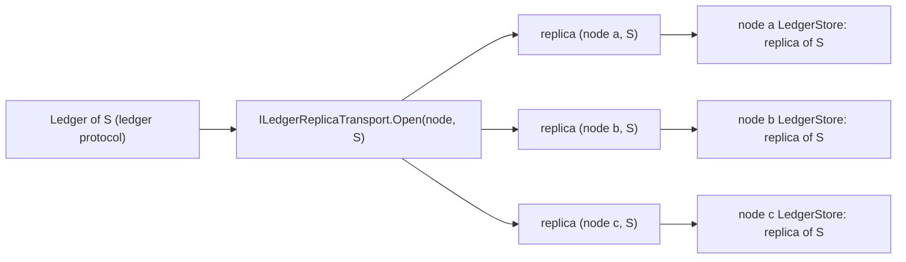
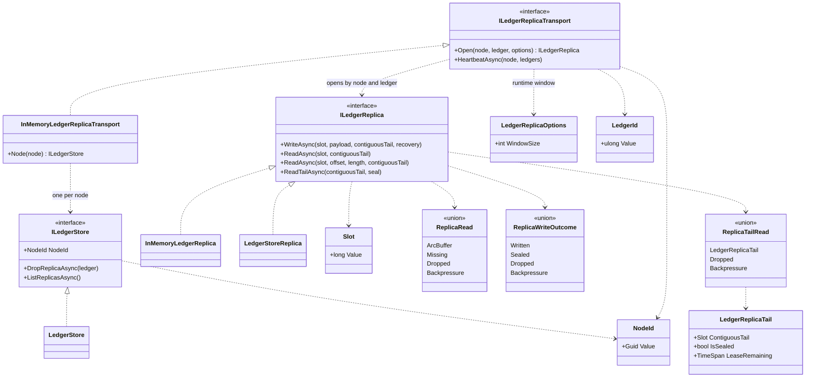
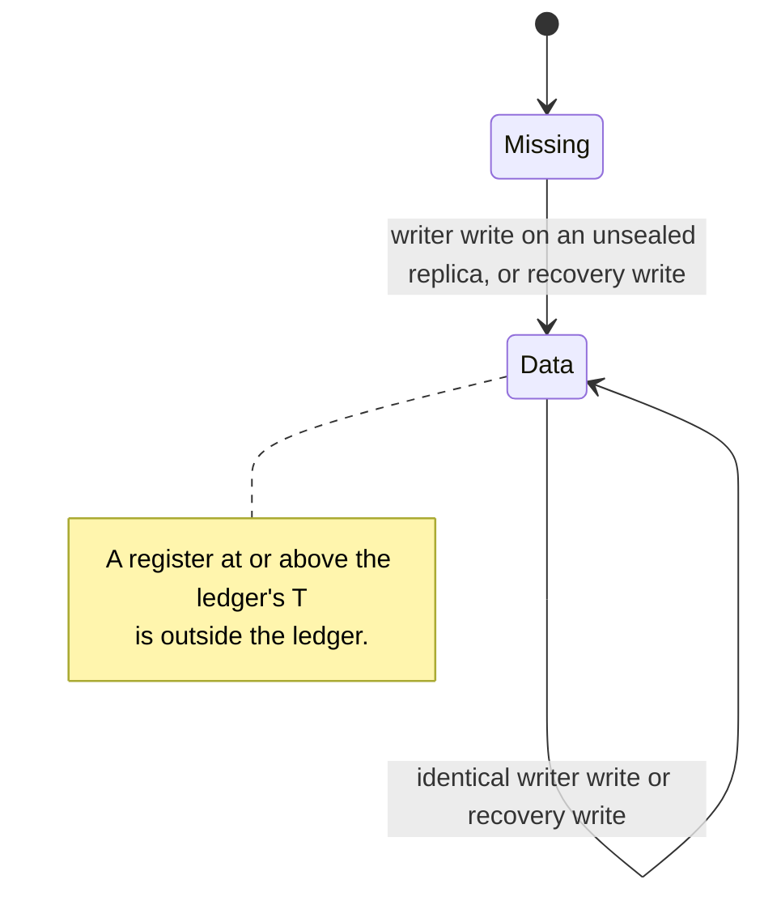
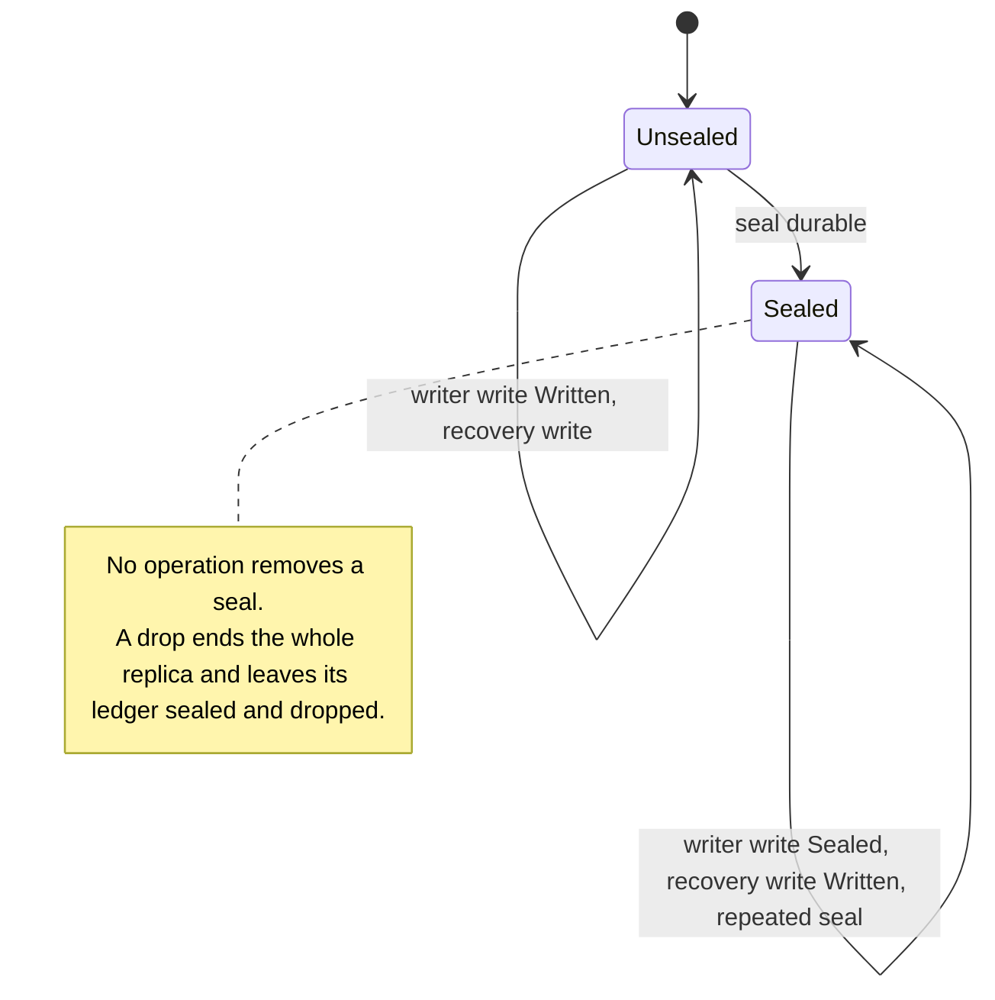
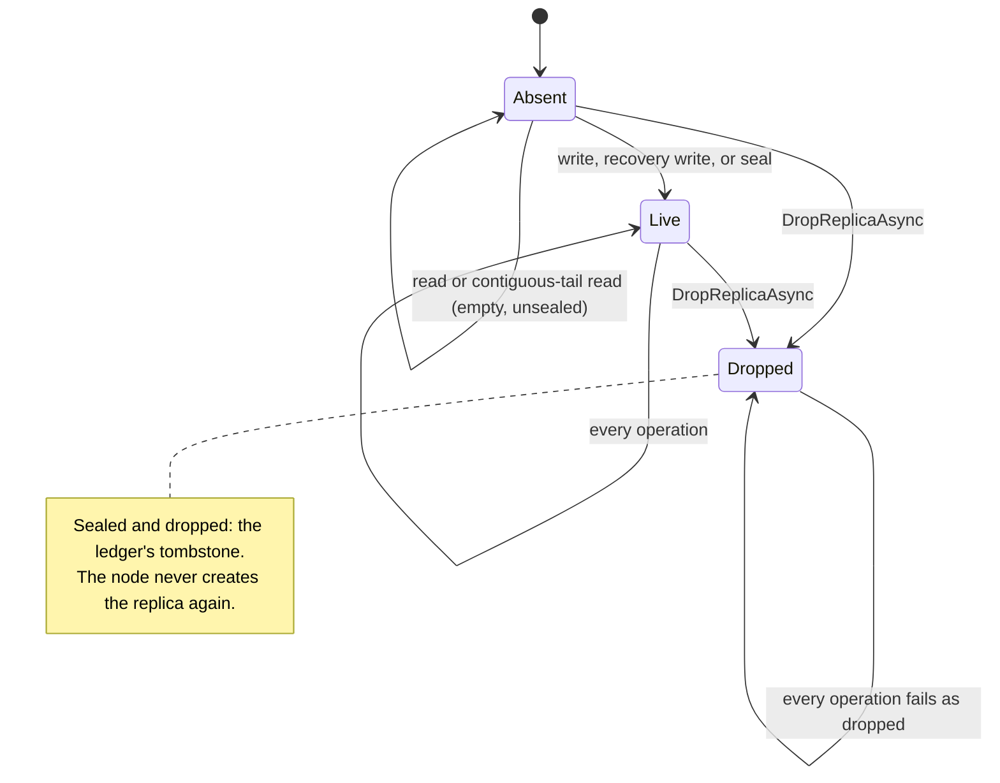

# Ledger replicas

## 1. Purpose and scope

The ledger replica is Clog's replica contract: the storage of one ledger on one node, an address space of create-once
registers which one writer fills, with a durable seal and a retained contiguous tail. Its contract depends only on
Buffers; the LedgerStore implements it over [WAL](wal.md). The [ledger protocol](ledger-protocol.md) writes, reads,
seals, and recovers a ledger over its `N` replicas, after Apache BookKeeper's ledger protocol, and is the contract's
caller; its `Ledger` is not a replica.

> "The LogDrive is an address space of registers with a random read/write interface (see Figure 2).
> Addresses are initialized to an unwritten state; a write switches them to a written state."
> (research/papers/logdrive/paper.md, §3.1)

A **ledger replica**, one `ILedgerReplica`, is the storage of one ledger on one node, addressed by `(node, LedgerId)`,
as a ledger's storage on one bookie is in BookKeeper. A node creates a ledger's replica with the first write, recovery
write, or seal which reaches it, as a bookie creates a ledger's state with its first add or fence, unless the node has
**dropped** the ledger, which leaves the ledger's **tombstone** on the node. A dropped ledger is sealed; the node holds
none of its values and never creates its replica again. The layer above drops ledgers, off the request path:
[Ledgers](ledgers.md#85-replica-lifecycle-on-a-node) drops a replica once the node's view of the ledger map revokes it.
Each **register**, one address, holds one slot of the ledger: it is unwritten or holds a **DATA entry**, the slot's
batch (a non-empty value). Each replica is **unsealed** or **sealed**: a sealed replica answers every **writer write**,
the ledger writer's create, with `Sealed`, and still accepts **recovery writes**, which copy a value some replica holds.

Every write, read, contiguous-tail read, and seal carries the caller's **known contiguous tail**, a lower bound of the
ledger's [contiguous tail](ledger-protocol.md#1-purpose-and-scope): while the ledger is open, its writer's completed
prefix, and once it is closed, its recorded `T`. Every address below it holds DATA on `Q` replicas, and it never exceeds
`T`. Each replica retains the greatest one it receives, and reports it, so a reader learns it from one replica.

This file specifies:

- the ledger replica contract (`ILedgerReplica`) and node-addressed access to ledger replicas
  (`ILedgerReplicaTransport`);
- the memory provider, for tests and simulation;
- node drops, and the tombstones through which a node refuses the ledgers it dropped.

The [LedgerStore](ledgerstore.md), which holds a node's replicas, meets the same contract and has its own file, with
the cluster claim of its node root; the [Orleans composition](../compositions/orleans.md#512-replica-transport) reaches
another node's replicas over grain calls. [Ledgers](ledgers.md) assigns ledger IDs in the map write which installs a
ledger, builds each process's `Ledger` of a ledger over the replicas of the nodes the ledger map names
([ledger-protocol §2.5](ledger-protocol.md#25-building-a-ledgers-ledger-and-ledgerwriter)), and drops a node's replicas.

Code: `Orleans.Durable.Storage.Engine.Ledgers.Abstractions` (contract and data types) and
`Orleans.Durable.Storage.Engine.Ledgers` (the memory provider), with the LedgerStore in
`Orleans.Durable.Storage.Engine.Ledgers.Store`.

Replicas are the storage of a quorum ledger, one whose map entry places it on nodes. A ledger placed in the object
store keeps one copy there and has no replicas ([object-store ledgers](object-ledgers.md)); the two meet one storage
seam below the ledger protocol's `Ledger` ([ledger-protocol §2.7](ledger-protocol.md#27-ledger-storage)), and this
contract and its invariants are the quorum's alone.

### Design rationale

**Registers, not a second shared log.** Durability composes below sequencing: a register interface can be
replicated without letting each replica choose append positions. A monolithic durability, ordering, and
reconfiguration engine would hide that boundary and couple the critical path to control-plane changes. Scalar
addresses and one DATA value per register leave batching to the register's user: Ledgers packs the rows of many
keys into one value.

**A minimal contract.** A ledger replica answers every operation from its own state: a write, a read, and a
contiguous-tail read, which seals first when asked. The memory provider and the LedgerStore each meet it directly, and a
replica transport carries it to another node's LedgerStore, so one contract serves tests, a node's disk, and another
node's disk, and the [ledger protocol](ledger-protocol.md) branches on no provider. A seal means one thing on every
replica: a contiguous-tail read which seals first, so it reports a retained contiguous tail with the seal. Recovery,
BookKeeper's ledger recovery, belongs to the ledger protocol alone: it seals a coverage of replicas, reads across them,
and returns a candidate end, which no replica could decide from its own state. A node drops a replica outside the
contract, when the layer above drops it. Byte-range reads are part of the contract because returning one row of a batch
should not require transporting every other row; a provider without a cheaper form reads the whole value and slices
it.

**The seal is a record in the replica's log.** A LedgerStore replica records its seal in its node's WAL and
answers once the record is durable, so WAL replay restores it, and the WAL orders it against the replica's writes:
a writer write logged before it was accepted, and one which arrives after it is refused. The seal names no
address. Recovery decides `T`, and only the ledger map records it, so a replica holds no per-address end marker,
and a seal never races a write for a register.

**One concept, one name.** Delos' Loglet `seal`, which the ledger protocol implements with recovery, and a replica's
seal are one concept at two levels: recovery seals a ledger by sealing `N − Q + 1` of its replicas
([LP-I6](ledger-protocol.md#5-invariants)), and each replica records its own seal in its log. Clog names both seal, and
a writer write after a replica's seal answers `Sealed`. Sealing is what fences a ledger's writer.

**Rejected alternatives.**

- *Positional SEAL entries* (the LogDrive paper's sealing). A conditional DATA/SEAL create in each register arbitrates
  the writer and the sealer in storage which has a conditional create and nothing else, as object-store replicas
  do. Clog's replicas are its own LedgerStores, which order a seal against writes in their log; positional SEAL
  entries cost a weak-tail scan of the trailing window, a sealer which advances over DATA, alignment of a SEAL quorum at
  one address, and repair of minority SEAL, and make the protocol's DATA and SEAL decisions intersect, which forces
  `Q` to be a majority.
- *A separate seal verb.* Sealing and then reporting the retained contiguous tail is a contiguous-tail read which
  seals first; one verb gives every provider, transport, and test one path.
- *Pushed drops.* A drop sent to a ledger's replicas would repeat a decision every node's view already owns, and
  add an outcome for a drop the view does not yet support. Each node drops what its view revokes, on every view
  change and periodically.
- *Node drops as `(node, ledger)` members of `ILedgerReplicaTransport`.* `ILedgerReplicaTransport` reaches every node,
  so the type would admit a drop on another node, the pushed drop above, and an implementation which serves drops only
  for its own node would refuse the rest, a second meaning for `NotSupportedException`. A node's own handle,
  `ILedgerStore` (§2.3), states which node it drops on.
- *Reconciliation against the concrete `LedgerStore`.* Ledgers would depend on one provider, and could not
  reconcile over the memory provider under simulation.

**Node-addressed replicas, created by use.** Ledger IDs are unique within a cluster and never reused
([LG-I3](ledgers.md#5-invariants)), and a node identity names one disk, so `(node, LedgerId)` names one replica for
the cluster's life. The ledger map records each ledger's nodes, and nothing else records a replica: a per-replica
configuration record would be a second authority for what the map already names. A replica comes into existence with the
first write, recovery write, or seal which reaches it, as a bookie's state for a ledger does, so the map write which
installs a ledger can assign its ID, and installation waits on no node. A separate create would put a round trip to
every replica node before every transition, and a create before the map write would need an ID the write had not yet
assigned.

**Creation unless dropped.** The hazard a drop creates is resurrection. A ledger's close sealed
`N − Q + 1` replicas, and a write the deposed writer delayed past the drop must not recreate an empty, unsealed
replica on one of them, or `Q` replicas could accept it. So a node refuses a ledger from the record which drops its
replica onwards, and decides every creation against its drops under the serialization which orders them. A drop is
a record in the node's own storage, so creating or refusing a replica reads only the node's own catalog, on the request
path and when the node starts. A dropped ledger is sealed:
the drop seals what it drops, and every rule which counts a sealed answer counts a dropped one, so a drop only
strengthens the refusal the seal began. A node refuses every request for a dropped ledger, a seal included: such a
seal comes only from an executor whose view still lists a removed ledger, whose close the map's conditional write
rejects, and refusing it sends the executor to the map at once.

**Tombstones.** A node keeps the tombstone of every ledger it dropped, for its life: each is an 8-byte ledger ID
in the node's catalog, tens of megabytes after a year of heavy churn
([ledgerstore, design rationale](ledgerstore.md#design-rationale)), so bounding them is not worth a second
mechanism.

Rejected alternatives:

- *A replica authority* which a node consults before it creates a replica: the node's view of the map, read again
  when it lags the request's epoch. It puts a MetaStore read on the first write of each new ledger to a lagging
  node and before a restarted node serves, and an epoch on every request, to decide what the drop's own record
  already orders. Its `NotInstalled` answer would check at the node the caller's precondition that requests name only
  assigned ledgers, which Ledgers asserts where it sends them (§3.2).
- *Creation authorized by a view ahead of the request*: each request carries the epoch of a view which lists its
  ledger, and a node whose own view is behind that epoch has not dropped the ledger, so it creates without reading
  the map. A restarted node's view is unset, and recreates a dropped replica unless the node reads the map first or
  keeps the epoch of its last drop durably, which is the epoch floor below.
- *Implicit creation with a collector, without tombstones*: a collector deletes the replicas the map no longer
  assigns a node. The deposed
  writer's delayed writes recreate the dropped replicas of sealed nodes and reach `Q` `Written` answers before the
  collector runs, and deleting the replicas afterwards cannot retract the acknowledgment (the `no-tombstone` mutant
  of [`LedgerDrop.qnt`](../../../specs/ledgers/README.md)). Stamping each creation with a map view keeps a
  collector from deleting a legitimate replica, as `NextLedgerId` already does, and does nothing against the
  deposed writer.
- *A creation floor at the highest dropped ID*, in place of tombstones. Ledgers are not dropped in ID order: when
  S7 splits into S9 and S10, and S10 is closed, drained, and dropped, a floor of 10 refuses S9's first write on every
  replica (`LedgerDrop.qnt`'s witness `NeverLowerCreatedAfterDrop` reaches such a first write on a node which
  dropped S10).
- *A creation floor at the lowest ID the map lists with the node*, which Ledgers would raise and below which the
  node would discard its tombstones. No later map lists an ID below it with the node, as
  [`MapFloor.qnt`](https://github.com/ReubenBond/clog/blob/evidence/replica-authority-alternatives/specs/journal-log/MapFloor.qnt)
  checks over every map sequence of its bounds (tag `evidence/replica-authority-alternatives`), but it is a second
  mechanism, with its own record and its own computation in Ledgers, to bound a set of ledger IDs.
- *Rebuilding tombstones from the map* when a node's catalog is lost: every ID below the map's `NextLedgerId` which
  the map does not list with the node. That is the map floor, read from the MetaStore before the node serves; a lost
  catalog is detected instead, and the node returns as a new node (ledgerstore LS-I5).
- *An epoch floor*, which refuses requests whose epoch precedes the node's last drop. It keeps an epoch on every
  request, and refuses in epoch space, so it bounces the first write of every ledger installed before the node's
  last drop.

**Retained contiguous tails.** A replica which missed a write holds a hole there, which a reader passes by reading
another replica: single writers give each address one value, so any DATA copy of a decided address is the decision.
Each replica retains the greatest contiguous tail an operation carries and reports it, so a reader learns the ledger's
decided prefix from one replica, and recovery starts from the highest a seal coverage reports
([ledger-protocol §8.2](ledger-protocol.md#82-known-contiguous-tail)). Only the ledger's writer and the map's recorded
`T` originate a contiguous tail, so every retained value is a fact about the ledger, and none passes `T`; no replica
retains a candidate end. A retained value is soft state: losing it costs a read from more replicas, never safety.
Replicas which accept only appends that extend their own log (Raft's log-matching rule) would also prevent holes, but
make uncommitted entries overwritable and turn every replica into a protocol participant; reading another replica on the
rare hole keeps replicas passive.

**A cancellation ends the wait, not the request.** A transport ends a cancelled caller's wait at once, wherever its call
is, and leaves the request to land or not, so a caller which cancels, a `Ledger`'s disposal among them, is bounded by
its cancellation rather than by the transport's timeout (§2.2). Aborting the request on the wire was rejected: a request
already sent may land whatever the caller does (§6.3), so an abort could only narrow the unknown outcome, never remove
it, and it would make the caller's bound depend on the callee's acknowledgement, which a stopping or partitioned node
never sends.

### Diagram

A ledger `S`'s replicas, each opened on its node through `ILedgerReplicaTransport` and held by that node's store:

## 2. Contract upward

Shared outcome and error taxonomy: [outcomes.md](../outcomes.md). Address and identity types:
[identity.md](../identity.md).

### 2.1 `ILedgerReplica`

Every member is asynchronous and thread-safe. The caller owns a write payload until the returned operation
completes; a provider which uses a payload after its operation completes takes its own lease on it (`Retain` or
`Slice`, [buffers §2](buffers.md#2-contract-upward)). The caller owns and disposes a batch a `ReplicaRead` returns.
Every operation which takes a slot throws `ArgumentException` (or `ArgumentOutOfRangeException`)
for one outside `0 ..= 2^63 − 2`. Every operation requires a `contiguousTail` argument: the caller's known contiguous
tail (§3.2), `0` when it knows none; the replica retains it (LR-I6). A replica's **known contiguous tail** for an
operation is the greater of its argument and the replica's retained contiguous tail. Every replica is
`IAsyncDisposable` (§6.3).

Every answer a replica gives reflects durable state (LR-I4, [durable answers](../conventions.md#13-durable-answers)):
`Written` once DATA durably occupies the slot's register; the owned batch and `Missing` from durable, published state;
`Sealed` and a sealed `LedgerReplicaTail` once the seal is durable; and `Dropped` once the drop is. An
answer which reflects a create, seal, or drop in flight waits for its durable outcome and answers from it.

Each operation answers a union ([conventions §15](../conventions.md#15-outcomes-unions-and-errors)): a write
`ReplicaWriteOutcome`, a read `ReplicaRead`, and a contiguous-tail read or a seal `ReplicaTailRead`. Every one of them
has two more cases besides those the table lists: `Dropped`, once the node dropped the ledger (LR-I3), and
`Backpressure`, which a bounded replica gives before it retains or writes anything, so it has no effect, and which
repeating the operation may change. A `Ledger`'s `Backpressure` is the ledger protocol's
([ledger-protocol §6.4](ledger-protocol.md#64-failures)).

| Member | Preconditions | Outcomes |
| --- | --- | --- |
| `WriteAsync(slot, payload, contiguousTail, recovery)` | `payload` is non-empty. A writer write (`recovery` false) comes from the ledger's writer, which writes at most one DATA value to `slot`; identical retries are allowed, and may carry a greater `contiguousTail`. A recovery write (`recovery` true) copies the DATA a replica reported for `slot` (§3.2). | `Written(LeaseGrant)`: DATA occupies the slot's register (LR-I4). For a writer write (`recovery` false) when leases are enabled (`LeaseDuration > 0`), the replica advances its RAM-only `grantedLeaseUntil` to at least `now + LeaseDuration` before acknowledging and returns `LeaseGrant = LeaseDuration` (zero for recovery writes or when leases are disabled, LR-I10). `Sealed`: a writer write met a seal, and the payload is not stored (LR-I8); a recovery write never reports it. Throws as listed in §6.4. |
| `ReadAsync(slot, contiguousTail)` | — | The owned batch, an `ArcBuffer`, or `Missing` (unwritten). Throws `LedgerReplicaCorruptException` for a value which fails integrity (LR-I2). Below the ledger's contiguous tail the slot is decided, so the ledger protocol reads it from one replica ([LP-I10](ledger-protocol.md#5-invariants)); at or above it, a result decides nothing. |
| `ReadAsync(slot, offset, length, contiguousTail)` | `offset ≥ 0` and `length > 0`; otherwise it throws `ArgumentOutOfRangeException`. | A byte-range read: the batch's bytes `[offset, offset + length)`; `OutsideBatch(length)`, a value naming the batch's length, when the range extends past the batch; or `Missing`. |
| `ReadTailAsync(contiguousTail, seal)` | — | A `LedgerReplicaTail(ContiguousTail, IsSealed, LeaseRemaining)`. With `seal` false: the replica's retained contiguous tail after the call, whether it is sealed, and `LeaseRemaining = TimeSpan.Zero`; the ledger protocol's explicit contiguous-tail write sends it so, to every replica, for each to retain the tail ([ledger-protocol §8.2](ledger-protocol.md#82-known-contiguous-tail)). With `seal` true, the replica seals first, idempotently, and afterwards answers every writer write `Sealed`: it answers sealed, with its retained contiguous tail and `LeaseRemaining = max(0, max(grantedLeaseUntil, bootLeaseHorizon) - now)` (zero when leases are disabled or expired, LR-I10), once its seal and every writer write it accepted before it are durable (LR-I8). |

`ReplicaWriteOutcome` reports what the replica did with a writer write: `Written` once DATA occupies the slot's
register, whether this write's or an earlier copy of the same value, and `Sealed` once the replica's seal is durable. A
writer write which meets a seal is unknown to the ledger: the slot may hold DATA on `Q` other replicas, and only the
ledger's `T` decides it (§6.1).

A ledger replica answers every request as §8.1 does, with no window precondition, and accepts recovery writes. The
ledger protocol needs both. The caller's requirements of §3.2 hold for the ledger, not for each replica: a replica which
missed writes, being down or slower than its peers, holds more unwritten slots than the window allows and receives
a known contiguous tail above its own, and the protocol still sends every request to it and decides from its answer.
Recovery and read repair copy it DATA which a replica reported (LR-I5).

On a ledger replica the node does not hold (LR-I7), the node decides from its own state, under the serialization
which orders its creations and drops:

- When the node dropped the ledger, which its tombstone records (§2.3), every operation answers `Dropped`.
- Otherwise a write, a recovery write, or a seal creates the replica first, and a seal creates it sealed; a read or
  contiguous-tail read answers as an empty, unsealed replica would: `Missing`, and the contiguous tail the read
  carried, which it does not retain. A read or contiguous-tail read concurrent with the replica's create answers so
  until the create is published, as it is ordered before the create
  ([durable answers](../conventions.md#13-durable-answers)).

A replica the node holds serves every operation.

### 2.2 `ILedgerReplicaTransport`

Access to the ledger replicas on a cluster's nodes, addressed by `(node, LedgerId)`. [Ledgers](ledgers.md)
opens a ledger's replicas through it and builds each process's `Ledger` over them
([ledger-protocol §2.5](ledger-protocol.md#25-building-a-ledgers-ledger-and-ledgerwriter)). A node's own listing and
drops go through its `ILedgerStore` (§2.3).

| Member | Contract |
| --- | --- |
| `Open(node, ledger, options)` → `ILedgerReplica` | A handle over the replica of `ledger` on `node`, with window `options.WindowSize`, bound to that node and opened without I/O, so building a `Ledger` never waits on an unavailable minority. The caller owns and disposes it. Opening creates nothing; its operations answer as the node does: a replica the node does not hold is created by a write, recovery write, or seal unless the node dropped the ledger, which answers `Dropped` (LR-I3, LR-I7), and an unreachable node fails as unavailable. |
| `HeartbeatAsync(node, ledgers, cancellationToken)` → `ReplicaHeartbeatRead` | Batched per-node lease renewal in RAM with zero WAL writes and zero replica creation (LR-I10). For each `LedgerId` in `ledgers` in order: if the node holds a live unsealed replica and leases are enabled, advances its RAM-only `grantedLeaseUntil` to at least `now + LeaseDuration` and answers `Granted`; if live and sealed, answers `Sealed`; if dropped (tombstoned), answers `Dropped`; if absent (neither live nor dropped), answers `Absent` without creating a replica. Returns `ReplicaHeartbeatReply(LeaseGrant, Outcomes)` (with `LeaseGrant = LeaseDuration` when leases are enabled, else zero; an empty `ledgers` span returns an empty reply without I/O) or `Backpressure` before touching the store. |

Every implementation, whether it reaches a node in process or over a network, keeps LR-I9:

- **The named node answers.** A replica's operations are answered only from the store of the node they name, never
  from another node's. A node whose disk was replaced or wiped is a new node and answers nothing for the old one, so
  a replica which lost its state never answers under its old identity (the ledger model's `assumption-amnesia` case
  shows the loss otherwise).
- **Calls cross unchanged.** Each runs exactly the called operation on that store, with its arguments, the
  contiguous tail and the recovery flag included, and the replica's ledger and window unchanged, and returns the
  store's outcome, its contiguous tail and sealed flag included, or its ledger replica failure or `ArgumentException`,
  with its type. The node decides with its own storage.
- **Lost answers are unknown outcomes.** A failure in which no answer comes back from the node, after the
  request may have left the caller, is an unknown outcome: the operation may still take effect, and the failure is
  reported as neither a storage outcome nor a ledger replica failure type. `OperationCanceledException` reports only the
  caller's own cancellation.
- **A cancellation ends the wait at once.** A call whose caller's token is cancelled ends with
  `OperationCanceledException` as soon as the cancellation runs, wherever the call is: waiting for budget, it is
  withdrawn unsent; sent, its request may still land, and its outcome is unknown. No call outlasts its caller's
  cancellation by a transport's timeout, so a `Ledger`'s disposal, which cancels its calls and then waits for them
  ([ledger-protocol §6.3](ledger-protocol.md#63-cancellation-and-disposal)), is bounded by the cancellation.
- **Refusals precede the store.** An implementation, at the caller or at the node, refuses an operation itself only
  before the store, with no effect. It reports the refusal as a definite answer or failure, for example
  `Backpressure` from a bounded host or `NotSupportedException` for a request the node cannot read, or as an unknown
  outcome, which claims nothing.
- **Byte budgets wait in order.** An implementation which bounds the bytes outstanding to a node, request payloads and
  reply bytes alike, reserves a write's payload and, for a read whose reply crosses to the caller, the longest reply it
  accepts when it admits the call; a read whose reply is the store's own buffer, in process, reserves none. It refuses a
  call larger than the budget with `ArgumentException`, a caller's defect, since the payload limit is at most the
  budget. It holds a call which lacks budget in that node's FIFO queue, granting budget in arrival order, until the
  call's deadline, fixed when the call was made, and only then fails it with `LedgerReplicaQueueTimeoutException`,
  before the request leaves the caller, with no effect. It never fails a call at once for lack of budget, and a call at
  the payload limit waits only behind the calls queued before it, so a large batch is delayed, not starved. Replica
  calls, which never wait on other calls, take a budget of their own: no replica call waits for budget behind a call
  whose completion depends on a replica call, such as a composition's forwarded write. The writer repeats a write which
  timed out in the queue ([LP-I12](ledger-protocol.md#5-invariants)), and recovery waits it out.
- **Payloads follow §2.1.** The caller owns a payload it passes until the operation completes, and owns a payload
  an operation returns.

The safety of a repeated or delayed request rests on the store's rules (LR-I1, LR-I3, LR-I7, LR-I8), not on how
often an implementation delivers it.

Implementations: `InMemoryLedgerReplicaTransport` (§9.1), for tests and simulation, and, in the Orleans composition,
`OrleansLedgerReplicaTransport`, which reaches its own node's LedgerStore in process and every other node over grain
calls ([orleans §5.12](../compositions/orleans.md#512-replica-transport)). Both bound a node's calls with a
`CallBudget` (`Orleans.Durable.Storage.Engine.Threading`) per destination node, which `NodeCallBudget`
(`Orleans.Durable.Storage.Engine.Ledgers`) makes: a FIFO queue which grants request payload and reply bytes, and a
number of calls, in arrival order, and fails a call with `LedgerReplicaQueueTimeoutException` only at its deadline, an
absolute time each call fixes once, so every wait it makes counts against one deadline. The memory transport's reads
reserve its largest payload. The Orleans transport's remote whole reads reserve a read reply and read a longer batch
again reserving its length, and its contiguous-tail reads and seals take a second, calls-only lane per node, apart from
the bytes.

### 2.3 `ILedgerStore`

A node drops ledgers outside `ILedgerReplica`, at the layer above's direction, through `ILedgerStore`, the handle of one
node's store: the `LedgerStore` implements it ([ledgerstore §2.2](ledgerstore.md#22-store)), and
`InMemoryLedgerReplicaTransport.Node(node)` returns one for each node it holds (§9.1). Each drop is durable before it
returns, and is serialized with the node's creations, so a creation either precedes a drop or is refused by it.

| Member | Contract |
| --- | --- |
| `NodeId` | The node whose store the handle reaches. |
| `DropReplicaAsync(ledger)` | Drops `ledger` on the node: stops admitting operations to its replica, waits for those admitted, and in one step removes the replica, with every value and its seal, and leaves the ledger's **tombstone**, which records it sealed and dropped. A ledger the node does not hold gets a tombstone too; one the node already dropped changes nothing. |
| `ListReplicasAsync()` | The ledgers whose replicas the node holds, ascending. |

A ledger with a tombstone is dropped on the node: every operation on it answers `Dropped`, and the node never creates
its replica again (LR-I3, LR-I7). The node keeps every tombstone for its life. A dropped ledger is sealed: every rule
which counts a sealed answer counts a dropped one ([LP-I5](ledger-protocol.md#5-invariants)).

The layer above decides what a node drops (§3.2).

### 2.4 Shared operations

`LedgerReplicaOperations` in `Orleans.Durable.Storage.Engine.Ledgers.Abstractions` holds the contract's argument checks,
which every provider runs before an operation has any effect: `ValidateSlot`, `ValidateWindowSize`,
`ValidateReplicaWindow` (LR-I6), and `ValidateBatch`. `RangeOf(value, offset, length)` answers a byte-range read from a
batch the caller owns: a view of bytes `[offset, offset + length)`, or `OutsideBatch` with the batch's length for a range
which extends past it; it throws `ArgumentOutOfRangeException` for a negative offset or a length which is not positive.
`ReadRangeOfValueAsync(replica, slot, offset, length, contiguousTail)` reads the whole value and answers so, for
providers whose storage has no cheaper byte-range read; `ValidateReadRange` and `ReadRangePointWiseAsync` validate and
provide the default point-wise fallback for `ILedgerReplica.ReadRangeAsync` when `SupportsReadRange` is false. The
ledger protocol forwards the range to its replicas, so only
the range crosses the network ([ledger-protocol §8.3](ledger-protocol.md#83-quorum-operations)); the LedgerStore still
reads the whole record from its WAL and answers the range from it ([ledgerstore §8.2](ledgerstore.md#82-reads)), so forwarding
saves the network, not the disk, until the WAL reads ranges
([deferred](../deferred.md#wal-fixed-buffers-zero-copy-large-payloads-and-range-reads)). The contract's component grants
no other component its internals: a provider reaches it only through its public types. Its public types and their public
and protected members are a checked-in snapshot in the architecture tests, so a change to the contract's surface is an
explicit change to this file.

## 3. Requirements downward

### 3.1 From storage

A ledger replica's storage provides, per register, an atomic create-if-absent, a replace for a value which fails
integrity, and durability on acknowledgement; per replica, a durable seal which it orders against the replica's
writer writes, and the window of the request which created it, recorded durably with its creation; and per node, a
durable record of the replicas the node holds, written before the first record of a replica it creates, and of its
tombstones, each drop written in one step with the tombstone it
leaves, and every creation decided against them under the serialization which orders the node's drops. The memory
provider meets them under its node lock, for its own lifetime. The LedgerStore meets them with per-slot locks over
the WAL, which also records each replica's create, seal, and drop ([ledgerstore
§3](ledgerstore.md#3-requirements-downward), [LS-I2](ledgerstore.md#5-invariants),
[LS-I11](ledgerstore.md#5-invariants)). A replica transport carries them from another node's LedgerStore; a
request which fails or times out there may still take effect later (LR-I9), and the store's rules keep it safe.

### 3.2 From callers

| Requirement | Why |
| --- | --- |
| **One writer, one value per address.** Only the ledger's writer sends writer writes, and it writes at most one DATA value to an address; the same value may be written any number of times. The ledger protocol guarantees this by giving each sequencer slot one writer ([LP-I1](ledger-protocol.md#5-invariants)). | Create-once registers (LR-I1); any copy of a decided address is its value ([LP-I10](ledger-protocol.md#5-invariants)). |
| **Recovery writes copy reported DATA.** A recovery write carries a value a replica reported for that address, as the ledger protocol's recovery and read repair do ([LP-I7](ledger-protocol.md#5-invariants)). | It never changes a decided value (LR-I5). |
| **Window discipline `K`.** The runtime window `LedgerReplicaOptions.WindowSize = K` bounds the writer's outstanding addresses: when it writes address `p`, every address below `p + 1 − K` holds DATA it decided. The ledger writer's sequencer keeps at most `K` slots in flight ([LP-I2](ledger-protocol.md#5-invariants)). Every replica of a ledger uses the ledger's `K`; a replica refuses a request of another window with `ArgumentException` (LR-I6). | A reopened replica's retained contiguous tail (LR-I6) and the extent of recovery's reads ([LP-I7](ledger-protocol.md#5-invariants)). |
| **Non-empty DATA.** | Every DATA value carries at least one byte; providers reject an empty payload. |
| **Known contiguous tail.** Every `contiguousTail` argument is at most the ledger's contiguous tail (§1), the writer's completed prefix while the ledger is open and its recorded `T` once closed: every address below it holds DATA on `Q` replicas, and it never exceeds `T`. `0` claims nothing. Only the ledger's writer and the map's recorded `T` originate one; a `Ledger` forwards the greatest it knows, from its writer, its replicas, recovery's `c`, and the map, never a candidate end ([LP-I11](ledger-protocol.md#5-invariants)). | Replicas retain it (LR-I6), and the ledger protocol reads an address below it from one replica ([LP-I10](ledger-protocol.md#5-invariants)). |
| **Drop only what is never used again.** The caller drops a ledger on a node only once it never again sends the node a request for the ledger which it expects to be served. Ledgers drops a replica once the node's view of the ledger map revokes it ([ledgers §8.5](ledgers.md#85-replica-lifecycle-on-a-node)). | A dropped ledger refuses for good (LR-I3) and counts as sealed ([LP-I5](ledger-protocol.md#5-invariants)), so a drop of a ledger still in use fences its writer and fails every recovery of it: the ledger could never close. |
| **Requests only for assigned ledgers.** The caller sends a write, recovery write, or seal for a ledger's replica only once `(node, LedgerId)` can name no other contents. Ledgers, which assigns ledgers to nodes, checks this where it sends each one ([LG-I7](ledgers.md#5-invariants)). | A request creates the replica of any ledger the node has not dropped (§2.1), so one for an ID the map then assigns to another ledger would create that ledger's replica holding foreign DATA. |

## 4. Data types

The types are in `Orleans.Durable.Storage.Engine.Ledgers.Abstractions`, namespace
`Orleans.Durable.Storage.Engine.Ledgers`. [Identity](../identity.md) defines `LedgerId` and `NodeId` for every layer
which names them; ledger replica, the lowest such layer, holds their code types.

| Type | Definition |
| --- | --- |
| `Slot` | Readonly struct over a non-negative `long` `Value`: a slot of a ledger, and the register which holds it in each replica; ordered and equatable by value; `Add`, `Subtract`, `+`, and `-` are checked. Operations accept `0 ..= 2^63 − 2`. |
| `LedgerId` | Readonly struct over a non-zero `ulong` `Value`, which the ledger map assigns, unique within a cluster and never reused ([ledgers §4](ledgers.md#4-data-types)); equal by value and ordered numerically. The ledger replica uses only its equality. |
| `NodeId` | Readonly struct over a non-empty `Guid` `Value`: the node identity its LedgerStore creates and keeps for its lifetime ([LS-I6](ledgerstore.md#5-invariants)); equal by value. |
| `LedgerReplicaOptions` | Sealed record with required `WindowSize` (`K`), positive. A replica records the `K` of the request which creates it durably and refuses a request of another window (LR-I6). |
| `ReplicaWriteOutcome` | Union declaration of `Written(TimeSpan LeaseGrant)` (with `Written.Instance` at `TimeSpan.Zero` and a cached per-store instance for configured `LeaseDuration`), `Sealed`, `Dropped`, and `Backpressure`, equal by case and grant. |
| `ReplicaRead` | Hand-written non-boxing union of the owned batch (`ArcBuffer`) and the singleton records `Missing`, `Dropped`, and `Backpressure`. It declares no equality: the caller owns the batch. |
| `ReplicaRangeBatch` | Readonly disposable struct `(Slot FirstSlot, int Count, ArcBuffer Packed, int FirstSlotTooLargeLength = 0)`: up to `maxSlots` consecutive slots packed as repeated `[u32 LE length][bytes]` frames (`FrameHeaderLength`, `ValidatePacked`, `WriteFrame`, `SliceNext`), or `Count == 0` for missing / first-slot `TooLarge`. |
| `ReplicaRangeRead` | Hand-written non-boxing union of `ReplicaRangeBatch`, `ReplicaWriteOutcome.Dropped`, and `ReplicaWriteOutcome.Backpressure`. |
| `ReplicaTailRead` | Hand-written non-boxing union of a `LedgerReplicaTail` and the singleton records `Dropped` and `Backpressure`, equal by case and tail. |
| `LedgerReplicaTail` | Readonly record struct `(Slot ContiguousTail, bool IsSealed, TimeSpan LeaseRemaining = default)`: a retained contiguous tail, a sealed flag, and, on a sealing read (`seal: true`), the remaining duration of any granted or boot lease horizon in the replica's monotonic clock (LR-I10). |
| `ReplicaHeartbeatStatus` | Byte enum: `Granted`, `Sealed`, `Dropped`, `Absent`. |
| `ReplicaHeartbeatReply` | Readonly record struct `(TimeSpan LeaseGrant, ReadOnlyMemory<ReplicaHeartbeatStatus> Outcomes)`: per-ledger outcomes of a batched `HeartbeatAsync` in request order, with the node's granted lease duration. |
| `ReplicaHeartbeatRead` | Hand-written non-boxing union of `ReplicaHeartbeatReply` and `ReplicaWriteOutcome.Backpressure`. |
| `LedgerReplicaCorruptException` | A stored value fails its integrity check; `Slot` when known. |
| `LedgerStorageCorruptException` | An object-store ledger's storage holds a value which fails its integrity check, or lacks a decided batch while the ledger is not dropped ([object-ledgers OL-I7](object-ledgers.md#5-invariants)). |
| `LedgerReplicaQueueTimeoutException` | A transport's byte budget for `Node` stayed short until the call's deadline, so the call never left its caller and had no effect (§2.2); transient (§6.4). |
| `LedgerStoreClusterMismatchException` | The node root is claimed by another cluster ([ledgerstore §7.1](ledgerstore.md#71-node-root)): `Claim`, `Cluster`, `ClaimedCluster`. |

`Dropped` means the node dropped the ledger, which its tombstone records: it holds none of the ledger's values, never
creates its replica again, and the ledger is sealed there (§2.3; LR-I3, LR-I7). `Backpressure` is
[§2.1](#21-iledgerreplica)'s.

A `ReplicaRead` owns its batch, which the caller disposes; its other cases own nothing.

The register and seal lifecycles below are logical, not storage formats.

A ledger replica's lifecycle on its node:

## 5. Invariants

- **LR-I1 — Create-once registers.** A register's first successful create decides its entry; later creates of
  the same address leave it unchanged and report its occupant. Only a recovery write replaces a value, and only
  one which fails integrity (LR-I5); only the node's drop of the replica ends a register (LR-I3).
  > "individual addresses are single-value registers: i.e., they are only linearizable for write/read
  > operations if a single value is written to them (though the same value can be written multiple
  > times). We rely on the application to never write multiple values to an address."
  > (research/papers/logdrive/paper.md, §3.1)
- **LR-I2 — Corruption is never missing.** A stored value which fails its integrity check is reported as
  `LedgerReplicaCorruptException`, never as `Missing` or `Batch`. A corrupt answer reports damage, and says nothing
  about whether a value was ever stored there: damage the node cannot place faults unwritten slots too
  ([LS-I5](ledgerstore.md#5-invariants)). A node loses no replica it holds without losing its disk, and with it its node
  identity ([LS-I6](ledgerstore.md#5-invariants)), so a replica a node neither holds nor dropped is one it never
  created.
- **LR-I3 — Drop.** A node drops a ledger (`ILedgerStore.DropReplicaAsync`, §2.3) only at the layer above's direction,
  and removes its replica, if it holds one, with every value and the seal, in the step which leaves the ledger's
  tombstone. A drop first stops admitting operations to the replica and waits for those admitted, so no mutation of it
  completes after the drop returns, and afterwards every operation answers `Dropped`, including a write delayed past the
  drop, for the node's life. No operation answers dropped before the drop's step is durable
  ([durable answers](../conventions.md#13-durable-answers)): a crash before then keeps the replica as it was, unsealed
  unless a seal reached it, and the node serves it again, so the answer would not be final and a seal check which
  counted it as sealed would have counted a replica the crash brings back. An operation which meets a drop in progress
  waits for it, and answers the node's failure if the drop fails. A dropped ledger is sealed: its tombstone records it
  sealed and dropped. A node keeps every tombstone for its life. This is the replica's part of
  [LG-I7](ledgers.md#5-invariants).
- **LR-I4 — Durable answers.** Every answer reflects durable state
  ([durable answers](../conventions.md#13-durable-answers)). A write reports `Written` only once DATA durably occupies
  the address, as the replica's storage establishes under its register's lock. A read reports `Batch` and `Missing`, a
  write `Sealed`, a contiguous-tail read its seal, and every operation `Dropped`, only from durable,
  published state: the DATA, the seal, or the drop is durable before the answer is given, and an answer which reflects
  a create, seal, or drop in flight waits for its durable outcome. An outcome which cannot be established throws and
  is never reported as success.
- **LR-I5 — Copies carry the address's one value.** A recovery write carries DATA a replica reported for that
  address, and single writers give the address one value, so a copy never changes a decided value: it creates a
  missing register, replaces a value which fails integrity, and leaves existing DATA.
  > "The subsequent read-repair writes occur after this linearization point and write the same value v, so
  > they do not change the value of a in the abstract LogDrive and do not affect correctness."
  > (research/papers/logdrive/paper.md, Appendix A.5)
- **LR-I6 — Retained contiguous tail.** Each `ILedgerReplica` retains the greatest contiguous tail it receives with any
  operation and reports it from `ReadTailAsync`, so a reported value is never below the operation's argument and never
  above the greatest contiguous tail the replica received, or, once it is reopened, the window bound below; a
  contiguous-tail read of a replica the node neither holds nor dropped retains nothing and reports its argument. While
  the store holding a ledger replica stays open, the replica's retained contiguous tail never decreases. A replica
  records the window `K` of the request which created it, durably with its creation, and refuses an operation of
  another window before it has any effect, so no replica can claim a different bound on its unwritten addresses. A
  reopened replica starts from `max(0, h + 1 − K)` for its highest DATA address `h` and that recorded `K`: under the
  window discipline (§3.2) every address below `h + 1 − K` holds decided DATA, so a restart lowers the value only to
  one the window already establishes, and the next operation raises it. That a retained value never exceeds the
  ledger's contiguous tail, nor, once the ledger is closed, its recorded `T`, and that no replica retains a candidate
  end, are its callers' obligations, not the replica's: every operation carries only a known contiguous tail of the
  ledger, which the ledger protocol bounds so and never takes from a candidate end
  ([LP-I11](ledger-protocol.md#5-invariants), §3.2).
- **LR-I7 — Creation unless dropped.** A node holds a ledger's replica from the first write, recovery write, or
  seal which reaches it, unless the node dropped the ledger; a seal creates it sealed. The node decides each
  creation from its own state, under the serialization which orders its drops, so a creation either precedes a drop,
  which then removes the replica, or is refused by it. A read, a contiguous-tail read, and `Open` create nothing. A
  read or contiguous-tail read of a replica the node neither holds nor dropped answers as an empty, unsealed replica,
  the contiguous-tail read with its argument, and so does one concurrent with the replica's create until the create is
  published, as it is ordered before the create. A creating write or seal publishes the replica before it takes effect,
  so a read or contiguous-tail read concurrent with it may find the replica held, empty, and unsealed, which serves it
  and retains its contiguous tail (LR-I6). A dropped ledger answers every operation `Dropped`, and its replica is
  never created again (LR-I3). A replica the node holds serves every
  operation.
- **LR-I8 — Seal.** A sealing `ReadTailAsync` on a ledger replica records the seal durably before it answers, and
  the seal lasts for the life of the replica, which only a drop ends (LR-I3). Every writer write the replica accepted
  is ordered before the seal; every writer write it receives afterwards answers `Sealed` and stores nothing. A sealing
  answer, first or repeated, waits until every writer write the replica accepted before the seal is durable and
  published, so a read served after it sees each of them. Recovery writes, reads, and contiguous-tail reads are served
  as before. The answer carries the replica's retained contiguous tail. The seal names no address.
  > "When a bookie receives a fence message for a ledger, the fenced state of the ledger is persisted to disk."
  > (Apache BookKeeper, *The BookKeeper protocol*, "Closing a ledger as a reader")
- **LR-I9 — Node access answers as the node does.** Every `ILedgerReplicaTransport` implementation answers a replica's
  operations only from the store of the node they name, running exactly the called operation with
  its arguments, the contiguous tail and the recovery flag included, and the replica's ledger and window unchanged, and
  returns the store's outcome, its contiguous tail and sealed flag included, or its ledger replica failure or
  `ArgumentException`, with its type; it keeps no cache of the node's answers, so every answer is the node's own
  durable answer (LR-I4). A failure in which no answer comes back from the node, after the request may have
  left the caller, is an unknown outcome, reported as neither a storage outcome nor a ledger replica failure type, and
  the operation may still take effect; `OperationCanceledException` reports only the caller's own cancellation. The
  implementation, at the caller or at the node, refuses an operation itself only before the store, with no effect, and
  reports the refusal as a definite failure or as an unknown outcome, which claims nothing. A node whose disk was
  replaced or wiped is a new node, and answers nothing for the old one. Payload ownership follows §2.1 (§2.2).
- **LR-I10 — RAM-only replica read-lease grants and boot horizon.** Replica read-lease state lives strictly in RAM and
  writes zero WAL records. When leases are enabled (`LeaseDuration = D > 0`), a node latches
  `bootLeaseHorizon = boot + D` on its monotonic clock when its store opens, before serving any RPC, and maintains a
  per-live-replica `grantedLeaseUntil` in memory. Each non-recovery `WriteAsync` accepted on an unsealed live replica
  and each `HeartbeatAsync` entry for a live unsealed replica advances `grantedLeaseUntil` to `max(prev, now + D)` and
  reports `LeaseGrant = D` (without creating replicas or writing WAL on heartbeats). Every sealing
  `ReadTailAsync(seal: true)` reports `LeaseRemaining = max(0, max(grantedLeaseUntil, bootLeaseHorizon) - now)` once
  the seal is durable (`0` when
  leases are disabled or the horizon has elapsed); a dropped or sealed-on-creation replica still respects
  `bootLeaseHorizon` after a restart, so no crash can cause a replica to under-report an unexpired pre-crash lease
  grant ([system model §2](../system-model.md#2-clocks)).

## 6. Faults, concurrency, and cancellation

### 6.1 Ambiguous and delayed requests

- A writer write which fails or times out at a replica on another node is ambiguous: it may land, at most once, possibly
  later. The ledger's writer repeats the identical write until it lands, meets a seal, or meets a drop
  ([LP-I12](ledger-protocol.md#5-invariants)). A repeat which meets its own landed write on an unsealed replica reports
  `Written`.
- A writer write which meets a seal is unknown to the ledger, as BookKeeper's `LedgerFenced` is: the slot may
  already hold DATA on `Q` other replicas, and only the ledger's close decides it
  ([ledger-protocol §6.1](ledger-protocol.md#61-ambiguous-and-delayed-requests)).
- A writer write delayed past a seal reports `Sealed`; one which landed before the seal and lies at or above `T`
  is outside the ledger. A request delayed past a drop is refused (LR-I3).
- A seal, read, or recovery write which fails or times out may be repeated; each is idempotent. A seal delayed past
  its recovery still seals the replica.
- A write, recovery write, or seal delayed past a node's drop of its ledger creates nothing: the node's tombstone of
  the ledger answers it as dropped (LR-I7). One which reaches a node which has not dropped a closed ledger may
  create an unsealed replica there, one of the at most `Q − 1` the close left unsealed, which the node drops at its
  next reconciliation ([ledgers §8.5](ledgers.md#85-replica-lifecycle-on-a-node)).

### 6.2 Concurrency

- A writer write and a seal racing at a replica resolve in the replica's log: the write logged before the seal
  is accepted, and the write after it answers `Sealed` (LR-I8).
- A recovery write racing a writer write, another recovery write, or read repair at one register resolves under the
  register's lock; every order leaves the slot's one value (LR-I5).
- Concurrent recoveries' seals and copies are idempotent at each replica: a repeated seal answers sealed, and every
  copy of a slot carries its one value (LR-I5, LR-I8). Which candidate end the ledger takes is the ledger
  protocol's ([ledger-protocol §6.2](ledger-protocol.md#62-concurrency)).
- An unsealed replica keeps accepting the writer's writes after the ledger is fenced; the DATA they leave at or above
  `T` is outside the ledger.

### 6.3 Cancellation and disposal

- A cancelled caller stops waiting; it never stops a write or a seal. A request already sent may land.
- An operation whose token is cancelled before it starts touches no storage.
- Cancellation is never reported as an outcome: a cancelled write throws `OperationCanceledException`, never
  `Written`, `Sealed`, or absence.
- Every replica is `IAsyncDisposable` and may be disposed while operations are in flight. Each of them completes or
  fails and releases its buffers; an operation which starts after disposal fails with `ObjectDisposedException`.

### 6.4 Failures

| Failure | Meaning | Repeating the operation |
| --- | --- | --- |
| `LedgerReplicaCorruptException` | The slot's register holds a value which fails integrity (LR-I2). | Does not change it; a recovery write of the slot's value does. |
| `LedgerStorageCorruptException` | An object-store ledger's one copy holds a value which fails integrity, or lacks a decided batch ([object-ledgers §6](object-ledgers.md#6-faults-concurrency-and-cancellation)). | Does not change it. |
| `LedgerStoreClusterMismatchException` | The node root belongs to another cluster ([LS-I12](ledgerstore.md#5-invariants)). | Configuration error. |
| `LedgerReplicaQueueTimeoutException` | A transport's byte budget for the node stayed short until the call's deadline (§2.2); the request never left the caller, so the call had no effect. | May succeed. |
| Transport, I/O, or timeout | The outcome is not established; the operation or seal may still take effect (LR-I9). A replica whose node stopped on a local storage failure ([conventions §14](../conventions.md#14-local-storage-failures-stop-the-process)) answers this way until its node restarts. | May succeed. |
| `AggregateException` | Several replicas' failures, such as a `Ledger`'s when no decision can reach its quorum or coverage ([ledger-protocol §6.4](ledger-protocol.md#64-failures)). Its inner exceptions are the replicas' failures. | May succeed exactly when one of its inner failures may. |
| `InvalidDataException` | Data failed validation. From a `Ledger`: a read below the known contiguous tail found every replica missing, or recovery found DATA at or above `c + 2K`, so a caller broke §3.2, or more than `Q − 1` replicas lost a decided slot ([ledger-protocol §6.4](ledger-protocol.md#64-failures)). From any other source, such as a replica's or a decoder's rejection, the bytes it judged are what storage holds. | Does not change it, whatever its source. |

The answers `Dropped` and `Backpressure` are values, not failures: repeating a `Dropped` operation never changes its
answer, and repeating a `Backpressure` one may ([§2.1](#21-iledgerreplica)).
`LedgerReplicaFailures.IsTransient` classifies a failure by this table, and every component which repeats a ledger
replica operation decides through it: the ledger protocol's recovery, which repeats a replica's operation, and its
writer, which repeats a write ([LP-I12](ledger-protocol.md#5-invariants)). Besides the rows above, a rejected argument,
a disposed replica, an unsupported request, an `OutOfMemoryException`, and the repeating caller's own cancellation do
not change on repetition; a cancellation the caller did not request, such as a transport's timeout, is an unknown
outcome which may.

## 7. Formats

The replica contract has no format of its own. A LedgerStore replica's registers, seal, creation, and drop are records
in its node's WAL, and its node root holds the cluster claim; their formats and golden vectors are the
[LedgerStore's](ledgerstore.md#7-formats).

## 8. Mechanism and policy

### 8.1 Replica writes and seals

A ledger replica serializes its writer writes and its seal: a writer write checks the seal and logs its record
as one step against the seal's own. Each register mutation holds the register's lock from its check until its
outcome is durable.

| Request | Unsealed replica | Sealed replica |
| --- | --- | --- |
| Writer write, register `Missing` | Write the value → `Written` | No write → `Sealed` |
| Writer write, register holds DATA | No write → `Written` | No write → `Sealed` |
| Writer write, register fails integrity | Corrupt | No write → `Sealed` |
| Recovery write, register `Missing` or fails integrity | Write the value → `Written` | Write the value → `Written` |
| Recovery write, register holds DATA | No write → `Written` | No write → `Written` |
| Seal | Record the seal; answer once it and every writer write the replica accepted before it are durable, with the retained contiguous tail | Answer with the retained contiguous tail |

A writer write answers `Sealed` only once the seal is durable. A seal answers only once every writer write the
replica accepted before it is durable, so a read after the seal's answer observes each of them. The memory
provider performs each row under its storage lock; the LedgerStore's is in
[ledgerstore §8.1](ledgerstore.md#8-mechanism-and-policy).

### 8.2 Policy

| Policy | Value | Owner |
| --- | --- | --- |
| Window `K` | `LedgerReplicaOptions.WindowSize`, positive: the ledger's `K` | [Ledgers](ledgers.md#4-data-types), through the [ledger protocol](ledger-protocol.md#84-policy) |
| Byte-range reads | Memory and the LedgerStore read the whole value and slice it (`LedgerReplicaOperations.ReadRangeOfValueAsync`); the ledger protocol forwards the range to the replicas it reads below its known contiguous tail ([ledger-protocol §8.3](ledger-protocol.md#83-quorum-operations)) | each provider |

## 9. Providers and implementations

| Provider | Type (project) | Seal | Drop |
| --- | --- | --- | --- |
| Memory | `InMemoryLedgerReplica`, `InMemoryLedgerReplicaTransport` (`Orleans.Durable.Storage.Engine.Ledgers`, `Memory`) | a flag in the replica's storage | `DropReplicaAsync` on a node's `ILedgerStore` removes the storage and leaves the ledger's tombstone |
| LedgerStore | `LedgerStoreReplica` (`Orleans.Durable.Storage.Engine.Ledgers.Store`): [ledgerstore.md](ledgerstore.md) | a seal record in the node's WAL | `LedgerStore.DropReplicaAsync`, its `ILedgerStore` member, writes one drop record, which removes the replica from the catalog and leaves its tombstone |

Every provider retains contiguous tails in memory (LR-I6): the memory provider per replica storage, shared by its
facades; the LedgerStore per live replica, shared by every caller on every node. Neither persists one: a reopened
replica starts from the window bound of LR-I6.

### 9.1 Memory

Process-local storage for tests and simulations, durable for the storage's lifetime.

- `InMemoryLedgerReplica` is one replica's storage behind a window-bound facade. `InMemoryLedgerReplicaTransport` holds
  the storages and tombstones of each node, and meets `ILedgerReplicaTransport`, `ILedgerStore`, and LR-I7 in process,
  so Ledgers runs under deterministic simulation. `Open` returns a fresh facade without creating storage; the first
  write, recovery write, or seal through any facade creates it unless the node dropped the ledger, decided under the
  node's lock.
  Disposing a facade leaves the storage.
- A write snapshots the payload into an owned buffer and applies §8.1 atomically under the storage lock. Reads
  return an independent copy. Every answer is final when it is given: the provider has no crash and no request in
  flight, so it is an oracle for answers at quiescence, and crash behaviour is the LedgerStore's to show.
- A sealing `ReadTailAsync` sets the storage's sealed flag under the lock; it is durable for the storage's lifetime.
- The storage records the window of the facade which created it and refuses an operation of another window with
  `ArgumentException` (LR-I6).
- A bounded transport is constructed with the payload limit it emulates and each node's byte budget, deadline, and
  `TimeProvider` (§2.2): a write above the payload limit is refused with `ArgumentException`, a write reserves its
  payload and a read the payload limit, and each facade holds its node's budget, a `CallBudget` which
  `NodeCallBudget` makes.
- `InMemoryLedgerReplicaTransport.Node(node)` returns the node's `ILedgerStore`. Its `DropReplicaAsync(ledger)` meets
  §2.3 in one step under the node's lock: it removes the storage, with every value and the seal, and records the
  ledger's tombstone; every later operation through any facade answers as LR-I7 requires. `ListReplicasAsync()` lists
  the node's storages under the same lock.

### 9.2 LedgerStore

One store per node root multiplexes every ledger replica the node holds through one WAL write-ahead log, keyed by
ledger ID. Its catalog lists a replica from the first write, recovery write, or seal which creates it, and a seal is a
record in the WAL. A drop is one WAL record which removes the replica from the catalog and leaves its tombstone, and the
catalog refuses every later request for the ledger ([LS-I2](ledgerstore.md#5-invariants)).

## 10. Verification

Projects: `test/Durable.Storage/Orleans.Durable.Storage.Engine.Ledgers.Tests` (class names below);
`test/Durable.Storage/specs/ledger-protocol` and `test/Durable.Storage/specs/ledgers` (Quint, run by
`test/Durable.Storage/eng/model-check-quint.ps1`). The [ledger model](../../../specs/ledger-protocol/README.md) checks
each replica's answers, seals, recovery writes, drops, and restarts under the ledger protocol ([ledger-protocol
§10](ledger-protocol.md#10-verification)), and each of its invariants has a mutant which must produce its
counterexample.

`LedgerReplicaConformanceTests` runs an executable spec of the replica contract, `LedgerReplicaSpec`, through the
conformance kit ([verification §4.1](../verification.md#41-the-conformance-kit)) over the memory provider's and a
LedgerStore's replicas of two ledgers on one node, the store crashing and restarting, and over a `Ledger` in the spec's
composition role, whose listing is the union of its nodes' ([ledger-protocol §10](ledger-protocol.md#10-verification)).
The spec and its executor are shared test source (`test/Durable.Storage/shared/Conformance/LedgerReplica`), so
simulation reuses the oracle. Each replica runs every sequence and concurrent group Accordant generates to a small
depth, and long CsCheck sequences and concurrent groups. The spec's role decides what a caller may send: a ledger
replica answers every request as §8.1 does, writer writes and recovery writes alike (§2.1); a `Ledger` receives only
what the ledger protocol sends it, its writer's writes within the window above the known contiguous tail they carry,
reads, seal checks, and recoveries, and never a bare seal or a recovery write.

For a ledger replica the spec models, per ledger on its node, the DATA registers, the seal, the retained contiguous
tail, whether the replica exists, and the ledger's tombstone: a writer write meets the seal, a recovery write passes it,
a seal creates the replica sealed, a contiguous-tail read of a replica the node neither holds nor dropped answers its
argument and retains nothing, and a restart, a spec operation, keeps every durable answer and rebuilds each retained
contiguous tail to `max(0, h + 1 − K)` (LR-I6). A replica retains a call's contiguous tail, and creates the replica a
write or seal names, when the call reaches it, and a `Ledger` answers a writer write from its replicas' answers as they
arrive; the harness records the calls which overlapped each call in real time, and the spec admits those effects, a
greater reported tail, a listed replica, or a `Sealed` writer write whose DATA another call finds, only from an
overlapping call, the last only from an overlapping seal, recovery, or removal. The memory and LedgerStore runs are
strict: no failure is allowed. The executor maps each case of the answer unions, `Dropped` and `Backpressure` among
them, to its outcome. The spec admits a replica's `Backpressure`, which changes nothing, for a run whose memory replica
injects it at random, and a `Ledger`'s, which may leave a mutation pending as an unavailable one does, for a run whose
replicas inject it; a recovery never answers it ([ledger-protocol §6.4](ledger-protocol.md#64-failures)). A `Ledger`
answers `Dropped` only once the ledger left the map, and never to a writer write or a seal check, which count it as
sealed (LP-I5).

The kit's own tests check that it catches, and minimizes, a sealed replica which accepts a writer write, a sealed
replica which refuses a recovery write, a replica which does not retain the contiguous tail it carries, a seal which
does not create its replica, a drop which leaves no tombstone, a read which creates a replica, a listing which
names dropped ledgers, a replica which answers `Backpressure` after applying a write, a `Ledger` which counts a
replica's `Sealed` answer as `Written`, and `Ledger`s over replicas
which answer a seal before they apply it or answer `Missing` for DATA they hold at or above the known contiguous tail.

| Invariant | Evidence |
| --- | --- |
| LR-I1 | `InMemoryLedgerReplicaTests` (`ARepeatedWriteReportsWrittenAndKeepsTheFirstValue`, `ConcurrentRecoveryWritesOfOneValueConverge`); `LedgerStoreReplicaTests` (`ConcurrentWritesOfOneSlotAreLinearizable`, `ARecoveryWriteOnASealedReplicaCreatesItsDataOnce`, and `DamagedRecordsInTheReplayedSuffix_ReportCorruptionUntilRecoveredAndNeverMissing`, in which only a recovery write re-establishes a faulty slot); `LedgerQuorumRecoveryTests.ARecoveryCopiesFoundDataToACorruptReplica`; `LedgerStoreSimulationTests.AcknowledgedWritesSurviveCrashesAndRestarts` (`Orleans.Durable.Storage.Simulation.Tests`: each address a single-value register in a linearizable client history across crashes); `LedgerReplicaConformanceTests`; ledger model witness `NeverRepeatedWritten`, in which a writer's repeat, under duplicated deliveries, meets its own landed write and answers `Written` (§6.1). |
| LR-I2 | Ledger model `AcknowledgedSurvive` and `ReadableBelowEnd` with up to `Q − 1` replicas holding corrupt values, written or not, which recovery neither counts as absent nor reads, and replaces (mutant `corrupt-as-missing`, in which a corrupt value answers `Missing`, as a bookie which answered `NoSuchEntry` for a corrupt entry log did; witness `NeverCorruptUnwritten`); the trace mutant `mutant-corrupt-quorum`, in which `Q` replicas answer corrupt; `LedgerStoreReplicaTests` (`DamagedRecordsInTheReplayedSuffix_ReportCorruptionUntilRecoveredAndNeverMissing`, `DamagedRecordsBelowACheckpoint_FaultOnlyTheSlotsRead`, `APointReadOfADamagedRecordReportsCorruption`); `LedgerReplicaConformanceTests`, with the mutant `TheKitCatchesAQuorumWhoseReplicasHideDataAtOrAboveTheTail`; `LedgerStoreSimulationTests.AcknowledgedWritesSurviveCrashesAndRestarts` (`Orleans.Durable.Storage.Simulation.Tests`: no acknowledged entry reads as missing after a restart) |
| LR-I3 | `InMemoryLedgerReplicaTransportTests` (`ADropLeavesATombstoneAndEveryFacadeThenRefuses`, `ADropOfALedgerTheNodeDoesNotHoldLeavesATombstone`, `ADropRemovesExactlyOneReplica`, and the property `RandomWritesReadsAndDropsMatchAModelOfEachNode`); `LedgerStoreTests` (`ADropIsOneWalRecordWhichUnlistsTheReplicaAndLeavesItsTombstone`, in which a second drop writes nothing, `ADropOfALedgerTheNodeDoesNotHoldLeavesATombstone`, `ADropWaitsForAdmittedMutationsAndRefusesLaterOnes`, `ADropRemovesOnlyItsOwnReplicaAndTheOthersKeepServing`); `LedgerReplicaConformanceTests`, whose `LedgerReplicaSpec` models each node's ledgers and tombstones and drops and lists through each node's `ILedgerStore` over two ledgers on the memory nodes and a LedgerStore across crashes, and over a `Ledger`, with the mutant of a drop which leaves no tombstone; Quint `LedgerDrop.qnt` `EndAddressSealed` and `DurableIsDecided`, mutants `drop-keeps-replica`, `non-atomic-drop`, `split-tombstone` (the drop's step), and `no-tombstone` (the node's life), and `DroppedIsFinal`, mutant `drop-volatile` (a node answers dropped before the drop's step is durable, and a crash brings the replica back); the ledger model's `DropReplica`, which drops a replica with its seal and leaves its tombstone, and both models' `TombstoneExcludesReplica`; the ledger model's assumption case `assumption-tombstone-loss`, in which one node forgets a tombstone under its identity and a deposed writer reaches a quorum, which LS-I5's refusal to open without the catalog prevents; `LedgerStoreSealTests.ADropOfASealedReplicaRemovesItWithItsSeal` and `LedgerStoreCrashStateTests.SealRecordsRecoverFromEveryCrashState`, in which a drop removes a sealed replica with its seal |
| LR-I4 | `LedgerStoreReplicaTests.ConcurrentWritesOfOneSlotAreLinearizable`; `LedgerStoreSealTests` (`ASealSubmitsItsRecordOnlyOnceEveryEarlierWriterWriteIsDurable`, `OperationsMeetingASealInFlightAnswerOnlyOnceItsRecordIsDurable`, `ASealWhoseRecordFailsFailsEveryOperationWaitingOnIt`); `LedgerStoreTests` (`OperationsMeetingADropAnswerDroppedOnlyOnceItsRecordIsDurable`, `AReplicaAdmitsNoWriteBeforeItsCreateIsDurableWhileReadsSeeItAbsent`, `ASealWhichCreatesAReplicaAnswersOnceItsCreateIsDurableWhileReadsSeeItAbsent`); `LedgerStoreCrashStateTests` (`SealRecordsRecoverFromEveryCrashState` and `ReplicaCreatesAndDropsRecoverFromEveryCrashState`, whose oracle holds every crash state to the answers given by its point: no answered seal, `Sealed`, sealed report, create, or drop is lost); `LedgerReplicaConformanceTests`, whose LedgerStore target restarts and keeps every answer. Ledger model `NoRevokedAnswer`, which holds every replica to each DATA position and seal it answered across restarts, with a volatile-answer mutant per answer (`write-volatile`, `read-volatile`, `copy-volatile`, `create-volatile`, `seal-volatile`, `repeat-seal-volatile`, `write-sealed-volatile`, `check-sealed-volatile`), and the seal's and rebuilt tail's mutants `restart-drops-seal` and `reopen-h1` ([ledger model](../../../specs/ledger-protocol/README.md)). |
| LR-I5 | Ledger model witness `NeverRepairedCorruption` (a recovery write replaces a corrupt value, and the recovery closes) under `AcknowledgedSurvive` and `ReadableBelowEnd`; `InMemoryLedgerReplicaTests` (`ARecoveryWriteOnASealedReplicaStoresDataAndLeavesItSealed`, `ConcurrentRecoveryWritesOfOneValueConverge`); `LedgerStoreReplicaTests` (`ARecoveryWriteOnASealedReplicaCreatesItsDataOnce`; `DamagedRecordsInTheReplayedSuffix_ReportCorruptionUntilRecoveredAndNeverMissing`, in which a recovery write re-establishes a faulty slot); `LedgerQuorumRecoveryTests` (`ARecoveryCopiesFoundDataToACorruptReplica`; the property `ARecoveryEndsAboveEveryAcknowledgedWriteWithEveryLowerPositionOnQ`, in which every recovery write copies its position's one value); `LedgerReplicaConformanceTests`, with the mutant `TheKitCatchesARecoveryWriteRefusedWhenSealed`. |
| LR-I6 | Ledger model `RetainedBelowEnd` (mutants `retain-recovered`, in which recovery writes carry the positions they copied; `learn-own-end`, in which a finished executor carries its own candidate end where the map recorded a lower `T`; and `reopen-h1`, in which a restarted replica rebuilds `h + 1`), `CheckTailBelowEnd` (mutant `retain-recovered`), and `BelowTailDecided`, whose fetchers learn retained values (mutant `eager-tail`), with replicas which restart and rebuild `max(0, h + 1 − K)`; `InMemoryLedgerReplicaTests.TheReplicaRetainsTheGreatestContiguousTailAnyOperationCarried`; `InMemoryLedgerReplicaTransportTests.AReplicaRefusesEveryOperationOfAnotherWindowWithoutEffect`; `LedgerStoreReplicaTests` (`AReplicaRecordsItsWindowAndRefusesAnotherWithoutEffect`, `ARestartRebuildsTheRetainedTailFromTheHighestSlotAndTheRecordedWindow`, `OutOfOrderWritesSurviveReopenWhichRebuildsTheRetainedTail`, and `AReplicasWindowSurvivesARestartFromItsCreateRecordOrItsCatalogEntry`, in which a replica created with `K = 4` holding slots 4 to 7 refuses a `K′ = 1` request without effect after a restart and rebuilds 4, never 7); `LedgerStoreTests.AReadOfAnUnlistedUndroppedReplicaReadsEmptyAndAppendsNothing`, whose contiguous-tail read answers its argument and retains nothing; `LedgerStoreCrashStateTests`, whose every recovered replica reports `max(0, h + 1 − K)`; `LedgerQuorumTests.EveryOperationCarriesItsTailToEveryReplica`; `LedgerQuorumRecoveryTests.ARecoveryReturnsAndCarriesTheTailItReadsFrom`; `LedgerReplicaConformanceTests` (the mutant `TheKitCatchesATailWhichIsNotRetained`; `ATailReportMayHoldTheTailOfAnOverlappingCall`); `QuorumSimulationTests.AWriterRacingRecoveryLosesNoAcknowledgedWrite` (`Orleans.Durable.Storage.Simulation.Tests`: in the ledger trace every reported tail is at most the writer's completed prefix, and a replica's never decreases between restarts); `OrleansReplicaTransportTests.EveryCarriedValueReachesTheCalleesStoreUnchanged`, in which a tail one silo carried is retained for the node's own caller, and a request of another window is refused across silos |
| LR-I7 | Ledger model `EndSealed`, `NoAcknowledgementAtOrAboveEnd`, and `OpenCheckSound`, over nodes which drop a held replica with its tombstone and keep creating a ledger they held none of (mutant `no-tombstone`, in which a drop records no tombstone and a deposed writer's delayed writes recreate dropped replicas and reach a quorum; mutant `split-create`, which decides a creation before the node's drop and applies it after; mutant `copy-ignores-tombstone`, in which one creating path, the recovery write, ignores the tombstone, at two positions); Quint `LedgerDrop.qnt` `EndAddressSealed` and `DurableIsDecided` (mutants `no-tombstone`, `drop-keeps-replica`, `non-atomic-drop`, and `split-tombstone`, which records the tombstone in a second catalog write, which a crash loses; each split mutant holds every property without crashes), with witnesses in which a lower ledger's first write succeeds on a node which dropped a higher one, which a floor at the highest dropped ID would refuse, a delayed request creates a stray replica of a removed ledger on a node which never held it, and that node's reconciliation drops it again; the ledger model's witnesses `NeverStrayAfterDrop` and `NeverStrayDroppedAgain`; the ledger model's `NoRevokedAnswer`, with the mutant `create-volatile`, which answers a seal which creates the replica before its create record is durable, so a restart loses the replica and its seal. `InMemoryLedgerReplicaTransportTests` (`TheFirstMutationCreatesAReplicaAndReadsCreateNothing`, `ADropLeavesATombstoneAndEveryFacadeThenRefuses`, `ADropOfALedgerTheNodeDoesNotHoldLeavesATombstone`, `RandomWritesReadsAndDropsMatchAModelOfEachNode`); `LedgerStoreTests` (`CreationIsDecidedAgainstTheTombstonesUnderTheGate`, a property of random creations, drops, and restarts; `EveryCreatingPathAndEveryReadAnswersDroppedForATombstonedLedger`, for a ledger the node held and dropped; `ADropOfALedgerTheNodeDoesNotHoldLeavesATombstone`; `AReadOfAnUnlistedUndroppedReplicaReadsEmptyAndAppendsNothing`; `WaitingCreationsAreWrittenAsOneCreateRecord`); `LedgerReplicaConformanceTests`, whose `LedgerReplicaSpec` creates a replica on its first write, recovery write, or seal, a seal creating it sealed, unless the node's tombstone refuses it, over random sequences with restarts against its model of each node (mutants `TheKitCatchesASealWhichDoesNotCreate` and `TheKitCatchesAReadWhichCreatesAReplica`), and `AWriteWhichEveryReplicaFailsBeforeApplyingItMayLeaveTheLedgerUnlisted`, the #143 regression, in which the model of a `Ledger` leaves a failed write which may have reached no node uncreated, and `AReadMayLeaveItsTailOnTheReplicaAnOverlappingWriteCreated` and `AContiguousTailReadMayLeaveItsTailOnTheReplicaAnOverlappingSealCreated`, the #171 regressions, in which a read concurrent with a creating write or seal finds the published, empty replica, which retains its contiguous tail; `LedgerStoreReplicaTests.ASealOfAnUnlistedReplicaCreatesItSealed`; `LedgerStoreSealTests.ASealOfAnUnlistedReplicaCreatesItSealedWithTheSealingRequestsWindow`; `LedgerStoreCrashStateTests.SealRecordsRecoverFromEveryCrashState`; `OrleansLedgerReplicaConformanceTests`, the same spec over both paths of the Orleans transport, and `OrleansReplicaTransportTests` (`AnUnheldReplicaAnswersTheTailSentAndADroppedOneAnswersDropped`, `DelayedAndDuplicatedRequestsLeaveOnlyStatesTheContractAllows`, and `ANodeRestartedAtANewAddressIsReachedAgain`, whose restarted endpoint serves its replica before any map read) |
| LR-I8 | Ledger model `NoAcknowledgementAtOrAboveEnd`, `AcknowledgedSurvive`, `OpenCheckSound`, and `EndSealed` (mutants `sealed-accepts`, in which a sealed replica accepts writer writes; `seal-no-create`, in which a seal answers for a replica it does not create; `copy-unseals`, in which a recovery write clears the seal; `seal-volatile`, in which a replica answers a seal before its record is durable; `restart-drops-seal`, in which WAL replay leaves the seal out, as BookKeeper's `SealOnUncleanShutdown = FALSE` does) and `NoRevokedAnswer` (mutants `seal-volatile`; `repeat-seal-volatile`, `write-sealed-volatile`, and `check-sealed-volatile`, in which a seal, a writer write, and a tail check meeting a seal's mark answer sealed before its record is durable); Quint `LedgerDrop.qnt` `EndAddressSealed`; `InMemoryLedgerReplicaTests` (`AWriterWriteOnASealedReplicaAnswersSealedAndStoresNothing`, `ASealIsPositionlessAndIdempotent`, `ConcurrentSealsAllAnswerSealed`, `AWriterWriteRacingASealIsEitherWrittenOrSealedAndAbsent`, `ARecoveryWriteOnASealedReplicaStoresDataAndLeavesItSealed`); `LedgerStoreSealTests`; `LedgerStoreReplicaTests` (`AWriterWriteRacingASealKeepsItsOutcomeAcrossReopen`, `ASealSurvivesACrash`); `LedgerStoreCrashStateTests.SealRecordsRecoverFromEveryCrashState`; `LedgerReplicaConformanceTests`, whose `LedgerReplicaSpec` models each replica's seal over the memory and LedgerStore replicas across restarts and over a `Ledger` (mutants `TheKitCatchesAWriterWriteWhichIgnoresTheSeal`, `TheKitCatchesARecoveryWriteRefusedWhenSealed`, `TheKitCatchesASealWhichDoesNotCreate`, and `TheKitCatchesAQuorumWhoseReplicasAnswerASealBeforeApplyingIt`); `LedgerQuorumRecoveryTests.ARecoveryWriteAnsweredSealedNeverCountsTowardTheQuorum`; `QuorumSimulationTests.AWriterRacingRecoveryLosesNoAcknowledgedWrite` (`Orleans.Durable.Storage.Simulation.Tests`: in the ledger trace no replica answers a writer write `Written` after it answered a seal); `OrleansLedgerReplicaConformanceTests`, `LedgerReplicaSpec` over both paths of the Orleans replica transport; `SimulatedLedgerReplicaConformanceTests` (`Orleans.Durable.Storage.Simulation.Tests`), the memory and LedgerStore replicas' concurrent windows explored, which catch a write answered from a seal check made before it lands on every run |
| LR-I9 | In process: `InMemoryLedgerReplicaTransportTests` (the property `RandomWritesReadsAndDropsMatchAModelOfEachNode`, in which every node answers from its own replicas and tombstones, `ADropLeavesATombstoneAndEveryFacadeThenRefuses`); `LedgerReplicaConformanceTests`, one suite over two ledgers on one node, whose drops and listings run through the node's `ILedgerStore` over the memory nodes and a LedgerStore, the store its own node's handle, and whose listing, for a `Ledger`, is the union of its nodes' (mutants: a drop which leaves no tombstone, a read which creates a replica, and a listing which names dropped ledgers); `LedgerStoreSimulationTests` (`Orleans.Durable.Storage.Simulation.Tests`), whose `SimulatedLedgerReplicaTransport` hands out each node's handle, which lists and drops on the node's own scheduler lane. Over the network: the Orleans replica transport's evidence for OR-I14 – OR-I16 ([orleans §9](../compositions/orleans.md#9-verification)), including `OrleansLedgerReplicaConformanceTests` over its replicas, with contiguous tails and the recovery flag crossing unchanged, and over a faulty network between silos, judged under unknown outcomes; the ledger model's `assumption-amnesia` case for a node which answers under a lost disk's identity |

The ledger model checks one ledger with bounded positions, windows, and replicas, and abstracts payloads into
positions; multi-ledger transitions are checked by `LedgerMap.qnt`, and drops by `LedgerDrop.qnt`.

`LedgerReplicaFailuresTests` covers §6.4's classifier: each failure repetition cannot change, an `OutOfMemoryException`
and an `InvalidDataException` from any source among them, is not transient; an unknown outcome and a cancellation the
caller did not request are, as is a `LedgerReplicaQueueTimeoutException`; an aggregate is transient exactly when one of
its failures is; and only the caller's own cancellation ends a repetition.

`CallBudgetTests` (`Orleans.Durable.Storage.Engine.Threading.Tests`) cover §2.2's budget itself, `CallBudget`: calls are
granted in arrival order and none overtakes another, a large call at the head delaying smaller calls behind it; a
waiting call fails with its owner's timeout only at its deadline, one absolute time from the call, and at once only when
that deadline has passed; a waiting call's cancellation withdraws it; the call limit holds; and bounds and deadlines
which are not positive and finite are refused. A model-based property drives random arrivals, completions, deadlines,
and cancellations against a model FIFO queue and checks every grant, timeout, and withdrawal; a second drives a budget
of calls alone, whose calls may wait with no deadline, against a model FIFO semaphore, and a cancellation after a grant
leaves the call granted. Mutants injected through the budget's policy seams (`MutantCallBudget`, shared test source),
one which lets a smaller call overtake the head, one which fails a call at once, and one which times a call out early,
are each caught by the oracle which names it. `InMemoryLedgerReplicaTransportBudgetTests` cover the budget as the
in-memory transport carries it: the bytes outstanding never pass the budget, reply bytes included; a call whose deadline
passes in the queue fails with `LedgerReplicaQueueTimeoutException` and reaches no replica; a call larger than the
budget or the payload limit is refused; and the same mutants, injected through the transport's budget seam, are caught.
The Orleans transport's lanes run the same cases in `OrleansReplicaTransportCallerTests`, its own node's lane among them
([OR-I17](../compositions/orleans.md#51-invariants)).

`LedgerStoreSealTests.AnOperationCancelledBeforeItStartsTouchesNoStorage` covers an operation cancelled before it
starts: a seal or a write writes no record and creates no replica.

`LedgerReplicaRangedReadTests.AByteRangeReadReturnsTheRangePassesThroughMissingAndAnswersARangePastTheBatch` covers
§2.1's byte-range read on the memory provider, and `LedgerReplicaContractTests`
(`Orleans.Durable.Storage.Architecture.Tests`) covers §2.4: the contract's component depends only on Buffers and grants
no other component its internals (`TheContractGrantsNoInternals`), and its public types and their public and protected
members, with their signatures, parameter names, defaults, and nullability, are the checked-in snapshot
`LedgerReplicaContractTests.PublicMembers.txt` (`TheContractsPublicMembersAreItsSnapshot`).
