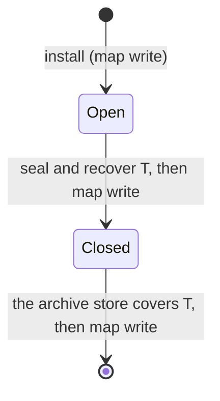
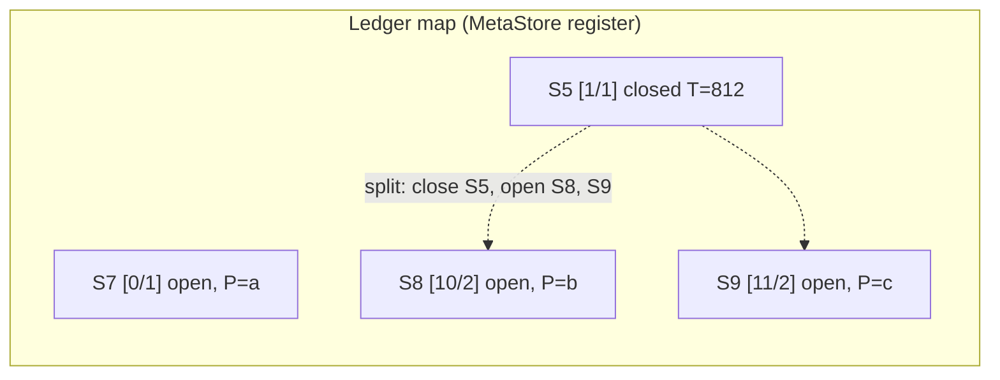
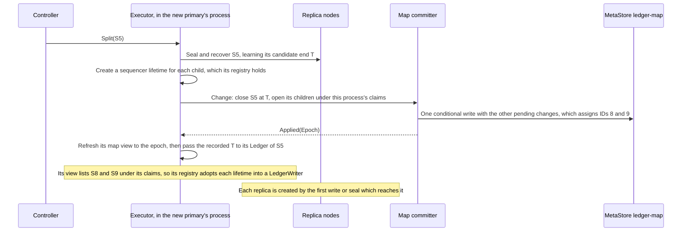

# Ledgers

## 1. Purpose and scope

Ledgers are the live ledgers: the replicated, totally ordered home of every recent row. A **ledger** is one log of
the [ledger protocol](ledger-protocol.md), appended to by one `LedgerWriter` (one sequencer lifetime, in its primary's
process) over a quorum of node replicas, owning one dyadic key range for its lifetime. The **ledger map**, one
[MetaStore](metastore.md) register, lists every live ledger. Ranges move between owners by recovering ledgers (sealing
their replicas and finding their last position) and writing the map once; no transition copies data.

The layer owns:

- the keyspace, dyadic ranges, and their containment and overlap rules;
- rows, row kinds, batches, tags, and the order of each key's rows;
- segments: runs of a ledger's slots which share a key dictionary, their key ordinals, and the per-key counter and
  opaque token each segment stores for its keys;
- the ledger map: its content, the commit rule of its changes, its committer, and the transitions which change
  it;
- ledger installation: identifier assignment, primary claims, and sequencers;
- the primary's ordered proposal path and open check, and readers' contiguous-tail reads;
- each node's replica lifecycle: creation by first use, reconciliation, and drops from the map.

[The Archive](archive.md) defines the history of a key, which combines the live ledgers and the archive store they drain
into (the [LSM](archive-lsm.md) or [archive logs](archive-logs.md)), and the coverage under which a closed ledger leaves
the map. [Journals](journals.md) owns admission: it decides what the primary proposes. Policy (when to split, merge,
roll, take over, or move a primary, and which nodes hold replicas) belongs to the composition's controllers
([Orleans](../compositions/orleans.md)), which choose each transition.

Code: `Orleans.Durable.Storage.Engine.Ledgers`, concrete classes which other layers use directly. Data-plane types use
namespace `Orleans.Durable.Storage.Engine.Ledgers` and control-plane types
`Orleans.Durable.Storage.Engine.Ledgers.Control` (§2). The ledger protocol's `Ledger` and `LedgerWriter` are in code
([ledger-protocol](ledger-protocol.md)), as are keys and ranges, rows, tags, the batch codec, the map, its view and
committer, the primary's proposals and open check, `LedgerReader`, through whose leases the process creates its writers,
`LedgerWriterRegistry`, transitions, and reconciliation, with segments, key ordinals, markers, slots at batch creation,
the per-key counter and token, `CLLB`'s layout of §7, `LedgerSegmentView`, `ScanAsync`'s rewind, and a reader's read
repair (row 5.1 of the [implementation
plan](https://github.com/ReubenBond/clog/blob/6ffb29aa96d2e4d48fc9c34f80790493e548af96/docs/implementation-plan.md)).
*Not yet in code*: the [composition](../compositions/orleans.md) which runs each node's reconciliation whenever its view
changes, and periodically.

### Design rationale

**A ledger owns a range for its lifetime.** Assigning keys to long-lived logs makes every ownership change a
copy between logs which already hold the data, guarded by epochs and in-band ownership records. A ledger which
owns a range for one sequencer lifetime moves that range by one recovery and one register write: the successor reads
its predecessors' rows where they are, so failover, handoff, splits, and merges move no data.

**Seal per ledger, holes tolerated.** Each ledger keeps the ledger replica's create-once registers; a recovery seals
its replicas and finds its end, and the map records it, as BookKeeper closes a ledger
([ledger-protocol, design rationale](ledger-protocol.md#design-rationale)).
A replica which missed a write leaves a hole which readers pass by reading another replica below the contiguous
tail, as BookKeeper readers do below the last add confirmed. Raft's log-matching rule prevents holes but makes
uncommitted entries overwritable and every replica a participant in elections; a ledger needs neither, because
its writer never changes.

**Odd `N`, majority `Q`.** A ledger's recovery uses only its own replicas, so it needs `max(Q, N − Q + 1)` of
them, and the ledger tolerates `min(N − Q, Q − 1)` failed replicas for both writes and recovery
([ledger-protocol §6.5](ledger-protocol.md#65-liveness)). `Q = (N + 1) / 2` over an odd `N`
gives the most, `(N − 1) / 2`, so the map records `N` and derives `Q` from it. Rejected alternatives:

- *Six replicas with `Q = 4` across three availability zones* (BtrLog §3.3). It keeps every acknowledged entry
  through the loss of a zone and one more node, but writes and takeovers still stall under that loss, and the LSM
  already bounds a ledger's exposure to its drain age, an hour by default ([LSM §8.8](archive-lsm.md#88-policy)).
- *Hierarchical forwarding* among replicas. It makes replicas protocol participants; the ledger replica keeps them
  passive ([ledger-replicas, design rationale](ledger-replicas.md#design-rationale)).

**Dyadic ranges.** Every range is a node of the binary trie over the key's bits, so two ranges nest or are
disjoint, containment and overlap are prefix comparisons, and the live ledgers and LSM partitions align. The costs
are sibling-only merges and uneven division over node counts which are not powers of two. Arbitrary ranges strictly
generalize dyadic ones, so relaxing the rule later invalidates no stored data.

**Bodies are inline.** Every row carries its body in its batch, so a body is bounded only by the batch which holds it,
and the batch by the replica's payload limit. A body is then copied once, into its batch, and travels, replicates,
recovers, and drains with the batch: no object outlives or precedes its row, nothing sweeps objects a delayed writer may
still be uploading, and no reader meets a reference whose object is gone. Large-row blobs, uploaded beside the batch and
named by a reference in the row, were rejected: they add an object lifecycle with its own sweeper and its races, a
second integrity check, and a read which can miss. A caller which bounds its own bodies, as Journals' admission does
([journals §8.1](journals.md#81-admission)), keeps its bound small enough that a batch of one row with a 65,535-byte
key, a 32-byte version base and token, and a maximal body fits the payload limit (`LedgerBatch.MaxRowLength`, §4), as
Journals' startup check does. The limits Ledgers owns:

| Limit | Default | Relation to a body |
| --- | --- | --- |
| Replica payload limit, a batch's bytes | 32 MiB in the Orleans composition | Bounds every batch, and so every body; the writer's batch refuses a row which would pass it (§2.4, [conventions §7](../conventions.md#7-payload-size)). |
| `MaxProposalBytes` | 64 MiB per ledger | Bounds the bytes of the batches a writer created and has not yet decided; at least the replica payload limit, which holds the largest batch its caller builds (§2.4, §8.7). |
| `MaxSegmentBytes` | 64 MiB | Holds at least two batches at the payload limit, and at least three rows with 16 MiB bodies; a segment passes it by at most its last batch (§8.2). |

**Proposal memory follows a byte budget.** The window `K` bounds how many batches a writer has in flight, but with
bodies inline a batch may be as large as the payload limit, so `K` alone would let a ledger hold `K` times that, 2 GiB
at `K = 64` and 32 MiB batches. The writer therefore also bounds the bytes of the batches it created and has not yet
decided by `MaxProposalBytes`, and waits before creating a batch which would pass it; `K` caps the count and the budget
caps the bytes, so small batches still fill the window while large ones take turns. The budget is per ledger, beside
its caller's own budget for entries not yet in a batch (Journals' `MaxQueuedBytes`), and the replica transport's per
node (§3). Bounding by a smaller `K` was rejected: it would throttle the small batches which make up most traffic to
protect against rare large ones.

**A read owns its bytes and lends its rows.** A read's `Data` answer owns the batch's verified bytes, which its caller
disposes, and lends a `BatchView` over them, as a WAL scan lends its records. The bytes have one owner, with one
`Dispose`, as each `ArcBuffer` lease has, and the view allocates nothing. The view and the rows it lends are
`ref struct`s, which keeps them off the heap and from crossing an `await`; a read through them after the owner releases
the bytes is a use after release, which Debug builds' poisoned pages expose ([BUF-I4](buffers.md#5-invariants)). A row
lends its body as a `ReadOnlySequence<byte>`, which its reader can neither release nor take, and `RetainBody()` and a
resolved row's `ToRow()` give owned copies which retain the body's pages without copying them. A view which owned the
bytes, with a `Dispose` of its own, was rejected: the bytes would have two owners, each able to release them under the
other. `Row` follows the same one-owner rule, holding its own lease on its body. A `LedgerSegmentView` is the one
exception which copies: it copies each key once into its key table, so a scan releases each batch's pages as it passes
it while later referencing rows still resolve, and a resolved row's `ToRow()` shares that table entry's array rather
than copying the key again, so a drain holds each key of a segment once.

**The reader holds the process's ledgers.** A process keeps one `Ledger` per ledger, so the known contiguous tail its
reads, seal checks, and writer learn is one value. `LedgerReader` reads every ledger the process touches, so it owns
them: it opens each from the map's entry, which is LG-I7's sender check, and leases it to each operation and to each
writer, which is created through a lease and holds one of its own, so a `Ledger` the map no longer lists is disposed
only once nothing uses it. A separate cache type was rejected as a second owner of the same lifecycle which the spec
would name only for this.

**A seal check says whether its process serves the writer.** A linearizable read of an open ledger needs a tail which
covers every proposal the primary answered `Durable`, and the process's one `Ledger`, which the writer shares, gives
that tail in the writer's process alone. `LedgerTail.ServedHere` makes the condition a value the caller checks rather
than a convention about where it runs: the Archive reports it as `ArchiveRead.Linearizable`, and Journals forwards a
read which is not. A read past a fresh `Ledger`'s tail of a ledger the map revokes answers `Dropped` rather than
refusing the slot: the caller learned a tail from the `Ledger` the reader released when its view revoked the ledger, so
the slot was decided, and the drop is the answer which sends it to the archive store.

**A proposal which met a seal is decided from the map.** Its batch may be on `Q` replicas, so only the recorded `T`
decides it ([ledger-protocol, design rationale](ledger-protocol.md#design-rationale)). While it has proposals the view
has not decided, the writer re-reads the map with bounded jittered backoff and follows its view, so a deposed primary
whose view missed the close learns `T` from its first read, and one whose seal preceded the close by a recovery learns
it once the close lands, whatever the composition's own map reads do. Reading the map once per seal was rejected: a
seal precedes the close by a recovery, so that read finds the ledger still open, and the proposal would wait on reads
the writer does not make. Once the view decides every proposal, the writer stops reading, so the register's load is a
read per backoff interval per deposed primary, only during a transition.

**The caller streams its rows into the batch.** A proposal's caller writes each row into a `LedgerBatch` its writer
creates, the row's fields and then its body's bytes, with a running CRC-32C and a check per row of its key against the
range and of the batch's length against the payload limit, so a row the batch refuses
writes nothing, no `Row` is built per row, and each body is copied once, into the batch. The caller declares the row
count when it creates the batch, since the header which carries it precedes the rows, so it plans the batch before
writing it (`RowLength`), and a row the batch then refuses is a failed precondition: that batch can never hold its
declared rows and is never proposed, so the writer is abandoned. Every call with a complete batch of the writer's own
takes the batch's bytes, whatever follows, so a caller never wonders whether a failed call left them. An exception while
the batch writes leaves its bytes and their CRC-32C out of step, so the batch is then unusable. Proposing a span of
rows, encoded once the proposal held its slot, was rejected: it built a `Row` per entry, copying its key, and held a
lease on each body while it waited. A semaphore over admitted proposals was rejected: its waiters may resume out of call
order, which would break the slot order batches take.

**Slots at batch creation.** A batch's start flag, segment offset, and ordinal base, and whether each of its rows
defines or references its key, depend on the batches before it, so `LedgerWriter` assigns a batch its slot when it
creates it, creates batches one at a time, and advances its segment's dictionary only for created batches. A created
batch is proposed, or the writer is abandoned, so every created batch is decided in slot order, or no later batch is
(LG-I12): a reference's defining batch is decided whenever the reference is. A caller therefore waits for the window
before it writes its batch rather than after, and a cancellation which withdraws anything withdraws a creation still
waiting. Withdrawing a created batch was rejected: a later decided batch could reference a key only the withdrawn batch
defined. Encoding a batch only once it holds its slot was rejected: the rows would wait as owned copies, a second copy
of every body on the proposal path.

**Segments bound the key dictionary.** A key's full bytes, version, and token appear once per segment, in its defining
row, and every later row of the key in the segment carries a varint ordinal: at small bodies the rows shrink by about
40%, and at 1 KiB bodies by 2% to 6%. A segment is also the unit in which consumers take a ledger's closed rows in bulk,
as the archive's drains do ([archive](archive.md)): its rows for each key are fixed once it closes, and a reader of any
of its slots rewinds at most one segment. Rejected alternatives:

- *A dictionary per batch.* At low load most batches hold one row, so a key rarely repeats within one.
- *A dictionary per ledger.* Its memory grows for the ledger's life, and every reader rewinds to slot 0.
- *A fixed-size key hash per row.* Still about 8 bytes per row, and a collision needs the full key from elsewhere.
- *zstd per batch.* It costs CPU on the proposal path, compresses small batches poorly, gives no reuse across batches,
  and keeps a body's pages from being lent without a copy ([conventions §1](../conventions.md#1-buffers-and-ownership)).

**Segment ends are durable.** Every process judges a segment closed by the same evidence, a decided batch with the start
flag after it or the ledger's `T`, so a reader elsewhere sees an idle segment close only when something durable says so.
A writer which ends a segment on an idle ledger therefore proposes an empty marker batch, the only batch with no rows.
Segment ends known only to the writer were rejected: no other process could see an idle segment close.

**Segment rules in procedural order.** `LedgerSegmentView` checks a batch's segment offset, then its ordinal base, then
each row in order, a defining row's `duplicate-key` before its `count-overflow`, so a batch which breaks two segment
rules has one reason, as the batch rules do (§7). A key-filtered view checks the rows of its key alone beside each
batch's offset and base, since checking every key's would need a whole key table, which the filter exists to avoid.
Once a segment ages, the next batch the writer creates starts the next segment; while no creation is waiting and no
created batch is unproposed, the writer owes the segment a marker, which it queues under its lock, so no caller's batch
comes between, and proposes itself. Drains rely on no segment outliving `MaxSegmentAge` by more than one batch's
build, and an aged segment takes one end. A marker the writer proposes itself which fails other than by the writer's
disposal is a defect, and is reported as one.

**Read-ahead bounded by bytes.** The transport's per-node budget counts a read's reply only until the reply arrives,
so a scan which holds `K` completed replies of large batches could hold `K` times the payload limit. A scan therefore
also stops issuing reads while the replies it holds and has not yet yielded pass 64 MiB, as `MaxProposalBytes` bounds
the writer's side, so it holds at most 64 MiB plus its reads in flight, each reserving the payload limit; a smaller
`K` for scans was rejected for the reason it was for proposals. The bound is an internal parameter, which tests lower;
a bound per process, shared by its scans, waits for a measurement which needs it.

**A resumed scan keeps its view.** A scan which resumes after `Backpressure` at the slot after its view's last
continues that view rather than rewinding, so a reader which meets backpressure often reads each segment once; the
history reader and the LSM's drain hold their views across retries through an internal overload, so a drain which
meets backpressure inside its segment resumes from the slot it reached, keeping the rows it read. The same overload takes
a window of reads in flight which scans run together share, a `SemaphoreSlim` of `K` places: a scan takes a place for
each read it issues, frees it once it has taken that read's answer or released it unread, and waits for one only while
it has none in flight, so the history reader's scans of a key's live ledgers keep `K` reads in flight in all
([archive §8.1](archive.md#81-history-reads)).
The view keeps one last successfully advanced slot, which supplies both its rows' tags and the next slot for a resume.

**`MaxSegmentBytes`.** Under the spec's workload of about 5.6 MB per ledger-hour ([Orleans
§8.1](../compositions/orleans.md#81-resource-and-request-cost-model)), `MaxSegmentAge` ends every segment long before
its size does, so the size matters only on hot ledgers. The choice between 64 and 256 MiB is analytic over a parametric
model (body sizes of 64 B to 4 KiB, row keys of 24 to 84 bytes, how long one activation's writes spread, hot keys at 10
and 100 writes a second, and ledger rates up to the split threshold) whose output is a histogram of key reuse distance
in ledger bytes, plus a live measurement of a drain's per-key request latency. A larger segment saves defining rows and
per-segment work for recurring keys, at four times a consumer's per-segment memory, the bytes a cold reader rewinds, and
the rows a lost defining batch takes with it. 64 MiB is the default until the model and the measurement favour 256 MiB.

**A per-key counter and an opaque token.** Each defining row stores two values its writer's caller supplies, the key's
version before the row and the key's token for the segment, and Ledgers advances the version's count by one per row of
the key, so every reader resolves the same versions from the batches alone. Ledgers interprets neither value; their
meaning belongs to the caller ([Journals](journals.md#81-admission)). `BeginRow` returns the version it assigns, so
Ledgers is the one authority on a row's version and its writer's dictionary the one authority on whether a key is
defined in a segment, and no callback runs from the writer into its caller.

**The writer checks the payload limit.** The replica's payload limit is its transport's, so the composition passes it
to `CreateWriter`, as it passes the register's value limit to the committer, and the replica contract stays free of
limits ([conventions §7](../conventions.md#7-payload-size)). The writer's batch checks each row against it as the row
begins, so no batch reaches a replica over the limit, where it would fail as a write repetition cannot change, which
would stop the lifetime. A caller which plans its batches (`RowLength`) and bounds its bodies so that one row always
fits meets no refusal.

**One register.** The map is small, changes only for transitions, drops, and floor raises, and is read through
caches. One
register makes every transition a single linearizable step which closes and opens ledgers together, so the open ranges
always partition the keyspace. Its size at large ledger counts is an [open
item](../deferred.md#ledger-map-size-and-sharding).

**Executors become primaries.** The process which executes a transition creates the sequencer lifetime of every ledger
the transition opens and is named as its primary. Installing a ledger therefore never names a sequencer which does not
yet exist, and a primary's process is the only one which holds its sequencer. A split's two children start on one
primary; a handoff then moves one of them.

**Lifetimes before IDs.** The change names each opened ledger's lifetime in its primary claim, and the write which
applies it assigns the ledger's ID, so the lifetime exists before the ledger has an ID, and with it a `Ledger` or a
writer. The executor creates the lifetime, its process's `LedgerWriterRegistry` holds it, and the registry adopts it
into the ledger's `LedgerWriter` once its view lists the ledger open under the lifetime's claim; the primary writes only
from then on (§8.1). A lifetime whose change can no longer apply never had a writer, and the registry stops it. Drawing
only the claim's `SequencerInstanceId` before the write, and the lifetime at adoption, was rejected: a pending claim
then has no lifetime to stop, and a `Sequencer` no longer draws its own ID ([LP-I15](ledger-protocol.md#5-invariants)).

**One call, one write.** A transition is one call on the node which becomes primary: it recovers the ledgers the
transition closes, creates the new ledgers' sequencer lifetimes, and submits one change of the map. Replicas are
created by the first write, recovery write, or seal which reaches them, from a sender whose map lists them (§8.5), so
nothing names a new ledger before the write which installs it, and that write assigns its ID. A change which loses
leaves behind only lifetimes, which its process stops once its map view shows the change can no longer apply, and
seals, which any later transition's recovery completes.

**Handoffs are takeovers the controller chooses.** A planned handoff, a roll, a split, and a merge all seal and recover
the ledgers they close, exactly as a takeover does. The old primary needs no protocol of its own: its next append meets
the seal, and it then helps, recovering the ledger from its own contiguous tail, so a recovery whose seal round begins
after the helper's seal completes starts at that tail (§8.2). A pause-and-drain handoff was rejected: it needs its own
timeout, an owner for resuming, and an answer for entries refused while paused, to save the few batches a seal answers
`Fenced`, which their senders resend.

**IDs assigned by the installing write.** The write assigns consecutive IDs from `NextLedgerId`, so IDs are
dense and transitions commit in any order. Two alternatives were rejected. A controller which assigned IDs before
the write would need to reserve them: with gaps allowed, a slower transition is superseded and redone whenever a
later one commits first, and the LSM must learn which IDs were never used; with gaps forbidden, every commit waits
behind every slower one with a lower ID. Creating replicas by first use removes the need to know an ID before
installation.

**Serialized map changes over conditional writes.** Every map change goes through the ledger-map committer, which
decides each change by its commit rule against the value it replaces. The composition runs one committer for the
register, so changes do not conflict and concurrent ones, such as a failed node's takeovers, share one write.
Safety stays in the conditional write: Orleans, for one, may briefly run two activations of one grain, and only a
clock could make one committer exclusive. Every invariant therefore holds for any number of committers, and
serialization is a performance and liveness choice. Two alternatives were rejected. Executors writing the map
directly and retrying on conflict make a failed node's takeovers race on one register, each loser re-reading and
rewriting the whole map. A lease which made one writer exclusive would put a clock on the safety path. The
executor takes its commit as an in-process delegate, so Ledgers names no transport: a composition passes the
committer's `CommitAsync` when it runs in the same process, or a delegate which makes its own call to the process
running the committer. The delegate never leaves the executor's process; only the change and its outcome cross.

**The map is the state of the world.** Every process reconciles from its map view: it serves a primary only while its
view names the primary's claim, and stops a sequencer lifetime once its view closes or removes the ledger, or shows
that the change which created the lifetime can no longer apply. Whether a transition applied is therefore decided by the
map, not by whether its reply arrived. Replies carry a verdict, with the deciding map's epoch for `Applied` and
`Superseded`; no process tears anything down because of one. A lost reply or a cancelled caller is survived by retrying:
the controller issues the transition again, and the committer answers from the map.

**Drops follow each key's lineage.** A ledger leaves the map only after every older ledger which overlaps its range has
left (LG-I10). This is a structural simplification: for each key, the map lists the newest stretch of its lineage, and
every older ledger is wholly in the archive store, so a key's history is a stored prefix followed by listed ledgers.
Read safety rests on the store's coverage of each dropped ledger ([HI-I2](archive.md#5-invariants)) either way, and
archive logs drain each key in this order ([archive logs, design rationale](archive-logs.md#design-rationale)). Dropping
in global ID order was rejected: one long-lived open ledger with a low ID would hold back every later drop until it
rolled.

**A retirement floor in the map.** A composition which releases a retired node's disk needs the node's absence from
every ledger to be permanent. Otherwise a controller activation which paused, or a transition chosen while the node
was active and issued again, could open a ledger naming the node after its disk is gone, and that ledger would start
one replica short of its loss budget. Only the map's own conditional write is ordered against every other map change.
Each install therefore carries the revision of the composition's node view it chose its nodes from, the map keeps a
retirement floor which the composition raises once a retirement applies, and the commit rule refuses an install
chosen below the floor (LG-I11). The floor is one 8-byte value however many nodes retire. Listing the retired nodes in
the map was rejected: the list grows for the cluster's life in a register whose value is size-limited, and a sharded
map would need a copy in every shard ([deferred](../deferred.md#ledger-map-size-and-sharding)). A check against the
executor's or the controller's view alone was rejected: such a view predates the retirement for as long as its process
pauses.

**One task reconciles a registry.** The registry's follower is the only path which reconciles: a view change, a
lifetime's stop, a `Hold`, and an executor's `ReconciledAsync` each mark the registry and wake it. Reconciling
inline from each of them was rejected: a stop's continuation reconciled under the stopping thread's suppressed flow,
reconciliations multiplied with stops, and an executor could not tell whether a reconciliation it did not run had seen
its epoch. A failure to create one ledger's writer is contained to that ledger, which is then `Unserved`, so the
follower never ends early and the registry's disposal always disposes every writer.

**A bounded drain before the executor's seal.** `StopAdmittingAsync` waits for the primary's own appends only for a few
write round trips. Those appends may be waiting out backpressure on replicas which only the executor's seal releases,
so an unbounded wait could deadlock the executor on itself; the seal decides whatever is still in flight, as it does
for any other primary.

**A retry answers from the claims.** Each execution of a transition creates fresh lifetimes, so a retry whose first
attempt applied finds its claims listed under the first attempt's lifetimes. The registry knows every lifetime it holds
or has pending, and only an executor in its process creates one, so the executor answers `Applied` when its view lists
every range the transition opens under a claim the registry knows. A token carried through the change was rejected:
the claims already identify the submitter.

**One install rule.** The map committer's rule, the executor's precondition, and the registry's decision of a pending
lifetime are one predicate, `LedgerMapValue.InstallRuleHolds`, so the three never disagree about whether a change can
still apply: a bootstrap is precluded exactly when a ledger is open, as the committer's rule says. A change which closes
an ID at or above `NextLedgerId` is a defect, `InstallClosesNeverInstalled`, which the committer classifies before the
rule, and the executor refuses with `ArgumentException` after reading the register.

**Primaries among their replicas.** A transition's executor is among the replicas of every ledger it opens, which
`TransitionChoice` checks. One of each write's `Q` fsyncs is then local, as the Orleans composition places primaries
([Orleans §5.4](../compositions/orleans.md#54-primaries-and-grain-placement)), and the primary's process is on a node
its map lists for the ledger. Allowing a primary off its replicas was rejected: no supported placement needs it, and it
would add a node to every write's round trip.

**A closing scope hides a ledger from `Unserved`.** An executor which closes a ledger this node is primary of stops its
writer first, which would list the ledger `Unserved` and invite a controller's `Replace` racing the executor's own
change. The executor's closing scope keeps it off the list while the executor runs; an executor interrupted before its
change applied ends the scope, and the ledger, still open and unserved, is listed as the spec requires.

**`Fenced` means no later `Durable`.** A writer completes `Fenced` once no proposal it admits later can be `Durable`:
every stop of its lifetime but its disposal's, and the map's decision. Tying it to seals alone left a writer whose write
failed for good unfenced while it could admit nothing durable.

**An unwritten slot answers, not throws.** A slot granted while the writer is being disposed is never written, and a
recovery ends the ledger at or below it, so its proposal is `Fenced` and its append `Unresolved(null)`, answered once
the earlier slots' resolutions end so answers keep slot order. Throwing `ObjectDisposedException` for it asserted
nothing the writer did not know.

**The registry re-reads for pending lifetimes.** A change whose commit outcome the executor never learned may have
applied, and no other reader of the register may run soon. While lifetimes are pending, the registry re-reads with the
writer's bounded jittered backoff, so their claims are decided without waiting for an unrelated change; a commit
failure under which the change never applies stops them at once.

**A bound on helper recoveries.** A node's failure stops many primaries' lifetimes at once, and each would start a
helper recovery. A process runs at most 32 at once; a helper is an aid, since the transition which closes the ledger
recovers it, so one beyond the bound is skipped rather than queued.

**Incremental reconciliation, with a sweep.** A view change can revoke only the ledgers which lost the node and the
replicas of ledgers installed since the last view, so `ReconcileAsync` judges those alone, and a periodic
`SweepAsync` judges every replica for strays which arrive late. Judging every replica on every change was rejected:
its cost grows with the node's replicas times the map's changes.

### Diagrams

## 2. Contract upward

Outcome taxonomy: [outcomes](../outcomes.md).

The contract has two planes. The **data plane**, in namespace `Orleans.Durable.Storage.Engine.Ledgers`, serves the
request path: keys, rows, and tags (§2.1, §2.2), the cached map (§2.3), the primaries this process holds (§2.4), and
readers (§2.5). The **control plane**, in namespace `Orleans.Durable.Storage.Engine.Ledgers.Control`, changes the map:
the transition executor and the map committer (§2.6), and node reconciliation (§8.5). The control plane uses the data
plane; no data-plane type references a control-plane type ([README §2.5](../README.md#25-dependency-rules)). Every type
is a concrete class with one implementation, which other layers and the composition use directly.

### 2.1 Keys and ranges

- A **key** is an opaque byte string of 1 to 65,535 bytes, ordered lexicographically by unsigned bytes. Bit `i` of a
  key is bit `7 − (i mod 8)` of byte `i / 8`; bits past the key's end are 0 for containment.
- A **range** `(prefix, depth)` with `0 ≤ depth ≤ 524,280`, the bits of the longest key, contains exactly the keys
  whose first `depth` bits equal `prefix`. `(0, 0)` is the whole keyspace. The children of `(p, d)` are `(2p, d + 1)`
  and `(2p + 1, d + 1)`; they are **siblings**, and `(p, d)` is their parent. A range at depth 524,280 has no
  children.
- Two ranges are disjoint or one contains the other, and the keys of each range form an interval of the key order. A
  list of ranges **partitions** the keyspace iff every key lies in exactly one of its members: none repeats, and its
  members are the leaves of one full binary trie rooted at `(0, 0)`.

The layer treats keys as uniformly spread for policy only: splits halve a range, and merges join siblings. The
journal layer prefixes a hash to spread its keys ([Journals](journals.md#41-keys)); nothing below relies
on the spread for safety.

### 2.2 Rows, batches, and tags

A **row** is one keyed change: `(key, kind, body)`. Its body is always inline, in its batch, so the replica's payload
limit bounds it; Ledgers interprets no body.

| Kind | Effect on the key's state |
| --- | --- |
| `Append` | Applies on top of the earlier rows. |
| `Replace` | Supersedes every earlier row; the row itself is the new state's base. |
| `Delete` | Supersedes every earlier row and leaves its body, when it has one, as the key's tombstone; an empty body leaves nothing. |
| `Message` | Unversioned ledger message addressed to a `MessageChannel` (`[a-z0-9._-]`, 1 to 64 ASCII bytes); carries no key, no version base, no row token, and no segment-dictionary ordinal, commits atomically in the batch slot, and is excluded from `Archive.Lsm`, `Archive.Logs`, and `ArchiveReader` journal folds (LG-I15). |

`RowKinds.IsDefined(RowKind)` admits all four ledger kinds (`Append`, `Replace`, `Delete`, `Message`);
`RowKinds.IsArchiveKind(RowKind)` admits only keyed archive kinds (`Append`, `Replace`, `Delete`), guarding
`ArchiveRow.Live` and every archive and journal fold.

**Ledger message channels (`MessageChannel`).** A **message channel** is a validated ASCII identifier (`[a-z0-9._-]`,
1 to 64 bytes) routing unversioned `RowKind.Message` rows to an `IMessageHandler` on the open ledger's primary and to an
`IMessageProcessor` during single-pass `DrainScan` segment draining. Because `RowKind.Message` rows carry only their
channel and body without a key, version base, row token, or segment ordinal, they consume zero `LedgerSegmentDictionary`
entries, zero `MaxSegmentKeys` budget, and zero RocksDB `key_index` or `tombstones` writes, and impose no range-depth
limit on ledger splits.

**Versions and tokens.** Each key carries two opaque values its writer's caller supplies, which Ledgers stores and
lends back without interpreting either; their meaning belongs to the caller:

- Its **version** `(base, count)`: a `RowToken` base of at most 32 opaque bytes and a `u64` count. Every row of the key,
  of any kind, keeps the base and adds one to the count, and a row's version is the key's version after it. The version
  before the key's defining row in a segment is stored in that row, and each later row's version in the segment is
  implied (LG-I13). `LedgerSegmentView` computes each row's version once, for every reader. A count at the `u64` maximum
  is a `BeginRow` precondition (§4), and a segment whose rows would advance a key's count past it breaks a segment rule
  (`count-overflow`, §7).
- Its **token**: a `RowToken` of at most 32 opaque bytes, one per key per segment, stored verbatim in the key's
  defining row and lent with each of the key's rows in the segment.

**Segments.** A **segment** is a run of consecutive slots of one ledger which shares a key dictionary. Its identity is
`(ledger, start slot)`.

- **Start.** A batch with the start flag begins a segment, and slot 0 always carries it. Every other batch carries its
  segment offset: the slots back to its segment's first slot.
- **Ending.** `LedgerWriter` ends the open segment (§8.2) once its batches pass `MaxSegmentBytes`, once it has defined
  `MaxSegmentKeys` keys, once its first batch with rows is older than the writer's segment age, `MaxSegmentAge` less up
  to a tenth drawn once per ledger, when its caller asks (`EndSegmentAsync`, §2.4), and at the ledger's close. A segment
  which holds only its marker never ends by age or size, so an idle ledger writes no further markers.
- **Closed, by evidence.** A segment is **closed** once a decided batch with the start flag follows it, or once its
  ledger is closed, when it ends at `T`. Every process sees closure alike, through the batches and the ledger map. A
  writer which ends a segment on an idle ledger proposes an empty **marker** batch: the start flag and no rows.
- **One ledger.** A segment never spans ledgers.

**Ordinals.** A key's first row in a segment **defines** it: the row carries the full key, the key's version before the
row, and its token for the segment, and takes the segment's next **ordinal**, the number of keys the segment defined
before it. Each later row of the key in the segment **references** it, carrying only its kind, the key's ordinal, and
its body. Each batch's header carries its **ordinal base**, the number of keys its segment defined before it, so a
defining row's ordinal is implied. A segment defines each key at most once, with ordinals 0, 1, …, and every reference
names a key defined earlier in its segment (LG-I12).

References are sound because a referencing row's defining row lies in the same segment at a slot at or below its own,
and batches are created and decided in slot order: every created batch is decided in slot order, or no later batch is
(LG-I12), and a ledger's decided slots form the prefix below its contiguous tail or `T`
([LP-I3, LP-I8](ledger-protocol.md#5-invariants)). So a reference's defining row is decided whenever the reference
is. Recovery copies decided batches verbatim and never creates or re-encodes one
([LP-I7](ledger-protocol.md#5-invariants)), which keeps this.

**Batches.** A **batch** is the rows one slot of a ledger holds, in proposal order: at least one, except a marker,
which holds none; every row's key lies in the ledger's range. A `Row` owns its own lease on its body. A `BatchView`
lends a decoded batch's rows as `BatchRow`s, which carry what the batch alone holds: a defining row's key, version
before, and token, and a referencing row's ordinal. A `LedgerSegmentView` lends **resolved rows** (`ResolvedRow`), each
with its key, kind, version, body, tag, and its key's token in the segment. Each lent row is valid only for the step
which lends it ([conventions §1](../conventions.md#1-buffers-and-ownership)).

A row's **tag** is `(LedgerId, Slot, Index)`: its ledger, its batch's position in that ledger, and its index
in the batch. Tags order lexicographically. For any key, the tag order of its decided rows is the order in which
they were accepted (LG-I6); **fold** applies a key's rows in tag order under the kind rules above, and a key's
**base** is its last `Replace` or `Delete` row.

### 2.3 Ledger map

Each process reads the map through its `LedgerMapView`, a cached, read-only view of the register.

| Member | Postconditions |
| --- | --- |
| `OpenAsync(register)` | Returns the view once its first read of the register has returned, so `Current` always holds a value the register held. |
| `Current` | The newest map this process has read, by epoch. It is durable, since it holds only values read from the register, and may be stale: a hint about currency only. A decision which a later map cannot invalidate may count it; every use which needs a current map confirms it through the ledger (§8.4). |
| `ReadAsync()` | A linearizable read of the register, begun after the call; updates `Current` when the value read is newer. Calls made while a read is in flight share the next read, which runs with no caller's token or execution context ([conventions §12](../conventions.md#12-shared-workers-and-execution-context)), so one caller's cancellation ends only its own wait. Each read disposes the entry it reads ([conventions §1](../conventions.md#1-buffers-and-ownership)). A value which fails to decode fails the read with its rejection (§7), and `Current` keeps its last value. |
| `RefreshAsync(epoch)` | Completes once `Current` has at least `epoch`, reading the register only while it is older; concurrent calls share reads. Replies which carry an epoch name the value to refresh to. A read begun after the call which finds an older epoch throws `ArgumentOutOfRangeException`: `epoch` names no value the register held, a caller defect, since epochs come from reads and from writes which landed. |
| `Find(key)` | In `Current`: the open ledger whose range contains `key`, and every closed ledger whose range contains it, in ID order, as a `LedgerLookup`; null before the keyspace is bootstrapped. |
| `FindOpen(key)` | In `Current`: the open ledger whose range contains `key`, as `Find`'s `Open`, without collecting the closed ones, so it allocates nothing; null before the keyspace is bootstrapped. |
| `WaitForChangeAsync(afterEpoch)` | Completes with `Current` once its epoch passes `afterEpoch`; it reads nothing. |

A map value lists every live ledger ([§4](#4-data-types)), its retirement floor ([§2.6](#26-transitions)),
`NextLedgerId`, the ID the next installed ledger takes, and an epoch which every write increments once. An absent
register reads as epoch 0, `NextLedgerId` 1, floor 0, and no ledgers. Only the map committer writes the register
([§2.6](#26-transitions)). Reads are linearizable and `Current` keeps the newest by epoch, so a process's view of the
map only advances.

### 2.4 Primary: `LedgerWriter`

The process named as an open ledger's primary holds its `LedgerWriter`
([ledger-protocol §2.3](ledger-protocol.md#23-ledgerwriter)), the only path which appends to the ledger. A process
**holds** a claim while the `LedgerWriter` whose sequencer lifetime the claim names runs in it.
`LedgerWriterRegistry(reader, maxBatchLength, options, timeProvider, loggerFactory)` serves the primaries of the
process of the node the process's `LedgerReader` names (`LocalNode`, §2.5), the one source of the process's node, from
the reader's map view, through which it leases each writer's `Ledger`, and follows the view's changes (§8.3); a reader
which names no node throws `ArgumentException`. `maxBatchLength` is the replica's payload limit and `options` the
cluster's `LedgerWriterOptions` (§4); a `MaxProposalBytes` below the payload limit, which could never hold a batch at
the limit, throws `ArgumentOutOfRangeException`. The reader and its replica transport outlive the registry. One task,
the registry's follower, reconciles: it wakes on each change of the view, each stop of a lifetime it holds, each `Hold`,
and each `ReconciledAsync`, and a reconciliation whose view and marks are unchanged does nothing. While lifetimes are
pending, it re-reads the register with bounded jittered backoff, so a change whose commit outcome its executor never
learned is still decided:

| Member | Outcomes |
| --- | --- |
| `TryGet(ledger)` | The primary, while the map view lists the ledger open under a claim this process holds and its lifetime runs. Per ledger it answers null until the registry adopts the ledger's one lifetime, then that writer, then null forever once the view lists the ledger closed or the lifetime stops: never a second writer (LP-I1), since the view only moves forward, a closed ledger never opens again, and a stopped lifetime never runs again. |
| `Unserved` | The open ledgers the map view lists with this node as primary under a claim this process does not hold, and which no executor in this process is closing: lifetimes which stopped (§8.2), and claims of an earlier process of the node. Each needs a `Replace`. `WaitForUnservedAsync(known)` completes with `Unserved` once it lists a ledger the set `known` does not. |
| `Hold(lifetime, closes, opens, chosenAt)` | Internal. Holds a sequencer lifetime an executor in this process created for a ledger its change opens, with the IDs of the ledgers the change closes (none for a bootstrap), the ranges it opens, and its `ChosenAt`, also after the executor returns. Once the map view lists a ledger open under the lifetime's claim, it creates the ledger's `LedgerWriter` over the lifetime through the reader's lease, and holds the writer until it leaves by the rule of §8.3; once the change's rule fails in the view (§2.6), or the view lists the claim already closed, it stops the lifetime with `Requested`. A writer which cannot be created stops its lifetime, is logged, and leaves its ledger `Unserved`; the reconciliation goes on. Each reconciliation reads the view under the registry's lock, so reconciliations apply the view's values in epoch order. |
| `BeginClosing(ledgers)` | Internal. For an executor in this process which closes `ledgers`: until the returned scope ends, they are not `Unserved`, so no controller replaces a ledger this process is closing. A scope which ends while the view still lists one open, as after an interrupted executor, leaves it `Unserved`. |
| `ReconciledAsync(epoch)` | Internal. Completes once a reconciliation which began after the call used a view at `epoch` or later, or the registry is disposed. |
| `Knows(claim)` | Internal. Whether the claim names this node and a lifetime the registry holds or has pending, which only an executor in this process creates. |
| `DisposeAsync()` | Stops every lifetime it holds and disposes every writer, which decides each proposal its view decides and fails each other with `ObjectDisposedException`. It awaits every writer's disposal whatever else fails, so no writer outlives it ([ledger-protocol §6.3](ledger-protocol.md#63-cancellation-and-disposal)). |

`LedgerWriter`, which the registry creates through its reader's lease of the ledger (§2.5,
`LedgerLease.CreateWriter(lifetime, map, host, timeProvider)`, internal) over the lifetime a transition's executor
created before the map write whose primary claim names it, the ledger's range from the lease's map entry, the
process's map view, and the `LedgerWriterHost` the registry lends every writer: the replica's payload limit, which the
composition takes from its replica transport, the writer options, the writers' log, and the bound on helper
recoveries (§8.2). Creation
throws `InvalidOperationException` unless the lease's entry claims the lifetime, so a writer exists only for a lifetime
its map lists. The writer holds a lease of its own until it is disposed. The `Ledger` adopts one lifetime, and stops it
at once when this process already recovered the ledger or found it sealed ([LP-I14](ledger-protocol.md#5-invariants)).

| Member | Outcomes |
| --- | --- |
| `CreateBatchAsync(rowCount, maxLength)` | Waits until the writer's previously created batch is proposed, the window has room, and `maxLength` fits `MaxProposalBytes` beside the batches created and not yet decided, then creates a `LedgerBatch` of `rowCount` rows at the writer's next slot, which it assigns now, with its segment state: the start flag, the segment offset, and the ordinal base (§8.2). `maxLength` is the most bytes the batch will hold, which the caller bounds by its rows (`MaxRowLength`, `MaxHeaderLength`): the creation reserves it from `MaxProposalBytes`, it chooses the batch's pages ([buffers §8](buffers.md#8-mechanism-and-policy)), the batch refuses a row which would pass it, and the reservation shrinks to the batch's length once it is proposed and ends once its proposal is decided. The caller disposes the batch. Batches are created one at a time, in slot order (LG-I12), and a created batch is proposed or the writer is abandoned: disposing one never proposed calls `Abandon`. Cancellation while the call waits withdraws it: it creates nothing and takes no slot. When the lifetime has stopped, which the call checks before each wait and which ends every wait, the batch takes no slot (its `Grant` and `Segment` are null), and its proposal completes `Fenced` at once. A batch whose creation took a slot keeps it: when the executor stops admitting during the creation, its proposal completes `Fenced` once the earlier proposals' appends have ended, and when the writer is disposed meanwhile, its proposal throws `ObjectDisposedException`, the slot ending the ledger at or below it either way; a creation which throws after it took its slot abandons the writer. A caller holds no lock of its own across the call, since the call may wait for the caller's own earlier proposals to be decided. The caller plans the batch (`RowLength`): a row the batch refuses as it is written is a failed precondition, after which the batch can never be proposed. A `rowCount` below 1 or above `MaxSegmentKeys`, or a `maxLength` below `MaxHeaderLength(rowCount)` or above the payload limit or `MaxProposalBytes`, throws `ArgumentOutOfRangeException` before the call waits, a call after disposal `ObjectDisposedException`, and one on a writer which only appends `InvalidOperationException`. |
| `ProposeAsync(batch)` | `Durable(Slot)`: the batch is the decided DATA at `Slot`, and every lower slot is decided. `Fenced`: the batch is not in the ledger and never will be; the ledger's recorded `T` is at or below its slot, or it took none. `Ambiguous`: the ledger left the map before the primary learned `T`; it asserts nothing about the batch ([outcomes §8](../outcomes.md#8-error-taxonomy)). A call with a complete batch this writer created takes the batch's bytes at once and appends them at the batch's slot, whatever follows, a cancellation or a disposal included: cancellation stops only the caller's wait, and the append is decided as usual. A batch is **proposed** once a call took its bytes, and is immutable from then on, which Debug builds assert. The caller disposes the `LedgerBatch`, which then holds nothing. A batch another writer created or with a declared row or body byte unwritten throws `ArgumentException`, keeping its bytes, so its caller may complete it and propose it again; one already proposed, disposed, or left unusable by a failed write throws `InvalidOperationException`, without appending; the batch refused each row outside the range, or which would take it past its `maxLength` or the replica's payload limit (§7), as its caller wrote it (§2.2). A call after disposal throws `ObjectDisposedException`; a proposal whose slot was granted during the disposal, so never written, completes `Fenced` once the earlier slots' resolutions end. |
| `EndSegmentAsync()` | Ends the open segment with a marker batch the call creates, in turn with its callers' creations, and proposes: the marker's `ProposalOutcome`. Once it is `Durable(Slot)`, the segment before the marker is closed and ends at `Slot`, so a caller which needs the open segment's rows complete now, as a failure-triggered drain does, takes them below `Slot`. Cancellation before the marker is created withdraws the call; after, it stops only the caller's wait. |
| `LedgerId`, `Range`, `Window`, `MaxBatchLength` | The writer's ledger, its range, its window `K`, and the replica's payload limit, which a caller such as Journals' admission plans its batches by. `Range` and `MaxBatchLength` throw `InvalidOperationException` for a writer which only appends. |
| `Abandon()` | For a caller which met a fault of its own and proposes nothing more, and at the disposal of a created batch never proposed: stops the lifetime with `Abandoned`, so the writer is `Fenced` and failure handling recovers and replaces the ledger (§8.6). Nothing created after the abandoned batch is decided. Idempotent. |
| `ConfirmOpenAsync()` | Confirms the ledger is open: when the primary holds an active, unsurrendered quorum read lease (`now + δ < localLeaseUntil`, [LP-I18](ledger-protocol.md#5-invariants)), answers `Open(ContiguousTail)` locally in 0 RTT without contacting replicas; otherwise checks the seal on `Q` replicas after the call began ([LP-I9](ledger-protocol.md#5-invariants)): `Open(ContiguousTail)` when none answered sealed, with the primary's contiguous tail, which covers every proposal it reported `Durable`; or `Sealed`, after which the primary proposes nothing more, permanently surrenders its lease, and re-reads the map until its view lists the ledger closed or no longer lists it (§8.2); or `Backpressure`, when backpressure kept the seal check from deciding, which asserts nothing ([outcomes §8](../outcomes.md#8-error-taxonomy)). Concurrent fallback checks share one quorum round trip: a call made while a check is in flight shares the next one, which runs with no caller's token or execution context, so a caller's cancellation ends only its own wait. A check which no quorum answers fails as `Ledger.ReadTailAsync` does. A call after disposal throws `ObjectDisposedException`; a check already in flight still answers. |
| `InstanceId` | The `SequencerInstanceId` of the writer's lifetime, which the ledger's primary claim names ([LP-I15](ledger-protocol.md#5-invariants)). |
| `ProposedBytes` | The bytes of every batch this writer proposed at a slot, a marker included, by its length, whatever the proposal's outcome; a proposal which took no slot counts nothing. It only grows, for the writer's lifetime, so its rate over a window is the ledger's load, which the Orleans composition's node reports for the controller's splits and merges ([orleans §5.6](../compositions/orleans.md#56-controllers)). |
| `ObserveUndrained(watermark)`, `ForgetDrainedBelow(watermark)` | `ObserveUndrained` answers what the writer proposed in its segments which start at or above `watermark`, the ledger's drain watermark as its caller knows it: a `LedgerUndrained` of those batches' bytes, by `ProposedBytes`' rule, and the age of the oldest of them with rows, or none, changing nothing. The writer keeps each segment it ended, its start, the bytes proposed before it, and when its first batch with rows was created, until `ForgetDrainedBelow` passes it, which the composition's node calls after each drain ([orleans §5.9](../compositions/orleans.md#59-resource-governance)), so the writer holds an entry per segment no drain has passed. A forgotten segment stays forgotten. A `watermark` above the open segment's start, which no drain passes, throws `ArgumentOutOfRangeException`. |
| `segmentEnded`, the registry's sink | Each segment a writer ends, as a `LedgerSegmentKeys` with the keys it defined, given once to the optional `Action<LedgerSegmentKeys>` the composition passes to `LedgerWriterRegistry`: when the writer creates the batch which starts the next segment, and the open segment's when the writer stops, so a writer the registry drops loses no count. One which defined no key, a marker's alone, is not given. The sink is called under the writer's lock, so it only records; null on a composition which needs no counts, as on the LSM. The key counts are the writer's in-process record, not part of the format: the Orleans composition's node counts the keys of the segments it owes a drain from them ([orleans §5.6](../compositions/orleans.md#56-controllers)). |
| `StopAdmittingAsync()` | Internal. For an executor in this process which closes the ledger (§8.1): every batch created after the call takes no slot, and every proposal after the call completes `Fenced` without being written, since it is not in the ledger and never will be (a slot its batch took and nobody wrote ends the ledger at or below it); once every earlier proposal's append has ended, whether or not its caller still waits, or `StopAdmittingDrainLimit` (100 ms, a few write round trips) has passed, it stops the lifetime with `Sealing`, so the executor's recovery starts at the primary's contiguous tail and its seal decides the appends still in flight. The primary's own writes may wait out backpressure which only that seal ends, so the wait is bounded. Irrevocable and idempotent: the caller then seals the ledger, and a caller which exits before the seal, or cancels the wait, leaves the lifetime stopped and the ledger `Unserved`. |
| `Fenced` | Completes once the writer will make no later proposal `Durable`: its lifetime stopped other than by its disposal (a write met a seal, a write or completion failed, an executor in this process stopped admitting, or an open check or a recovery in this process found or sealed the ledger), or its map view lists the ledger closed or no longer lists it, also at the writer's disposal. |
| `DisposeAsync()` | Disposes the append path ([ledger-protocol §2.3](ledger-protocol.md#23-ledgerwriter)), stopping the lifetime, and decides each proposal which needs the map from its view as it stands: from `T` when it lists the ledger `Closed(T)`, and `Ambiguous` when it no longer lists it, one decision which every such proposal shares. Only while the view lists the ledger open, or does not yet list it, does such a proposal fail with `ObjectDisposedException`, which asserts nothing. It then ends the writer's lease (§2.5). `LedgerWriterRegistry` disposes a writer only once its view has decided every proposal (§8.3). The writer is disposed once: every call completes once that one disposal has ended, the open segment given (§2.4), so a caller which races the registry's disposal awaits it too; only the first call surfaces its failure. |

Batches take slots in the order of their creation, one at a time, since the sequencer grants acquisitions in request
order ([ledger-protocol §2.6](ledger-protocol.md#26-sequencers)), and each created batch is proposed or the writer is
abandoned, so a primary's batches are decided in slot order, or none after an abandoned one is (LG-I12). Proposals
complete in slot order; one whose batch took no slot, since the lifetime had stopped, completes `Fenced` at once. After
the first `Fenced` or `Ambiguous` outcome, every proposal called later also completes `Fenced` or `Ambiguous` (LG-I5).
A creation also waits while the batches the writer created and has not yet decided, with the new batch's `maxLength`,
would pass `MaxProposalBytes`, so `K` caps the batches in flight and `MaxProposalBytes` their bytes; creations take the
budget in call order. Cancelling a creation still waiting withdraws it: no batch is created and no slot taken. Once a
batch is created, cancellation only stops the caller waiting; the append continues and is decided as usual.

### 2.5 Reads: `LedgerReader`

Any process reads any live ledger, below a contiguous tail or the map's recorded `T` (LG-I8). `LedgerReader(map,
transport, timeProvider, localNode)` reads through the process's map view, which it exposes as `Map`, and its replica
transport. `localNode`, which every caller states, is the process's own node, or null for a process without one, such
as a client: it names each `Ledger`'s preferred replica, which its reads below the known contiguous tail ask first
([ledger-protocol §8.4](ledger-protocol.md#84-policy)) and whose missing or corrupt batch they repair with one whose
CRC-32C matches (§7), the batch verifier the reader gives each quorum, and the node whose primaries the process's writer
registry serves (§2.4). A process has one reader,
which its `LedgerWriterRegistry` and its history reader share, so the process has one `Ledger` of each ledger. Each
member takes the ledger as a map value the caller read lists it (`LedgerMetadata`).

| Member | Outcomes |
| --- | --- |
| `ReadAsync(ledger, slot)` | Reads a decided slot: below a closed ledger's `T`, or below an open ledger's known contiguous tail in this process, which its seal checks (`ReadTailAsync`) raise, so a caller reads the tail first. Any other slot throws `ArgumentOutOfRangeException`, as `ScanAsync` does: at or above `T` a deposed writer's batch may lie. `Data`, `Dropped`, or `Backpressure`. `Data` is the first batch a replica reports ([LP-I10](ledger-protocol.md#5-invariants)); it owns the batch's verified bytes, an `ArcBuffer` its caller disposes, and lends a `BatchView` over them (§4). `Dropped` when a replica reports the ledger dropped, once the reader re-read the map; and for a slot past the known contiguous tail of a ledger which the map, re-read, revokes, since the reader released the `Ledger` whose tail the caller learned and leased a fresh one, whose tail is 0. `Backpressure` when backpressure kept the read from deciding ([ledger-protocol §6.4](ledger-protocol.md#64-failures)), which asserts nothing. A batch which breaks a rule of its format (§7) throws its `InvalidDataException`, as corruption. A point read decodes its batch alone, so a referencing row names its key by ordinal: a caller which knows the key's defining slot and ordinal, as a key index does, reads the defining batch and finds the ordinal's defining row there (`BatchView.FindDefining`), which answers `unknown-ordinal` when that batch defines no such ordinal (§7), and filters the row's batch by the ordinal. |
| `ReadTailAsync(ledger)` | A `LedgerTailRead`: the `LedgerTail` `(ContiguousTail, IsSealed, ServedHere)` from either the primary's 0-RTT quorum read lease (when `ServedHere`, unsealed, unsurrendered, and `now + δ < localLeaseUntil`, [LP-I18](ledger-protocol.md#5-invariants)) or a seal check of `Q` replicas begun after the call ([LP-I9](ledger-protocol.md#5-invariants), coalesced in singleflight), with the process's known contiguous tail afterwards; when it finds the ledger sealed, the reader has re-read the map. `ServedHere` is true when the process's `Ledger` held the writer which serves the ledger's proposals before the check began: then, in the process which serves the ledger's writer, the tail covers every proposal that writer answered `Durable`, since each completed its slot first, which raised the known contiguous tail past it (LG-I8). Or `Backpressure`, when backpressure kept the check from deciding, which asserts nothing. For a closed ledger, `(T, true)` from the map without I/O. |
| `ScanAsync(ledger, from, below, key)` | The decided batches with `from ≤ slot < below`, in slot order, each lending its rows as the scan's `LedgerSegmentView` resolved them (`LedgerScanItem`), and a last `Dropped` when a replica reports the ledger dropped, or a last `Backpressure`, after which the caller resumes from that slot. The scan first reads the batch at `from` and rewinds by its segment offset to its segment's start, then reads forward from there, advancing its `LedgerSegmentView` over every batch, so it resolves each row from `from` on, and yields each batch at or above `from` as its `Data` with the view advanced past it, which lends that batch's resolved rows until the scan's next step. With a `key`, which is optional, the view resolves that key's rows alone, in constant memory. It keeps up to `K` reads in flight, and the bytes it reads ahead are bounded too: the replica transport's per-node budget reserves each remote read's reply while it is in flight (§3), and the scan issues no read while the replies it holds and has not yet yielded pass 64 MiB, so it holds at most 64 MiB beside its reads in flight. It stops at the first answer which is not `Data`, releasing the batches it read ahead. Each item's `Data` is its caller's, who disposes it; the scan owns its `LedgerSegmentView` and disposes it when the enumeration ends. `below` is at most the ledger's known contiguous tail in this process: a contiguous tail the caller learned through this reader, or the recorded `T`. A `below` under `from` throws `ArgumentOutOfRangeException` at the call, and one above that tail when the scan is enumerated, unless the map, re-read, revokes the ledger, which answers `Dropped` as `ReadAsync` does. A batch which breaks a rule of its format or of its segment (§7) throws its `InvalidDataException`, as corruption. |
| `LearnTailAsync(ledger)` | The ledger's known contiguous tail in this process after it learns one from the replica on its own node, without a seal check ([ledger-protocol §8.2](ledger-protocol.md#82-known-contiguous-tail)), which a scan may read below: a closed ledger's `T` from its entry without I/O; for an open one, the tail that replica retained, or the known one when the process has no replica of the ledger or the replica's answer teaches nothing. A node's apply loop learns an open ledger's tail with it (§8.5). |

**One `Ledger` per ledger per process.** The reader owns the process's `Ledger` of each ledger it reads, which it opens
from the map's `LedgerMetadata` over exactly the replicas the map lists (LG-I7), with `K` and `Q` from the entry
([ledger-protocol §2.5](ledger-protocol.md#25-building-a-ledgers-ledger-and-ledgerwriter)), and passes a closed ledger's
recorded `T` to it (`ObserveRecordedTail`), from the entry the caller passes or once its view lists the ledger closed.
Each operation leases the `Ledger`, and so does each writer: the process creates a ledger's writer through a lease
(`LedgerLease.CreateWriter`, an internal handout to `LedgerWriterRegistry` and `TransitionExecutor`), and the writer
holds a lease of its own until it is disposed, so the writer's known contiguous tail is the reader's. A lookup takes no
lock: each `Ledger`'s leases are counted with interlocked operations. Once the reader's view no longer lists the ledger,
the reader releases it, and its last lease disposes the `Ledger` with the replicas it owns; a lease of a ledger the view
no longer lists keeps its `Ledger` for that lease alone. Disposing the reader stops the reads of every `Ledger` it
holds, leased or not, and its map re-reads: each read, seal check, and recovery fails with `ObjectDisposedException`
once the replica calls it awaits end under the `Ledger`'s cancelled lifetime, though its caller's token stands, while a
write its lease admitted goes on until the `Ledger`'s disposal cancels its replica calls ([ledger-protocol
§6.3](ledger-protocol.md#63-cancellation-and-disposal)). It then releases every `Ledger`, refuses later operations with
`ObjectDisposedException`, and completes once every lease has ended and every `Ledger` is disposed: each `Ledger`'s
disposal cancels every replica call it has in flight, so the reader's disposal waits only for replica calls a
cancellation ends, which a transport ends at once ([ledger-replicas
§2.2](ledger-replicas.md#22-iledgerreplicatransport)), never for a transport's timeout or for a lease
which a caller holds across a slow replica under a token of its own. Two demands on its
callers bound it. Every served writer is disposed before the reader, which asserts it, since stopping the reads would
end the writer's open check and the recovery it helps. And a caller ends its lease, a scan's among them, once a read
fails or its own work stops: a lease held past that is the caller's defect, and holds the disposal. The drain worker and
the archive reader scan with `await foreach` over bodies which await nothing but their own token, so a failed read ends
the scan and its lease. A read past the known contiguous tail whose map re-read the disposal cancels answers
`ObjectDisposedException`, since no map read begun after the call says whether the map revoked the ledger. An opening
which fails disposes the replicas it already opened.

A live ledger's **decided end** is the map's `T` once it is closed, and, while it is open, a contiguous tail its
reader learned or the tail its primary's open check confirmed: every slot below it is decided (LG-I8). A reader other
than an open ledger's primary sees the ledger only below a contiguous tail, as BookKeeper's
non-fencing readers read to the last add confirmed. A linearizable read of an open ledger's recent rows runs in the
process which serves its writer: there a seal check begun after the call, through `ConfirmOpenAsync` or the reader's
`ReadTailAsync`, which share the `Ledger`, returns a contiguous tail which covers every proposal the writer answered
`Durable`, and reports it (`ServedHere`).

### 2.6 Transitions

A **transition** closes open ledgers and opens new ones in one change of the map. A controller chooses it as a
`Transition` ([§4](#4-data-types)), which names the node whose process executes it and becomes the primary of every
ledger it opens, the replicas and `K` of those ledgers, and `ChosenAt`, the revision of the composition's node view it
chose those nodes from (§3). The executor is among those replicas (`TransitionChoice` checks it), so one of each
write's `Q` fsyncs is local and the primary's process is a node its map lists for the ledger. A transition closes only
open ledgers, the leaves of the ledgers' lineage. The executor
recovers each ledger the transition closes through the process's `Ledger` of it (`RecoverAsync`,
[ledger-protocol §2.1](ledger-protocol.md#21-ledger)), first stopping admission at the ledger's `LedgerWriter` when this
process holds it, which seals it and returns its candidate end, and the change closes the ledger there: the write
records that candidate end as its `T`.

| Transition | Preconditions in the map | Change |
| --- | --- | --- |
| `Bootstrap` | No ledger open | Open one ledger over `(0, 0)` |
| `Replace(S)` | `S` open | Close `S` at `T`; open a successor over `S`'s range. A takeover, after a failure; a planned handoff, which moves the primary to the executing node; or a roll, which changes replicas, `N`, or `K`, or ends a long-lived ledger so it can drain and drop (§8.7). All run alike: the old primary, if it still runs, meets the seal at its next append and helps (§8.2) |
| `Split(S)` | `S` open, depth below the key length in bits | Close `S` at `T`; open its two children |
| `Merge(S₁, S₂)` | `S₁`, `S₂` open siblings | Close both at their recovered tails; open the parent |

A **drop** is a map change but not a transition: once the archive store covers a closed ledger below `T`, the
composition submits `LedgerMapChange.Drop(S)` (§3), and each replica node then drops its replica once its view revokes
it (§8.5). Drops follow each key's lineage: a ledger leaves the map only after every listed ledger with a lower ID whose
range overlaps it (LG-I10).

A **floor raise** is a map change but not a transition either: once the composition retires a node at revision `r` of
its node view, it submits `LedgerMapChange.RaiseFloor(r)`. No later write opens a ledger chosen below the map's
retirement floor (LG-I11), and a view at `r` or later lists the node ineligible (§3), so once a map's floor is at
least `r`, no later write opens a ledger naming the node. The composition's retirement gate rests on this
([OR-I4](../compositions/orleans.md#51-invariants)).

A recovery's seal is final, so a transition interrupted after its recoveries completes when the controller issues
it again; until then the sealed ledgers stay open in the map, and their former primary admits nothing more
(§8.2).

**Serving follows the map.** Each process reconciles from its map view (§8.3). It serves every open ledger its view
lists under a claim it holds, and passes the recorded `T` to its `Ledger` of each closed ledger it recovered. A lifetime
whose claim the view lists follows its ledger's entry (§8.3). A lifetime whose claim the view does not list stops once
nothing of the change which created it can still apply: the change was never submitted, was refused, or failed so that
it never applies, or the change's rule fails in the view (`LedgerMapValue.InstallRuleHolds`): a ledger the change closes
is no longer listed open, a listed open ledger it does not close overlaps a range it opens (for a bootstrap, any open
ledger), or the view's retirement floor exceeds the change's `ChosenAt` (LG-I11). The map committer's rule, the
executor's precondition, and the registry's decision are that one predicate. The executor hands each lifetime it creates
to `LedgerWriterRegistry` (`Hold`, §2.4), so the process decides it from its view after `ExecuteAsync` returns. A lost
reply is survived by retrying: the controller sends the same transition again, and the executor answers `Applied` when
its view lists every range the transition opens under a claim of a lifetime it created for that same transition (the
same case, ledgers closed, and choice), which its registry still holds or has pending, since only that transition's
change names such a claim. A claim of this process created for another transition shows nothing of this one: a
primary's own roll, whose range the view lists under the primary's claim of an earlier change, or a roll another roll
by the same primary superseded, is `Superseded`.

**Executor.** `TransitionExecutor(registry, logger)` runs in every process which can become a primary, over the
process's `LedgerWriterRegistry`, whose reader and map view it uses. It recovers the ledgers a transition closes,
creates a sequencer lifetime for each ledger it opens, which the registry holds, and submits the change once through
`commit`, an in-process delegate its caller creates, which reaches the map committer (§8.1). Only the
`LedgerMapChange` and its `LedgerMapCommitOutcome` cross to another process, as data.

| Member | Outcomes |
| --- | --- |
| `ExecuteAsync(transition, commit)` | The outcome `commit` returned, once the process's registry has reconciled with a view at its epoch: `Applied(Epoch)`, and the process serves the ledgers its view lists under its claims; `Superseded(Epoch)`, and it has stopped the lifetimes it created; or `Refused` or `Rejected(Reason)`, and it has stopped them. `Superseded` at the view's epoch, without a submission, when its refreshed view shows the change can no longer apply (§8.1), or a replica answers a recovery dropped. `Applied` at the view's epoch, in place of `Superseded`, when the view lists every range the transition opens under a claim of a lifetime the executor created for the same transition, which the registry still knows (`Knows`): an earlier submission of the transition by this process applied it, as when a retry follows a lost reply. An exception when a recovery fails, before any change is submitted, or when `commit` throws. `ArgumentException` when another node executes the transition, it closes a ledger the map never installed, or its ledgers cannot take it: a split at the deepest range, or a merge of ledgers whose ranges are not siblings. |

| `commit` result | Executor |
| --- | --- |
| `Applied(Epoch)` or `Superseded(Epoch)` | Refreshes its map view to `Epoch` and waits for its registry to reconcile from it (§8.3). A `Superseded` whose view lists every range it opens under a claim of a lifetime created for the same transition, which the registry knows, answers `Applied`. |
| `Refused` | Stops the lifetimes it created: nothing of the change is pending. The executor never submits the change again; a retry is a new transition. |
| `Rejected(Reason)` | A defect: the committer rejected the submission, which applied nothing and is carried by no write. Stops the lifetimes it created and reports the defect (below). |
| `OverflowException`, `InvalidDataException`, or an `InvalidOperationException` other than `ObjectDisposedException` | The committer wrote nothing, and the change never applies: it would advance `NextLedgerId` past 2^64 − 1, the register holds no ledger map, or the committer found a defect before writing. Stops the lifetimes it created and rethrows. |
| Another exception, thrown synchronously or not | The outcome is unknown, and the change may still apply. Rethrows; the lifetimes stay until the map view decides them, which the registry re-reads while they are pending. |

Cancellation before `commit` is called stops the lifetimes and leaves the sealed ledgers open in the map; after
it, cancellation stops the caller waiting, and the map view decides the lifetimes.

**Map committer.** `LedgerMapCommitter` writes the register, and every map change goes through it. The
composition runs one for the register ([Orleans §5.6](../compositions/orleans.md#56-controllers)), and constructs it
with the register and the register's value limit: the largest value its provider stores, which the composition knows
from the provider it builds, since the MetaStore contract carries no storage limit
([conventions §5](../conventions.md#5-providers), [metastore §8](metastore.md#8-mechanism-and-policy)).

| Member | Outcomes |
| --- | --- |
| `CommitAsync(change)` | `Applied(Epoch)`: the map at `Epoch`, a value written or read after the change was submitted, holds the change's goal. `Superseded(Epoch)`: the change's goal is absent from that value and its commit rule fails against it; no attempt of it applies from then on. `Refused`: the change would make the map exceed the register's value limit, in a value no write the committer dispatched can still replace; it was not applied, and submitting it again may apply it. An exception when the MetaStore stays unavailable, or when a write whose outcome is unknown was written for the change's batch and the register's next read shows neither the change's goal nor, for a change that write did not carry, its permanently failed rule: the outcome is unknown, and submitting the same change again decides it. A change the held write carried is answered only `Applied`, or fails with the write's exception, and a failed read after the unknown outcome fails the batch with the write's exception; a read, after an unknown outcome or a mismatch, which finds a value which is not a ledger map fails each change a write of the batch carried with an unknown outcome (`GroupCommitOutcomeUnknownException`) whose inner exception is the `InvalidDataException`. `Rejected(Reason)` for a defect (below), in a value no write the committer dispatched can still replace: nothing applied, no write carries the submission, and a later submission is decided afresh. `OverflowException` for an install which would advance `NextLedgerId` past 264 − 1, for that change alone; `InvalidDataException`, the rejection itself, when the register holds a value which is not a ledger map (§7) and no write of the batch carried the change; `InvalidOperationException` when a value the committer would write breaks an invariant or does not decode as itself, or when its rules fail, a committer defect, for a change no write of the batch carried, nothing written for it; a change a dispatched write carried fails with an unknown outcome around the defect instead. Cancelling ends only the caller's wait: the change stays in its batch and may apply. `DisposeAsync` closes admission, answers queued changes with `ObjectDisposedException`, cancels the write in flight, whose changes' outcome stays undecided and which are answered `ObjectDisposedException`, and completes once every admitted change has its answer. |

A **change** (`LedgerMapChange`) installs ledgers, `Install(Closes, Opens, ChosenAt)`, drops one closed ledger,
`Drop(S)`, or raises the retirement floor, `RaiseFloor(r)`. An install closes ledgers, each at a candidate end its
executor's recovery returned, and opens ledgers, each with a range, replicas, `K`, and a primary claim but no ID, and
carries its transition's `ChosenAt`. Its **commit rule**, against the value it is applied to:

- every ledger it closes is listed open;
- every listed open ledger whose range overlaps a range it opens is one it closes, so a bootstrap applies only to
  a map which lists no open ledger;
- its `ChosenAt` is at least the value's retirement floor;
- the ledger it drops is listed closed, and no listed ledger with a lower ID overlaps its range;
- a floor raise's rule always holds.

Applying it closes the ledgers it closes, each at the `T` the change carries; removes the ledger it drops; raises
the floor to `r` when `r` is greater; and lists the ledgers it opens `Open`, in order, under consecutive IDs from
`NextLedgerId`, which it advances. Its **goal**: the map lists a ledger under any claim it opens, which is unique
because every claim names a fresh sequencer lifetime ([LP-I15](ledger-protocol.md#5-invariants)); for a drop,
`S < NextLedgerId` and the map no longer lists `S`; for a floor raise, the floor is at least `r`. A change applies
whole, so while the ledgers it opened are listed, one claim listed means all are.

**Permanence.** A closed ledger never reopens, a dropped one never returns, the retirement floor only grows,
`NextLedgerId` only advances, and the open ranges always partition the keyspace. A change is derived from a map its
submitter read, or whose write it saw land, and in which its rule held (§3), and the register only advances past that
map, so once a rule fails against a value at or after that map, it fails against every later value, and a `Superseded`
change never applies later. A drop's or a floor raise's goal, once present, stays present. An install's goal turns
absent only once every ledger it opened has left the map; a later decision then reads `Superseded` although an attempt
applied, which misleads no process, since the map lists none of the change's claims.

**Defects.** Every value a committer writes keeps LG-I1 to LG-I3 and LG-I9 to LG-I11, which it checks before each write
against the value it replaces and the changes its fold applied: the open ranges partition the keyspace; the IDs it
assigns are exactly the opens', each listed open unless a later change of the batch closed or dropped it; a ledger which
leaves the map was closed before or in the batch; a listed ledger changes only by closing; and each applied install's
`ChosenAt` is at least the floor of the value it applied to. A value which breaks one is a committer defect, which
writes nothing and fails every change of the batch with `InvalidOperationException`, except a change an earlier write of
the batch carried, which fails with an unknown outcome around the defect. A change which no map could take fails its
construction with `ArgumentException`: an install which opens nothing, closes one ledger twice, or opens overlapping
ranges, and an opening whose replicas are not `N` distinct nodes with `N` odd. A change whose result would leave the
open ranges not partitioning the keyspace (LG-I1) is a defect, `OpensLeaveGap`; its rule decides the overlaps of LG-I2,
and the write assigns the IDs of LG-I3. So is an install which closes a ledger at or above `NextLedgerId`,
`InstallClosesNeverInstalled`: no map its submitter could have read lists that ledger. So is a drop whose goal is
absent and whose rule fails: a submitter derives each
drop from a map no newer than the register, whose closes, drops, and `NextLedgerId` only advance, so a drop valid in
that map is valid or already applied in the register. The committer answers that change alone `Rejected`, with the rule
it breaks as its `LedgerMapRejection`, once no write it dispatched can still land (**Refusal and rejection fence**). An
install chosen below the floor is a stale choice, made in good faith by a controller whose view predates a retirement,
and reads `Superseded`. A floor raise leaves the value's size unchanged, so it is never `Refused`.

A defect is loud. A submitter which receives `Rejected`, the executor once it has stopped its lifetimes and the
controller for its own drops, fails a debug assertion (`Debug.Fail`) naming the reason, logs it as an error, and never
submits the change or issues its transition again. Deterministic simulation fails every run in which a correct
submitter receives `Rejected`.

**Group commit.** The committer batches concurrent submissions and merges identical ones. It decides a batch by folding
it in submission order over the value it last read or wrote: each change whose goal is absent and whose rule holds
against the result of the changes before it applies to that result, unless the result would then exceed the register's
value limit, and then the change is `Refused`. One conditional write replaces the value with the result and increments
the epoch once, and the committer answers every change of the batch from the value that write produced, once it lands.
It answers a change only from a value read or written after the change was submitted: a batch which applies nothing
against an older value re-reads the register and decides again. A mismatch re-reads the register and decides the whole
batch again against the value read. A write whose outcome is unknown ends its batch with one read ([conventions
§6](../conventions.md#6-retries-and-idempotency)): the committer re-reads the register, answers `Applied` each change
whose goal the value read shows, answers each change the held write did not carry whose permanently failed rule the
value read shows, and fails every other change of the batch with the write's exception, its outcome unknown; the held
write lands at most once, only over the value it was decided against ([MS-I3](metastore.md#5-invariants)). A change
the held write carried is answered only `Applied`, or fails: its rule held against the fold's result, which may differ
from the value read, so the held write may still apply it. Under §3's precondition this costs at most a resubmission;
it is the defence for when the precondition is broken, as by a drop submitted beside the drop of an earlier ledger in
its lineage. A failed read fails the batch with the write's exception, and the next batch begins with a read. A
mismatch asserts only that the write can no longer land: after a backend-SDK retry an earlier
attempt of it may have applied ([metastore §2.2](metastore.md#22-iconditionalregister)), so the committer tests every
change against the value it reads before answering it. One write is in flight at a time; the next batch accumulates
while it is. An applied write returns the register's new version ([metastore
§2.2](metastore.md#22-iconditionalregister)), which the committer's next write names, so the committer re-reads the
register only after a mismatch, an unknown outcome, or a batch which applies nothing against a
value from before its submissions. A value is from after a submission only when the read or write which produced it was
dispatched after the change was submitted; a write in flight when a change arrives produces a value from before it.
Before each write the committer checks the value against the one it replaces (**Defects**); a batch folded over a
value which lags the register may close or drop a ledger it opened, which breaks no invariant, since that write
mismatches and the batch is decided again. The batches run one at a time, with no caller's token or execution context
([conventions §12](../conventions.md#12-shared-workers-and-execution-context)), and every entry read is disposed
([conventions §1](../conventions.md#1-buffers-and-ownership)). The committer names no composition: the composition
chooses where it runs and how submissions reach it.

**Refusal and rejection fence.** A refusal, unlike a failed rule, is not permanent: a drop shrinks the map, and a drop
carried by a write whose outcome is unknown may still land and make room. Neither is a defect's rule: a held write may
carry the same drop after the close, or the drop of an earlier ledger in its lineage, which makes it valid. That write
can land only while the register holds the version it was conditioned on, so while the committer's value carries that
version, the committer answers no change `Refused` or `Rejected` from it: the batch whose write's outcome is unknown
decides its fold's refusals and defects afresh against the value read, failing them with the write's exception while
that value may still be replaced, and a later batch which would answer one first fences
the register, writing the value it holds again, with the epoch incremented, over that version. Once the fence applies,
no held write can land, and the batch is decided from the fenced value; a mismatch re-reads and decides the batch
again; and an unknown outcome ends the batch as any write's does. Defects come only from broken submitters (§3), so the
fence costs nothing on the correct path.

The fence covers only the writes its own committer dispatched. With two committers at once, as under a duplicated
activation, a change one answers `Refused` or `Rejected` may still land through the other's held write. For an install,
its executor has then stopped the lifetimes it created, so the claims the install lists are held by no process: its
ledgers are `Unserved` (§2.4), and a controller replaces them through failure handling (§8.6).

## 3. Requirements downward

**Ledger protocol** ([ledger-protocol](ledger-protocol.md)): one `Ledger` per ledger per process, over the ledger's
replicas with window `K` and quorum decisions with `Q = (N + 1) / 2`, derived from the entry's `N`
([LP-I4](ledger-protocol.md#5-invariants)), and in the primary's process its `LedgerWriter`, which creates and owns the
ledger's sequencer lifetime ([LP-I15](ledger-protocol.md#5-invariants)); in-order completion; `RecoverAsync` seals the
ledger and returns a candidate end `T`, every slot below which holds decided DATA and no slot at or above which
completes ([LP-I8](ledger-protocol.md#5-invariants)); the seal check ([LP-I9](ledger-protocol.md#5-invariants));
`ObserveRecordedTail` learns the map's `T`; the known contiguous tail carried with every operation
([LP-I11](ledger-protocol.md#5-invariants)).

**Ledger replicas** ([ledger-replicas](ledger-replicas.md)): durable seals ([LR-I8](ledger-replicas.md#5-invariants));
node replicas in each node's [LedgerStore](ledgerstore.md), opened by `(node,
LedgerId)` through `ILedgerReplicaTransport`, locally or through the composition's replica transport ([orleans
§5.12](../compositions/orleans.md#512-replica-transport)), and listed and dropped through the caller's own node's
`ILedgerStore` ([ledger-replicas §2.3](ledger-replicas.md#23-iledgerstore)); creation by a replica's first write,
recovery write, or seal unless its node dropped the ledger, and drops which leave a ledger sealed and dropped on its
node for the node's life ([LR-I7, LR-I3](ledger-replicas.md#5-invariants)); and a transport which bounds the bytes
outstanding to each node, request payloads and reply bytes, holds a replica call waiting for budget in that node's FIFO
queue until a deadline, a budget of its own which no call whose completion depends on a replica call shares, and fails
it with `LedgerReplicaQueueTimeoutException`, which had no effect, only then
([ledger-replicas §2.2](ledger-replicas.md#22-iledgerreplicatransport)), so a batch at the payload limit is delayed
behind smaller ones but never starved or refused for lack of budget.

**MetaStore** ([metastore](metastore.md)): the `ledger-map` register, with linearizable reads and conditional
writes whose unknown outcomes take effect at most once ([MS-I1](metastore.md#5-invariants),
[MS-I3](metastore.md#5-invariants)), so each node's view of the map only advances.

**Node resolution**: the composition resolves a node identity to the process serving it and refuses a wiped node at
the same address ([OR-I14](../compositions/orleans.md#51-invariants)).

**Callers**:

- Only the primary's process proposes, through the `LedgerWriter` which `LedgerWriterRegistry` returns, and it
  proposes a batch only after every row in it passed its admission check
  ([Journals](journals.md#81-admission)).
- Each row's caller supplies the key's version before the row and its token for the segment, neither of which Ledgers
  interprets, and never passes a version whose count is at the `u64` maximum (§4).
- Every write of the `ledger-map` register goes through the map committer.
- Each change is derived from a map value read from the register, or written by a write which landed, in which its
  rule holds: an install from the value its controller chose its transition from, closing ledgers that value lists
  open; a drop from a value which lists its ledger closed and no lower-ID ledger overlapping it (LG-I10); and a floor
  raise, whose rule always holds. The register only advances past that value, so a rule which fails against a later
  value stays failed (§2.6), on which the committer's answers after an unknown outcome rest
  ([conventions §6](../conventions.md#6-retries-and-idempotency)).
- A `Drop(S)` is submitted only with the archive store's evidence of coverage ([HI-I2](archive.md#5-invariants)), as
  [archive §2.3](archive.md#23-coverage-and-drops) defines it for each store. Drops follow each key's lineage (LG-I10).
- An install's `ChosenAt` is the revision of the composition's node view from which its replicas and primary were
  chosen, and it names only nodes eligible in that view; a node retired at revision `r` is ineligible in every view at
  `r` or later. The composition raises the floor to `r` only once that retirement applies.
- A decision which rests on a retired node's absence from every ledger is taken only from a map value read from the
  register, or written by a write which landed, whose floor covers the node's retirement and which names the node in
  no ledger (LG-I11), as the Orleans retirement gate is ([OR-I4](../compositions/orleans.md#51-invariants)).
- A transition's replicas are registered nodes eligible in its node view, of which at least `Q`, the executor among
  them, are live; the rest may be nodes already unavailable, as a replica which fails after its ledger opens is.
  Choosing them and the node which executes it is policy.

## 4. Data types

| Type | Definition |
| --- | --- |
| `LedgerId` | A `ulong` which the map write installing the ledger assigns from `NextLedgerId`; 0 is never assigned. Unique within a cluster for its life (LG-I3). Its code type is in `Orleans.Durable.Storage.Engine.Ledgers.Abstractions`, since the ledger replica addresses replicas by it ([identity §3](../identity.md#3-ledger-identity)). |
| `KeyRange` | `(Prefix, Depth)`, `0 ≤ Depth ≤ 524,280`: `Depth` bits, stored in `⌈Depth / 8⌉` bytes with the unused low bits 0, which construction requires; the default is the whole keyspace and equals the constructed `(0, 0)`. `Containing(key, depth)`, the range at `depth` which contains `key`; `Contains(key)`, `Contains(range)`, `Overlaps(range)`, `Children`, `Parent`, `Sibling`; `IsPartition(ranges)`, whether a list of ranges partitions the keyspace (§2.1). Equality is by value, and `GetContainingHashCode(key, depth)` is the hash code of `Containing(key, depth)`, computed without constructing it, so a lookup by range finds a key's range at a depth without allocating; the hash covers the depth and the prefix's first 8 bytes, which spread well over keys led by a hash, as journal keys are ([Journals](journals.md#41-keys)). `IsPartition` and `GetContainingHashCode` are internal to the layer, whose map and committer call them. Its text form is the prefix's bits, `/`, and the depth: `10/2`, and `/0` for the whole keyspace. Construction throws `ArgumentOutOfRangeException` for a depth outside 0 to 524,280 and `ArgumentException` for a prefix of the wrong length or with a bit set past the depth; `Containing`, `Contains(key)`, and `GetContainingHashCode` throw `ArgumentException` for a key of 0 or more than 65,535 bytes; `Children` throws `InvalidOperationException` at depth 524,280, and `Parent` and `Sibling` on the whole keyspace. |
| `RowKind` | `Append = 0`, `Replace = 1`, `Delete = 2`, `Message = 3` (§2.2). `RowKinds.IsDefined` accepts all four kinds (`0..3`); `RowKinds.IsArchiveKind` accepts keyed archive kinds (`0..2`). |
| `MessageChannel` | Validated immutable ASCII `[a-z0-9._-]` channel identifier (`MaxLength = 64`, 1 to 64 bytes), implementing `IEquatable<MessageChannel>` and `IComparable<MessageChannel>` (§2.2). |
| `RowToken` | A readonly struct of at most 32 opaque bytes, held inline without allocation: a key's token for a segment, or a version's base (§2.2). Equality is by bytes, and the default is the empty token. Construction throws `ArgumentException` for more than 32 bytes. Ledgers stores and lends it verbatim and never interprets it. |
| `RowVersion` | `(Base: RowToken, Count: ulong)`, a readonly record struct: a key's version (§2.2), equal by base and count. `Next()` keeps the base and adds one to the count, and throws `OverflowException` at the `u64` maximum ([conventions §8](../conventions.md#8-checked-arithmetic)). |
| `Row` | `(Key: ReadOnlyMemory<byte>, Kind, Body: ArcBuffer)`, which owns a copy of its key and its own lease on its body, possibly empty, which its disposal releases; construction retains that lease, and the caller keeps and disposes its own. Construction throws `ArgumentException` for a key of 0 or more than 65,535 bytes or an undefined kind, and `InvalidOperationException` for a released body. A row's version, token, and ordinal are not part of a `Row`: they live on `BatchRow` and `ResolvedRow`. |
| `BatchRow` | A `ref struct`: one row of a `BatchView`, valid only for the step which lends it, holding what its batch alone records: its `Index`, `Kind`, `IsDefining`, and `Ordinal`, stored on a referencing row and implied on a defining one (the batch's ordinal base plus the defining rows before it); on a defining row, its `Key`, as contiguous bytes (a view of the batch's page, or of a scratch array the enumerator reuses when the key spans pages), its `VersionBefore`, and its `Token`, whose accessors throw `InvalidOperationException` on a referencing row; and its body, as `BodyLength` and `Body`, a `ReadOnlySequence<byte>` lent over the batch's buffer, which its reader can neither release nor take. `RetainBody()` returns an owned `ArcBuffer` of the body, which retains its pages without copying them, outlives the batch's buffer, and is the default buffer for an empty body; `Body` allocates a segment per page for a body which spans pages, and nothing otherwise. |
| `ResolvedRow` | A `ref struct`: one row a `LedgerSegmentView` lends, valid only for the step which lends it: its `Tag`; its `Key`, from the view's key table; its `Kind`; whether it `IsDefining`; its `Version`, after the row (LG-I13); its `Token`, its key's token in the segment; and its body, as on `BatchRow`, with `RetainBody()`. `ToRow()` makes an owned `Row`, which shares the key table entry's array, never written after the view copies it, and retains the body. |
| `LedgerSegmentId` | `(Ledger: LedgerId, Start: Slot)`, a readonly record struct: a segment's identity, its ledger and its first slot (§2.2). |
| `LedgerSegmentKeys` | `(Segment: LedgerSegmentId, KeyCount: int)`, a readonly record struct: a segment, with the keys it defined, at least 1, from its writer (§2.4) or an archive drain's scan. |
| `Tag` | `(LedgerId, Slot, Index: int)`: the slot of the row's batch ([identity §5](../identity.md#5-addresses)) and the row's index in the batch, from 0; construction throws `ArgumentException` for a default `LedgerId` and `ArgumentOutOfRangeException` for a negative index; ordered lexicographically. |
| `LedgerBatch` | A batch being written for one proposal of the `LedgerWriter` which created it (§2.4), at the slot and with the segment state its creation assigned: `Slot`, `Segment` (its `LedgerSegmentId`, null for a batch which took no slot), `IsSegmentStart`, `LedgerSegmentOffset`, and `OrdinalBase`. `RowVersion BeginRow(ReadOnlySpan<byte> key, RowKind kind, RowVersion versionBefore, RowToken token, int bodyLength, ReadOnlySpan<byte> bodyHead)`, cited elsewhere as `BeginRow(key, kind, versionBefore, token, bodyLength, bodyHead)`, writes a row's fields and the body's first bytes, `bodyHead`, and declares its body's length, and `WriteBody` writes the body's bytes, in any chunks, into one owned `ArcBuffer` with a running CRC-32C, so each body is copied once and no `Row` is built ([conventions §1](../conventions.md#1-buffers-and-ownership)); `AddRow` does both, and a short row is one `BeginRow`. `BeginRow` always takes the key's version before the row and its token for the segment, and stores them only when the row defines its key in the segment, which the writer's dictionary decides. It returns the `RowVersion` the row receives, from the writer's dictionary: for a defining row, the caller's `versionBefore.Next()`, and for a referencing row, the version the dictionary holds for the key, `.Next()`, where a Debug assertion checks that the caller's `versionBefore` equals the held version. The caller adopts the returned version, so Ledgers is the one authority on a row's version (LG-I13). A `BeginRow` which throws leaves the writer's dictionary unchanged. `DeclaredRowCount` is declared at creation, since the header precedes the rows; `RowsBegun` is the rows begun and `Length` the batch's length once complete. `RowLength(key, versionBefore, token, bodyLength)` is the bytes the row would add to this batch, as a defining or a referencing row as the writer's dictionary says, and `HeaderLength` the batch's bytes with no rows, so a caller plans its batch. Before creating one, a caller bounds it with the static `MaxRowLength(keyLength, baseLength, tokenLength, bodyLength)`, a row's length as a defining row, which bounds it either way, and `MaxHeaderLength(rowCount)`; a caller which bounds its bodies checks a batch of one row with a 65,535-byte key, a 32-byte version base and token, and a maximal body against the payload limit and `MaxProposalBytes` at startup. `BeginRow` throws `ArgumentException`, writing nothing, for an empty or overlong key, a key outside the writer's range, an undefined kind, a version whose count is at the `u64` maximum, a head longer than the body, or a row which would take the batch past its `maxLength` or the replica's payload limit (§7); a body byte past its declared length, a row begun before the last body is complete or past `DeclaredRowCount`, or a write after the batch was proposed or disposed throws `InvalidOperationException`. A write which fails leaves the batch unusable: every later write and proposal throws `InvalidOperationException`. A batch borrows its thread's CRC-32C and returns it once proposed or disposed. Disposal releases what no proposal took, and disposing a batch which holds a slot and was never proposed abandons its writer (§2.4). An internal constructor takes a segment state (the start flag, offset, ordinal base, and a dictionary) in place of a writer, so the layer's tests and vectors encode batches and segments without one; it is `CLLB`'s one encoder. |
| `BatchView` | A `ref struct` view of a decoded batch over a borrowed buffer: its `IsSegmentStart`, `LedgerSegmentOffset`, `OrdinalBase`, and row count, and its rows, in order, as `BatchRow`s; a marker has none. A read's `Data` owns the verified bytes and lends the view over them (§2.5). `FindDefining(ordinal)` returns the batch's defining row of that ordinal, or the `InvalidDataException` with reason `unknown-ordinal` when the batch defines none, for a point read through a key index (§2.5). `Decode(buffer, out view)` verifies the whole batch alone by §7's batch rules and returns null with the `BatchView`, or the `InvalidDataException` naming the first rule the bytes break, its reason in `Data["orleans.durable.storage.decode.reason"]` ([conventions §15](../conventions.md#15-outcomes-unions-and-errors)). `Decode` allocates nothing once its thread has decoded or encoded a batch, which allocates the thread's CRC-32C; enumerating allocates only a scratch array per enumerator, reused across its rows, for a key which spans pages. `Decode` is internal to the layer, whose readers call it. |
| `LedgerSegmentView` | A class: the decoder of one ledger's segments, whose ID it is constructed with (`LedgerSegmentView(ledger)`) and which tags the rows it resolves, taking the batches in slot order from a slot at which a segment starts, by §7's segment rules. `Advance(slot, view)` checks a decoded batch against its predecessors and returns null, or the `InvalidDataException` naming the segment rule it breaks; a batch with the start flag begins a new segment, resetting the ordinals and the key table, and any other batch must take the slot after the view's last, which a skipped or repeated slot breaks with `ArgumentException`, as a caller's defect. `Rows` then lends the batch's `ResolvedRow`s, each version computed once (LG-I13). The view owns a key table which copies each defined key once, with its ordinal, its defining row's version and token, and the key's count of rows so far; it keeps counts and positions, never bodies, so its caller releases each batch's pages once the view advances past it. A key-filtered view (`LedgerSegmentView(ledger, key)`) records that key's ordinal and version alone, and the positions of that key's rows in the batch, in constant memory, lends that key's rows alone, and checks the rules of rows for that key alone, beside each batch's segment offset and ordinal base. A whole view's table is sized by the segment's contents: every key it holds was defined in bytes the view decoded, so it allocates in proportion to the bytes read and needs no configured bound; the writer's `MaxSegmentKeys` keeps the segments it writes small (§8.2). `Dispose` releases the table. |
| `LedgerScanItem` | One batch of a scan (§2.5): its `LedgerRead`, which its caller disposes, and, for a `Data`, its `Rows`, the batch's rows as the scan's `LedgerSegmentView`, advanced past it, resolved them, which are valid until the scan's next step: once the scan advances, or its enumeration ends, `Rows` throws `InvalidOperationException`. The scan owns the view and disposes it when the enumeration ends; an internal overload takes a view its caller holds, which the scan advances and does not dispose, so a caller which resumes a scan at the slot after the view's last, as the history reader does after `Backpressure`, rewinds no further. |
| `LedgerWriterOptions` | `(MaxSegmentBytes, MaxSegmentKeys, MaxSegmentAge, MaxProposalBytes)`, a record: when a writer ends segments, and the bytes its batches created and not yet decided may hold (§8.7). Readers depend on none of them, so they may differ between processes and change between a ledger's writers. `MaxSegmentAge` is the longest a segment stays open; each writer ends its segments at an age drawn once between nine tenths of it and it (§8.2). Construction throws `ArgumentOutOfRangeException` for a value which is not positive, or a `MaxSegmentAge` above 30 days, which keeps the age within its timer's range. |
| `LedgerStatus` | A union: `LedgerStatus.Open`, or `LedgerStatus.Closed(T)` with `T` the recovered tail: a candidate end of a recovery of the ledger which completed its seal coverage, which the map's conditional write recorded (LG-I9). |
| `ProposalOutcome` | A proposal's outcome (§2.4): `Durable(Slot)`, `Fenced`, or `Ambiguous`, each case a readonly record struct nested in it. A non-boxing union written by hand, since every proposal returns one ([conventions §15](../conventions.md#15-outcomes-unions-and-errors)): its case and one slot, with equality by case and slot. |
| `OpenCheckOutcome` | The primary's open check (§2.4): `Open(ContiguousTail)`, `Sealed`, or the replica contract's shared `ReplicaWriteOutcome.Backpressure`, a union declaration. |
| `LedgerRead` | A reader's read of one slot (§2.5): `Data(Slot, Batch, Count)`, which owns the batch's verified bytes and lends its `BatchView` (`View`) until its caller disposes it; or the replica contract's shared `ReplicaWriteOutcome.Dropped` and `ReplicaWriteOutcome.Backpressure`. A non-boxing union written by hand, since every read and scanned slot returns one, with no equality, since `Data` owns its bytes. |
| `LedgerTail`, `LedgerTailRead` | A seal check's tail `(ContiguousTail, IsSealed)`, and its answer, the tail or `Backpressure`, which a reader's tail read returns ([ledger-protocol §4](ledger-protocol.md#4-data-types)). |
| `PrimaryClaim` | `(Node: NodeId, Sequencer: SequencerInstanceId)`, a record struct: the node whose process holds the ledger's sequencer lifetime, and that lifetime. Construction throws `ArgumentException` for a default node or sequencer. |
| `LedgerMetadata` | `(Id, Range, Location: LedgerLocation, K, Primary: PrimaryClaim, Status)`, a record struct, with `K` at least 1; `Location`, `K`, and on nodes the replicas, are fixed for the ledger's life. `Replicas` is its location's replica nodes, in the map's order, none in the object store, and `IsOnNode(node)` answers whether one of them is `node`, false for every node when the ledger is in the object store. A second constructor takes the replicas of a ledger on nodes; the default is `N = 3`. Equality compares the locations, whose replicas compare element by element; construction throws `ArgumentException` for a default ID, location, primary claim, or status. |
| `LedgerLocation` | Where a ledger's storage is, a union ([conventions §15](../conventions.md#15-outcomes-unions-and-errors)): `Nodes(Replicas: NodeId[N])`, `N` distinct nodes with `N` odd and at most 255, which owns the replicas' validation, the quorum `Q = (N + 1) / 2`, derived and not stored, and element-wise equality, and whose ledger the [ledger protocol](ledger-protocol.md) stores through `LedgerQuorum`; or `ObjectStore`, one copy in the cluster's object store, through `ObjectLedgerStorage` ([object-store ledgers](object-ledgers.md)). `CLLM` (§7) encodes `ObjectStore` as a replica count of 0. |
| `LedgerMapValue` | `(Epoch, NextLedgerId, RetirementFloor, Ledgers: LedgerMetadata[])`, an immutable class, ledgers in ascending ID order below `NextLedgerId`. Every write increments `Epoch` once; `NextLedgerId` is the ID the next installed ledger takes; `RetirementFloor`, a `ulong`, is the greatest revision a `RaiseFloor` carried (LG-I11). An absent register reads as `(0, 1, 0, [])`. `Get(id)` returns the ledger listed under `id`, or null; `Find(key)` returns a `LedgerLookup`, and `FindOpen(key)` its open ledger alone, each null while no ledger is open; `OlderOverlapping(id)` the listed ledger with the lowest ID below `id` whose range overlaps it, whose drop must come first (LG-I10), or null, which the value computes for every listed ledger on its first call and keeps, so a node's drains of many ledgers scan a value once. It carries no MetaStore version: the committer keeps the version with the value it last read or wrote, and nothing on the data plane uses one. Its codec, `CLLM` (§7), is internal to the layer. |
| `LedgerLookup` | `(Open: LedgerMetadata, Closed: LedgerMetadata[])`, a record struct: the open ledger whose range contains a key, and every closed ledger whose range contains it, in ID order. |
| `Transition` | Control plane. A union: `Bootstrap`, `Replace(S)`, `Split(S)`, or `Merge(S₁, S₂)`, each with its `TransitionChoice`: `(Executor, Location: LedgerLocation, K, ChosenAt, Epoch)`, the executing node, the location (`Nodes(Replicas)` or `ObjectStore`) and `K` of every ledger it opens (a split's two children share them), `ChosenAt`, and the epoch of the map its controller chose it from. Construction throws `ArgumentException` for a default ledger ID, a merge of one ledger with itself, a default executor or, for `Nodes`, one not among the replicas, or replicas which are not `N` distinct nodes with `N` odd, and `ArgumentOutOfRangeException` for `K` below 1. |
| `LedgerMapChange` | Control plane. `Install(Closes: (LedgerId, T)[], Opens: (Range, Location, K, Primary)[], ChosenAt)`, each `T` a candidate end of the executor's recovery; `Drop(LedgerId)`; or `RaiseFloor(ulong)`. Opened ledgers carry no ID: the write assigns it. |
| `LedgerMapCommitOutcome` | Control plane. `Applied(Epoch)`, `Superseded(Epoch)`, `Refused`, or `Rejected(Reason)`: the verdict, with the epoch of the map which decided it for `Applied` and `Superseded`, and the rule the change breaks for `Rejected`. |
| `LedgerMapRejection` | Control plane. The defect rule a rejected change breaks, one member per rule of §2.6, as `DropNotClosed`, `DropNeverInstalled`, `DropBlockedByLineage`, `InstallClosesNeverInstalled`, and `OpensLeaveGap`. |

## 5. Invariants

| ID | Invariant |
| --- | --- |
| LG-I1 | The open ledgers' ranges partition the keyspace. |
| LG-I2 | A map write which opens a ledger closes, in the same write, every open ledger whose range overlaps it, each at its recovered tail. |
| LG-I3 | Ledger IDs are assigned consecutively from 1 in installation order and never reused. |
| LG-I4 | A closed ledger's decided rows are exactly its DATA below `T`. |
| LG-I5 | Only the open ledger's primary proposes; its proposals which took slots complete in slot order, and one which took none completes `Fenced` at once; after the first `Fenced` or `Ambiguous` outcome, no proposal of the ledger called later completes `Durable`. |
| LG-I6 | For every key, its ledgers in ID order are its successive owners, and the tag order of its decided rows is their acceptance order. |
| LG-I7 | A write, recovery write, or seal of a ledger reaches a node only from a sender whose map lists the ledger with the node. A node drops a ledger only once its map view revokes it: the ledger's ID is below the view's `NextLedgerId` and the view does not list it with the node. The drop leaves the ledger sealed and dropped on the node for its life ([LR-I3](ledger-replicas.md#5-invariants)). An object-store ledger's writes and seals reach only the cluster's object store, from a sender whose map lists the ledger there, and only `ObjectLedgerSweeper` reclaims its storage, once its view revokes the ledger, leaving it sealed and dropped for the store's life ([OL-I4, OL-I8, OL-I9](object-ledgers.md#5-invariants)). |
| LG-I8 | A reader other than an open ledger's primary reads it only below a contiguous tail; a closed ledger is read below the map's `T`; a linearizable read of an open ledger runs in the process which serves its writer, where either an active, unsurrendered quorum read lease ([LP-I18](ledger-protocol.md#5-invariants), LG-I14) or a seal check of `Q` replicas begun after the read returns a tail which covers every proposal that writer answered `Durable`, and reports that it was served there. A sealed or dropped answer makes the reader re-read the map. The fallback seal check is the ledger storage's check ([LL-I5](ledger-protocol.md#5-invariants)), a check of `Q` replicas for a quorum ledger and of the `sealed` marker for an object-store ledger. |
| LG-I9 | `Closed(T)` records only a candidate end of a recovery of that ledger which completed its seal coverage, and a ledger leaves the map only once closed. |
| LG-I10 | A ledger leaves the map only after every ledger with a lower ID whose range overlaps it has left: for every key, the map lists a suffix of the ledgers which have held it. |
| LG-I11 | The map's retirement floor only grows, and no install whose `ChosenAt` is below the floor of the value it is applied to applies. |
| LG-I12 | Batches are created one at a time and take slots in creation order. Each created batch is decided in slot order, or no later batch is decided. A segment lies within one ledger, closes by a later flagged batch or by `T`, defines each key at most once with ordinals 0, 1, …, and every reference names a key defined earlier in its segment. |
| LG-I13 | A row's version is its defining row's stored version `(base, count)` with the count advanced by one per row of the key in the segment (§2.2). Ledgers stores each defining row's version base and token verbatim. |
| LG-I14 | **Lease-respecting transitions.** Before `TransitionExecutor` submits `LedgerMapChange.Install` closing one or more open ledgers (`Replace`, `Split`, `Merge`), it waits on its monotonic clock for the maximum `LeaseRemaining` reported across all closed ledgers' recoveries ([LP-I18](ledger-protocol.md#5-invariants)), so no successor ledger can commit in `LedgerMap` while an outgoing primary holds an unexpired local read lease. Exception: on `Transition.Replace` with `PredecessorReleaseHint.Cooperative`, the outgoing primary permanently surrendered its read lease in `PrepareReleaseAsync` before returning `Released` ([OR-I24](../compositions/orleans.md#51-invariants)), so the executor skips the lease wait (0 ms planned handoff). |
| LG-I15 | **Ledger message isolation.** Every `RowKind.Message` row is protected by its batch's CRC-32C, decided atomically with its batch's slot and keyed rows, addressed by an unversioned `MessageChannel`, consumes zero `LedgerSegmentDictionary` entries or RocksDB index writes, and is excluded from `Archive.Lsm`, `Archive.Logs`, and all `ArchiveReader` journal folds. |
| LG-I16 | **Single-pass message drain before commit/drop.** On both LSM and Archive Logs, every segment's `RowKind.Message` rows are validated against registered `IMessageProcessor`s and folded during `DrainScan`, and every channel fold's `CommitAsync` completes durably before `ManifestChange.Drain` commits (LSM) or the segment drain marker is written (Archive Logs), including message-only segments with zero archive rows, so a closed ledger is never dropped before every segment's surviving messages are durably committed. Modeled by [`MessageDrain.qnt`](../../../specs/message-drain/MessageDrain.qnt). |

LG-I1 and LG-I2 make each key's ownership a chain; LG-I3 orders it; LG-I4 and LG-I5 make every closed ledger's
contribution final; LG-I6 follows from them. A successor ledger's ID exceeds every parent's: LG-I2 closes the parents in
the write which assigns the successor its ID, and LG-I3 assigns it from the map's `NextLedgerId`, above every ID
assigned before; `LedgerMapRules` asserts it where the map installs ledgers. LG-I10 keeps each key's listed ledgers a
suffix of that chain, so the archive store holds a prefix of every key's history and the map lists the rest, and, with
the successor's greater ID, that prefix is the key's rows below a tag ([archive LSM
§2.8](archive-lsm.md#28-prefixes-and-tokens)). LG-I11 makes a retired node's absence
from every ledger permanent once a map whose floor covers its retirement shows it, since every later install was chosen
from a view in which the node is retired (§3); a decision which rests on that absence, such as releasing the node's
disk, therefore holds in every later map. LG-I9 is the guarantee the ledger replica's seal finality and seal check rely
on ([LR-I7, LP-I9](ledger-replicas.md#5-invariants), [LP-I8](ledger-protocol.md#5-invariants)): a closed or dropped
ledger had `N − Q + 1` replicas sealed before its close. LG-I7 keeps a deposed primary from reaching a quorum on
replicas re-created after a drop, which would let it complete a slot no history contains. LG-I8 makes a reader's view of
a range linearizable although its map is a cached hint. LG-I12 makes every decided reference resolve: a reference's
defining row lies in its segment at a slot at or below its own, and a created batch is decided in slot order or ends
the ledger's decided slots before it, so no decided row names a key whose defining batch is undecided; it rests on the
writer's creation order, on LG-I5, and on recovery copying decided batches verbatim
([LP-I7](ledger-protocol.md#5-invariants)). LG-I13 gives every reader the same version for every row from the batches
alone. Each of LG-I1 to LG-I11 rests on a seal, on a commit rule checked in a conditional write, or, for LG-I5, on
`LedgerWriterRegistry` serving a primary only while the map names its claim, so it holds for any number of controllers,
executors, and committers, with any views; LG-I12 and LG-I13 rest on the one writer of each ledger. The archive's
coverage evidence ([HI-I2](archive.md#5-invariants)), which a drop also needs, rests on the drop's submitter (§3).

## 6. Faults, concurrency, and cancellation

- **Primary crash or partition.** Its in-flight batches are decided by the takeover's recovery: those below `T` are
  `Durable`, the rest are absent, and the segment open at the crash ends at `T`. Recovery copies decided batches
  verbatim, markers among them, and never creates or re-encodes one ([LP-I7](ledger-protocol.md#5-invariants)), so every
  reference below `T` still resolves (LG-I12). A deposed primary which still runs learns `Fenced` from its next proposal
  or `Sealed` from its next open check ([LP-I8](ledger-protocol.md#5-invariants)), and then helps the recovery (§8.2).
- **Replica loss.** A ledger's acknowledged batches survive `Q − 1 = (N − 1) / 2` lost replicas. Writes and the
  open check need `Q` responsive replicas, and a recovery needs `N − Q + 1` to seal and `Q` to hold its copies, so
  each tolerates `(N − 1) / 2` unavailable ([ledger-protocol
  §6.5](ledger-protocol.md#65-liveness)). A roll onto new replicas restores redundancy; the
  old ledger drains from its surviving replicas.
- **More than `Q − 1` replicas lost permanently.** An acknowledged batch may be lost, and the ledger can be neither
  recovered nor closed, so its range is unavailable, and its rows below the last drain are in the archive store only.
  This is the durability boundary ([system model](../system-model.md#3-failures-tolerated)).
- **A lost batch.** A decided batch which no replica holds verifiably is lost data, the same boundary
  ([deferred](../deferred.md#recovering-a-range-after-a-ledger-loses-its-quorum)). It takes its own rows and makes
  the rest of its segment unresolvable: a later batch's ordinal base and references cannot be checked or resolved
  without it, so no reader resolves the segment past it, and no reader skips it. The earlier batches of the segment and
  the other segments still resolve. The ledger never drops, since its consumers cannot take that segment's rows.
- **An abandoned writer.** A created batch which is never proposed, after its caller's failed precondition or
  `Abandon`, holds a slot nobody writes: the writer stops its lifetime with `Abandoned`, so no later batch is decided
  (LG-I12), and failure handling recovers the ledger, ending it at or below that slot, and replaces it (§8.6).
- **MetaStore unavailable.** Proposals and reads continue on open ledgers; transitions wait.
- **Competing changes.** A committer applies a change only while its commit rule holds, so of two changes which
  close one ledger, or open overlapping ranges, at most one applies; the other reads `Superseded`, its process
  stops its lifetimes, and its controller chooses again. With one committer for the register they arise only from
  stale choices and duplicate controllers. A loser's recovery of a ledger the winner also recovered is harmless: the
  map records the winner's end, and the loser's candidate end raises no contiguous tail
  ([LP-I7](ledger-protocol.md#5-invariants)).
- **Unknown map-write outcome.** The committer ends the batch with one read of the register, answering what it decides
  and failing the batch's other changes (§2.6); the held write lands at most once ([MS-I3](metastore.md#5-invariants)).
  An executor whose `commit` fails with an unknown outcome leaves its lifetimes to its map view; the controller issues
  the transition again while the map does not show it.
- **Map full.** A change which would make the map exceed the register's value limit is `Refused`, and nothing of it
  applies, while the ledgers its executor sealed stay sealed. The controller retries, and the map gains room as drops
  remove covered ledgers. A controller issues a transition other than a takeover only when its change fits the map with
  the changes it has pending (§8.7), so only a race leaves a range with a healthy primary sealed by a refused change.
- **Stray replicas.** A write, recovery write, or seal delayed past a ledger's drop may create its replica on a node
  which held none, and so kept no tombstone; node reconciliation drops it (§8.5).
- **Cancellation.** Cancelling a batch's creation while it waits withdraws it, with no batch created and no slot
  taken, and so does cancelling `EndSegmentAsync` before its marker is created; after creation, and for a proposal or
  a read, cancellation stops the wait. Cancelling a transition before its change is
  submitted stops its lifetimes and leaves sealed ledgers open in the map, which any later transition recovers and
  closes; after it, the map view decides the lifetimes.

## 7. Formats

The ledger map's and the batch's layouts are given here, each with its codec, golden vectors, and fuzz target
([formats](../formats.md#7-rules-for-format-changes)).

**Ledger map, `CLLM` version 1.** The value of the `ledger-map` register, one per cluster. Integers are little-endian,
and node and sequencer identities are their UUIDs' 16 bytes, big-endian ([identity §2](../identity.md#2-node-and-silo),
[§8](../identity.md#8-sequencer-identities)). A value of length `L`:

| Offset | Bytes | Field |
| ---: | ---: | --- |
| 0 | 4 | Magic: ASCII `CLLM` |
| 4 | 4 | Version = 1 (`u32`) |
| 8 | 8 | Epoch (`u64`), at least 1, since a stored value was written |
| 16 | 8 | `NextLedgerId` (`u64`), at least 1 |
| 24 | 8 | Retirement floor (`u64`) |
| 32 | 4 | Ledger count (`u32`) |
| 36 | `L − 40` | The ledgers, in ascending ID order |
| `L − 4` | 4 | CRC-32C of bytes 0 to `L − 5` (`u32`) |

Each ledger holds, in order: its ID (`u64`); its range, as its depth (`u32`) and its `⌈depth / 8⌉` prefix bytes with the
unused low bits 0; its location, `N` (`u8`) and its `N` replicas' node identities for a ledger on nodes, or a count of
0 and none for a ledger in the object store; `K` (`u32`); its primary claim's node identity and
sequencer identity; and its status (`u8`: 0 open, 1 closed), followed, when closed, by `T` (`u64`). A ledger with
`N = 3` over a range of depth at most 32 takes at most 110 bytes. Each value has one encoding, which `LedgerMapValue`
encodes and decodes; the decoder checks the format alone, and the committer checks the map's invariants before every
write (§2.6). An absent register reads as `(0, 1, 0, [])` without decoding.

Decoding checks the rules below in the table's order, and each ledger's fields in layout order: its ID, its range's
depth and prefix, `N`, each replica, `K`, the primary's node and sequencer, its status, and `T`. A field is first
checked to end at or before the CRC (`entry-truncated`, or `range-truncated` for the range), then against its own rule.
The range is read by `KeyRange.Read`, a per-record decoder ([conventions
§15](../conventions.md#15-outcomes-unions-and-errors)) whose rejections the map reports as they are. Decoding allocates
in proportion to the value's length, never to its count. A rejection names the first rule the value breaks by its
reason, and the map view and the committer throw it as the map's corruption:

| Reason | Rule |
| --- | --- |
| `truncated` | The value holds its 36-byte header and its CRC |
| `bad-magic` | The magic is `CLLM` |
| `bad-version` | The version is 1 |
| `crc-mismatch` | The CRC-32C matches bytes 0 to `L − 5` |
| `zero-epoch` | The epoch is at least 1 |
| `zero-next-id` | `NextLedgerId` is at least 1 |
| `entry-truncated` | Each field of the counted ledgers but the range ends at or before the CRC |
| `zero-id` | A ledger's ID is at least 1 |
| `ids-not-ascending` | Each ledger's ID exceeds the one before it |
| `id-at-or-above-next` | Each ledger's ID is below `NextLedgerId` |
| `range-truncated` | A range's depth and prefix end at or before the CRC |
| `range-depth` | A range's depth is at most 524,280 |
| `range-prefix-bits` | A range's prefix bits past its depth are 0 |
| `even-replica-count` | `N` is odd, or 0 for a ledger in the object store |
| `empty-node` | A replica's or the primary's node identity is not the empty UUID |
| `duplicate-replica` | A ledger's replicas are distinct |
| `zero-k` | `K` is at least 1 |
| `k-above-int` | `K` is at most 231 − 1 |
| `empty-sequencer` | The primary's sequencer identity is not the empty UUID |
| `bad-status` | The status is 0 or 1 |
| `tail-out-of-range` | `T` is below 263 |
| `trailing-bytes` | The last counted ledger ends at the CRC |

**Batch, `CLLB` version 1.** The DATA value of one slot, at most the replica's payload limit, which the writer's
`LedgerBatch` checks as each row begins, refusing a row which would pass it with `ArgumentException`. Integers are
little-endian. A **varint** is an unsigned LEB128 integer of at most 10 bytes, in its shortest form. Each value has one
encoding, and the CRC trails the rows so the encoder writes a batch front to back and appends the CRC of what it
wrote. A batch, in order:

| Field | Encoding |
| --- | --- |
| Magic | ASCII `CLLB`, 4 bytes |
| Version | 1 (`u32`) |
| Flags | `u8`: bit 0 the segment start, the other bits 0 |
| Segment offset | Varint: the slots back to the segment's first slot; 0 exactly when bit 0 is set |
| Ordinal base | Varint: the keys the segment defined before the batch; 0 when bit 0 is set |
| Row count | Varint; 0 only for a marker, which sets bit 0 |
| Rows | The rows, in order, below |
| CRC | CRC-32C of every byte before it (`u32`) |

Each row begins with a flags byte (`u8`): its kind in bits 0 and 1 (`Append` 0, `Replace` 1, `Delete` 2, `Message` 3),
*defining* in bit 2 (0 for `Message`), and the other bits 0. Keyed archive rows (`Append`, `Replace`, `Delete`) follow
the defining/referencing table below; `Message` rows (`flags = 0x03`, `DefiningFlag = 0`) use an unversioned layout:
`channelLen (u8, 1..64) || channelBytes (ASCII [a-z0-9._-]) || bodyLen (varint) || bodyBytes`. The fields which follow
the flags byte for keyed rows:

| Field | Defining row | Referencing row |
| --- | --- | --- |
| Key | Varint length, 1 to 65,535, then the key's bytes | — |
| Version before: base | `u8` length, 0 to 32, then the base's bytes | — |
| Version before: count | Varint | — |
| Token | `u8` length, 0 to 32, then the token's bytes | — |
| Ordinal | — (implied: the batch's ordinal base plus the defining rows before it in the batch) | Varint, absolute within the segment |
| Body | Varint length, then the body's bytes | The same |

**Batch rules.** Decoding a batch alone accepts only this layout. It checks the rules procedurally, in this order, and
a rejection names the first rule the batch breaks by its reason:

1. The whole batch: `truncated`, `bad-magic`, `bad-version`, `crc-mismatch`, then `bad-flags`.
2. Each header varint in layout order: `bad-varint`, then that field's rule: the segment offset's
   `bad-segment-offset`, the ordinal base's `bad-ordinal-base`, and the row count's `no-rows`.
3. Each row, and each of its fields in layout order (its flags; for a defining row its key length and bytes, base
   length and bytes, count, and token length and bytes; for a referencing row its ordinal; and its body length and
   bytes): `row-truncated` when the field does not end at or before the CRC, which a varint meets when it reaches the
   CRC unterminated; then `bad-varint` for a varint; then the field's own rule.
4. `trailing-bytes`.

`BatchReader` walks the pages once, deriving the current page's unread suffix from its byte position and the page's
starting offset. An exhausted page advances to the next page with bytes; at the buffer's end the reader stays on the
last page. Fixed-width reads, copies, and skips check the limit before consuming bytes; a contiguous take also checks
the current suffix's length. A varint consumes bytes up to its terminator or the limit. Contiguous fields are lent
directly from their page, and crossing a page uses the same forward cursor.

Each length is compared with the bytes before the CRC without overflow, and decoding allocates in proportion to the
batch's length, never to a count. A body is bounded only by the batch: a body length which runs past the CRC is
`row-truncated`. Every reader reports a rejection as corruption ([conventions §4](../conventions.md#4-integrity)). The
rules:

| Reason | Rule |
| --- | --- |
| `truncated` | The batch holds its 9 fixed header bytes and its CRC |
| `bad-magic` | The magic is `CLLB` |
| `bad-version` | The version is 1 |
| `crc-mismatch` | The CRC-32C matches every byte before it |
| `bad-flags` | The batch's flag bits other than bit 0 are 0 |
| `bad-varint` | Each varint terminates before the CRC within 10 bytes, fits a `u64`, and is in its shortest form; in a row, one which reaches the CRC unterminated is `row-truncated` |
| `bad-segment-offset` | The segment offset is 0 exactly when the start flag is set |
| `bad-ordinal-base` | The ordinal base is 0 when the start flag is set |
| `no-rows` | The row count is at least 1 without the start flag |
| `row-truncated` | Each field of the counted rows ends at or before the CRC |
| `bad-row-flags` | A row's kind is 0, 1, 2, or 3, bits 3..7 are 0, and a `Message` row (`kind = 3`) clears the *defining* bit (`0x04`) |
| `bad-channel` | A `Message` row's channel length is 1 to 64 and every channel byte is ASCII `[a-z0-9._-]` |
| `empty-key` | A defining row's key length is at least 1 |
| `key-too-long` | A defining row's key length is at most 65,535 |
| `base-too-long` | A version base's length is at most 32 |
| `token-too-long` | A token's length is at most 32 |
| `forward-ordinal` | A referencing row's ordinal is below the batch's ordinal base plus the batch's defining rows before it |
| `trailing-bytes` | The last counted row ends at the CRC |

**Segment rules.** A segment's batches are decoded in slot order, from the slot at which the segment starts, by a
`LedgerSegmentView`, which checks each batch, once it passes the batch rules, against its predecessors. A batch with the
start flag begins a new segment, resetting the ordinals and the key table. Each failure is corruption, and the first
rule a batch breaks, batch rules before segment rules, names its reason:

| Reason | Rule |
| --- | --- |
| `segment-offset-mismatch` | The first batch decoded carries the start flag, and each later batch without it at slot `s` carries the offset `s` minus its segment's start slot; an offset greater than `s` breaks it too |
| `ordinal-base-mismatch` | Each batch's ordinal base is the number of keys its segment defined before it |
| `duplicate-key` | A segment defines each key at most once |
| `count-overflow` | A key's stored count plus its rows in the segment stays at most 264 − 1, so every row's version is a `RowVersion` |

The batch rules and `ordinal-base-mismatch` make every reference resolve, so the segment rules need no rule for an
unknown ordinal. A point read through a key index, which names a key's defining slot and ordinal, meets one: a
defining batch which defines no such ordinal answers `unknown-ordinal` (`BatchView.FindDefining`, §2.5), which the
point-read path reports as corruption.

## 8. Mechanism and policy

### 8.1 Installing ledgers

A transition's executor:

1. Refreshes its map view to the transition's epoch (`RefreshAsync`), so the view is at least as new as the map the
   controller chose from, and checks the change's rule against it (`InstallRuleHolds`, §2.6) before it seals
   anything: every ledger it closes listed open, no ledger open for a bootstrap, and its `ChosenAt` at or above the
   view's retirement floor. The view only advances, so a rule which fails there fails in every later map: the executor
   answers `Applied` at the view's epoch when the view lists every range the transition opens under a claim its
   registry knows, as when a retry follows a lost reply, and `Superseded` otherwise. A ledger whose ID is at or above
   the view's `NextLedgerId` is not yet in the view, which then reads the register before deciding.
2. Opens a closing scope for the ledgers it closes (`BeginClosing`, §2.4), so none is `Unserved` while it closes them,
   and recovers each, concurrently, through the process's `Ledger` of it (`RecoverAsync`), leased from its
   `LedgerReader`, learning its candidate end. When this process holds the ledger's writer, as for a split or merge by
   its primary, it first stops admitting (`StopAdmittingAsync`, §2.4) and lets its own appends end, for at most a few
   write round trips, which stops the writer's lifetime ([LP-I14](ledger-protocol.md#5-invariants)), so the recovery
   starts at its contiguous tail, and its seal decides the appends still in flight. A replica which answers a recovery
   `Dropped` shows the ledger has left the map: the executor reads the register and answers `Superseded`.
3. Creates in this process the sequencer lifetime of each ledger the transition opens, which the ledger's primary
   claim names, and holds each in `LedgerWriterRegistry` with the IDs of the ledgers the change closes, the ranges it
   opens, and its `ChosenAt` (`Hold`, §2.4). Once the map view lists the ledger, the registry creates its one
   `LedgerWriter` over that lifetime through the reader's lease of the ledger (`CreateWriter(lifetime, …)`, §2.4,
   [ledger-protocol §2.5](ledger-protocol.md#25-building-a-ledgers-ledger-and-ledgerwriter)). An exception or a
   cancellation before the change is submitted stops these lifetimes.
4. Submits the change once through its `commit` delegate: close the recovered ledgers at their candidate ends;
   open the new ones under this process's claims. The write assigns their IDs. From the call on, the change may apply
   however `commit` fails, synchronously or not, so the map view decides the lifetimes, and the registry re-reads the
   register while they are pending; a failure under which the change never applies (§2.6) stops them.
5. On `Applied(Epoch)` or `Superseded(Epoch)`, refreshes its map view to `Epoch` and waits for the registry to
   reconcile from it (`ReconciledAsync`, §8.3): the process serves the ledgers the view lists under its claims, and
   stops the lifetimes the view decides against; it passes each recovered ledger's recorded `T` to the process's
   `Ledger` of it (`ObserveRecordedTail`) while the view lists it closed. Only the map's `T` is passed: a losing
   recovery's candidate end may exceed it ([LP-I11](ledger-protocol.md#5-invariants)). A `Superseded` whose view lists
   every range it opens under a claim the registry knows answers `Applied`. On `Refused`, it stops the lifetimes it
   created, and the controller chooses again; the seals stand. On `Rejected(Reason)`, it stops the lifetimes it
   created and reports the defect (§2.6), and the controller issues the transition no more. The closing scope then
   ends.

Nothing names a new ledger before the write which installs it. Each replica is created by the first write,
recovery write, or seal which reaches it, and only a sender whose map lists the ledger with that node sends one
(LG-I7, §8.5); the primary writes only once its own view lists the ledger, so a transition which loses its write
creates none.

### 8.2 Appends

**Creating batches.** The writer creates batches one at a time (`CreateBatchAsync`): a creation waits until the batch
created before it is proposed and until its `maxLength` fits `MaxProposalBytes` beside the bytes of the batches created
and not yet decided, reserving it, then acquires the next slot from its sequencer (`AcquireAsync`,
[ledger-protocol §2.3](ledger-protocol.md#23-ledgerwriter)), which waits while the window is full, and gives the batch
its segment state. The batch starts a segment when it takes slot 0, or when the open segment has ended; otherwise its
offset is its slot minus the segment's start slot, and its ordinal base the keys the segment has defined. As the caller
begins each row, the writer's dictionary decides whether it defines its key, assigning the next ordinal and recording
the key's version, or references it. Its dictionary maps each key the open segment defined to its ordinal and current
version, and is released at each segment end. Measured over 218 keys of 44 bytes, an entry takes 127 bytes
with an empty version base and 183 with a 32-byte one, so `MaxSegmentKeys` keys take 33 to 48 MB, and a whole
`LedgerSegmentView`'s key table 139 bytes a key with an empty base and token, 36 MB; with any keys, the dictionary
holds at most the key bytes of the segment, which `MaxSegmentBytes` and its last batch bound, plus about 100 bytes per
key, so about 120 MiB at the defaults with keys of 65,535 bytes. Ordinals fit 3 varint bytes. A creation which waits
for budget or for the window checks first whether the lifetime has stopped, and the stop ends every such wait (§2.4).

**Ending segments.** The writer ends the open segment, so the next batch it creates carries the start flag:

- once, at a creation, the segment's batches total at least `MaxSegmentBytes`, so a segment passes it by at most its
  last batch, or the keys it has defined and the creation's `rowCount` together pass `MaxSegmentKeys`, so no segment
  defines more than `MaxSegmentKeys` keys (a `rowCount` above it is refused, §2.4);
- once its first batch with rows is older than the writer's segment age, on the writer's `TimeProvider`: the next
  batch created starts a segment, and whenever no batch is then created and unproposed or waiting to be created, the
  writer owes the segment a marker, which it queues under its lock and proposes itself, so the segment ends once, and
  the writer's disposal waits for it. A segment which holds only its marker never ends by age or size, so an idle
  ledger writes one marker
  and then nothing until its next batch with rows. The writer draws its segment age once, when it is created, from
  its seeded random source, uniformly between nine tenths of `MaxSegmentAge` and
  `MaxSegmentAge`, so the segments of ledgers created together, as a split's children or a node's takeovers are, do not
  end together and their consumers' drains do not burst, while no segment outlives `MaxSegmentAge`;
- on `EndSegmentAsync`, which always creates and proposes a marker, in turn with its callers' creations, and answers
  the marker's outcome, so its caller takes the closed segment below the marker's slot;
- at the ledger's close, when `T` ends it without a batch.

A marker is a batch like any other: it takes a slot at its creation and is decided in slot order. A segment is closed
only by evidence, a decided batch with the start flag after it or the recorded `T` (§2.2), never by the writer's
decision alone.

**Proposing.** The primary hands each complete batch to its `LedgerWriter` (`ProposeAsync`), which appends it at the
batch's slot as one batch (`AppendAsync`), and completes it in slot order. `Durable`, `Fenced`, and `Ambiguous` follow
the `AppendOutcome` ([ledger-protocol §2.4](ledger-protocol.md#24-append-outcomes)): `Appended(Slot)` is `Durable` at
its slot, and
`Unresolved(null)`, an acquisition after the lifetime stopped, wrote nothing and is `Fenced` at once. `Sealed(Slot)`, a
write which met a seal, and `Unresolved(Slot)`, a write or completion which could not complete, each leave the lifetime
stopped, and the primary learns `T` from the map: the batch is `Durable` if its slot is below `T`, `Fenced` otherwise,
and `Ambiguous` only when the ledger left the map before the primary learned `T`. While it has such proposals, and
after an open check finds the ledger sealed, the writer re-reads the map with bounded jittered backoff and follows its
view until the view lists the ledger closed, passing the recorded `T` to its `Ledger` (`ObserveRecordedTail`), or no
longer lists it; every such proposal is decided by that one view of the ledger. A view whose `NextLedgerId` is at or
below the ledger's ID does not list it yet, and decides nothing. Every write carries the ledger's known contiguous tail.

**Helping a recovery.** A seal means another process is recovering the ledger for a transition. Once its sequencer
stops, other than by its writer's disposal or by an executor in its process which stopped admitting to recover the
ledger itself, the primary admits nothing more and, while its map view lists the ledger open, its writer recovers the
ledger through its `Ledger`'s `RecoverAsync`, from its known contiguous tail. That recovery seals every replica it
reaches and leaves the tail on `N − Q + 1` of them, so a recovery whose seal round begins after the helper's seal
completes starts at that tail ([ledger-protocol §8.3](ledger-protocol.md#83-quorum-operations)). The helper's candidate
end decides nothing, since only the map's `T` is passed (§8.1). A process runs at most
`LedgerWriterHost.MaxHelperRecoveries` (32) helpers at once, each re-checking its view before it recovers, and a helper
beyond them leaves the recovery to the transition which closes the ledger. A helper which too few replicas answer, or
which the writer's disposal ends, logs it and leaves the recovery to that transition; any other failure is a defect,
which fails a debug assertion and surfaces from the writer's disposal. The ledger is then `Unserved` (§2.4), and the
composition reports it, so a controller issues a `Replace(S)` once no transition of `S` is in progress. Correctness
never depends on the old primary learning of the seal: once its view lists the ledger closed, it resolves its in-flight
batches from `T` (§8.3).

### 8.3 The primary's open check

The primary confirms its ledger is open through `ConfirmOpenAsync` and `Ledger.ReadTailAsync`. When quorum read
leases are enabled (`LeaseDuration > 0`, [LP-I18](ledger-protocol.md#5-invariants)), writes piggyback lease grants from
each unsealed replica, and `LedgerWriterRegistry` renews idle open ledgers (idle for more than `LeaseDuration / 3`) via
one batched `ILedgerReplicaTransport.HeartbeatAsync` RPC per peer node. While the primary's ledger is open,
unsurrendered, and `now + δ < localLeaseUntil`, `ReadTailAsync` and `ConfirmOpenAsync` return `(ContiguousTail,
IsSealed: false, ServedHere: true)` locally in 0 RTT; otherwise they fall back to a `Q`-replica seal check
([LP-I9](ledger-protocol.md#5-invariants)), coalesced in singleflight. A sealed answer stops the writer's lifetime and
permanently surrenders the lease as a write which meets a seal does (§8.2): the `Ledger`'s seal check stops its
writer's lifetime when it finds the ledger sealed ([ledger-protocol §2.1](ledger-protocol.md#21-ledger),
[LP-I14](ledger-protocol.md#5-invariants)). Before a planned handoff, `PrepareReleaseAsync` permanently surrenders the
lease before returning `Released`, allowing `TransitionExecutor` to skip the lease wait on `Transition.Replace` with
`PredecessorReleaseHint.Cooperative` (LG-I14, [OR-I24](../compositions/orleans.md#51-invariants)). Setting
`LeaseDuration = TimeSpan.Zero` disables leases completely and reduces every open check to the clock-free `Q`-replica
seal check ([system model §2](../system-model.md#2-clocks)). Write durability and recovery remain completely
clock-free: the primary's write authority is its sequencer lifetime, which exists only in its process
([LP-I16](ledger-protocol.md#5-invariants)), and a recovery's seal is its end.

**Primaries follow the map.** A process serves a ledger's primary through `LedgerWriterRegistry` once its map view
lists the ledger open under a claim it holds, and its primary writes only to the replicas that view lists. Once
its view lists the ledger `Closed(T)`, the process resolves its in-flight proposals from `T`, `Durable` below it and
`Fenced` at or above it, and stops the lifetime. Once its view no longer lists the ledger, having missed its close,
the process answers its in-flight proposals `Ambiguous`, since the dropped entry's `T` is gone, and stops the
lifetime. A lifetime whose change can no longer apply (§2.6) stops without serving. Replicas are dropped separately,
by each node's reconciliation (§8.5).

**Leaving the registry.** A writer, and with it its sequencer lifetime, leaves its process's `LedgerWriterRegistry`
only once the process's map view has decided every proposal it admitted: the view lists the ledger `Closed(T)`, or no
longer lists it, or shows that the change which created the lifetime can no longer apply, in which case the writer
never served and admitted none. The registry then disposes it, which stops the lifetime with `Requested`. A writer whose
lifetime stopped (a write met a seal, an append could not complete, or an open check found the ledger sealed) while its
view still lists the ledger open stays held, unserved: `TryGet` no longer returns it, the ledger is `Unserved`, and its
stopped appends wait for `T`. Once a writer has left, no append of the process is left to resolve, and nothing in the
process reaches the lifetime, so it resolves as another process's lifetime does, and the process has no append which
would lead it to seal ([LP-I16](ledger-protocol.md#5-invariants)). Leaving as soon as the lifetime stops was rejected:
the `Sealed` and `Unresolved(Slot)` proposals it held would have no owner to learn `T`.

### 8.4 Readers and cached maps

A reader finds a key's ledgers in its cached map. It reads a closed ledger below the map's `T`, and an open one below a
contiguous tail it learned from a replica or a seal check, or, for a linearizable read, below the tail the primary's
open check, or a seal check in the primary's process, returns (LG-I8). A sealed answer, or a replica which reports the
ledger dropped, makes it re-read the map and start again: `LedgerReader` re-reads it before it answers, so its caller's
next lookup in the view finds the newer map. A ledger installed after the cached map was read has a closed predecessor
in the current map, so a reader which confirms through the primary never misses rows in a ledger its map does not list.

**Resolving rows.** A row resolves only with its segment's earlier batches, so a reader of slot `s` rewinds by the
batch's segment offset and decodes the segment from its start through a `LedgerSegmentView`, which copies each key once
and computes each version once (LG-I13), and releases each batch's pages as it passes it; it delivers the rows from `s`
on. A reader which wants one key, as a first touch does, resolves that key alone in constant memory. A reader which
knows a key's defining slot and ordinal, from `JournalStateDatabase`'s key index which records each row's tag, its
defining row's slot, and its ordinal ([journals §8.3](journals.md#83-warm-state)), point-reads the defining batch and
the row's batch through `ArchiveReader` and filters the latter by the ordinal over `BatchView.FindDefining`, with no
full-ledger scan ([archive §8.1](archive.md#81-history-reads)).

### 8.5 Replica lifecycle on a node

- **Create** by first use: the first write, recovery write, or seal which reaches a node creates the ledger's replica
  unless the node dropped the ledger ([LR-I7](ledger-replicas.md#5-invariants)). Ledgers owns the sender's side of
  LG-I7 and checks it where it sends: each send path asserts that the map it acts from lists the ledger with the target
  node, the primary's writes, which begin once its view lists its ledger (§8.1), an executor's seals and recovery
  writes, and an old primary's helping seal and its recovery writes (§8.2); a reader's read repair writes only to a node
  of the map entry its quorum was built from, whose location is fixed for the ledger's life, so it needs no check of its
  own. A send acts
  from the map in which its sender found the ledger: the assertion holds when that map lists the ledger with the node,
  or no longer lists a ledger below its `NextLedgerId`, since a sender's view only advances past the listing it acted
  from.
- **Delivery.** A node's `LedgerApplyLoop` delivers the decided batches of every ledger it replicates to its
  `LedgerApplier`, in slot order, as resolved rows through one `LedgerSegmentView` per ledger, which its scans
  (`ScanAsync`) advance: an open ledger's below each contiguous tail it learns from its own replica
  (`LedgerReader.LearnTailAsync`, [ledger-protocol §8.2](ledger-protocol.md#82-known-contiguous-tail)), every
  `LearnInterval`, the writer's `ContiguousTailInterval` of 100 ms, and, once its map view lists the ledger
  `Closed(T)`, the rest below `T`. It reads through the node's `LedgerReader`, so a batch its own replica lacks comes
  from another (LP-I10). Each delivery starts from the applier's durable watermark (`NextSlotAsync`): one in the middle
  of a segment makes the scan rewind to the segment's start and resolve from there, delivering the rows from the
  watermark on, and the view then stays across the delivery's scans, which resume without rewinding. The applier
  therefore reaches every closed ledger's `T`, and a wait for it ends. The loop follows the node's map view, which other
  callers refresh: it starts a delivery for each ledger the view lists with the node, and once the view no longer lists
  one, stops its delivery and tells the applier (`RemoveAsync`). Backpressure and failures repetition may change back
  off, jittered, from `LearnInterval` to a second; a `Dropped` answer waits for the view's next listing; any other
  failure, the applier's among them, faults the loop's `Completion` and stops what met it: the ledger's delivery, or,
  for a removal the applier failed, the loop. The map's drop
  rule, the archive store's coverage of the ledger below `T` ([HI-I2](archive.md#5-invariants)), is a drop's whole
  precondition: an applier which had not reached `T` when its node's view revoked the ledger reads the rest from the
  archive store. An open ledger costs its replica nodes one local tail read each per `LearnInterval`, and
  `LedgerApplyLoop.Wake(LedgerId)` wakes a replicated ledger's delivery when a reader waits for its catch-up. A node's
  key indexes (`JournalStateDatabase`) are its applier ([journals §8.3](journals.md#83-warm-state)), with the catch-up
  of a closed predecessor the node does not replicate.
- **Drop** follows the map change which removes the ledger: each replica node drops its replica once its map view
  revokes it.
- **Order.** Each node orders its creations and drops, so a node which dropped a ledger never creates its replica again
  ([LR-I7](ledger-replicas.md#5-invariants)).
- **Reconciliation.** Whenever its map view changes, and periodically, a node drops each replica it holds which its view
  **revokes**: one whose ledger's ID is below the view's `NextLedgerId` and which the view does not list with the
  node. These are replicas of removed ledgers, and stray replicas which a delayed write created on a node which held
  none. `ReplicaReconciler` applies it through its own node's `ILedgerStore`, listing the node's replicas with
  `ListReplicasAsync` and dropping each revoked one with `DropReplicaAsync`, at most 8 at once, so it reconciles over
  every provider ([ledger-replicas §2.3](ledger-replicas.md#23-iledgerstore)). On each change of the view,
  `ReconcileAsync` judges only what the change can revoke: the ledgers the view it last reconciled with listed with
  the node which the current view no longer lists, and the replicas of ledgers installed since, whose IDs lie between
  the two views' `NextLedgerId`s. Periodically, `SweepAsync` judges every replica the node holds, so a stray replica
  a delayed write created after its ledger's installation reached the view is dropped too.

`ReplicaReconciler` decides from the node's view alone. IDs are assigned in installation order and never reused (LG-I3),
and a ledger's replicas are fixed for its life (§4), so no later map lists a revoked replica with the node again, and a
view which predates the ledger's installation revokes nothing. A reconciliation with a stale view drops less, never
wrongly. A map read which fails delays reconciliation; creation and the replicas' operations never wait on one. A wrong
drop would be permanent: the tombstone answers as sealed, so the ledger's writer is fenced and every recovery of it
fails as dropped ([LP-I5](ledger-protocol.md#5-invariants)).

Dropping by tombstone keeps a deposed primary from completing a write after its ledger's drop. The seal which closed
the ledger reached `N − Q + 1` of its replicas, so every write quorum includes one of them. Each of those rejects the
deposed primary's writes while its node holds the replica sealed, and once the node drops the ledger, its tombstone
refuses them for good. The remaining replicas are too few to form a write quorum, and reconciliation drops whatever
such a write creates on them.

**Object-store ledgers.** A ledger whose location is `ObjectStore` has no replica on any node, so no node's
`ReplicaReconciler` judges it (`IsOnNode` is false). `ObjectLedgerSweeper`, one per cluster in
`Orleans.Durable.Storage.Engine.Ledgers.Control`, applies the same revocation rule to the store's ledgers: it creates a
revoked ledger's `dropped` marker, then deletes its batches and keeps its fences and markers for the store's life, which
refuse a deposed primary's writes as a tombstone does ([object-store ledgers §8.5](object-ledgers.md#85-reclamation)).

### 8.6 Takeover

When the composition's failure detector suspects a primary, or the primary's own process reports its ledger
`Unserved` (§8.2), a controller chooses a takeover, a `Replace(S)`, and asks a live node to execute it. The executor
recovers `S`, whose seal on `N − Q + 1` of its replicas ends the old primary's later completions, and its change
installs the successor. The new primary admits nothing until its [Journals](journals.md#81-admission) can
compute each key's state, which it does lazily per key from the history.

### 8.7 Policy

- **Split and merge.** Split a range at its midpoint when its load exceeds a threshold; merge siblings when both
  are cold. The core accepts any dyadic transition; thresholds are policy.
- **Placement.** Spread replicas across failure domains and keep several ledgers per node, so a node's failure
  spreads its takeovers across the cluster.
- **Rolling.** A node's WAL is released only below the first file of its oldest live replica
  ([LS-I4](ledgerstore.md#5-invariants)), so a ledger which lives long pins WAL. A controller rolls a ledger
  whose replicas pin more than a configured share of a node's WAL; the closed ledger then drains and drops.
- **Drops.** Drop each covered ledger as soon as LG-I10 allows, oldest first along each key's lineage.
- **Map room.** Issue a handoff, roll, split, merge, or balancing move only when its change, with the changes already
  pending, fits the register's value limit. Issue a takeover of an ended claim regardless: its range has no primary
  either way.
- **Configuration.** New ledgers take `N` and `K` from the cluster's configuration; changing it reaches existing
  ledgers through rolls.
- **Proposal bytes.** `MaxProposalBytes`, 64 MiB per ledger by default: the bytes of the batches a writer created and
  has not yet decided, at least the replica payload limit, and so the largest batch any caller builds, which the writer
  registry checks when it is created ([conventions §7](../conventions.md#7-payload-size)). With its caller's queue
  (Journals' `MaxQueuedBytes`, 64 MiB),
  a primary holds at most 128 MiB of entries and batches per ledger, besides the copies in transit which the replica
  transport's per-node budget bounds. A budget above the transport's per-node budget adds no throughput: the batches
  past it wait in the transport's queue instead of the writer's.
- **Segments.** `LedgerWriterOptions`, per process: `MaxSegmentBytes`, 64 MiB by default (design rationale);
  `MaxSegmentKeys`, 218, which bounds the writer's dictionary, and so the key tables of the views which
  read its segments; and
  `MaxSegmentAge`, which the composition sets to its drain age, an hour by default ([Orleans
  §6](../compositions/orleans.md#6-configuration)), and which each writer shortens by a random amount of up to a tenth,
  drawn once per ledger (§8.2), so ledgers created together do not end their segments, or drain them, at once.
- **Commits.** The composition runs one map committer for the register, a `LedgerMapCommitter`, and submits
  every change to it, so changes do not conflict and concurrent transitions share writes.

## 9. Providers and implementations

Each type has one implementation, which tests use over in-memory providers. Data plane: the values `KeyRange`,
`RowKind`, `RowToken`, `RowVersion`, `Row`, `BatchRow`, `ResolvedRow`, `LedgerSegmentId`, and `Tag`; `LedgerBatch`, the
encoder, and `BatchView`, the decoded batch, which compute CRC-32C with System.IO.Hashing's `Crc32` over
`Crc32ParameterSet.Crc32C`; `LedgerSegmentView`, the segment decoder; `LedgerMapView` over an
`IConditionalRegister`, `LedgerWriterRegistry` and `LedgerWriter` over `Ledger`, and `LedgerReader`. Control plane:
`TransitionExecutor`; `LedgerMapCommitter`, the ledger map's commit rules over an `IConditionalRegister`, which
parameterize the group committer ([conventions §6](../conventions.md#6-retries-and-idempotency)); and
`ReplicaReconciler`, which applies §8.5 through its node's `ILedgerStore`.

## 10. Verification

- **Model.** [`MessageDrain.qnt`](../../../specs/message-drain/MessageDrain.qnt) checks unified single-pass `DrainScan`
  message draining and deterministic sealed `JobShard` publishing on both LSM (`DrainWorker`) and Archive Logs
  (`ArchiveLogDrainWorker`), covering `LG-I15`, `LG-I16`, `JS-I11`, and `JS-I12` (`WakeupPreserved`,
  `NoDropBeforeMessagesCommitted`, `ClearedInSegmentWritesNothing`, `IdempotentShardPublish`, weak-fairness liveness
  `EventuallyDrainedAndDropped` and `EventuallyWakeupDelivered`, five witnesses, and six safety/volatile-answer mutants;
  [message-drain model](../../../specs/message-drain/README.md)).
- **Ledger messages (`RowKind.Message`).** Golden vectors (`ledgers/batches.json`, `batch-rejections.json`) and fuzz
  targets (`ledgers-batch`, `ledgers-segment`) verify the unversioned `RowKind.Message = 3` layout, `bad-row-flags` for
  `0x07`/bits 3..7, `bad-channel` for empty/oversized/non-ASCII channels, and zero segment-dictionary growth.
- **Model.** [`LedgerLease.qnt`](../../../specs/ledgers/LedgerLease.qnt) checks the L2 ledger-replica quorum read
  lease protocol ([LR-I10](ledger-replicas.md#5-invariants), [LP-I18](ledger-protocol.md#5-invariants), LG-I14):
  bounded monotonic clock rates `v_min .. v_max` with `F ≥ v_max / v_min`, primary grant tracking
  `t_send + floor(D / F)` on `Q` unsealed write/heartbeat grants, 0-RTT local reads while `now + δ < localLeaseUntil`,
  RAM-only replica `grantedLeaseUntil` and startup `bootLeaseHorizon` across crash/restart with durable `isSealed`,
  sealing `ReadTailAsync` returning `leaseRemaining`, sealer waiting `max(leaseRemaining)` before `LedgerMap` CAS
  (`Replace`, `Split`, `Merge`), and cooperative `PrepareRelease` permanently surrendering `localLeaseUntil` before
  `Released` to skip the sleep. Its safety invariant `NoStaleLocalRead` (no 0-RTT local read ever executes while a
  successor ledger is committed in `LedgerMap`) is paired with guard-disabling mutants (`no-boot-horizon`,
  `no-drift-divisor`, `no-seal-wait`, `no-surrender-before-release`, `extend-after-surrender`, `short-lease-quorum`,
  `short-seal-coverage`), each verified by TLC to violate safety.
- **Model.** [`LedgerMap.qnt`](../../../specs/ledgers/LedgerMap.qnt) checks writes, takeover, split,
  merge, drain, trim, drop, and a three-phase reader over dyadic ranges. Invariants and their mutants:
  `OneOwner` (LG-I1, LG-I2; mutant `no-close-overlap`); `HistoryOrdered` (LG-I3's reuse, LG-I4, LG-I6, and
  [JS-I1](journals.md#5-invariants); mutants `reuse-id`, `no-seal` (a transition which closes a ledger without
  sealing it), `own-ledger-only`); `IdsDense` (LG-I3's consecutive IDs; mutant `skip-id`); `DropsInLineageOrder`
  (LG-I10; mutant `drop-out-of-order`); `AckedInHistory` ([LSM-I3](archive-lsm.md#5-invariants) and LG-I5; mutants
  `drop-undrained` and `write-before-install`, a primary which appends before the map write which installs its
  ledger applied, as `LedgerChaining.tla`'s `AllNonEmptyLedgersInLedgerList` checks for BookKeeper's ledger list);
  `ReadsSeeAcked` (LG-I8 and [LSM-I4](archive-lsm.md#5-invariants); mutants `manifest-before-map`, `ignore-trimmed`).
  It also checks what interleavings decide about segments: `ReferencesResolve`, a writer whose created batches
  are decided in slot order or abandon it (LG-I12; mutant `withdrawn-defining-batch`, in which a withdrawn batch
  defines a key a later decided batch references, and `trim-mid-segment` with two entries per key, in which a stored
  referencing row loses its defining row); `TrimsAtSegmentStarts` (mutant `trim-mid-segment`); and
  `TokensReplayPlan`, the per-key token chain across ledgers through splits, merges, and takeovers, which Journals
  produces ([JS-I10](journals.md#5-invariants); mutants `token-from-wrong-parent` and `token-includes-fenced`). Markers
  start segments which may hold nothing else, and the witnesses `NeverReferencingRow` and `NeverMarker`, each
  violated, show that a stored ledger reaches a referencing row and a marker.
- **Model.** [`LedgerDrop.qnt`](../../../specs/ledgers/LedgerDrop.qnt) checks one final-window address of
  a closed ledger through drain, removal from the map, and drops, with delayed writer writes, seals, and recovery
  writes, over nodes which drop each replica their own view of the map revokes, recording its tombstone, from views
  which may predate the ledgers' installation: `EndAddressSealed` and `DurableIsDecided` (LG-I4, LG-I7; mutants
  `drop-keeps-replica`, `no-tombstone`, `non-atomic-drop`, `split-tombstone`; the split mutants lose their second
  catalog write to a crash, and hold every property without crashes), `NeverDropsListed` (LG-I7's revocation rule;
  mutant `revoke-unlisted`, which drops a ledger its view does not list though its ID lies at or above the view's
  `NextLedgerId`), `TombstoneExcludesReplica`, `DroppedIsFinal` (mutant `drop-volatile`, which answers dropped before
  the drop's catalog write is durable, so a crash brings back a replica the node answered dropped), `DecisionsAgree`
  (mutant `short-coverage`), and `FencedHasNoEffect`
  (LG-I5's outcomes; mutant `ambiguous-as-fenced`), with witnesses in which a lower ledger's first write succeeds on a
  node which dropped a higher one, which a creation floor at the highest dropped ID would refuse, and in which a delayed
  request creates a stray replica on a node which held none, which its reconciliation drops again.
- **Model.** The [ledger model](../../../specs/ledger-protocol/README.md) checks one ledger's seal, recovery, close, and
  drop, with readers' seal checks begun at any time (LG-I8 for open ledgers, LG-I9's premise; `ReadersSeeClose`,
  `CheckTailBelowEnd`, `EndSealed`), fetchers which read one replica and drain below a contiguous tail they learned
  (LG-I8; `BelowTailDecided`, mutants `eager-tail`, `fetch-stored-tail`, and `drain-max-stored`), every position
  below `T` on `Q` replicas (LG-I4; `ReadersAgree`, mutant `no-rereplication`), and that the protocol refines
  `AtomicLedger.qnt`, the ledger with atomic appends and close which `LedgerMap.qnt` models (`RefinesAtomicLedger`:
  LG-I5's `Durable` and `Fenced` outcomes; mutants `short-negatives` and `unconditional-close` at the close,
  `no-tombstone` at an acknowledgement, and `drop-open` at the drop).
- **Not modeled.** Proposal ordering across many slots (LG-I5) reuses the ledger protocol's in-order completion and the
  ledger model; it needs tests with the implementation. The retirement floor (LG-I11) is not modeled either:
  `LedgerMap.qnt` has no node identities or node view, and the floor is one comparison inside the conditional write
  the model already makes atomic. Adding nodes, a registry, and stale controllers would multiply the model's state
  space for that one comparison, while the commit-rule properties and mutants below, the gate-monotonicity property,
  and the per-step checkers ([verification §3.2](../verification.md#32-invariant-checkers)) judge every sequence of
  floor raises and stale installs the generators reach.
- **Committers in the models.** `LedgerMap.qnt` assigns each new ledger's ID from `next_ledger_id` in the write
  which installs it, as the committer does, and makes every map write one conditional step which closes and opens
  ledgers together. A group commit is a sequence of such steps in one write, so serializing commits through one
  committer changes no modeled step.
- **Trace validation.** The ledger map committer and transition simulations record every value the register applied,
  the proposals answered durable, and each ledger's decided batches as a `LedgerMapTrace`, which `just
  ledger-map-traces` replays against `LedgerMap.qnt` with `quint test` ([verification
  §5.1](../verification.md#51-trace-validation); [ledgers models](../../../specs/ledgers/README.md#trace-validation)).
  Each write becomes its sequence of conditional steps, a group commit's installs in the order of the IDs they open and
  then its drops, and each batch a `write` or `marker` before its ledger's close; the model's map, `next_ledger_id`,
  tails, and row forms must match the run's after each, so the traces check `OneOwner`, `IdsDense`, `HistoryOrdered`,
  `AckedInHistory`, `DropsInLineageOrder`, and `ReferencesResolve` against the implementation, and eight trace mutants,
  each refused at the step it changes, show the replay checks each. The simulations drain, trim, and read nothing, so
  a drop's drain is the model's, and trims and reads are not traced.
- **Keys and ranges.** CsCheck properties of `KeyRange` against a bit-by-bit reading of §2.1: `Contains(key)` for keys
  shorter and longer than the prefix, among them keys shorter than the prefix which repeat its leading bytes; two ranges
  overlap exactly when one contains the other, and overlapping ranges share a key; containment is a partial order, and a
  key of a range is a key of every range containing it; a range's children are siblings, each its parent's child, which
  split its keys between them; the keys of a range form an interval of the key order, and a range holds exactly the keys
  between its prefix padded with 0 bits and its prefix padded with 1 bits, checked at each bound and its neighbors in
  the key order; construction rejects a prefix with unused bits set or of the wrong length; equal ranges hash alike, the
  default among them, and `GetContainingHashCode(key, depth)` equals the hash code of `Containing(key, depth)`.
  `IsPartition` agrees with an independent oracle, pairwise disjoint ranges whose measures `2^−depth` sum to 1 in exact
  arithmetic, over lists biased toward near-partitions, with CsCheck's `classify` reporting partitions, gaps, overlaps,
  overlaps whose measures sum to 1, and repeats; metamorphically, splitting a member or merging two sibling members
  keeps a partition, a split followed by a merge restores it, and any order of its members gives the same answer, while
  removing a member, adding any range, or replacing a member with another range of its depth breaks it, so a check of
  the measures alone fails. Examples pin the ends: the whole keyspace has no parent or sibling, a range at depth 524,280
  has no children, and keys of 1 and 65,535 bytes. In `KeyRangePropertyTests`, over the bit model `KeyBits`, and
  `KeyRangeTests`.
- **Rows, tags, and batches.** CsCheck properties: `Tag` order agrees with comparing `(LedgerId, Slot, Index)` as a
  tuple and is a total order consistent with equality; the batch codec decodes the rows it encodes, re-encodes every
  batch it accepts to the same bytes, decodes the same rows from any division of its buffer into pages, and lends rows
  equal to their owned copies, whose bodies outlive the batch's buffer. One independent reading of §7's batch and
  segment rules, `LedgerSegmentRules`, written once as test source, judges every decoding: a property mutates encoded
  batches (flipped bits, truncations, extensions, and counts, flags, kinds, varints, ordinals, and lengths set to their
  bounds), with the CRC as mutated and recomputed, and requires the decoder to name the reason that reading names, or to
  accept the rows it reads, which re-encode to the same bytes; examples which break two rules pin the order, among them
  a batch rule in batch `k + 1` beside a segment rule in batch `k`. Examples pin each domain's limits from both sides:
  varints of 10 bytes accepted, and of 11 bytes, overflowing in the 10th byte, and an overlong 0 rejected; keys of 0, 1,
  65,535, and 65,536 bytes; version bases and tokens of 32 and 33 bytes; ordinals 127 and 128; empty bodies, and a body
  whose length runs one byte past the CRC; a marker; a key defined and referenced in one batch; ordinals reset across a
  start flag; a count at the `u64` maximum, which `BeginRow` refuses, and a segment whose rows would pass it
  (`count-overflow`); an empty `Delete` followed by an `Append`, whose count keeps advancing; an `Index` of −1 and 0;
  and a batch longer than 1 MiB, which the encoder writes across pages. Pages of generated lengths repeat across the
  whole buffer, so later rows and the CRC split too. `BatchTests` also pins the reader's cursor across mixed reads,
  copies, and skips, empty buffers, repeated reads at the end, failed fields taking nothing, and varints crossing
  pages and ending at the limit. Golden vectors (`test/Durable.Storage/shared-vectors/ledgers/`: `batches.json` and
  `batch-rejections.json`, with at least one batch per batch rule; and `segments.json` and `segment-rejections.json`,
  ordered batches from a slot at which a segment starts, with their resolved rows, versions, and tokens, and at least
  one segment per segment rule) pin the format both ways, and Verify snapshots render each decoded vector and each
  rejection's reason and message ([verification §8](../verification.md#8-snapshot-testing)). The `ledgers-batch` fuzz
  target holds `BatchView.Decode` to the same reading for single batches; the `ledgers-segment` target takes a `u16`
  batch count, at most 1,024, and that many batches each prefixed by its `u32` length, at slots 0 to `n − 1`, an input
  whose framing falls short lying outside the target's domain, recomputes each CRC, and decodes them contiguous and from
  pages of 7 to 63 bytes, in slot order, batch rules and then segment rules, the first failure winning; on acceptance it
  checks that the resolved rows equal `LedgerSegmentRules`', that `LedgerBatch` re-encodes the same rows and boundaries
  to the exact input, and that decoding after a rewind from any slot gives the suffix. Both are seeded from the vector
  files, `ledgers-batch`'s corpus was re-merged from the new seeds with this layout, and the layer's tests replay their
  corpora ([verification §6.1](../verification.md#61-decoder-fuzzing)). Mutants of the version rule (LG-I13), one which
  counts a key's rows per batch rather than per segment and one which resets the count at a referencing row, fail the
  vectors and the property. A metamorphic property holds each key's rows in a segment identical whether the segment is
  decoded from its start, after a rewind, or from any page split. Every test class releases the pages it rents and runs
  each property case in its own page leak scope ([verification §11.1](../verification.md#111-leak-checks)). In
  `RowTypeTests`, `BatchTests`, `BatchPropertyTests`, `BatchVectorTests`, `LedgerSegmentTests`,
  `LedgerSegmentVectorTests`, and `LedgersCorpusReplayTests`.
- **Segments at the writer.** `LedgerWriterSegmentTests`, over memory replicas, each scenario judged by a
  `LedgerSegmentView` over the decided slots: a segment ends at each trigger, by the batch which reaches
  `MaxSegmentBytes`, at the threshold and one byte past it, when a creation's rows would pass `MaxSegmentKeys`, whose
  `rowCount` above it is refused, at the writer's drawn segment age on a
  fake clock with no traffic, counted from the segment's first batch with rows, which proposes a marker, and which lies
  within the tenth below `MaxSegmentAge` and differs between writers created together under one seed while a seed
  replays it, a segment holding only its marker ending by neither age nor size, on `EndSegmentAsync`, whose marker's
  slot closes the segment, and at a seal during a batch's build; a segment which ages while a batch is built ends once
  the writer is idle, with one marker; a property over random writer scripts, on a clock whose timers fire late, forms
  exactly the segments the end rules give; the first batch after an end has the start flag, offset
  0, and ordinal base 0; a created batch disposed unproposed, or refused a row, abandons the writer, and no later batch
  is decided; `BeginRow` returns the version its row resolves to, and a `BeginRow` which throws leaves the dictionary as
  it was; a proposed batch refuses every later write; a stop of the lifetime ends a creation waiting for the window or
  the budget; and the dictionary is released at each end and holds at most `MaxSegmentKeys` keys plus one batch's. The
  composition's ordering test, `NodeControllerTests.AFailureTriggeredDrainStartsOnceItsMarkerIsDecidedAndEndsAtItsSlot`,
  holds the marker's writes and finds the failure-triggered drain reading and submitting nothing until the marker is
  decided, then ending at its slot in one start, on the LSM and on archive logs. A creation waits while its
  `maxLength` would take the batches created and not yet decided past `MaxProposalBytes`, takes the budget in call order
  once a decision frees it, and is refused when `maxLength` exceeds the budget or the payload limit, or cannot hold the
  batch's header, before it takes a slot; the bytes held never pass the budget, and small batches fill the window while
  large ones take turns. Once the executor stops admitting, waiting
  creations take no slot, and a batch granted its slot before is `Fenced` in slot order.
- **Segments at readers.** `LedgerReaderSegmentTests`: `ScanAsync` rewinds from every slot and yields the suffix the
  whole segment resolves, with and without a key; a recovery which ends mid-segment leaves every reference below `T`
  resolving; a lost batch takes its rows and leaves the rest of its segment unresolved, while the earlier batches and
  other segments resolve; an item kept past the scan's next step is stale; a scan abandoned early releases what it read
  ahead; and a scan stops reading ahead once the replies it holds reach its bound. `BatchView.FindDefining` finds
  exactly the ordinals its batch defines and answers `unknown-ordinal` for any other (`BatchPropertyTests`). An
  applier which restarts mid-segment receives exactly the rows from its watermark on (`LedgerApplyLoopTests`, under
  Delivery below). `ArchiveReader`'s point read through `ArchiveKeyIndex` / `JournalStateDatabase`, which filters by
  ordinal and rejects a stale entry with `unknown-ordinal`, is verified in `ArchiveKeyIndexTests` and
  `JournalStateDatabaseTests`. The archive,
  transition, and drain simulations run with segments of two keys, a few batches, or tens of simulated milliseconds,
  so scans rewind and aged segments end with markers under their faults: the transition simulation checks that every
  decided batch below `T` resolves to the version its writer's `BeginRow` returned, from the ledger's first slot and
  after a rewind from a random slot, and the archive simulations' read oracles judge the rows their scans resolve.
- **The map's values and codec.** Golden vectors (`test/Durable.Storage/shared-vectors/ledgers/`: `maps.json`, among
  them a value before bootstrap, ranges at depths 1 to 9, and every field at its bound, and `map-rejections.json`, with
  at least one value per reason of §7, among them a count of 232 − 1 ledgers, and one breaking two rules) pin
  `CLLM` both ways, contiguous and from pages of one byte, and Verify snapshots render each decoded vector and each
  rejection's reason and message. CsCheck properties: the codec decodes the values it encodes, from any division into
  pages, and re-encodes each to the same bytes; one independent reading of §7's rules (`LedgerMapFormatRules`) judges
  every mutated encoding (flipped bits, truncations, insertions, header and ledger fields set to their bounds, a replica
  repeated), with the CRC as mutated and recomputed, and every reason of the rejection vectors arises; a range's binary
  form reads back as the range; and `Find` answers what a scan of the value's ledgers answers, and allocates nothing
  when no closed ledger contains the key. The `ledgers-map` fuzz target holds `LedgerMapValue.Decode` to the same
  reading, seeded from both vector files, and the layer's tests replay its corpus. In `LedgerMapVectorTests`,
  `LedgerMapCodecPropertyTests`, and `LedgerMapValueTests`.
- **Map view.** `LedgerMapViewTests`, over a scripted register whose entries are rented under the test's page
  accounting, so the leak check sees an entry a shared read fails to dispose: the view opens once its first read
  returns; `Current` changes only on reads, and only to newer epochs; three callers during a read share the next read;
  a refresh reads only while the view is older and throws for an epoch the register never held; a wait for a change
  completes on the read which raises `Current` and reads nothing; one caller's cancellation leaves the shared read to
  the others; an undecodable value fails the read with its rejection and leaves `Current`; and a failed read fails its
  callers and leaves the next read to succeed.
- **Properties.** CsCheck properties of the commit rule over random change sequences from bootstrap: every change
  whose rule holds keeps LG-I1 to LG-I3, LG-I10, and LG-I11; an install whose `ChosenAt`
  is below the floor reads `Superseded`; once a value read or written has a floor at or above a node's retirement and
  names the node in no ledger, every later value names it in none, a gate-monotonicity property whose generator is
  biased toward an open gate followed by a stale install, with CsCheck's `classify` reporting how often each case
  arises; mutants which ignore the floor, lower it, or leave an install's `ChosenAt` unchecked fail; for a change
  derived from a value
  `vᵢ` as an executor or controller derives it, a rule which fails against a later `vⱼ` fails against every value
  after `vⱼ`; a drop's goal, once present, stays present, and an install's turns absent only once every ledger it
  opened has left; and a group commit equals folding its changes in submission order, each against the result of
  those before it, so of two `Replace(S)` in one batch one applies. `LedgerMapReference` restates the rule over
  ranges of at most 4 bits, judging coverage and overlap by enumerating keys, and judges every verdict and every written
  value; `LedgerMapWorld` derives each change as its submitter would, from a value the register held, with a node
  registry whose retirements raise the floor and stale controllers whose views predate them. A node's gate opens at a
  value which names it nowhere and whose floor covers its retirement, or at which a raise to its retirement was answered
  applied, as the composition's gate trusts the answer; the mutant which answers a raise without applying it fails
  there. Examples pin each rule, each defect's reason, the value limit, the end of the ID space, the changes' shape
  faults and equality, and the pre-write check against hand-built writes breaking LG-I1, LG-I3, LG-I9, LG-I10, and
  LG-I11, among them one which removes an open ledger, one which assigns an ID no open took, and one which applies an
  install below the floor of the value it applied to. In
  `LedgerMapRulesTests` and `LedgerMapRulesPropertyTests`.
- **Committer conformance.** One oracle of `LedgerMapCommitter.CommitAsync`, `LedgerMapHistoryOracle`, run in process
  and, with row 5.3, through the composition's transport, keeps the register's values since each submission and judges
  each outcome by `LedgerMapReference`: `Applied(e)` only when the goal holds at `e`, `Superseded(e)` only when the goal
  is absent and the rule fails at `e` and the goal appears at no later epoch, `Rejected(r)` only when a value since the
  submission shows the change a defect for `r` or a rule before it in its chain, and `Refused` only for an install,
  each epoch one the register held at or after the submission. The fold decides a rejection against the result of its
  batch's earlier changes, a value later than any the register held before the write, so the rule it names may come
  later in its chain than the one the register shows: a drop's never installed, not closed, then blocked by its
  lineage, and an install's closing a ledger never installed, then leaving a gap. A negative answer is revoked, and
  fails, when a value from after the submission, produced by a write the answering committer dispatched before the
  answer arrived, holds the change's goal; the register records the dispatch order and the writer of each write it
  applies. Each committer
  answers for its own writes, so another committer's write may apply the change at any time; judging another
  committer's writes against the reads which precede each answer is deferred, since an answer is observed only after
  its committer may already have read for its next batch. The oracle rejects the
  answers a committer which answered from its cached value, or before its write landed, would give, and a refusal or a
  rejection which a write it dispatched before revokes. Over generated histories, two committers
  share a scripted register double, each change derived as its submitter would derive it and submitted to either, while
  writes are answered, applied and answered `Mismatch`, failed after applying, failed without applying, or failed and
  landed after the batch's read or never, and half the histories run under a value limit of a few ledgers; every answer
  holds, every value written keeps the invariants, every outcome, `Refused` among them, occurs, and some write applies
  and answers `Mismatch` (`LedgerMapCommitterConformanceTests`). Deterministic simulation does the same over
  `SimulatedConditionalRegister` with read failures, unknown outcomes, delayed landings, and applied writes answered
  `Mismatch` (`LedgerMapCommitterSimulationTests`). The generated histories also run each in a simulation of its own,
  over the scripted register, whose rounds of concurrent submissions the explorer interleaves with the register's
  decisions (`SimulatedLedgerMapCommitterConformanceTests`). Examples over the scripted register
  (`LedgerMapCommitterTests`), whose entries are rented under the test's page accounting so the leak check sees every
  entry the committer reads: consecutive batches read the register only at first, naming the version each write
  returned; a batch folds in submission order, of two `Replace(S)` one applies, and a resubmission in the same batch as
  its original merges and is answered alike; a second committer's writes make the first one's value lag, so its write
  mismatches and is decided from a read, and a batch which applies nothing against a value from before its submission
  re-reads; a write which applied and answered `Mismatch` is decided from a read; an unknown outcome which landed before
  the read is decided by it, one which never lands fails only the changes it carried and the fold's refusals and
  defects, answering the others from the read, and one which lands after the read leaves a lineage pair's drops
  unanswered rather than rejected, which their resubmission then finds applied. A held write which drops a ledger to
  make room for a replacement, whose outcome is unknown and which the read shows unapplied, makes the replacement's
  resubmission fence the register before it is answered `Refused`, after which the held write never lands. A held write
  which closes a ledger and drops it, whose outcome is unknown and which the read shows unapplied, leaves the drop's
  resubmission unanswered while the fence's own outcome is unknown, and answered `Rejected` only once a fence applies,
  after which the held write never lands (`ARejectionWaitsForAFenceWhileAHeldWriteMayStillLand`). A replacement which
  the fold refused beside a floor raise, in a batch whose write's outcome is unknown, after an earlier held write which
  drops a ledger, is decided against the value read: once the earlier write lands and the later one can never land, the
  read shows room, so the replacement fails as unknown rather than `Refused`, and applies when submitted again
  (`ARefusalAfterAnUnknownOutcomeIsDecidedAgainstTheValueRead`). A failed read after an unknown outcome fails the batch
  with the write's exception, after which the resubmission reads once and finds the write applied. Drops of open,
  never-installed, and lineage-blocked ledgers answer `Rejected` with their rule (`DropNotClosed`, `DropNeverInstalled`,
  `DropBlockedByLineage`), and the same drop submitted again once its rule holds applies; an install which closes a
  never-installed ledger is `InstallClosesNeverInstalled`, while one which closes a ledger already closed fails its rule
  (`LedgerMapRulesTests`). A stale bootstrap and an install a stale controller chose below a floor raised since read
  `Superseded`, a repeated floor raise finds its goal, an install over the value limit is `Refused` until a drop frees
  room, and a floor raise into a full map applies. A cancelled caller's change still applies; disposal answers queued
  and in-flight changes `ObjectDisposedException`; an undecodable value or a failed read fails the batch and the next
  one reads again; an install past the last ID overflows alone; and a register value breaking LG-I1 makes the committer
  fail its batch with `InvalidOperationException` and write nothing.
- **Proposals and open checks.** `LedgerWriterProposalTests`, over memory replicas and a scripted map register, with
  each writer created through a reader's lease: a row which would take its batch a byte over the replica's payload
  limit is refused before any replica sees a write, and a batch at the limit is written at exactly the limit's length,
  as a row outside the range is refused; an incomplete batch is refused and keeps its bytes
  (`AnIncompleteBatchIsRefusedAndKeepsItsBytes`), as is another writer's (`AWriterRefusesABatchAnotherWriterCreated`); a
  call with a complete batch takes its bytes even when its caller cancels, and the append is decided as usual, and
  takes them once (`AProposedBatchCannotBeProposedAgain`); a writer which only appends creates no batch
  (`AnAppendOnlyWriterCreatesNoBatch`); an abandoned writer is `Fenced` and proposes nothing more
  (`AnAbandonedWriterIsFencedAndProposesNothingMore`); a proposal whose batch landed before its write met a seal is
  `Durable` once the map records a `T` above it, and one after the lifetime stopped is `Fenced` at once; a write which
  stored its batch and then failed in a way repetition cannot change is `Durable` when `T` lies above its slot and
  `Fenced` when `T` is at it; a primary whose view missed the close re-reads the map once and is `Fenced`; a proposal
  whose ledger left the map is `Ambiguous`; one whose view does not yet list the ledger stays pending while the view
  lists it open and is decided once it lists it closed; disposal fails a proposal while the view lists the ledger open,
  and decides one held in an outage's retries from a view which lists it closed; proposals take slots in call order
  across a full window, one batch created at a time; a cancelled creation waiting for the window or for the batch
  before it takes no slot; the open check reports the contiguous
  tail until a recovery seals the ledger, then `Sealed` with the lifetime stopped and the writer following its view to
  `T`, and `Backpressure` with it running when backpressure keeps the check from deciding; concurrent open checks share
  the next check, which a cancelled caller leaves to the others; disposing the writer while an open check is held
  releases its lease, so every replica the reader opened is disposed; and a lifetime adopted after this process
  recovered the ledger is stopped at once (LP-I14). `SequencerTests.WaitingAcquisitionsAreGrantedInRequestOrder` and
  `AStopFailsEveryWaitingAcquisition`; `LedgerUnionLawsTests` holds `ProposalOutcome` and `LedgerRead` to the union
  laws. Deferred (decision 16 of the [implementation
  plan](https://github.com/ReubenBond/clog/blob/6ffb29aa96d2e4d48fc9c34f80790493e548af96/docs/implementation-plan.md#decisions)):
  a microbenchmark of the proposal path's allocations, which copies each body once into the batch and allocates no
  `Row` per row.
- **Batch builder.** `LedgerBatchTests`: rows written into a `LedgerBatch` field by field, each body's head with its
  row's fields and the rest in chunks of generated lengths, form the batch the independent reading of §7 gives, each row
  defining or referencing its key as the segment state says, and `RowLength` is each row's exact length; a row outside
  the range, past the payload limit, with an overlong key, a count at the `u64` maximum, or a head longer than its body
  is refused and writes nothing, so the batch's rows, length, and bytes are those it accepted; and the batch holds its
  declared rows and body bytes exactly, refusing a body byte past its declared length, a row begun early or past its
  count, and any write after it completed or was disposed, whose disposal releases its pages.
- **Reader.** `LedgerReaderTests`, over `InMemoryLedgerReplicaTransport` and a scripted map register: an open ledger is
  scanned to the contiguous tail its reader learned, and a scan beyond it is refused; a closed ledger is read to the
  map's `T`, and its tail comes from the map without opening a replica; a read is refused at `T`, at the open tail, and
  a scan to `T + 1` or below its start; a sealed answer and a dropped one each make the reader re-read the map, after
  which a closed ledger's `Ledger` knows `T` and a dropped one is released and disposed once its last lease ends; a
  backpressured read answers `Backpressure` and ends a scan; every lease of a ledger shares its `Ledger`, built with the
  entry's `N`, `Q`, and `K`; disposing the reader during a scan completes once the scan ends, with every replica the
  reader opened disposed; disposing it ends a leased read or seal check held at its replicas, which fails with
  `ObjectDisposedException`, and completes, also when the reader's node holds a replica, which a decided read asks first
  (`DisposalStopsALeasedReadHeldAtItsReplicasAndCompletes`); and a read past the tail whose map re-read the disposal
  cancels answers `ObjectDisposedException` (`AReadPastTheTailWhoseMapReReadTheDisposalCancelsAnswersDisposed`).
- **Executor and primaries.** Executor tests with a scripted `commit` delegate cover each row of its outcome table:
  lifetimes stop on `Refused`, on `Rejected`, which also reports the defect, and on cancellation before `commit`, and
  stay on an unknown outcome until the map view decides them, including a view whose floor passes the change's
  `ChosenAt` while every ledger it closes is still open; an executor whose transition's `ChosenAt` is below its
  refreshed view's floor answers `Superseded` without sealing anything; on `Applied` the process serves exactly the
  ledgers its view lists under its claims, also after the view refreshes past the change and for an applied bootstrap,
  and passes a recorded `T` only for a recovered ledger the view lists closed. An executor whose view predates the
  transition's epoch refreshes before checking preconditions, and one whose view does not yet list a ledger the
  transition closes reads the register rather than answering `Superseded`. A split by the primary's own process which
  exits before its seal stops the lifetime and lists the ledger `Unserved`; proposals after `StopAdmittingAsync`
  complete `Fenced`, and it waits for the append of a proposal whose caller stopped waiting; and an unknown outcome,
  whether `commit` throws synchronously after dispatching the change or returns a faulted task, leaves the lifetimes to
  the view. A primary whose append meets a seal recovers from its contiguous tail, after which a recovery whose seal
  round begins later starts at that tail, and lists the ledger `Unserved`; a primary whose view skips its ledger's close
  answers its in-flight proposals `Ambiguous`; and a transition executed by another node, closing a ledger the register
  never installed, or merging ledgers which are not siblings throws without sealing. A retry after a lost reply answers
  `Applied`; a losing executor whose candidate end exceeds `T` holds `T`; a recovery which meets a dropped replica
  answers `Superseded`; a merge of siblings with different tails opens their parent; a ledger this process is closing is
  not `Unserved` until its executor ends; a commit failure under which the change never applies stops the lifetimes, and
  an unknown outcome is adopted from the registry's own re-read; cancellation after `commit` leaves the lifetimes to the
  view; `StopAdmittingAsync` is bounded by its drain limit; a proposal granted a slot during disposal is `Fenced`; every
  stop but a requested one fences the writer; and a writer is created only over the lifetime its leased claim names.
  `LedgerWriterRegistryTests`: a writer whose lifetime stopped is held unserved, its stopped append waiting, until the
  view lists its ledger closed, when the append is decided and the writer leaves; a close which races the writer's
  disposal decides every append from the view, in each order; a writer which cannot be created leaves its ledger
  `Unserved` while the follower goes on; a lifetime stopped at its adoption is held unserved; an idle primary whose
  ledger another process closes reports `Fenced` once its view lists the close, and its `Ledger` learns `T`; an earlier
  process's claim is listed `Unserved`, and the addition signalled; a held lifetime stops once its change can no longer
  apply, or its claim is listed already closed; disposal stops held lifetimes and fails undecided appends; and `TryGet`
  answers each ledger's one writer between nulls, across a replace and a stop.
- **Simulation.** `LedgerProposalSimulationTests` (`Orleans.Durable.Storage.Simulation.Tests`) runs a deposed primary
  which keeps proposing and checking that its ledger is open, two executors which recover the ledger, the first closing
  it in a simulated `ledger-map` register, and two readers whose views stay stale until a sealed answer makes them
  re-read the map, each process with its own view, under lost and duplicated messages, a partition, and a pause: the
  durable proposals are exactly the slots below the recorded `T`, each at its call's index, a prefix in call order after
  which every proposal is `Fenced` (LG-I5), the verifier's scan reaches `T`, every decided slot was written on `Q`
  replicas, and every batch a reader sees lies below `T` and is its slot's decided batch, while each reader reaches `T`
  (LG-I8). Across the corpus, some proposal whose write met a seal is decided from `T` and some reader re-reads the map
  after a sealed answer; seeds 4 and 10 fail against a sequencer whose waiting acquisitions race.
  `TransitionSimulationTests` runs a process on each of four nodes, every ledger on three of them, the executor among
  them, each process with its own map view, reader, registry, and executor, over LedgerStore replicas and a simulated
  `ledger-map` register which two committers share; two controllers whose views lag choose racing replaces, splits, and
  merges, executors are interrupted and lose their replies, and the register answers with unknown outcomes, mismatches,
  and read failures, under message loss and duplication, a partition, and a pause. After every step each value the
  register applied keeps the map's invariants (`LedgerMapReference.Violation`: LG-I1 – LG-I3, LG-I9, LG-I10), and the
  ledger trace holds each recorded `T` to a candidate end's checks (no slot at or above it completes, and the writer
  never sees it written) and bounds each replica's tail by its writer's prefix or `T`; `LedgerMapHistoryOracle` judges
  every committer answer, and no submitter receives `Rejected`. Once faults stop, every open range ends served by its
  primary's process; each ledger's durable proposals are exactly its slots below `T`, in call order, after which none is
  durable (LG-I5); once the closed ledgers drop in lineage order, each node's reconciliation leaves only the replicas
  its view lists with it (LG-I7); and a reader whose view predates the drops meets one, answers `Dropped`, and re-reads
  the map (LG-I8). It also checks that every slot a proposal was answered `Durable` at holds its batch, the tag order of
  each key's rows across its ledgers against real time (LG-I6), each close against the seal answers which covered it
  (LG-I9), that each reconciliation drops exactly the replicas it held which its view revokes, that each registry's
  `Unserved` agrees with `TryGet`, and that no pending lifetime remains whose change can no longer apply;
  `TheCorpusExercisesEveryPath` checks each path the scenario aims at occurs on some seed. The corpus takes each path by
  construction, whatever its seed: it applies the bootstrap without faults before the controllers race, and once faults
  and proposals stop it applies a split by the ledger's primary, issues the split again, superseded, merges the split's
  children, interrupts an executor before it submits, and loses a replace's reply after it applied.
- **Delivery.** `LedgerApplyLoopTests`: once a node's view lists a ledger it replicates `Closed(T)`, its applier
  receives every batch below `T` as resolved rows, each the version its writer gave it, including those its own replica
  lacks (`AClosedLedgersApplierReceivesEveryBatchBelowTIncludingThoseItsReplicaLacks`); an open ledger's applier
  receives the batches below the tail the node learns from its own replica, and the rest once the ledger closes, asking
  the node's replica each slot once (`AnOpenLedgersApplierReceivesTheBatchesBelowItsLearnedTailAndTheRestOnceItCloses`);
  one which restarts anywhere in a segment receives exactly the rows from its watermark on
  (`AnApplierWhichRestartsMidSegmentReceivesExactlyTheRowsFromItsWatermarkOn`); and a ledger the view no longer lists
  leaves the applier (`ALedgerTheViewNoLongerListsLeavesTheApplier`). Mutants which deliver only below the last
  contiguous tail the delivery learned, ignore the watermark, rewind each scan, never wake on a new listing, or never
  remove a ledger fail them.
- **Reconciliation and send paths.** `ReplicaReconcilerTests` (`ReconciliationDropsExactlyTheReplicasItsViewRevokes`,
  `AStaleViewDropsASubset`, `AViewWhichPredatesALedgersInstallationNeverDropsIt`,
  `ALaterReconciliationDropsOnlyWhatTheViewsChangeRevokes`, and a property over random transition sequences, whose
  generator includes views older than an existing replica's installation, that it never drops a replica a later map
  lists with the node), over `InMemoryLedgerReplicaTransport`' handles and the LedgerStore alike; and the send-path
  assertions, which the Debug leg evaluates ([verification §11.2](../verification.md#112-debug-assertions)):
  `LedgerSendAssertionTests` (`APrimaryWriteToANodeItsMapDoesNotListFails`,
  `AnExecutorsSealOrRecoveryWriteToANodeItsMapDoesNotListFails`, `APrimarysHelpingSealToANodeItsMapDoesNotListFails`,
  `TheSendCheckPassesExactlyWhenTheMapListsEveryNodeOrRevokedTheLedger`).
- **Plane separation and one writer.** `Orleans.Durable.Storage.Architecture.Tests` (`PlaneSeparationTests`) checks that
  no type in a data-plane namespace references a type in `Orleans.Durable.Storage.Engine.Ledgers.Control` or a
  `.Hosting` namespace, and that no data-plane type calls a register write, through the interface or a class which
  implements it (`DataPlaneTypesCallNoControlPlaneWrite`); that only `LedgerMapCommitter` calls
  `IConditionalRegister.WriteAsync` for the map (`OnlyEachRegistersCommitterCallsItsWrite`); and that each type the
  planes table names is declared in its cell's namespace, required once §5 of the
  [specification](../README.md#5-implementation-status) lists Ledgers as in code. Each check skips while the layer has
  no type in code; each write a rule lists names a member of its declaring type
  (`EachForbiddenWriteIsAMemberOfItsDeclaringType`, `EachFixtureWriteIsAMemberOfItsDeclaringType`). It also checks that
  `Orleans.Durable.Storage.Engine.Ledgers` references no type of `Orleans.Durable.Storage.Engine.Archive` or
  `Orleans.Durable.Storage.Engine.Journals`, so versions and tokens stay opaque to the layer.
