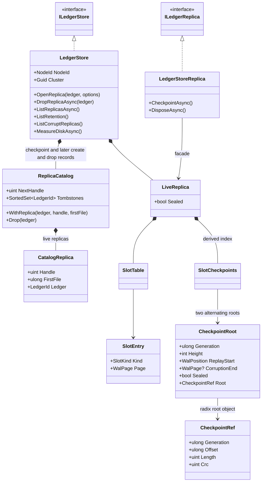
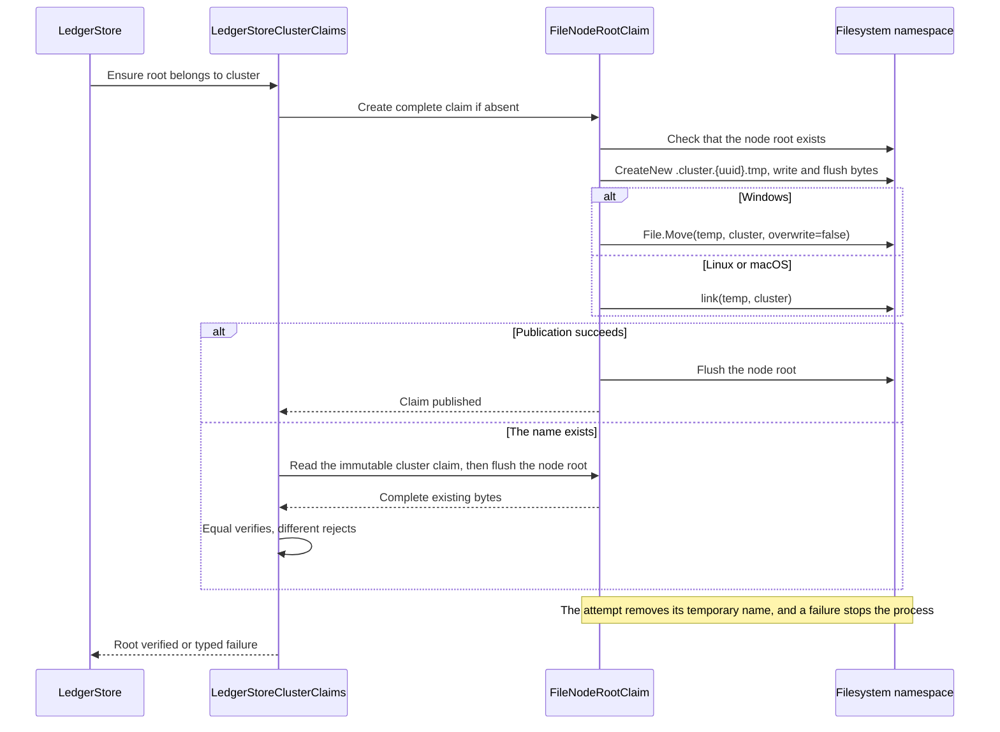
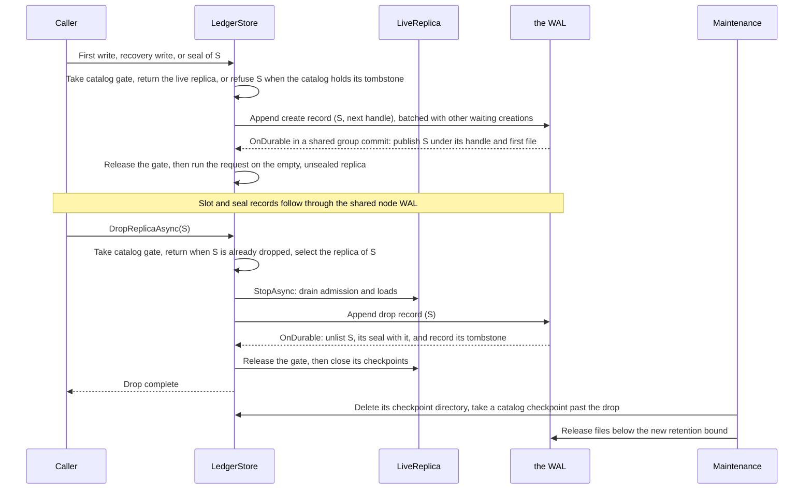
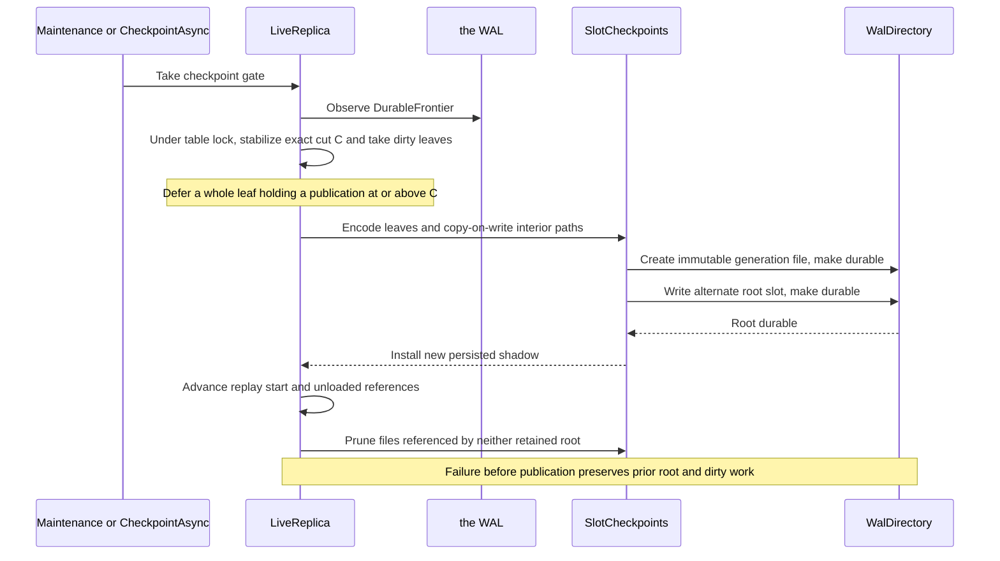

# LedgerStore

## 1. Purpose and scope

The LedgerStore holds a node's ledger replicas. One store owns one node root and multiplexes every ledger
replica the node holds through one WAL write-ahead log, so every replica's writes share one group-commit and
fsync stream. Replicas are keyed by ledger ID, the `ulong` the [ledger map](ledgers.md#4-data-types) assigns.

- **WAL records** hold every write the store makes: slot mutations, keyed by `(replica handle, slot)`, and the
  store's **create**, **seal**, and **drop** records. A create decides that a ledger replica exists and gives it a
  replica handle, a seal ends its writer's writes, and a drop removes a replica and leaves its ledger's
  **tombstone**, which records the ledger sealed and dropped.
- The **catalog** holds the live replicas with their handles and first files, the tombstones, and the next handle:
  the fold of the WAL's create and drop records over the newest **catalog checkpoint**, which persists it. A tombstone
  outlives the WAL file holding its drop record, in the catalog checkpoints, for the node's life.
- The layer above drops ledgers; the catalog refuses every dropped ledger, and creates a
  replica on its first write, recovery write, or seal otherwise.
- A per-replica **slot table** maps each slot to the WAL page of its latest record. **Slot-index
  checkpoints** persist the table and the replica's seal incrementally, so recovery replays only the WAL written
  since.
- The **node file** beside the WAL holds the node identity, which names the disk: a replaced or wiped disk starts a
  new node.
- The node root records its cluster identity once, and the store opens only for that cluster
  ([LS-I12](ledgerstore.md#5-invariants)).

The store implements the [Ledger replica contract](ledger-replicas.md#2-contract-upward) for each ledger replica. Other
nodes reach its replicas through the [Orleans replica transport](../compositions/orleans.md#512-replica-transport).
[Ledgers](ledgers.md) drops a replica once the node's ledger-map view revokes it ([ledgers
§8.5](ledgers.md#85-replica-lifecycle-on-a-node)). The code lives in `Orleans.Durable.Storage.Engine.Ledgers.Store`.

### Design rationale

One node WAL amortizes durable writes across all its replicas. A WAL per replica would create independent
fsync streams and churn per-ledger structures; an LSM tree would compact registers which are normally
written once, nearly in order, and reclaimed by whole ledger.

**One ordered durable stream.** Every write the store makes, creates, seals, and drops included, is a record in the
node's WAL, so one log orders existence, refusal, and contents, and the catalog is a checkpoint of that log as the
slot index is. A create or drop shares the WAL's group commit with whatever records are in flight and touches no
other file or directory, since a replica's checkpoint directory comes with its first checkpoint, where a separately
written catalog costs two or three fsyncs and a directory flush per create under the store-wide gate. No create or
drop replaces a file, so none fails because another process holds the file open, as a replace can on Windows
([#106](https://github.com/ReubenBond/clog/issues/106)). Crash reasoning reduces to the WAL's: a record is durable
whole or absent, so an answered create or drop survives every crash and an unanswered one survives whole or not at
all, and recovery, which already replays the WAL, applies the creates and drops above the catalog checkpoint's cut in
the same pass as the slot tables. The rejected alternative is a catalog file replaced atomically on every create and
drop, beside a WAL of slot mutations only: a drop then costs one replacement rather than one record, and existence is
read without a replay, but every create and drop pays its own fsync stream, and a second durable structure adds its
own crash states.

The WAL's authority has one cost. A `WalCorruption` which recovery meets at or above the catalog checkpoint's cut
may hide a create or drop record. A replica whose create is lost would reopen unlisted, and empty if created again,
answering `Missing` for entries it acknowledged, and a ledger whose drop is lost would lose its tombstone, so a
delayed write could create it again; scoped damage cannot help, since nothing names the lost ledger. The store
therefore refuses to open (§6.2), as it refuses a damaged node file. A torn tail (`WalTorn`) is not damage: a crash
leaves it, it holds no acknowledged record, and it never refuses the open. A catalog checkpoint follows each create
or drop within `CheckpointInterval`, and every `CheckpointReplayBytes` of WAL, as a replica's replay does, so the WAL
in which damage refuses the open stays short. Below the cut, damage stays scoped to the replicas it can affect (LS-I5).

**Two valid catalog checkpoints.** The catalog checkpoint carries what the WAL no longer holds: the tombstones of drop
records the store has released. So the store releases WAL only while it holds at least two valid catalog checkpoints, as
the slot index keeps two roots, and never past the older one's cut, so either one, with the retained WAL, derives the
catalog. Recovery loads the newest valid one. The store deletes catalog checkpoints only after it writes one: every
catalog checkpoint other than the two newest valid ones, whatever its validity, before it releases any WAL. Losing every
catalog checkpoint loses the node's tombstones, which LS-I5 detects: the store refuses to open, a detected node loss
counted against the `Q − 1` budget of the node's ledgers, and the disk returns as a new node ([system model
§3](../system-model.md#3-failures-tolerated)). Deriving the catalog from the whole retained WAL instead would need every
drop record retained for the node's life, pinning every WAL file which holds one. A tombstone costs 8 bytes in each
catalog checkpoint, and each checkpoint writes them all. A node which rolls ledgers at 100 MiB/s of WAL drops about
8,000 replicas a day and holds 24 MB of tombstones after a year; its `CheckpointReplayBytes` trigger writes a catalog
checkpoint every GiB of WAL, about 2% of the WAL's bytes, and covers every drop's wait for one. A node at Orleans'
representative load ([orleans §8.1](../compositions/orleans.md#81-resource-and-request-cost-model)) drops about 50
replicas a day and holds 160 KB after a year; its `CheckpointInterval` trigger writes at most one catalog checkpoint per
interval in which a create or drop awaits one, about 8 MB a day. Each tombstone keeps its plain 8-byte encoding until
that cost is measured as a limit ([deferred](../deferred.md#delta-encoded-tombstones-in-catalog-checkpoints);
[ledger-replicas, design rationale](ledger-replicas.md#design-rationale)).

Each catalog checkpoint is a new immutable file named by its cut, created whole as slot-index generation files are,
so its name and contents become durable together, no file is replaced, and the newest is found by name without a
generation counter. A two-slot root written in place, as slot-index roots are, would bound the catalog's size, which
grows with the live replicas and the tombstones; one name replaced atomically is the replace this design removes.

One batch of creations, or one drop, is in flight at a time: the catalog gate holds from the decisions until its record
is durable and published, so each decides against a durable catalog and handles follow WAL order. A replica becomes
live, and serves any operation, only once its create record is durable: the WAL completes write groups out of order
([wal §8](wal.md#placement-and-write-groups)), so a slot record accepted before the create was durable could survive
a crash which lost the create, and its acknowledged entry would belong to no replica. Creations waiting at the gate form
one batch, written as one create record and published together once it is durable: a takeover's first writes create many
replicas on a node at once, and a batch pays one group commit for them all. A batch is one record because the WAL
recovers each record whole or not at all ([WAL-I2](wal.md#5-invariants)) but completes and tears records independently:
of two create records written back to back, an operating-system crash can tear the first and keep the second, whose
handle would then skip the first's, and replay could only treat that as damage and refuse the open. Pipelining beyond a
batch would need answers held until every earlier create or drop is durable, which one batch per gate hold makes
unnecessary.

A catalog checkpoint's capture takes no gate and waits for no frontier. Under the lock which orders the catalog's
publications it takes the catalog and a cut just past the latest published create or drop record, or the durable
frontier when that lies above, and the catalog gate writes each create or drop record only after the previous one is
published, so the catalog reflects exactly the records below the cut. Capturing at the durable frontier under the gate
would hold back creations and drops while it waited for the frontier to pass the latest record, which the WAL advances
just after the record's publication and signals to no one. An open writes a catalog checkpoint itself when it holds
fewer than two valid ones, found the newest invalid, or replayed a record or damage above the cut, rather than leave it
to maintenance: its cut, the open's frontier, then lies above every range the open recovered, so the WAL in which damage
refuses the next open starts after them. Each open also repeats the creation of every replica directory it keeps, which
flushes `slots/`, so a directory name which a process crash left unsynced is durable before the store relies on what
lies beneath it.

**One cluster per node root.** A node root records its cluster once, so a root configured for another cluster
refuses to open, and ledger IDs, unique within a cluster, never meet another cluster's on one disk. The claim
cannot distinguish independent deployments deliberately configured with the same cluster identity.

The node identity lives in its own write-once file in `wal/`, not in the catalog and not beside the cluster claim. It is
written once and never derived, so it needs neither a checkpoint nor a replay. The claim is created before the store and
outside `wal/`, so an identity kept there would survive the loss of `wal/`, and the root would reopen empty under it,
answering `Missing` for entries the node acknowledged. In `wal/` the identity moves with the WAL however the node root's
subdirectories are mounted: a root which lost its WAL lost its identity too and opens, if at all, as a new node, and a
replacement disk is a different node. The node file is published last when the store is created, after WAL file 1 and
the empty catalog's checkpoint are durable, so a node file shows that the WAL and a catalog existed, and their loss
refuses the open (LS-I5, LS-I6).

**Creation unless dropped.** A replica comes into existence with the first write, recovery write, or seal which reaches
it, unless the node dropped its ledger ([LR-I7](ledger-replicas.md#5-invariants)), as a bookie's state for a ledger
does, so the map write which installs a ledger assigns its ID and waits on no node. A drop record removes the replica it
drops and leaves its ledger's tombstone, and creations are decided under the gate which orders drop records, so the
catalog alone decides every creation, and the store reads no map. The tombstone records the seal of the replica it
removes: a dropped ledger is sealed. The catalog keeps every tombstone for the node's
life: each is a ledger ID, and bounding them is not worth a second mechanism ([ledger-replicas, design
rationale](ledger-replicas.md#design-rationale)).

**The seal is a WAL record.** A replica's seal is one store record in the node's WAL, beside its creates and
drops, as BookKeeper persists a ledger's fenced state on the bookie. The WAL already orders a replica's mutations,
so it orders the seal against the replica's writer writes: a writer write logged before the seal was accepted,
and every later one is refused. Replay restores the seal with the writes it ordered, and the record names no slot,
because recovery decides the ledger's end and the ledger map records it. A seal kept anywhere else would need
its own fsync and order itself against writes only through a second lock.

The slot index exploits dense slots and nearby WAL pages. A hash map spends memory on keys already implied
by slot order and makes ordered tail operations harder. A fuzzy whole-hash-table checkpoint also scales
with table size. Copy-on-write radix nodes with independently encoded leaves preserve ordered access while
allowing rare old-slot recovery writes without overlaying and compacting sorted files.
The WAL remains authoritative: a bad derived checkpoint is rebuilt, not a reason to reinterpret damage as
an empty register.

Naming a record by page instead of byte position saves offset bits because the per-slot lock and
write-once pages establish LS-I7. A linear predictor with patched exceptions compresses nearby pages and
still decodes one entry in constant time. Fixed-width `(file, page)` entries spend 96 bits per slot;
delta-of-delta encoding decodes sequentially, and Elias–Fano requires monotonic pages which permuted
admission does not guarantee. Unloaded leaves keep cold index memory small; touched leaves load or rebuild.
Checkpointing an exact cut permits ordinary last-writer-wins suffix replay even when durable callbacks
publish out of order.

Full replay is a correct fallback, not the normal recovery policy: WAL history can grow far faster than
the current live index. The motivating 32,768-slot, 4 KiB, one-at-a-time append comparison reopened in
3,028 ms by full scan and 1,050 ms from a 3.0-bit-per-slot checkpoint; those figures are workload-specific
evidence, not a recovery-time guarantee. Slot-index checkpoints bound replay work but do not release
authoritative WAL files; only drops do, once two catalog checkpoints cover them. Controllers roll long-lived
ledgers so that they drain and drop ([ledgers §8.7](ledgers.md#87-policy)), and disk pressure is
[Orleans policy](../compositions/orleans.md#59-resource-governance).

Checkpoint generations end at 2<sup>63</sup> − 1 and are never taken while a usable root slot or a generation file
names them, so a replica whose usable root slot names the last stops checkpointing until an operator deletes its
checkpoints (§8.8). Every finite bound has a last generation, and a damaged or crafted root slot or file name can
name it; the writer then has only three choices: write a generation the loader rejects, so each new checkpoint is
lost at the next open; renumber, a recovery procedure which reuses generations; or refuse. Refusing is the simplest
and keeps LS-I9 whole; since LS-I4 retains the WAL, the cost is a growing replay, never a lost record, and no
legitimate store takes 2<sup>63</sup> checkpoints. The refusal is an `InvalidDataException`, naming stored data in an
impossible state: no storage operation failed, so it stops no process, and it is not a `LedgerReplicaCorruptException`,
which reports an address or a lost replica and which the ledger protocol treats as the replica's failure, although
every slot still serves.

## 2. Contract upward

### 2.1 Ledger replica operations

`LedgerStoreReplica` (`Orleans.Durable.Storage.Engine.Ledgers.Store`) implements `ILedgerReplica` over one live ledger
replica. The shared outcomes are in [outcomes](../outcomes.md); this table gives the LedgerStore's behavior. Every
operation also answers `Dropped` once its ledger is dropped, which its tombstone records (LS-I2); fails with
`ObjectDisposedException` after disposal; and fails with `ArgumentException`, before any effect, when the replica's
window differs from the one the replica's create record holds ([LR-I6](ledger-replicas.md#5-invariants)).

| Member | Behavior | Outcomes and failures |
| --- | --- | --- |
| `WriteAsync(slot, payload, contiguousTail, recovery)` | Checks the replica's window against the replica's (§8.3), retains `contiguousTail`, then applies the slot rules (§8.1): a writer write is refused once the replica is sealed and otherwise writes DATA unless the slot holds DATA; a recovery write writes DATA over `Missing` or a faulty slot. An accepted non-recovery write on an unsealed live replica also extends `grantedLeaseUntil` in RAM when `LeaseDuration > 0` ([LR-I10](ledger-replicas.md#5-invariants)) without writing any WAL record. | `Written(LeaseGrant)` when the slot holds DATA afterwards (this write's or an earlier one), with `LeaseGrant = LeaseDuration` for an unsealed non-recovery write and `TimeSpan.Zero` for a recovery write or when leases are disabled; `Sealed` for a writer write once the replica's seal is durable. `LedgerReplicaCorruptException` for a writer write on a faulty slot of an unsealed replica. `ArgumentException` for empty DATA or a slot at or above 2<sup>40</sup>. |
| `ReadAsync(slot, contiguousTail)` | Checks the window, retains `contiguousTail`, then reads the slot's latest record from the WAL page the table names and validates it (§8.2). | `Missing`, `Batch` (owned buffer). `LedgerReplicaCorruptException` for a faulty slot, a damaged page, or a record of the wrong kind; the slot then becomes faulty. |
| `ReadAsync(slot, offset, length, contiguousTail)` | Reads the whole record and returns bytes `[offset, offset + length)` (`LedgerReplicaOperations.ReadRangeOfValueAsync`). | As `ReadAsync`; `ArgumentException` for a range outside the value. |
| `ReadTailAsync(contiguousTail, seal)` | Retains `contiguousTail`; with `seal`, records the replica's seal in the WAL unless it is already sealed (§8.3); then reports the replica's retained contiguous tail, sealed flag, and, on a sealing call, `LeaseRemaining`. | `LedgerReplicaTail(ContiguousTail, IsSealed, LeaseRemaining)`; the contiguous tail is, after the store opens, at least `max(0, h + 1 − K)` for its highest DATA slot `h` (§8.3). It reports a seal only once the seal record is durable, and a sealing call answers only once every writer write the replica accepted before the seal is durable too (LS-I11). On a sealing call, `LeaseRemaining = max(0, max(grantedLeaseUntil, bootLeaseHorizon) - now)` (LR-I10; `TimeSpan.Zero` when disabled or expired). Idempotent. |
| `CheckpointAsync()` | Captures changed leaves and the seal below an exact cut at or below the observed `WriteAheadLog.DurableFrontier`, moving the next recovery's replay start to that cut (§8.8). | Completes; waits for a checkpoint already running. `InvalidDataException` while a usable root slot of the replica names the last generation, 2<sup>63</sup> − 1, until an operator deletes its checkpoints (§8.8). |
| `DisposeAsync()` | Releases the replica; the store stays open. | — |

### 2.2 Store

`LedgerStore` (`Orleans.Durable.Storage.Engine.Ledgers.Store`) owns one node root: its cluster claim, node file, WAL,
and checkpoints. A host opens one store on its node root and owns it. Ledgers reaches its replicas through
`ILedgerReplicaTransport` ([ledger-replicas §2.2](ledger-replicas.md#22-iledgerreplicatransport)), in process on its own
node and from other nodes over the [Orleans replica transport](../compositions/orleans.md#512-replica-transport), and
drops through the store itself, its node's `ILedgerStore` ([ledger-replicas §2.3](ledger-replicas.md#23-iledgerstore)).

| Member | Preconditions | Postconditions and failures |
| --- | --- | --- |
| `OpenAsync(storage, options, cluster, create, checkpointOptions, timeProvider)` | `cluster` is non-empty; the node root exists and is durable (§3.3). | Verifies the root's cluster claim, creating the claim when `create` is set and the root holds none ([LS-I12](ledgerstore.md#5-invariants)); then opens the root's store, creating it when `create` is set and the root holds none, and recovers it (§8.7). A creation which a crash interrupted before its node file holds no store, and an open with `create` completes it (§8.7 step 3). It creates and flushes only the root and what lies beneath it, and reads no ledger map. `DirectoryNotFoundException` when the node root does not exist; `LedgerStoreClusterMismatchException` when another cluster owns the root; `WalNotFoundException` when the root holds no store and `create` is not set; `LedgerReplicaCorruptException` per LS-I6, for a store in a root without a claim, and per LS-I5: a lost catalog, a catalog checkpoint whose cut lies outside the recovered WAL, or damage which may hide a create or drop (§6.2). A failed local storage operation of the open, such as a catalog checkpoint's read or the write of WAL file 1 or of a catalog checkpoint, stops the process (§6.4). |
| `NodeId`, `Cluster` | — | The node identity (§2.3) and the root's cluster; `NodeId` is the store's `ILedgerStore` member. |
| `OpenReplica(ledger, options)` | `options.WindowSize > 0`. | A `LedgerStoreReplica` over the replica of `ledger`, without I/O and without creating it. A replica the catalog lists serves every operation. One it does not list answers as LR-I7 requires: when the catalog holds the ledger's tombstone, every operation answers `Dropped`; otherwise a read answers empty and unsealed, and a contiguous-tail read its argument, from the published catalog, and its first write, recovery write, or seal creates it under the catalog gate (§8.5). |
| `Heartbeat(ledgers)` | — | Batched RAM-only lease renewal for `ledgers` with zero WAL writes and no replica creation ([LR-I10](ledger-replicas.md#5-invariants)): for each ledger ID, extends `grantedLeaseUntil` in RAM and answers `Granted` if the catalog lists it live and unsealed (and `LeaseDuration > 0`), `Sealed` if live and sealed, `Dropped` if tombstoned, or `Absent` if unlisted. Returns `ReplicaHeartbeatReply(LeaseGrant, Statuses)`. |
| `DropReplicaAsync(ledger)` | — | Under the catalog gate, drops `ledger` with one drop record (§8.6): removes its replica, if live, with its seal, and leaves its tombstone. Completes once the record is durable. Idempotent: a ledger already dropped writes nothing. |
| `ListReplicasAsync()` | — | The ledger ID of every live replica, ascending, from the catalog without I/O; dropped ledgers are absent (LS-I2). `ObjectDisposedException` after disposal. |
| `GetRetention()` | — | What holds the root's WAL (`LedgerStoreRetention`): the current file, the retention bound below which every file is released (LS-I4), the live replica with the lowest first file, and the live replica count. |
| `MeasureDiskAsync()` | — | The disk the store uses (`LedgerStoreDiskUsage`): the bytes of its cluster claim and of the files beneath `wal/` and `slots/`, the least free space of the volumes holding the two, the size of `wal/`'s volume, and the size of the smaller volume. Each directory's volume is queried for itself, since each may be its own mount point (§7.1), and a replica's directory a concurrent drop deletes is left out ([wal §2](wal.md#2-contract-upward)). A failed measurement of either directory stops the process. The Orleans composition's node budgets its disk from it ([orleans §5.9](../compositions/orleans.md#59-resource-governance)). |
| `ListRetention()` | — | Every live replica with its first file, oldest first (`LedgerReplicaRetention`): each pins the WAL from its first file (LS-I4). Controllers choose which ledgers to roll from it. |
| `ListCorruptReplicas()` | — | The ledger ID of every live replica in which the store found damage, ascending: each whose recovery met a damaged WAL range which faults its slots (LS-I5), each whose loaded slot table holds a fault a read found, which the replica's checkpoints keep, and each which answered `LedgerReplicaCorruptException` to an operation since the store opened ([LR-I2](ledger-replicas.md#5-invariants)). Only damage which no checkpoint records, or which lies in a leaf not yet loaded, is known in memory alone: after a restart, the replica's next operation which meets it lists the replica again. A dropped replica is no longer listed. A failed storage operation is no damage: it stops the process ([conventions §14](../conventions.md#14-local-storage-failures-stop-the-process)). The Orleans composition's node reports the list, and its controller rolls each such replica out ([orleans §5.6](../compositions/orleans.md#56-controllers)). |
| `DisposeAsync()` | — | Stops maintenance, waits for any creation or drop in progress, and closes the store (§8.10). |

One process owns a root's store at a time: the WAL's exclusive directory ownership refuses a second owner (§3.2).
A store opens with the WAL options its host supplies (§8.11); every handle over a replica shares the store's
WAL and the replica's slot table.

### 2.3 Node identity

`LedgerStore.NodeId` is the node identity the root's node file holds (§7.1): a random, non-empty UUID the store's
creation publishes last, once WAL file 1 and the empty catalog checkpoint are durable, and fixed for the store's
lifetime. Ledgers and the [ledger map](ledgers.md#4-data-types) name replicas by it,
and a replica call names the node it expects ([OR-I14](../compositions/orleans.md#51-invariants)).

## 3. Requirements downward

### 3.1 WAL

The store relies on [WAL](wal.md) for:

| Requirement | WAL member or invariant |
| --- | --- |
| A record whose write completed survives any crash | [WAL-I1](wal.md#5-invariants) |
| Records occupy increasing positions in admission order, and positions are never reused | `WriteAheadLog.WriteAsync`; the WAL placement |
| Each write reports a post-sync `WalDurableRecord` carrying the record's position and the page holding its first frame, through `WalWriteRequest.OnDurable(record)`, or its failure through `OnFailed` | `WalWriteRequest`, `WalDurableRecord` |
| `DurableFrontier` passes a record only after its `OnDurable` has returned | `WriteAheadLog.DurableFrontier` |
| A scan returns every durable record in order and reports every other page as `WalTorn` or `WalCorruption`, including files missing within an open | `WriteAheadLog.ReadAllAsync(from)`; [WAL-I2](wal.md#5-invariants) |
| A point read returns the last record on a page whose first 8 bytes, little-endian, equal a key, or a `WalCorruption` | `WriteAheadLog.ReadAsync(page, key)` |
| An open finalizes the previous open and starts at a file numbered at least `minimumFirstFile` | `WriteAheadLog.OpenAsync(directory, options, minimumFirstFile)`; [WAL-I4](wal.md#5-invariants) |
| The file new records go to | `WriteAheadLog.CurrentFile` |
| Release of a prefix of files below the durable frontier's file | `WriteAheadLog.ReleaseAsync(file)`; [WAL-I5](wal.md#5-invariants) |
| A failed storage operation stops the process before the log acknowledges anything it held | WAL's storage seam ([conventions §14](../conventions.md#14-local-storage-failures-stop-the-process)) |

### 3.2 Storage

From `WalStorage` and `WalDirectory` (`Orleans.Durable.Storage.Engine.Wal`):

- exclusive ownership of each directory it opens or creates, so one process owns a root's store;
- directory creation, one level under an existing parent, which makes the directory's name durable by flushing the
  parent; opening, which makes the directory's entries durable; listing; and durable deletion;
- named files: `CreateNamedFileAsync` (contents and name durable together; fails when the name exists),
  `OpenNamedFileAsync`, `ListNamedFilesAsync(extension)`, and durable `DeleteNamedFileAsync`;
- `MinimumPageSize`, the smallest page a write never shares with another page.

Portable file I/O, Linux io_uring (6.1 or later), and simulated storage implement them. The store creates `slots/` and
then `wal/` beneath the node root when it creates the store, and each replica's directory one level beneath `slots/`
with the replica's first checkpoint, so every directory it flushes is the node root or lies beneath it, as the WAL's
caller precondition requires ([wal §3](wal.md#3-requirements-downward)); §3.3 states the root's.

### 3.3 Root

The node root is an operator's: it exists, and it and every directory above it are durable, before the store opens. Clog
checks that it exists, failing with `DirectoryNotFoundException` naming it, and creates and flushes only the root and
what lies beneath it: the cluster claim ([ledgerstore §7.1](ledgerstore.md#71-node-root)),
`wal/`, and `slots/`. The process holds in the root the rights its creations use, and on Windows the root lies on a
local NTFS volume ([wal §3](wal.md#3-requirements-downward)). The root's disk preserves fsynced data together with the
node identity ([system model](../system-model.md#4-assumptions)). A lost catalog is a detected node loss (LS-I5).
Publishing the cluster claim needs an atomic no-replace publication of a file name: a no-replace move on Windows, or
`link(2)` on Linux and macOS (§7.1).

### 3.4 Callers

- The [Ledger replica contract](ledger-replicas.md#2-contract-upward): a caller writes at most one DATA value to an
  address.
- **Requests only for assigned ledgers, and drops only of ledgers never used again**
  ([ledger-replicas §3.2](ledger-replicas.md#32-from-callers)). Ledger IDs are non-zero and unique within the root's
  cluster.
- Exact per-replica in-flight slot serialization lets distinct ledgers and distinct slots within a ledger proceed
  concurrently for any ledger window `K`. A tail span of 1,024 slots below the tail keeps the active tail
  leaves mutable and loads them when the store opens (§8.7); for `K` of at most 1,024, that is at most five 256-slot
  leaves.
- The caller supplies a `TimeProvider`, which schedules checkpoints.

## 4. Data types

| Type | Definition |
| --- | --- |
| Node identity | `NodeId`: a random, non-empty UUID which the store's creation publishes last; stored in the node file (§7.1, [identity §2](../identity.md#2-node-and-silo)). |
| Cluster | `Guid`, non-empty: the cluster the root belongs to, recorded once in its cluster claim (§7.1). |
| Ledger ID | `LedgerId`: a non-zero `ulong` naming one ledger for the life of its cluster, assigned by the ledger map ([identity §3](../identity.md#3-ledger-identity)). |
| Replica handle | `u32` below 2<sup>24</sup> − 1. Assigned ascending from 0 by create records, in WAL order; never reused on a node. Exhausting the 2<sup>24</sup> − 1 handles fails creation with `InvalidOperationException`. The **store handle**, 2<sup>24</sup> − 1, keys create, seal, and drop records (§7.3). |
| Slot | A `Slot` value within one ledger replica, `0 <= slot < 2^40`. |
| Record key | `u64` `(handle << 40) \| slot`. |
| Record | A record key followed by its body: a slot's non-empty DATA value; or, under the store handle, a create, seal, or drop record (§7.3). |
| Catalog | `(NextHandle, Replicas, Tombstones)`: the newest valid catalog checkpoint with the WAL's create and drop records at or above its cut applied in WAL order (LS-I1). |
| `CatalogReplica` | `(Handle, FirstFile, Ledger)`: a live ledger replica, the WAL file holding its create record, and its ledger ID. |
| Tombstone | A dropped ledger: its replica is gone, and the ledger is sealed and dropped on the node for its life. |
| Catalog cut | `WalPosition`: a catalog checkpoint reflects exactly the create and drop records below its cut (§7.2, §8.8). |
| `SlotKind` | `Missing`, `Data`, `Faulty` (the state cannot be established). |
| `SlotEntry` | `(Kind, WalPage)`, 16 bytes in memory: the slot's state and the page of its latest record. A `Faulty` entry with no known record has page `(0, 0)`; WAL files are numbered from 1, so that page names no record. |
| Leaf | 256 consecutive slots, numbered `slot >> 8`. In memory a leaf is mutable (256 entries), frozen (its encoding, §7.4), or unloaded (known only by its checkpoint reference). |
| `CheckpointRef` | `(Generation, Offset, Length, Crc)`: one checkpoint object (§7.4). Generation 0 is null. |
| `CheckpointRoot` | `(Generation, Height, ReplayStart, CorruptionEnd, Sealed, Root)`: one root slot (§7.4). |
| `CorruptionEnd` | Optional `WalPage`. Set when a replay met damage; every record replay yielded before the damage starts on a lower page. |
| `LedgerStoreOptions` | Node root and WAL settings (§8.11). |
| `LedgerStoreCheckpointOptions` | Checkpoint triggers (§8.11); runtime policy, never persisted. |
| `LedgerStoreReplay` | `(Path, Generation, ReplayedRecords)`, with `Path` one of `Created`, `Checkpoint`, `FullScan`. |
| `LedgerStoreRetention` | `(CurrentFile, FirstRetainedFile, OldestReplica, LiveReplicas)`: the current file; the retention bound (LS-I4); the ledger ID of the live replica with the lowest first file, if any; and the live replica count. |
| `LedgerReplicaRetention` | `(Ledger, FirstFile)`: a live replica and the first WAL file it may hold a record in. |

```mermaid
stateDiagram-v2
    [*] --> Absent : catalog lists no replica and holds no tombstone for the ID
    Absent --> Absent : read or contiguous-tail read (empty, unsealed)
    Absent --> Live : first write, recovery write, or seal; a durable create record lists the ID with a new handle
    Absent --> Dropped : a durable drop record names the ID
    Live --> Live : register operations, seal, checkpoint
    Live --> Stopping : a drop closes admission
    Stopping --> Stopping : an operation waits for the drop's outcome
    Stopping --> Dropped : drain operations, then a durable drop record removes the replica and its seal
    Dropped --> Dropped : every operation fails as dropped
    note right of Stopping
        Answers nothing until the drop's outcome:
        dropped once the record is durable and published,
        its failure if the drop fails.
    end note
    note right of Dropped
        Sealed and dropped, by its tombstone:
        no operation serves slots or creates the replica,
        across restarts. Handles are never reused.
    end note
    note right of Live
        A failed local storage operation stops the process.
        Disposal closes runtime state, not catalog existence.
    end note
```





The lifecycle is per ledger ID: a drop refuses only its own replica, and the node's other replicas keep serving.

## 5. Invariants

- **LS-I1 — The WAL orders existence.** The catalog is a catalog checkpoint with the create and drop records at or above
  its cut applied in WAL order: a ledger replica exists on a node exactly while the catalog lists it, and a ledger is
  dropped exactly while the catalog holds its tombstone. The first write, recovery write, or seal of a replica the
  catalog neither lists nor holds a tombstone for appends a create record, one per batch of creations, whose pair for
  the replica takes the next handle in WAL order; the replica's first file is the file holding that record. The replica
  becomes live, and the store admits any operation on it, the creating request's first, only once that record is
  durable, so every record of the replica follows its create record in the WAL and becomes durable after it, although
  the WAL completes write groups out of order. A read or contiguous-tail read of a replica the catalog neither lists nor
  holds a tombstone for reads no slots and answers empty and unsealed, with the read's argument as its contiguous tail.
- **LS-I2 — A drop leaves its ledger sealed and dropped.** The store decides every creation and every drop under the
  catalog gate, against the catalog: it creates a replica only when the catalog neither lists nor holds a tombstone for
  its ledger, and answers every operation on a dropped ledger `Dropped`. A drop appends one drop
  record, which names its ledger, and answers once the record is durable. The record removes the ledger's replica, if
  live, with its seal, from the catalog, and records its tombstone. No operation answers dropped before that record is
  durable and published, since a crash before then keeps the replica as it was and the store serves it again
  ([durable answers](../conventions.md#13-durable-answers)): an operation which meets the replica while its drop is in
  flight waits for the drop's outcome, and answers the drop's failure if it fails, whose failed storage operation
  stops the process (LS-I10). A dropped ledger is sealed: its tombstone holds the
  seal the replica's seal record held. The catalog never discards a tombstone, so a dropped ledger stays dropped for
  the node's life, across restarts, and the store never creates its replica again. A drop first stops admitting
  operations to the replica it drops and waits for those admitted, so no mutation of it completes after the drop
  returns. This is the LedgerStore's form of [LR-I3](ledger-replicas.md#5-invariants) and
  [LR-I7](ledger-replicas.md#5-invariants): a write, recovery write, or seal delayed past the drop creates nothing.
- **LS-I3 — The WAL is authoritative from a catalog checkpoint's cut; slot-index checkpoints are derived.** The WAL
  decides every replica's contents and its seal, and every create and drop since the cut of each catalog checkpoint
  the store keeps; a catalog checkpoint carries the tombstones of the drop records below its cut. On
  damage-free runs, recovery from either kept catalog checkpoint yields the same catalog, and recovery from a
  slot-index checkpoint yields the slot table and seal a full replay of the replica's WAL files yields. A slot-index
  root or leaf which fails validation is recomputed from the WAL, never trusted; a catalog checkpoint which fails
  validation is never loaded: recovery uses the newest valid one.
- **LS-I4 — Retention keeps what derives the store.** No record of a ledger replica precedes its first file. The store
  releases WAL only while it holds at least two valid catalog checkpoints, and keeps every WAL file from its **retention
  bound**, the lowest of: the file of the WAL's durable frontier, below which every file is closed and durable; each
  live replica's first file; and the file holding the cut of the older of
  its two newest valid catalog checkpoints. It deletes older files, oldest first, and before it releases any, lists
  `wal/` and deletes every catalog checkpoint other than the two newest valid ones, whatever its validity, leftovers of
  failed writes included. The retained WAL therefore holds every record of every live replica, and every record at or
  above either kept catalog checkpoint's cut, so either one, with the retained WAL, derives the catalog: a replica it
  lists whose first file was released is a dropped one, whose drop record lies at or above its cut. No catalog
  checkpoint which recovery can load lacks a tombstone the released WAL held.
- **LS-I5 — Damage is scoped, and a lost catalog refuses the open.** A damaged WAL range in file `F` which ends at or
  below the cut of the catalog checkpoint recovery uses faults only live replicas whose first file is at or below `F`
  and whose replay start precedes the range's end. Within such a replica, a slot is faulty exactly when its latest
  record starts below the range's end or it holds no record; a point read which finds a damaged or mismatched record
  faults only that slot. A faulty slot reports `LedgerReplicaCorruptException`, never `Missing`, until a later record
  re-establishes it ([LR-I2](ledger-replicas.md#5-invariants)). The store lists each live replica in which it found
  damage (`ListCorruptReplicas`): a damaged range at recovery, a fault its loaded slot table holds, or a corrupt answer
  since it opened. Damage which no checkpoint records, or which a checkpoint records in a leaf not yet loaded, is listed
  only once an operation meets it: after a restart, the open loads only the tail's and resolved leaves, and the
  replica's next operation which meets such damage lists it again. A store has **lost its catalog** when it holds no
  valid catalog checkpoint, unless WAL file 1 is retained and a scan finds neither a record nor damage; that is a
  detected node loss ([system model §3](../system-model.md#3-failures-tolerated)). A lost catalog, a `WalCorruption`
  which ends above the cut, which may hide a create or drop record, and a catalog checkpoint whose cut lies outside the
  recovered WAL, which shows a lost WAL prefix or tail, each refuse the open: the store never derives a catalog without
  the records it lost, so no open serves the node without a tombstone it recorded. A store with no valid catalog
  checkpoint which has not lost its catalog has made no create or drop durable, and writes the empty catalog's
  checkpoint before it serves (§8.7). A `WalTorn` range holds no acknowledged record and never refuses the open.
- **LS-I6 — The node identity and the WAL move together.** The node identity lives in the node file, in the WAL
  directory, published once, last in the store's creation, after WAL file 1 and the empty catalog's checkpoint are
  durable, and never changed, so a node file shows that the WAL and a catalog existed. A root without a node file holds
  at most an interrupted creation: any number of WAL files from file 1 in which a scan finds neither a record nor
  damage, at most one catalog checkpoint, valid and of the empty catalog, and no directory in `slots/`. An open with
  `create` completes such a creation under a new identity. Any other root holding WAL files, catalog checkpoints, or
  checkpoint directories without a node file, and a root holding a node file without WAL files, refuses to be created
  and keeps its files; an open without `create` refuses it too, except that, opening no WAL, it answers
  `WalNotFoundException` for WAL files or a single catalog checkpoint whose contents only a scan or a read shows
  (§8.7 step 3). A new identity is created only in a root holding no node file, WAL file, catalog checkpoint, or
  checkpoint directory, or in an interrupted creation. A replica's first
  checkpoint creates its checkpoint directory, and its drop record precedes the directory's deletion, so a directory
  whose handle is at or above the catalog's next handle shows that the WAL lost a create, and the store likewise refuses
  to open and keeps its files.
- **LS-I7 — One record per slot per page.** A slot's in-flight claim on its replica is held from its condition check
  until its record's durable outcome is published. Log order is therefore each slot's mutation order, recovery's
  last-writer-wins replay restores each slot's latest state, and no two records of one slot start on one
  page, so the page names the record.
- **LS-I8 — A checkpoint reflects exactly its cut.** A checkpoint holds every WAL record of its replica below its
  replay start `C`, its seal record included, and none at or above `C`. `C` never decreases across a replica's
  checkpoints.
- **LS-I9 — Checkpoint roots never regress.** A generation number is never taken while a usable root slot or a
  generation file names it, and every generation lies below 2<sup>63</sup>, so while a usable root slot names the
  last, 2<sup>63</sup> − 1, no checkpoint follows. A root comes into force only once its generation file and root
  slot are durable; until then the previous root stays in force. A generation file is deleted only when neither of
  the last two roots references it.
- **LS-I10 — A failed local storage operation answers nothing.** A failed write, read, or file operation of the
  store's WAL, node file, or checkpoints, and a durable record's failed publication, stop the process before the
  store gives any answer which rests on them ([conventions
  §14](../conventions.md#14-local-storage-failures-stop-the-process)), and the next incarnation recovers from what the
  device holds.
- **LS-I11 — The seal is a record in the replica's log.** A replica's seal is one seal record in the node's WAL
  (§7.3). The seal answers only once its record is durable and published and every writer write the replica
  accepted before it is durable and published. Every writer write the replica accepted precedes the seal
  record in the WAL, and every writer write it receives once the seal record is logged answers `Sealed` and writes
  nothing, once the record is durable. Replay of the record, or a checkpoint whose cut follows it, restores the
  seal; only a drop removes it, leaving the ledger sealed and dropped (LS-I2). This is the LedgerStore's form of
  [LR-I8](ledger-replicas.md#5-invariants).
- **LS-I12 — One cluster per node root.** Every node root holds one cluster claim, `{root}/cluster` (§7.1). The
  claim is created before the root holds any replica and verified before any replica in it is served; a root
  claimed by another cluster fails with `LedgerStoreClusterMismatchException`. A claim is never overwritten.

The drop's safety argument is [LP-I8](ledger-protocol.md#5-invariants)'s: a ledger's recovery sealed `N − Q + 1` nodes
before its close, and each keeps its replica sealed until it drops the ledger, whose tombstone then refuses
it for the node's life ([LR-I7](ledger-replicas.md#5-invariants)), so a write the deposed writer delayed past the drop
reaches no write quorum.

The LogDrive paper allows the out-of-order completion the store exhibits across slots: "writes on the
LogDrive can linearize out of address order" (`research/papers/logdrive/paper.md`, §3.1).

## 6. Faults, concurrency, and cancellation

### 6.1 Crash cuts

| Crash point | State after recovery | Answers which hold ([durable answers](../conventions.md#13-durable-answers)) |
| --- | --- | --- |
| While publishing the cluster claim | No claim or the complete claim ([ledgerstore §7.1](ledgerstore.md#71-node-root)); a leftover temporary file is ignored. A claim an open reads is durable: the read flushes the root after reading, before it answers. | An open's read of the claim: the read flushes the root after reading, before it answers. |
| While creating the store, before its node file is published | No store: `wal/` holds no node file, and at most WAL files which hold no record and the empty catalog's checkpoint, an interrupted creation (LS-I6). The next open with `create` completes it, writing the empty catalog's checkpoint if it is missing before it publishes the node file of a new identity; without `create`, `WalNotFoundException`. A leftover temporary file is deleted. | None: the store answers nothing before its node file is published. |
| Any crash point, followed by the loss of every catalog checkpoint | The open refuses exactly when the recovered WAL holds a record, holds damage, or has released file 1, the catalog being lost (LS-I5), so it refuses once any create or drop is durable or was answered, and never serves without a tombstone it recorded. Otherwise it writes the empty catalog's checkpoint before it serves. | Those of a store the open refuses are lost with the node, a detected loss within `Q − 1` (LS-I5); an open which proceeds answered nothing before. |
| A first create, unanswered and lost, followed by the loss of every catalog checkpoint | The WAL holds file 1 and no record: the open writes the empty catalog's checkpoint and opens empty. No request of the batch was answered. | None: no request of the batch was answered. |
| After an open found no valid catalog checkpoint and a WAL with file 1 and no record, before its checkpoint of the empty catalog is durable | The open served nothing and released nothing; the next open finds the same and writes it again. | None: the open served nothing. |
| With a create, seal, or drop record in flight | A record answered before the crash survives (WAL-I1). One not yet answered survives whole, as if answered, or is absent ([WAL-I2](wal.md#5-invariants)), even when the crash tears it and later records survive: a create record's batch of replicas all exist, empty and unsealed, or none does, and no request of the batch was answered; a seal's replica is sealed or not, and the seal was not answered; a drop's ledger is dropped, its replica removed with its seal and its tombstone recorded, or the catalog is as before it. No slot or seal record of a replica survives without its create: the replica admitted none before its create was durable. | Every create, seal, and drop answered, and every operation answered dropped: each answer followed its record's durable publication. |
| After a drop's record, before its replicas' checkpoint directories are deleted | The ledgers are dropped; open deletes the directories. | The drop, and every operation answered dropped. |
| After a drop, before a catalog checkpoint covers it or older WAL files are released | Open applies the drop record to the newest valid catalog checkpoint; maintenance's next catalog checkpoint covers it, and the release follows (§8.8). | The drop, and every operation answered dropped, from the drop record above the cut. |
| During a catalog checkpoint, before its file is published | The previous catalog checkpoints are in force; open deletes the temporary file. | Every create and drop answered, from the previous catalog checkpoints and the records above their cuts. |
| After a catalog checkpoint is published, before older or invalid ones are deleted | The newest is in force; no WAL file at or above the older kept valid checkpoint's cut has been released; the next deletion lists the WAL directory and deletes every catalog checkpoint but the two newest valid ones, whatever its validity, before it releases anything. | Every create and drop answered. |
| After an open which found fewer than two valid catalog checkpoints, before maintenance wrote a new one | The open wrote its own catalog checkpoint, deleted none, and released no WAL, so the next open finds the same ones and the open's, if durable; the store releases nothing until maintenance writes another and deletes the others. | Every create and drop answered. |
| During a checkpoint, before its root slot is durable | The previous root is in force; open deletes the partial generation file. A replica's first checkpoint may leave its directory without a root, or no directory: the replica replays from its first file. | Every mutation answered: a checkpoint holds nothing the WAL does not. |
| After a checkpoint's root write failed, which stopped the process | Its root slot may hold the failed root, which is usable with its generation file, so open loads it; otherwise the previous root is in force, and open deletes the generation file (§8.8). | Every mutation answered. |
| A process crash which left a directory's name unsynced, then an operating-system crash after a restart | Every open's read of the cluster claim flushes the root, which makes `wal/` and `slots/` durable; `slots/` precedes `wal/`; a replica's first checkpoint makes its directory durable before writing beneath it, and every open repeats the creation of each replica directory it keeps, which makes a name a crashed process left unsynced durable ([WAL-I10](wal.md#5-invariants)), so the restarted process relies on nothing beneath a name the crash could lose. | Every answer the restarted process gave. |
| After a checkpoint, losing WAL records after its cut | The checkpoint contains no copy of that suffix. A surviving-file gap is corruption; a suffix loss without surviving evidence has the detection boundary described in [WAL §6](wal.md#damage-and-loss). A checkpoint cut does not prove that missing suffix records were unacknowledged. | Those whose records the lost suffix held are lost with it, within the WAL's detection boundary. |
| With writes in flight | Every acknowledged mutation survives (WAL-I1); a torn, never-acknowledged write is absent. | Every acknowledged mutation, and every read of a durable value; nothing was answered for a torn write. |

In every crash state the catalog recovery derives equals its newest valid catalog checkpoint with the create and
drop records at or above the checkpoint's cut applied in WAL order (LS-I1, LS-I3): every live replica an answered
create made and no answered drop removed, and every tombstone an answered drop left. At least two valid catalog
checkpoints exist before any WAL release, so a damaged newest one falls back to the older one with every tombstone
intact (LS-I4).

### 6.2 Damage

| Damage found | Effect |
| --- | --- |
| `WalCorruption` while replaying, ending at or below the catalog checkpoint's cut | Raises `CorruptionEnd` (§8.7) of each replica whose replay start precedes the range's end. |
| `WalCorruption` ending above the catalog checkpoint's cut | The range may have held a create or drop record. A lost create would leave its replica unlisted, so it would reopen empty if created again and answer `Missing` for acknowledged entries, and a lost drop would lose its tombstone; the catalog cannot be derived: `LedgerReplicaCorruptException`; the store does not open and leaves its files (LS-I5). |
| A valid page holding a record shorter than its key, a slot record with an empty body, a slot record of a handle at or above the catalog's next handle, or, below the catalog checkpoint's cut, a seal record which breaks a rule of §7.3 | Damage which preserved the CRC: raises `CorruptionEnd` to the next page for each replica whose replay start is at or below the record. |
| A store record at or above the catalog checkpoint's cut which breaks a rule of §7.3 | A damaged create or drop, or one whose kind cannot be trusted: `LedgerReplicaCorruptException`; the store does not open and leaves its files. |
| A file missing within an open | WAL reports the range as `WalCorruption`, handled as above. |
| `WalTorn` | A range a crash left incomplete; its records were never acknowledged and are skipped. It never refuses the open, above the catalog checkpoint's cut included. |
| A point read meets `WalCorruption` or a record which does not match the entry | The slot becomes `Faulty` at that page; the fault is checkpointed and survives restarts until a later record replaces it. |
| A checkpoint root or an object of its tree fails validation (§7.4, §8.8), or a generation file it references is missing | Recovery falls back to the older root, or to a full scan, and requests a checkpoint at once. |
| A leaf object fails validation, or its generation file is missing | The leaf is recomputed from the WAL (§8.9) and checkpointed at once. |
| A usable root slot names 2<sup>63</sup> − 1, the last generation | The generations are exhausted: the replica records the refusal and writes no checkpoint until an operator deletes its checkpoints (§8.8). |
| A catalog checkpoint fails validation (§7.2) | Recovery never loads it: it takes the newest valid one and replays the create and drop records from its cut (LS-I3, LS-I4); maintenance writes a new catalog checkpoint and only then deletes the invalid one. With none valid, the catalog is lost unless WAL file 1 is retained and holds neither a record nor damage (LS-I5): `LedgerReplicaCorruptException`; the store does not open and leaves its files, and the disk returns only as a new node. |
| A catalog checkpoint whose cut, from its name, lies below the first retained WAL file or past the WAL recovery found | The WAL lost a prefix the checkpoint needs, or a tail the checkpoint reflects: `LedgerReplicaCorruptException`; the store does not open and leaves its files (LS-I4, LS-I5). |
| The derived catalog lacks a tombstone, or a listed or dropped ledger, of a valid catalog checkpoint recovery read | A checkpoint contradicts another: `LedgerReplicaCorruptException`; the store does not open and leaves its files (LS-I2). |
| A node file which is not 32 lowercase hexadecimal digits naming a non-empty UUID (§7.1) | `LedgerReplicaCorruptException`; the store does not open and leaves its files. |
| The node file, WAL files, catalog checkpoints, and checkpoint directories disagree, including a checkpoint directory whose handle is at or above the catalog's next handle | `LedgerReplicaCorruptException` (LS-I6); the store does not open and leaves its files. Without a node file, an open without `create` answers `WalNotFoundException` when only the WAL's records or the one catalog checkpoint's catalog would show the disagreement (§8.7 step 3). |
| A store in a root without a cluster claim | `LedgerReplicaCorruptException` ([LS-I12](ledgerstore.md#5-invariants)): the claim precedes the store, so the store does not open and leaves its files. |

### 6.3 Corruption reporting

While a slot is faulty, or while `CorruptionEnd` is set, operations report `LedgerReplicaCorruptException` as
follows, so that corruption is never reported as missing:

| Operation | Reports corruption when |
| --- | --- |
| `ReadAsync`; a writer write on an unsealed replica | The slot it touches is faulty. |
| A recovery write | Never: it re-establishes the slot. |
| A writer write on a sealed replica, `ReadTailAsync` | Never: none reads a slot. |

A seal logged after the damage still seals the replica. A `Ledger` repairs a faulty slot with a recovery write from
a replica which holds the slot's DATA ([ledger-protocol §8.3](ledger-protocol.md#83-quorum-operations)). Suspect values
and CRC-matched quorum reads are [deferred](../deferred.md).

### 6.4 Local storage failures

Every file operation of the store reaches the disk through the WAL's storage seam, which reports a failure to the
fatal-error handler and stops the process ([conventions
§14](../conventions.md#14-local-storage-failures-stop-the-process)): a WAL write or read, a create, seal, or drop
record's failure, the node file's write or read, a catalog or slot-index checkpoint's write, read, or deletion, a
checkpoint directory's deletion, and a WAL release. The store reports its defects through the same handler, each by its
name under the shared defect code, before it completes any operation or releases a slot claim or admission which
waiting work observes. A durable record whose publication throws leaves the store's catalog or slot table apart from its
WAL (`LedgerStoreRecordPublication`, `LedgerStoreSlotPublication`, LS-I10). A seal or drop which fails with an error no
seam reported leaves a marked seal without its record, or a closed admission without its drop record (`LedgerStoreSeal`,
`LedgerStoreDrop`). A failure of maintenance which no seam reported would end checkpoints and WAL releases while the WAL
grew without bound (`LedgerStoreMaintenance`). The store retries none of them: the next incarnation recovers from what
the device holds (§8.7), and every answer given before the failure holds there ([durable
answers](../conventions.md#13-durable-answers)). A missing file is an answer, which recovery decides (§6.2).

When a test intercepts the stop, the store answers nothing more: the failed operation, every operation waiting on it,
and every later operation of the store or its replicas fail with the reported failure.

### 6.5 Concurrency

- **Per-replica slot serialization.** Each `LiveReplica` tracks its own in-flight slots under its table lock
  (`Dictionary<long, TaskCompletionSource?>`), inserting `null` with zero waiter allocation on the uncontended path
  and lazily allocating a `TaskCompletionSource` (`RunContinuationsAsynchronously`) only when a second mutation
  contends on the exact same `(replica, slot)`. Distinct replicas and distinct slots within a replica never serialize
  against one another. A mutation holds its slot claim from before its leaf load and condition check until `OnDurable`
  publishes its outcome or `OnFailed` reports failure (LS-I7). Publication is the slot's linearization point. Reads,
  contiguous-tail reads, and listings see a slot only after its record is durable.
- **Seal order.** Each replica orders its writer writes against its seal (LS-I11): a writer write checks the seal
  and registers as in flight in one step under the replica's table lock, and stays registered until its outcome is
  published; the seal marks the replica in one step under the same lock, waits for the writer writes registered
  before the mark, then submits its record. A writer write which meets the mark waits for the seal record to be
  durable and answers `Sealed`. Recovery writes, reads, and contiguous-tail reads do not take part, but a
  contiguous-tail read which meets the mark waits for the seal's outcome.
- **Admission.** Each operation on a replica is admitted through the replica's admission gate
  ([conventions §11](../conventions.md#11-admission-and-close)) before it runs and leaves when it completes; an
  accepted mutation stays admitted until its outcome is published. A drop closes the gate, which stops admission
  and waits for the admitted operations to leave. An operation which meets the closed gate waits for the drop's outcome
  and answers from it ([durable answers](../conventions.md#13-durable-answers)): dropped once the drop record is durable
  and published, or the drop's failure, whose failed storage operation stops the process (LS-I2, LS-I10).
- **Catalog gate.** Creations and drops serialize on one gate per store. Creations waiting at the gate form one batch,
  and a batch or a drop holds the gate from its decisions until its record is durable and published, so one batch or
  drop is in flight at a time, each decides against a durable catalog, and handles are assigned in WAL order; a drop
  also stops its replica under it. Creations are decided under it against the catalog's tombstones, from the catalog
  alone. A catalog checkpoint's capture takes no gate: it takes the catalog and its cut under the lock which orders
  the catalog's publications (§8.8). The gate does no file or directory I/O. A replica's first write, recovery write,
  or seal waits for its creation; later operations do not take the gate.
- **Table lock.** One lock per replica guards its slot table. Encoding, decoding, and file I/O run outside
  it.
- **Checkpoint gate.** One gate per replica serializes background and on-demand checkpoints and disposal's
  final checkpoint. A dropped or disposed replica writes no further checkpoint.
- **Leaf loads.** One load runs per leaf, shared by every caller, on the thread pool, without any caller's
  cancellation. Stopping a replica stops new loads and waits for running ones.

### 6.6 Cancellation

Cancellation stops the caller waiting, never the write ([conventions](../conventions.md)):

- A mutation cancelled before the WAL accepts its record is abandoned and writes nothing.
- A mutation cancelled after acceptance completes durably; only the caller's wait ends.
- A creating request or drop cancelled while it waits for the catalog gate writes nothing. Once it holds the gate it
  runs to its record's published outcome, a drop stopping its replica first; only the caller's wait ends.
- A checkpoint cancelled before its root is durable leaves the previous root in force and returns its
  leaves to the dirty set.

## 7. Formats

Integers are little-endian unless stated. CRC-32C is the Castagnoli CRC of [conventions](../conventions.md).
Golden vectors: `test/Durable.Storage/shared-vectors/ledgerstore/`: `catalog.json` and `catalog-rejections.json` (§7.2),
`records.json` and `record-rejections.json` (§7.3), `leaves.json`, `leaf-rejections.json`, and `generations.json`
(the leaves and generation files of §7.4), `roots.json` and `root-rejections.json` (the root slots of §7.4), and
`tree-rejections.json` (the trees of §7.4). Each rejection vector is named by the first rule it breaks in check
order, and a vector breaking two adjacent rules pins their order.

### 7.1 Node root

```text
{root}/
  cluster                         cluster claim: 32 lowercase hexadecimal digits
  wal/
    node                          node identity: 32 lowercase hexadecimal digits (below)
    {file:D20}.clfl               WriteAheadLog files (wal.md §7): every record, creates, seals, and drops included
    {file:D20}-{offset:D20}.clsc  catalog checkpoints, named by their cut (§7.2)
  slots/
    {handle}/                     one live replica's checkpoints, from its first; decimal handle, no leading zeros
      slots.root                  the two-slot root (§7.4)
      {generation:D20}.clsi       immutable checkpoint generation files (§7.4)
  index/                          the node's journal index (journals.md §8.3)
```

On Windows, mount a dedicated volume at the node root, not at `wal/` or `slots/`: the WAL flushes `wal/` whenever it
creates or deletes a WAL file, a catalog checkpoint, or the node file, and `slots/` whenever it creates or deletes a
replica's directory, and a flush of a volume's root directory flushes every open file on the volume
([wal §1](wal.md#design-rationale)). Elsewhere each subdirectory can be its own mount point. `wal/` holds
everything authoritative: the node identity, the records, and the catalog checkpoints, which carry the tombstones of
released drop records. `slots/` and `index/` are derived.

**Cluster claim.** `{root}/cluster` holds the cluster identity as exactly 32 lowercase hexadecimal ASCII digits (`Guid`
format `N`), with no terminator. The store publishes it on first open with an atomic no-replace create and verifies it
on every open ([LS-I12](ledgerstore.md#5-invariants)): when the name exists, the store reads the claim, and a different
value throws `LedgerStoreClusterMismatchException`, an equal value verifies the root, and absence, which a claim never
returns to, throws `LedgerReplicaCorruptException`. A failed create or read stops the process
([conventions §14](../conventions.md#14-local-storage-failures-stop-the-process)).

`FileNodeRootClaim` implements it, and issues every file-system call through the WAL's `WalFileSystem`
([wal §9](wal.md#file-system-directories)). The node root is an operator's precondition: it exists, and it and
every directory above it are durable, before the store opens (§3.3). `FileNodeRootClaim` checks that it exists,
failing with `DirectoryNotFoundException` naming it, creates the claim inside it, and creates no directory; it flushes
only the root. The store writes the complete claim to a unique temporary file in the root, then publishes it
atomically: a no-replace move on Windows, or a POSIX `link(2)` on Linux and macOS. The successful move or link is the
ownership linearization point. `File.Move(..., overwrite: false)` is used only on Windows: Unix no-overwrite move can
check absence and then rename over a competing claim; `link(2)` atomically creates the destination or fails if it
exists. Both names are on the same filesystem. Claim readers use `FileShare.Read | FileShare.Delete`, so Windows
verification does not block concurrent namespace operations. Competing processes observe one winning cluster, and
processes using that cluster reuse its claim. The temporary name is removed after a publication, after an existing
name, and after cancellation; a crash or a failure, which stops the process, can leave an unreferenced temporary file,
which no reader reads. With disk flushing enabled, the temporary file is synced before publication, the node root is
flushed after it, and every read of the claim flushes the node root after it reads and before it answers, so a claim
whose creation returned, or which a read returned, survives an operating-system crash complete, one a competing
process linked just before the read included ([durable answers](../conventions.md#13-durable-answers)). The WAL's
directory flush is an `fsync` on Linux and macOS and `FlushFileBuffers` of the directory's handle on Windows
([wal §9](wal.md#file-system-directories)).



**Node file.** `{root}/wal/node` holds the node identity as exactly 32 lowercase hexadecimal ASCII
digits (`{node:N}`, [identity §2](../identity.md#2-node-and-silo)) with no terminator, the cluster claim's encoding.
The store creates it once, last in the store's creation, once WAL file 1 and the empty catalog checkpoint are durable,
with `CreateNamedFileAsync`, which makes its contents and name durable together and fails when the name exists, and
never writes it again (LS-I6). Reading it accepts exactly 32 lowercase hexadecimal digits naming a non-empty UUID; any
other content is damage, and the store does not open. `NodeFile.Decode` returns `NodeFileDecoding`, the identity or the
rejection naming the first rule the contents break ([conventions §15](../conventions.md#15-outcomes-unions-and-errors)),
with the codes `digits` (anything but exactly 32 lowercase hexadecimal digits) and then `empty-uuid`; the store reports
a rejection as `LedgerReplicaCorruptException` with the rejection inside. The vectors under
`test/Durable.Storage/shared-vectors/ledgerstore` pin its encoding and its rejections.

### 7.2 Catalog checkpoint, `CLSC` version 1

A catalog checkpoint holds the catalog which the create and drop records below its cut `K` leave
(§8.8). It is the named file `{K.File:D20}-{K.Offset:D20}.clsc` in `wal/`, created whole with
`CreateNamedFileAsync` and never modified. Cuts only increase, so names sort by cut, and the checkpoint with the
highest cut is the newest.

A 16-byte header, then the body:

| Offset | Bytes | Field |
| ---: | ---: | --- |
| 0 | 4 | Magic: ASCII `CLSC` |
| 4 | 4 | Version = 1 (`u32`) |
| 8 | 4 | Body length (`u32`) |
| 12 | 4 | CRC-32C of the body (`u32`) |
| 16 | — | Body |

The body holds, in order: the cut, its WAL file (`u64`) and offset (`u64`); the next handle (`u32`); the live replicas
in ascending handle order, each its handle (`u32`), its window `K` (`u32`), its first file (`u64`), and its ledger ID
(`u64`), preceded by their count (`u32`); and the tombstones, ascending ledger IDs (`u64`), preceded by their count
(`u32`).

Decoding accepts only the canonical encoding. `ReplicaCatalog.Decode` returns `CatalogDecoding`, the checkpoint or the
rejection naming the first rule the bytes break ([conventions §15](../conventions.md#15-outcomes-unions-and-errors)),
with these reason codes in check order:

| Code | Rule broken |
| --- | --- |
| `truncated` | Shorter than the header, or a field cut short |
| `bad-magic` | The magic is not `CLSC` |
| `bad-version` | The version is not 1 |
| `length-mismatch` | The body length is not the body's |
| `crc-mismatch` | The body fails its CRC-32C |
| `zero-cut-file` | The cut lies in file 0 (WAL files are numbered from 1) |
| `cut-mismatch` | The cut is not the one the file's name gives |
| `next-handle-out-of-range` | The next handle is above 2<sup>24</sup> − 1 |
| `count-overflow` | A replica or tombstone count is larger than the remaining bytes |
| `handle-order` | A replica's handle is not above the one before |
| `handle-not-below-next` | A handle is at or above the next handle |
| `window-out-of-range` | A window is 0 or above 2<sup>31</sup> − 1 |
| `zero-first-file` | A first file is 0 |
| `first-file-above-cut` | A first file is above the cut's file (a create at or above the cut is not reflected) |
| `zero-ledger` | A replica's or tombstone's ledger ID is 0 |
| `duplicate-ledger` | A ledger is listed twice |
| `tombstone-order` | A tombstone is not above the one before |
| `tombstone-live` | A tombstone's ledger has a live replica |
| `trailing-bytes` | Bytes follow the tombstones |

Each replica is checked against `handle-order` through `duplicate-ledger` before the next, and each tombstone against
`zero-ledger`, `tombstone-order`, and `tombstone-live`; a field cut short is `truncated` where it is read.

A catalog checkpoint is valid when it decodes. Recovery loads the newest valid one, and refuses the open when a catalog
checkpoint's cut lies outside the recovered WAL (§6.2). The store releases WAL only while it holds two valid ones, never
past the older one's cut, and before any release deletes every catalog checkpoint other than those two, whatever its
validity (LS-I4), so either one derives the catalog with the WAL the store retains. The store classifies a rejected
checkpoint as one it never loads (LS-I3).

### 7.3 WAL record

Each WAL record of the store is an 8-byte record key followed by the body:

| Offset | Bytes | Field |
| ---: | ---: | --- |
| 0 | 8 | Record key `(handle << 40) \| slot` (`u64`) |
| 8 | n | Body |

A **slot record** has a handle below 2<sup>24</sup> − 1, and its body is the slot's value. A **store record** has the
store handle, 2<sup>24</sup> − 1, and its kind in the slot field: key
`0xFFFFFF0000000001` for a create, `0xFFFFFF0000000002` for a drop, and `0xFFFFFF0000000003` for a seal. Its body is
one or more 16-byte entries for a create, one batch of creations (§8.5); the replica's ledger and handle for a seal;
and, for a drop, the ledger it drops:

| Offset | Bytes | Create entry `i` |
| ---: | ---: | --- |
| 8 + 16·i | 8 | Ledger ID (`u64`) |
| 16 + 16·i | 4 | Handle (`u32`): the catalog's next handle plus `i`, which the replica takes |
| 20 + 16·i | 4 | Window `K` (`u32`), from 1 to 2<sup>31</sup> − 1: the window of the operation which created the replica ([LR-I6](ledger-replicas.md#5-invariants)) |

| Offset | Bytes | Seal |
| ---: | ---: | --- |
| 8 | 8 | Ledger ID (`u64`) |
| 16 | 4 | Handle (`u32`): the live replica's |

| Offset | Bytes | Drop |
| ---: | ---: | --- |
| 8 | 8 | Ledger ID (`u64`): the ledger the record drops |

A create's handles are thus consecutive from the catalog's next handle. A batch is bounded by the WAL's maximum record
of `int.MaxValue` bytes, 134,217,727 entries; the 2<sup>24</sup> − 1 handles are fewer, so every batch the handles admit
is one record. A create's first file is not recorded: it is the file holding the record. A seal names no slot: it seals
the replica its ledger and handle name (LS-I11). A drop removes its ledger's replica, if live, with its seal, and
records the ledger's tombstone (LS-I2).

| Record | Meaning |
| --- | --- |
| A slot record with `n > 0` | DATA: the value is the payload. |
| A create, seal, or drop record | §8.5, §8.3, §8.6. |
| A record shorter than 8 bytes, a slot record with `n = 0`, or a slot record of a handle at or above the catalog's next handle | Damage which preserved the page CRC (§6.2). |
| A store record of another kind; a create whose body is not a positive multiple of 16 bytes; a seal whose body is not 12 bytes; a drop whose body is not 8 bytes; a ledger ID of 0; a create's or seal's handle at or above 2<sup>24</sup> − 1; a create's window of 0 or above 2<sup>31</sup> − 1 | A damaged store record (§6.2). |

`LedgerRecords.Classify` sorts a record into its class without decoding it, keeping its `RecordClass`: the record
vectors name the damage it finds `record-truncated`, `empty-slot-record`, and `handle-not-allocated`.
`LedgerRecords.DecodeStore` decodes a store record's body where it lies, in the record's own buffer, and returns
`StoreRecordDecoding`, the create, seal, or drop record or the rejection naming the first rule it breaks
([conventions §15](../conventions.md#15-outcomes-unions-and-errors)). Its reason codes, in check order:

| Code | Rule broken |
| --- | --- |
| `store-kind-unknown` | The kind is not create, drop, or seal |
| `create-body-length`, `drop-body-length`, `seal-body-length` | The body's length is not its kind's |
| `zero-ledger` | A ledger ID is 0 |
| `handle-out-of-range` | A handle is at or above 2<sup>24</sup> − 1 |
| `window-out-of-range` | A create's window is 0 or above 2<sup>31</sup> − 1 |

A create's entries are checked in order, each against the last three rules before the next. The store classifies a
rejection by where it meets it: below the catalog cut a damaged record raises its replicas' `CorruptionEnd` (§6.2),
and at or above the cut it fails the open with `LedgerReplicaCorruptException`, whose inner exception is the rejection.

Replay also checks each store record against the catalog it applies to: a create's first handle equals the catalog's
next handle, its handles are consecutive, and its ledgers are distinct, unlisted, and not dropped; a drop's ledger has
no tombstone; a seal names a listed replica's ledger and handle. `ReplicaCatalog.Apply` returns `null` with the catalog
the record leaves, or the rejection naming the check it fails, which makes the create or drop damaged:
`create-handle-mismatch`, `create-ledger-dropped`, `create-ledger-listed`, or `drop-ledger-dropped`. A seal of a handle
the catalog no longer lists, below its next handle, belongs to a dropped replica and is skipped, as its slot records
are; any other seal which disagrees is damage, handled per §6.2, with the code `seal-ledger-mismatch` for a seal of a
listed handle naming another ledger, or `seal-handle-unassigned` for a seal of a handle at or above the next handle.

The record key is the write request's header and the caller's buffer, or the store record's body, its payload, so values
are never copied to prepend it. A store record encodes its body into its request's `ArcBufferWriter`, so a create record
of any number of creations crosses as pages ([conventions §1](../conventions.md#1-buffers-and-ownership)). The WAL's
point read matches a record's first 8 bytes, so records of different replicas which share a page stay distinct, and no
slot's key matches a store record.

### 7.4 Slot-index checkpoints, `CLSI` version 1

Bit-packed arrays place value `j` in bits `[j·w, (j+1)·w)`, where bit `k` is bit `k mod 8` of byte `k / 8`,
and pad to a byte boundary with zero bits.

**Object reference, 24 bytes.**

| Offset | Bytes | Field |
| ---: | ---: | --- |
| 0 | 8 | File generation (`u64`), below 2<sup>63</sup>; 0 is null |
| 8 | 8 | Byte offset in the file (`u64`) |
| 16 | 4 | Length (`u32`) |
| 20 | 4 | CRC-32C of the referenced bytes (`u32`) |

A null reference is all zeros. Every generation a root slot, a reference, or a file name holds lies below
2<sup>63</sup>: generations start at 1 and each checkpoint takes the next, so no store's own checkpoints reach the
last, 2<sup>63</sup> − 1, after which none follows (LS-I9, §8.8). `CheckpointRef.Decode` returns
`InvalidDataException?`, `null` when the reference is valid, with the reference through an `out` parameter
([conventions §15](../conventions.md#15-outcomes-unions-and-errors)); its one code, `null-reference-fields`, names a
null reference whose other fields are not all zero.

**Interior node, 6,144 bytes:** 256 object references, child `i` covering prefix `(parent prefix << 8) | i`.
Children are interior nodes one level down, or leaves at level 1. Height `h` counts interior levels: leaf
numbers lie below 256<sup>h</sup>, `h <= 7`, and an empty table has `h = 0` and a null root. A node holds at
least one non-null child. The objects a tree references occupy disjoint byte ranges of their files, so each is
referenced once, by its parent or by the root slot; the writer appends a generation's objects back to back. They lie
in the root's generation or older ones, since a generation references only the objects it writes and those its
predecessors wrote. When the tree grows, the previous root becomes child 0 of the first new level.

**Leaf.** A slot is present unless `Missing`. Present slots are numbered `j = 0..n-1` in slot order, at leaf
indexes `i_j`.

| Offset | Bytes | Field |
| ---: | ---: | --- |
| 0 | 1 | Flags: bit 0 set when all 256 slots are present; other bits zero |
| 1 | 1 | State width `ws`, 0–1 |
| 2 | 1 | File-index width `wf`, 0–8 |
| 3 | 1 | Residual width `wr`, 0–63 |
| 4 | 2 | File count `c`, 1–256 |
| 6 | 2 | Exception count `e` |
| 8 | 8 | Intercept `a` (`i64`) |
| 16 | 8 | Slope `d`, virtual pages per 256 slots (`i64`) |
| 24 | 16·c | File table: WAL file (`u64`) and virtual base (`u64`), each strictly ascending |
| … | 32 or 0 | Presence bitmap, bit `i` for leaf index `i`; absent when flag bit 0 is set |
| … | ⌈n·ws/8⌉ | States: DATA or Faulty |
| … | ⌈n·wf/8⌉ | File indexes |
| … | ⌈n·wr/8⌉ | Residuals |
| … | 9·e | Exceptions, strictly ascending by leaf index: leaf index (`u8`), virtual page (`u64`) |

Entry `j` names file `file[f_j]` and page `v_j − base[f_j]`, where `v_j` is the exception's virtual page when
one names `i_j`, and otherwise `a + floor(i_j · d / 256) + r_j`, computed in 128-bit arithmetic. A `Faulty`
entry with no known record is encoded at file 0, page 0.

`FrozenLeaf.Decode` returns `SlotLeafDecoding`, the leaf or the rejection naming the first rule its bytes break
([conventions §15](../conventions.md#15-outcomes-unions-and-errors)), with these reason codes in check order:

| Code | Rule broken |
| --- | --- |
| `truncated` | Shorter than the 24-byte header, or than the file table and presence bitmap the header gives |
| `reserved-flags` | A flag bit other than bit 0 is set |
| `width-out-of-range` | `ws` above 1, `wf` above 8, or `wr` above 63 |
| `file-count-out-of-range` | `c` is 0 or above 256 |
| `file-table-order` | The files or the bases are not strictly ascending |
| `bitmap-empty-or-full` | The presence bitmap has no bit or every bit set |
| `too-many-exceptions` | More exceptions than present slots |
| `length-mismatch` | A length other than the computed size |
| `exception-order` | An exception's leaf index is not above the one before |
| `exception-absent-slot` | An exception names an absent slot |
| `exception-residual` | An exception's entry has a nonzero residual |
| `file-index-out-of-range` | A file index is at or above `c` |
| `page-out-of-range` | A page lies outside `[0, 2^32)` |
| `nonzero-padding` | A packed array's padding bits are not all zero |

`truncated` is checked twice: before the header is read, and after `file-count-out-of-range`, against the file table
and presence bitmap. Each exception is checked against `exception-order`, `exception-absent-slot`, and
`exception-residual` before the next; then each present entry, in slot order, against `file-index-out-of-range` and
`page-out-of-range`. A state width of at most 1 holds no state above 1, so no rule names one. A leaf with no present
slot is never written; its reference is null.

**Canonical writing versus validating reading.** `SlotLeafCodec.Encode` produces the deterministic
canonical encoding below. The leaf decoder validates the structural and value constraints above; it
does not re-encode entries to require those exact canonical bytes. It can therefore accept alternate
valid widths or predictors representing the same entries. For example, changing a single-entry
zero-residual leaf's residual width from 0 to 1 and adding its zero residual byte preserves the decoded
entry while differing from the encoder's output. Canonical-only rejection is not established by the
current decoder or rejection-vector set; it must not be inferred from canonical encoder vectors.
The format contract here requires canonical production and structurally valid decoding, not rejection
of every alternate valid representation.

**Canonical encoder.** Golden vectors pin both decoding and this algorithm:

1. The file table lists the distinct files ascending; `base[0] = 0` and
   `base[k] = base[k−1] + maxPage(file k−1) + 1`. `v_j = base[f_j] + page_j`.
2. With `j1 = floor((n−1)/4)` and `j3 = n−1−j1`, `d = floor((v_j3 − v_j1) · 256 / (i_j3 − i_j1))`, or 0 when
   `i_j3 = i_j1`. The quartile endpoints keep one outlier at either end from bending the line.
3. `q_j = v_j − floor(i_j · d / 256)`. For each width `w` from 0 to 63, a two-pointer sweep over the sorted
   `q` finds the longest window `[q_lo, q_hi]` with `q_hi − q_lo < 2^w`, choosing the lowest such window. The
   cost is `n·w + 72·(n − retained)` bits. The encoder takes the cheapest `w`, preferring the smaller on ties,
   and stops at the first `w` which retains every entry.
4. `a` is the chosen window's lowest `q`; retained entries store `r_j = q_j − a`; the others become
   exceptions.
5. `ws` is the bit length of the largest state; `wf` is the bit length of `c − 1`.

**Generation file** `{generation:D20}.clsi`: the generation's leaves in leaf order, then its interior nodes
bottom-up, each level in prefix order, back to back. The file is zero-padded to a multiple of `S` (below),
created whole, and never modified.

**Root** `slots.root`: two slots of `S = max(4096, MinimumPageSize)` bytes, created zero-filled with the
first checkpoint. Each checkpoint writes the slot which does not hold the root in force.

| Offset | Bytes | Field |
| ---: | ---: | --- |
| 0 | 4 | CRC-32C of bytes 4..S−1 |
| 4 | 4 | Magic: ASCII `CLSI` |
| 8 | 4 | Version = 1 |
| 12 | 4 | Height `h` |
| 16 | 8 | Generation (non-zero) |
| 24 | 16 | Replay start `C`: WAL file (`u64`) and offset (`u64`) |
| 40 | 8 | `CorruptionEnd` file |
| 48 | 4 | `CorruptionEnd` page index |
| 52 | 4 | Flags: bit 0 set when `CorruptionEnd` is set, the two fields above being zero otherwise; bit 1 set when the replica's seal record precedes the cut; other bits zero |
| 56 | 24 | Root object reference |
| 80 | S−80 | Zero |

`CheckpointRoot.Decode` returns `CheckpointRootDecoding`, the root or the rejection naming the first rule the slot
breaks ([conventions §15](../conventions.md#15-outcomes-unions-and-errors)), with these reason codes in check order:

| Code | Rule broken |
| --- | --- |
| `truncated` | Shorter than its 80 bytes of fields |
| `crc-mismatch` | Bytes 4..S−1 fail the CRC-32C |
| `bad-magic` | The magic is not `CLSI` |
| `bad-version` | The version is not 1 |
| `nonzero-padding` | A byte from 80 on is not zero |
| `null-reference-fields` | The root reference is null with other fields set |
| `height-out-of-range` | `h` is above 7 |
| `height-root-mismatch` | `h = 0` with a non-null root reference, or `h > 0` with a null one |
| `generation-zero` | The generation is 0 |
| `generation-out-of-range` | The generation, or the root reference's, is at or above 2<sup>63</sup> |
| `unknown-flags` | A flag bit other than bits 0 and 1 is set |
| `corruption-end-without-flag` | A `CorruptionEnd` field is nonzero without flag bit 0 |

A root slot is usable when it decodes and the root file is exactly `2·S` bytes. The store reads only whole slots, so
it never meets `truncated`. It classifies a rejected slot as one it never loads: the slot is no candidate, and its
generation does not count toward the next one (LS-I3, LS-I9); a `generation-out-of-range` slot is damage, which
requests a checkpoint at once (§8.8). Moving a root to storage with a
different minimum page size makes its roots unusable, so recovery scans the WAL.

**Loading a tree.** Loading a candidate root's tree (§8.8) gives the tree's interior nodes and leaf references, or the
rejection naming the first rule an object of the tree breaks, met depth-first in child order, with these reason codes,
which `test/Durable.Storage/shared-vectors/ledgerstore/tree-rejections.json` pins:

| Code | Rule broken |
| --- | --- |
| `node-length` | An interior node's reference is not 6,144 bytes long |
| `leaf-beyond-address-space` | A leaf's number is above 2<sup>55</sup> − 1, beyond the slot space |
| `leaf-length` | A leaf's reference has a length no leaf has, outside 40 to 8,775 bytes |
| `generation-after-root` | The object lies in a generation after its root's |
| `generation-missing` | The object's generation file is missing |
| `outside-file` | The object lies outside its file |
| `overlap` | The object overlaps another object of the tree |
| `crc-mismatch` | The object fails its CRC-32C |
| `null-reference-fields` | A child reference is null with other fields set |
| `node-empty` | An interior node has no non-null child |

A node's reference is checked against `node-length`, then `generation-after-root` through `crc-mismatch`, and its
children against `null-reference-fields`, child by child, and `node-empty`, before the nodes and leaves beneath it, in
child order. A leaf's reference is checked against `leaf-beyond-address-space`, `leaf-length`, and
`generation-after-root` through `overlap`; loading does not read the leaf. An object's generation lies below
2<sup>63</sup>, since it is at most its root's. The store classifies a rejected tree as an unusable root: loading
records the rejection, moves to the older root or, with none left, replays the WAL from the replica's first file, and
requests a checkpoint at once (LS-I3, §6.2).

Every object lies within its file, and a read is shorter only at a file's end, so reading an object returns all its
bytes. A leaf loads on demand: `SlotCheckpoints.ReadObjectAsync` reads the object's bytes and returns `null`, or the
rejection of bytes which fail their CRC, `crc-mismatch`, and `FrozenLeaf.Decode` decodes the bytes into a
`SlotLeafDecoding`. The
replica classifies a rejection of either as a leaf it recomputes from the WAL and checkpoints at once (LS-I3, §8.9), as
it does a leaf whose file is gone.

The leaf's packed states are **not** the numeric values of the in-memory `SlotKind` enum: Missing has no
presence bit, and present slots encode DATA as 0 and Faulty as 1. Object references checksum the referenced
object only; generation padding is zero and is not included in an object's length or CRC. These layouts
are implemented by `SlotLeafCodec`, `CheckpointRef`, and `CheckpointRoot`; golden vectors pin both fields and
rejection rules.

### 7.5 Data page index

A `WalPage(File, Index)` names data page `Index` (0-based) of a WAL file, at byte offset `P·(1 + Index)` after
the header page, where `P` is the file's page size. A record's page is the page holding its first frame.
Pages are per file, so a page size may differ between opens.

## 8. Mechanism and policy

### 8.1 Slot rules

Each mutation claims its slot on its `LiveReplica`, loads the slot's leaf, observes the slot, and then either answers
without writing or writes one WAL record:

| Mutation | `Missing` | DATA | Faulty |
| --- | --- | --- | --- |
| Writer write, replica unsealed | Write the value → `Written` | No write → `Written` | Corrupt |
| Writer write, replica sealed | No write → `Sealed` | No write → `Sealed` | No write → `Sealed` |
| Recovery write | Write the value → `Written` | No write → `Written` | Write the value → `Written` |

The record's durable completion publishes the slot's new entry from its `WalDurableRecord` into a `DurableSlotWrite`
proof token, releases the slot claim, and produces `Written` only from that token ([conventions
§13](../conventions.md#13-durable-answers)). A writer write answers `Sealed` only from a `DurableSeal` proof minted
once the seal record is durable (or recovered from a checkpoint/WAL), and one which checked the seal before the seal
record was logged precedes it in the WAL ([LR-I8](ledger-replicas.md#5-invariants), LS-I11). Similarly, create and
drop records produce `DurableCreate` and `DurableDrop` proof tokens inside `OnDurable`, and `LiveReplica.CompleteDrop`
requires a valid `DurableDrop` before answering waiting operations `Dropped`.

### 8.2 Reads

A read loads the slot's leaf, takes its entry, and asks the WAL for the record on the entry's page with the
slot's key. It validates the record against the entry: a non-empty value for DATA. A byte-range read reads the whole
record and answers its range, or `OutsideBatch` for a range past it. A read of a replica the catalog does not list reads
nothing (LS-I1, LS-I2).

### 8.3 Contiguous tail and seal

Each live replica records the window `K` of the operation which created it, in its create record and its catalog
entry (§7.2, §7.3), and every operation first checks its replica's window against it: one of another window fails
with `ArgumentException` and has no effect ([LR-I6](ledger-replicas.md#5-invariants)).

Each live replica retains the greatest contiguous tail any operation carried (LR-I6), in memory, shared by every
handle over the replica and so by every client of a host; it never decreases while the store is open. A replica the
store creates starts it at 0, and one it reopens at `max(0, h + 1 − K)` for its highest DATA slot `h` and its
recorded `K`, once recovery has resolved `h` (§8.7 step 7); a drop discards it. Nothing durable records it.
`ReadTailAsync` returns it with the replica's seal, which it reports only once the seal record is durable: a read
which meets a seal in flight waits for the record ([durable answers](../conventions.md#13-durable-answers)). On a
replica the catalog neither lists nor drops, a `ReadTailAsync` which does not seal answers its argument, unsealed,
and retains nothing (LS-I1).

A sealing `ReadTailAsync(contiguousTail, seal: true)` creates the replica first if the catalog does not list it
(§8.5), retains `contiguousTail`, and then:

1. If the replica is sealed, waits for its seal record to be durable and answers.
2. Otherwise, in one step under the replica's table lock against the writer writes' seal checks (§6.5), marks the
   replica sealed, so later writer writes answer `Sealed` once the record is durable.
3. Waits for every writer write which checked the seal before the mark to publish its outcome, then submits a seal
   record (§7.3) to the WAL. The marked seal runs to its record's outcome whatever its caller's cancellation, since
   later writer writes wait on it; a failed record stops the process, and so does any other failure but the store's
   own disposal, which leaves the mark without its record (`LedgerStoreSeal`, §6.4).
4. Answers sealed with the retained contiguous tail and
   `LeaseRemaining = max(0, max(grantedLeaseUntil, bootLeaseHorizon) - now)` once the seal record is durable and
   published (LS-I11, [LR-I10](ledger-replicas.md#5-invariants)).

For a dropped ledger, which its tombstone records, it answers `Dropped` and creates nothing (LS-I2). On open, before
serving any RPC, the store latches `bootLeaseHorizon = boot + LeaseDuration` on its monotonic clock (`0` when
`LeaseDuration == TimeSpan.Zero`), so a sealing `ReadTailAsync` after a crash or restart still covers any pre-crash
RAM-only lease grant without writing lease state to the WAL (LR-I10).

### 8.4 Retention

Each live replica's first file is the WAL file holding its
create record; no record of it precedes that file (LS-I4). The store releases WAL only while it holds at least two valid
catalog checkpoints, and
its retention bound is the lowest of the file of the WAL's durable frontier (`WriteAheadLog.ReleaseAsync` releases only
below it, WAL-I5), each live replica's first file, and the file holding the cut of
the older of its two newest valid catalog checkpoints. A dropped replica pins nothing: its files are released up to the
older kept checkpoint's cut, and its drop record's file once both kept checkpoints reflect the drop (§8.8), from when
its tombstone lives in the catalog checkpoints. After each
catalog checkpoint the store deletes every catalog checkpoint other than the two newest valid ones, whatever its
validity, then, while two valid ones remain, releases every file below the bound through `WriteAheadLog.ReleaseAsync`,
oldest first. `GetRetention` and `ListRetention` read the bound and the live replicas' first
files from the catalog, so controllers see which ledgers pin the WAL.

### 8.5 Creation

The first write, recovery write, or seal of a replica the catalog does not list creates it, unless its ledger is
dropped. Under the catalog gate: return the live replica when an earlier request created it; return none, which the
request answers `Dropped`, when the catalog holds the ledger's tombstone (LS-I2); otherwise fail with
`InvalidOperationException` when the handles are exhausted, and append a create record (§7.3). Creations waiting at the
gate form one batch: the store decides each, gives requests for one ledger one entry, with the window of the first of
them, and appends one create record whose entries name each distinct ledger with the next handle in turn, and holds the
gate until the record is durable. Its `OnDurable` callback publishes the batch: the catalog lists each replica under its
handle, with the file holding the record as its first file, and only then does each replica become live and admit
operations, the creating request's first, so none of its records can precede its create or become durable without it
(LS-I1). A takeover which creates many replicas on a node thus pays one group commit, not one per replica. A replica
starts empty and unsealed, with no checkpoint and no checkpoint directory; its first checkpoint creates
`slots/{handle}/` (§8.8). The create writes nothing else. Reads, contiguous-tail reads, and `OpenReplica` create
nothing; a read or contiguous-tail read of an unlisted replica decides against the published catalog, without the gate,
failing as dropped for a dropped ledger and otherwise answering empty and unsealed, a contiguous-tail read with its
argument.

### 8.6 Drop

Under the catalog gate, for ledger `S`:

1. If the catalog holds `S`'s tombstone, return: `S` is already dropped.
2. If the catalog lists `S`'s replica, stop it: close its admission, wait for admitted operations, and stop leaf loads.
   An operation which arrives later waits for step 3's outcome and answers from it
   ([durable answers](../conventions.md#13-durable-answers)): dropped only once the drop record is durable and
   published, and the drop's failure otherwise, which stops the process, whatever it is, since the closed admission has
   no drop record (`LedgerStoreDrop`, LS-I2, LS-I10). The gate does no file or directory I/O (§6.5).
3. Append a drop record naming `S` (§7.3). Its `OnDurable` publishes it: the catalog no longer lists the replica, its
   seal goes with it, and the catalog holds `S`'s tombstone (LS-I2).
4. Release the gate, then close the stopped replica's checkpoints and queue its checkpoint directory for deletion.

Maintenance then deletes the dropped replica's checkpoint directory, if it has one, and writes a catalog checkpoint
whose cut lies above the drop record within `CheckpointInterval`; once two valid catalog checkpoints reflect it, the
store releases the WAL files below the new retention bound (§8.4, §8.8, §8.10). A deletion which answers that the
directory's lock is held, as one does on Windows when a scanner's handle on its lock file outlasts the contention bound
([wal §9](wal.md#9-providers-and-implementations)), leaves the directory to maintenance's next pass, or to the next
open; it is an answer, not a failure. `DropReplicaAsync(S)` takes this path,
at the layer above's direction (§3.4).

The creation and drop ordering is:



**Failure.** A create or drop record whose write or publication fails stops the process (LS-I10). The record may
still be durable, so the next incarnation serves the create or drop as recovery finds it, whole or absent, and no
operation answered dropped for a drop without a durable record.

### 8.7 Open and recovery

`LedgerStore.OpenAsync(storage, options, cluster, create, checkpointOptions, timeProvider)`. Opening reads no ledger
map: the catalog decides every creation, so every replica the catalog lists, and every request for an unlisted one, is
served at once.

1. Verify the root's cluster claim ([ledgerstore §7.1](ledgerstore.md#71-node-root)), whose
   read flushes the root before it answers. When it is absent: if `{root}/wal/` holds a node file, catalog checkpoints,
   or WAL files, fail with `LedgerReplicaCorruptException` ([LS-I12](ledgerstore.md#5-invariants)); otherwise,
   without `create`, fail with `WalNotFoundException`, and with `create`, publish it. A claim for another cluster fails
   with `LedgerStoreClusterMismatchException`.
2. Open `{root}/wal/`, which flushes it. Step 1's read flushed the root, so a `wal/` or `slots/` whose name a crashed
   creator left unsynced is durable before the store reads or acknowledges anything beneath it. When `wal/` is
   missing: without `create`, fail with `WalNotFoundException`; with `create`, refuse if `{root}/slots/` holds
   directories (LS-I6), then create or accept `slots/` and create `wal/`, each flushing the root. `slots/` precedes
   `wal/`, so a root holding `wal/` holds a durable `slots/`, and an open which finds `wal/` creates neither.
3. Read the node file (§7.1). With one, a root without WAL files lost its WAL: refuse. Without one, the root holds no
   store, at most a creation a crash interrupted, since the creation publishes the node file last (step 4): any number
   of WAL files from file 1 which hold neither a record nor damage, and at most one catalog checkpoint, valid and of the
   empty catalog. The store serves nothing before its node file exists, so no such leftover was ever acknowledged.
   Refuse catalog checkpoints without WAL files, checkpoint directories, or more than one catalog checkpoint (LS-I6).
   Otherwise, without `create`, fail with `WalNotFoundException`: the open opens no WAL, so it neither scans the WAL
   nor reads the checkpoint, and answers so whatever they hold. With `create` and no WAL files, create the store
   (step 4). With `create` and WAL files, complete the interrupted creation: refuse unless the WAL retains file 1, its
   catalog checkpoint, if any, is valid and of the empty catalog, and, once the WAL is open, that checkpoint's cut lies
   at or below the end recovery found in its file and a scan finds neither a record nor damage; then write the empty
   catalog's checkpoint if it is missing, and publish the node file of a new random identity (LS-I6). Opening the WAL
   publishes a new WAL file, so a completion which fails before its node file leaves more record-free files from file 1,
   which the next completion accepts.
4. To create the store, create the WAL, write its first catalog checkpoint, of the empty catalog, at the WAL's durable
   frontier, and then publish the node file of a random identity. The open serves only once the checkpoint is durable:
   a failed or cancelled write fails the open, which disposes the store and publishes no node file.
5. Otherwise, refuse with `LedgerReplicaCorruptException`, before reading any catalog checkpoint or opening the WAL, if
   a catalog checkpoint's cut, from its name, lies in a file below the first retained file or above the last (LS-I4,
   LS-I5). Read the catalog checkpoints newest first until two are valid (§7.2), and take the newest valid one; an
   I/O error reading one fails the open, which deletes nothing. Without a valid one, unless the WAL still retains its
   file 1 and a scan finds neither a record nor a `WalCorruption`, so no create or drop was ever written, fail with
   `LedgerReplicaCorruptException` and leave the files: the catalog is lost, a detected node loss (LS-I5). For each
   directory in `slots/` whose handle the checkpoint lists or lies at or above its next handle, repeat its creation,
   which flushes `slots/` and makes durable a name a crashed process left unsynced, then open it, which flushes it. Load
   its newest usable slot-index checkpoint (§8.8), and record every other directory for deletion once step 8's checks
   pass. Open the WAL with `minimumFirstFile` one above every loaded replay start's file, so no page a slot-index
   checkpoint names is reused, even when the WAL lost the file holding its replay start. Every catalog checkpoint's cut
   lies in a retained file, and a listed replica's first file at or below its checkpoint's cut, so the WAL's own next
   file follows them.
6. Replay `ReadAllAsync` once, from the lowest of the catalog cut and every listed replica's replay start, or from the
   first retained file when that lies above it, deriving the catalog and the slot tables together. A listed replica
   whose first file was released is a dropped one, whose drop record lies at or above the cut (LS-I4). A listed
   replica without a slot-index checkpoint replays from the start of its first file. For each record, parse it (§7.3):
   - A create or drop record below the catalog cut is skipped: the checkpoint reflects it. One at or above the cut is
     checked against the catalog (§7.3) and applied: a create lists each of its replicas with an empty slot table and
     the record's file as its first file, and each adopts the slot-index checkpoint loaded for its handle, if any, whose
     replay start lies above the record; a drop unlists its ledger's replica, if listed, discarding its slot table and
     seal, and records its ledger's tombstone.
   - A seal record of a listed handle at or above that replica's replay start marks the replica sealed.
   - A slot record of a listed handle at or above that replica's replay start is applied, loading its leaf first.
     A slot record of an unlisted handle below the next handle belongs to a dropped replica and is skipped.
     Other damage is treated per §6.2.
   - A `WalCorruption` which ends at or below the catalog cut marks each replica whose replay start precedes its end
     as damaged; the damage ends at the page of the next record, or at page 0 of the new open's first file when none
     follows, and raises `CorruptionEnd` there. A `WalCorruption` which ends above the cut, and a damaged create or drop
     record at or above the cut, fail the open with `LedgerReplicaCorruptException` and leave the files (LS-I5). A
     `WalTorn` range is skipped wherever it lies: a crash left it, and it holds no acknowledged record.
7. For each replica: freeze settled leaves, resolve the highest slot by loading leaves downwards from the
   highest until one holds a record, and load the leaves covering 1,024 slots below the tail and the
   tail slot, so appends and recovery reads near the tail read no checkpoint. Every other leaf loads on demand. Start
   its retained contiguous tail at `max(0, h + 1 − K)` for that highest slot `h` and the window `K` its catalog entry
   holds (§8.3).
8. Fail with `LedgerReplicaCorruptException` and leave the files if a checkpoint directory's handle is at or above the
   catalog's next handle (LS-I6); if a catalog checkpoint's cut lies past the end recovery found in its file, or a live
   replica's first file precedes the first retained file (LS-I4, LS-I5); or if the derived catalog does not follow a
   valid catalog checkpoint step 5 read: it assigned fewer handles, lacks a tombstone, or neither lists nor dropped one
   of its replicas, or lists it under another handle or first file (LS-I2). Only then delete the checkpoint directories
   of handles the catalog does not list; one whose deletion answers that its lock is held is left for maintenance to
   delete, as a drop's is (§8.6). Write a catalog checkpoint at this open's frontier when fewer than two are valid, the
   newest is invalid, or the replay met a record or a `WalCorruption` at or above the cut: its cut then lies above every
   recovered range, so damage found there later faults only the replicas it reaches (LS-I5). A failed write stops the
   process, and the next open finds the catalog checkpoints this one found (§6.4). Then start maintenance. The open
   deletes no catalog checkpoint and releases no WAL: maintenance does both after its next catalog checkpoint (§8.8).

Each replica reports a `LedgerStoreReplay`: its path, the checkpoint generation it loaded, and the records
it replayed.

### 8.8 Checkpoints

Slot-index checkpoints persist each replica's slot table; catalog checkpoints, at the end of this section, persist
the catalog.

**Loading.** Root candidates are the usable root slots, newest generation first. Loading one reads its interior
nodes. Before it reads a node it checks that the reference is 6,144 bytes long, lies within its file, and is
disjoint from every other object the tree references, so it reads each node at most once; then it validates the
node's CRC and format. Each leaf reference must lie within its file, have a length some leaf has (40 to 8,775
bytes), be disjoint from the tree's other objects, and have its leaf number within the slot space. Every object
must lie in the root's generation or an older one. Checkpoints are derived (LS-I3), so a tree object which is
invalid, missing, overlapping, or out of range fails its candidate with the rejection naming the rule it breaks
(§7.4), and loading moves to the next; without one, the
replica replays from the start of its first file. A failed read, listing, or deletion stops the process (§6.4), and
cancellation fails the load. Leaves stay unloaded. The next generation is one more than the highest
generation a usable root slot names; a root slot or generation file at or above 2<sup>63</sup> is damage, and the
file is deleted. No other file counts: a tree names only its root's generation and older ones, and loading deletes
every generation file the loaded root does not reference, so no file outlives the load with a generation above
every root slot's. Only generation files neither retained root references may be deleted (LS-I9). Finding a damaged
root requests a checkpoint at once.

**Taking a generation.** A checkpoint takes its generation once its root is durable. A write which fails stops the
process (§6.4), so no later write in that process takes the generation it may have left. The next open loads the
failed root when its root slot is usable, so the generation stays taken, and otherwise deletes the generation's file,
so no root slot or file names a generation when it is taken (LS-I9). Once a write has published its generation's file,
it runs to its outcome whatever its caller's cancellation.

**Exhausted generations.** Generations start at 1 and each checkpoint takes the next, so a store reaches the last
generation, 2<sup>63</sup> − 1, only through a damaged or crafted root slot. While a usable root slot names the last
generation, whether open loaded it, a checkpoint took it, or open rejected its tree and loaded an older root, no
checkpoint can follow without taking a generation a usable root slot names (LS-I9), and the generations are exhausted:
the replica records an `InvalidDataException` as its exhaustion, once; maintenance schedules no checkpoint for it,
whether by interval, replay bound, or damage, and checks again under the checkpoint gate, so a checkpoint which waited
there records nothing; disposal writes no final checkpoint; and `CheckpointAsync` fails with the same exception, even
when it would change nothing, and nothing retries it. A stray generation file names no taken generation, so open deletes
it and it exhausts nothing, and a write of the last generation which fails stops the process, whose next open finds the
generations exhausted only if the failed root's slot is usable. The root in force stays in force and every operation
keeps serving, but the replica's WAL suffix, and so the replay its recovery performs, grows until an operator
intervenes; this is safe, because LS-I4 retains the WAL from the replica's first file whatever its checkpoints hold. The
operator procedure: with the store closed, delete the replica's `slots.root` and its `.clsi` files. The next open finds
no root, replays the WAL from the replica's first file, and numbers checkpoints from 1 again; no root slot or file of
the earlier numbering remains, so nothing names a generation it takes again.

**Root-retention implementation gap.** LS-I9 requires retaining every generation referenced by either
of the last two roots. During normal checkpoint publication `ReclaimAsync` retains both sets, but
`SlotCheckpoints.LoadAsync` reconstructs only the selected root's set and calls
`DeleteFilesAsync(_currentFiles)`. After reopen it can delete files still referenced exclusively by the
older root, reducing the fallback promised by LS-I9. The older root's references remain protected by the
contract; this load-time pruning is not the intended retention rule.

**Taking generation `g`.** One background task owns checkpointing, and `CheckpointAsync` runs the same step,
serialized by the checkpoint gate:

1. Under the table lock, at one instant: choose the cut `C` and defer leaves
   (below); take every other dirty leaf, plus the leaves to copy forward when compacting; capture
   `CorruptionEnd`, and the seal when its record lies below `C`.
2. Outside the lock, encode mutable copies, and read and validate unloaded leaves' objects. A leaf removed
   since it became dirty is written as null. An unloaded leaf whose object is unusable is recomputed and left
   for the next generation; its records all precede its previous cut, so its old reference stays correct.
3. Build new interior nodes bottom-up from the persisted shadow (the root in force's interior nodes),
   replacing the taken children and growing the height as needed. Write leaves and nodes as `{g}.clsi`; a
   replica's first checkpoint first creates `slots/{handle}/` one level beneath `slots/`, which flushes `slots/`
   alone.
4. Write root `g` into the slot not holding the root in force.
5. Install the new shadow, move the replica's replay start to `max(C, start of first file)`, point unloaded
   leaves at the objects `g` copied them to, then delete files neither root `g` nor the previous root
   references.

With no taken leaf, generation `g` is only a root, written when `C`, `CorruptionEnd`, or the seal moved; otherwise
nothing is written. A cancellation before the generation's file is published returns the taken leaves to the dirty
set and leaves the previous root in force; a failure stops the process (§6.4).



**Exact cut (LS-I8).** For each dirty leaf the table keeps the positions of the first and last records
published to it since it was last taken. `C` starts at `WriteAheadLog.DurableFrontier`, below which every record is
published. Write groups complete out of order, so a leaf may already hold records at or above `C`: such a
leaf is deferred, stays dirty, keeps its previous version in the tree, and lowers `C` to its first record
since it was taken. Passes over the leaves repeat while `C` moves. Every taken leaf then holds exactly its
records below `C`; normally `C` lags the frontier by the writes in flight.

A mutation is acknowledged inside `OnDurable`, and the frontier passes its record after the callback
returns (WAL-I8). A checkpoint taken between those events defers the record's whole leaf. When every dirty
leaf is deferred, the checkpoint can write only a root; an unchanged cut and corruption bound leave the
existing root in force. A caller establishing a checkpoint prerequisite for later WAL damage waits for the
frontier to pass the latest published record before taking the checkpoint. With those publications settled,
the checkpoint captures every dirty leaf. Concurrent publications can still defer their leaves, so a
checkpoint-write fault test keeps its settled prerequisite in separate leaves from its in-flight mutations.

**Compaction.** When a checkpoint starts while the root in force references more than `MaxCheckpointFiles`
generation files, the oldest file's leaves, and one leaf beneath each interior node it holds, join the taken
leaves, so the file is reclaimed after the next root. Copying validates every unloaded leaf it takes.

**Catalog checkpoints.** A catalog checkpoint is due when a published create or drop record awaits one and
`CheckpointInterval` has passed since the last, and when the WAL bytes from its cut to the end of the latest published
page reach `CheckpointReplayBytes`; the open writes one as §8.7 step 8 says. Creates and drops within an interval share
one checkpoint, and the interval rewrites nothing while the catalog is unchanged. While checkpoints succeed, the WAL
above the newest cut, where a `WalCorruption` refuses the open (§6.2), is bounded by those triggers, as a replica's
replay is.

A capture takes no gate and waits for nothing. Under the lock which orders the catalog's publications it takes the
catalog and the cut `K = max(WriteAheadLog.DurableFrontier, P + 1)`, where `P` is the position of the latest published
create or drop record; disposal's final checkpoint, which follows the WAL's drain, takes the frontier alone. The WAL
publishes a record before its frontier passes it, and the catalog gate writes each create or drop record only after the
previous one is published, so every one below `K` is published and reflected in the catalog the capture takes, its
tombstones included, and every later one lies at or above `K`. A record can begin exactly at `K`: one which shares its
first page with a durable record while its later pages are in flight stops the frontier where it begins
([WAL-I7](wal.md#5-invariants)), so the replay applies every record at or above the cut (§8.7 step 6). Neither the
frontier nor `P` decreases, so cuts only increase. The capture copies no tombstone: the catalog keeps its tombstones
in an immutable structure which a drop extends, so neither creations nor the capture wait on the checkpoint's size.
The capture then encodes the checkpoint once (§7.2) and creates its file with `CreateNamedFileAsync`; the checkpoint
is durable and in force once that returns. After a checkpoint it writes,
maintenance lists `wal/` and deletes, durably, every catalog checkpoint but the two newest valid ones, whatever its
validity, the names of failed attempts included, before any release; only then, while exactly those two remain, does
it release WAL files below the new retention bound (§8.4), which lies at or below the older kept one's cut, so every
catalog checkpoint present derives the catalog from the WAL the store retains (LS-I4). A failed write or deletion
stops the process (§6.4): the previous checkpoints stay in force, and a name the failed write published is one the
next deletion lists. An open's WAL starts above every catalog checkpoint's cut (§8.7), so cuts never decrease and names
never repeat.

### 8.9 Slot table

- **Leaves.** Leaves cover 256 slots and live in a dictionary by leaf number. Every mutation increments the
  leaf's version and adds it to the dirty set.
- **Freezing.** A mutable leaf freezes once the highest slot is at least its last slot plus 1,024, so no
  in-flight append reaches it. Maintenance copies it under the lock, encodes it outside, and installs the
  encoding only if the leaf's version is unchanged. Mutating a frozen leaf thaws it. Recovery freezes
  settled leaves as it replays.
- **Highest slot.** The highest slot only rises: recovery resolves it (§8.7), and each record above it raises
  it.
- **Loading a leaf.** A load reads the leaf's object, validates its CRC and format, and installs it frozen.
  A load whose file a checkpoint reclaimed retries with the leaf's new reference.
- **Recomputing a leaf.** When a leaf's object fails validation or its file is gone, the load scans the replica's
  WAL files from its first file for the leaf's slots: the latest record of each wins, and a slot whose latest
  record precedes WAL damage, or which has none and damage exists, is `Faulty`. The recomputed leaf is dirty,
  and a checkpoint is requested at once.
- **Corruption tracking.** A present entry whose page lies below `CorruptionEnd`, or an absent slot while it
  is set, is faulty; a slot whose latest record is at or above it is re-established. `CorruptionEnd`
  persists in every later root until the replica is dropped.

### 8.10 Maintenance and disposal

One maintenance task per store loops over the live replicas:

- it freezes settled leaves;
- it writes a replica's checkpoint when its interval has passed since its last checkpoint, when the WAL
  bytes from its replay start to the end of the latest published page reach `CheckpointReplayBytes`, or when
  a damaged root or leaf requested one;
- it deletes a dropped replica's checkpoint directory, writes a catalog checkpoint once its interval has passed while a
  published create or drop record awaits one, and once the WAL bytes from its cut reach `CheckpointReplayBytes`, then
  lists `wal/` and deletes every catalog checkpoint but the two newest valid ones and releases WAL files below the
  retention bound (§8.4, §8.8);
- it schedules no checkpoint for a replica whose generations are exhausted (§8.8);
- it waits for the earliest due time, rounded up to a whole millisecond because timers count whole milliseconds
  and a shorter wait returns at once, or a wake signal (a create, a drop, a settled leaf, the replay bound reached, a
  recomputed leaf), taking the signal before checking for work so none is lost;
- it stops when the store is disposed; any other failure stops the process, the seam's report naming a failed storage
  operation, and the store's `LedgerStoreMaintenance` report any other failure (§6.4).

Disposal stops maintenance, waits for any create or drop in progress, stops leaf loads, and disposes the
WAL, which drains it. It then writes each replica's final checkpoint, at most eight at once, each under its replica's
checkpoint gate, and a final catalog checkpoint, leaving recovery an empty suffix within its caller's bound, unless the
store never finished recovering, or, for a replica's checkpoint, the replica's generations are exhausted (§8.8). The
caller bounds the final checkpoints with a cancellation token (`CloseAsync`; `DisposeAsync` writes them all): once it is
cancelled, disposal starts no more and lets each one already started finish, so no final checkpoint is cut short by the
bound. A replica whose final it skipped keeps its checkpoint in force, and the drained WAL holds its records above that
checkpoint's replay start, which the next open replays (§8.7 step 6), as after a crash once the WAL drained: the catalog
checkpoint records the catalog alone, and recovery replays from the lowest of its cut and every listed replica's
replay start. Disposal answers the final checkpoints it wrote and those it skipped (`LedgerStoreCloseResult`), which the
Orleans composition logs
([orleans §5.2](../compositions/orleans.md#52-nodes-and-silos)). It releases every file whatever fails. A stopped
store, which only a test that intercepts the stop observes (§6.4), writes no checkpoint, releases every file, and throws
the failure which stopped it.

An operation concurrent with the store's disposal, or after it, answers from a durable outcome, as a write the WAL
admitted before its disposal does, or fails with `ObjectDisposedException` without effect; neither reports a fatal
error (§6.4). So a caller's work which outlasts its owner's stop and reaches the closed store never stops the process
for it.

### 8.11 Policy

| Setting | Default | Range | Owner |
| --- | --- | --- | --- |
| Storage | `portable` | `portable`, or `io-uring` (Linux 6.1 or later) | Host, per process; never persisted ([WAL](wal.md#9-providers-and-implementations)) |
| `PageSize` | 4,096 | Power of two, 512–65,536, at least the storage's minimum page size | `LedgerStoreOptions` |
| `FileSize` | 256 MiB | A multiple of the page size, at least two pages, at most 2<sup>32</sup> data pages | `LedgerStoreOptions` |
| `PreallocateFiles` | `true` | — | `LedgerStoreOptions` |
| `MinWriteGroupsInFlight` | 1 | 1 – `MaxWriteGroupsInFlight` | `LedgerStoreOptions` |
| `MaxWriteGroupsInFlight` | 4 | ≥ 1 | `LedgerStoreOptions`; the WAL adapts between the two ([WAL](wal.md#write-group-concurrency)) |
| `WriteWindowPages` | 4,096 | ≥ 1 | `LedgerStoreOptions` |
| `PageBufferBudgetBytes` | 16 MiB | ≥ page size | `LedgerStoreOptions` |
| `LeaseDuration` | 3 s | ≥ 0 (`TimeSpan.Zero` disables leases) | `LedgerStoreOptions`, runtime RAM-only; never persisted ([LR-I10](ledger-replicas.md#5-invariants)) |
| `CheckpointInterval` | 30 s | > 0 and ≤ 2<sup>32</sup> − 2 ms, the longest timer wait | `LedgerStoreCheckpointOptions`, runtime; it paces slot-index and catalog checkpoints |
| `CheckpointReplayBytes` | 1 GiB | > 0 | `LedgerStoreCheckpointOptions`, runtime; it paces slot-index and catalog checkpoints |
| `MaxCheckpointFiles` | 32 | ≥ 2 | `LedgerStoreCheckpointOptions`, runtime |
| Slot serialization | Exact per `(replica, slot)` in-flight claim | Dynamic | `LiveReplica` |
| Leaf size | 256 slots | Fixed (format) | `SlotLeafCodec` |
| Settle distance, tail leaves loaded at recovery | 1,024 slots | Constant (`TailSlotSpan = 1,024`) | `LiveReplica`, `SlotTable` |
| Handle space, slot space | 2<sup>24</sup> − 1 handles (the store handle, 2<sup>24</sup> − 1, keys create, seal, and drop records), 2<sup>40</sup> slots | Fixed (key format) | `ReplicaCatalog`, `LedgerStore` |

`LedgerStoreOptions` is host configuration. The WAL options configure the WAL
([wal](wal.md#8-mechanism-and-policy)), which records the page size and write window in each file it
creates, so a store may reopen with other values; the store's clock paces the WAL's file preparation.

A live replica pins the WAL from its first file. Controllers roll long-lived ledgers so that they drain and drop
([ledgers §8.7](ledgers.md#87-policy)), choosing them from `ListRetention()`, and
[Orleans resource governance](../compositions/orleans.md#59-resource-governance) throttles admission under disk
pressure. The store releases WAL files only through drops, once two valid catalog checkpoints cover them. Copying live
records forward out of old files is [deferred](../deferred.md).

`LedgerStoreCheckpointOptions` is a settable options record, which a composition binds from configuration; the store
copies it before validating it and holds that copy, so what it checked is what it runs with, whatever its caller changes
later.

## 9. Providers and implementations

| Type (project) | Role |
| --- | --- |
| `LedgerStore` (`Orleans.Durable.Storage.Engine.Ledgers.Store`) | One node root's store: cluster claim, node file, WAL, catalog checkpoints, recovery, creations, drops, maintenance. |
| `ReplicaCatalog` | The catalog's pure transitions (`WithReplica`, `Drop`), its tombstones, and the `CLSC` checkpoint codec. |
| `LiveReplica` | One live replica: its slot table, per-slot in-flight serialization, seal, checkpoints, leaf loading, slot rules, and admission. |
| `SlotTable`, `SlotLeafCodec`, `FrozenLeaf` | The in-memory table and the leaf codec. |
| `SlotCheckpoints`, `CheckpointRoot`, `CheckpointRef` | One replica's checkpoint files, roots, and references. |
| `LedgerStoreReplica` | The `ILedgerReplica` facade over one live replica. |
| `FileNodeRootClaim` | The node root's cluster claim ([ledgerstore §7.1](ledgerstore.md#71-node-root)). |

**Hosts.** Each Orleans silo owns one store on its node root and serves it to the other silos over the [Orleans replica
transport](../compositions/orleans.md#512-replica-transport). The host's store creates a replica with its first write,
recovery write, or seal unless its ledger is dropped (§8.5), and drops a ledger at the host's direction (§8.6).

## 10. Verification

| Invariant | Evidence |
| --- | --- |
| LS-I1 | `LedgerStoreTests` (`ACreationTakesTheNextHandleAndWritesNoFileOrDirectory`, `WaitingCreationsAreWrittenAsOneCreateRecord`, `CreationIsDecidedAgainstTheTombstonesUnderTheGate`, a property over random creations, drops, and restarts, `AFailedCreateOrDropRecordIsReportedAndTheRestartedStoreHoldsItWholeOrAbsent`, `AReadOfAnUnlistedUndroppedReplicaReadsEmptyAndAppendsNothing`, `AReplicaWithoutACheckpointRecoversFromTheWal`, `CheckpointDirectoriesOfDroppedReplicasAreDeletedOnOpen`, `ADroppedDirectoryWhoseDeletionAnswersHeldIsDeletedByALaterPass` and `AnOpenLeavesADirectoryWhoseDeletionAnswersHeldToMaintenance`, in which maintenance, or an open, reports nothing when a dropped replica's directory answers that its lock is held, and maintenance deletes it on a later pass, `ListReplicasListsTheLiveReplicasAscending`, `AReplicaAdmitsNoWriteBeforeItsCreateIsDurableWhileReadsSeeItAbsent` and `ASealWhichCreatesAReplicaAnswersOnceItsCreateIsDurableWhileReadsSeeItAbsent`, in which a write or a seal waits on its held create while a read and a contiguous-tail read meanwhile answer at once as an empty, unsealed replica, `ACreateOrDropRecordInThePageCacheAtAProcessCrashSurvivesWhole`, `EveryWaitingCreationCompletesWhenTheStoreFailsOrIsDisposed`, `ACreationOrDropCancelledWhileItWaitsWritesNothing`, and `CreationsAndDropsSucceedWhileTheCatalogCheckpointsAreHeldOpen`, the #106 regression, in which, on Windows, every named file in `wal/` held open without delete sharing stalls only the deletion of catalog checkpoints and the release behind it, never a create or a drop); `ReplicaCatalogTests.TransitionsFoldCreateAndDropRecordsAsReplayChecksThem`; `LedgerStoreCrashStateTests` (`ReplicaCreatesAndDropsRecoverFromEveryCrashState`, `ACreateRecordTornBeneathLaterRecordsRecoversFromEveryCrashState`, `AFirstWriteWhoseCreateIsHeldBeneathLaterRecordsRecoversFromEveryCrashState`, `CreationsWaitingBehindAHeldCreateShareOneRecordInEveryCrashState`, `OutOfOrderWalCompletionsRacingCheckpointsRecoverFromEveryCrashState`, `AProcessCrashFollowedByAnOperatingSystemCrashRecoversFromEveryCrashState`: in every crash state the derived catalog is the newest valid catalog checkpoint with the create and drop records above its cut applied, every create answered by the crash point survives, a batch's create record in progress is whole or absent, with consecutive handles, including when the crash tears it and keeps later records, and every slot record the WAL holds names a handle below the next handle, of a listed or dropped replica); the `ILedgerReplica` conformance kit over two ledgers per node, the memory provider and a LedgerStore across crashes, with the mutant `TheKitCatchesAReadWhichCreatesAReplica`; `LedgerStoreSimulationTests.AcknowledgedWritesSurviveCrashesAndRestarts` (`Orleans.Durable.Storage.Simulation.Tests`: every acknowledged replica stays listed until its drop and every listed replica was requested, checked after every step across overlapping process and operating-system crashes); `LedgerStoreInvariantsTests` (each check fires on a broken projection); `LedgerStoreSealTests.ASealOfAnUnlistedReplicaCreatesItSealedWithTheSealingRequestsWindow` and `LedgerStoreReplicaTests.ASealOfAnUnlistedReplicaCreatesItSealed`, in which a seal creates the replica sealed; `LedgerStoreSealTests.AnOperationCancelledBeforeItStartsTouchesNoStorage`, in which a cancelled seal or write creates nothing; `LedgerStoreTests.TheNodeMatchesItsModelOfAbsentLiveAndDroppedReplicas`, over every creating path; `LedgerStoreCrashStateTests.SealRecordsRecoverFromEveryCrashState`, whose seal of a ledger the node does not hold creates its replica sealed, kept in every crash state from its answer on; the ledger model's `NoRevokedAnswer`, with the mutant `create-volatile`, which answers a creating seal before its create record is durable |
| LS-I2 | `LedgerStoreTests` (`ADropIsOneWalRecordWhichUnlistsTheReplicaAndLeavesItsTombstone`, in which a second drop writes nothing, `ADropOfALedgerTheNodeDoesNotHoldLeavesATombstone`, `CreationIsDecidedAgainstTheTombstonesUnderTheGate`, `WaitingCreationsAreWrittenAsOneCreateRecord`, in which two requests for one ledger share one pair, `EveryCreatingPathAndEveryReadAnswersDroppedForATombstonedLedger`, `ADropWaitsForAdmittedMutationsAndRefusesLaterOnes`, `OperationsMeetingADropAnswerDroppedOnlyOnceItsRecordIsDurable`, in which a writer write, a recovery write, a seal, a read, and a contiguous-tail read wait while the drop record is in flight and answer dropped once it is durable, or the failure when it fails, `ADropRemovesOnlyItsOwnReplicaAndTheOthersKeepServing`, `AFailedCreateOrDropRecordIsReportedAndTheRestartedStoreHoldsItWholeOrAbsent`, `CreationsAndDropsSucceedWhileTheCatalogCheckpointsAreHeldOpen`); `LedgerStoreCatalogCheckpointTests` (`ATombstoneOutlivesTheReleaseOfItsDropRecord`, in which every dropped ledger refuses a write, and `ACatalogCheckpointTheDerivedCatalogDoesNotFollowRefusesToOpen`); `ReplicaCatalogTests.FollowsChecksEachClauseAlone`; the `ILedgerReplica` conformance kit's mutants `TheKitCatchesADropWhichLeavesNoTombstone` and `TheKitCatchesAListingWhichIncludesDroppedLedgers`; `LedgerStoreCrashStateTests.ReplicaCreatesAndDropsRecoverFromEveryCrashState` (every drop answered by the crash point survives, with its tombstone, across catalog checkpoints and WAL release, and one in progress is whole or absent; a read which met a drop in flight answered dropped only from a point at which every crash state keeps the drop); `LedgerStoreSimulationTests.AcknowledgedWritesSurviveCrashesAndRestarts` and `LedgerStoreInvariantsTests` (`ACatalogWithoutTheTombstoneOfAnAcknowledgedDropFails`, `ACatalogWhichLosesATombstoneFails`) (`Orleans.Durable.Storage.Simulation.Tests`: every acknowledged drop leaves a tombstone, which no restart loses, checked after every step). The design: Quint [`LedgerDrop.qnt`](../../../specs/ledgers/LedgerDrop.qnt) invariants `EndAddressSealed` and `DurableIsDecided`, with mutants `drop-keeps-replica` (a drop keeps serving the replica), `no-tombstone` (a drop leaves no refusal, so a write delayed past it recreates the replica, and a deposed primary reaches a quorum), `non-atomic-drop` (a node deletes the replica's DATA and seal in one catalog write and removes it in another, so a crash leaves it listed, empty, and unsealed), and `split-tombstone` (a node removes the replica in one catalog write and records its tombstone in another, which a crash loses), `DroppedIsFinal` with mutant `drop-volatile` (a node answers dropped before the drop record is durable, and a crash brings the replica back), and the witness in which a lower ledger's first write succeeds on a node which dropped a higher one, which a creation floor at the highest dropped ID never reaches; the ledger model's `EndSealed` with mutants `no-tombstone` and `split-create`; `LedgerStoreSealTests.ADropOfASealedReplicaRemovesItWithItsSeal`; `LedgerStoreCrashStateTests.SealRecordsRecoverFromEveryCrashState`, which drops a sealed replica; `LedgerStoreTests.TheNodeMatchesItsModelOfAbsentLiveAndDroppedReplicas`, a property of random writer writes, recovery writes, seals, drops, catalog checkpoints, the WAL releases they allow, and restarts over several ledgers against a model of the node, each ledger absent, live with its DATA and seal, or dropped, checked after every step and restart; `LedgerReplicaConformanceTests.ALedgerStoreReplicaConformsAcrossRestarts`, random writes, recovery writes, seals, contiguous-tail reads, drops, and process and operating-system restarts of a LedgerStore against `LedgerReplicaSpec`'s model of the node |
| LS-I3 | `LedgerStoreCheckpointTests.RandomMutationsCheckpointsAndCrashesRecoverTheAcknowledgedTable` (CsCheck model against a reference map, the seal included, with process and OS crashes), `ADamagedLeafIsRecomputedFromTheWalAndCheckpointedAgain`, `AnUnusableRootIsRecomputedAtOnce`, `CompactionCopiesUnloadedLeavesAndRecomputesDamagedOnes`; `SlotCheckpointLoadTests` (`AMissingGenerationFileMakesTheRootsReferencingItUnusable`, `AnUnreadableObjectFailsTheLoadAndTheRestartedProcessLoadsTheNewestRoot`, `TheObjectsOfATreeOccupyDisjointRanges`, `AReferenceOfALengthNoObjectHasIsNotRead`, `AnObjectInAGenerationAfterItsRootsIsDamage`, `ATreeBreakingOneRuleIsUnusableForItsReason`, each naming the tree rejection's reason); `LedgerStoreCheckpointTests.LeafRejectionsAreLeavesTheReplicaRecomputes`; `LedgerStoreVectorTests` (`RootRejectionVectorsAreUnusableForTheirReason`, `RootRejectionsAreSlotsTheStoreNeverLoads`, `TreeRejectionVectorsAreUnusableRootsForTheirReason`, `LeafVectorsMatchTheCanonicalEncoderInBothDirections`, `LeafRejectionVectorsAreRejectedForTheirReason`, `GenerationVectorsMatchTheCheckpointWriterInBothDirections`); `LedgerStoreCatalogCheckpointTests` (`RecoveryFromEitherKeptCatalogCheckpointYieldsTheSameCatalog`, a CsCheck model of creates, drops, writes, checkpoints, releases, and process and OS crashes; `ADamagedNewestCatalogCheckpointFallsBackToTheOlderOneWithEveryTombstoneIntact`; `AnOpenWithOneValidCatalogCheckpointDeletesAndReleasesNothingUntilMaintenanceWritesAnother`; `AnUnreadableCatalogCheckpointFailsTheOpenAndDeletesNothing`; `ACatalogCheckpointReflectsExactlyTheRecordsBelowItsCut`, its tombstones included, against a model of the records; `ACaptureCutsPastAPublishedDropWhileALowerWriteIsInFlight`; `ARequestedCatalogCheckpointWithNothingPastTheNewestCutWritesNothing`; `AnOpenReadsCatalogCheckpointsOnlyUntilTwoAreValid`, in which an unreadable third one is never read; `ACreateRecordWhichBeginsAtTheCatalogCutIsReplayedAndCheckpointed`, whose create record begins where the frontier stops, behind a durable write sharing its first page; `ACaptureAtTheLatestPublishedRecordsPositionCutsPastIt`); `ReplicaCatalogTests.BoundaryCatalogsRoundTrip`, a catalog spanning the encoder's chunks among them; `LedgerStoreCrashStateTests` (in every crash state, recovery from the older kept catalog checkpoint, with the newest damaged, yields the same catalog; `ACatalogCheckpointCapturedAboveTheFrontierRecoversFromEveryCrashState`, whose capture is cut strictly past a drop record the frontier has not reached; `ACatalogCheckpointCutWhereACreateRecordBeginsRecoversFromEveryCrashState`, whose capture is cut exactly where an in-flight create record begins; `SealRecordsRecoverFromEveryCrashState`, which recovers each seal from its record and from the root which records it); `LedgerStoreCheckpointTests.ASealRecordedAfterDamageStillSealsTheReplica` |
| LS-I4 | `LedgerStoreTests.RetentionReleasesFilesOnlyBelowTheLowestLiveFirstFile` (including `LedgerStoreRetention` before and after each drop); `LedgerStoreCatalogCheckpointTests` (`ADroppedReplicasFilesAreReleasedOnlyOnceTwoCatalogCheckpointsCoverItsDrop`, `ReleaseNeverPassesTheOlderValidCatalogCheckpointsCut`, `CatalogCheckpointsButTheTwoNewestAreDeletedBeforeTheWalPastTheirCutsIsReleased`, `ACrashBetweenWritingACatalogCheckpointAndDiscardingAnOldOneKeepsTwoValid`, `RecoveryFromTheOlderCatalogCheckpointSkipsTheReleasedFilesOfReplicasItLists`, `ATombstoneOutlivesTheReleaseOfItsDropRecord`, `ACatalogCheckpointAFailedWritePublishedIsDeletedBeforeAnyRelease`); `LedgerStoreCrashStateTests.ReplicaCreatesAndDropsRecoverFromEveryCrashState` (in every crash state no released file lies at or above the retention bound, and a released first file implies two valid catalog checkpoints) |
| LS-I5 | `LedgerStoreTests.DamageFaultsOnlyTheLedgersWhoseFirstFileIsAtOrBelowIt`; `LedgerStoreCheckpointTests.ReEstablishedSlotsNoLongerReportCorruption`, `ALostWalFileInTheReplayedSuffixFaultsTheSlotsBeforeIt`, `AnInvalidRecordOnAValidPageFaultsTheSlotsBeforeIt`, `APointReadOfAMismatchedRecordFaultsOnlyItsSlot`, `ARecomputedLeafFaultsTheSlotsBeforeWalDamage`; `LedgerStoreReplicaTests.DamagedRecordsInTheReplayedSuffix_ReportCorruptionUntilRecoveredAndNeverMissing`, `DamagedRecordsBelowACheckpoint_FaultOnlyTheSlotsRead`, `APointReadOfADamagedRecordReportsCorruption`, `AFaultAReadFoundIsListedAfterARestart`, `AFailedPointReadStopsTheStoreAndIsNotListedCorrupt`; `LedgerStoreCatalogCheckpointTests` (`WalDamageAtOrAboveTheCatalogCutRefusesToOpen`, `ADamagedStoreRecordRefusesToOpen`, `ATornTailAboveTheCatalogCutOpens`, `NoValidCatalogCheckpointRefusesToOpen`, `ACatalogCheckpointWhoseCutLiesOutsideTheRecoveredWalRefusesToOpen`, `ACatalogCheckpointMissingAnOlderOnesTombstoneRefusesToOpen`, `EveryCatalogCheckpointLostWithARecordInTheWalRefusesToOpen`, `EveryCatalogCheckpointLostAfterAReleaseRefusesToOpen`, `OnlyAWalWithItsFileOneAndNoRecordWritesTheEmptyCatalog`, `DamageEndingAtTheCatalogCutOpensAndDamageStraddlingItRefuses`, `ACatalogCheckpointWhoseCutLiesPastTheRecoveredEndOfItsFileRefusesToOpen`, `AnOpenWhichCannotWriteItsFirstCatalogCheckpointFails`, `AnOpenWhoseOwnCatalogCheckpointFailsFailsAndTheRestartedOpenWritesIt`, `AnOpenCheckpointsTheCatalogOnlyWhenItsReplayReachesTheCut`); `LedgerStoreCheckpointTests.AnOpenNeverReusesTheLostFileOfACheckpointsReplayStart`; `LedgerStoreCrashStateTests` (in every state, with every catalog checkpoint deleted, the open refuses unless no create or drop record was acknowledged); `LedgerStoreSimulationTests.AcknowledgedWritesSurviveCrashesAndRestarts` (`Orleans.Durable.Storage.Simulation.Tests`: after every restart, through torn writes and media damage, each acknowledged entry reads as itself or corrupt and never missing) |
| LS-I6 | `LedgerStoreTests` (`TheNodeFileHoldsTheNodeIdentity`, `ADamagedNodeFileRefusesToStart`, `AnInterruptedCreationIsCompletedByTheNextOpenWithCreate`, in which a creation fails at its catalog checkpoint or its node file, twice, and the next open with create completes it, `MoreThanAnInterruptedCreationLeavesWithoutANodeFileRefusesToStart`, one case per leftover, an invalid catalog checkpoint and one whose cut lies past the WAL among them, `ANodeFileWithoutWalFilesRefusesToStart`, `CatalogCheckpointsOrCheckpointDirectoriesWithoutWalFilesRefuseToStart`, `AStoreInARootWithoutAClaimIsCorrupt`, one case per leftover of §8.7 step 1, `AReplicaWithoutACheckpointRecoversFromTheWal`, `ACheckpointDirectoryWhoseHandleTheWalNeverAssignedIsCorrupt`, `CheckpointDirectoriesAreDeletedOnlyOnceTheOpenPassesItsChecks`); `LedgerStoreCheckpointTests.ARootWhoseWalWasLostRefusesToStart`; `LedgerStoreCrashStateTests` (in every crash state the node identity is the one created first, and a state before the node file's publication holds no store, which an open with create completes into an empty store under a new identity); `LedgerStoreSimulationTests.AcknowledgedWritesSurviveCrashesAndRestarts` (`Orleans.Durable.Storage.Simulation.Tests`: the identity survives every restart); `LedgerStoreInvariantsTests.ANodeIdentityWhichChangesFails`; the ledger model's assumption case `amnesia` (a replica emptied under its identity answers `Missing`, and recovery closes below an acknowledged entry), which shows why a lost disk must return as a new node, and its positive case, in which a lost disk's node never answers again |
| LS-I7 | `LedgerStoreReplicaTests` (`ConcurrentWritesOfOneSlotAreLinearizable`, `DistinctLedgersWritingTheSameSlotProceedConcurrently`, `SameLedgerWrites1024SlotsApartProceedConcurrently`, `SameSlotWritesSerializeWithoutDuplicateWalRecords`, `CancellingAContendingSlotWaiterPreservesTheOwnerAndSiblingWaiters`, `FailedOwningWriteReleasesContendingSlotWaitersWithTheFailure`, `OutOfOrderWritesSurviveReopenWhichRebuildsTheRetainedTail`); `LedgerStoreTests.InterleavedLedgersRecoverEveryAcknowledgedWriteAtAnyCrashCut` |
| LS-I8 | `LedgerStoreCheckpointTests.ACheckpointDefersLeavesWithRecordsAboveItsCut` (root-only capture while the frontier is held; settled capture and recovery after it advances), `ACheckpointNeverReflectsARecordAtOrAboveItsCut`, `AWalTailLostAfterTheCutLeavesTheCheckpointIntact`, `ACheckpointLeavesRecoveryOnlyTheWalSuffix`; `LedgerStoreCrashStateTests` (in every crash state each checkpoint holds exactly the latest WAL record of each slot below its cut, and its cut is at or above every acknowledged cut, including while write-through WAL writes complete out of order between checkpoints and in preallocated WAL files across a roll into a prepared file, and across a close whose caller's bound skipped two of its three final checkpoints, `ACloseWhoseBoundSkipsFinalCheckpointsRecoversFromEveryCrashState`); `LedgerStoreCrashStateTests.ACloseWritesFinalCheckpointsEightAtATimeAndStartsNoneOnceItsBoundPasses` (§8.10, #411: eight finals at once, none started past the bound, every replica recovered, the skipped ones by replay) |
| LS-I9 | `LedgerStoreCheckpointTests.ATornNewestRootFallsBackToTheOlderRootAndItsGenerationIsTakenAgain`, `AFailedCheckpointKeepsThePreviousRootAndLosesNoLeaf`, `ACheckpointFailingAtAnyWriteLosesNoAcknowledgedMutation`, `CompactionBoundsTheCheckpointFilesAndEveryReferencedFileSurvives`, `TallTreesRecoverCompactAndFallBackToTheOlderRoot`; `LedgerStoreCrashStateTests` (in every crash state the root in force is at or above every acknowledged root, opening finds no damage, and every leaf it references reads, through compaction and reclamation, and through a checkpoint whose root write fails after reaching the device, in `ACheckpointWhoseRootWriteFailsAfterReachingTheDeviceRecoversFromEveryCrashState`); `SlotCheckpointLoadTests` (`AGenerationAtOrAboveTheLimitIsDamage`, `TheLastGenerationLoadsAndNoCheckpointFollowsIt`, `AStrayFileAtTheLastGenerationIsDeletedAndDoesNotExhaust`, `AFailedWriteOfTheLastGenerationIsTakenByTheRestartedProcess`, `AFailedWriteWhoseRootReachedTheDeviceLoadsOnReopen`, `AnObjectInAGenerationAfterItsRootsIsDamage`); `LedgerStoreCheckpointTests` (`ExhaustedGenerationsStopCheckpointingUntilAnOperatorDeletesTheCheckpoints`, `ACheckpointWaitingWhileAnotherTakesTheLastGenerationRecordsNothing`) |
| LS-I10 | `LedgerStoreReplicaTests.AFailedWalWriteIsReportedAndTheRestartedProcessRecoversEveryAnsweredWrite`; `LedgerStoreTests.AFailedCreateOrDropRecordIsReportedAndTheRestartedStoreHoldsItWholeOrAbsent`; `LedgerStoreSealTests.ASealWhoseRecordFailsFailsEveryOperationWaitingOnIt` and `ASealWhichFailsWithADefectIsReportedOnceAndTheRestartedReplicaIsUnsealed` (`LedgerStoreSeal`); `LedgerStoreTests.ADropWhichFailsWithADefectIsReportedOnceAndReadsAnswerTheFailure` (`LedgerStoreDrop`) and `ACreateRecordWhosePublicationThrowsIsReportedOnceBeforeTheCreationAnswers` (`LedgerStoreRecordPublication`); `LedgerStoreReplicaTests.ASlotRecordWhosePublicationThrowsIsReportedOnceBeforeTheWriteAnswers` (`LedgerStoreSlotPublication`); `LedgerStoreCheckpointTests.AFailedBackgroundCheckpointEndsMaintenanceAndDisposalSurfacesItOnceEverythingIsReleased` and `AMaintenanceDefectIsReportedOnceAndStopsTheStore` (`LedgerStoreMaintenance`); `LedgerStoreCrashStateTests.AProcessStoppedByAFailedOperationRecoversFromEveryCrashState` (each recorded operation of a workload of the store's creation, replica creates, writes, reads racing a write, a checkpoint, and drops fails in turn, which is reported and crashes the process there; the stopped store answers nothing, and every crash state of the restarted store keeps every answer given before it); `LedgerStoreSimulationTests.AcknowledgedWritesSurviveCrashesAndRestarts` and `LedgerStoreNodeTests.AFailedWriteStopsTheProcessWhichRestartsWithEveryAcknowledgedWrite` and `EveryStorageFaultFiresAndStopsTheProcess` (`Orleans.Durable.Storage.Simulation.Tests`: a node whose storage operation fails answers nothing more, and crashes and restarts) |
| LS-I11 | Ledger model `NoAcknowledgementAtOrAboveEnd`, over replicas which restart keeping their DATA and seal (mutants `seal-volatile`, in which the replica answers a seal before its record is durable, and `restart-drops-seal`, in which replay leaves it out, which also fails `EndSealed`), and `NoRevokedAnswer` (mutants `seal-volatile`, `repeat-seal-volatile`, `write-sealed-volatile`, and `check-sealed-volatile`, in which a seal, a writer write's `Sealed`, or a tail check's sealed flag answers from a mark before its record is durable); `LedgerStoreSealTests` (`WriterWritesBeforeTheSealAreWrittenAndThoseAfterItAreSealedAndStoreNothing`, in which a recovery write on the sealed replica is `Written` and the WAL holds the create, the earlier write, the seal, and the recovery write in that order; `ASealSubmitsItsRecordOnlyOnceEveryEarlierWriterWriteIsDurable`, in which no seal record reaches the WAL while an earlier writer write is held, and a read sent after the seal's answer finds that write's DATA; `OperationsMeetingASealInFlightAnswerOnlyOnceItsRecordIsDurable`, a repeated seal, a writer write, and a contiguous-tail read; `ASealWhoseRecordFailsFailsEveryOperationWaitingOnIt`; `ASealOfAnUnlistedReplicaCreatesItSealedWithTheSealingRequestsWindow`; `ADropOfASealedReplicaRemovesItWithItsSeal`); `LedgerStoreTests.TheNodeMatchesItsModelOfAbsentLiveAndDroppedReplicas`, whose writer writes answer `Sealed` once a seal answered, across restarts and catalog checkpoints; `LedgerStoreReplicaTests` (`AWriterWriteRacingASealKeepsItsOutcomeAcrossReopen`, `ASealSurvivesACrash`); `LedgerStoreCheckpointTests.ASealRecordedAfterDamageStillSealsTheReplica`; `LedgerStoreCrashStateTests.SealRecordsRecoverFromEveryCrashState`: in every crash state an answered seal holds, recovered from its record or from the root which records it, a replica no seal had reached is unsealed, and a writer write the seal refused stored nothing; the `ILedgerReplica` conformance kit over a LedgerStore across restarts ([LR-I8](ledger-replicas.md#5-invariants)), on the thread pool and, in `SimulatedLedgerReplicaConformanceTests`, each case in a simulation of its own whose concurrent windows the explorer interleaves with the disk's completions |
| LS-I12 | `FileNodeRootClaimTests` (`CompetingProcesses_OneClusterWinsAndBothProcessesReuseItsClaim`, `FailedPublication_PreservesTheOccupantAndCleansUpTheTemporaryFile`, `CancelledWrite_LeavesTheRootUnclaimedAndCleansUpTheTemporaryFile`, `ClaimVerification_SharesNamespaceAccessOnWindows`, `AFlushedClaimIsCompleteInEveryCrashStateAndDurableOnceItsCreationReturns`, which enumerates every crash state of a claim created in a durable node root, `AClaimAFlushedReadReturnsIsDurable`, `AClaimLinkedJustBeforeAFlushedReadIsDurableOnceTheReadAnswers`, the regression in which a read which flushed the root before reading answered a competing process's claim whose name a crash could still lose, and `AMissingNodeRootIsRefusedAndNotCreated`); `LedgerStoreTests` (`TheClusterClaimIsPublishedBeforeTheStoreAndAnotherClusterIsRefused`, `AStoreInARootWithoutAClaimIsCorrupt`); `LedgerStoreCrashStateTests`, whose crash states include the claim's publication |
| Formats | `ReplicaCatalogTests` (`DecodingInvertsEncodingForAnyCatalog`, `ArbitraryBytesAreEitherACanonicalCatalogOrRejectedWithAReason`, `EveryRuleBreakingCatalogIsRejectedForItsReason`, `BoundaryCatalogsRoundTrip`, `ACheckpointsNameIsItsCut`, `TheCatalogLayoutIsPinned`), over the §7.2 body with tombstones; `LedgerStoreRecordTests` (`ParsingInvertsTheSlotRecordLayoutForAnyHandleSlotAndValue`, `ParsingInvertsTheStoreRecordLayoutForAnyCreateDropOrSeal`, `ArbitraryBytesAreEitherARecordOrDamage`, `EveryRuleBreakingStoreRecordIsDamagedForItsReason`, `TheSlotKeySpaceEndsBelowTheStoreHandle`, `ACreateRecordWhoseBodySpansPagesEncodesAndDecodesInPlace`); `LedgerStoreTests.TheNodeFileHoldsTheNodeIdentity`; `LedgerStoreVectorTests` (`NodeFileVectorsMatchTheCodecInBothDirections`, `NodeFileRejectionVectorsAreRejectedForTheirReason`, `NodeFileRejectionsAreDamageCarryingTheRejection`, `CatalogRejectionsAreCheckpointsTheStoreNeverLoads`, `RootRejectionsAreSlotsTheStoreNeverLoads`); `SlotLeafCodecTests` (`EveryRuleBreakingLeafIsRejectedForItsReason`, `ArbitraryBytesAreEitherAValidLeafOrRejectedWithAReason`); `SlotCheckpointFormatTests` (root layout, `ARootSlotBreakingOneRuleIsUnusableForItsReason`, `ASlotShorterThanItsFieldsIsTruncated`, null references); `LedgerStoreVectorTests` (every vector file in both directions, and every catalog, record, leaf, root, and tree rejection; snapshot renderings of the decoded catalogs and of each catalog rejection's reason and message); golden vectors `test/Durable.Storage/shared-vectors/ledgerstore/`, with create and drop records, drops of held and unheld ledgers among them, and catalog checkpoints with tombstones, including a live replica with a tombstone; `LedgerStoreCorpusReplayTests`, which replays the `ledgerstore-catalog`, `ledgerstore-record`, `ledgerstore-leaf`, `ledgerstore-root`, and `ledgerstore-generation` fuzz corpora ([verification §6.1](../verification.md#61-decoder-fuzzing)); seal records and 16-byte create pairs in `records.json` and `record-rejections.json`, catalog entries with their windows in `catalog.json` and `catalog-rejections.json` (reason `window-out-of-range`), and roots with the sealed flag in `roots.json`; `SlotLeafCodecTests.ThePackedStatesAreZeroForDataAndOneForFaulty`; `SlotCheckpointFormatTests.EachRootFlagRoundTripsAlone` |
| Policy | `LedgerStoreCheckpointTests.TheIntervalIsPositiveAndAtMostTheLongestTimerWait`, `TheIntervalTriggersACheckpointWhenItPasses`, `TheReplayBoundTriggersACheckpointPublishedBeforeTheTaskFirstRuns`, `TimerObservationWaitsForPendingTimersAfterTheExpectedWork` (active timer and completed-work observation), `OpeningLoadsOnlyTheLeavesRecoveryNeeds`; `LedgerStoreCatalogCheckpointTests` (`DropsWithinAnIntervalShareOneCatalogCheckpointAndAnUnchangedCatalogIsNotRewritten`, `TheReplayBoundMakesACatalogCheckpointDueBeforeTheInterval`); `ReplicaCatalogBenchmarks` (decode, `IsDropped`, and `Follows` at a million tombstones, the measurement [deferred](../deferred.md#a-dense-in-memory-tombstone-set) waits on); `LedgerStoreNodeTests.MaintenanceWaitsOutSubMillisecondRemaindersOfItsInterval` (`Orleans.Durable.Storage.Simulation.Tests`) |
| Cancellation | `LedgerStoreReplicaTests.CancellingAnAdmittedWrite_StopsOnlyTheWaitAndTheWriteStillBecomesDurable`, `Dispose_WaitsForAdmittedWritesAndTheyRecover` |
| Disposal under operations (§8.10) | `LedgerStoreReplicaTests.OperationsConcurrentWithTheStoresDisposalAnswerDurablyOrFailDisposedWithoutAFatalReport`: a write held in the WAL, a seal behind it, a drop, a read which waits for the drop's outcome, a creation behind the drop, an open, and a listing, each begun before the store's disposal, answer or fail with `ObjectDisposedException`; the reopened store holds every answer which succeeded and nothing of an operation which failed; a read through the handle opened before, a read, and a write after the disposal fail so; and none reports a fatal error |
| Disposal | `LedgerStoreTests.DisposalClosesEveryFileAndDirectory`; every crash cut, whose released store holds no handle on the crashed storage (`SimulatedNodeRoot.CrashAsync`); every `Orleans.Durable.Storage.Engine.Ledgers.Tests` class returns the pages it rented ([verification §11.1](../verification.md#111-leak-checks)) |

Crash tests run over `SimulatedWalStorage`, which holds, completes, and tears writes and crashes the process or the
operating system at chosen cuts. `LedgerStoreCrashStateTests` runs the store over the real directory implementation,
the portable storage's files, and the cluster claim on a recording file system rooted at the node root, which exists
durably and above which a flush throws, and recovers from every crash state the claim, the store's directories, and the
node file, catalog checkpoint, slot-index checkpoint, and WAL writes allow under the persistence model of [verification
§7.5](../verification.md#75-crash-state-enumeration): with unpreallocated and preallocated WAL files, with write-through
WAL writes completing out of order, after a process crash at each operation of a workload and a restart which finishes
it, and, for a seeded sample of states, after a crash of the recovery itself. The workloads include creates, seals,
drops of held and unheld ledgers, catalog checkpoints, and WAL releases past drop records, so the enumeration covers
every crash state of a drop record, the catalog checkpoints which carry its tombstone, and the deletion of older catalog
checkpoints, with a workload which writes three or more catalog checkpoints with drops and releases between them, and
workloads which hold a first write's create record beneath later records, hold a create record while three creations
wait behind it, capture a catalog checkpoint while a held write keeps the frontier below a drop record, capture one
at the frontier where a create record begins, and hold a drop record's fsync while a read meets the drop. In every
state, recovery with every newer valid catalog checkpoint damaged yields, from each kept one, the catalog with every
acknowledged tombstone; the first retained WAL file lies at or below the cut's file of the older of the two newest valid
catalog checkpoints; after a completed release two valid ones exist; every slot record names a listed or dropped
replica's handle below the next handle; a batch's replicas are all listed or none; every drop an operation answered
dropped before the point holds; with every catalog checkpoint
deleted, the open refuses unless no create or drop record was ever written; and a state before the store's node file
holds no store, which an open with create completes. The model's directory flush is the WAL's on every
platform ([wal §9](wal.md#file-system-directories)).
