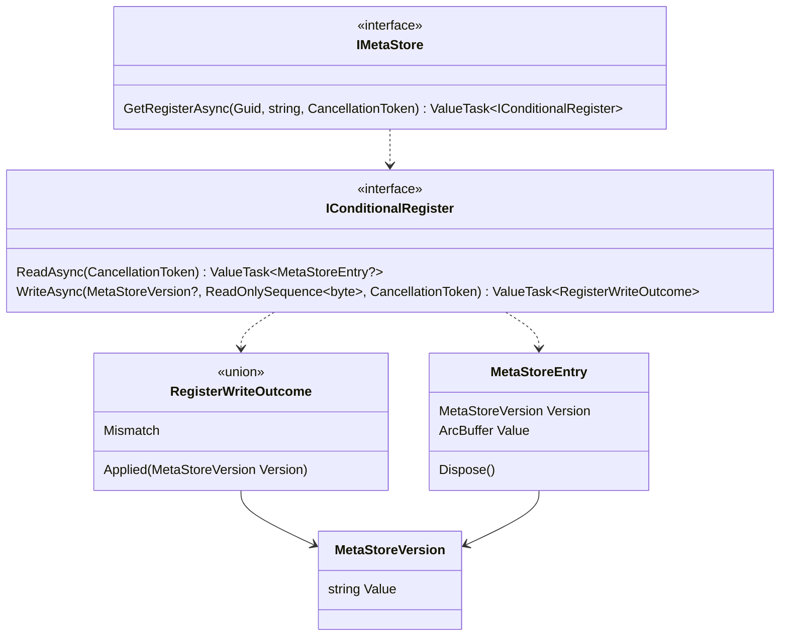
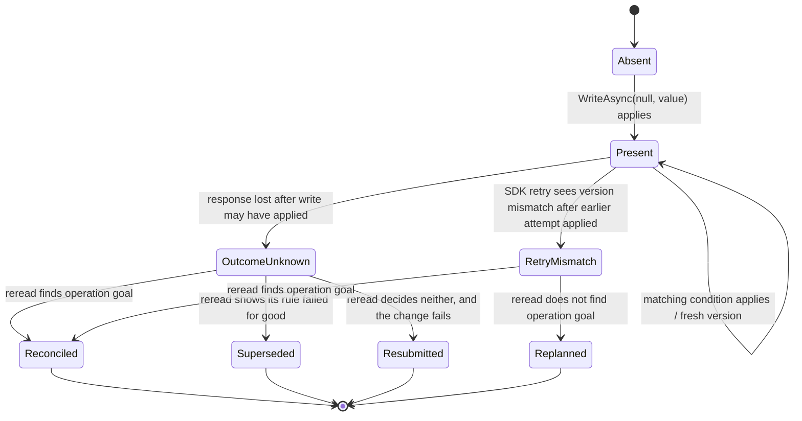

# MetaStore

## 1. Purpose and scope

The MetaStore holds small, critical metadata in conditional registers: one versioned value per register,
replaced only by a write which names the version it expects. It is the control plane's only source of
fault-tolerant consensus; the data plane (ledger replicas, the ledger protocol) needs none.

> "The MetaStore component has a simple API: it is a single versioned register supporting a conditional
> write. Reading the MetaStore returns a value with an attached version. Writing to it requires supplying a
> new value and an expected existing version." (research/papers/delos/paper.md, §3.2)

Delos's observation that one such register suffices for consensus, and that the log storage beneath it needs
none, is the basis for keeping consensus in Clog's control plane:

> "The VirtualLog MetaStore is a necessary and sufficient source of fault-tolerant consensus in our
> architecture; as we describe later, Loglets are not required to implement consensus."
> (research/papers/delos/paper.md, §3.3)

The MetaStore owns the register contract, the mapping of `(cluster, register name)` to each backend's key,
version tokens, and the classification of each write as applied, mismatched, or unknown. It decides no
transition: each user decides its own writes by re-reading the register and testing its goal.

Users and their registers:

| User | Register name | Value |
| --- | --- | --- |
| [Ledgers](ledgers.md) | `ledger-map`, one per cluster | The ledger map ([ledgers §7](ledgers.md#7-formats)), written only by its committer, for transitions, drops, and floor raises |
| [Orleans composition](../compositions/orleans.md) | `node-registry`, one per cluster | The node registry: a revision which every write increments, and every node's entry, updated by conditional read-modify-write which accepts only a newer silo generation of a node, or its retirement |

Projects: `Orleans.Durable.Storage.Engine.MetaStore.Abstractions` (contract); providers in
`Orleans.Durable.Storage.Engine.MetaStore` (memory), `Orleans.Durable.Storage.FileSystem` (file system),
`Orleans.Durable.Storage.CasPaxos`, `Orleans.Durable.Storage.AzureStorage`, `Orleans.Durable.Storage.S3`, and
`Orleans.Durable.Storage.GoogleCloud`.

### Design rationale

The MetaStore is a small, independent consensus boundary: one linearizable conditional register per
`(cluster, name)`, with opaque backend versions and absent distinct from empty. Callers reconcile by reading
the register and testing a monotonic goal after either a mismatch or an unknown result. This avoids
per-operation journals, composite version tokens, and garbage collection while preventing an applied write
with a lost response from being mistaken for failure. The ledger map and the node registry share it without
depending on each other or on the data plane, so transitions stay available when a ledger's primary is not
([ledgers](ledgers.md#design-rationale)). Consensus stays in this control plane; appends pay quorum writes,
not consensus round trips.

An applied write answers the register's new version, which every backend learns as it applies the write (its own
counter, the protocol's current version, an ETag, the version attribute it stamped, an update time), so a writer which
writes the register again names the version its own write returned, with no read between. A write's outcome is a union
of `Applied(Version)` and `Mismatch` ([conventions §15](../conventions.md#15-outcomes-unions-and-errors)): only an
applied write carries a version, and an unknown outcome stays an exception, which carries none. A `bool` with a read to
learn the version was rejected: the read costs a round trip per write and can return a later writer's version, which a
caller could take for its own.

The register's value is a large payload: its contract states no bound, and the ledger map grows with the live ledgers
([conventions §1](../conventions.md#1-buffers-and-ownership)). A write takes a `ReadOnlySequence<byte>`, which it reads
before its task completes, since a write whose outcome is unknown may land after its caller's wait has ended, so each
provider copies the value into its own buffer, or its client library's type, before it dispatches the request. A read
returns an entry which owns its value as an `ArcBuffer`, so a provider which already holds the bytes in an array it
never changes hands them over without a copy. An entry's equality would compare a buffer the reader may already have
released, so entries have none: a reader compares versions, which name values (MS-I5).

Fast CASPaxos is the disk-native replicated option: the adapter delegates protocol and recovery to the pinned
upstream implementation, with five fixed members, fast quorum four, and classic-recovery quorum three.
Fixed membership and externally owned repair are accepted boundaries; cloud-native conditional stores remain
available. Raft would add leader election and log compaction for independent registers, while a bespoke
embedded register or a copied protocol would create a second consensus authority.

### Diagrams

## 2. Contract upward

Outcome taxonomy: [outcomes](../outcomes.md). A write's definite outcome is a `RegisterWriteOutcome`, `Applied(Version)`
or `Mismatch` ([conventions §15](../conventions.md#15-outcomes-unions-and-errors)). The register's value is a large
payload ([conventions §1](../conventions.md#1-buffers-and-ownership)): `WriteAsync` takes it as a
`ReadOnlySequence<byte>`, and a read returns a `MetaStoreEntry` which owns it as an `ArcBuffer` (§4).

### 2.1 `IMetaStore`

| Member | Preconditions | Postconditions |
| --- | --- | --- |
| `GetRegisterAsync(cluster, name)` | `cluster` is a non-empty GUID; `name` is a register name ([§4](#4-data-types)). | Returns the `IConditionalRegister` keyed `(cluster, name)`. Performs no backend I/O and creates nothing; an invalid name throws `ArgumentException`. Two calls with equal arguments, from any process configured with the same backend, address the same register (MS-I4). |

### 2.2 `IConditionalRegister`

| Member | Preconditions | Outcomes |
| --- | --- | --- |
| `ReadAsync()` | — | `null` when the register does not exist; otherwise a `MetaStoreEntry` holding the current value and its version, read linearizably (MS-I1), which the caller owns and disposes. The value is durable: a read never returns a value a crash could revoke. A present empty value reads as an empty `Value`, `default(ArcBuffer)`, never as `null` (MS-I2). Throws when the backend fails or holds a malformed entry (`InvalidDataException`). |
| `WriteAsync(expectedVersion, value)` | `expectedVersion` is `null` (create if absent), or a version read from this register or returned by a write which applied to it. `value` stays unchanged until the call completes. | See below. The write reads `value` only before its task completes, on every outcome: it copies the value before it dispatches the request (§4). |

| `WriteAsync` outcome | Meaning |
| --- | --- |
| `Applied(Version)` | The register held `expectedVersion` (or did not exist, for `null`) and now holds `value`, durably, at `Version`, a version it never had (MS-I1, MS-I5). `Version` is the register's version after the write: a read returns it with `value` until another write applies, and a write naming it applies if none has. |
| `Mismatch` | The backend reported that the register's version did not match `expectedVersion` when it evaluated the condition, or `expectedVersion` is a token this backend cannot have issued. With a backend-SDK retry, the mismatch may follow an earlier attempt of the same write which applied. |
| Any exception | Unknown outcome: a timeout, a transport failure after sending, cancellation after dispatch, or a backend error. The write takes effect at most once, possibly later, and only at `expectedVersion` (MS-I3); no version is returned. |

After `Applied`, a caller which writes the register again names the version the write returned. Callers re-read the
register after `Mismatch` and after an exception, and test whether their goal holds. If it holds, the operation
succeeded, whoever wrote it. After `Mismatch`, after which the write can never land, they re-plan from the value they
read. After an exception, the read ends the write's batch: a committer answers each change whose goal, or permanently
failed rule, the value read shows, and the batch's other changes fail, so their submitters submit them again
([conventions §6](../conventions.md#6-retries-and-idempotency)). Registers are never deleted; a user represents deletion
in its value (a ledger leaving the ledger map, for example).

## 3. Requirements downward

Each backend provides, per key:

- linearizable reads, and linearizable conditional create and conditional replace, over durable state: a write is
  acknowledged, and its value is visible to a read, only once the value is durable (durable linearizability), so the
  register's history after any crash extends every answer given before it;
- a version token which changes on every applied write and is never reissued for that key; an applied conditional
  write's answer carries the key's new version token;
- at-most-once effect for a request which failed or timed out, possibly much later.

Fast CASPaxos meets these with a replicated consensus protocol over durable acceptors; the cloud backends
meet them natively. The file-system provider builds them from local storage
([system model §5.3](../system-model.md#53-local-storage-wal-ledgerstore-journal-index-block-cache)): an exclusive
lock file per register serializes its writers, an atomic rename publishes each write whole, directory flushes make
every answer durable before it leaves, and each write stamps a fresh random version (§9). The MetaStore needs no clock
for safety and relies on no Orleans-provided guarantee.

From callers it requires:

- a version passed to `WriteAsync` comes from a read of the same register, or from a write which applied to it;
- `Mismatch` asserts only that this write cannot land from now on: a backend-SDK retry may have applied an earlier
  attempt of it, so before a caller answers a change as not applied, it tests the change's goal against a fresh read, as
  the committers do ([conventions §6](../conventions.md#6-retries-and-idempotency));
- every transition a caller writes has a goal which a later read can test, and transitions are monotonic, so
  a write which landed and was then superseded is detectable or harmless;
- callers retry unknown outcomes by re-reading, never by replaying the write unconditionally.

## 4. Data types

| Type | Definition |
| --- | --- |
| Cluster | A non-empty `Guid`, rendered as 32 lowercase hexadecimal digits (`{cluster:N}`) in every key ([identity](../identity.md)). |
| Register name | One or more components separated by `/`, each `[a-z0-9._-]{1,128}`. Case-sensitive. The names in use are `ledger-map` and `node-registry`. |
| Register key | `{cluster:N}/{name}`, before backend encoding ([§7](#7-formats)). |
| `MetaStoreVersion` | An opaque, non-blank string holding a backend-native condition token (an ETag, a version attribute, an encoded timestamp, or encoded protocol version bytes). Equality is ordinal. Callers never parse, order, or construct one; it is valid only for the register which issued it, through a read or an applied write. |
| `RegisterWriteOutcome` | A union of `Applied(Version: MetaStoreVersion)` and `Mismatch` ([conventions §15](../conventions.md#15-outcomes-unions-and-errors)). |
| `MetaStoreEntry` | A sealed class holding `Version: MetaStoreVersion` and `Value: ArcBuffer`, `default(ArcBuffer)` when empty. It owns its value; its reader disposes it, after which `Value` is invalid. It has no content equality. |

A write copies its value before it dispatches the request, so the caller's later change to its buffer, or its release
of the pages a sequence spans, never changes the register. A provider never changes an array an entry wraps, so a later
write never changes an entry already read, and a reader never writes through its entry's value
([conventions §1](../conventions.md#1-buffers-and-ownership)), which the memory register shares with its other readers.
Each provider's copies:

| Provider | Before dispatch | On a read |
| --- | --- | --- |
| `memory` | Into a new array, which an applied write puts in place of the register's array | None: the entry wraps the register's array |
| File system | Into the register file's bytes, after its header (§7) | None: the entry wraps the array the file is read into, after its header |
| `caspaxos` | Into the protocol's `ByteString`, through a pooled array when the value spans ledgers | Out of the protocol's `ByteString` into an array the entry wraps |
| `azure-blob` | Into the array of the `BinaryData` it uploads | None: the entry wraps the downloaded `BinaryData`'s array |
| `azure-table` | Into the entity's binary property | None: the entry wraps the binary property of the entity the SDK returns |
| `aws-dynamodb` | Into the array of the binary attribute's `MemoryStream` | None when the response's stream exposes its buffer, which the entry wraps; otherwise out of the stream into an array the entry wraps |
| `google-firestore` | Into an array, which the client copies into the document's bytes field | None: the entry wraps the array the client returns for the field |

## 5. Invariants

- **MS-I1 — Durable linearizable conditional register.** Each register behaves as one linearizable versioned
  register: every read returns the latest applied value and its version, and a write applies only if the
  register's version at its linearization point equals `expectedVersion` (or the register is absent, for
  `null`). Of concurrent writes naming one version, at most one applies. Every value a read returns, and every write
  answered `Applied`, is durable, and the version an applied write returns is the register's version after it, so no
  crash revokes an answer ([durable answers](../conventions.md#13-durable-answers)).

  > "a MetaStore: a single versioned register supporting a conditional write predicated on the current
  > version" (research/papers/delos/paper.md, §3.3)
- **MS-I2 — Absent is distinct from empty.** A register which was never written reads as `null`; a register
  holding an empty value reads as present with an empty value. A `null` expected version creates only an
  absent register, and a non-null expected version never creates one.
- **MS-I3 — Unknown writes apply at most once.** A write whose outcome is unknown either never applies or
  applies exactly once, at the version it named. Every write is conditional and every applied write changes
  the version (MS-I5), so a delayed or retried copy of an applied write mismatches.
- **MS-I4 — Registers are independent.** Registers with different `(cluster, name)` pairs map to different
  backend keys and never affect each other; in particular, registers of different clusters sharing one
  backend are independent.
- **MS-I5 — Fresh versions.** Every applied write gives the register a version it has never had, so a
  matching `expectedVersion` proves that no write intervened since the caller's read.

## 6. Faults, concurrency, and cancellation

| Fault | Behavior |
| --- | --- |
| Lost response after the backend applied the write | The caller sees an exception; its re-read finds its goal. |
| Request delayed past the caller's re-plan | It lands only if the register still holds its expected version; otherwise it mismatches. The caller's goal test decides either way. |
| Backend-SDK retry after an applied attempt | The retry mismatches and the write answers `Mismatch`; the caller's re-read finds its goal. |
| Malformed stored entry | `ReadAsync` throws `InvalidDataException`; it is never reported as absent. |
| Backend unavailable | The operation throws; callers wait out outages and re-read. |

**Concurrency.** Any number of processes may read and write one register; MS-I1 serializes them. A caller
holds no lock and no lease.

**Cancellation.** A token cancelled before dispatch throws `OperationCanceledException` without I/O. A token
cancelled after dispatch ends the caller's wait and throws `OperationCanceledException`; the write's outcome
is unknown, and the backend or protocol may still complete it, with the copy of the value the provider made before
dispatch (§4). A backend's mismatch answer is reported as `Mismatch` only while the caller's token is not cancelled.

## 7. Formats

The register key is `{cluster:N}/{name}`. Each backend places it below its configured root and stores the value
bytes verbatim. Backends whose key syntax reserves `/` within one key component (Azure Table row keys,
Firestore document identifiers) write each `/` of the register key as `:`, which no register name contains, so
the mapping stays injective.

| Provider | Backend object | Backend key | Value | Version token |
| --- | --- | --- | --- | --- |
| `memory` | Process-local entry | `(cluster, name)` | Byte array | Decimal count of applied writes (`"1"` after the first) |
| `caspaxos` | Fast CASPaxos register | `{cluster:N}/{name}` | Register bytes | Canonical Base64 of the protocol's opaque version bytes |
| `azure-blob` | Block blob in `container` | `{prefix}{cluster:N}/{name}`; a non-empty `prefix` ends in `/` | Blob content | Blob ETag |
| `azure-table` | Entity in `table`, partition `partitionKey` (default `clog`) | Row key `{rowKeyPrefix}{cluster:N}:{name}` with `/` written as `:` | Binary property `Value` | Entity ETag |
| `aws-dynamodb` | Item in `table`, string partition key attribute `Id`, no sort key | `{partitionKeyPrefix}{cluster:N}/{name}` | Binary attribute `Value` | String attribute `Version`: a fresh random GUID (32 hex digits) per write |
| `google-firestore` | Document in `collection` (default `durableStorageRegisters`) | Document id `{cluster:N}:{name}` with `/` written as `:` | Bytes field `value`, and string field `write`, a fresh GUID (32 hex digits) per write, so that every write changes the document and its update time (MS-I5) | Base64 of 12 bytes: the document's update time, seconds (`int64` BE) then nanoseconds (`int32` BE) |

Conditional operations per backend:

| Provider | Create (`expectedVersion = null`) | Replace | Mismatch |
| --- | --- | --- | --- |
| `memory` | Under one lock | Under one lock | Version differs or presence differs |
| `caspaxos` | `CompareExchangeAsync(key, null, value)` | `CompareExchangeAsync(key, version, value)` | `Mismatch`; a non-canonical or invalid token is `Mismatch` without I/O |
| `azure-blob` | Upload with `If-None-Match: *` | Upload with `If-Match: {ETag}` | 412 `ConditionNotMet`; 409 `BlobAlreadyExists` on create; 404 `BlobNotFound` on replace |
| `azure-table` | `AddEntity` | `UpdateEntity` (replace mode) with `If-Match: {ETag}` | 409 `EntityAlreadyExists` on create; 412 `UpdateConditionNotSatisfied`, 404 `ResourceNotFound` or `EntityNotFound` on replace |
| `aws-dynamodb` | `PutItem` with `attribute_not_exists(Id)` | `PutItem` with `Version = :expectedVersion` | `ConditionalCheckFailedException`; reads use `ConsistentRead` |
| `google-firestore` | `Create` | `Update` with a last-update-time precondition | `AlreadyExists` on create; `FailedPrecondition` or `NotFound` on replace; a malformed token is `Mismatch` |

An applied write's version, per provider: `memory`, the count of applied writes after it; `caspaxos`, the canonical
Base64 of the version the protocol's `CompareExchangeResult.Current` reports; `azure-blob`, the upload's ETag;
`azure-table`, the ETag of the service's answer in its header form, as an entity read carries it; `aws-dynamodb`, the
`Version` attribute the write stamped; `google-firestore`, the write result's update time, encoded as a read's version
is; and the file system, the version the write stamped in the file. An applied answer which carries no version (a Fast
CASPaxos `Applied` result without a present current value, an Azure Table answer without an ETag) leaves the write's
outcome unknown: the write throws `IOException`, and its caller re-reads. So does an Azure Blob answer without an ETag.

Golden vectors for the key encodings and the Firestore version encoding:
`test/Durable.Storage/shared-vectors/metastore/register-keys.json`.

The `FileSystemMetaStore` register file is exactly:

| Offset | Size | Encoding |
| --- | --- | --- |
| 0 | 4 | ASCII `CLFM` |
| 4 | 1 | Format version `1` |
| 5 | 16 | Fresh random `Guid` version in .NET `Guid` byte order |
| 21 | remaining bytes | Register value, verbatim; an empty value is a 21-byte file |

There is no value-length field or checksum. `FileSystemConditionalRegister.Decode` returns `RegisterFileDecoding`, the
entry or the rejection naming the first rule the file breaks
([conventions §15](../conventions.md#15-outcomes-unions-and-errors)), with the reason codes `truncated` (shorter than
21 bytes), `bad-magic`, and `bad-version`, in that order; `test/Durable.Storage/shared-vectors/metastore/register-file-rejections.json`
pins them. The MetaStore has no corruption exception, so a read or write of a malformed file throws the rejection, an
`InvalidDataException`. The register keyed `{cluster:N}/{name}` is the file
`{root}/{cluster:N}/{stem}~clfm`, whose stem is the name with each `/` written as `+` and each `.` as `=`. Beside it,
`{stem}~lock` serializes writers, and a write publishes its file under the temporary name `{stem}~{guid:N}~tmp`, which
only the rename makes the register's (§9). No register name holds `+`, `=`, or `~`, so the mapping is injective, every
file lies in its cluster's directory, and no file name holds a dot, which Windows would strip from its end (MS-I4). A
name whose stem exceeds 218 characters, so that its temporary file's name would exceed 255, is refused with
`ArgumentException` when the register is obtained.

**Version uniqueness gap:** `FileSystemConditionalRegister` stamps a `Guid.NewGuid()` on every successful
write. This is a fresh random token, not a construction that proves a token can never be reused. It therefore
does not strictly establish MS-I5's never-reissued-version guarantee, although collision is probabilistically
negligible. The contract remains the intended guarantee; this implementation gap needs an explicit resolution
before treating the filesystem provider as a proof of MS-I5.

## 8. Mechanism and policy

| Policy | Rule |
| --- | --- |
| Value size | No MetaStore-wide limit. Each backend's limit applies: Azure Table's 64 KiB binary property, DynamoDB's 400 KB item, Firestore's 1 MiB document, and Orleans' message size limits for the native Fast CASPaxos voters' messages. The largest value is the ledger map, which grows with the live ledgers: at most 110 bytes per ledger with `N = 3` over a range of depth at most 32 ([ledgers §7](ledgers.md#7-formats)), so Azure Table's limit holds at least about 595 ledgers. Its size at high ledger counts is an [open item](../deferred.md). |
| Timeouts and retries | Runtime registration policy, never durable data. Cloud backends use their SDK's retries and timeouts. Fast CASPaxos uses `OperationTimeout` (default 10 s) for the whole operation and `AttemptTimeout` (default 1 s) per protocol phase, each positive (§8.1). |
| Credentials | Runtime registration only, through the host's SDK clients; diagnostics are credential-free ([conventions](../conventions.md)). |
| I/O | Constructing a provider or obtaining a register performs no I/O. |

### 8.1 Fast CASPaxos semantics

`Orleans.Durable.Storage.CasPaxos` adapts the Fast CASPaxos register service (`IRegisterService`) to the register
contract over a caller-owned register service, and hosts that service natively in an Orleans cluster: voters on silos, a
proposer on every silo, Orleans RPC between them, SQLite persistence, and operator-driven voter reconfiguration. The
consensus family lies under `src/Consensus/`. Operator setup, lifecycle, voter reconfiguration procedures, and failures
are in [the Fast CASPaxos operations guide](../../operations/caspaxos.md).

| Aspect | Rule |
| --- | --- |
| Bootstrap and authoritative configuration | `CasPaxosMetaStoreOptions.Voters` defines the bootstrap configuration (`InitialConfiguration = 1`), identical on every bootstrap silo. Each voter names its durable identity, the advertised endpoint of the silo which serves it, and its SQLite acceptor database. After the first reconfiguration (`c >= 2`), the reserved configuration register `__caspaxos/config` (`VoterConfiguration`: `(number, voters, Pending \| Active)`) is the authority for the active voter set. Once bootstrap voters have been retired, silos can start from a later seed configuration (`InitialConfiguration > 1`), verifying that `__caspaxos/config` holds an active configuration at or above that number before serving. |
| Configuration-qualified ballots and floor fencing | Every ballot is a lexicographically ordered triple `(configuration, round, proposer)`. Quorums for a ballot are counted strictly among `V(configuration)`. Each acceptor durably persists one acceptor-wide floor ballot `(c_floor, 0, 0)`; its effective promise for every key—present or absent—is `max(promised[key], floor)`. `SetFloor((c + 1, 0, 0))` atomically fences all ballots `< (c + 1, 0, 0)` across every key while keeping ballot-free `Read` and `ListKeys` available so operators can enumerate keys and stale proposers can discover `V(c + 1)`. |
| Identity binding and retirement | A voter's acceptor database holds the voter identity it is bound to, a random incarnation assigned once to a fresh database, its 1-based `join_configuration`, and for bootstrap voters the canonical SHA-256 digest of sorted `V(1)` voter identities (`SqliteVoterRegistry`). Opening a database bound to another voter, holding acceptor state without a binding, or disagreeing on its stored bootstrap digest fails the silo's start before the voter answers. A lost or removed voter's identity is permanently retired by its absence from `V(c + 1)` and later configurations. |
| Admission and joining voters | A fresh voter database answers admission requests upon open and answers protocol requests (`Read`, `Prepare`, `Accept`, `ListKeys`, `SetFloor`) once a majority of the other voters in its configuration durably admit its incarnation. Bootstrap voters (`c = 1`) exchange and verify their bootstrap configuration digest during admission; a mismatch fails startup immediately. A voter introduced in `c_join > 1` (`CasPaxosMetaStoreOptions.JoiningVoter`) atomically persists its binding and `floor = (c_join, 0, 0)` before answering protocol requests and obtains majority admission from `AdmissionPeers` (`V(c_join) \ {self}`). Each voter remembers the first incarnation it admits for every other voter ever after, so a lost or retired voter restarted on a fresh database under its old identity is refused. A single voter admits itself. |
| Operator reconfiguration | `CasPaxosReconfigurationService` (`Orleans.Durable.Storage.CasPaxos.Hosting`, registered by `AddCasPaxosMetaStore`) drives `VoterReconfigurationDriver` through four idempotent, resumable steps: **Choose** (`CompareExchange` on `__caspaxos/config` in `c` from `(c, V(c), Active)` to `(c + 1, V(c + 1), Pending)`), **Fence `c`** (`SetFloor((c + 1, 0, 0))` on a classic quorum `F` of `V(c)`), **Install** (enumerate keys across `F` and run Vertical Paxos I hand-off recovery—phase 1 across classic quorums of both `V(c)` and `V(c + 1)`, phase 2 accept strictly on `V(c + 1)`—transferring `__caspaxos/config` last), and **Activate** (`CompareExchange` on `__caspaxos/config` in `c + 1` from `Pending` to `Active`). Supports replacing a lost voter (`ReplaceVoterAsync`), adding a voter (`AddVoterAsync`), removing a voter (`RemoveVoterAsync`), arbitrary target sets (`ReconfigureAsync`), inspection (`GetCurrentConfigurationAsync`), and crash recovery (`ResumeAsync`). |
| Stale-configuration recovery | Proposers issue ordinary operations only in an `Active` configuration (or bootstrap `c = 1`). When a proposer observes a floor or higher-configuration ballot (`> c`) on a prepare rejection, accept rejection, duplicate accept echo, read (including `AcceptorMissing`), or its own ballot allocator's `HighestReservedConfiguration`, it discards stale `c` state, reads `__caspaxos/config` via ballot-free `Read` from fenced `V(c)` voters, follows the configuration chain, and adopts `(c_cur, V(c_cur))` only after confirming `Active` on a classic quorum of `V(c_cur)`. While `c_cur` is `Pending`, ordinary operations wait or time out without mutating registers. |
| Transport | Each voter silo registers a system target (`ICasPaxosVoter`) serving `Read`, `Prepare`, `Accept`, `SetFloor`, `ListKeys`, and `Admit`; its answers are the acceptor's committed answers. A proposer addresses each voter at the newest live generation membership holds at the voter's endpoint and counts a reply only when it names the voter addressed; a request reaching another voter is refused before touching state. Consensus ballots (including configuration) and bytes cross through surrogates at this boundary; consensus types name no Orleans type. |
| Proposers | Every silo runs `ReplicatedRegisterService` over the active voters, reaching its hosted voter in process while it is a member of the active configuration, with a positive cluster-unique `ProposerId` and lexicographically monotonic `(configuration, round)` reservations in its SQLite database (`SqliteProposerBallotSource`). |
| Quorums | Per configuration `c`: classic quorum `floor(N(c) / 2) + 1`, fast quorum `ceil(3 * N(c) / 4)`. Five voters: fast quorum 4, classic quorum 3; three voters: 3 and 2. Initial fast ballot `(1, 1, 0)` is implicitly prepared only in `c = 1`; in `c > 1`, a key's first ballot is classic and may piggyback `(c, r + 1, 0)` for subsequent 1-RTT fast writes. |
| Startup | The host opens the proposer's and voter's databases, recovering committed state, initializing any `c_join > 1` join floor, and validating bindings, and registers the voter's system target before the runtime initializes; it waits for voter admission (and non-bootstrap seed verification when `InitialConfiguration > 1`) once the silo has joined membership, before it is active. Durable storage's node registers at `Active`, after consensus serves. Addressing uses Orleans membership, never a register consensus serves. |
| Persistence | WAL with `synchronous=FULL`; an acceptor answers after its group-committed transaction is durable, `SetFloor` answers after `acceptor_floor` commits, and a reserved ballot returns after its `(configuration, round)` reservation commits. A failed directory flush, acceptor transaction, binding or admission record, or ballot reservation stops the process through the fatal-error handler ([conventions §14](../conventions.md#14-local-storage-failures-stop-the-process)), with the sites `ConsensusDirectoryFlush` and `ConsensusTransaction`. |
| Admission bounds, deadlines, and cancellation | The register service admits at most `Capacity` operations and bounds each by `OperationTimeout`, each phase by `AttemptTimeout`; each voter's writer queue is bounded by `VoterQueueCapacity`. A caller's cancellation reaches a voter's acceptor, which honors it until its writer selects the request. A phase consumes no reply after it ends, so a late reply never counts. |
| Shutdown | Stopping the silo drains the register service's operations, closes the proposer's allocator, and stops the voter, which drains its admitted requests before its database closes; a stopped voter answers nothing. |
| Reads | `ReadAsync(key)`: absent maps to `null`; a present value, including an empty one, maps to an entry whose version is the canonical Base64 of the protocol's version bytes. |
| Writes | `CompareExchangeAsync(key, version, value)`: `Applied` → `Applied` with `Current`'s version; `Mismatch` → `Mismatch`; `Unknown`, including a write whose replies were lost, timed out, or cancelled after dispatch → an exception carrying the cause (`OperationCanceledException` when the caller's token is cancelled), the outcome unknown (MS-I3). Any other status throws `InvalidDataException`; an `Applied` result without a present current value throws `IOException`, an unknown outcome. |
| Ownership | `CasPaxosMetaStoreFactory(IRegisterService)` borrows a caller-owned service; `AddCasPaxosMetaStore` registers the silo's `IMetaStore` and `CasPaxosReconfigurationService` over its hosted consensus services. |

Zero-pause online membership change and restoring voters from backups remain [deferred](../deferred.md#fast-caspaxos-backup-restore-and-zero-pause-membership-change).

**Design rationale.** Orleans RPC replaces a separate gRPC deployment, so the metadata closure holds no transport of its
own. System targets give addressed RPC independently of grain placement and directory ownership, which a consensus
voter cannot depend on: the directory's and the registry's state are what consensus must be available to serve. A voter
identity is distinct from the silo incarnation which serves it, so the binding lives in the voter's own database and
shares its fate, and the reply names the voter rather than the silo. Admission is the mechanism by which a voter whose
state was lost is refused rather than trusted: its fresh database cannot itself tell a first start from a loss, and a
majority of the others always intersects the majority which admitted its first incarnation. Reconfiguration reuses the
register protocol itself—storing voter membership in `__caspaxos/config`, fencing old configurations uniformly across
all keys with one durable acceptor floor, and transferring keys via Vertical Paxos I hand-off—providing a single
linearizable choice point and straightforward crash recovery; because the MetaStore sits off the data plane's hot path,
the brief metadata pause between Fence and Activate is acceptable. SQLite stays the persistence: its durable acceptors
and ballot allocators are the consensus family's qualified stores.

## 9. Providers and implementations

| Provider | Project | Implementation | Configuration (runtime) |
| --- | --- | --- | --- |
| `memory` | `Orleans.Durable.Storage.Engine.MetaStore` | `InMemoryMetaStore`: in-process registers keyed `(cluster, name)`, which last only as long as their process; for tests and simulation | — |
| — | `Orleans.Durable.Storage.FileSystem` | `FileSystemMetaStore`: one file per register below a root which every process of one host shares; for soaks and single-host labs | `root` |
| `caspaxos` | `Orleans.Durable.Storage.CasPaxos` | `CasPaxosMetaStoreFactory`, `CasPaxosMetaStore`; native hosting through `AddCasPaxosMetaStore` | `CasPaxosMetaStoreOptions`: the voters, the proposer, and the deadlines and bounds (§8.1) |
| `azure-blob` | `Orleans.Durable.Storage.AzureStorage` | `AzureBlobMetaStore` | A container client and `prefix` |
| `azure-table` | `Orleans.Durable.Storage.AzureStorage` | `AzureTableMetaStore` | A table client, `partitionKey`, and `rowKeyPrefix` |
| `aws-dynamodb` | `Orleans.Durable.Storage.S3` | `DynamoDbMetaStore` | A DynamoDB client, `table`, and `partitionKeyPrefix` |
| `google-firestore` | `Orleans.Durable.Storage.GoogleCloud` | `FirestoreMetaStore` | A Firestore database and `collection` |

The host builds each provider from its own SDK clients and credentials.

**`FileSystemMetaStore`.** A register is one file in its cluster's directory, `{root}/{cluster:N}` (§7): `CLFM`,
format version 1, a 16-byte random version (MS-I5), then the value. The root is an operator's, as a node root is: it
and every directory above it exist durably before the store is used
([system model §5.3](../system-model.md#53-local-storage-wal-ledgerstore-journal-index-block-cache)). The
provider refuses a missing root, creates only the cluster directories in it, and flushes only the root and those
directories. Every file-system call goes through the WAL's `WalFileSystem`, whose directory flush is qualified on Linux
and on Windows on local NTFS volumes; on Windows it refuses every other volume, and on macOS it issues `fsync`
unqualified ([wal §9](wal.md#file-system-directories)). The root is on a local file system, as every lock file's is
([wal §3](wal.md#3-requirements-downward)): a lock file on NFS, or on a file system which takes no `flock`, answers
`PlatformNotSupportedException`. The seam reports every failed operation to the fatal-error handler, which stops the
process, and waits out a rename which another process's open handle briefly refuses on Windows
([conventions §14](../conventions.md#14-local-storage-failures-stop-the-process)); the provider handles no failure
itself. Every answer is durable before it leaves ([conventions §13](../conventions.md#13-durable-answers)):

1. A write creates the cluster directory when it is absent, and flushes the root whether or not it created the
   directory: a writer which crashed after creating it may have left its name unsynced. So the directory's name is
   durable before any rename into it.
2. It holds the register's lock file exclusively, through `WalFileSystem`'s lock (`flock(2)` on Linux and macOS), so
   writers in every process and container on one kernel serialize, and reads the register. A lock another writer holds
   is the seam's answer, on which the write waits; any other failure to take it is a failure the seam reports, which
   stops the process. On a mismatch against a present file it flushes the cluster directory, so the version it was
   decided against is durable, and answers `Mismatch`; a mismatch against an absent register asserts an absence no
   crash can revoke, since the store never deletes a register's file.
3. Otherwise it copies the value into the new file's bytes, writes them under its temporary name, flushes the file,
   renames it over the register, and flushes the cluster directory before it answers `Applied` with the version it
   stamped. A write which fails stops the process; a temporary file it leaves is never read, since only the register's
   own file is.
4. A read answers absent when the cluster directory does not exist: every write flushes the root before its rename (step
   1). Otherwise it opens the file without the lock, so it returns one write whole; a missing directory found by the
   open itself is a failure, which stops the process
   ([conventions §14](../conventions.md#14-local-storage-failures-stop-the-process)). When the file exists, the read
   flushes the cluster directory before it decodes the file and answers: the rename which published the file may be
   unsynced, its writer between the rename and its flush or crashed there. The flush follows the read, so it covers
   every rename the read saw. A read whose flush fails answers nothing.

On Windows the flushes need the rights the WAL's do ([wal §3](wal.md#3-requirements-downward)): a writer needs
`FILE_ADD_SUBDIRECTORY` on the root and `FILE_ADD_FILE` on its cluster directory, and a reader `FILE_ADD_FILE` on the
cluster directory.

## 10. Verification

The contract kit `test/Durable.Storage/shared/ConditionalRegisterContract.cs` runs the same cases against memory
(`InMemoryConditionalRegisterTests`, `Orleans.Durable.Storage.Engine.MetaStore.Tests`), the file system
(`FileSystemConditionalRegisterTests`, which add writers through separate stores over one root), Azure Table, Azure
Blob, and DynamoDB over credential-free fakes (`AzureTableMetaStoreTests`, `AzureBlobMetaStoreTests`,
`DynamoDbMetaStoreTests` in `CredentialFreeCloudMetaStoreTests.cs`, `Orleans.Durable.Storage.Engine.MetaStore.Tests`),
Firestore through the SDK's own client over a credential-free gRPC call invoker which keeps documents in memory and, as
the service does, leaves a document's update time unchanged by a write which changes none of its fields
(`FirestoreMetaStoreTests`, `Orleans.Durable.Storage.Engine.MetaStore.Tests`), and Fast CASPaxos
(`CasPaxosMetaStoreContractTests`, `Orleans.Durable.Storage.CasPaxos.Tests`). `CloudMetaStoreMappingTests` and
`RegisterKeyVectorTests` are in `Orleans.Durable.Storage.Engine.MetaStore.Tests`. Every case of the kit disposes each
entry it reads and each buffer it rents, and every test class of `Orleans.Durable.Storage.Engine.MetaStore.Tests` and
`Orleans.Durable.Storage.CasPaxos.Tests` holds a page leak check ([verification
§11.1](../verification.md#111-leak-checks)), so an empty value's round trip (`EmptyValueReadsAsPresent`) runs under the
check for every provider. Both projects run in the Debug leg ([verification
§12](../verification.md#12-gates-and-measurements)), where returned pages hold poison, and that run is the evidence of
the kit's `AWriteCancelledMidCallLandsItsOwnCopy`: a backend double holds a write, of a value of one page or of several,
once its request is dispatched (Azure Table, Azure Blob, DynamoDB, Firestore, and the Fast CASPaxos adapter's register
service, each of which lands the request the register passed once released, and fails the test if it mismatches) or
while it waits for the register's lock (the file system); the test cancels the caller's wait, releases the value's pages
and rents them again for other bytes, then lets the request land, after which the register holds exactly the value
written, or for the file system, once the writer's wait for its next retry has ended and the test holds the lock,
exactly the previous one. The memory register decides a write synchronously, before its caller can cancel. The kit's
`AConflictAnsweredAfterCancellationThrows` holds a write until its caller's token is cancelled, and then answers it with
the backend's conflict (Azure Table, Azure Blob, DynamoDB, Firestore, and the Fast CASPaxos adapter's register service),
after which the write throws rather than answering `Mismatch` (§6).
`FirestoreMetaStoreTests.AWriteOfUnchangedBytesGetsAFreshVersion` checks that a write of unchanged bytes gets a version
the register never had (MS-I5). `MetaStoreCorpusReplayTests` replays the `metastore-register` fuzz corpus of the `CLFM`
register file ([verification §6.1](../verification.md#61-decoder-fuzzing)). `FileSystemMetaStoreCrashStateTests`
(`Orleans.Durable.Storage.Engine.MetaStore.Tests`) enumerate the file-system provider's crash states ([verification
§7.5](../verification.md#75-crash-state-enumeration)), and `FileSystemConditionalRegisterTests` check its root
precondition (`AMissingRootIsRefusedAndNotCreated`), its name mapping
(`RegistersWhoseNamesLookLikePathsAreDistinctAndStayInTheirClusterDirectory`), and its name limit
(`ANameTooLongForAFileNameIsRefused`). `SimulatedConditionalRegisterConformanceTests`
(`Orleans.Durable.Storage.Simulation.Conformance.Tests`) runs `ConditionalRegisterSpec` through the conformance kit in
Clockwork simulations over `SimulatedConditionalRegister` (with unknown outcomes, seed replay, and explored concurrent
windows catching `SimulatedConditionalRegister.ChecksBeforeWritingMutant` with one preemption) and over
`FileSystemMetaStore` on `RecordingFileSystem.YieldsAtIo` (with explored concurrent windows and seeded sequences,
touching no real disk; [verification §4.1](../verification.md#41-the-conformance-kit)).

| Invariant | Evidence |
| --- | --- |
| MS-I1 | Contract kit `ConcurrentCreatesHaveOneWinner`, `ConcurrentWritesWithOneVersionHaveOneWinner` (the one winner's version and value are the register's), `StaleVersionDoesNotOverwriteValue`, `NullVersionCreatesOnlyWhenAbsent`, `AnAppliedWriteReturnsTheRegistersNewVersion`; `MetaStoreModelTests.GeneratedSequencesConformToVersionedRegisterModel` (`ConditionalRegisterSpec`, Accordant, memory, `Orleans.Durable.Storage.Model.Tests`: each write names the version an earlier write returned, and every read must return the version the write of its value returned); `SimulatedConditionalRegisterConformanceTests` (`ConditionalRegisterSpec` in Clockwork simulations over `SimulatedConditionalRegister` and over `FileSystemMetaStore` on `RecordingFileSystem.YieldsAtIo`, with preemption-bounded schedule exploration over concurrent windows and `SimulatedConditionalRegister.ChecksBeforeWritingMutant` caught by one preemption); `FileSystemMetaStoreCrashStateTests` (the file-system provider's crash states, judged by `ConditionalRegisterSpec`: every operating-system crash point of a workload of creates, mismatches, updates, stale updates, and reads, after a process crash at each of its operations in turn, after a read whose value another process's writer renamed and has not flushed, and, in `EveryAnswerHoldsAfterAFailureOfEachOperation`, after an injected failure of each operation in turn, which is reported and stops the process, so every crash state of the restarted process keeps every answer given before it, and a version an applied write returned before the crash names its value in every state after it); `CasPaxosMetaStoreSimulationTests.HealthyStickyClientHasOneWinnerAndThirtyOneMismatches`, `ConcurrentProposersResolveSameRevisionContendersDefinitively`, `FastPathNeedsFourthMemberButNotFifth`, `ClassicRecoveryWithTwoMembersDownPreservesChosenState`; `CasPaxosSqliteTests.FactoryUsesFastSqliteQuorumAcrossProposersAndReopensDurableIdentities`; `NativeConsensusConformanceTests.FaultedHistoriesConformToTheRegisterSpec` (`ConditionalRegisterSpec` with unknown outcomes over the native voters and real SQLite, under lost, late, and misrouted replies, partitioned voters, and a voter restart); `CloudMetaStoreMappingTests.DynamoDbOptionsMapConsistentReadKeyAndCreateCondition` and the `*VersionConflictRecognizesOnlyNativeCasStatuses` cases; for the applied version, `CasPaxosMetaStoreMappingTests.Write_MapsDefiniteOutcomeWithoutReplay` and `Write_AppliedWithoutTheRegistersVersionFails`, `CasPaxosMetaStoreSimulationTests.HealthyStickyClientHasOneWinnerAndThirtyOneMismatches`, `CloudMetaStoreMappingTests.AzureTableAppliedVersionIsTheAnswersEtag` and `AzureBlobAppliedVersionIsTheUploadsEtag`, `CasPaxosMetaStoreSimulationTests.ConcurrentProposersResolveSameRevisionContendersDefinitively` and `ClassicRecoveryWithTwoMembersDownPreservesChosenState`, the contract kit run over `FirestoreMetaStoreTests`, and the `VersionIsTheNative*` cases of `CredentialFreeCloudMetaStoreTests.cs` |
| MS-I2 | Contract kit `EmptyStoreReturnsNull`, `EmptyValueReadsAsPresent` (under the page leak checks), `NonNullVersionDoesNotCreateMissingRegister`; `CasPaxosMetaStoreMappingTests.Read_AbsentReturnsNullAndForwardsKeyAndCancellation`, `Write_NullVersionIsCreateAndEmptyValueIsPreserved`, `Write_NonNullForeignTokenDoesNotCreateMissingRegister`; `CasPaxosMetaStoreSimulationTests.PresentEmptyAndSameByteWritesAdvanceVersion`. The contract kit runs `EmptyValueReadsAsPresent` for Azure Table, Azure Blob, DynamoDB, and Firestore over credential-free fakes; no cloud backend is tested against its emulator or live. |
| MS-I3 | `CasPaxosMetaStoreSimulationTests.LostReplyThrowsUnknownAlthoughValueCommitted`, `SupersededLostReplyNeverBecomesMismatchOrFreshMutation`, `CancellationAfterCommitPreservesStateAndCallerToken`; `CasPaxosMetaStoreMappingTests.Write_UnknownStaysUnknownRegardlessOfLaterObservation`, `CancellationAfterDispatchDoesNotReplayUnknownWrite`, `Write_MapsDefiniteOutcomeWithoutReplay`; `DynamoDbMetaStoreTests.ConditionalFailureAfterAnAppliedAttemptIsReportedAsAConflict`; `CloudMetaStoreMappingTests.FirestoreWriteWithAMalformedVersionIsAMismatchWithoutIo`; `FileSystemMetaStoreCrashStateTests` (a write which threw or whose process crashed is a pending write of `ConditionalRegisterSpec`); `SimulatedConditionalRegisterConformanceTests.TheSimulatedRegisterConformsWithUnknownOutcomes` and `ACaseReplaysFromItsSeedAndEachFaultFires` |
| MS-I4 | `CasPaxosMetaStoreFactoryTests.CompleteKeyPreservesClusterAndOrdinalName`, `CompleteKeyIsStableAcrossFactoriesAndDistinctAcrossClusters`, `CompleteKeysMatchTheSharedRegisterKeyVectors`, `InvalidRegisterNamesThrowWithoutContactingTheService`, `EmptyClusterThrowsWithoutContactingTheService`; `InMemoryMetaStoreTests.RegistersOfDifferentClustersAndNamesAreIndependent`; `CasPaxosMetaStoreSimulationTests.FactoriesShareCompleteKeysWithoutMergingClustersOrOrdinalNames`; `RegisterKeyVectorTests` and the `Store*` key cases of `CredentialFreeCloudMetaStoreTests.cs`; `FileSystemConditionalRegisterTests.RegistersWhoseNamesLookLikePathsAreDistinctAndStayInTheirClusterDirectory`; vectors `test/Durable.Storage/shared-vectors/metastore/register-keys.json` |
| MS-I5 | Contract kit `MatchingVersionUpdatesAndChangesVersion`; `CasPaxosMetaStoreSimulationTests.PresentEmptyAndSameByteWritesAdvanceVersion`, `MismatchingNativeTokenPreservesExistingAndMissingKeys`; `CasPaxosMetaStoreMappingTests.Version_RoundTripsNativeBytesWithoutLoss`; `CloudMetaStoreMappingTests.FirestoreVersionMapsTimestampWithoutPrecisionLoss`, `FirestoreDocumentDataCopiesValueAndChangesTheDocument`, `FirestoreMetaStoreTests.AWriteOfUnchangedBytesGetsAFreshVersion`, `RegisterKeyVectorTests.FirestoreVersionsEncodeTheUpdateTimeWithoutPrecisionLoss`; the `VersionIsTheNative*` cases of `CredentialFreeCloudMetaStoreTests.cs`; `InMemoryConditionalRegisterTests.VersionIsTheDecimalCountOfAppliedWrites` |

Further evidence: the contract kit's `ValuesAreCopiedOnWriteAndEntriesKeepTheirValues` (values of one page and of
several, released once their writes complete, and an entry which keeps its value through later writes),
`AWriteCancelledMidCallLandsItsOwnCopy`, and `CancellationIsObserved`;
`CloudMetaStoreMappingTests.DynamoDbItemWrapsAnExposedStreamBuffer`;
`CasPaxosMetaStoreMappingTests.PreCancellationThrowsBeforeIo`, `ServiceFailureIsNotTranslatedToAbsenceOrMismatch`, and
`AdapterDoesNotImposeGrpcDefaultPayloadLimit`; `CloudMetaStoreMappingTests` (backend mappings and malformed entries).
Fast CASPaxos fault schedules run on the upstream deterministic `RegisterSimulationCluster` (Clockwork scheduling, real
consensus hosts, the production adapter unchanged); each schedule replays from its seed and records protocol and
consumer traces (`CasPaxosMetaStoreSimulationTests.ProductionAdapterReplaysIdenticalDelayedFaultedContinuationTrace`).
`just caspaxos` runs the adapter and architecture suites.

The native consensus (§8.1) is checked in `Orleans.Durable.Storage.CasPaxos.Tests` over real SQLite voters behind each
voter's production service, the proposers' `RemoteVoter`s reaching them through links which stand in for Orleans RPC and
inject its faults: `NativeConsensusTests` runs the contract kit over remote voters, and checks the identity binding and
incarnation, committed promises and accepts, and durable ballot reservations across restart
(`VotersKeepTheirIdentityPromisesAcceptsAndReservationsAcrossRestart`), the refusal of a database bound to another voter,
of a voter whose state was lost, and of a reply from a voter other than the one addressed, a fresh voter's wait for its
admission, a lost voter within quorum, a partitioned proposer, a late reply, a lost reply's unknown outcome, cancellation,
and shutdown. `NativeConsensusConformanceTests` judges seeded faulted histories by `ConditionalRegisterSpec`.
`ConsensusStorageFailuresTests` checks that the consensus stores' failures stop the process at their sites, and
`SqliteVoterRegistryTests` (`Orleans.Consensus.CasPaxos.Sqlite.Tests`) checks the binding, the admission records, and a
serving acceptor's report of a failed transaction. `OrleansNativeConsensusTests` (`Orleans.Durable.Storage.Tests`) runs
durable storage and a journaled grain over three voter silos with real Orleans RPC: the voters' admission, a killed
voter within quorum, the restart of its silo at its endpoint with a new generation as the same admitted voter, and the
refusal of a voter silo restarted on a lost database.
