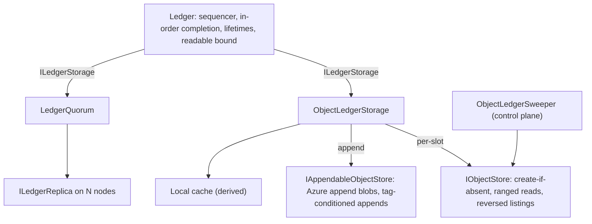

# Object-store ledgers

## 1. Purpose and scope

An **object-store ledger** keeps one copy of a [ledger](ledgers.md)'s batches in a cloud object store, written by
the ledger's one primary. It is the second implementation of the
[ledger storage seam](ledger-protocol.md#27-ledger-storage), beside `LedgerQuorum`, the quorum over `N` node replicas.
Above the seam nothing changes: one `Ledger` per ledger per process, the sequencer, in-order completion, writer
lifetimes, the readable bound, and Ledgers' rows, segments, map, and transitions are shared by both implementations. A
ledger's storage is fixed when it is installed, by its map entry's location
([ledgers §4](ledgers.md#4-data-types)), so a cluster may hold quorum and object-store ledgers at once, and a roll
moves a range from one to the other.

An object-store ledger is a **diskless** ledger: its node's disk holds only derived caches, and its durability is
the object store's. Batching is unchanged: a batch holds the rows of many journals, so the store's requests scale
with ledgers and batches, not with journals.

> "When the Loglet (i.e., the AtomicLog) becomes unresponsive for appends, we simply seal it; call checkTail to
> determine the switchover point; and then write a mapping to the conditional register so we can switch to a new
> Loglet (either another AtomicLog or an entirely different implementation) for new appends."
> (research/papers/logdrive/paper.md, §4)

This file specifies:

- `ObjectLedgerStorage`, the object-store ledger's `ILedgerStorage`, in its two layouts: **per-slot**, one object per
  slot, on every provider; and **append**, extents of slots in Azure append blobs;
- the ledger's markers, fences, and tombstones in the store;
- `ObjectLedgerSweeper`, which reclaims the storage of ledgers the map no longer lists;
- the store's identity record and the local cache.

Code: `Orleans.Durable.Storage.Engine.Ledgers` (namespace `Orleans.Durable.Storage.Engine.Ledgers.Objects`;
`ObjectLedgerSweeper` in `Orleans.Durable.Storage.Engine.Ledgers.Control`), over `IObjectStore` and
`IAppendableObjectStore` in `Orleans.Durable.Storage.Engine.ObjectStore.Abstractions` (§3.1). In code: the seam it
implements and the map's `ObjectStore` location (row 7.1 of the [implementation plan](https://github.com/ReubenBond/clog/blob/6ffb29aa96d2e4d48fc9c34f80790493e548af96/docs/implementation-plan.md)),
the per-slot layout's storage, its store and record, `PrefixedAppendableObjectStore`, and the sweeper (row 7.3),
the `ObjectLedger` formal model (`ObjectLedger.qnt`, rows 7.3b and 7.4),
`S3ObjectStore`'s directory-bucket mode for S3 Express One Zone (row 7.2b), the append layout
(`AppendObjectLedgerStorage`, `ObjectLedgerExtentFormat`, `ILedgerStorage.ReadRangeAsync`, `CLOE` vectors, and
`ledgers-object-extent` fuzz target, row 7.4), and the local cache (`ObjectLedgerCache`) and Orleans composition
(row 7.5).
*Not yet in code*: the providers' qualification (row 7.6).

### Design rationale

**Below the shared front, not below the quorum.** The ledger protocol's contiguous tail, holes, recovery writes,
quorum counting, and node addressing are the quorum's mechanism for deciding slots across `N` independent replicas
([ledger-protocol §8.2](ledger-protocol.md#82-known-contiguous-tail), [LR-I6](ledger-replicas.md#5-invariants)). A
single copy in an object store decides each slot with one conditional request, so it needs none of them. The seam sits
below `Ledger` and above `LedgerQuorum`: the sequencer, in-order completion (LP-I3), and stopping a lifetime before a
seal (LP-I13, LP-I14) stay shared and are proved once, and the object-store fence depends on them, since a write above
the fence may land but never completes. The seam carries one neutral fact down, the writer's acknowledged prefix, which
the quorum turns into its known contiguous tail and the object-store ledger uses as recovery's evidence.

Rejected alternatives:

- *A shared object-store replica under the quorum protocol with `N = 1`.* It makes the object store imitate a node
  replica: a positional seal for LR-I8's positionless one, no retained tail for LR-I6, no node for LR-I3, LR-I7, and
  LR-I9. The quorum protocol's proofs, its model, and `LedgerReplicaSpec` assume those invariants, so its evidence
  would not cover the object store, and the replica contract would describe a capability rather than an abstraction.
- *A Loglet-shaped `ILedger` above `Ledger`, each implementation owning its sequencer.* It passes nothing about tails
  down, but each implementation would own and prove its own sequencer, window, in-order completion, and LP-I14 fencing,
  and every reference to `Ledger` and `LedgerWriter` would change type. A Loglet's `append` also chooses its position,
  while Ledgers needs a batch's slot when it creates the batch ([LG-I12](ledgers.md#5-invariants)).
- *A LedgerStore over a WAL on blob storage, node-addressed.* The WAL's storage seam needs page writes and truncation
  ([wal §2](wal.md#2-contract-upward)), which only Azure page blobs offer, and a takeover would adopt and replay a whole
  node's WAL, fencing the node, to recover one ledger.
- *One object log per node, shared by the node's ledgers.* Fewer requests only when one node is primary of many
  ledgers, at the price of the same adoption and fencing.

**In-band seals, revived.** The per-slot layout is the per-slot object profile which Clog's cloud providers used until
commit `047dc2c94`: one object per address, created only if absent; a zero-length object is a SEAL; a create whose
outcome is unknown is settled by reading the object's length and CRC-32C metadata; addresses are reverse-encoded, so a
listing returns the newest slots first. A seal is a create which races the writer's create for one name, with the
request every write already makes, and adds no read to an append.

> "S3 gives us the ability to list keys in lexicographic order. Accordingly, we can list the first K keys to obtain
> the last K written slots, which we then invert to return the list of holes in the last K slots."
> (research/papers/logdrive/paper.md, §3.2)

**A positionless fence for appends.** An append conditioned only on its offset races a recovery's seal append, and a
live writer which pipelines appends can win every round. Azure conditions every `Append Block` on a blob index tag as
well as its offset, as the archive-log store already does ([archive logs
§9.1](archive-logs.md#91-azure-append-blobs-azurearchivelogstore)), so a recovery seals an extent by changing the tag,
which refuses every later append whatever its offset. S3 Express One Zone and Cloud Storage appendable objects offer
offset conditions only, so they use the per-slot layout until a positionless fence is qualified
([deferred](../deferred.md#object-ledger-appends-on-s3-express-and-cloud-storage)).

**Markers for what is not positional.** A positional fence answers a writer, but not an open check, which would have
to find a seal anywhere in the writer's window, nor a reader racing a drop, which would find slots missing. Two marker
objects, each created once and never deleted, answer both: `sealed`, created before a recovery returns, and `dropped`,
created before the sweeper deletes anything. An open check reads one object.

**Tombstones forever.** A partitioned writer repeats a write which met an outage without bound
([LP-I12](ledger-protocol.md#5-invariants)), so a fence which is ever deleted can let its write land and complete. Every
fence object is kept for the store's life, as a node keeps its tombstones
([ledger-replicas, design rationale](ledger-replicas.md#design-rationale)); a drop deletes every batch.

**The drop marker answers a late SEAL.** A recovery's SEAL create may be held in flight past the recovery, the ledger's
close and drop, and the sweep, and then land on a slot the sweep emptied, re-creating the name of a decided batch empty.
Every read which meets an absent object or a SEAL, at any slot, reads `dropped` and answers the drop once it exists; a
read which meets a batch at or above its bound reads it too, after the batch, since a delayed write may re-create a
batch there after the sweep and an absent marker then proves the batch preceded any sweep; and a recovery reads it
before it creates anything and again before it answers. So a reader whose stale map still bounds it above the slot, and
a recovery begun after the sweep, both answer `Dropped` (LL-I9), and the late SEAL is an empty object which every read
answers as the drop, at most `2K` of them for each recovery which outlived its ledger. [Object store
§2.4](object-store.md#24-the-callers-demand) admits such a re-creation in a ledger whose `dropped` marker exists.

Rejected alternative: *keeping the batches of the fence's window.* A recovery would record `K` in `sealed`, and the
sweeper would delete batches only below `T − K`, so no slot a delayed SEAL may reach would be emptied. It keeps up to
about `2K` batch objects, each up to a batch's size, for every dropped ledger for the store's life, garbage which grows
with every ledger a cluster closes, and reads above the kept window still need the marker.

**Durability is the store's.** One copy survives what the store survives. A single-zone store (S3 Express One Zone,
Azure LRS, Cloud Storage zonal buckets) loses acknowledged entries not yet drained when its zone is lost; the operator
chooses the store, and the exposure is a qualification boundary
([verification §13](../verification.md#13-qualification-boundaries)).

**One cluster per store prefix, without a claim.** Object-store ledgers live below the cluster's store prefix, the short
prefix of the cluster's own which the Orleans composition derives from its service ID or takes from its configuration
and records in its node registry with the archive store's identity ([orleans
§5.13](../compositions/orleans.md#513-archive-log-store)), the prefix under which the cluster's LSM objects live, in
their own `ledgers/` namespace. That each cluster's prefix is unique within its container or bucket is an operator
precondition which the store does not check ([archive LSM §9](archive-lsm.md#9-providers-and-implementations), *One
cluster per store prefix*), so clusters which share a bucket do so under distinct prefixes, and a silo configured with
another prefix than its registry's is refused before it touches the store. The store's identity follows the archive
store's: a record holding a random store ID and the layout, created once by its first user and adopted by every later
one ([archive §2.4](archive.md#24-selecting-the-store)), whose ID the node registry records, so a silo refuses a store
repointed or emptied under the cluster rather than read it as empty (OL-I1). A cluster claim, a conditional create of
the cluster's identity which refuses another cluster's store, was rejected as the LSM rejected it ([archive LSM, design
rationale](archive-lsm.md#design-rationale), *No cluster claim on the LSM*): it guards only the precondition's
misconfiguration and adds a write and a refusal path to every new cluster's start.

**Small windows set the cost.** A store write costs a request and a round trip of several milliseconds or more. With
the window `K` small, Journals' batches grow with the arrival rate (journals §8.8: linger 0, batch what is queued),
so requests per ledger stay near `K` per round trip whatever the load, and no entry waits for a timer
(§8.6).

### Diagram

## 2. Contract upward

### 2.1 `ObjectLedgerStorage`

`ObjectLedgerStorage` implements [`ILedgerStorage`](ledger-protocol.md#27-ledger-storage) and meets LL-I1 to LL-I9.
Every member is asynchronous and thread-safe. A `Ledger` holds one per object-store ledger, which `LedgerReader` opens
from the ledger's map entry through the process's `ObjectLedgerStore` (§2.2), without I/O. How it meets each member:

The recorded `T` arrives as `acknowledged`: the front carries it once it observes it, and the storage records it as its
bound, with no call of its own. No member answers `Backpressure`: a throttled request fails transiently (§6).

| Member | Mechanism |
| --- | --- |
| `WindowSize` | The ledger's `K`, from its map entry, which `ObjectLedgerStore.Open` takes. |
| `WriteAsync(slot, payload, acknowledged)` | Per-slot: one create-if-absent of the slot's object with the batch's CRC-32C. Append: queues the batch behind the append in flight and writes every contiguous queued batch in the next append (§8.1). `Written` once the batch is durable at the slot; `Sealed` once the slot's create met a SEAL, or the extent's append met the seal tag, a drop answering as a seal. |
| `CheckAsync(acknowledged)` | Fixes the bound at `acknowledged`, then reads the `sealed` marker (§8.3): one read. The map closes a ledger before it revokes it, so a dropped ledger's check answers sealed. |
| `RecoverAsync(acknowledged)` | Reads `dropped`, creates `sealed`, places the fence (§8.2) over `[T, T + K)`, re-reads `dropped`, and answers the candidate end: the first slot after the last batch below the fence. Every recovery of the ledger answers the same end. A transient failure repeats it from its start. |
| `ReadAsync(slot, acknowledged)`, `ReadAsync(slot, offset, length, acknowledged)` | Below the bound, the greater of `acknowledged` and the bound it holds: a whole read reads the slot's properties, then its object, which their CRC-32C checks (per-slot), or reads the slot's frame from its extent using the cached slot index built from walking trailers backwards (append); a byte-range read reads the range alone, and the properties only when the range is absent, a range past the batch answering `OutsideBatch` (§8.4). An absent object or a SEAL answers `Dropped` once `dropped` exists, and below the bound fails with `LedgerStorageCorruptException` otherwise (OL-I7); a batch at or above the bound answers `Dropped` once `dropped` exists, read after the batch. |
| `ReadRangeAsync(from, below, acknowledged)` | Reads consecutive slots `[from, below)` in order as an `IAsyncEnumerable<ReplicaRead>` (`LedgerRangeReads` default over `ReadAsync` for per-slot and quorum); in the append layout, reads each extent's frames with ranged reads of 8 MiB (§8.4), checking `dropped` per OL-I7. |
| `WriteContiguousTail(acknowledged)` | Issues no object-store request; raises only the instance's local bound (and in per-slot promotes buffered pending decided batches to the local cache), so no other process learns a tail from the store. |
| `LearnTailAsync(acknowledged)` | The greater of `acknowledged` and the bound it holds, with no request: the store holds no tail a writer published, and an object-store ledger has no replica nodes whose apply loop learns one, so its readers learn a tail by a seal check. |
| `StopReadsAsync()`, `DisposeAsync()` | Stop the reads, checks, and recoveries, and release the cache's entries for the ledger ([ledger-protocol §6.3](ledger-protocol.md#63-cancellation-and-disposal)). |

### 2.2 `ObjectLedgerStore`

One per process: the store, its layout, and its cache (`ObjectLedgerCache`). `ObjectLedgerStore.Over` takes any object
store, for the per-slot layout, and `OverAppendable<TStore>` one store of both interfaces through a type parameter
constrained to both, for either layout; in the append layout it checks at startup that the payload limit's largest batch
framed with its trailer fits `MaxAppendLength` (§8.1). `Open(ledger, windowSize)` returns an `ILedgerStorage`
(`ObjectLedgerStorage` for per-slot, `AppendObjectLedgerStorage` for append) for a ledger whose map entry's location is
`ObjectStore`, without I/O. `StoreRecordAsync()` answers the store's record (§7): the call which finds none creates it,
with its CRC-32C, holding a new random store ID and the configured layout, and a call which finds one, or whose create
meets one, answers the record the store holds; a record whose layout differs from the configured one throws
`ObjectLedgerStoreMismatchException`, and one which fails its CRC-32C or its
format, or vanished after it existed, `InvalidDataException`. `ReadStoreRecordAsync()` reads it without creating it. The
record's ID checks nothing by itself: the composition compares it with the ID its node registry records before the
process serves, and a cluster whose registry records one never creates a record again, so a store emptied or repointed
under the cluster is refused rather than read as empty (OL-I1, [orleans
§5.14](../compositions/orleans.md#514-object-store-ledgers)).

### 2.3 `ObjectLedgerSweeper`

In `Orleans.Durable.Storage.Engine.Ledgers.Control`; the only type which deletes or replaces an object-store ledger's
objects ([README §2.5](../README.md#25-dependency-rules)). `SweepAsync(map)` lists the store's ledgers below the map's
`NextLedgerId` and reclaims each one the map **revokes**, whose ID is below its `NextLedgerId` and which it does not
list: it creates the ledger's `dropped` marker unless the listing shows it, then replaces the fence extent with its
tombstone (append layout), then deletes every other object of the ledger but its markers and fences (§8.5), and answers
how many objects it deleted. Repeated sweeps delete objects which delayed writes recreated after a sweep (OL-I9). The
composition runs one sweeper per cluster, on the controller grain's silo, on every change of its view and periodically
([orleans §5.14](../compositions/orleans.md#514-object-store-ledgers)).

## 3. Requirements downward

### 3.1 From the object store

Object-store ledgers use `IObjectStore` and `IAppendableObjectStore`, whose one contract, the callers' demand among it,
[object store](object-store.md#2-contract-upward) states. The per-slot layout uses any `IObjectStore`, under the
cluster's prefix by `PrefixedObjectStore`; the append layout one store of both interfaces through a type parameter
constrained to both, under the prefix by `PrefixedAppendableObjectStore`. Their own uses:

- **Per-slot.** `CreateAsync` of a batch, or of a SEAL, an empty object; `GetPropertiesAsync`, whose length and CRC-32C
  settle a create whose answer was lost (§8.1); `ListAsync` from a start name, newest slot first.
- **Append.** `CreateAppendableAsync` of each extent; `AppendAsync` of at most `MaxAppendLength`, 100 MiB, per append
  and at most 40,000 appends per extent (`ExtentMaxAppends`), within the store's 50,000; `SealAsync` in recovery, whose
  `NotAppendable` tells a tombstone from an extent; and `ReplaceWithTombstoneAsync` by the sweeper (§8.5). An append
  which a seal follows before its retry answers `Appended`, since the extent holds its bytes, so `Sealed` is definite.
- **Markers.** `sealed` and `dropped`, created once and empty, read by properties.

Azure is the one provider of appendable objects among the services ([object store §9.1](object-store.md#91-azure-appendable-objects)),
relying on `x-ms-if-tags` evaluated atomically with `Append Block` and `Set Blob Tags`, and on a `Put Blob` replacing an
append blob whole ([verification §13](../verification.md#13-qualification-boundaries)).

The store is strongly consistent: a read, a properties read, or a listing which begins after a write's durable answer
reflects it. The prefix carries no lifecycle or expiration rule, which would delete fences: an operator precondition
the store does not probe, beside the container or bucket settings the LSM requires
([archive LSM §9](archive-lsm.md#9-providers-and-implementations)).

### 3.2 From the shared front

The front ([ledger-protocol §2.7](ledger-protocol.md#27-ledger-storage)) writes each slot from one writer lifetime, one
batch per slot, retries byte-identical; completes slots in order (LP-I3); stops its lifetime before its first recovery
(LP-I14); acquires a slot only below its completed prefix plus `K` (LP-I2), so every batch lies below the first slot no
batch occupies plus `K`; passes only an acknowledged prefix or the recorded `T` as `acknowledged`; and reads only below
its readable bound.

## 4. Data types

| Type | Definition |
| --- | --- |
| `ObjectLedgerLayout` | `PerSlot` or `Append`, fixed per store by its record. |
| `ObjectLedgerStoreOptions` | `(Layout, ExtentTargetBytes, ExtentMaxAppends, MaxBatchBytes, CacheBytes, CacheDirectory?, Redundancy)`, over an object store whose names lie below the cluster's store prefix (§7); the defaults are per-slot, 128 MiB, 40,000 appends (below Azure's 50,000 blocks), 100 MiB − 49 B max batch (`MaxAppendLength − 49 B`), 1 GiB memory cache, and no local disk directory. |
| `ObjectLedgerStoreRecord` | `(Id: ObjectLedgerStoreId, Layout)`, the store's record (§7), in the archive store record's form; `Decode` answers it or the `InvalidDataException` naming the first rule its bytes break. |
| `LedgerStorageCorruptException` | The storage holds a value which fails its integrity check, or lacks a decided batch while the ledger is not dropped (OL-I7); in the ledger replica contract's component, beside `LedgerReplicaCorruptException`, so the failure classifier names it ([ledger-replicas §6.4](ledger-replicas.md#64-failures)). |
| `ObjectLedgerStoreMismatchException` | The store's record names another layout, or its ID differs from the one the node registry records, or it is absent while the registry records one. |
| `ObjectProperties` | `(Length, Crc32c?)`, in `Orleans.Durable.Storage.Engine.ObjectStore`. |
| `ObjectAppendOutcome`, `ObjectSealOutcome` | The appendable store's unions ([object store §4](object-store.md#4-data-types)). |

## 5. Invariants

Both layouts' code, formal model (`ObjectLedger.qnt`, [ledger
model](../../../specs/ledger-protocol/README.md)), local cache, and Orleans composition hold OL-I1 to OL-I11.

- **OL-I1 — Store identity.** The store's record is created once, by the first user which finds none, and holds a
  random store ID and the layout; a process uses the store only when the record's layout is its own and its ID is the
  one the cluster's node registry records, and once the registry records an ID, no process creates a record again, so
  none treats an emptied or repointed store as empty.
- **OL-I2 — Conditional placement.** Every batch reaches the store by a conditional request: a create-if-absent of its
  slot's object, or an append at the writer's own expected offset while the extent is open. A write whose outcome is
  unknown, or which met an occupant, is settled by reading the occupant at the writer's own name or offset: its own
  CRC-32C answers `Written`, a SEAL answers `Sealed`, and absence repeats the write.
- **OL-I3 — Fence.** A recovery's candidate end `T` is the first slot after the last batch below its fence: in the
  per-slot layout the lowest SEAL object, placed by conditional creates over `[s, s + K)` from the first slot `s` a
  listing showed without a batch, and over `(T, T + K)`; in the append layout the seal of the newest extent, and of the
  extent its last `ROLL` names. Every slot below `T` holds its batch, and no writer write at `T` answers `Written`, so
  by LP-I3 no slot at or above `T` completes; a write the writer issues after the recovery, below its completed prefix
  plus `K` and so below `T + K`, meets the fence. Every recovery of the ledger answers the same `T`.
- **OL-I4 — Markers.** A recovery creates the ledger's `sealed` marker before it answers; the sweeper creates `dropped`
  for every ledger it reclaims, before it deletes or replaces any object of the ledger. Neither is ever deleted.
- **OL-I5 — Check order.** A check fixes its bound before it reads `sealed`; an unsealed answer proves no recovery
  completed before that read began.
- **OL-I6 — Recovery from evidence.** A recovery starts from the acknowledged prefix, the recorded `T`, or the
  listing's window below the newest slot, never above a slot it has not seen hold a batch; a listing's absence decides
  nothing until a conditional create does. It re-reads `dropped` before it answers, and answers `Dropped` when it
  exists.
- **OL-I7 — No missing below the bound.** A read which meets an absent object or a SEAL answers `Dropped` once `dropped`
  exists, at any slot, and below the bound is corruption otherwise, never `Missing`; a read which meets a batch at or
  above the bound reads `dropped` after the batch and answers `Dropped` when it exists.
- **OL-I8 — Permanent fences.** Every SEAL object, the tombstone which replaces the fence extent, and both markers last
  for the store's life, a SEAL which a delayed create lands after a sweep among them. The tombstone replaces its extent
  in one request with an object no append can extend.
- **OL-I9 — Reclamation.** Only `ObjectLedgerSweeper` deletes or replaces an object-store ledger's objects, and only of
  a ledger its view revokes; it deletes nothing of OL-I8. Objects which delayed writes create after a sweep are batches
  at or above `T`, copies of decided batches below it, and SEALs at any slot; a later sweep deletes the batches.
- **OL-I10 — Append-layout shape.** An extent holds the frames of consecutive slots, each append ending with a
  trailer, and at most one `ROLL` frame, last, which names the next extent's first slot; the writer creates the next
  extent only after its `ROLL` is `Written`, and keeps one append in flight per ledger.
- **OL-I11 — Derived cache.** The local cache holds only batches read or written as decided, each with its CRC-32C,
  which every hit checks; a cache which fails or misses answers nothing, and the read goes to the store.

## 6. Faults, concurrency, and cancellation

- **Unknown outcomes.** A create or append whose answer was lost is settled by OL-I2's read. A 409 `Conflict` (S3's
  `ConditionalRequestConflict`) is repeated, not settled.
- **Outages and throttling.** The store's outages and its `503` and `429` answers, after the SDK's retries, are
  transient failures: the front repeats writes without bound ([LP-I12](ledger-protocol.md#5-invariants)), recovery
  waits them out, and admission backs up until node budgets answer `Throttled`
  ([orleans §5.9](../compositions/orleans.md#59-resource-governance)). A per-account request budget, which the
  composition shares among ledger writes, checks, drains, and archive logs, keeps a cluster under its account's limit
  ([orleans §5.14](../compositions/orleans.md#514-object-store-ledgers)).
- **A stale writer.** A deposed primary's writes meet the fence or land above it; none completes (OL-I3, LP-I3). In the
  append layout its appends after the seal answer `Sealed` whatever their offset.
- **Racing recoveries.** Concurrent recoveries create the same markers and fences; each conditional create decides once,
  and both answer the same end.
- **Refusals.** The store's refusal of a request (`ObjectStoreRefusedException`) is waited out as an outage, since a
  grant may yet change it; a missing container fails the store's record read at startup (§2.2), before any ledger opens.
- **Corruption.** A batch whose CRC-32C fails, or a batch lost below the end, is corruption
  (`LedgerStorageCorruptException`), never `Missing` or a batch ([LR-I2](ledger-replicas.md#5-invariants)'s rule,
  restated as LL-I6). A recovery reads only its window's listing, so a corrupt batch anywhere below `T`, or a lost batch
  below the window, surfaces on the read or drain which meets it rather than blocking the recovery. With one copy, the
  ledger's history is then lost at that slot: a qualification boundary, with the loss procedure of
  [deferred](../deferred.md#recovering-a-range-after-a-ledger-loses-its-quorum).
- **Changed content.** A batch whose content changed after its writer computed its CRC-32C is a defect, which the
  storage reports to the fatal-error handler, so no repetition writes the changed bytes under a checksum computed afresh
  ([conventions §14](../conventions.md#14-local-storage-failures-stop-the-process)).
- **Local cache failures.** A failed read or write of the cache discards the entry, or the whole cache, and the read
  goes to the store: the cache holds derived state only, the trivially safe recovery [conventions
  §14](../conventions.md#14-local-storage-failures-stop-the-process) allows.
- **Cancellation.** A caller's cancellation stops its wait; a create or append already sent may still land, and OL-I2
  settles it.

## 7. Formats

Names below `ledgers/` under the cluster's store prefix, `{prefix}/ledgers/`, the prefix the cluster's LSM objects live
under (§1, *One cluster per store prefix*), with `{id}` the ledger ID and `{rev}` a slot's reverse key, `(2^63 − 2) −
slot` as 20 decimal digits, so a listing returns the newest slots first (the object profile's encoding, revived with its
vectors):

| Name | Content |
| --- | --- |
| `ledgers/store` | The store's record, in the archive store record's form ([archive §7](archive.md#7-formats)): exactly two ASCII lines separated by one line feed, with no terminator, `id=` and the store ID's 32 lowercase hexadecimal digits, not all zero, then `layout=per-slot` or `layout=append`; created once. A decoder checks the lines (`bad-line`), then the ID (`bad-id`), then the layout (`bad-layout`). |
| `ledgers/l/{id:020}/sealed` | Empty. Created once by a recovery (OL-I4). |
| `ledgers/l/{id:020}/dropped` | Empty. Created once by the sweeper (OL-I4). |
| `ledgers/l/{id:020}/s/{rev}` | Per-slot: the slot's batch with metadata `durablecrc32c`, or empty, a SEAL. |
| `ledgers/l/{id:020}/x/{rev}` | Append: the extent whose first slot `{rev}` names, a `CLOE` append blob, or its tombstone, a block blob holding one `SEAL` frame. |

`CLOE` v1 extents hold frames, each `kind (DATA 1, ROLL 2, SEAL 3), slot u64, length u32, CRC-32C u32`, then
`length` bytes of batch for DATA and none otherwise; each append ends with a trailer `first slot u64, count u32, start
offset u64, previous trailer offset u64, CRC-32C u32`, from which a reader walks an extent backwards one append at a
time. [Formats §3](../formats.md#3-object-storage-layout) registers both. `test/Durable.Storage/shared-vectors/ledgers/object-*.json`
pins the names, reverse keys, and listing order, the slots' classification and settlement, and the store's record, whose
decoder the `ledgers-object-store-record` fuzz target checks; `object-extents.json` and `object-extent-rejections.json`
pin `CLOE` v1 frames, trailers, and rejections, and the `ledgers-object-extent` fuzz target checks their decoders.

## 8. Mechanism and policy

### 8.1 Writes

**Per-slot.** The writer creates `s/{rev(slot)}` if absent, with the batch and its CRC-32C. `Created` answers
`Written`. `Exists`, or a lost answer, reads the object's properties: its own length and CRC-32C answer `Written`,
length zero `Sealed`, absence repeats the create (OL-I2).

**Append.** One append is in flight per ledger. Batches which arrive meanwhile queue, and the next append carries every
queued batch whose slot follows the last one written, in slot order, each in a DATA frame, then the trailer, at the
offset the previous append ended, stopping before a batch whose frame would take the append past `MaxAppendLength`; the
store checks at startup that the largest batch the payload limit admits, framed with its trailer, fits one append.
`Appended` answers `Written` for each of its batches. `LengthMismatch` or a lost answer reads the extent at the
writer's own offset: its own frames answer `Written`, a different occupant fails with `InvalidDataException`; `Sealed`,
which the store gives only when the extent does not hold the append's bytes, answers `Sealed` for every queued batch;
`Absent`, an extent the sweeper removed, also answers `Sealed`. An extent rolls once it passes `ExtentTargetBytes` or
`ExtentMaxAppends`: the writer appends a ROLL frame naming the next slot, then creates the next extent
(`CreateAppendableAsync`), and writes on (OL-I10).

### 8.2 Recovery

1. Read `ledgers/l/{id}/dropped`: when it exists, answer `Dropped`, creating nothing. Create `ledgers/l/{id}/sealed`
   if absent.
2. **Per-slot.** List `s/` newest first: the newest slot `h` holding an object, then each slot down to the window's low
   end `w = max(a, h + 1 − K)`, where `a` is the evidence of OL-I6, or `w = a` when the listing is empty; below `w`
   every slot holds a batch (LP-I2), and below `h + 1 − K` because a SEAL lies only in an earlier recovery's window. Let
   `s` be the first slot at or above `w` which the listing does not show holding a batch. A SEAL the listing shows at
   `s` ends the ledger, `T = s`, since no batch ever replaces one. Otherwise create a SEAL at every slot of `[s, s + K)`
   the listing did not show, in parallel, and settle each create which finds an object by its properties. `T` is the
   first slot at or above `s` which holds no batch; when every slot of `[s, s + K)` held one, the writer outran the
   recovery, which lists again with evidence `s + K`. Then create a SEAL at every slot of `(T, T + K)` neither the
   listing nor the window settled, so a write the writer pipelined past `T`, below its completed prefix plus `K`, meets
   a fence (LL-I4).
3. **Append.** List `x/`, newest first, and seal the newest extent (`SealAsync`): `Sealed` an extent, `NotAppendable` a
   tombstone, which a drop left — check `dropped` and answer `Dropped` when it exists, or fail with
   `LedgerStorageCorruptException` if no `dropped` marker exists. Read its last trailer and frame. A
   ROLL frame names the next extent (strictly above the current extent's first slot, otherwise
   `LedgerStorageCorruptException`): create it if absent and seal it, then repeat on it. The end `T` is the slot after
   the last DATA frame, or the ROLL's slot when the named extent holds none.
4. Read `ledgers/l/{id}/dropped`: when it exists, answer `Dropped`; otherwise answer `T`.

Every step is idempotent, so a transient failure repeats the recovery from step 1.

### 8.3 Checks

`CheckAsync` fixes its bound, the acknowledged prefix it carries or the recorded `T`, then reads `sealed` (one
properties read). The map closes a ledger before it revokes it, so a dropped ledger's `sealed` exists, and its check
answers sealed, as a drop counts as a seal (LP-I5). A check answers in one request, so the primary's coalesced open
check ([ledgers §8.3](ledgers.md#83-the-primarys-open-check)) costs one read per round trip of reads.

### 8.4 Reads and the cache

A process reads only below its bound. A per-slot read reads the slot's properties, then the object's bytes with one
ranged read, which the properties' CRC-32C checks; a byte-range read reads only its range, in one request, which no
checksum covers, and the slot's properties only when the range is absent. An absent object or a SEAL reads `dropped`,
and a batch at or above the bound reads it after the batch, so every answer a sweep may change answers the drop once its
marker exists (OL-I7). With `ObjectLedgerCache`, the process caches only decided batches (reads below the bound and
writes once decided, never an undecided speculative slot, OL-I11) in memory and optionally in a volatile local
directory, verifying each hit's CRC-32C, until its bytes budget evicts it or the ledger is disposed (`DisposeAsync`) or
observed dropped, so the primary's applies and the drains of its open ledger
([orleans §5.14](../compositions/orleans.md#514-object-store-ledgers)) read from memory; any checksum mismatch or disk
error drops the entry and falls back to the store without raising a fatal storage error (OL-I11). Another process reads
a per-slot batch with one ranged read of its object, and an append-layout batch by walking the extent's trailers back
from its end in tail chunks (coalescing concurrent cold walks per extent), which it caches as the extent's slot index.
A range read (`ReadRangeAsync`) reads an extent's frames with ranged reads of 8 MiB; each `DATA` frame carries its own
CRC-32C, which authorizes streaming each verified frame as it is read while validating each append's `CLOE` trailer at
the append boundary (failing with `LedgerStorageCorruptException` if a final append is truncated before its trailer and
`dropped` does not exist).

### 8.5 Reclamation

For each ledger a sweep finds revoked (§2.3): create `dropped` unless the listing shows it, which sorts first among the
ledger's names; in the append layout, replace the newest extent with its tombstone; delete every other object under
`ledgers/l/{id}/` but `sealed`, `dropped`, every zero-length per-slot object, and the tombstone, up to 32 deletes in
flight. A sweep lists `ledgers/l/` once, stopping at the map's `NextLedgerId`, and lists again after a ledger the map
still lists once it passed 64 of its objects, so a live ledger's slots cost it a page at most; it judges a ledger it
already reclaimed by its `dropped` marker, deleting only objects created since. Every ledger keeps its markers and its
fences' SEALs, about `2K + 2` empty objects, for the store's life, so a sweep's listing grows with the ledgers the store
ever held ([deferred](../deferred.md#compacting-object-ledger-tombstones)).

### 8.6 Policy and cost

| Setting | Default | Why |
| --- | --- | --- |
| `K` for object-store ledgers | 2 per-slot, 4 append | Requests per ledger stay near `K` per round trip; batches grow with arrivals. |
| Journals' linger | 0 | The window self-clocks batches; a timer only adds latency. |
| `ExtentTargetBytes`, `ExtentMaxAppends` | 128 MiB, 40,000 | Bounds read amplification and stays below Azure's 50,000 blocks. |
| Cache | 1 GiB memory; optional local directory | Covers the primary's applies and its open ledger's drains. |

Back-of-envelope, one ledger, entries under 1 KiB, at about $5 per million writes (S3 Standard, Azure hot, Cloud
Storage Class A): per-slot with `K = 2` at a 30 ms round trip, about 67 writes/s, about $860 a month, at any load
above that; append on Azure with one append in flight at 30 ms, about 33 writes/s, about $430 a month. An entry waits
about one round trip per-slot, and about 1.5 append. A check under read load costs one metadata read per coalesced round
trip. These are estimates: rows 7.6 and 5.4 measure them on each provider.

## 9. Providers and implementations

| Provider | Layout | Notes |
| --- | --- | --- |
| Memory and file-system object stores | Both | Tests and simulation; with the simulated and fault-injecting stores, each implements `IAppendableObjectStore`, the simulated one with delayed landings. |
| Amazon S3 | Per-slot | Ordered listings; conditional `PutObject` (`IfNoneMatch: "*"`); fidelity suite on LocalStack (`CLOG_EMULATORS=1`) and live S3 (`CLOG_S3_LIVE`). |
| S3 Express One Zone | Per-slot | Directory-bucket mode (`--x-s3`, [object store §9.2](object-store.md#92-s3-directory-buckets)): hierarchical layout routing ordinal listings over unordered directory listings; one zone; fidelity suite on `FakeS3DirectoryBucketService` and live S3 Express (`CLOG_S3_EXPRESS_LIVE`). |
| Azure Blob Storage | Append, or per-slot | Append blobs with tag-conditioned appends; per-slot over block blobs; fidelity suite on Azurite (`CLOG_EMULATORS=1`) and live Azure (`CLOG_AZURE_LIVE`). |
| Google Cloud Storage | Per-slot | `ifGenerationMatch=0` creates; appendable objects deferred; fidelity suite on `fake-gcs-server` and the Cloud Storage testbench (`CLOG_EMULATORS=1`) and live GCS (`CLOG_GCS_LIVE`). |

The revived object profile brings back the cloud drives' classification and settlement rules, their tests, and the
`object-profile` vectors (key layout, address encoding, listing order, classification, and settlement), adapted to the
names of §7 and to `IObjectStore`.

## 10. Verification

| Evidence | What it establishes |
| --- | --- |
| The ledger storage spec over both implementations | LL-I1 to LL-I9 ([ledger-protocol §10](ledger-protocol.md#10-verification)): `LedgerStorageSpec`, the contract's spec, which judges answers alone (row 7.1b), run over both per-slot and append layouts through `ObjectLedgerSystem` on the memory and fault-injecting stores (`ObjectLedgerConformanceTests`), whose held writes land a SEAL or a batch after a sweep, on the simulated and file-system stores under seeded and explored schedules (`SimulatedObjectLedgerConformanceTests`), and on `S3ObjectStore` directory-bucket mode over the unordered `FakeS3DirectoryBucketService` (`S3DirectoryBucketLedgerConformanceTests`); it fails a storage blind to the `dropped` marker. |
| `ObjectLedger` model (`ObjectLedger.qnt`), refining `AtomicLedger.qnt` | Both per-slot and append layouts (`Layout = "per-slot"` and `Layout = "append"`, OL-I2 to OL-I10, rows 7.3b and 7.4) under a stale writer, delayed and unknown creates/appends, coalescing and extent rolls, two concurrent recoveries, readers with stale maps, fetchers, a drop racing a recovery, and the sweeper; all eight mutants caught across both layouts (`seal-unconditional`, `check-without-marker`, `drop-without-marker`, `recover-from-gap`, `drop-deletes-seal`, `read-ignores-drop`, `tombstone-appendable`, `roll-before-written`) and eighteen reachability witnesses (ten per-slot, eight append). |
| Simulation | In code (row 7.5): `MixedObjectLedgerSimulationTests` (`Orleans.Durable.Storage.Simulation.Tests`), Ledgers and Journals simulations over a cluster mixing quorum and object-store ledgers with diskful and diskless processes (including crashing a diskless primary with writes in flight before takeover and restarting a fresh-identity diskless node) and rolls between locations, judged by the history fold and the linearizability checker, with non-vacuous pre- and post-sweep `ObjectLedgerSweeper` assertions. Planned: trace validation against the `ObjectLedger` model. |
| Appendable object store spec | `ObjectStoreSpec` extended to appends, seals, and tombstones, over the memory, file-system, simulated, and fault-injecting stores and on Azurite ([object store §10](object-store.md#10-verification)), row 7.2. |
| Provider fidelity | One test per precondition of §3.1, each failure's error code asserted, plus end-to-end `ObjectLedgerStorage` and `AppendObjectLedgerStorage` lifecycle tests (`ObjectLedgerFidelityLifecycle`): `S3ObjectLedgerFidelityTests` on LocalStack and `CLOG_S3_LIVE`, `S3ExpressObjectLedgerFidelityTests` on `FakeS3DirectoryBucketService` and `CLOG_S3_EXPRESS_LIVE`, `GcsObjectLedgerFidelityTests` on `fake-gcs-server`, the Cloud Storage testbench, and `CLOG_GCS_LIVE`, and `AzureAppendableObjectFidelityTests` on Azurite and `CLOG_AZURE_LIVE` (covering tag-conditioned appends, seals racing appends in flight, tombstones, lost-answer recovery, per-slot preconditions, and both ledger layouts). `AzureLiveAccount` isolates each test in a container of its own with a once-per-process stale-container sweep; `S3LiveAccount`, `S3ExpressLiveAccount`, and `GcsLiveAccount` isolate each test under a timestamped prefix with a once-per-process stale-prefix sweep and bounded-parallel cleanup on disposal. Each provider stays unqualified until its live run passes ([verification §10](../verification.md#10-integration-end-to-end-and-soak), row 7.6). |
| Revived object-profile tests and vectors | `ObjectLedgerVectorTests` over the names, reverse keys, and listing order, the slots' classification and settlement, the store's record, and `CLOE` v1 extents (`object-extents.json`, `object-extent-rejections.json`, fuzz target `ledgers-object-extent`); `ObjectLedgerStorageTests`: a SEAL held past the sweep which lands on an emptied slot reads as the drop, writes settled by their occupant, reads below the bound, and a recovery whose window the writer filled; `AppendObjectLedgerStorageTests`: single-in-flight coalescing, startup payload-limit check, `ROLL` and recovery following `ROLL`, tag-seal recovery, tombstones, cached extent index, and 8 MiB ranged reads; `ObjectLedgerSweeperTests`: reclamation of revoked ledgers only, the marker first, fences and tombstones kept, a re-created batch swept again, and the store's record. |
| Metamorphic | `ObjectLedgerCacheTests`: CsCheck metamorphic cache-on (memory and memory+disk) vs cache-off agreement for both per-slot and append layouts, decided-only caching, memory and disk CRC-32C corruption and I/O fallback, concurrent `Put`/`TryGet`/`EvictLedger` stress, and `LocalStorageFailureTests.DerivedCachesNeverReferenceFatalErrorHandler` (OL-I11). `ObjectLedgerMetamorphicTests`: exact answer equivalence across quorum `N = 1, Q = 1`, quorum `N = 3, Q = 2`, per-slot `ObjectLedgerStorage`, and append `AppendObjectLedgerStorage` over scripted edge cases (including torn pipelined windows, recovery racing an in-flight writer, and a lagging/dropped quorum replica) and CsCheck-randomized workloads (appends, pipelined appends, slot and byte-range reads including below-bound cold reads, `ReadRangeAsync`, checks, recovery, and drops) under `ArcBufferLeakCheck`. |
| Benchmarks | In-memory CPU and allocation microbenchmarks (`ObjectLedgerCodecBenchmarks`, `ObjectLedgerTombstoneCodecBenchmarks`, `ObjectLedgerCoalescerBenchmarks`, `ObjectLedgerWriteBenchmarks`, `ObjectLedgerTakeoverBenchmarks`): `CLOE` frame, trailer, and tombstone codecs, deterministic append-coalescer allocations and throughput, entry latency and throughput over `K` (`1, 2, 4`) and load for both layouts, and O(log N + K) takeover time against ledger age (slot/extent count), dry-verified with `just bench '*ObjectLedger*' --job Dry`; live per-provider latency distributions run against live provider accounts and await cloud credentials. |
