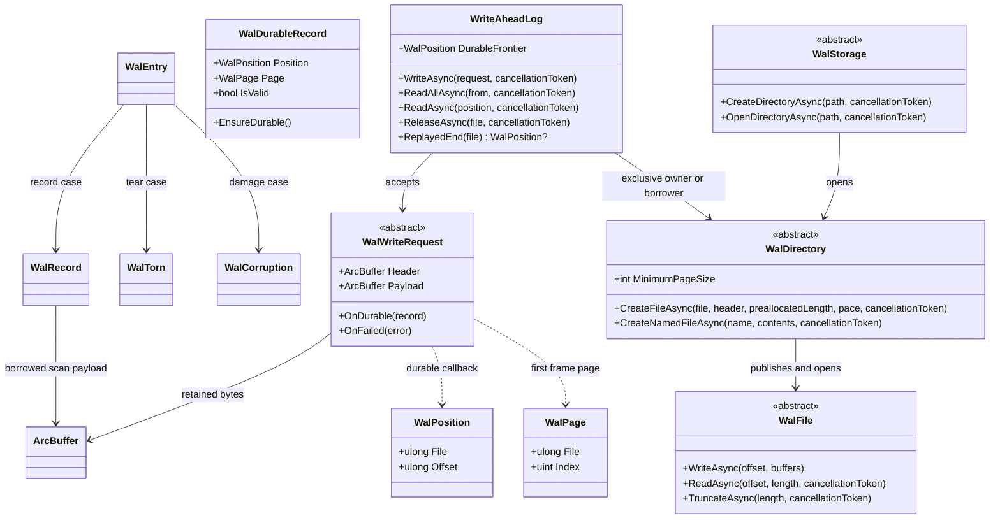
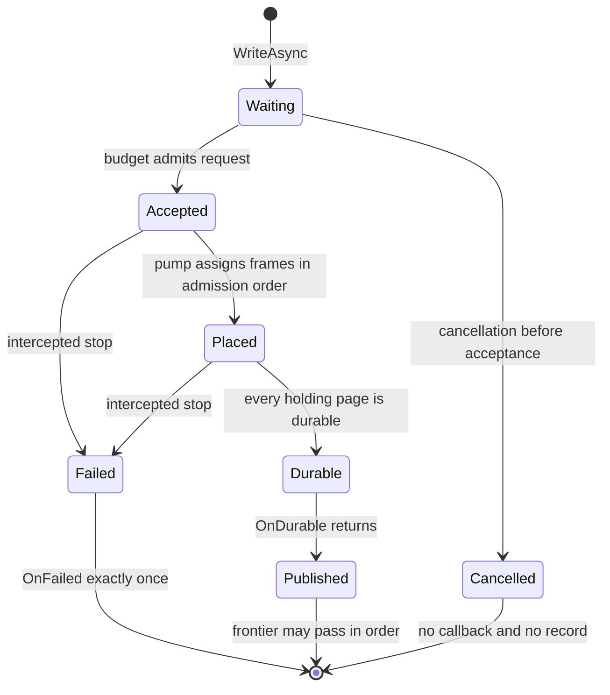
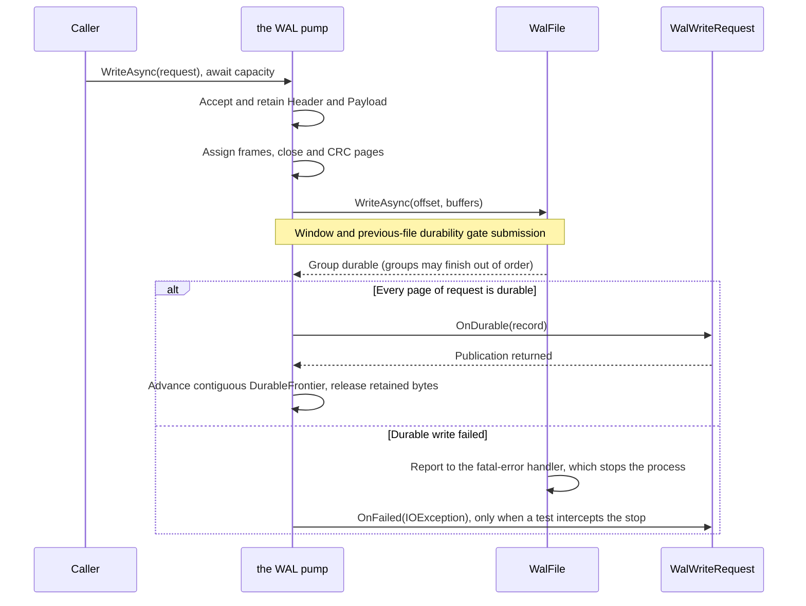
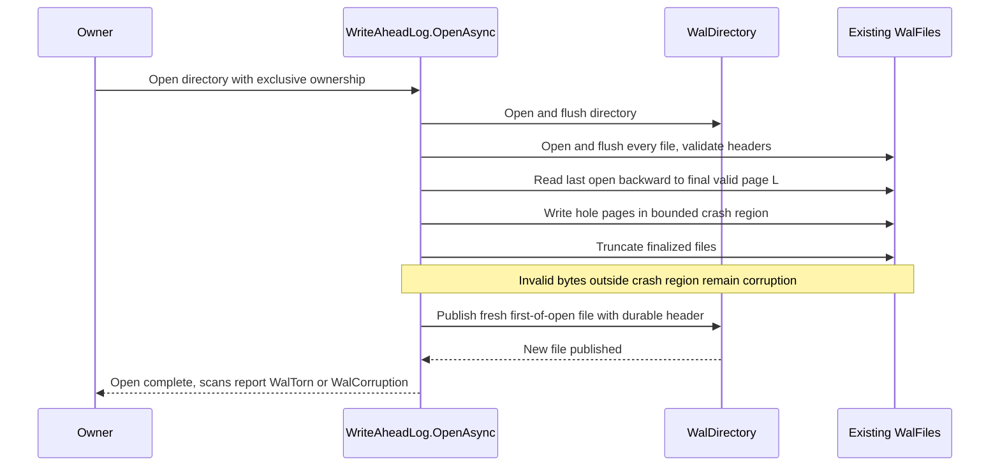

# WAL

## 1. Purpose and scope

The WAL (`Orleans.Durable.Storage.Engine.Wal`, namespace `Orleans.Durable.Storage.Engine.Wal`) is a page-oriented
write-ahead log of independently durable records in one directory of numbered files. Records are opaque byte strings
appended in admission order; small records pack into shared pages and a long record continues across pages. Each page is
written once and carries a CRC-32C. A record is durable when every page holding it is durable, and different records
become durable in either order, which is all a ledger replica needs from local storage: "writes on the LogDrive can
linearize out of address order" (`research/papers/logdrive/paper.md`, §3.1).

The WAL lets replay tell a crash from damage to acknowledged data. A scan reports every page it cannot read records
from, in band, as `WalTorn` (left incomplete by a crash; nothing acknowledged was on it) or `WalCorruption` (damage to
bytes which were durable), so the layer above can repair from replicas instead of losing data silently.

The WAL depends only on [Buffers](buffers.md) and stores opaque records; the
[LedgerStore](ledgerstore.md) runs one WAL per node, gives records their meaning, and keeps its node file and its
catalog and slot-index checkpoints as named files of the WAL's directories.

### Design rationale

The WAL owns opaque record durability, not slot arbitration or a log-wide commit. Registers can become durable
out of address order; making acknowledgements wait for one contiguous commit frontier would couple independent
records to the slowest earlier page. `DurableFrontier` is instead a publication/replay boundary, not the
acknowledgement point. `AppendAsync` acknowledges from its record's `OnDurable` for the same reason: completing it
only once the frontier passed the record would make each append wait for every earlier one. Forward-only,
write-once pages and a fresh file per open let replay classify a bounded crash region once; checksums then
distinguish later damage from that recorded tear.

An engine with one ordered commit, or packed pages guarded by a separate contiguous commit file, adds an
authority the WAL does not need. Chained page checksums also make one damaged page invalidate unrelated later
records, and forbidding records to span pages would impose a page-size payload limit. One file per register
avoids a WAL codec but makes create, close, rename, and metadata flush costs part of every small write.
The WAL owns its complete format and reports damage to the replicated layer rather than hiding it.

Every answer the WAL gives rests only on durable bytes ([conventions §13](../conventions.md#13-durable-answers)), so
its storages make each write report its own errors and return the device's bytes to reads (§3), through direct,
write-through I/O. Buffered writes made durable by `fsync` meet neither. Linux reports a writeback error once per
open file description: "After an error has been reported on one request, subsequent requests on the same file
descriptor should return 0, unless further writeback errors have occurred since the previous file synchronization"
(`Documentation/filesystems/vfs.rst`, "Handling errors during writeback"). With several write groups in flight on
one descriptor, one group's `fsync` could take another group's error, and the other group's records would be
acknowledged though their pages were lost. A page whose writeback failed also stays cached and readable, so a later
open in the same boot would replay from bytes the device never held. Serializing each file's syncs, failing every
later write once one fails, and dropping the file's cached pages after its flush on open
(`posix_fadvise(POSIX_FADV_DONTNEED)`) is the rejected alternative: it gives up concurrent write groups, and the
call it rests on is advisory. Direct I/O needs aligned buffers, which the WAL's pages already are. A Linux file system
may accept `O_DIRECT` and still buffer a file, so each open checks, through `statx`, that the file system serves the
file by direct I/O (§9); that check sets the portable storage's floor at Linux 6.1, the io_uring storage's.

On Linux, the io_uring storage makes direct writes durable with a data sync after each write group, not with
`O_DSYNC`. Both keep the page cache out of the data path: a direct write returns its transfer error, and the
`fdatasync` returns its own journal or device-flush error. On a local consumer NVMe whose atomic write unit is 512
bytes, a 4 KiB `O_DIRECT | O_DSYNC` write took 2.24 ms p50, while a direct write followed by `fdatasync` took about
1.2 ms for the write plus flush; through the whole WAL, data sync with the faster zero-fill (§8) raised appends
1.8–2.4×. Kernel-side packing through buffered writes was no faster at the same records per flush, and rewriting a
partially filled 4 KiB page would make a torn device write invalidate acknowledged records protected by its page CRC.
The WAL therefore keeps its in-process bounce buffer and write-once pages. The measurements and rejected alternatives
are in [io_uring WAL performance](../../performance/io-uring-wal.md).

Reads then bypass the page cache, so each read reaches the device: a keyed or positioned read of a recently written
record costs one device read per page it spans, where buffered reads would often have hit the page cache, and a scan
or replay reads its chunks from the device without the kernel's read-ahead. That is the cost of reads which see only
the device's bytes (WAL-I10); a cache of recently durable pages within the WAL would recover it without giving that up,
and is deferred until point-read latency or read IOPS is measured as a limit
([deferred work](../deferred.md#wal-cache-of-recent-durable-pages)). macOS serves
development and tests only: its I/O is buffered, every write and directory flush uses `F_FULLFSYNC`, and none of this
is qualified (§9).

The adaptive write-group limit serves both serial and parallel durable-write devices. A fixed limit can
either waste a parallel device or multiply serial-device latency; a fixed batching delay adds latency even
when the device is idle. The measured comparison motivating this policy used 512-byte closed-loop appends
(`test/Durable.Storage/benchmarks/Clog.LogDrivePerf --groups`): on a loop-mounted ext4 Docker volume, 4 clients achieved
400/228/126 appends/s at 9/17/32 ms p50 with 1/2/4 groups, respectively; a modeled parallel device
(`--device parallel:2:200`) at 16 clients achieved 2,325/3,151/3,600 appends/s at 7.7/4.3/4.2 ms.
These are workload-specific design evidence, not portable performance guarantees. The current mechanism
and thresholds are specified once in [write-group concurrency](#write-group-concurrency).

The WAL makes a name durable by flushing its directory on every platform, so one persistence model
([verification §7.5](../verification.md#75-crash-state-enumeration)) describes each. Every directory it flushes is
its caller's root or lies beneath it (§3): the root is an operator's, durable before the WAL runs, so the WAL never
needs a right, or pays for a flush, above it. A directory created beneath the root is made durable by flushing its
parent once it is created, and creating it again, accepting the existing directory, repeats that flush, which makes
durable a name a crashed creator left unsynced (WAL-I10). Opening a directory flushes it, not its parent: its name was
durable once its creation returned.

A directory flush which fails stops the process ([conventions
§14](../conventions.md#14-local-storage-failures-stop-the-process)), so nothing in that process relies on a later flush.
It leaves the names it covered unsynced, and the next incarnation's open flushes the directory, which makes them durable
(§3). A directory's entries are file-system metadata, which ext4 and XFS write through their journals: when the device
fails a journal write, ext4 aborts its journal and XFS shuts the file system down, so every later flush fails, and a
flush which succeeds after a failure follows one which failed before it reached the device, for example on access or
memory. NTFS, which also logs its metadata, is taken to behave alike; no test shows either ([verification
§13](../verification.md#13-qualification-boundaries)).

On Windows the flush is `FlushFileBuffers` on a handle to the directory. Windows' file-system algorithms specify it:
"The object store MUST flush all persistent attributes for Open.File to stable storage", and "The operation ensures
that the directory structure is persisted to stable storage", with the product note "This is only implemented by the
NTFS file system. Other file systems return STATUS_SUCCESS and perform no other action"
([MS-FSA
§2.1.5.7](https://learn.microsoft.com/en-us/openspecs/windows_protocols/ms-fsa/0de7dc40-9627-437e-a4df-c4696cdc3d02) and
[note 80](https://learn.microsoft.com/en-us/openspecs/windows_protocols/ms-fsa/4e3695bd-7574-4f24-a223-b4679c065b63)).
ReFS, FAT, and exFAT therefore succeed without making anything durable, so the WAL checks each flushed directory's
volume through the handle it flushes and refuses any file system but NTFS, and any remote volume, whose handle reports
the server's file system (§9). The WAL's Windows persistence model, a directory flush which makes the directory's
entries durable, is an assumption grounded in MS-FSA; power loss is outside the tests ([verification
§13](../verification.md#13-qualification-boundaries)).

The handle is opened with `FILE_FLAG_BACKUP_SEMANTICS`, which `CreateFileW` requires to open a directory and which
needs no privilege: "Appropriate security checks still apply when this flag is used without SE_BACKUP_NAME and
SE_RESTORE_NAME privileges"
([`CreateFileW`](https://learn.microsoft.com/en-us/windows/win32/api/fileapi/nf-fileapi-createfilew)). A flush fails
with `STATUS_ACCESS_DENIED` on a handle with neither write nor append access
([`NtFlushBuffersFileEx`](https://learn.microsoft.com/en-us/windows-hardware/drivers/ddi/ntifs/nf-ntifs-ntflushbuffersfileex)),
which on a directory are `FILE_ADD_FILE` and `FILE_ADD_SUBDIRECTORY`. The WAL requests only the right the flushed
operation implies: `FILE_ADD_FILE` after publishing or deleting a file, and on open, and `FILE_ADD_SUBDIRECTORY` after
creating or deleting a directory. Within the root these are rights the WAL's own creations already use. POSIX needs only
read access to open a directory for `fsync`; Windows needs one of these write-class rights.

The same algorithm flushes, for a volume's root directory, every open file on the volume, so flushing a root costs far
more than flushing another directory: 0.2 to 9 s on a busy NTFS system volume, against under 7 ms for a directory in
which 20 files were just created. The WAL flushes a volume's root only when its caller's root is one, and the
LedgerStore keeps its WAL directory off one ([ledgerstore §7.1](ledgerstore.md#71-node-root)).

Write-through namespace operations are the alternative Windows documents: "A write-through request via
FILE_FLAG_WRITE_THROUGH also causes NTFS to flush any metadata changes, such as a time stamp update or a rename
operation, that result from processing the request" (`CreateFileW`). They would need a handle-based form of every
create, rename, and delete, since `CreateDirectoryW` and `DeleteFileW` take no write-through option and
`MOVEFILE_WRITE_THROUGH` "guarantees that a move performed as a copy and delete operation is flushed to disk"
([`MoveFileExW`](https://learn.microsoft.com/en-us/windows/win32/api/winbase/nf-winbase-movefileexw)), and a second
persistence model. SQLite, LevelDB, RocksDB, Pebble, and PostgreSQL issue no directory flush on Windows: SQLite's
`winDelete` ignores its `syncDir` argument, LevelDB states "On Windows no need to sync parent directory", RocksDB's
and Pebble's directory `Fsync` return success without a call, and PostgreSQL ignores the `EACCES` its read-only
directory open receives
([`os_win.c`](https://github.com/sqlite/sqlite/blob/master/src/os_win.c),
[`env_windows.cc`](https://github.com/google/leveldb/blob/main/util/env_windows.cc),
[`io_win.cc`](https://github.com/facebook/rocksdb/blob/main/port/win/io_win.cc),
[`default_windows.go`](https://github.com/cockroachdb/pebble/blob/master/vfs/default_windows.go),
[`fd.c`](https://github.com/postgres/postgres/blob/master/src/backend/storage/file/fd.c)). That leaves a name's
survival of a power loss to whenever the file system writes its metadata. etcd opens a directory with backup
semantics and write access to flush it
([`dir_windows.go`](https://github.com/etcd-io/etcd/blob/main/client/pkg/fileutil/dir_windows.go)), as the WAL does.

A directory's deletion removes every other entry under the directory's lock and the lock file and the directory last,
so an owner which arrives during it can lock only the emptied directory, and keeps it. Renaming the directory to a
tombstone first, which would make the deletion one step no owner can arrive inside, is the rejected alternative:
Windows refuses to rename a directory while a handle within it is open, the deleter's own lock file's included, so the
deleter would release its lock before the rename, and the race would return. Callers instead never open a directory
while it is being deleted (§3), and the lock-last order keeps WAL-I11 for any caller which does.

Storage implementations have their own folders and namespaces within the WAL assembly (§9). This keeps the core's
contract visible and the shared file-system durability mechanism beneath both real providers and its other consumers.
The existing assembly boundary carries these implementations together; separate provider assemblies would add
cross-assembly plumbing for the same shared mechanism.

## 2. Contract upward

Every answer the WAL gives is durable when it leaves ([conventions §13](../conventions.md#13-durable-answers)): an
acknowledgment (`OnDurable`, `AppendAsync`'s completion; WAL-I1, WAL-I8), `DurableFrontier`, a scan's or a read's
records and damage (WAL-I10), and a directory's answers from its names: a listing, a refusal of an existing name, and a
report of a missing file or directory (WAL-I12). A failure asserts nothing about the state the operation was changing:
a failed write group's records may be present after the next open (§6), and a creation or deletion of a file or
directory which fails, its directory flush included, stops the process
([conventions §14](../conventions.md#14-local-storage-failures-stop-the-process)), and its outcome is unknown until the
next incarnation's open flushes the directory, before any answer.

### Lifecycle

| Operation | Preconditions | Postconditions and outcomes |
| --- | --- | --- |
| `WriteAheadLog.CreateAsync(WalStorage storage, string path, WalOptions options, CancellationToken)` | `options` valid; `options.PageSize` ≥ the directory's `MinimumPageSize`; the directory's parent exists (§3) | Creates (or accepts an existing, file-less) directory with `CreateDirectoryAsync`, takes exclusive ownership, and publishes file 1 as the first file of the first open. The log owns the directory. Throws `WalExistsException` when the directory holds files, `WalUnsupportedFormatException` when the page size is below the storage minimum, `ArgumentOutOfRangeException` for invalid options, and `IOException` when another owner holds the directory. |
| `WriteAheadLog.CreateAsync(WalDirectory directory, WalOptions options, CancellationToken)` | As above, with no parent; the caller owns `directory` | As above, flushing only inside `directory`; disposing the log leaves `directory` open. |
| `WriteAheadLog.OpenAsync(WalStorage storage, string path, WalOptions options, CancellationToken)` | `options` valid | Takes exclusive ownership, opens and flushes every file and the directory (WAL-I10), validates each file header, finalizes the last open (WAL-I4), then publishes the new open's first file, numbered one above the highest existing file. Throws `WalNotFoundException` when the directory is missing or holds no files, and `WalUnsupportedFormatException` when a file has a recognized magic with an unknown version, or a page size (in `options` or in an existing file) is below the storage minimum. |
| `WriteAheadLog.OpenAsync(WalDirectory directory, WalOptions options, ulong minimumFirstFile, CancellationToken)` | As above; the caller owns `directory` | As above; the new open's first file is numbered above every existing file and at least `minimumFirstFile`. A caller holding positions or pages in files the directory has since lost passes a number above them, so a lost file's number is never reused; scans treat the skipped numbers as an earlier open's lost tail. |
| `DisposeAsync()` | — | Rejects new requests (`ObjectDisposedException`), waits until every accepted request has its outcome and storage I/O has retired, finishes and closes the prepared next file (its fill at full speed), and releases files, buffers, and an owned directory. Repeated calls return the same completion. |

The options an open passes are recorded in the header of every file it creates (page size, write window), so a later
open may choose different values; readers decode each file with its own.

`WriteAheadLog.CreateAsync(storage, path)` flushes the directory's parent, so a caller whose write-ahead log directory
is its root, above which nothing is flushed (§3), opens the directory with `storage.OpenDirectoryAsync(root)` and
creates the log with `WriteAheadLog.CreateAsync(WalDirectory, …)`, which flushes only inside it.
`WriteAheadLog.OpenAsync(storage, path)` flushes only the directory.

### Writing

| Operation | Behavior |
| --- | --- |
| `WriteAsync(WalWriteRequest request, CancellationToken)` | Waits for page-buffer capacity, then accepts the request, whose record is `request.Header` followed by `request.Payload`. Each accepted request receives exactly one `OnDurable(WalDurableRecord record)` or `OnFailed(Exception error)` call (WAL-I8). Cancellation applies only while waiting for capacity. Throws `ObjectDisposedException` after disposal begins, and `ArgumentException` for a record longer than `int.MaxValue` bytes. |
| `AppendAsync(ArcBuffer payload, CancellationToken)` | Writes `payload` as one record and returns its `WalPosition` once it is durable, or throws the exception its `OnFailed` received. It completes from the record's `OnDurable`, before `DurableFrontier` passes the record (WAL-I8), so a caller which reads `DurableFrontier` or scans after the append first waits for `DurableFrontier` to exceed the returned position. Cancellation applies only before acceptance. |
| `DurableFrontier` | The position below which every record has completed `OnDurable`. It advances in log order, once the outcome callbacks of the records it passes have returned, so it follows their acknowledgements. A stopped log (§6) throws the failure which stopped it, as `CurrentFile` and `ReplayedEnd` do. |
| `CurrentFile` | The file the log appends to: every record accepted from now on lies in this file or a later one. |
| `ReplayedEnd(ulong file)` | For a file of an earlier open which the log retains, its length after replay's truncation, the end below which replay found every record of it; otherwise `null`. A LedgerStore bounds a catalog checkpoint's cut by it ([ledgerstore §8.7](ledgerstore.md#87-open-and-recovery)). |
| `ReadCopyBytes` | The number of record bytes reads copied because a record spanned pages. |

`WalWriteRequest` is an abstract class:

| Member | Contract |
| --- | --- |
| `Header`, `Payload` (`ArcBuffer`) | Either may be the default (empty) value. The log retains its own views from acceptance until the outcome callback returns; the caller keeps the bytes unchanged until then. |
| `OnDurable(WalDurableRecord record)` | Every page holding the record is durable. `record` is a zero-allocation durability proof minted only after every holding page's write group synced ([conventions §13](../conventions.md#13-durable-answers)); `record.Position` is the record's position and `record.Page` the data page holding its first frame. Runs on the completion path; `DurableFrontier` passes the record only after it returns, so the caller may publish the record here. |
| `OnFailed(Exception error)` | The record could not be made durable: a local storage operation of the log failed, which stops the process (§6). Only a test or a simulation which intercepts the stop observes it; `error` is an `IOException` whose inner exception is the failure. The record's bytes may still be present after the next open. |

Outcome callbacks do not throw. A callback which throws leaves its caller's state behind the log, so the log reports it
to the fatal-error handler as the defect `WalOutcomeCallback`, which stops the process
([conventions §14](../conventions.md#14-local-storage-failures-stop-the-process)).

### Reading

| Operation | Behavior |
| --- | --- |
| `ReadAllAsync(WalPosition from, CancellationToken)` | Enumerates `WalEntry` values at or above `from` and below `DurableFrontier` as captured when enumeration starts, in log order: `WalRecord` for each complete record, `WalTorn` for each maximal run of hole pages, and `WalCorruption` for each maximal run of invalid pages, each valid page which breaks the frame rules, each file with an invalid header, and each range of lost bytes (§6). A `WalRecord`'s payload is borrowed until the enumeration advances; `Retain` it to keep it. `default(WalPosition)` scans from the start. Enumeration may run concurrently with writes. |
| `ReadAsync(WalPosition position, CancellationToken)` | Reads the record at a position delivered by `OnDurable` or a scan. Returns a `WalRead` holding the record's owned bytes, or the `WalCorruption` range of a page holding it which is invalid or breaks the frame rules (the whole file when its header is invalid). Throws `ArgumentOutOfRangeException` when the position names no retained file or no frame. |
| `ReadAsync(WalPage page, ulong key, CancellationToken)` | Reads the last record whose first frame lies on `page` and whose first 8 bytes, little-endian, equal `key`, of the records settled on it. A record is settled when every page holding it is durable in the current open, or, in a final open, lies within its file and is not a hole page; any other record was torn or is not yet durable, and is no match. Every case in which no such record can be read is a `WalCorruption`, never an exception: an absent file (the range of the whole file number), an invalid header (the file), a page outside its file, an invalid or ill-formed page, and no match (the page). When the page's last record holds fewer than 8 bytes on it, the read completes the key from the next page alone and assembles the record only when the key matches; a next page which breaks the frame rules is corruption of that page, as is any other continuation page of the record it assembles. |

`ReadAsync` and `ReadAllAsync` apply the same page and frame rules, so a point read never returns a record a scan
would not.

### Releasing

`ReleaseAsync(ulong file, CancellationToken)` releases the files numbered below `file`: it closes and deletes them,
oldest first, so the directory keeps a contiguous suffix of files, from which replay and scans start (WAL-I5). Only
files below the file of `DurableFrontier` may be released: every record in them has completed `OnDurable`, so every
page of them is durable and no outcome callback is still delivering a position or page in them; the current file never
is. It throws `ArgumentOutOfRangeException` when `file` is above `DurableFrontier.File`. It observes cancellation only
before it takes its files from the log; it then closes every file it took and deletes them oldest first, whatever the
caller's token, so no cancellation leaves a gap which no later release deletes. A deletion which fails stops the process
([conventions §14](../conventions.md#14-local-storage-failures-stop-the-process)), leaving the files from it onward,
which the next open finds, so the directory still holds a contiguous suffix.

### Storage and directories

`WalStorage`, `WalDirectory`, and `WalFile` are abstract classes, so members can be added with default
implementations. A caller which owns a directory uses them directly.

| Type | Member | Contract |
| --- | --- | --- |
| `WalStorage` | `CreateDirectoryAsync(path, ct)` | Creates the directory under its existing parent, or accepts an existing one, and makes its name durable by flushing the parent; it creates no ancestor. Repeating it makes durable a name a crashed creator, or one a failed flush stopped, left unsynced (WAL-I10). `DirectoryNotFoundException` when the parent is missing. |
| | `OpenDirectoryAsync(path, ct)` | Takes exclusive ownership of an existing directory and makes its entries durable (WAL-I10); its name is durable once a `CreateDirectoryAsync` for it has returned. `DirectoryNotFoundException` when it is missing, once its absence is durable in its parent (WAL-I12). |
| | `DeleteDirectoryAsync(path, ct)` | Deletes an unowned directory and its contents, if it exists; durable on return. It takes the directory's lock first, so a lock another owner holds answers `WalLockHeldException` and nothing is deleted, then deletes every other entry under the lock, and the lock file and the empty directory last: on Linux and macOS still under the lock, since a lock file is unlinked there whoever holds it, and on Windows just after releasing it, since Windows refuses to delete a file its own handle holds without sharing deletion. Callers never open a directory while it is being deleted (§3). An owner which arrives anyway can lock only the emptied directory, and its lock or its new lock file makes the last step answer `WalLockHeldException`: the directory remains, holding only the entries that owner creates, each durable once its open returns (WAL-I11). `WalLockHeldException` thus answers either that nothing is deleted or that an arriving owner keeps the emptied directory; `SimulatedWalStorage` answers only the first. On Windows its lock's open and its lock file's deletion first wait out another handle on the lock file, a scanner's or an indexer's, for up to the contention bound (§9), so `WalLockHeldException` there means a handle outlasted it. A directory which vanishes after the deletion found it, as when a concurrent deletion removes it first, is already gone. It flushes the parent even when the directory is already gone, so a restarted process which repeats a deletion makes its removal durable; a missing parent fails that flush, which stops the process. |
| | `ListDirectoriesAsync(path, ct)` | The names of the directories directly within `path`, in ordinal order, or none when it is missing, once every name it reports, and the absence of every other, is durable (WAL-I12); it flushes `path`, or its parent when `path` is missing, every time, so a missing parent stops the process. |
| | `MeasureDirectoryAsync(path, ct)` | `WalDirectoryUsage(UsedBytes, FreeBytes, TotalBytes)` of a directory its caller holds: the bytes of the files beneath it, hidden ones included, and the space of the volume holding it, queried for the directory itself (`statvfs` on Unix, `GetDiskFreeSpaceExW` on Windows), so a directory which is its own mount point reports its own volume. A reparse point (a symbolic link, a junction, a mounted volume) is neither counted nor entered. Below the directory, an entry a concurrent change removes, one being deleted, or one the process cannot read, as `System Volume Information` or `lost+found` at a volume's root, is an answer, left out or counted with the length it had. A failure of the directory's own listing, its absence among them, stops the process as `MeasureDirectory`, and one of its volume's query as `VolumeSpace`. The simulated storage sums its files and reports the volume its `VolumeSpace` names. |
| `WalDirectory` | `MinimumPageSize` | The largest of the filesystem block, physical sector, and direct-I/O alignment sizes: the smallest page which a write never shares with another page. |
| | `ListFilesAsync(ct)` | The published log-file numbers, ascending, each durable (WAL-I12). |
| | `CreateFileAsync(ulong file, ArcBuffer header, long preallocatedLength, WalFillPace? pace, ct)` | Creates a log file holding `header` at offset 0 and publishes its name. The header, the length, and the name are durable on return, and the name never refers to a file without its complete header (WAL-I3). A non-zero `preallocatedLength` makes the file that long with every byte after the header written as zero; each zero-fill write first awaits `pace(written, count, ct)` when it is set. A storage which cannot serve the file refuses it before its name is published. A failed or cancelled creation asserts nothing: its name may be published, with its complete header, and is durable once the directory's next flush completes. `IOException` when the name exists, once its name is durable. |
| | `OpenFileAsync(ulong file, ct)` | Opens a log file and makes every byte it holds durable before returning (WAL-I10); `FileNotFoundException` when it is missing, once its absence is durable (WAL-I12). |
| | `DeleteFileAsync(ulong file, ct)` | Deletes an unopened log file, if it exists; durable on return. |
| | `CreateNamedFileAsync(name, ArcBuffer contents, ct)` | Creates a named file and publishes its name once its contents are durable; the name and contents are durable on return. `IOException` when the name exists, once its name is durable. A failed creation asserts nothing, as for `CreateFileAsync`; the temporary it leaves is never read, and the next owner's open deletes it. |
| | `OpenNamedFileAsync(name, ct)` | Opens a named file, flushing it first; `FileNotFoundException` when it is missing, once its absence is durable (WAL-I12). |
| | `ListNamedFilesAsync(extension, ct)` | The published named files ending with `extension`, in ordinal order, each durable (WAL-I12). |
| | `DeleteNamedFileAsync(name, ct)` | Deletes a named file, if it exists; durable on return. |
| | `DisposeAsync()` | Releases ownership. |
| `WalFile` | `Length` | The file length in bytes. |
| | `WriteAsync(long offset, ReadOnlyMemory<ArcBuffer> buffers)` | Writes the buffers back to back at `offset` and completes when they are durable. Every buffer is whole pages of the aligned class, written at an offset which is a multiple of their size, as direct I/O requires. Each write reports its own failure: one which completes is durable whatever becomes of the file's other writes. Calls for disjoint ranges may overlap and complete in any order; a call runs to completion once made, finishing short writes internally. The caller keeps its views and bytes unchanged until completion. |
| | `ReadAsync(long offset, int length, ct)` | An owned buffer of up to `length` bytes, shorter only at the end of the file. The bytes are the device's: a failed write's bytes are read only as far as the device holds them. |
| | `TruncateAsync(long length, ct)` | Shortens the file; the new length is durable on return. Called only while no write to the file is in flight. |

A named file's name is a simple file name (no `/`, `\`, or `:`), is neither `.`, `..`, nor `lock`, and does not end
with `.clfl` or `.tmp` (compared case-insensitively); other names throw `ArgumentException`. Named files hold data
the directory's owner keeps beside the log.

The caller of `CreateFileAsync` or `CreateNamedFileAsync` keeps its lease on the header or
contents until the call completes and releases it afterwards; the directory keeps no reference to the buffer.

## 3. Requirements downward

The WAL requires of its storage (each `WalStorage` implementation meets these on its qualified platforms, §9):

- **Durable completion.** A write completes only when its bytes, and the file length needed to read them back, are
  durable, and each write reports its own errors: a write which completes is durable whatever becomes of the file's
  other writes, so one write group's success never hides another's failure.
- **Page isolation.** A crash damages only bytes which a write in flight covered. A page of at least
  `MinimumPageSize` bytes shares no sector or block with another page, so a torn write leaves every other page intact;
  the page CRC detects the torn page.
- **Atomic, durable names.** A rename is atomic, and flushing a directory makes its entries durable. A directory flush
  which succeeds makes durable every entry change made before it, including changes an earlier, failed flush of the
  directory did not make durable: the next incarnation's open relies on it, since a failed flush stops the process
  ([conventions §14](../conventions.md#14-local-storage-failures-stop-the-process)). On Windows, every
  directory the WAL flushes lies on a local NTFS volume, the only file system whose directory flush does this (§1); a
  flush on any other volume throws `PlatformNotSupportedException` (§9).
- **Reads see the device.** A read returns the device's bytes, never bytes a failed write left only in a cache, and
  flushing an existing file makes durable every byte an earlier process's writes left on the device, so reads after
  an open's flush observe only durable bytes.
- **Exclusive ownership.** A lock file opened without sharing excludes every other owner of a directory: on Windows
  through the handle's sharing mode, and on Linux and macOS through `flock(2)`'s exclusive lock, which `WalFileSystem`
  takes itself, since .NET's own advisory lock is best-effort. It takes that lock on the file the path names: once it
  holds the lock, it compares the handle's device and inode with the path's, and opens the path again when a deletion
  unlinked the file it opened. Lock files need a local file system. A lock another owner holds answers
  `WalLockHeldException`, as does a deletion whose last step meets an owner which arrived during it; a file system which
  takes no `flock` (`EOPNOTSUPP`, `ENOSYS`), an NFS mount on Linux, whose client emulates `flock` with POSIX locks which
  never conflict within a process, and any other operating system answer `PlatformNotSupportedException`; and every
  other error is a local storage failure, which the seam reports as the lock's open (`OpenLock`) and which stops the
  process ([conventions §14](../conventions.md#14-local-storage-failures-stop-the-process)).

The WAL requires of its callers:

- Every directory the WAL flushes is the caller's root or lies beneath it. The caller's root, the parent of each
  directory it passes to `CreateDirectoryAsync` or `WriteAheadLog.CreateAsync(storage, path)`, exists and is durable: an
  operator who creates it makes it durable. The WAL creates no ancestor and flushes nothing above the root. A caller
  whose write-ahead log directory is the root itself opens it and creates the log in the opened directory (§2).
- The process can flush each directory the WAL flushes: on Linux and macOS it can open it for reading; on Windows it
  holds the right to create the kind of entry it flushes, `FILE_ADD_FILE` (Create files / write data) where it
  publishes or deletes files and `FILE_ADD_SUBDIRECTORY` (Create folders / append data) where it creates, deletes, or
  lists directories (§1).
- A caller keeps a request's bytes unchanged until its outcome callback returns, and outcome callbacks do not throw.
- A caller which owns a directory disposes the log before the directory, and passes `minimumFirstFile` above every file
  in which it still holds positions or pages.
- A caller never opens a directory, with `OpenDirectoryAsync` or the `WriteAheadLog.CreateAsync` and `OpenAsync` which
  take ownership through it, while a `DeleteDirectoryAsync` of it is in progress. An open which raced a deletion could
  own the emptied directory and miss the entries it expected; the deletion's order keeps one owner regardless (WAL-I11).
- No read or scan of a file is in progress, or starts, when `ReleaseAsync` releases it.
- Positions passed to `ReadAsync(WalPosition)`, and pages passed to `ReadAsync(WalPage, key)`, come from `OnDurable`
  or a scan; a page from either is durable.
- A caller which writes a named file in place passes `WalFile.WriteAsync` whole aligned pages at aligned offsets (§2).

## 4. Data types

| Type | Definition |
| --- | --- |
| `WalPosition(ulong File, ulong Offset)` | A byte in the log: a file number and a byte offset within that file. A record's position is the offset of its first frame word. Ordered by file, then offset; this is admission order (WAL-I6). |
| `WalPage(ulong File, uint Index)` | A data page: data page `Index` (0-based) of file `File`, which starts at byte `P × (1 + Index)`. A record's page is the page holding its first frame. Ordered by file, then index. |
| `WalRecord(WalPosition Position, WalPage Page, ArcBuffer Payload)` | A complete record observed by a scan. |
| `WalTorn(WalPosition Start, WalPosition End)` | A run of hole pages: pages a crash left incomplete, which replay recorded. No acknowledged record has bytes on them. |
| `WalCorruption(WalPosition Start, WalPosition End)` | Damaged bytes which were durable: invalid pages, a valid page which breaks the frame rules, a file with an invalid header, or lost bytes. |
| `WalEntry` | Union of `WalRecord`, `WalTorn`, and `WalCorruption`. |
| `WalRead` | Union of `ArcBuffer` (the record's owned bytes) and `WalCorruption`. |
| `WalWriteRequest` | A record submitted for one durable outcome (§2). |
| `WalDurableRecord` | Zero-allocation proof struct (`internal` constructor, non-default validated) delivered to `OnDurable` once every page holding a record has synced; exposes `Position`, `Page`, `IsValid`, and `EnsureDurable()` ([conventions §13](../conventions.md#13-durable-answers)). |
| `WalOptions` | One open's configuration (§8). |
| `WalStorage`, `WalDirectory`, `WalFile` | Storage abstraction (§2). |
| `WalFillPace` | `ValueTask (long written, int count, CancellationToken)`: what a preallocating `CreateFileAsync` awaits before writing `count` zeros after `written` bytes (§8). |

`WalEntry` and `WalRead` are unions written by hand for the non-boxing union pattern: each case is a constructor
parameter type, `TryGetValue(out T)` reads a case from its own field, and `HasValue` and `Value` implement `IUnion`.
.NET 11 supplies `UnionAttribute` and `IUnion`.

Exceptions (all `IOException`):

| Exception | Raised when |
| --- | --- |
| `WalExistsException` | `CreateAsync` finds a directory holding log files. |
| `WalNotFoundException` | `OpenAsync` finds no directory, or one without log files. |
| `WalUnsupportedFormatException` | A file header has the `CLFL` magic and an unknown version, or a page size is below the storage's minimum. |

## 5. Invariants

- **WAL-I1 — Acknowledged records survive crashes.** Once a record's `OnDurable(record)` is called, every
  later open's scan whose `from` is at or below `record.Position`, while `record.Position.File` is retained, yields a
  `WalRecord` with that position, page, and the same bytes, across any number of process and operating-system crashes.
  The only exception is media damage to a page holding the record after it became durable, which the scan reports as a
  `WalCorruption` covering that page.
- **WAL-I2 — Scans never mistake damage for records.** A scan yields a record only when every page holding it is valid
  and satisfies the frame rules, and yields every such record at or above `from` and below its frontier, in log order.
  Every page it cannot read records from lies in a `WalTorn` (hole pages) or `WalCorruption` (every other case) entry.
  Point reads apply the same rules.
- **WAL-I3 — A file's name is published only with its durable header.** A log file is written under a temporary name
  with its header, made durable, renamed, and the directory flushed. A published file whose header is invalid was
  therefore damaged, and its whole range is `WalCorruption`.
- **WAL-I4 — Each open finalizes the previous open before writing.** An open publishes its first file only after
  replay has written hole pages over the previous open's crash region and truncated its files (§8). Every open
  except the current one is therefore final: each of its pages is valid or a hole page unless it was damaged after
  replay.
- **WAL-I5 — Only closed, durable files are released, oldest first.** `ReleaseAsync` releases a prefix of files, each
  below the file of `DurableFrontier`, so every record of this open in it has completed `OnDurable`, every page of it
  is durable, and every file of an earlier open is final (WAL-I4); never the current file. It deletes them oldest
  first, so the directory always holds a contiguous suffix of files.
- **WAL-I6 — Log order is admission order.** Records occupy strictly increasing positions in the order `WriteAsync`
  accepted them. Each open creates a file numbered above every existing file (and at least `minimumFirstFile`) and
  appends only to files it created; file numbers and offsets are never reused; a record never spans files. No record
  carries an identifier, version, or sequence number.
- **WAL-I7 — Bounded write window.** A data page is submitted only when every page at least W pages before it in its
  file is durable, and a file's first data page only when every page of the open's previous file is durable. W is
  recorded in each file's header.
- **WAL-I8 — One outcome per accepted request.** Each accepted request receives exactly one `OnDurable` or `OnFailed`,
  unless the process stops first ([conventions §14](../conventions.md#14-local-storage-failures-stop-the-process)).
  `OnDurable` is called only when every page holding the record is durable. `DurableFrontier` advances in log order and
  passes a record only after its `OnDurable` has returned.
- **WAL-I9 — Pages are written once.** An open writes each data page of its files once, after closing it. Replay
  changes a finished open only by writing hole pages over pages its crash left invalid and truncating its files.
- **WAL-I10 — Reads see durable bytes.** Reads return the device's bytes, and opening a log flushes every existing file
  and the directory before any read, so a scan reports only bytes which are durable. Creating a directory, or
  accepting an existing one, flushes its parent, so a directory's name is durable once its creation returns, and a
  caller which repeats the creation on each open makes durable a name an earlier, crashed creator left unsynced before
  it acknowledges anything under it.
- **WAL-I11 — One owner per directory.** A directory has at most one owner at a time; a second `OpenDirectoryAsync` for
  it, as `WriteAheadLog.CreateAsync` and `OpenAsync` make, fails with `IOException` until the first owner disposes it. A
  deletion removes entries only while it excludes every owner, and removes the directory only once it is empty.
- **WAL-I12 — Directory answers are durable.** A directory answers from its names (a listing, a refusal of an existing
  name, or a report of a missing file or directory) only once every name it reports, and the absence of every other,
  is durable, including names a change in flight left ([conventions §13](../conventions.md#13-durable-answers)). A
  failed creation or deletion asserts nothing about the name it was changing, and stops the process
  ([conventions §14](../conventions.md#14-local-storage-failures-stop-the-process)), and so does a flush which finds
  the directory, or the parent of a missing one, gone.

## 6. Faults, concurrency, and cancellation

### Crashes and replay classification

WAL-I7 bounds what a crash leaves incomplete. Within one file, a page W or more pages before a valid page was durable
before that page was submitted; every page of a file followed by a valid data page in a later file of the same open
was durable too. Let the **final file** F be the last file of the last open holding a valid data page, and L its last
valid page. The invalid pages within W before L, the pages after L, and every page of a later file of the open were
in flight at the crash, so no acknowledged record has bytes on them; every other page was durable. Replay (§8)
writes this classification to disk once, so it survives later damage: afterwards a scan reads the crash region's
hole pages as `WalTorn` and every other invalid page as `WalCorruption`.

| Page or file observed by a scan | Entry |
| --- | --- |
| Hole page | `WalTorn`; a record with bytes on it was never acknowledged and is skipped, and an orphan Continuation fragment after it is skipped |
| Invalid page (CRC mismatch, including an all-zero page) | `WalCorruption` |
| Valid page breaking the frame rules | `WalCorruption` of that page |
| File with an invalid header | `WalCorruption` from `(file, 0)` to `(file, length)` |
| Missing file numbers within an open, followed by a surviving data page of that open | `WalCorruption` covering the gap |
| Missing file numbers, or bytes beyond the replayed end of `from`'s file, with no later data page of that open | Nothing: the open's lost tail |

Adjacent invalid pages form one maximal `WalCorruption` run and adjacent hole pages one `WalTorn` run; each valid page
which breaks the frame rules is its own entry. Entries are clipped to start at `from`.

### Damage and loss

- **Torn writes** are detected by the page CRC; replay turns the crash region's torn pages into hole pages.
- **Media damage after replay** reads as `WalCorruption` wherever it falls.
- **Damage between a crash and the next open** is indistinguishable from the crash: in the crash region it becomes a
  hole page and reads as `WalTorn`; after L, or as zeros at the end of an earlier file of the open, it is truncated.
  Replicas above the WAL resolve those cases.
- **Lost files.** Files of one open are numbered consecutively, so a missing number is lost bytes (table above).
  `minimumFirstFile` keeps a lost file's number from being reused.
- **Write errors.** Each write reports its own failure (§3). A failed write leaves on the device any subset of the
  sectors it covers, each old, new, or torn, and reads return exactly that. The failure stops the process before the log
  acknowledges anything the failed write held (WAL-I8); the next open, in the same boot or after a crash, flushes the
  file before reading it, which makes what the device holds durable, and replay classifies the failed group's pages as
  an unfinished write's.

**Qualification boundary.** The bounded-window argument classifies crash-only failures under page isolation;
it does not prove that damage to acknowledged bytes immediately before replay was an unacknowledged
write. `FinalizeLastOpenAsync` has no independent durable expected-end marker: damage in the final crash
region, or loss of the final surviving suffix, can be classified as a tear or a shorter tail. This is a
limit of the current detection mechanism, not permission to acknowledge and then silently lose a record
under WAL-I1/WAL-I2. Replication supplies recovery copies but does not make an unreported local loss a
`WalCorruption`; qualification must distinguish crash-only survival from media-loss detection.

### Failures

A failed local storage operation (a write, a flush, a rename, a directory flush, or a read) stops the process
([conventions §14](../conventions.md#14-local-storage-failures-stop-the-process)), and the next incarnation's open
replays from what the device holds (WAL-I4, WAL-I10). The storage seam reports it (§9): a failed write group (an I/O
error or a full device), a failed file creation (preparing or rolling to the next file) or deletion, a failed directory
flush, and a failed read alike. The WAL itself reports its defects the same way, each by its name under the shared
defect code: an outcome callback which throws (`WalOutcomeCallback`), a failure of its placement of records
(`WalPlacement`), and a write group, a roll to the next file, or a discard of a prepared file which failed with an error
no seam reported (`WalWriteGroup`, `WalRoll`, `WalDiscard`). Every stop goes through one helper, which reports the
failure unless a seam reported it, before any record learns its outcome. A write group's records are acknowledged only
once it is durable, so the stop leaves every record the failed operation held unacknowledged, and a failed record may be
present after the next open.

- **An intercepted stop.** When a test or a simulation intercepts the report, the log stops as the process would, at
  any reported failure of its storage (a write, a read, a release's deletion, or the next file's preparation), and
  answers nothing more: it completes every accepted record not yet durable with `OnFailed`, including one whose write
  completes after the stop (records whose pages are all in other in-flight groups wait for them); every later write,
  append, read, scan, release, `DurableFrontier`, `CurrentFile`, and `ReplayedEnd` throws an `IOException` whose inner
  exception is the reported failure; and it starts no further storage operation. Disposal releases its handles and
  buffers and completes.
- **A directory on another volume.** On Windows a directory on a volume other than local NTFS throws
  `PlatformNotSupportedException` from the operation which needed its flush (§9): a configuration, not a failure.
- **An unknown format version** fails `OpenAsync` with `WalUnsupportedFormatException`.

### Concurrency

`WriteAsync` and `AppendAsync` may be called from any number of threads. One pump places records and submits write
groups; up to the write-group limit (§8) are in flight and complete in any order. Reads and scans run
concurrently with writes; a scan reads only pages below the frontier it captured. `ReleaseAsync` requires that no read
or scan of a released file is in progress. A directory's operations may run concurrently; its name changes run one at
a time, each with its directory flush, and an answer from its names waits for a change it observed to finish its
flush (§9).

### Cancellation

Cancellation stops the caller waiting, never the write. `WriteAsync` and `AppendAsync` observe cancellation only before
acceptance; afterwards the record runs to its outcome. `WalFile.WriteAsync` takes no token. `OpenAsync` may be
cancelled during replay; every replay step is idempotent, so the next open repeats it with the same result. Reads,
scans observe their tokens between storage operations, and `ReleaseAsync` before it takes its files.

## 7. Formats

Golden vectors: `test/Durable.Storage/shared-vectors/wal/`.

### Common rules

Integers are unsigned little-endian. CRC-32C is the Castagnoli polynomial (reflected `0x82F63B78`) with initial value
and final XOR `0xFFFFFFFF`; `CRC32C("123456789") = 0xE3069283`. The page size P is a power of two from 512 bytes to
64 KiB. Bytes 0–3 of every page hold the CRC-32C of bytes 4 through P − 1, so an all-zero page never validates.

### Files

| Name | Content |
| --- | --- |
| `{file:D20}.clfl` | One log file: page 0 is the header, and data page i starts at byte `P × (1 + i)`. The first file of a new log is 1. |
| `{name}.tmp` | A file or named file before its name is published; deleted when an owner takes the directory. |
| `lock` | The lock file whose exclusive handle owns the directory. |
| `{name}` | A named file of the directory's owner. |

### Header page, version 1

| Offset | Bytes | Field |
| ---: | ---: | --- |
| 0 | 4 | CRC-32C of bytes 4..P−1 |
| 4 | 4 | Magic `CLFL` (`43 4C 46 4C`) |
| 8 | 4 | Format version = 1 |
| 12 | 4 | Page size P |
| 16 | 4 | Write window W, in pages (≥ 1) |
| 20 | 4 | Flags: bit 0 = first file of its open; other bits zero |
| 24 | P − 24 | Zero |

A header is valid when its CRC matches, the magic and version match, P is a supported page size equal to the header's
own length, W is from 1 to `int.MaxValue`, no other flag bit is set, and bytes 24 onward are zero. A reader reads the
fixed fields, then the page of the size they name when they carry the magic, version 1, and a supported page size.
`WalFormat.DecodeHeader` returns `WalHeaderDecoding`, the header's fields or the rejection naming the first rule the
bytes break ([conventions §15](../conventions.md#15-outcomes-unions-and-errors)), with these reason codes in check
order:

| Code | Rule broken |
| --- | --- |
| `truncated` | Fewer than the 24 bytes of fixed fields |
| `zero-page` | The 24 fixed bytes are all zero, the only bytes the reader holds when they name no page size |
| `bad-magic` | Bytes 4–7 are not `CLFL` |
| `unsupported-version` | The version is not 1; the message names the version read |
| `page-size-unsupported` | P is not a power of two from 512 bytes to 64 KiB |
| `page-size-mismatch` | P is not the page's length |
| `crc-mismatch` | The CRC-32C fails |
| `window-zero` | W is 0 |
| `window-out-of-range` | W exceeds `int.MaxValue` |
| `unknown-flag` | A flag other than bit 0 is set |
| `nonzero-padding` | A byte from offset 24 is not zero |

The WAL classifies `unsupported-version` as unsupported (`WalUnsupportedFormatException`, carrying the rejection) and
every other rejection as damage (WAL-I3).
For P = 4096, W = 256, first of its open, bytes 4–23 are `43 4C 46 4C 01 00 00 00 00 10 00 00 00 01 00 00 01 00 00 00`.

### Data pages and frames

A data page holds frames back to back from offset 4, then zero. Each frame starts with a 32-bit word: bits 31..30 are
the kind and bits 29..0 the fragment length.

| Kind | Word | Layout | Placement |
| --- | --- | --- | --- |
| End (0) | `0` | — | Ends the page's frames; the rest of the page is zero. Fewer than 4 remaining bytes also end the frames. |
| Full (1) | `0x40000000 \| n` | Word, then the whole record of n bytes (n may be 0) | Anywhere the frame fits. |
| First (2) | `0x80000000 \| n` | Word, 8-byte total record length, then the first n ≥ 1 bytes | Fills the page to its end; the total exceeds n and is at most `int.MaxValue`. |
| Continuation (3) | `0xC0000000 \| n` | Word, then the next n bytes | Only at offset 4 of the page after a First or Continuation; fills the page (n = P − 8) unless it finishes the record. |

A record is a Full frame when it fits in the open page's remaining space; otherwise a First frame when at least 13
bytes remain (the 12-byte First header and one byte) and the record fits in the current file; otherwise it starts on a
fresh page, and a record which does not fit in the current file from a fresh page starts the next file. A frame
breaking these rules makes its page ill-formed.

The First frame's total is the **record's** length, not a byte offset or the remaining fragment length.
Readers require each following page to start with Continuation of exactly
`min(P − 8, bytes still required)`. After the final fragment, another Full or First frame may occupy the
same page. Every holding page must pass its CRC and whole-page frame validation, including neighboring
frames, before a point read returns the record; a valid checksum alone does not establish a well-formed
record. An orphan Continuation is skipped only in the scan contexts explicitly allowed by the tear/start
rules (§6), not treated as an independent record. There is no separate per-record checksum or commit word.
`WalFormat` and `WriteAheadLog.Read` implement these rules; `test/Durable.Storage/shared-vectors/wal/pages.json`,
`page-rejections.json`, and `example.json` pin the frame words, totals, padding, and rejection cases.

`WalFormat.ValidatePage` returns `null` for a valid hole page or a valid, well-formed data page, and otherwise the
rejection naming the first rule the page breaks, with these reason codes in check order: `crc-mismatch` (`zero-page`
for an all-zero page); then, unless the page is a hole page, its frames: `continuation-empty` and
`continuation-overlong` for a leading Continuation; for each later frame, `frame-overrun` (a Full frame past the page),
`continuation-not-leading`, `hole-not-zero` (a hole word with non-zero bytes after it), `end-with-length`, and for a
First frame `first-empty`, `frame-overrun`, `first-not-filling`, `first-total-not-above-fragment`, and
`first-total-out-of-range`; and last `nonzero-after-end`. A reader tests each page it meets with `bool` probes
(`IsValidPage`, `IsHolePage`, and `IsWellFormed`, the frame rules alone, which with a required frame offset also
breaks on `frame-start-not-found`), which build no rejection, and reports a page it cannot read in band as `WalTorn` or
`WalCorruption` (§6).

### Hole page

A valid page whose word at offset 4 is kind End with length P − 8 (`F8 0F 00 00` for P = 4096) and whose bytes 8
onward are zero. Only replay writes it, over a page a crash left invalid. A hole page is not a well-formed data page.

### Worked example

A 9,000-byte record in file 7, P = 4096, starting at data page 4 (byte `0x5000`): a First frame at `0x5004` with word
`0x80000FF0` (4,080 bytes) and total length `0x2328`; a Continuation at `0x6004` with word `0xC0000FF8` (4,088 bytes);
a Continuation at `0x7004` with word `0xC0000340` (832 bytes), ending at `0x7348`, after which page 6 is zero. The
record's position is `(7, 0x5004)`, its page `(7, 4)`, and the frontier after it `(7, 0x7348)`.

## 8. Mechanism and policy

### Options

| `WalOptions` member | Default | Valid range |
| --- | --- | --- |
| `PageSize` | 4,096 | A power of two from 512 (`WalOptions.MinimumPageSize`) to 65,536 (`WalOptions.MaximumPageSize`), and at least the directory's `MinimumPageSize` |
| `FileSize` | 256 MiB | A multiple of `PageSize`, at least two pages, with at most 2³² data pages. A file holding a larger record grows to fit it. |
| `PreallocateFiles` | `true` | — |
| `TimeProvider` | `TimeProvider.System` | Not null; paces file preparation |
| `MinWriteGroupsInFlight` | 1 | ≥ 1 |
| `MaxWriteGroupsInFlight` | 4 | ≥ `MinWriteGroupsInFlight` |
| `WriteWindowPages` (W) | 4,096 | ≥ 1 |
| `PageBufferBudgetBytes` | 16 MiB | ≥ `PageSize` |

`WalOptions.Validate` throws `ArgumentOutOfRangeException` for a value outside its range; every create and open
validates its options.

### Admission

`WriteAsync` accepts a request while the bytes of accepted, unfinished records are below `PageBufferBudgetBytes`, and
otherwise waits until an outcome frees capacity. Each record is charged its length plus 16 bytes of frame overhead,
so empty records also consume budget. A single record may exceed the budget.

A failed local storage operation stops the process, so `Failed` is reached only when a test or a simulation
intercepts the stop (§6). A failed request's bytes may still be replayed, but are never acknowledged by this open.

### Placement and write groups

One pump places accepted records in admission order, forward only (WAL-I6), copying each record's bytes once
into pages built in the aligned 4 KiB buffer class ([Buffers](buffers.md)), so direct I/O submits them unchanged.
Pages are opened only inside the write window (WAL-I7). The pump folds each byte it copies into the open page's
CRC-32C, through System.IO.Hashing's `Crc32` over `Crc32ParameterSet.Crc32C`, so closing a page zero-fills its
remainder and stores its CRC without reading the page again; the page never changes again (WAL-I9). Each contiguous
run of closed pages of one file becomes a **write group**, one
`WalFile.WriteAsync`, submitted while fewer groups than the write-group limit are in flight and, for a file's first
data page, only once the open's previous file is closed and durable. Before collecting the runs, the pump closes the
open page when a group slot would remain free after the waiting runs, so a lone record is not delayed, or when the page
continues the last waiting run, which joins it to that run, so a record spanning pages is one write. A record completes
when every page holding it is durable, whichever groups carry them.

### Write-group concurrency

The write-group limit lies between `MinWriteGroupsInFlight` and `MaxWriteGroupsInFlight`, and follows how the device
makes groups durable. On a device which runs durable writes one at a time, a group submitted while another is in
flight waits behind it, so it is durable no sooner than if it had waited for a free slot, and it spends a whole durable
write on the records it carries; with one group in flight, every record accepted during a write shares the next. On a
device which runs durable writes in parallel, a group submitted at once is durable about a lone group's duration later,
sooner than waiting for a slot. The log keeps an exponentially weighted average (weight 1/8) of each group's duration,
from submission until durable on the log's `TimeProvider`, separately for groups submitted alone and with others in
flight. Once both are known, the limit is `MaxWriteGroupsInFlight` while the concurrent average is at most 1.25 times
the lone average, and `MinWriteGroupsInFlight` otherwise; it starts at the minimum. A group submitted while another is
midway through its write takes about 1.5 times a lone group's duration on a serial device. While the limit is below the
maximum, every 65th group may be submitted past it, so the concurrent average stays current and the limit rises when
the device begins to run writes in parallel; on a serial device this costs one extra durable write per 64 groups.
Equal bounds fix the concurrency.

The io_uring storage shares each file's data sync among the write groups whose transfers completed before it was
submitted (§9), so on a device with fast flushes, such as one with power-loss protection, concurrent groups complete
about as soon as lone ones and the limit rises to the maximum. On the measured consumer NVMe, flushes serialize, and
one group in flight carried the most records per flush. That policy needed no change.

The write window bounds the bytes a group can carry. A group carries what is waiting, so the window matters only
under load. The default W is 4,096 pages (16 MiB at 4 KiB pages). It was 256 pages, then 1,024. On the measured NVMe,
durable throughput per flush rose from 293 MiB/s with 1 MiB writes to 756 MiB/s with 4 MiB and 1,133 MiB/s with
16 MiB writes. Through the whole WAL, with bulk mode (below), payload throughput at 64 KiB × 256 clients rose from
219 MiB/s at 256 pages to 399 at 1,024 and 552 at 4,096 pages, with light-load latency unchanged
([io_uring WAL performance](../../performance/io-uring-wal.md)). A larger window also widens the region replay
treats as a possible crash tear.

### Files and preallocation

Each open creates a fresh file (WAL-I6). A record whose pages would pass the current file's last data page starts the
next file, which holds the larger of the planned number of data pages and the record's pages.

With `PreallocateFiles`, creation writes zeros through the whole file before publishing it, so later writes change no
file metadata (NTFS valid data length, ext4 unwritten extents) and need no metadata sync. An open's first file is
4 MiB (or `FileSize`, if smaller), and each next file doubles the current file's size up to `FileSize`. Preparing a
file writes its whole size to the WAL's device, so it is paced to keep that load small and steady:

- The next file's preparation starts on a background task once the current file is a quarter full (its built data
  pages at least a quarter of its data pages).
- The zero-fill writes 4 MiB at a time through the page cache, syncs the file after every 16 MiB and at the end, and
  drops the synced pages from the Linux page cache. The device thus sees the fill at about its pace, with one device
  flush per 16 MiB, not one per write or one for the whole file. Syncing every write was the previous design. On the
  measured consumer NVMe each sync cost a device flush: synced 256 KiB writes filled at 50 MiB/s, below a busy log's
  rate, so rolls waited seconds for their file, and synced 4 MiB writes still contended with the log's own flushes
  ([io_uring WAL performance](../../performance/io-uring-wal.md)).
  Before each write it waits for the remaining bytes spread evenly over the time the current
  file takes, at its fill rate since it started taking records, to become three quarters full, and at most 1 s; once
  the current file is three quarters full it does not wait. The fill thus writes at about twice the log's own rate
  (four times while file sizes double), and the file is ready with a quarter of the current file to spare.
- A roll which needs the file, or disposal, hurries the fill: it continues without waiting, and the roll or disposal
  waits for it.

**Bulk mode.** Zero-filling makes every logged byte reach the device twice, which matters only when the log's
writes are large; an allocated file's unwritten blocks avoid it, but each durable write into them costs a metadata
commit, which matters only when they are small. On the measured NVMe a 4 KiB write plus `fdatasync` took 1.14 ms in a
zero-filled file and 3.6 ms in an allocated one, and a 1 MiB one 2.09 and 2.07 ms. The log therefore keeps an
exponentially weighted average (weight 1/8) of its durable groups' bytes. It enters bulk mode when the average reaches
3 MiB and leaves when it falls below 1 MiB; the gap keeps the mode from flapping. In bulk mode the log prepares no
zero-filled file, and a roll which finds no prepared file of its size creates the next file allocated
(`WalDirectory.CreateAllocatedFileAsync`), at once. A file whose preparation started before bulk mode is still taken.
Out of bulk mode, while it appends to an allocated file, the log prepares a zero-filled file at once and unpaced, and
the first record after it is ready starts that file, leaving the allocated file's unused pages behind as any roll
does. Replay truncates them with the rest of an earlier file's zero tail. Allocated and zero-filled files are
indistinguishable on disk: unwritten blocks read as zero.

The waits use `WalOptions.TimeProvider`. A record which does not fit in the current file's remaining pages and finds no
prepared file of its size (a record larger than the prepared file, or larger than the current file's unused part
before the next file's preparation starts) creates its file at once, unpaced. A prepared file which a larger record
passes keeps no data page and takes no records; the record's file takes the following number. The passed file joins
the log as a closed file without data pages, so a release deletes it in its turn (WAL-I5) and a scan reads none of it,
and the next open truncates it to its header. A passed file's preparation which failed stopped the process. Without
preallocation, files are created holding only their header and grow with writes, up to `FileSize` data bytes unless a
record needs more, and the log reads no clock.

### Replay

`OpenAsync` finalizes the last open once, before it publishes the new open's first file (WAL-I4):

1. Open and flush every file and the directory, and validate each header (WAL-I10). Files with an invalid header are
   left for scans to report.
2. Take the last open: the files from the last one whose header carries the first-of-open flag.
3. Read the open's files backward from their physical ends to find F and L (§6). Reading to the physical end finds a
   valid page beyond any damaged run.
4. Write a hole page over each invalid page from max(0, L − W + 1) up to L, with W from F's header.
5. Truncate F after L, each later file of the open to its header, and each earlier file of the open after its last
   non-zero page. An earlier file was durable throughout, so its damaged pages stay for the scan to report. When no
   file of the open holds a valid data page, every file of the open is truncated to its header.
6. Create the new open's first file. Its publication makes the previous open final.

Every step is idempotent and the new file is published last, so an interrupted replay is repeated with the same L
and the same result. Replay reads the unused tails of the last open's files, up to each file's size, once; later
opens read only data pages.

### Scans and reads

A scan reads files in number order in chunks of up to 1 MiB, from the data page holding `from`. For files of the
current open, it reads only the pages holding records below its captured frontier. A record whose pages lie on one
page is returned as a view of the read buffer; a record spanning pages is assembled into an owned buffer
(`ReadCopyBytes`) whose writer expects the record's length, so a record over 1 MiB is a chain of 1 MiB pages
([conventions §1](../conventions.md#1-buffers-and-ownership)).

### Telemetry

Meter `Orleans.Durable.Storage.Engine.Wal`, timed by the log's `TimeProvider`: histograms
`orleans.durable.storage.wal.write_group.duration`, from a group's submission until its write is durable, and
`orleans.durable.storage.wal.record.duration`, from a record's acceptance until it is durable (ms, buckets from 0.1 ms
to 5 s); `orleans.durable.storage.wal.write_group.concurrency`, the groups in flight when each group was submitted,
itself included; and `orleans.durable.storage.wal.write_group.records` and
`orleans.durable.storage.wal.write_group.pages`, the records with a page in each durable group, which measures
coalescing, and the pages it writes.

## 9. Providers and implementations

The WAL component (`Orleans.Durable.Storage.Engine.Wal`, in the Engine's `Wal` folder) separates the WAL's contract and
algorithm from its storage implementations, in matching folders and namespaces:

| Namespace | Contents |
| --- | --- |
| `Orleans.Durable.Storage.Engine.Wal` | `WriteAheadLog`, its storage contracts (`WalStorage`, `WalDirectory`, `WalFile`), record and position types, options, format, metrics, and write-group concurrency |
| `Orleans.Durable.Storage.Engine.Wal.FileSystem` | Shared file-system directories, the `WalFileSystem` seam and its supporting types, direct I/O, file locking, and directory sync |
| `Orleans.Durable.Storage.Engine.Wal.Portable` | `PortableWalStorage` and `PortableWalFile` |
| `Orleans.Durable.Storage.Engine.Wal.IoUring` | `IoUringWalStorage`, its engine and operations, and Linux interop |
| `Orleans.Durable.Storage.Engine.Wal.Simulation` | `SimulatedWalStorage` |

The core reaches storage through its contracts. Architecture tests enforce that its compiled types reference no
concrete storage implementation. The two real providers share `Orleans.Durable.Storage.Engine.Wal.FileSystem`; the
LedgerStore's node root and the file-system MetaStore and object store also use its seam. Those helpers stay in the WAL
assembly, beneath their consumers, so provider selection changes only the file I/O, with one directory-publication and
failure policy. The file-system package compiles apart from the Engine and reads none of its internals, so the seam is a
public contract of the WAL component: `WalFileSystem`'s operations and the types they name are public, and the members
an implementation overrides stay internal to the Engine, so no other assembly implements the seam. `WalDirectorySync`
has its own file beside the shared seam.

| Storage | Platform | Writes | Reads | `MinimumPageSize` |
| --- | --- | --- | --- | --- |
| `PortableWalStorage` | Linux 6.1 or later and Windows; macOS for development and tests | On Linux and Windows, one handle per file opened for direct, write-through I/O (`O_DIRECT \| O_DSYNC`; `FILE_FLAG_NO_BUFFERING \| FILE_FLAG_WRITE_THROUGH`), which submits a group's aligned pages as one scatter-gather write and reports its own errors; the file is synced only when a write extends it. On macOS, buffered writes, each followed by `F_FULLFSYNC`. | Direct, through the same handle, aligned to 4,096 bytes; buffered on macOS | 4,096 |
| `IoUringWalStorage` | Linux 6.1 or later | One `IORING_OP_WRITEV` per write group on a handle opened `O_DIRECT`, then the file's next `IORING_OP_FSYNC` with `IORING_FSYNC_DATASYNC`, one in flight per file and shared by every group whose transfer completed before it; the write reports its transfer errors and the data sync its flush errors, and the group completes once both succeed | Direct `IORING_OP_READV`, aligned to 4,096 bytes | 4,096 |
| `SimulatedWalStorage` | Tests and simulation | In memory, under test control | From cached bytes | Configurable (default 512) |

### File-system directories

`PortableWalStorage` and `IoUringWalStorage` share one directory implementation, differing only in file I/O. It
issues every file-system call through the WAL component's public `WalFileSystem`, which the operating system
implements and crash-state enumeration records ([verification §7.5](../verification.md#75-crash-state-enumeration)). The
portable storage's files (`PortableWalFile`) issue their reads, writes, truncation, and syncs through the same seam, as
do the LedgerStore's node root when it publishes its cluster claim
([ledgerstore §7.1](ledgerstore.md#71-node-root)) and the file-system MetaStore's registers
([metastore §9](metastore.md#9-providers-and-implementations)):

- `WalFileSystem` is the storage seam ([conventions §14](../conventions.md#14-local-storage-failures-stop-the-process)).
  Each of its operations, and each operation on a file it opens, reports a failure to the fatal-error handler with the
  operation's own exit code before rethrowing it, so every implementation (the operating system's, and the recording and
  intercepting file systems of the tests) reports alike, and no caller handles a failure. Each synchronous operation
  runs through one guard, which reports and rethrows a failure and passes an answer through unreported. Answers are a
  missing file in an existing directory (`FileNotFoundException`), a missing directory for the directory operations
  which name one (`DirectoryNotFoundException` from an existence check, a listing, a creation whose parent is missing, a
  deletion and its last steps, and the lock's open of a directory an open or a deletion found), a name which exists
  (`WalNameExistsException`), a lock another owner holds (`WalLockHeldException`), a volume which cannot do direct I/O
  or take a lock file's `flock` (`PlatformNotSupportedException`), the caller's cancellation, and a refused request
  (`ArgumentException`, `NotSupportedException`, `InvalidOperationException`, `ObjectDisposedException`). A file
  operation or a directory flush which finds its directory missing reports a failure: the directory its component
  created or was given has gone, as when its volume vanished. Any other error of a lock file's `flock` is a failure the
  seam reports as the lock's open (`OpenLock`). An existence check reads the file's attributes and answers absent only
  for a missing path, never for an I/O error.
- On Windows, a rename or deletion which another process's open handle refuses (a sharing violation, a lock
  violation, an access denial of a file another process holds open, or a directory not yet empty of a file another
  process deletes), an open which another handle's sharing mode refuses (a sharing or lock violation), and an open of
  a file which meets an access denial of a path holding no directory, as a file whose deletion is pending answers
  until the deleting handle closes, is contention, an answer: the operating system's seam repeats it, pausing from 1 ms,
  doubling to 100 ms, for up to 30 s on its `TimeProvider`, after which it reports the refusal. An owned directory,
  which runs each name change under the lock that appends wait on, makes one attempt under it and waits out contention
  outside it, with an asynchronous delay. A lock file's open refused by another handle answers `WalLockHeldException`
  at once, except in a
  directory's deletion: no owner holds a directory being deleted (§3), so its lock's open and its lock file's deletion
  wait out another handle on the lock file, a scanner's or an indexer's, for up to the bound, and only a handle still
  there past the bound answers that the lock is held (`WalLockHeldException`), not a failure.
- A `lock` file held exclusively makes one owner (WAL-I11): the handle's sharing mode on Windows, and on Linux and macOS
  `flock(2)`, which the seam takes itself on the file the path names (§3). Taking ownership deletes every `*.tmp` left
  by a crash, so only published names count, and deleting a directory takes its lock first and deletes the lock file
  and the empty directory last.
- Every directory path is taken in its full form without a trailing separator, so a parent flush flushes the
  containing directory.
- `CreateDirectoryAsync` creates one directory under its existing parent, or accepts an existing one, and flushes the
  parent: a directory flush makes its entries durable, not its own name. It creates no ancestor, so the parent is the
  caller's root or a directory created beneath it, and no flush reaches above the root (§3). The seam's
  `CreateDirectoryDurably` is that one step: it creates the directory if it is absent, then flushes the parent whether
  or not it created it. The file-system MetaStore's cluster directory takes the same step.
- A log file is created as `{file:D20}.clfl.tmp`, its header and (when preallocated) zeros are written through,
  paced as above, and it is synced; on Linux the sync then advises the kernel to drop the temporary's cached pages
  (`POSIX_FADV_DONTNEED`), which the direct handles that later open the file never read and would otherwise
  invalidate at each write, keeping io_uring from issuing it inline. The temporary is then opened as the storage opens
  its files, which refuses a file system that cannot serve it (below) before its name is published, renamed to its
  published name, and the directory is flushed (WAL-I3). A failed creation stops the process, and the next owner's open
  deletes the temporary it left. Named files are written and published the same way.
- Opening a file syncs it before returning; opening a directory flushes it, not its parent (WAL-I10). Truncation and
  deletion are synced; deleting a directory flushes its parent, even when the directory is already gone.
- An owned directory runs each name change (a publishing rename or a deletion) with its directory flush under one
  lock. An answer from its names (`ListFilesAsync`, `ListNamedFilesAsync`, `OpenFileAsync`, `OpenNamedFileAsync`, and
  the refusal of an existing name) observes the names first and then takes the lock, so every change it observed has
  finished its flush (WAL-I12). A failed flush throws and stops the process
  ([conventions §14](../conventions.md#14-local-storage-failures-stop-the-process)); the next incarnation's open flushes
  the directory before any answer. `ListDirectoriesAsync`, `OpenDirectoryAsync`, and `DeleteDirectoryAsync` observe
  and then flush the listed or opened directory, or its parent, every time, so a missing parent fails the flush and
  stops the process.
- A log or named file is opened for direct, write-through I/O on Linux and Windows. On Linux it is opened with
  `O_RDWR | O_DIRECT | O_DSYNC | O_CLOEXEC` (x64 and arm64, using each architecture's `O_DIRECT`) and takes a shared,
  non-blocking `flock`, as .NET does for a shared handle: a lock another handle holds refuses the open with
  `WalLockHeldException`, and a file system without locks leaves it untaken. A file system which refuses direct I/O
  fails the open with `EINVAL`, which the open answers as `PlatformNotSupportedException`: an unqualified volume.
  `ENOENT` is `FileNotFoundException` when the file's directory exists, and `DirectoryNotFoundException` otherwise. A
  file system may also accept `O_DIRECT` and serve a file through the page cache, as ext4 does for `data=journal`,
  inline-data, verity, and some encrypted files, where `O_DSYNC` would report writeback errors through the open file
  description again (§1); so every open reads `statx`'s `STATX_DIOALIGN` (Linux 6.1) and refuses, with
  `PlatformNotSupportedException`, a file whose direct-I/O offset or memory alignment is unreported, zero, or not a
  divisor of 4,096. On Windows it is
  opened with `FILE_FLAG_NO_BUFFERING | FILE_FLAG_WRITE_THROUGH`. Every read is aligned to 4,096 bytes in offset,
  length, and memory, and returns the requested bytes from the pages it reads. A temporary file is written through a
  buffered handle, one write at a time, and synced before it is published.
- A directory flush makes the directory's entries durable. A failed open or flush throws `IOException`, whose inner
  `Win32Exception` carries the operating system's error, which the seam reports. On Linux (x64 and
  arm64, using each architecture's flag values) and macOS, it opens the directory with `O_DIRECTORY | O_CLOEXEC` and
  flushes the descriptor: `fsync` on Linux, and `F_FULLFSYNC` on macOS, falling back to `fsync` only where the file
  system lacks it (`ENOTSUP`, `ENOTTY`, or `EINVAL`); opening a path which is not a directory fails with `ENOTDIR`.
  Other platforms and Linux architectures throw `PlatformNotSupportedException`.
- On Windows, the flush opens the directory with `CreateFileW`, `FILE_FLAG_BACKUP_SEMANTICS`, full sharing, and the
  one right its operation implies (§1): `FILE_ADD_FILE` after publishing or deleting a file and on open, and
  `FILE_ADD_SUBDIRECTORY` after creating or deleting a directory. A directory which denies it fails with
  `ERROR_ACCESS_DENIED`. A local path is opened in its full, extended (`\\?\`) form, which has no `MAX_PATH` limit; a
  device path (`\\?\`, `\\.\`, or `\??\`) keeps its form, and a UNC path, which names a remote volume, throws
  `PlatformNotSupportedException`. Through the handle it then reads the volume's file system
  (`GetVolumeInformationByHandleW`) and device characteristics (`NtQueryVolumeInformationFile`,
  `FileFsDeviceInformation`), and throws `PlatformNotSupportedException` unless the file system is NTFS and the
  volume lacks `FILE_REMOTE_DEVICE`; a mount point resolves to its own volume. Only then does it call
  `FlushFileBuffers`.

The directory flush and direct I/O are qualified on Linux 6.1 or later on ext4 (in `data=ordered` or `data=writeback`
mode) and XFS, and on Windows on local NTFS volumes; CI runs Linux on ext4 and Windows on NTFS. macOS serves
development and tests only. The crash-state enumeration checks where the WAL places its
flushes against the persistence model, which takes each platform's flush to meet its documented contract: POSIX
`fsync` on Linux, and on Windows the directory flush of MS-FSA §2.1.5.7 (§1). `WalDirectorySyncTests` tie the flush
the enumeration records to the operating system's call: they flush through
`WalFileSystem.Os` with the rights the WAL holds, check each failure's error and each refused volume, and are run
against directories which deny the flush's right through the portable storage's `CreateDirectoryAsync` and
`OpenDirectoryAsync`. `WalDirectIoTests` check on Linux that every descriptor the portable storage holds on a log's
files is `O_DIRECT | O_DSYNC`, that every io_uring descriptor is `O_DIRECT` without `O_DSYNC`, and which `statx`
alignments qualify a file, and on every platform that reads of any range return
exactly its bytes. Every test of the portable storage flushes its directories for real; on Linux its temporary files
lie under `artifacts/tmp` (`test/Durable.Storage/eng/dotnet-env.ps1`), since the WAL refuses tmpfs. Write errors are injected
through the simulated and recording storages; power loss lies outside the tests
([verification §13](../verification.md#13-qualification-boundaries)).

### `IoUringWalStorage`

**Requirements:** Linux 6.1 or later, in a little-endian 64-bit process, with io_uring enabled for the process (not
disabled by `kernel.io_uring_disabled` or a seccomp profile). The ring is created with `IORING_SETUP_SINGLE_ISSUER |
IORING_SETUP_DEFER_TASKRUN | IORING_SETUP_COOP_TASKRUN` and requires `IORING_FEAT_SINGLE_MMAP`. The storage calls
`io_uring_setup` (425) and `io_uring_enter` (426) through libc's `syscall`, with no liburing dependency. It probes
nothing and has no fallback: where io_uring cannot be set up, construction throws `PlatformNotSupportedException`.

**Mechanism:** one engine per storage instance, with one ring of 256 entries and one issuing thread which both submits
and reaps, serves every log using the storage. Callers queue operations and signal an eventfd on which the engine keeps
a read outstanding. Each operation's `user_data` packs a slot and a generation, so a stale completion cannot complete a
recycled slot. An operation's buffers stay pinned and its file handle referenced until its last completion; short
transfers are resubmitted for the remaining bytes, except that a read completes at a transfer which moves nothing or
ends part-way through an aligned page, which a direct read does only at the end of the file, and `EINTR` and `EAGAIN`
completions are retried. A write which transfers zero bytes while bytes remain fails rather than retrying forever.
Vectors are built once from the caller's buffers, with pooled pin handles retained through the last completion;
a short transfer advances the vector cursor without rebuilding the list. A transfer submits at most 1,024 vectors
(`UIO_MAXIOV`, beyond which Linux fails it with `EINVAL`); a group with more continues as a short transfer. Files are
opened `O_DIRECT` and qualified by `statx`, without `O_DSYNC`. Once a write transfers every byte, it waits for its
file's next `IORING_OP_FSYNC` with `IORING_FSYNC_DATASYNC`, and completes only when that data sync succeeds. Each file
has at most one data sync in flight, which covers exactly the writes whose transfers completed before it was submitted.
A write which completes while its file's sync is in flight waits for the next, which every write then waiting shares
(`IoUringSyncs`). A failed write fails its operation, and a failed data sync fails every write it covers. A failed
open, write, read, or truncation of a file is reported to the fatal-error handler, each with
its own exit code, and a failed data sync is reported as its write (`IoUringWrite`), as the portable storage's seam
reports its files'; its directories are the shared implementation's. A
failed submission to or reap from the ring (`io_uring_enter`) is reported as `IoUringRing`, and every operation in
flight, queued, or submitted later completes with that failure; an operation in flight keeps its buffers pinned, since
the kernel may still use them. An open which fails is reported before its handle is disposed.
Disposing the storage stops the engine once every submitted operation completes.

The [local performance investigation](../../performance/io-uring-wal.md) records the durable-write baseline,
the comparison of FUA writes, write plus data sync, and kernel-side packing, the write-group, window, and zero-fill
sweeps, fixed-buffer measurements, and cloud qualification guidance. On the measured consumer NVMe, the final engine
raised appends 1.8–2.4× at up to 64 clients and heavy-load throughput about 5×; one write group in flight was best,
which the adaptive policy selects. Fixed buffers and polling remain deferred.

Storage is runtime policy: the LedgerStore's host selects it per process (`portable` by default, or `io-uring`)
and never persists it ([LedgerStore](ledgerstore.md#8-mechanism-and-policy)).

### `SimulatedWalStorage`

A deterministic in-memory storage with separate cached and durable bytes. A write's bytes reach the cache when it is
issued and become durable when it completes. Every choice comes from the seed.

| Member | Behavior |
| --- | --- |
| `SimulatedWalStorage(int seed = 0, int minimumPageSize = 512, int sectorSize = 512, bool requiresAlignedBuffers = false)` | `sectorSize` is the unit in which a crash tears an unfinished write; with `requiresAlignedBuffers`, a write which is not whole aligned pages throws, as direct I/O refuses it. |
| `HoldWrites` | Writes stay in flight until completed. |
| `CompleteWrite()`, `CompleteWrite(Func<string?, ulong, long, bool> select)` | Completes one write in flight, chosen by the seed or by named-file name, file number, and offset, making its bytes durable. |
| `Crash(bool operatingSystem)` | Returns the storage a restarted process observes. A process crash keeps every cached byte; an operating-system crash keeps durable bytes and, for each unfinished write, an arbitrary subset of its sectors, each old, new, or torn. Writes in flight on the crashed instance fail. |
| `WriteFault`, `ReadFault`, `NamedWriteFault`, `NamedReadFault`, `DeleteFault`, `NamedDeleteFault` | Hooks which fail a write, read, named-file write, named-file read, log-file deletion, or named-file deletion before any byte or name changes; a hook which returns no exception observes the operation. |
| Fault reporting | Every fault a hook injects is reported to the fatal-error handler with the exit code of the operation it fails, and stops the instance where the process would stop: every later operation on it throws without reporting, so nothing the process does after the failure reaches the device. `Crash` returns the storage the restarted process observes. |
| `NamedPublishedFault` | Fails a named file's creation after its name and contents are durable. |
| `TornWriteFault` | Fails a log-file write after a seeded subset of its sectors, each old, new, or torn, reached the device, as a failed direct write leaves them: reads return those bytes, and they are durable. |
| `DirectoryFlushFault` | Fails the directory flush with which a log or named file's creation or deletion makes its name change durable. The change stays unsynced, and an operating-system crash keeps or loses it, until the directory's next flush, which the next incarnation's open makes, as the file-system directories do. |
| `PendingWriteCount`, `IssuedWriteCount` | Writes in flight and writes issued. |
| `OpenHandleCount` | Directory and file handles opened on this instance and not yet disposed. |
| `ReadDurable`, `Damage`, `ListFiles`, `RemoveFile`, `TruncateFile`, `WriteFile` | Inspect, damage, lose, cut, or construct a log file's durable bytes. |
| `ReadDurableFile`, `ListNamedFiles`, `DamageFile` | The same for named files. |

A file name is published durably with its header, as `CreateFileAsync` requires, unless `DirectoryFlushFault` fails
its flush.

## 10. Verification

All tests are in `Orleans.Durable.Storage.Engine.Wal.Tests`. Seeded crash tests drive the real writer through
`SimulatedWalStorage`; cut tests use `PortableWalStorage`; the io_uring tests run on Linux, and the Windows
directory-flush tests on Windows, and skip elsewhere.

`Orleans.Durable.Storage.Architecture.Tests.LayeringTests.TheWalCoreReachesStorageOnlyThroughItsContracts` checks the
core's separation from each storage namespace (§9).

| Invariant | Evidence |
| --- | --- |
| WAL-I1 | `WalCrashTests.EveryAcknowledgedRecordSurvivesACrash`, `RepeatedCrashesNeverLoseAnAcknowledgedRecordOrResurrectAnAbandonedOne`, `AWriteWhichFailsAfterSomeSectorsLandLosesNoAnswerToASameBootReopenOrALaterCrash` (an open in the same boot after a write fails part way finds every acknowledged record, and an operating-system crash afterwards keeps every record it reported); `WalCutTests.TruncatingTheFinalWriteGroupAtEveryByteRecoversExactlyTheCompletePrefix`, `ZeroingTheFinalWriteGroupFromEveryByteRecoversExactlyTheCompletePrefix`; `WalLifecycleTests.PortableStorageRoundTripsAcrossReopen`; `IoUringWalStorageTests.ConcurrentAppendsAreDurableAndRecoverAcrossReopen` and `ADataSyncCoversOnlyWritesCompletedBeforeItsSubmission`; `CrashStateTests.APortableFilesCompletedWritesSurviveEveryCrash` (the portable storage's file, with a sync after every write and with write-through writes synced only when they extend the file, keeps every completed write in every crash state) |
| WAL-I2 | `WalCrashTests.DamageOutsideTheCrashRegionIsCorruption`; `WalReplayTests.TornPageInTheCrashRegionIsTornAndLaterRecordsRecover`, `DamageBeforeTheWindowIsCorruption`, `ARunStraddlingTheWindowSplitsIntoCorruptionThenTorn`, `DamageInAFileFollowedByValidDataOfTheSameOpenIsCorruption`, `ATornMiddlePageLosesOnlyItsRecordAndTheOrphanFragmentIsSkipped`, `AValidPageWhichBreaksTheFrameRulesIsCorruption`, `AValidPageWhichBreaksTheFrameRulesIsAnEntryOfItsOwn`, `APointReadOfAFirstFrameNamingTheLongestRecordIsCorruption`, `ALeadingContinuationAfterASettledPageIsCorruption`, `AFirstFrameWithoutAPayloadByteIsCorruption`, `AnInvalidNeighbouringFrameMakesAPointReadCorrupt`, `PointReadOfADamagedPageReportsCorruption`, `ReadingFromAPositionYieldsOnlyLaterEntries`, `AFaultInsideTheStartingPageStartsAtTheRequestedPosition`; `WalPageTests.PagesFromDurabilityScansAndKeyReadsAgreeForAnyRecordSizes`, `KeyReadsDistinguishPackedRecordsAndKeysWhichSpanPages`, `KeyReadsSkipARecordTornAtTheFileEnd`, `KeyReadsSkipARecordWhoseContinuationIsNotYetDurable` (on either continuation page), `KeyReadsSkipARecordTornOnItsLastPage` (a hole page, or the file's end), `KeyReadsReportEveryUnreadablePageAsCorruption`, `ScansReportAFileLostWithinAnOpen`, `ScansStartingInALostTailReportNothing`; `WalVectorTests` (`PageVectorsMatchTheFrameLayoutInBothDirections`, `PageRejectionVectorsAreInvalidOrIllFormedForTheirReason`) with `test/Durable.Storage/shared-vectors/wal/pages.json` and `page-rejections.json` |
| WAL-I3 | `WalPublicationTests.ACrashBeforeTheRenameLeavesNoPublishedFileAndTheNextOpenRemovesTheTemporary` (a temporary holding any prefix of the header, or the whole header and zeros, is never listed, and the next open deletes it and publishes the same file number) and `ACrashBeforeTheFirstFileIsRenamedLeavesNoLog` (`PortableWalStorage`); `WalReplayTests.AFileWithAnInvalidHeaderIsCorruptionAndOtherFilesRecover`; `WalPageTests.ACreatedNamedFileSurvivesAnOperatingSystemCrashAndAnUnfinishedWriteTears`; `CrashStateTests.PublishedNamesNameCompleteContentsInEveryCrashState` (a created and deleted log file, a created and deleted named file, and a directory deleted by a path with a trailing separator, in every crash state of the recorded file-system trace). `WalVectorTests.HeaderRejectionVectorsAreDamageOrUnsupported` pins which headers are damage and which unsupported (`test/Durable.Storage/shared-vectors/wal/header-rejections.json`). |
| WAL-I4 | `WalReplayTests.AnInterruptedReplayIsRepeatedWithTheSameResult`, `ReplayTruncatesTheOpenAfterItsLastValidPage`, `DamageAfterReplayIsCorruptionEvenAtTheEndOfAnOpen`; `WalLifecycleTests.RecordLargerThanThePreparedFileLeavesItEmpty` |
| WAL-I5 | `WalReleaseTests.ReleasedFilesAreGoneAndTheRetainedSuffixRecoversAfterReopen`, `TheCurrentFileAndFilesWithPagesInFlightAreNeverReleased`, `ACrashAfterAReleaseRecoversTheRetainedFiles`, `AReleaseWhoseDeletionFailsClosesEveryReleasedFile`, `AReleaseWhoseSecondDeletionFailsLeavesAPrefixTheRestartedProcessFinds` (the failed deletion stops the process, whose next open finds a contiguous suffix), `APreparedFileARollPassesIsReleasedInItsTurn` (a scan of the open reads none of the passed file, and each release deletes it in its turn), `ARollWhichPassesAFailedPreparedFileStopsTheLog`, `AFileIsReleasedOnlyOnceTheFrontierPassesEveryRecordInIt` (a file whose every page is durable stays while a record in it is completing `OnDurable`) |
| WAL-I6 | `WalWriterTests.PositionsFollowAdmissionOrder`; `WalLifecycleTests.EachOpenAppendsToAFreshFileAndPositionsKeepIncreasing`; `WalPageTests.AnOpenStartsAtLeastAtTheMinimumFirstFile` |
| WAL-I7 | `WalWriterTests.ARecordLargerThanTheWindowAndTheFileIsWrittenInWaves`; `IoUringWalStorageTests.ALargeRecordIsWrittenAndReadInWaves`; `WalReplayTests.DamageBeforeTheWindowIsCorruption` |
| WAL-I8 | `WalWriterTests.ConcurrentAppendsAreEachDurableOnceAndReadBack`, `OutOfOrderCompletionHoldsTheFrontier`, `AFailedWriteStopsTheLogAndTheRestartedProcessRecoversTheAcknowledgedRecords`, `AThrowingOutcomeCallbackIsReportedAndStopsTheLog`, `CancellationAppliesOnlyBeforeAcceptance`, `EmptyRecordsConsumeThePageBufferBudget`; `WalPageTests.TheFrontierNeverPassesARecordWhoseDurableCallbackIsRunning`, `AnAppendCompletesBeforeTheFrontierPassesItsRecord`; `WalLifecycleTests.DisposeWaitsForAcceptedRequests`; `WalDirectIoTests.OnLinuxEveryLogFileDescriptorIsDirectWithItsStoragesSyncMode` (portable descriptors are `O_DIRECT \| O_DSYNC`; io_uring descriptors are `O_DIRECT` and each write is followed by its data sync), `IoUringWalStorageTests.AWriteCompletesOnlyAfterItsDataSyncAndReportsItsFailure`, `AFileQualifiesForDirectIoOnlyWhenStatxReportsAnAlignmentDividingTheDirectAlignment`, `ThePortableStorageOpensEveryFileForDirectIo`, and `OnWindowsADirectHandleRefusesAnUnalignedRead`; per-write error reporting on a real device lies outside the tests ([verification §13](../verification.md#13-qualification-boundaries)) |
| WAL-I9 | `WalPublicationTests.EachDataPageIsWrittenOnceAndReplayWritesOnlyHolePagesOverInvalidPages` (seeded rounds of appends ending in a process crash, an operating-system crash, or a close, with every storage write recorded: each write is whole data pages of the open's own files, no page is written twice, and a replay writes only hole pages over pages which were invalid at the crash, and nothing after a close) and `ReplayWritesHolePagesOverExactlyTheInvalidPagesBeforeTheLastValidPage`; `WalCrashTests.RepeatedCrashesNeverLoseAnAcknowledgedRecordOrResurrectAnAbandonedOne` (every replayed record is returned identically by every later replay) |
| WAL-I10 | `WalLifecycleTests.OpenFlushesCachedBytesBeforeAnyRead`; `WalDirectIoTests.OnLinuxEveryLogFileDescriptorIsDirectWithItsStoragesSyncMode` (reads bypass the page cache) and `AReadOfAnyRangeReturnsExactlyItsBytes`; `CrashStateTests.AReopenAfterAFailedWriteReportsOnlyRecordsEveryLaterCrashKeeps` (a reopen in the same boot after a failed write reports only records which every later crash state keeps) and `AWriteThroughWriteWhichFailsIsDurableOnceALaterFlushOfItsFileCompletes`; `CrashStateTests.ADirectoryACrashedProcessCreatedIsDurableOnceARestartedProcessCreatesItAgain` (a process crashes between creating a directory and flushing its parent; once a restarted process creates it again, every crash state keeps it, also for a path with a trailing separator), `ANameACrashedProcessPublishedIsDurableOnceARestartedProcessOpensItsDirectory`, `CreatingADirectoryWhoseParentIsMissingCreatesNothing`, `OpeningADirectoryFlushesOnlyTheDirectory`, and `ALogWhoseDirectoryIsTheRootIsCreatedInTheOpenedRoot` (a log in its caller's root, created in the opened root, is durable once created, and creating its directory instead is refused); every `CrashStateTests` trace on a `RecordingFileSystem`, which throws on a flush above its root; `WalDirectorySyncTests` (the operating system's directory flush through `WalFileSystem.Os`: `FlushSyncsADirectory`, `FlushSyncsADirectoryWhosePathIsLongerThanMaxPath`, skipped when the process opts in to long paths, and `FlushOfAMissingDirectoryFails` on every platform; elsewhere, `FlushRejectsARegularFile` and each Linux architecture's `open` flags; on Windows, `OnWindowsAFlushNeedsTheRightToAddItsKindOfEntry` and `OnWindowsAFlushNeedsNoOtherRight` (a protected access list granting that right alone), `OnWindowsAFlushSharesTheDirectory`, `OnWindowsAFlushTheHandleRefusesFails` (a named pipe's handle refuses the flush), `OnWindowsCreatingADirectoryWhoseParentDeniesItsFlushFails` and `OnWindowsOpeningADirectoryWhichDeniesItsFlushFails` (through the portable storage), `OnlyALocalNtfsVolumeQualifies`, `OnWindowsTheTestsFlushOnALocalNtfsVolume`, `OnWindowsAFlushOnAnotherFileSystemIsRefused` (NPFS), `OnWindowsAFlushOnARemoteVolumeIsRefused` (an administrative share, by its device and UNC paths), and `OnWindowsTheFlushOpensTheExtendedFullPath`) |
| WAL-I11 | `WalLifecycleTests.ASecondOwnerIsRejected` and `PortableStorageRoundTripsAcrossReopen` (a second open of an owned directory answers `WalLockHeldException`); `WalFileSystemLockTests`: `ASecondHandleCannotTakeAHeldLock`, `AnotherProcessCannotTakeAHeldLockEvenWithDotNetFileLockingDisabled` (a child whose .NET file locking is off, as a plain exclusive open in it shows, finds the lock held and leaves no descriptor open on it, then takes it once released), `ALockHeldWithDotNetFileLockingDisabledExcludesAnotherProcess` (the reverse: a lock only the seam's `flock` holds excludes this process), `AFailedExclusiveLockAnswersHeldOnlyWhenItWouldBlock` (Linux's and macOS's `errno` values), `AnOwnerWhichArrivesDuringADeletionKeepsTheEmptiedDirectory` (an owner arriving before the lock file's deletion, or the directory's, keeps the emptied directory with its own lock and files; on Linux and macOS the first is refused and the deletion completes), `ALockOnAnUnlinkedLockFileIsNotOwnership` (a lock on a lock file a deletion unlinked, while another owner holds a new one at the path, is taken again), `TheLastStepsOfADeletionAnswerNotEmptyAndHeld` (on Windows once a held lock outlasts the contention bound), `OnWindowsADeletionWaitsOutAScannerOnItsLockFile` (a scanner's handle met at the lock's open or at the lock file's deletion is waited out, and the directory deleted), and `ADirectoryWhoseLockAnotherOwnerHoldsIsNotDeleted`; `FileSystemMetaStoreCrashStateTests.AWriteWhoseLockFailsFailsWithoutWaiting`. The `flock` path runs on Linux only ([verification §13](../verification.md#13-qualification-boundaries)) |
| WAL-I12 | `CrashStateTests.AnswersAfterAFailedFlushStoppedTheProcessHoldInEveryCrashState` (for log files and named files, after a creation or deletion whose directory flush failed stopped its process, the restarted process's listing, an open which finds no file, and a refusal of an existing name each hold in every crash state), `AnAbsentDirectoryIsReportedOnlyOnceItsAbsenceIsDurable` (a restarted process's listing of, or open which misses, a directory whose deletion's flush failed), and `ADirectoryListingHoldsInEveryCrashState` (a listing after a crashed directory creation); `WalPageTests.ANameChangeWhoseFlushFailedIsUnsyncedUntilARestartedProcessOpensTheDirectory` (the simulated storage's model of the same); `WalReleaseTests.AReleaseWhoseDirectoryFlushFailsLeavesAContiguousSuffixAcrossAnOperatingSystemCrash`; `WalFileSystemLockTests.ADirectoryRemovedDuringADeletionOrAnOpenIsReportedOnceItsAbsenceIsDurable` (a deletion, or an open, which finds the directory gone after its check flushes the parent before it answers) |
| Format | `WalFormatTests` (frame words, header layout, hole page, unknown version, file names, the 9,000-byte layout, packing), `WalReplayTests.AnUnknownFileVersionFailsOpen`, and `WalWriterTests.DirectIoWritesOnlyWholeAlignedPages`; `WalVectorTests` (header and data-page vectors in both directions, every header and page rejection, and the worked example as the log writes it, with its snapshot rendering in `TheWorkedExampleReadsAsTheFormatDescribesIt`); golden vectors `test/Durable.Storage/shared-vectors/wal/`; `WalCorpusReplayTests`, which replays the `wal-header`, `wal-page`, and `wal-scan` fuzz corpora ([verification §6.1](../verification.md#61-decoder-fuzzing)) |
| Write groups | `WalWriterTests.ALoneRecordSpanningPagesIsOneWrite` |
| Assembled reads | `WalWriterTests.ARecordOverTheLargestPageReadsBackInPagesOfTheLargestSize` (by position and by scan) |
| Directories | `CrashStateTests.ACreatedDirectorySurvivesEveryCrash` (every crash state after `CreateDirectoryAsync` returns holds the directory, with or without a trailing separator), `ACreationTheStorageRefusesPublishesNothing` (a file the storage cannot serve is refused while it is a temporary, so no crash state holds its name) and `ADeletionARestartedProcessRepeatsIsDurableOnceItReturns` (a deletion whose parent flush failed, repeated by a restarted process once the directory is gone, leaves it gone in every crash state), `CreatingADirectoryDurablyFlushesItsParentWhetherOrNotItExisted` (the seam's one step creates an absent directory or accepts a present one, and flushes the parent in both cases) and `CreatingADirectoryDurablyStopsOnAFailedParentFlush`; `WalLifecycleTests.PortableStorageCreatesNoAncestor`; `CrashStateTests` model checks (`AnUnflushedWriteIsLostKeptTornOrZeroExtendedAndAFlushedOneSurvivesWhole`, `AFileFlushLeavesItsNameUnsyncedAndADirectoryFlushLeavesItsOwnName`, `AWriteThroughWritesBytesAreDurableOnceItCompletesAndItsLengthOnceItsFileIsFlushed`, `UnsyncedEntriesPersistInEverySubset`, `EveryPointKeepsItsOwnImagesSoAnUnflushedWriteIsLostAtTheLastPoint`, `ACapBelowTwoStatesPerPointKeepsEveryPointsStrictestAndMostCompleteImages`, `EveryUnsyncedOperationCanSurviveBeyondTenAtAPoint`, `OperationsInADurablyRemovedDirectoryAreUnreachable`); deleting any directory flush of `FileWalDirectory` fails a `CrashStateTests` test, creating a missing parent fails `PortableStorageCreatesNoAncestor`, and an open which also flushes its parent fails `OpeningADirectoryFlushesOnlyTheDirectory`; on Windows, making `WalFileSystem.Os`'s directory flush a no-op, dropping the flush, which takes the handle its open returns, ignoring the open's or the flush's failure, skipping the volume check or its remote test, dropping backup semantics, the extended path, or a sharing mode, swapping the two rights or requesting both, or flushing an opened directory or a created directory's parent with the other right fails a `WalDirectorySyncTests` test |
| Local storage failures (§6, §9) | `LocalStorageFailureTests` (`AFailedOperationIsReportedOnceAsItselfAndRethrown`, for each of the seam's 21 directory and file operations, `AnAnswerIsRethrownUnreported`, `TheOperatingSystemsAnswersAreNotReported`, `OnWindowsAnotherHandlesContentionIsWaitedOut`, and `EachSimulatedFaultIsReportedAndStopsTheStorageUntilItsCrash`, for each of the simulated storage's fault hooks); `CrashStateTests.AFailureAtAnyOperationIsReportedOnceAndTheRestartedProcessKeepsEveryAcknowledgedRecord` (a failure at each operation of a log's life in turn, from its directory's creation through appends which roll files and a release, is reported once, and the restarted process finds no damage, every acknowledged record the release kept, and no record no append wrote) |
| Disposal | `WalLifecycleTests.DisposalClosesTheDirectoryAndEveryFile`, `PortableStorageRoundTripsAcrossReopen`, `PreallocatedFilesAreZeroFilledPreparedAheadAndDoubleInSize` (every file closes, the prepared file included); `WalCrashTests.EveryAcknowledgedRecordSurvivesACrash`, `RepeatedCrashesNeverLoseAnAcknowledgedRecordOrResurrectAnAbandonedOne` (a log disposed after a crash holds no handle, and every append it accepted completes); every `Orleans.Durable.Storage.Engine.Wal.Tests` class returns the pages it rented, the log's own leases included ([verification §11.1](../verification.md#111-leak-checks)); `HandleLeakCheckTests` shows that the handle checks see an open portable or io_uring WAL file and an undisposed simulated handle |
| Preparation | `WalPreparationTests.TheNextFileIsPreparedOnceTheCurrentFileIsAQuarterFull`, `TheFillSpreadsItsBytesOverTheTimeTheCurrentFileTakesToBecomeThreeQuartersFull`, `TheFillGoesAtFullSpeedOnceTheCurrentFileIsThreeQuartersFullAndWaitsAtMostOneSecond`, `ARollHurriesAPacedFill`, `DisposalHurriesAPacedFill`; `WalLifecycleTests.PreallocatedFilesAreZeroFilledPreparedAheadAndDoubleInSize`; `LargeGroupsAllocateFilesAndSmallGroupsReturnToZeroFilledOnes` (bulk mode: large groups make rolls create allocated files; small groups prepare a zero-filled file and roll to it early; every record recovers across a reopen) |
