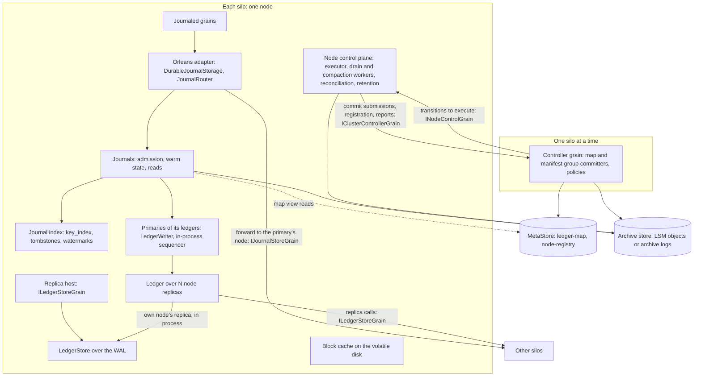
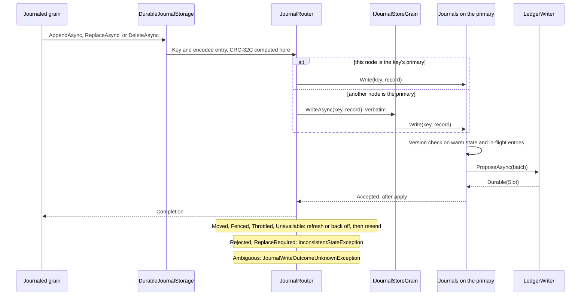

# Orleans journaling

## 1. Purpose

The Orleans composition is the storage behind Orleans Journaling. Each silo of an Orleans cluster is one Clog
node: it hosts the node's LedgerStore and replica endpoint, the primaries of its ledgers, and the journaled grains
of their keys, executes transitions and runs drains and compactions next to its data, and serves
`IJournalStorageProvider` from them. One controller grain, in one silo at a time, is the cluster's control plane.

- **Live ledgers.** Each journal entry lands in the open ledger whose range holds its key, replicated to the
  LedgerStores of `N` nodes (3) and acknowledged once `Q` (2) of them have fsynced it
  ([ledgers](../components/ledgers.md)).
- **Archive store.** Nodes drain their ledgers into the cluster's archive store ([Archive](../components/archive.md)):
  the LSM, an object store whose runs they compact and whose garbage a sweeper deletes
  ([LSM](../components/archive-lsm.md)); or archive logs, one log per journal in Azure append blobs in Orleans
  Journaling's own layout, which plain Orleans can read, and in front of which the live ledgers act as a replicated
  write-ahead log ([archive logs](../components/archive-logs.md), [§5.13](#513-archive-log-store)).
- **Local service.** Each journaled grain activates on the primary of its journal's range, which admits its entries
  and answers its reads, including absence, from warm state ([Journals](../components/journals.md)).
- **Elasticity.** Ranges move between nodes by transitions, so the cluster grows, shrinks, and restarts without
  copying data between nodes.

The composition owns wiring and policy: node identity and resolution, routing and forwarding, the mapping of journal
outcomes to Orleans, failure detection, the controller grain which hosts the committers, chooses transitions, and
schedules LSM work, node retirement, and resource governance. Every safety property comes from the layers it
composes; Orleans membership, placement, and messaging provide liveness and performance ([§3](#3-requirements-met)).

Code: `Orleans.Durable.Storage`, in the assembly `Orleans.Durable.Storage`, with its control-plane types in
`Orleans.Durable.Storage.Engine.Cluster.Control`, and the controllers' decisions, which name no Orleans type, in the
component `Orleans.Durable.Storage.Engine.Cluster.Control`, which the Engine (`Orleans.Durable.Storage.Engine`)
compiles. In code (row 4.1 of the [implementation
plan](https://github.com/ReubenBond/clog/blob/6ffb29aa96d2e4d48fc9c34f80790493e548af96/docs/implementation-plan.md)):
the silo's node over its LedgerStore, the node registry with its codec, committer, and resolver,
`RegisteredNodePlacement`, and registration through the controller grain; the replica transport (row 4.7); the
controllers' cores, `ClusterController` and `NodeController` (row 4.3's B1); and the controller and node control grains
which host them, the silo's Ledgers runtime and control loop, and the sweep host (row 4.3's B2); node retirement, its
gate, and cluster restart (row 4.4's A); resource governance (row 4.4's B); the durability repair and the placement
policies (row 4.4's C); the failure-triggered drains (row 4.6); and the journaling adapter: its Journals in the silo,
node grain, router, Orleans journal storage, grain placement, and status (row 4.2); the re-placement of journaled grains
by live migration (row 4.5's D); and archive logs in the silo: the store's selection, registration with the cluster's
store identity, the archive gate, and the drains, drops, and sweeps (row 4.9). *Not yet in code*: the rest.

### Design rationale

**Co-hosting.** Placing each grain on the primary of its journal's range keeps admission, existence checks, and
reads in one process: a write waits for one local and one remote fsync in parallel, and an activation which finds
no journal reads no object. Forwarding serves every grain placed elsewhere, so placement affects only cost.

**Safety below, liveness from Orleans.** Seals, conditional MetaStore writes, quorums, and version admission establish
safety. Orleans single activation is eventually consistent: a partition or a directory race can run two activations
of one grain for a while. Membership, placement, turns, and messaging therefore decide only timing and routing.

**One controller grain serializes the control plane.** The controller grain hosts the group committers of the ledger
map, the manifest, and the node registry, and runs the policies, so the cluster's map, manifest, and registry writes
leave one process, one write at a time per register: changes do not conflict, and a failed node's takeovers, every
node's drains, or a whole cluster's registrations share writes. Node grains execute transitions and run drains and
compactions next to their data, and submit their changes to the controller grain by calling it, so the layers name no
Orleans type: the node control grain wraps its call in an in-process delegate for the transition executor. Every grain
call carries serializable data only. Orleans single activation is eventually consistent, so the controller grain may
briefly run twice; every committer writes conditionally under each change's commit rule (OR-I12), and two activations
cost only superseded work. Its turns await only enqueueing and sends, so a manifest read, a sweep, or a slow node never
delays a takeover. Each manifest replace starts at least `ManifestCommitInterval` after the previous one completed
because object stores limit the write rate of one object (Google Cloud Storage allows about one write per second), and
the interval lets every change submitted meanwhile share the replace. Replies carry a verdict, with the deciding value's
epoch for `Applied` and `Superseded`, never a whole map or manifest: each node acts on its own views, which it refreshes
to that epoch. Two alternatives were rejected. Every node writing the map and the manifest directly, retrying on
conflict, makes concurrent changes race on one register and one object, each loser rewriting the whole value. A lease
which made one controller exclusive would put a clock on the safety path. The request path never calls the controller
grain, so the data plane keeps serving while it moves between silos; it can later hand work to further grains, such as
committers of manifest pages ([deferred](../deferred.md#manifest-size-root-and-pages)).

**Several ledgers per node.** Small ranges spread a failed node's takeovers and its ledgers' drains across the
cluster, let a joining node take primaries by handoff alone, and let balancing move load in small steps. The
ledger map's size bounds how many ledgers a cluster keeps
([ledgers](../components/ledgers.md#design-rationale)).

**No data copied between nodes.** Rebalancing, replica changes, and retirement roll ledgers onto other nodes and
let the closed ones drain to the LSM, which every node reads. Moving a range costs only the drains its data needs
anyway, never a second copy between disks.

**Instance-local NVMe keeps its instances through a planned stop, or drains into the object store first.**
Instance-local NVMe survives a silo restart and a reboot in place, and is lost whenever its instance is released or
moved ([§4](#4-restrictions)). A whole-cluster stop which releases the instances therefore loses every replica of every
ledger. Draining every row first would put every acknowledged entry in the archive, yet the map would still list open
ledgers on the lost nodes: the open ledgers partition the keyspace ([LG-I1](../components/ledgers.md#5-invariants)), and
a ledger closes only at the end of a recovery which sealed `N − Q + 1` of its replicas
([LG-I9](../components/ledgers.md#5-invariants)), so after the restart no transition could close them and every range
would stall. Without object-store ledgers, the profile's planned whole-cluster stop keeps every instance allocated
instead, and its restart is §5.10's. When object-store ledgers are configured and ready (row 4.8 B of the
[implementation
plan](https://github.com/ReubenBond/clog/blob/6ffb29aa96d2e4d48fc9c34f80790493e548af96/docs/implementation-plan.md)),
`IClusterControllerGrain.StartDrainAllAsync` runs a two-phase drain-all before an instance-releasing stop
([§5.14](#514-object-store-ledgers), [§8](#8-operation)): phase 1 rolls every range whose open ledger is on nodes into
the object store and drains and drops every closed ledger on nodes, suppressing any new placement onto nodes; once zero
node-backed ledgers remain in the map, phase 2 retires every active diskful node in `CLNR` and raises the map's
retirement floor to cover those retirements, freeing every StatefulSet ordinal without changing `CLNR` or adding a
parked ledger state. A parked ledger, open with no primary claim and closed at slot 0 without a recovery, was rejected:
it adds a map state which changes LG-I1, LG-I5, and LG-I9, the ledger map model, and the executor, for what rolls into
the object store already give. After the instances are stopped and restarted over empty roots at the same ordinals, each
silo registers a fresh node identity, takes over the open object-store ledgers with zero lost acknowledged entries, and
rolls the ranges back onto the new nodes under `ControlOptions.LedgerPlacement`. A silo which finds an empty root at an
ordinal whose node is active still stops and asks the operator, on this profile as on persistent volumes, though an
instance move makes that state routine: an unmounted or unformatted device leaves the same empty root over intact data,
and a succession taken automatically would turn a mount error the operator could repair into a lost node, several at
once when one event restarts several instances
([deferred](../deferred.md#automatic-succession-of-a-lost-instance-local-disk)). The profile is therefore a deployment
rule and its procedures, with no option of its own: it changes nothing a silo does.

**A takeover or leaving hand-off keeps its predecessor's dead or leaving replicas when it must.** A range whose
primary died or is gracefully stopping cannot wait for `N` live non-leaving nodes: a cluster of exactly `N` nodes would
stall every ledger of a dead or stopping node until it returned (or until membership declared a stopping node dead),
though `Q` live replicas suffice to seal the predecessor and to write. With fewer than `N` nodes which may be given
work, a takeover's successor, and the successor a leaving primary (retired, departing, or with its hand-off pending)
hands its ledger to, names every node which may be given work, at least `Q` of them, its primary among them, and keeps
for the rest the predecessor's active non-diskless replicas — first those membership shows dead, then those gracefully
leaving (departing or handing off), each in their order in the predecessor (OR-I5). Every live node is placed before any
dead or leaving one, so the successor gives up no tolerance the cluster could give it. Its quorum is then `Q` of `N`,
as for a ledger whose replica died after it opened, and the grace `G` and repair treat a kept replica that does not
return as they treat that one; a returning node creates the replica by its first write and fills its holes from the
others. The successor starts with its fault budget spent: with `N − Q` replicas dead or leaving, one more unavailable
replica stops its writes and its recovery until a node returns or repair replaces them, which is what waiting for `N`
would have cost the range anyway. Only those two transitions degrade. Splits, merges, balance, evening, and the
configuration and domain rolls are discretionary, so waiting for `N` costs only balance; a repair needs `N` nodes to
replace anything. A WAL-release roll (OR-I13) is not discretionary, yet it waits for `N` too: a cluster below `N` serves
until the WAL its open ledgers pin brings disk pressure, which then throttles their writes (OR-I10) until a node returns
([deferred](../deferred.md#degraded-wal-release-rolls)). Two alternatives were rejected. Waiting for `N` live nodes
stalls a range for as long as its node is down (or stalls graceful shutdown for the full membership death-detection
timeout). A successor of fewer than `N` replicas would tolerate fewer failures once its node returns, and a
configuration roll would then replace it again. A retired node is never kept, so the retirement gate's premise, that
every install names only nodes active at `ChosenAt`, holds (OR-I4).

**A restart waits for no node.** After a whole-cluster restart, a node which has not yet registered looks to the
controller grain exactly like one which will not return, so the controller takes its ledgers over at once on their other
replicas (§5.10). A grace in which the claim's own node is preferred, or a wait for its first report, would keep more
primaries where they were, which saves only a later balancing hand-off, at the cost of every range of a node which never
returns waiting out the grace; it was rejected. Each successor's primary is one of its predecessor's replicas, which
holds the ledger's entries, so a takeover on another replica loses nothing.

**Object storage off the acknowledgement path.** Entries are acknowledged at `Q` fsyncs, so object-store latency
affects only drains. An outage keeps closed ledgers live and eventually throttles admission through disk pressure
([§5.9](#59-resource-governance)) instead of failing writes. Three replicas with a quorum of two tolerate one lost
node for undrained data; a ledger without a quorum stalls rather than acknowledging an unsafe write.

**A replica's death drains its primary's open segment at once.** A row is acknowledged at `Q` fsyncs, so once a replica
which helped acknowledge it dies, the row may lie on one live replica alone, one more loss from gone, until a drain
takes it into the archive. With exactly `Q` live replicas the primary therefore ends the open segment with a marker and
drains to it ahead of every other drain (§5.6), which bounds that single-copy exposure by the detection, the wait for a
drain slot, one control interval, and one drain (OR-I23), rather than by the segment's age or the repair after `G`. The
bound holds only while the node's loop runs and the archive answers, as every drain does; a drain which cannot progress
backs off so it holds no slot from the others. Exposed ledgers have a slot of their own beyond `MaxConcurrentDrains`: on
archive logs a backlog holds its slot to `T`, so with only the shared slots an exposed ledger could wait behind any
backlog for as long as it drains. Preempting a running drain was rejected: it discards the progress of a segment's paced
writes, and the one reserved slot, which only exposed ledgers take, bounds the wait by another exposed drain. Above `Q`
every acknowledged row still lies on two live replicas; below it no marker can be decided. The node reads deaths from
its own silo's membership and registry views, through the projection the controller grain uses (§5.7). Having the
controller grain name the ledgers in its report replies, as it names closed ledgers to drain too, was rejected: it adds
a report's round trip, and when the death took the grain's silo too, it waits for the grain's next activation, though
the node already holds the same view.

**A second drainer only for a drain without progress.** A closed ledger which blocks a drop holds its descendants'
drains and WAL, so a second node drains it too once its drain has made no progress for `ClosedDrainTimeout`. The
timeout runs from the drain's last progress, not from when the drop was first blocked: a large ledger which drains
steadily, as an archive-log drain of many keys does, would otherwise gain a second drainer which repeats its reads and
writes. Drainers report progress to the controller grain, the one process which sees every node's reports.

**A node which drains nothing hands its closed ledgers on at once.** A node starts drains only while it serves and its
silo's archive gate passed, and each report says whether that holds (`NodeReport.Draining`), so the controller grain
follows the node's own condition rather than inferring it from the report's other fields: a stopping node, whose
hand-off began, or one whose gate has not passed or was refused, drains nothing, and the grain names the next replica
which drains at its next pass rather than after `ClosedDrainTimeout`; such a node may stay so until an operator acts,
and its closed ledgers would otherwise hold their descendants' drops for the timeout and then gain a drainer only one
replica at a time. A node whose Journals were refused but whose gate passed still serves its control plane and drains,
so it keeps its closed ledgers. A node the activation has not heard from counts as draining, since naming another at
each activation would double every first replica's drains until it reports.

**Drains scheduled per ledger, not in rounds.** Each control interval a node starts the drain of each due ledger whose
drain is not in flight, within `MaxConcurrentDrains` in flight over every interval, rather than running rounds which
each wait for their slowest drain. On archive logs every key is a paced request: at about 333 requests a second a
60,000-key segment drains for about three minutes, and a round barrier held every other ledger's drain, drop, and WAL
release on the node for as long. A drain which ends starts again at a later interval, least recently started first, and
a slot which frees waits at most an interval ([deferred](../deferred.md#continuous-drain-slots)). On the LSM a drain
ends at its segment's end, so a closed ledger of many segments takes turns with the others; on archive logs a drain runs
its ledger's closed segments to `T` in one start, so a backlog holds its slot until it is drained
([deferred](../deferred.md#time-sliced-archive-log-drains)).

**A key which cannot be written stops its ledger.** On archive logs a key's writes reach its log in segment order, so
a key whose write keeps failing, such as one whose log is corrupt, holds its ledger's drain. The composition names the
key in a metric and a critical event rather than skipping it, which would lose its rows once the ledger dropped
([archive logs, design rationale](../components/archive-logs.md#design-rationale)). The critical event is logged once
per block, when the drain starts to block at a segment, key, and cause, since the gauge keeps the state; each attempt
still logs the failed drain's warning. A blocked ledger is tried again only every minute, not every control interval:
each attempt rescans the segment, so retrying each interval would read up to a segment a second per blocked ledger for a
fault only an operator lifts.

**Archive-log request shares within the budget.** The budget `B`, `ArchiveLogRequestsPerSecond`, bounds the cluster's
drain requests (OR-I21), so the controller grain assigns the work-conserving share `floor + (B − N·floor)·keys/total`
over the `N` nodes it counts, with `floor = min(B/100, B/(2N))`: the floors take at most half the budget, every node
with nothing to drain can still start a drain, and when no node reports keys each gets `B/N`. A node runs only at rates
its replies gave it, and lowers its rate on its own, so the controller reserves for each node the larger of the rate it
last reported and the share last assigned to it, and caps each new share at the budget less the others' reservations.
That cap is what holds exactly; the reservations themselves pass the budget until the nodes which hold the room report
again, up to `2K` control intervals if they go silent, when a view lists a node anew, when a node reports a rate above
what now fits, and after the budget is lowered, so OR-I21 states those transients rather than a sum which never passes
`B`. A rate above what now fits stays at most its node's floor once replied to, since a reply which finds no room lowers
a node above its floor to it and leaves one at or below it: a new activation does not wait for a node its view shows
dead, so it may give the live nodes the whole budget before such a node, still running at its floor, reports, which the
reviewed seed found, at `B` plus that floor. Reserving the floor of every node the view shows down would hold budget for
nodes which have stopped, for a transient of at most a floor each which the others' next reports end. Each report
carries its number in its process, and the controller ignores one of the generation it last heard which is not newer
than the last it applied: the host gives up on a report call after `K − 1` intervals, Orleans may still deliver it later
and out of order, and applying it would reserve its node at a rate it no longer runs at, which let the others take the
difference, about half the budget again in the reviewed probe. A node still reporting stays reserved, whatever the view
shows: a node the view shows dead or retired, or does not list yet, is still running, and dropping its reservation let
the others absorb its budget while it kept its rate, which held the sum at a third above the budget for as long as it
reported. Such a node counts no keys and is assigned its floor, so its rate decays through a share; a reply which finds
no room lowers a node running above its floor to it, and otherwise assigns nothing. A node leaves the totals only by
age, once its latest report is `2K` control intervals old, `K = 5`.

**Activations and deadlines.** A new activation knows no node's rate, so it assigns none, and every node keeps its own,
until it has observed a registry view which lists a live active node and every node that view shows up has reported, or
`2K` intervals passed; an unobserved, empty view is no evidence that every node reported, so it never makes an
activation ready, nor does a view listing no live active node, which costs only liveness: no node gets a share, and each
falls to its floor, until the view lists one. A node's share falls to its floor `K` intervals after the last reply which
assigned it one: a reply which assigns none, for want of room or to a replaced process, does not renew it, and the fall
applies where the rate is read, before each drain request, so a report call which hangs, which the host also bounds
below `K` intervals, cannot hold it. The floor follows the node's current registry view, since the controller reserves a
silent node's floor over the nodes it counts now. Two activations which overlap, as a duplicate across a directory
partition may, each cap shares against their own reservations, so the rates may then reach the budget once per
activation; fencing shares with an activation epoch is
[deferred](../deferred.md#fencing-archive-log-shares-by-activation). The form "the larger of the floor and the
proportional share" was rejected because its floors summed past the budget, by a hundredth per idle node, and its first
activation's shares, assigned before every node reported, summed to about the harmonic number of the nodes times the
budget. Shares bound the drains only: sweeps and the Journals' own reads and writes of the store are outside the budget
([§5.13](#513-archive-log-store)).

**Undrained keys counted by the drainer.** A node counts the keys of the ledgers it owes a drain, not of those it wrote,
since a second drainer or a restarted node drains ledgers whose writers ran elsewhere, and the share should follow the
work. Its counts come from its own writers for segments it wrote, and otherwise from its drain worker's scans; the
segments of a ledger it owes which no count covers, below the lowest counted one or all of them, count as one segment of
the running average of the counts the node learned, each moving it a sixteenth of the way to the count, 4,096 keys
before the first, rounded, at least 1, and at most `MaxSegmentKeys`, until a count covers them. Counting such a segment
at `MaxSegmentKeys`, 262,144 keys, the most a segment holds, overstated real segments, of 174 to 5,555 keys at the
spec's workload, about 50 to 1,500 times, so a restarted node, whose writers' counts its process lost, took most of the
budget for minutes; an average follows the workload, and the cap keeps it within a segment. A ledger whose drain
answered `Waiting` counts nothing: its keys wait for an older ledger's drop, and a share for them would go unused. The
counts are kept in the node's process, not persisted: a durable count in the batch format would change `CLLB` for a
policy input. The writers push each segment's count to the node as the segment ends, rather than the node pulling it, so
a writer the registry drops loses none, and a segment drained before the node takes its count is not counted back in.
The budget is a `ControlOptions` value, since the controller assigns it and every node's floor divides it, and
`ControlOptions` agree on every silo.

**A short store prefix per cluster.** Each cluster's store lies under a short prefix of its own in the bucket or
container its silos are given, on the LSM and on archive logs, so clusters which share an account or bucket do not
clash: the project owner's decision, "we should have a unique prefix (which could be the cluster id, but ideally it
should be short)", in place of a cluster claim. The default is 10 lowercase base32 characters of the SHA-256 of Orleans'
`ServiceId`, 50 bits, one `[a-z0-9_-]` object-name component: the service ID is the same on every silo of a deployment
and across its deployments, whereas the `ClusterId` changes with each deployment; Orleans' Azure journaling provider
names a journal by its ID alone (`wal/{id}`, `checkpoints/{id}/{snapshot}`), so the namespace comes from this prefix;
and the cluster's GUID would cost 32 characters on every object's name. Hashing bounds the length and the alphabet
whatever the service ID holds, and makes a clash of distinct service IDs negligible, about `n²/2⁵¹` for `n` clusters on
one bucket; an operator may configure a prefix of 1 to 16 characters instead, whose uniqueness is then the operator's to
keep. A service ID Orleans gives by default, `default` or localhost clustering's `dev`, is kept by every deployment
which sets none, so it derives no prefix, and a silo which keeps one with no prefix configured does not start: two such
clusters on one bucket would otherwise share one store with no sign of it. The prefix is computed once at
configuration, with no request and no refusal path, and the node registry records
it with the store's kind and ID, so every silo of a cluster uses the one prefix, and a joining silo configured with
another is refused before its check makes a request, as one of another kind is. On archive logs the prefix precedes
Orleans' own names, `{prefix}/wal/{id}`, which a plain Orleans reader's provider expresses through its naming options,
`GetWalBlobName` and `GetCheckpointBlobName`; prefixing each journal's identity instead, `wal/{prefix}/{id}`, which
Orleans could read too, was rejected: it would leave Clog's objects and the logs under two roots, and each cluster's
sweeper would list every cluster's checkpoints. A cluster claim, `durable-storage/cluster`, was removed: it guarded the
same misconfiguration with a write and a refusal path at every new cluster's start ([archive logs, design
rationale](../components/archive-logs.md#design-rationale)).

**One archive gate before every drain and sweep.** On archive logs a silo passes one gate before its drains and sweeps
start: the store's kind and prefix against the registry's, which need no request; the store's record, read without
creating it, whose ID must be the registry's (OR-I20); then the record's store fields, the log-naming scheme among them;
then its parameters (OR-I8). Reading the record without creating it means a joining silo pointed at an empty container,
or at another store's, creates nothing there. A new cluster's first silo creates or adopts the record, as on the LSM:
each container belongs to one cluster by the operator's precondition, which nothing checks ([archive logs
§9](../components/archive-logs.md#9-providers-and-implementations)). A cluster claim, `durable-storage/cluster`, which a
new cluster's first silo won before it created or adopted the record, so two new clusters racing on one empty container
could not both adopt it ([#288](https://github.com/ReubenBond/clog/issues/288)), was removed by the project owner's
decision as overly complicated (archive logs, Design rationale, *No cluster claim on archive logs*). The gate's
evidence, `ArchiveLogGate`, is what the drain worker, the sweeper, and the sweep host's sweeps take, with the stores and
the log names, so the order is in the types rather than in each caller, and no option names the logs otherwise: a drain
whose names differed from the record's would complete into logs no reader reads, and drop the ledger. It binds the log
store and the object store of `durable-storage/` together as far as `LogArchiveStore`'s construction contract, both in
one container, holds; `Orleans.Durable.Storage.AzureStorage`'s `AddAzureArchiveLogs` meets it by building both over one
container client. A parameter mismatch stops drains and sweeps on archive logs as well as the Journals, since the Azure
layout writes the format into the logs themselves; on the LSM it stops only the Journals, since a drain carries rows
unchanged.

**Archive logs Orleans can read.** On archive logs each journal's log is Orleans Journaling's own pair of Azure blobs,
holding the journal's payloads in the cluster's format, so a plain Orleans deployment, given read-only access, reads a
journal Clog wrote: a cluster's journals can be read without Clog, read-only. The format key is therefore fixed per
cluster and the payloads are stored unwrapped. A Clog envelope around each payload, which let one journal mix formats,
was rejected: no Orleans reader could decode it, and a journal's format does not change in place. The store is a
direct Azure store in `Orleans.Durable.Storage.AzureStorage` rather than a client of Orleans' `IJournalStorage`, whose
whole-journal reads and ETag conditions would need a read before every write ([archive logs, design
rationale](../components/archive-logs.md#design-rationale)).

**The store's record gates the archive's services, not the silo's start.** The cluster's journal format and
`MaxBodyBytes` live in the archive store's record, beside its own fields, since a plain Orleans reader of archive logs
takes the format from there. A silo checks the record in the background, not before it starts or registers:
registration, the controller, takeovers, and the replica host must serve through an archive store outage
([§5.9](#59-resource-governance)), and none of them reads the archive, while the services which do read it already wait
for it, so waiting for the check costs them nothing they had. A silo joining a cluster whose node registry records the
archive store takes the store's identity from the registry, never from its configuration, and registers at once. Its
background check reads the record through `StoreRecordAsync`, which answers the record apart from its parameters'
agreement ([archive §2.4](../components/archive.md#24-selecting-the-store)), and gates each service on the half it
depends on: the record's identity and store fields before the silo drains, reads the archive, or serves its Journals
(OR-I20), and its caller parameters before it serves its Journals (OR-I8). Only the first registration of a new cluster,
whose registry records no store yet, waits for the store, and records the identity read from the record. A configured
store ID, checked against the record later, was rejected: the ID is random and created by the store's first user, so an
operator could set it only after reading the record, and a misconfigured first silo would record an ID no store holds. A
silo whose parameters differ keeps serving its replicas and its control plane, and never its Journals, rather than
stopping: the mismatch is a configuration defect, not a local storage failure. It asks to hand its ledgers off, so it is
pending and given no work, and a bad deployment stalls at the pod it reaches rather than spreading a journal outage over
every primary a refused node would be given. Recording the parameters in the node registry instead, beside the archive
store OR-I20 records, was rejected: plain Orleans readers need them in the store's record. The first registration of a
new cluster fails the silo's start when the store cannot give it an identity, other store fields, or a corrupt record,
since nothing records an identity it could register with; every later silo registers first and is refused in the
background. On the LSM the check reads the record through `StoreRecordAsync`, which creates one in an empty store, a
record no registry names, which the ID check then refuses: a read-only record read would be a second call on
`IArchiveStore` for that alone. The controller grain's archive work follows the gate of the silo which hosts it, on
either kind, from its activation: until the gate passes it commits no manifest change, reads no manifest, accepts no
drop, assigns no compaction or share, and asks for no sweep, and it takes its archive store by the kind the gate's check
found the registry's, not by its silo's configuration; it commits a manifest change only once it adopted the LSM, which
its turns order after the gate's pass, so a change in between is refused as inactive. A refused gate deactivates the
activation, and the silo reports the refusal as critical once however often the grain activates there again. Its
placement director, `ControllerPlacementDirector`, places it on the calling silo once that silo's gate passed, and
otherwise on another compatible silo at random, so a refused silo hosts it only while no other silo can, and one
misconfigured silo never stalls the cluster's compaction, drops, or sweeps. A controller which kept its manifest
committer over the silo's own store, whichever it is, was the alternative; a misconfigured silo hosting the grain would
then write the cluster's manifest into another store, and on archive logs it would accept drops and ask for sweeps no
one could run.

**Opaque versions as ETags.** A journal's version is Journals' opaque `(base, count)`, passed to Orleans as the
journal's `JournalMetadata` version in one canonical text form, so the grain compares versions only for equality. The
composition never infers from versions whether an `Ambiguous` write applied; only a re-read tells.

**A stale mapping keeps serving until its re-read lands.** A mapping shown stale requests a re-read of the node
registry rather than discarding the cached value, so placements keep using every mapping the cache holds while the
re-read waits for its second or the MetaStore is unavailable; only the mapping shown stale fails, as it did before. A
placement refusal requests a re-read only while the cache is stale against membership, an `Active` silo having no
entry, since only then could a re-read change it; a backoff from 100 ms re-reads while a silo's registration is pending,
so a new node is placed within a fraction of a second, while a registry which matches membership is read only on a
membership change. Discarding the value was rejected: every node's grain placement would then wait on the MetaStore,
and an outage of the register would stop replica calls between healthy nodes. Having each silo request a re-read once
its own registration answers was rejected: the backoff covers every silo's registration, the silo's own and others',
without another trigger.

**Registration answers need no fence.** The committer answers a registration from the value which decides it, and a
second controller-grain activation, or a write whose outcome is unknown, cannot make that answer false.
`Registered(r)` claims only that the value at revision `r`, read or written by a write which landed, holds the entry
(OR-I19). `Stale` and `WrongArchiveStore` are permanent: entries only advance, a retired entry stays retired, and the
recorded archive store never changes (OR-I2, OR-I20). `Refused` and `OrdinalOccupied` are decided against the value
read, and need not stay true: an entry which advances to a shorter address shrinks the value, and the occupant of an
ordinal may be retired. Neither needs permanence, because a registration either refuses is never carried in a write, and
a carried one is answered only `Registered` or with the write's exception. `OrdinalOccupied(o, n, …)` asserts only
that a value read after the submission held node `n` active at ordinal `o`; it holds while that entry stays active,
and the retirement which ends it is a later write the registration did not cause. Every negative answer therefore rests
on a value no write the committer dispatched for it can change, and the silo stops on it; an answer which could change,
a registration a write carried whose outcome is unknown, is never given.

**An occupied ordinal takes the operator's intent.** A silo over an empty root cannot tell a lost or replaced disk from
a volume which failed to mount, or from a deployment whose specification dropped its volume mount: each shows the same
empty directory. With automatic ordinal succession, a rolling update without the mount would retire every node in turn,
which could outrun re-replication and lose ledgers, and a retired identity never rejoins. The registry therefore
decides, and an ordinal another node holds active is taken only with the operator's explicit intent: a registration
whose ordinal belongs to another node's active entry is answered `OrdinalOccupied`, and its silo stops, unless the
silo's configuration names that node in `NodeToReplace`, or the operator retired the node first (`RetireNodeAsync`). A
free
ordinal, one whose entry is retired, and a node's own restart take nothing, so first deployment, scale-out, and restarts
register automatically. The rule covers a node the registry already holds as well: one whose volume is bound to another
ordinal's pod meets the same answer, and its event directs the operator to the binding rather than to a retirement,
since both volumes hold live nodes. The intent names the node to replace rather than allowing any replacement, so it
acts once: once that node is retired, a later silo over an empty root at the ordinal finds its successor active and
stops, even with the setting left in place, and a setting shared by every pod affects only the pod whose ordinal the
named node holds. The intent does not consult membership: a replacement relies on the deployment running at most one
silo per ordinal, which a StatefulSet guarantees ([§5.2](#52-nodes-and-silos)). A guard which refused while the named
node's silo is `Active` would race the old incarnation, which stays `Active` briefly during a restart, so it would be a
fallback rather than an invariant. A creation signal recorded beside the volume claim was the alternative; its source
depends on deployment tooling which does not exist, and the registry already holds the evidence the decision needs.

**The composition's configuration is public and bound by generated code; the rest stays internal.** The silo's
options root, `DurableStorageSiloOptions { Node, Control }`, its sections, `AddDurableJournalStorage`, the placement
strategy an app's grain names (`JournalPlacement`), and the exception an app grain's journal write may meet
(`JournalWriteOutcomeUnknownException`) are public, and `CompositionSurfaceTests` pins them, with the lower layers'
option types their sections reach, whose member names an app's configuration names. The node grains' placement and the
control plane's and the replica transport's exceptions pass only between Clog's own grains, and stay internal. Every
option a deployment sets is a settable property of a type the configuration binding generator parses from text, or a
section of such properties: the archive store's kind by its name, the archive-log container by its URI, and
`NodeToReplace` as the node identity's UUID, whose `{node:N}` form a log shows. The generator binds through code the
build emits, so binding stays within the trim and AOT analyzers, which the reflection binder does not. It calls no type
converter, and on an existing instance sets no init-only or constructor-only value, so the LSM's and the LedgerStore's
option records have setters, and the writers' options are four of the node's own, from which the node builds the
Ledgers' validated `LedgerWriterOptions`. The binding refuses a key which names no option, so a misspelled option fails
the silo's start. The store's identity is no option (OR-I20). The values, the resolver, the grains, and the hosts stay
internal: nothing outside the composition calls them, and nothing has shipped. A `NodeId` option bound through a type
converter was the alternative; the generator calls no converter, and the reflection binder, which does, is not
trim-safe.

**The silo builds its archive store from its configuration, over the stores its services supply.**
`DurableStorageOptions.ArchiveStore` selects the kind; on the LSM the silo's services supply the `IObjectStore`, and on
archive logs the `IArchiveLogStore` and the `IObjectStore` of Clog's objects in one container, which a provider
registers: `Orleans.Durable.Storage.AzureStorage`'s `AddAzureArchiveLogs` builds `AzureArchiveLogStore` and the object
store over one client of the container, with the store's client options, `Expect: 100-continue` beside the SDK's
retries, and the caller's credential, a `TokenCredential` or a client its own callback builds with those options. The
composition references no storage technology, as a provider references the layers and the composition takes no backend,
and a silo on archive logs whose services supply no archive-log store does not start, its error naming the registration.
Building the Azure stores in the composition, from a container URI and the services' credential or a shared access
signature its query carried, was rejected: it tied the composition to Azure, and guessed the authentication from the
URI. Taking a `BlobServiceClient` from the services was rejected too: the store sets the client's options, which a
supplied client fixes before the store sees it. The journal format the store records in each blob's metadata is the
registration's argument, which must be the silo's journal format; the store's record check compares the record's format
with the silo's. Azure Table is no archive-log store.

**The controller grain follows a passed gate.** Archive work, the manifest, drops, and sweeps, runs only where the
silo's gate passed, so the controller grain does it only there. A refused gate deactivates the grain, and its next
activation is placed on another silo; a gate which stays pending, as when the store's record read is held or the store
is out for that silo alone, would hold the grain, and the cluster's archive work with it, so the grain moves to a silo
whose node reported its gate passed. Each node already reports each control interval, so the report carries the gate's
state at no cost. Placing the grain only on a silo whose gate passed was rejected: a new cluster's first silo hosts it
before any gate passed, and the registration it serves comes before the check.

**The silo's archive store is one of two cases, and its gate holds one decision.** `SiloArchive` is the LSM or archive
logs, a closed hierarchy whose two nested cases are its only ones, each making its first registration's record,
checking the record, and building its sweeps; consumers switch on the case exhaustively. The silo's services hold it as
a singleton, which a union's value is not. Its gate, `ArchiveGate`, holds one decision: pending; passed, with its kind's
evidence, the LSM's object store or archive logs' `ArchiveLogGate`; refused, with its reason, a defect's own exception
among them; or cancelled. The kind archive work takes and the evidence it uses therefore cannot disagree, and the LSM
has no archive-log evidence to wait for. Only the record check decides the gate, and it cancels a gate it left undecided
as it ends; a start which fails cancels it too. The identity the node registered with lives in the node's registration,
set by the one write which registers it. A gate of two tasks, one per kind's evidence, beside a store with nullable
parts and a separate registered identity, was rejected: its parts could disagree, and work chose its kind from the
configuration rather than from the evidence.

**The node registry's codec writes its Protocol Buffers by hand.** `CLNR`'s body is a small, fixed schema whose
decoder must accept exactly one encoding, so `NodeRegistryCodec` parses it as Protocol Buffers does and compares the
body with its own canonical encoding of what it parsed. This needs no generated message types, no Protocol Buffers
runtime, and no protobuf code generator in the composition's build; the vectors' generator serializes every body with
the Protocol Buffers library, an independent encoder, and the fuzz target's oracle reads the canonical form directly.

## 2. Components composed



Arrows point from caller to dependency. Every silo runs the same components; the controller grain runs in one silo
at a time. Data-plane traffic (journal writes and reads, replica calls, map and manifest view reads) never passes
through the controller grain.

| Scope | Component | Specification | Role in this composition |
| --- | --- | --- | --- |
| Per silo | LedgerStore over the WAL, one per node root | [ledgerstore](../components/ledgerstore.md), [wal](../components/wal.md) | The node's replicas of every ledger it holds, keyed by ledger ID |
| Per silo | Replica host (`ILedgerStoreGrain`) | [§5.12](#512-replica-transport) | Serves the node's replicas to every other silo over grain calls |
| Per silo | `OrleansLedgerReplicaTransport`, an [`ILedgerReplicaTransport`](../components/ledger-replicas.md#22-iledgerreplicatransport) | [§5.12](#512-replica-transport) | Opens a handle over each replica by node identity and ledger ID: its own node's in process, others' over grain calls |
| Per silo | Journal index (`IJournalIndex`, `JournalStateDatabase`) | [journals §8.3](../components/journals.md#83-warm-state) | The node's derived per-ledger key indexes and tombstones |
| Per silo | Journals (`JournalStore`) | [journals](../components/journals.md) | Admission, reads, and expiry on the node's primaries |
| Per silo | `ArchiveReader` over the silo's one `LedgerReader` and the cluster's archive store | [archive](../components/archive.md) | History reads and absence answers for the node's Journals, and the archive's pure functions for its admission |
| Per silo | LSM workers and caches, on the LSM | [archive LSM](../components/archive-lsm.md) | Drains and compactions; section metadata, which `LsmArchiveStore.PreloadAsync` loads ahead of reads for the ranges of the open ledgers the silo is primary for, on the store the composition constructs; and the block cache |
| Per silo | Archive-log drains, sweeper, and store, on archive logs | [archive logs](../components/archive-logs.md), [§5.13](#513-archive-log-store) | Segment drains in lineage order, which submit their ledgers' drops; the sweeper of superseded checkpoints and drain markers; `AzureArchiveLogStore` |
| Per open ledger | A `LedgerWriter`, with its in-process sequencer, over the process's `Ledger` of `N` node replicas | [ledgers](../components/ledgers.md), [ledger-protocol](../components/ledger-protocol.md), [ledger-replicas](../components/ledger-replicas.md) | Sequences and replicates the ledger's batches in its primary's process |
| Per cluster | MetaStore registers `ledger-map` and `node-registry` | [metastore](../components/metastore.md), [ledgers](../components/ledgers.md#7-formats) | Range ownership and node resolution |
| Per cluster | The archive store: the LSM's object store, one prefix holding the manifest and runs; or the archive-log store, one Azure container holding the archive logs, the drain markers, and the store record | [archive LSM](../components/archive-lsm.md), [archive logs](../components/archive-logs.md) | Drained history |
| Per silo | `TransitionExecutor`, `ReplicaReconciler`, and `LedgerWriterRegistry` | [ledgers](../components/ledgers.md#26-transitions) | Executes the transitions the controller grain sends this node, submitting each change to the controller grain; reconciles the node's replicas from its map view through its own `ILedgerStore`; serves the primaries the map names |
| Per cluster | Controller grain (`IClusterControllerGrain`) | [§5.6](#56-controllers) | Decides for the cluster: the group committers of the ledger map, the manifest, and the node registry, takeovers, balancing, split and merge, configuration and retirement rolls, drops, and sweeping |

`Orleans.Durable.Storage` holds the composition. Its root namespace holds the data plane: the Orleans Journaling
adapter (`DurableJournalStorage`, implementing `IMessageJournalStorage`), the router, the placement strategies
and directors, the node grain (`JournalStoreGrain`) and the pressure state it consults before admission
([§5.9](#59-resource-governance)), the replica transport, the node registry's values, codec, and resolver, and the
primary-side reminder handler (`ReminderMessageHandler` / `ReminderLedgerSession`). Its `.Control`
namespace holds the control plane: the controller grain, the node control grain (`NodeControlGrain`), the node
registry's committer (`NodeRegistryCommitter`), and the segment reminder processor (`ReminderMessageProcessor`). Its
`.Hosting` namespace wires both: service registration and the silo lifecycle. Orleans types stay in this assembly,
`Orleans.Durable.Storage`. The controllers' decisions and their policies, `ClusterController`, `NodeController`,
`Placement`, and `ControlOptions`, are a component of their own, `Orleans.Durable.Storage.Engine.Cluster.Control`, in
the same namespace, which uses Ledgers, the Archive, and the LSM and no Orleans type, and which the Engine compiles, so
that deterministic simulation runs them without loading Orleans ([verification §7](../verification.md), [spec README
§2.7](../README.md#27-design-rationale)); the composition reads their internals through the Engine's one
`InternalsVisibleTo` to another production assembly. They decide from `RegisteredNodes`, the registry's projection which
the controller grain takes from each value it reads.
`AddDurableJournalStorage` registers it in a silo as Orleans Journaling's default journal storage provider, with the
silo's options from a configuration section
(`AddDurableJournalStorage(configuration.GetSection("DurableStorage"))`, whose `Node` and `Control` subsections name the
options of [§6](#6-configuration)), or from an `OptionsBuilder<DurableStorageSiloOptions>` callback, which configures
them in code; each has an overload which takes a provider name, which binds Clog to the keyed `IJournalStorageProvider`
and `IJournaledStateManagerFactory` of that name. The options are Microsoft.Extensions.Options options, validated as the
silo starts: a silo whose options cannot start a node does not start, and its failure names the option by its key. A
silo hosts one node, so it registers Clog under one name (OR-I9), and its options are the silo's unnamed options
whatever the provider's name, where an Orleans provider names its options after itself. The silo's services supply the
`IMetaStore` holding the cluster's registers, and on the LSM its `IObjectStore`, from a first-party provider ([MetaStore
§9](../components/metastore.md#9-providers-and-implementations), [LSM
§9](../components/archive-lsm.md#9-providers-and-implementations)): `AzureTableMetaStore` and `AzureBlobObjectStore`,
for example, or the DynamoDB, Firestore, S3, and Cloud Storage providers, or the native Fast CASPaxos MetaStore which the
cluster's own silos serve (`AddCasPaxosMetaStore` in `Orleans.Durable.Storage.CasPaxos`, [MetaStore
§8.1](../components/metastore.md#81-fast-caspaxos-semantics)). The native MetaStore's voters recover their databases
before the runtime initializes and serve once admitted, which the silo waits for after joining membership and before it
is active, so a node registers at `Active` over consensus which serves; its voters are addressed through Orleans
membership, never through a register they serve.
`playground/DurableStorage/Orleans.Durable.Storage.Samples.Journaling` is an Orleans app which runs Clog as its journal
storage this way. `DurableStorageNode`, the silo lifecycle participant in `.Hosting`, owns the node's LedgerStore,
replica endpoint, registry entry, state database, Journals, primaries, executor, and node control plane. `JournalRouter`
sends each journal's entries and reads to its primary. The silo's services supply the `IMetaStore` holding `ledger-map`
and `node-registry`. In code (row 4.1), `AddDurableJournalStorage` registers the node, its registry resolver,
`RegisteredNodePlacement`'s director, and the controller grain, and `PortableWalStorage` as the node's `WalStorage`
unless the silo's services supply one; a second call fails, since a silo hosts one node (OR-I9). In code (row 4.2's C):
the journal storage provider, `DurableJournalStorageProvider`, and its named overload.

## 3. Requirements met

Each layer states what it needs from its composition. This composition meets each requirement with a Clog
mechanism wherever safety depends on it; Orleans guarantees serve only liveness and performance.

| # | Requirement | Stated by | How this composition meets it | Orleans guarantee used |
| --- | --- | --- | --- | --- |
| R1 | Node resolution: a node identity resolves to the silo serving it, registry entries only advance, and a wiped node at the same address is refused. | [Ledgers §3](../components/ledgers.md#3-requirements-downward), [§5.12](#512-replica-transport) | The node registry, whose entries advance only to newer silo generations ([OR-I2](#51-invariants)), and its resolver, on whose silo address `RegisteredNodePlacement` alone activates a node's grains (`ILedgerStoreGrain`, `IJournalStoreGrain`, and `INodeControlGrain`), while membership shows that silo `Active`. An activation on a silo hosting another node, which the director never creates, answers `NotThisNode` before it opens a replica, deactivates, and the caller invalidates its mapping ([OR-I14](#51-invariants)). | Monotonic silo generations. |
| R2 | A failure detector which asks a live node to take over a suspected primary's ledgers. Liveness only: a false suspicion fences the old primary safely. | [Ledgers §8.6](../components/ledgers.md#86-takeover) | Membership ([§5.7](#57-membership-and-replica-placement)). A falsely suspected primary meets the seal: its later proposals resolve `Fenced`, and its next open check finds the ledger sealed ([LG-I5, LG-I8](../components/ledgers.md#5-invariants)). | Membership declares silos `Dead` and lists every silo which joined before the observer. |
| R3 | Controllers for placement, split and merge, rolls, drains, compactions, ledger drops, and sweeps. | [Ledgers §8.7](../components/ledgers.md#87-policy), [LSM §8.8](../components/archive-lsm.md#88-policy) | The controller grain and each node's control plane ([§5.6](#56-controllers)). Duplicates are safe ([OR-I12](#51-invariants)). | Activation on call; single activation, for performance and liveness only. |
| R4 | One Journals per process, which routes each key to its primary, the only process which proposes, and forwards encoded entries verbatim. Liveness only: `Moved` and the version check keep misrouting safe. | [Journals §3, §8.5](../components/journals.md#85-forwarding), [Ledgers §3](../components/ledgers.md#3-requirements-downward) | Every transition is executed in the process of the node it names as primary, which creates the sequencer ([ledgers §8.1](../components/ledgers.md#81-installing-ledgers)), and a silo proposes only through the `LedgerWriter` it holds ([OR-I1](#51-invariants)). Grain placement on the primary ([§5.4](#54-primaries-and-grain-placement)) and the node grain, which carries the writing silo's encoded entry unchanged ([§5.5](#55-forwarding-and-journal-outcomes), [JS-I5](../components/journals.md#5-invariants)), route entries there. | Placement and messaging. |
| R5 | Resource governance which bounds admitted growth by node disk budgets, including while the object store is unavailable. | [Journals §3](../components/journals.md#3-requirements-downward), [LSM §6](../components/archive-lsm.md#6-faults-concurrency-and-cancellation) | Node disk budgets, and the primary's node answering `Throttled` before it calls the Journals ([§5.9](#59-resource-governance), [OR-I10](#51-invariants)). | None. |
| R6 | Replicas from registered nodes, at least `Q` of them live. | [Ledgers §3](../components/ledgers.md#3-requirements-downward) | The controller grain chooses `N` distinct nodes read active in the registry and not declared `Dead`, or, for a takeover or a leaving primary's hand-off with fewer than `N` such nodes, at least `Q` of them and the predecessor's active non-diskless replicas declared `Dead` or gracefully leaving ([OR-I5](#51-invariants)), spread by placement policy ([§5.6](#56-controllers)). | Membership snapshots. |

The composition also meets each layer's other requirements:

| Requirement | Stated by | Met by |
| --- | --- | --- |
| Linearizable conditional registers `ledger-map` and `node-registry` | [MetaStore §3](../components/metastore.md#3-requirements-downward) | A configured MetaStore provider: Azure Blob, Azure Table, DynamoDB, Firestore, or the native Fast CASPaxos MetaStore hosted on the cluster's silos |
| On the LSM, an object store with no-overwrite creates, conditional replace, ranged reads, listing, and deletion | [Object store §2](../components/object-store.md#2-contract-upward) | A configured provider: Azure Blob Storage, Amazon S3, or Google Cloud Storage |
| On archive logs, an archive-log store whose appends are conditioned on a generation and an offset, whose generations are created once, and whose reads and properties reads are linearizable | [Archive logs §3](../components/archive-logs.md#3-requirements-downward) | `AzureArchiveLogStore` over Azure append blobs in a container of the cluster's own ([§5.13](#513-archive-log-store)) |
| A filesystem with directory durability, and a disk which keeps fsynced data with its node identity | [LedgerStore §3](../components/ledgerstore.md#3-requirements-downward) | One persistent volume per node, for example a StatefulSet volume claim |
| Per-node storage for warm state and key indexes | [Journals §3](../components/journals.md#3-requirements-downward) | One state database per node, under the node root |
| Every process which can reach a silo or gateway port, every silo and every Orleans client (`IClusterClient`), is a correct Clog component | [System model §4](../system-model.md#4-assumptions) | The deployment admits only the cluster's silos and its clients to silo and gateway ports, for example with network policy and Orleans' TLS |
| An injected `TimeProvider` | [Conventions](../conventions.md#2-time) | The silo's `TimeProvider` service |

Every Orleans guarantee the composition uses, and what happens when it does not hold:

| Orleans guarantee | Used by | When it fails |
| --- | --- | --- |
| Placement on the primary's silo (`JournalPlacement`) and live grain migration | Local admission and reads (performance) | A grain elsewhere works through forwarding ([§5.5](#55-forwarding-and-journal-outcomes)) |
| Placement of a node's grains (`ILedgerStoreGrain`, `IJournalStoreGrain`, `INodeControlGrain`) only on its registered silo while membership shows it `Active` (`RegisteredNodePlacement`, `[Immovable]`) | Reaching a node's replicas ([§5.12](#512-replica-transport)), Journals, and executor (R3, R4) | A call with no such silo fails as unavailable before any activation exists, with no effect. An activation on another node's silo answers `NotThisNode` before it touches the node's state and deactivates; the caller invalidates its mapping (OR-I14). The director places on the registered silo when membership lists it `Active`, even if the placing silo's grain-manifest view omits it, as it can for a silo restarted at the same endpoint: every silo defines the Clog grains. |
| Grain messaging | Forwarded entries and reads, replica calls, transitions, commit submissions, registrations, pressure and controller reports | A lost reply to a forwarded write is `Ambiguous`; a failed replica call is an unknown outcome which the quorum tolerates ([OR-I16](#51-invariants)); a worker's commit submission or a registration which fails or whose reply is lost is submitted again, and its goal decides it; a transition whose reply is lost is decided by the map, and issued again while the map does not show it; a lost report is repeated at the next control interval |
| Orleans' generated proxy deep-copies a grain argument which is not `[Immutable]` before the call returns, and `ArcBufferCopier` copies an `ArcBuffer` by pinning it (`Slice(0)`), a pin the message holds and Orleans never releases | The sender's shared payload copy, which the last of its calls releases as soon as its call ends ([§5.12](#512-replica-transport), OR-I18) | A message serialized after its call ended, by a response timeout or the caller's cancellation, would read pages returned to Orleans' pool and reused, so a replica could store bytes it was never sent. `OrleansBufferOwnershipContractTests` fails first, at the pin move which brings it |
| The grain method owns each argument Orleans decodes, and the caller each result, and Orleans releases neither (`ArcBufferCodec`: "The caller owns each decoded buffer") | The callee's release of a write's payload and the caller's release of a read's DATA, each the one release of its pin (OR-I18) | A second release would return a receive page while other messages' slices still read it. `OrleansBufferOwnershipContractTests` fails first, and Clog's releases move with that Orleans change ([deferred](../deferred.md#clog-pages-end-to-end-in-replica-calls)) |
| Orleans' page pool holds no reference to a page it rented out, so a page never returned is reclaimed by the GC | Every Orleans buffer which no one releases: the proxy's pins, the callee's DATA replies, and an argument Orleans decodes for a request it then drops | Those pages would accumulate without bound |
| Non-interleaving turns and ordered messaging per grain | One entry in flight per journal | An out-of-order entry is `Rejected` ([JS-I1](../components/journals.md#5-invariants)) |
| Monotonic `SiloAddress` generations | Registry entries (R1) | A stale entry names a silo membership no longer shows `Active`, so a replica call fails as unavailable (OR-I14) |
| The silo lifecycle: storage at `RuntimeInitialize`; registration, then primaries and the node control plane, at `Active` | A silo serves only after its registration applies (OR-I2) | Calls name the node they expect, so a call which reaches the wrong store is refused (OR-I14) |
| Membership declaring silos `Dead` | Takeover (R2), replica replacement, and failing the replica calls outstanding to a silo once it is declared dead ([§5.12](#512-replica-transport)) | A false suspicion fences the old primary (LG-I5) or rolls a live replica out after `G`; a missed declaration delays takeover, and replica calls to the silo end at Orleans' response timeout |
| Membership listing every silo which joined before the observer | Takeover after a whole-cluster restart (R2) | A silo missing from the observer's view is taken for ended: its ledgers are taken over, and it is fenced |
| Graceful shutdown stops the `Active` stage before membership marks the silo dead | Planned handoff at shutdown ([§5.6](#56-controllers)) | A silo stopped without it is a crash: its ledgers are taken over |
| Single activation of `IClusterControllerGrain` | Serialized commits: performance and liveness only (R3) | Two activations each commit through their own group committers; the commit rules admit at most one of any two conflicting changes (OR-I12) |
| Activation on call | Running the controller grain: every silo's registration, report, and commit submission activates it, on a live silo after its previous silo fails (R3) | A failed call is repeated at the next control interval; while the grain is unavailable, control-plane work waits and the data plane continues; while no silo runs, nothing needs control |

## 4. Restrictions

- **One node per silo.** A silo hosts exactly one node over one LedgerStore root (OR-I9).
- **Replication.** Each ledger has `N` replicas on `N` distinct nodes, `N` odd, and a write quorum of
  `Q = (N + 1) / 2`; `N` defaults to 3. A ledger's replicas come into existence with its first write, recovery write,
  or seal ([ledgers §8.5](../components/ledgers.md#85-replica-lifecycle-on-a-node)). With fewer than `N` live active
  nodes, a takeover, or a leaving primary's hand-off, names every one of them, at least `Q`, its primary among them,
  and keeps its predecessor's dead or gracefully leaving active replicas for the rest (OR-I5). Every other transition
  names `N` live active nodes, and waits while fewer exist; open ledgers whose primaries live keep serving meanwhile. A
  cluster of `N` nodes therefore fails over and hands off gracefully while `Q` of them live.
- **Node disks.** Each node root lies on one of two disk profiles. A *persistent volume*, the default, survives silo
  restarts and the replacement of the instance it is attached to. *Instance-local NVMe* survives a silo restart and a
  reboot of its instance in place, and is lost whenever the instance is released or moved to another host: by a stop
  which deallocates it, by a host failure or the cloud's repair of one, or by maintenance which redeploys it. Such a
  loss is a node loss. A deployment adopts it on a cloud only once that cloud is qualified and the profile measured
  against persistent volumes ([verification §13](../verification.md#13-qualification-boundaries)). On it:
  - an instance is released by plan, for maintenance, a resize, or a scale-in, only once its node is retired and its
    retirement gate open (OR-I4), so its disk holds no replica which counts against the node loss budget when it goes
    ([§8](#8-operation));
  - a planned whole-cluster stop either keeps every instance allocated, and with it every disk (restarting as
    [§5.10](#510-cluster-restart)'s), or—when object-store ledgers are configured and ready—runs drain-all
    (`StartDrainAllAsync` until `GetDrainAllAsync` answers ready, [§5.14](#514-object-store-ledgers),
    [§8](#8-operation)) to move every open ledger into the object store, drain and drop every ledger on nodes, retire
    every active diskful node, and raise the map's retirement floor before releasing the instances. Releasing every
    instance while any ledger remains on nodes loses every replica of that ledger, beyond the node loss budget, and is
    outside the model: no ledger can then be closed, so every range stalls ([design rationale](#design-rationale));
  - an instance released or moved without a plan is a node loss, which the operator answers with a succession at the
    ordinal ([§8](#8-operation));
  - each node's `FailureDomain` names its instance's fault domain, the host, rack, or power domain whose event releases
    every instance it reaches, and the cluster spans at least `N` of them: replica placement then puts each ledger's
    replicas in distinct domains and rolls those which share one ([§5.6](#56-controllers)), so one domain's event takes
    at most one replica of each ledger;
  - each lost disk registers a new identity, which the node registry keeps for the cluster's life, so a cluster's
    instance moves over its life count against the registry's identities
    ([deferred](../deferred.md#retired-node-tombstones)).

  On either profile the deployment creates the node root, durably, before its silo starts, and the silo creates only
  what lies beneath it ([ledgerstore §3.3](../components/ledgerstore.md#33-root)); on Windows the volume is mounted at
  the node root. The deployment does not start a silo whose volume is absent: a silo over an empty root is a new node,
  which stops while another node is active at its ordinal, unless the operator retired that node or named it for
  replacement ([§5.3](#53-node-registry)). A wiped or replaced disk is a new node. The block cache uses a volatile disk.
- **Lost quorum stalls.** A ledger with fewer than `Q` reachable replicas stalls. A primary which is alive in
  membership but cannot reach a write quorum stalls until an operator fences its node (STONITH); timeouts and slow
  storage fence nothing.
- **Node loss budget.** At most `Q − 1 = (N − 1) / 2` replicas of any live ledger are lost or corrupted at once,
  and writes and recovery continue while at most that many are unavailable. Retirement releases a disk only through the
  retirement gate (OR-I4), which no later map write can reopen, so a retirement never counts against this budget.
- **Replica traffic** uses Orleans grain calls to each node's `ILedgerStoreGrain`, and a silo reaches its own
  node's replicas in process ([§5.12](#512-replica-transport)).
- **Trust.** Orleans gateway clients (`IClusterClient`) are inside Clog's trust domain, as silos are: any process
  which can reach a silo or gateway port can call every grain, `ILedgerStoreGrain` included, so the deployment
  admits only the cluster's silos and clients to those ports
  ([system model §4](../system-model.md#4-assumptions)).
- **One cluster** per Orleans cluster: every silo configures the same Clog cluster GUID, MetaStore, and the LSM
  object store, which hold one keyspace.
- **LSM object store:** Azure Blob Storage, Amazon S3, or Google Cloud Storage; the memory and file-system
  stores serve tests.
- **Archive-log store:** Azure Blob Storage only, in an account without a hierarchical namespace, whose silo identity
  may write blob index tags ([§5.13](#513-archive-log-store)).
- **Entry bodies.** Every body is inline, at most `MaxBodyBytes`: 16 MiB by default, fixed per cluster, and
  configurable up to the replica payload limit less a maximal row's overhead (about 64 KiB). An `Append` or `Replace`
  above it is refused, so a grain whose state snapshot exceeds it cannot write it, where Orleans' own Azure provider
  accepts any size ([Journals §8.8](../components/journals.md#88-policy)). A silo whose limits do not fit together
  does not start ([§5.12](#512-replica-transport)).
- **One journal format per cluster.** Every journal's payloads are in the format key recorded with the cluster's
  archive store; the Journals of a silo configured with another never serve (OR-I8).
- **Durable Jobs.** The journal storage serves journals without a journal catalog or journal metadata
  ([§5.5](#55-forwarding-and-journal-outcomes)), which Durable Jobs needs to discover and claim its shards, so a silo
  keeps its Jobs shards in a named direct provider, Orleans' Azure Blob journal provider, and does not start when Jobs
  selects the durable storage provider ([§6](#6-configuration)).

## 5. Design

### 5.1 Invariants

| ID | Invariant |
| --- | --- |
| OR-I1 | **Claim-held admission.** A silo admits and proposes journal entries only through the `LedgerWriter` it holds for an open ledger whose primary claim names its node and a sequencer in its process. Orleans activations, directory state, and placement decide only where requests go. A ledger is therefore available for appends only while its primary's process lives, as in Delos' NativeLoglet: "it becomes unavailable for appends if the sequencer fails" (research/papers/delos/paper.md, §4.2.1). In code: the Journals admit only through the node's `LedgerWriterRegistry` (row 2.3b), which the node grain and the router reach (row 4.2's B and C), a node without the claim answering `Moved`. |
| OR-I2 | **Monotonic node registry.** In the register `node-registry`, the revision increases by one with every write, and each node's entry changes only to a strictly greater silo generation of the same node, or from active to retired at the revision of the write which retires it. A retired entry stays retired at that revision, advancing only to a greater generation as its silo restarts over the same disk, and is never active again; every entry stays in the register for the cluster's life. A write retires an entry only for an operator's retirement of that node, for a registration which names it for replacement at its ordinal, or for a whole-cluster drain-all Phase 2 completion (`CompleteDrainAll`), which atomically retires every active diskful node and clears `drain_all_revision`; a registration retires another node's active entry only when naming it for replacement. Only the controller grain's `NodeRegistryCommitter` writes the register. A silo serves only after a registry write has advanced its node's entry to the silo's own generation. In code: `NodeRegistryCommitter` writes the register, its registrations, its retirements, the registrations of retired nodes, and drain-all state transitions (`StartDrainAll`, `CancelDrainAll`, `CompleteDrainAll`), under `NodeRegistryRules.Violation`'s check of each write, and `DurableStorageNode` records the registration in the silo's `LocalNode`, whose one serving gate, `ServingAsync`, admits a call only once the registration answered `Registered` (row 4.1); the replica host and the transport's in-process path serve only through that gate (row 4.7), as does the node control grain (row 4.3) and the journal node grain's host, `JournalNodeHost` (row 4.2's B). |
| OR-I3 | **Retired nodes leave primaryship.** A retired node executes no transition and submits no map change: a transition's executor reads its own node active in the registry before it submits its change. The controller grain hands each of a retired node's open ledgers to an active node by planned handoff ([§5.8](#58-node-retirement)), and the node's primaries admit until each handoff's seal. In code: `NodeController`, which declines a transition when its registry view shows its node retired and wraps the `commit` delegate to answer `Refused` without submitting once it does, and `ClusterController`'s hand-offs of a retired primary's ledgers, hosted by the controller grain and the node control grains (row 4.3); and the retirement calls of `IClusterControllerGrain` (row 4.4's A). |
| OR-I4 | **Retirement gate.** A retired node's disk is released only once a ledger-map value read from the register, or written by a write which landed, has a retirement floor at or above the registry revision which retired the node and names the node in no node-backed ledger, among its replicas or as its primary. Every later install was chosen from a registry read at or above that revision, which lists the node retired ([LG-I11](../components/ledgers.md#5-invariants), OR-I5), so every later value names the node in none, and an answer that the disk is releasable holds after any crash. For single-node graceful retirement, `NodeStanding.IsReleasable` additionally waits until the map names the node in no ledger at all (so open object-store ledgers whose primary is the retired node hand off to another active silo before the node stops); for a planned whole-cluster stop, `DrainAllStatus.IsReady` opens once zero node-backed ledgers remain, zero active diskful nodes remain, `drain_all_revision` is 0, and the map's floor covers every diskful retirement, since open object-store ledgers hold no state on any node's disk ([§5.14](#514-object-store-ledgers)). In code: `NodeStanding.Of` and `DrainAllStatus.Of`, which `ClusterController` and `ClusterControllerGrain` (`GetRetirementAsync`, `GetDrainAllAsync`) answer from, and the floor raises `ClusterController.RunPass` returns (row 4.4's A, row 4.8 B). |
| OR-I5 | **Replica choice.** Every ledger a transition opens names `N` distinct replicas and a primary, each active in the registry read whose revision the transition carries as `ChosenAt`, with write quorum `Q = (N + 1) / 2`. Each may be given work when the controller chose them: live in membership, with no hand-off pending. The one exception is a degraded choice. A takeover, whose closed ledger's primary claim ended, or a hand-off of a ledger whose primary is retired, departing, or has its hand-off pending, chosen while fewer than `N` nodes may be given work, names every node which may, at least `Q` of them, its primary first, and then, in their order in the ledger it closes, that ledger's active non-diskless replicas which membership declared `Dead`, followed by those gracefully leaving (departing or with a hand-off pending); repair rolls out any replica that remains dead once its grace `G` ends and `N` nodes may be given work ([§5.6](#56-controllers)). In code: `Placement` and `ClusterController` (row 4.3), which choose from the registry's projection, `RegisteredNodes`, and the membership view, which the controller grain projects from its silo's registry resolver and `IClusterMembershipService` (row 4.3's B2), and which ask a degraded choice only for takeovers and those hand-offs; `Placement` asserts the degraded choice's shape. |
| OR-I7 | **Journal outcomes.** An Orleans journal write completes only for an `Accepted` entry. A `Rejected` write reads the journal once and, when the read's content has the storage instance's digest (its length, existence, and XXH3-128 hash), sends the entry once more conditional on the version read, so that a state's two names after a drop do not fail an unchanged grain (JS-I10); a second `Rejected`, or a read whose content differs, surfaces as `InconsistentStateException`, as `ReplaceRequired` does, and `Ambiguous` as `JournalWriteOutcomeUnknownException`, which asserts nothing about the journal; `ReplaceRequired` also latches the replace request on the storage instance, which Orleans then fences, and the recovering instance's read carries the request again (HI-I5). The answers which report a write without effect are exactly `Rejected`, `ReplaceRequired`, `Moved`, `Fenced`, `Throttled`, `Unavailable`, the node's answer when its Journals fail the write with `JournalStoreUnavailableException` (a key's load which could not reach its ledger's quorum, so the entry was never proposed; [Journals §6](../components/journals.md#6-faults-concurrency-and-cancellation)), the owner's `Refused` before its Journals, §5.5's four no-effect failures (`NotThisNode`, a placement refusal, the Orleans runtime's own overload rejection of the call, and `ForwardQueueTimeout`, a deadline passed in the node's write lane before the send), and the writing silo's refusals before it sends, its own Journals' `ArgumentException` before admission among them; any other failure of its own Journals is `Ambiguous`. The placement refusal and the overload rejection count only at the top level or as the direct inner exception of Orleans' message rejection. The adapter resends `Moved`, `Fenced`, `Throttled`, `Unavailable`, and the four failures to the key's current primary, at once only to follow a named owner and never twice in a row. Every other failure of a send, an exception the remote call ends with among them, is `Ambiguous`; cancellation asserts nothing, and corruption surfaces as itself. In code: the forwarded write's outcomes and their wire encoding (`JournalForwardedWriteOutcome`), and the owner's `Throttled`, `Unavailable`, and `Refused` answers (`LocalJournals`, `JournalNodeHost`), row 4.2's B; `JournalRouter`, `DurableJournalStorage`, and their latch (row 4.2's C). |
| OR-I8 | **One journal format and message-channel set per cluster.** Every journal payload the adapter stores is the Orleans journal bytes, unwrapped, in the format key recorded with the cluster's archive store. The first silo's check creates the store's record with its journal format, `MaxBodyBytes`, registered `message-channels` (comma-separated ordinal-sorted channel names, `""` when empty), `max-messages`, and `max-message-bytes` as caller parameters ([archive §2.4](../components/archive.md#24-selecting-the-store)), and every silo checks the record against its own before its Journals serve. A silo whose `format`, `max-body-bytes`, `message-channels`, `max-messages`, or `max-message-bytes` differs from the record's, whose record's store fields differ from its store's, or whose record breaks its format never serves journals, nor does one whose check meets a defect or a store which refuses the check's request definitely: it reports a critical event (6239 for a parameter, 6240 for a record which breaks its format, 6241 for another store, 6242 for a defect, 6246 for a definite refusal), asks to hand its ledgers off, so it is pending and given no work ([§5.6](#56-controllers)), and serves its replicas and its control plane. A cluster whose every silo is refused hands nothing off, since no node may execute a departure, and its journals stay unavailable until its configuration is fixed. A format key the record cannot hold fails the silo's start, naming the parameter. While the check waits for an archive store outage, the keys of the ledgers the silo is primary of answer `Moved` naming no owner. On archive logs, whose Azure layout writes the silo's own `format` into each blob, the silo's drains and sweeps wait for the check too ([archive logs §7.5](../components/archive-logs.md#75-clogs-objects)); on the LSM, `SiloArchive.Lsm.CheckAsync` verifies `message-channels` agreement before calling `Gate.Pass(...)` so a silo with a mismatched message-channel set refuses `ArchiveGate` as well. In code: the check and the hand-off of a refused node (`NodeLedgers`), retried while the store's answer is unknown; the record's parameters, validated at the start (`NodeRuntime.RecordParametersOf`); and the gate (`LocalJournals`), which answers every journal call as stopped, with no effect, until the check passes (row 4.2's A); `DurableJournalStorage`, which stores the Orleans journal bytes unwrapped and reports the silo's format key with each read, the key the check holds (row 4.2's C); and the Journals' state, which `DurableStorageStatus` reports (row 4.2's D); on archive logs the check passes `ArchiveLogGate`, whose parameters' refusal stops the drains and sweeps too (row 4.9). |
| OR-I9 | **One node per silo.** A silo opens exactly one LedgerStore root, registers that store's node identity, and serves replica calls for that store only. In code: `DurableStorageNode` opens the one root and registers its node identity (row 4.1), and `LedgerReplicaHost` serves replica calls on that store only (row 4.7). |
| OR-I10 | **Throttled admission.** While a primary's node is under disk pressure, or a replica node of its open ledger reported disk pressure within five control intervals of the primary's node receiving the report, the primary's node answers each journal write for that ledger `Throttled` before it calls the Journals, so the write has no effect. A ledger in the object store writes no node's disk, so disk pressure never throttles it ([§5.14](#514-object-store-ledgers)). Reads, drains, compactions, transitions, drops, and sweeps continue. In code: the throttle state, `NodePressure`, whose `IsThrottled(ledger)` the write path reads, the node's disk pressure (`LedgerStore.MeasureDiskAsync`, `NodeDisk`), and the pressure reports through `INodeControlGrain.ReportPressureAsync` (row 4.4's B); the node's Journals gate, `LocalJournals`, which answers `Throttled` from that state for the open ledger its node is primary of, reached by the forwarded write path through `JournalNodeHost` (row 4.2's B) and by the router's local write path, `JournalRouter` (row 4.2's C). |
| OR-I12 | **Commits are conditional.** The controller grain and the nodes change shared state only through the group committers of the ledger map, the manifest, and the node registry. Every committer, wherever it runs, writes conditionally on the version it read and applies each change only under its commit rule, so any number of controller-grain activations, committers, and node controllers, with any views, produce only states those rules admit. Serializing commits through the controller grain affects only performance and liveness. In code: the node registry's committer (row 4.1); `ClusterController`, which hosts the ledger-map and manifest committers, and `NodeController`, which submits every change through them, hosted by the controller grain and the node control grains (row 4.3). |
| OR-I13 | **Rolls release WAL.** A node requests rolls for WAL release only of its live replicas at the lowest first file, all of them at once, and only while each of their ledgers is open. In code: `WalRelease.Rolls`, which the silo's Ledgers runtime asks each control interval before it calls `RequestRollAsync` for each ledger it names, and the controller's release rolls (row 4.4's B). |
| OR-I14 | **Replica grains run only beside their node's store.** `ILedgerStoreGrain` for a node is activated only on the silo the caller's registry names for the node while the caller's membership view shows it `Active`; otherwise the call fails as unavailable before any activation exists, with no effect, and the caller requests a registry re-read when its cache is stale against membership. An activation runs a call only on a LedgerStore holding the node, checked through its silo's serving gate once the store is open, before the call waits for the registration or opens or creates any replica, and otherwise answers `NotThisNode`, deactivates, and the caller requests a registry re-read. Requested registry re-reads are single-flight, at most once per second, deferred rather than dropped, and retried until one succeeds. A replica stays bound to the node and ledger it was opened for. This meets [LR-I9](../components/ledger-replicas.md#5-invariants)'s rule that answers come only from the named node's store ([§5.12](#512-replica-transport)). In code: `RegisteredNodePlacement`'s director, `LocalNode.ServingAsync`'s node check, `LedgerStoreGrain`'s deactivation (`NotThisNode.DeactivateIfAnswered`), and `OrleansLedgerReplicaTransport`'s re-read requests (row 4.7); `IJournalStoreGrain`, placed and checked likewise, `JournalStoreGrain` deactivating on `NotThisNode` (row 4.2's B). |
| OR-I15 | **Replica calls cross unchanged.** A replica call carries the protocol version, the node, the ledger, `K`, and its operation's address, contiguous tail, recovery flag, range, reserved reply, and payload (or a batched heartbeat's ledger list); the callee refuses an unknown version before anything else and otherwise runs exactly that operation on its store. The version changes with a field's encoding too, so silos of two versions never form one cluster: a version change is a whole-cluster restart. Version 3 carries L2 quorum read-lease grants (`LeaseGrantTicks` on `Written`), remaining lease durations (`LeaseRemainingTicks` on sealed `Tail`), and batched per-node `HeartbeatAsync`, while preserving version 2's Orleans `ArcBuffer` payloads and DATA. The callee answers each definite result as a case of the call's reply union: the store's outcomes, `OutsideBatch` among them, `TooLarge` for a batch longer than the read reserved, `NotThisNode`, its definite refusals (`Refused`: an argument, an argument out of range, an unknown version, or its node stopping), and the store's corruption (`Corrupt`, with its slot and message). The caller reports each result as the table of §5.12 states, after the reply checks: a refusal as `ArgumentException`, `ArgumentOutOfRangeException`, `NotSupportedException`, or `LedgerReplicaUnavailableException` with its message, and corruption as `LedgerReplicaCorruptException` with the same slot and message. This meets [LR-I9](../components/ledger-replicas.md#5-invariants)'s rule that arguments, outcomes, and failures cross unchanged and [LR-I10](../components/ledger-replicas.md#5-invariants)'s lease contract. In code: `ILedgerStoreGrain`'s requests and reply unions, `LedgerReplicaHost`, and `LedgerReplicaCallResults` (row 4.7). |
| OR-I16 | **Transport failures are unknown outcomes.** A request reaches the callee whole or not at all. The callee's definite answers travel in its reply, so every exception a call ends with, the callee's or Orleans', becomes `LedgerReplicaUnavailableException` wrapping it, except the caller's own cancellation, which reports only the caller's own token, and a reply the caller cannot decode, its own finding, which is `InvalidDataException`. A call which ends with no answer from the callee is an unknown outcome and may still take effect; safety rests on the store's rules, not on how often a request is delivered. The transport and the callee's host refuse a call only before the store, with no effect: the host's backpressure and refusals as definite answers, a deadline passed in the caller's lane as `LedgerReplicaQueueTimeoutException`, and `NotThisNode`, a placement refusal, and a callee whose node stops as `LedgerReplicaUnavailableException`. This meets [LR-I9](../components/ledger-replicas.md#5-invariants)'s rules for unknown outcomes and refusals. In code: `LedgerReplicaCallResults.Failure` and `OrleansLedgerReplicaTransport` (row 4.7). |
| OR-I17 | **Bounded replica calls.** A silo's replica host admits at most `MaxReplicaCalls` calls through `ILedgerStoreGrain`, and a call only while the request payloads and DATA replies it holds, each admitted read's reserved reply counted from admission, stay within `MaxReplicaCallBytes`, and refuses any other call with `Backpressure` before the store. It holds each admission while the call's store operation runs, whatever the caller's cancellation, and a DATA reply's until Orleans first copies the reply, as the grain method returns, or its deadline passes; past that point the callers' per-node budgets bound the bytes in flight. A caller copies a remote reply's DATA into Clog's page pool while it still holds the read's grant. A read reserves the reply its caller reserved, a ranged read its length and a whole read `MaxReadReplyBytes`; a batch longer than that is answered `TooLarge` with its length, and the caller reads again reserving exactly that. Each caller keeps at most `MaxNodeCalls` writes and reads and `MaxNodeCallBytes` of their request payloads and remote replies outstanding to each node, its own included, in the node's data lane, and at most `MaxNodeControlCalls` contiguous-tail reads and seals in the node's control lane; a call beyond its lane waits in the lane's FIFO queue, never overtaken by a later call, and fails with `LedgerReplicaQueueTimeoutException`, unsent, only at its deadline, Orleans' response timeout from when the call was made, against which every wait the call makes counts. A remote write takes its shared sender copy only once granted, so the copies a caller holds stay within its nodes' data lanes. Forwarded writes wait in a per-node write lane under `MaxForwardCallBytes`, and the first pages of forwarded reads in a read lane under `MaxForwardReadCalls`, apart from replica calls and from each other, and the owner reserves a read's snapshot within `MaxForwardedReadBytes` before it answers the first page; a pinned snapshot's later pages take no lane, at most one page per pinned snapshot at a time, so no call waits for budget behind a call whose completion depends on it. A payload above the payload limit, `min(MaxNodeCallBytes / 2, MaxReplicaCallBytes / 4, MaxMessageBodySize − 64 KiB)`, fails with `ArgumentException` before sending, to any node; a silo computes its limits when its node starts and does not start unless `MaxReadReplyBytes` is within the payload limit and its largest batch, the larger of `MaxBatchBytes` and one row with a 65,535-byte key and a `MaxBodyBytes` body with their headers, is within that limit, `MaxBodyBytes` within the archive store's `MaxAppendBytes`, `MaxProposalBytes` and `MaxQueuedBytes` each at least that largest batch, and `MaxForwardCallBytes` at least the payload limit, the longest record a forwarded write carries. In code: the host's bounds (`LedgerReplicaHost`), each node's lanes (`CallBudget` of `Orleans.Durable.Storage.Engine.Threading`, through `NodeCallBudget`), and the limits (`ReplicaCallLimits`) (row 4.7); the start check of the largest batch, `MaxBodyBytes`, and `MaxQueuedBytes`, constructing the node's `JournalStore` over its writer registry and archive store, after the writer registry's own refusal of a `MaxProposalBytes` below the payload limit (row 4.2's A). The owner's snapshot reservations and forwarded-read slots (`ForwardedReads`, row 4.2's B); the write and read lanes, `ForwardingBudgets`, with the router's later pages in none, and `ReplicaCallLimits`' check of `MaxForwardCallBytes` (row 4.2's C). |
| OR-I18 | **Zero-copy consume-on-serialize wire leases for replica calls and forwarded writes; Orleans buffers for forwarded reads.** Remote replica write payloads (`LedgerReplicaWriteRequest.Payload`), replica read and range-read replies (`RemoteReplicaRead.Data.Bytes`, `RemoteReplicaRangeRead.Batch.Bytes`), and forwarded journal writes (`JournalForwardedEntry.Record`) cross in `WireArcBuffer`, a single-owner consume-on-serialize lease directly over Durable Storage's pooled `ArcBuffer`. `LedgerReplicaWriteRequest` and `JournalForwardedEntry` are not `[Immutable]`: Orleans' generated proxy synchronously calls `WireArcBufferCopier.DeepCopy` to retain an independent zero-copy lease (`RetainCopy`), `WireArcBufferCodec.WriteField` writes the pooled spans directly into Orleans' transport writer and immediately consumes and releases the pages on remote serialization (or the callee consumes them via `TakeBuffer` on a local in-silo call), and the caller releases the proxy copy if the call finishes or drops before serialization. `WireArcBufferCodec.ReadValue` decodes incoming wire bytes directly into Durable Storage's `ArcBufferPagePool.Shared` with zero intermediate copy. For replica read replies, `LedgerReplicaHost` wraps the store's pooled `ArcBuffer` in `WireArcBuffer.Take`, releasing call/byte admission on first surrogate conversion while arming a `ReplyDeadline` safety timer and host-shutdown drain so a response dropped before serialization still frees its pages deterministically. Forwarded read pages (`JournalForwardedRead`, `JournalForwardedPage`) continue to cross in Orleans' `ArcBuffer` via `WireBuffers`, passed uncopied to Orleans' journal consumer (§5.5). In code: `WireArcBuffer`, `WireArcBufferCodec`, `WireArcBufferCopier`, `OrleansLedgerReplicaTransport`, `LedgerReplicaHost`, `LedgerReplicaCallResults`, `RemoteReplicaReadConverter`, `RemoteReplicaRangeReadConverter`, `JournalNodeHost`, `JournalRouter`, `ForwardedReads`, and `WireBuffers`. |
| OR-I20 | **One archive store per cluster.** The node registry records the cluster's archive store, an `ArchiveStoreIdentity`: its kind, an `ArchiveStoreKind`, the store prefix it lies under ([§5.13](#513-archive-log-store)), and its store ID ([archive §2.4](../components/archive.md#24-selecting-the-store)), from its first registration, and never changes it. The first registration of a new cluster, whose registry records no store, waits for the archive store and records the identity of the store's record, read through `StoreRecordAsync`; a silo joining a cluster whose registry records one takes the identity from the registry, never from its configuration, and registers at once, through an archive store outage ([§5.3](#53-node-registry), [§5.9](#59-resource-governance)). In the background, in no lifecycle stage and bounded only by the runtime's cancellation, the silo then reads the record through `StoreRecordAsync`, read again while the store's answer is unknown, and checks that its store is the registry's: the store's kind and its prefix, which need no request, and the record's ID equal the recorded identity, and the record's store fields equal its store's own, which the store checks itself. Until that check passes the silo neither drains, nor reads or writes the archive otherwise (its compactions, drops, and sweeps among them), nor serves its Journals; it serves its replicas and its control plane, which do not depend on the archive's identity. Another store, store fields which differ, a corrupt record, or a defect of the check stops those services for the runtime's life, with a critical event, 6241 naming the field for another store (`kind`, `prefix`, or `id` when the store's kind, its prefix, or the record's ID differs from the registry's), and is not retried; the node hands its ledgers off as §5.6's refused node does. On archive logs the check is part of the silo's archive gate, whose evidence every drain and sweep takes ([§5.13](#513-archive-log-store)). The record's caller parameters, read by the same check, are OR-I8's. Every silo therefore reads histories from, and drains into, the store whose evidence its cluster's drops rest on ([HI-I2](../components/archive.md#5-invariants)). In code: the registry records the store as an `ArchiveStoreIdentity` with the Archive's kinds, the memory store's among them, and a registration naming another answers `WrongArchiveStore`, on which a silo does not start (row 4.1); `StoreRecordAsync` on every store, which refuses a record whose store fields differ (row 4.9's A); and the registration with the registry's or, at a new cluster's first, the record's identity in `DurableStorageNode`, which records it in the node's registration, the background check and its gate, `ArchiveGate`, in `NodeLedgers` over `SiloArchive`'s case, and the services which wait for the gate: the node's drains and compactions, the sweep host's sweeps, and the controller grain's manifest on the LSM (row 4.9). |
| OR-I19 | **Durable answers.** Every answer the composition gives asserts only durable state ([conventions §13](../conventions.md#13-durable-answers)). A journal outcome or read relays its Journals's answer, and only the answers OR-I7 lists report a journal write without effect. `Registered`, `Stale`, and every commit verdict come from a register or manifest value read after the submission, or written by a write which landed; a transition reply relays its executor's verdict; and the retirement gate answers as OR-I4 states. In code for registrations and retirements (`NodeRegistryCommitter`, rows 4.1 and 4.4's A) and the retirement gate (row 4.4's A). *Not yet in code*: the other answers. |
| OR-I21 | **The archive-log request budget.** On archive logs, each share a report reply assigns fits within `ArchiveLogRequestsPerSecond` less the other nodes' reservations, or only lowers its node: a reservation is the larger of the rate the node last reported and the share last assigned to it, or its floor while a node the view lists has not reported, and a node runs only at a share a reply gave it, or lower. A report of the generation last heard which is not newer than the last applied, by its number in its process, is ignored, so a report the node gave up on never lowers its reservation. The reservations may pass the budget, until the nodes which hold the room report again, or up to `2K` control intervals if they go silent, by the floors of nodes the view lists anew, by reported rates above what now fits, each at most its node's floor once replied to, since a reply which finds no room lowers a node above its floor to it, and after the budget is lowered. The rates the nodes run at pass the budget only: by floors no reservation covers, a node's floor over its registry view against the controller's over the nodes it counts, and the floors of nodes outside the controller's live active view whose reports stopped and aged out, a node declared dead which has not stopped, a departing one, a retired one draining what it owes, or one the view does not list yet, for as long as they stay so; after a controller move, by the shares the earlier activation gave the nodes the new one waits for, until each node's deadline, `K` intervals after that share, or a lowering reply once the new one is ready, which after a lowered budget may sum to the old one; by the shares an earlier activation gave nodes the new one's view does not show up, until their deadline; and, while activations overlap, up to the number of activations times the budget ([§5.6](#56-controllers)). A new activation assigns none until it has observed a registry view which lists a live active node and every node the view shows up has reported, or `2K` control intervals passed; under a view listing no live active node it assigns none, which costs liveness only. Sweeps and the Journals' own requests are outside the budget ([§5.13](#513-archive-log-store)). In code (row 4.9's B): `ArchiveLogShares`, `ArchiveLogRequestShare`, `ArchiveLogNodeShare`, `ClusterController.Report`'s fence on a report's number, and `ClusterControllerGrain`'s observation of its registry before its first reply. |
| OR-I22 | **A silent node's share falls.** A node runs its archive-log drains at no more than its floor, over its current registry view, once `K = 5` control intervals pass since the last reply which assigned it a share: a reply which assigns none does not renew the deadline, which applies where the drains read the rate, before each request, whatever a report call in flight does, and the host bounds each report call below `K` intervals. The controller leaves a node's report out of its totals at its first pass after the report is `2K` intervals old, at most a `BalanceInterval` later, so a node cut off from its controller holds no large share and its keys shrink no other node's share for longer than that; a node whose reports still arrive stays reserved ([§5.6](#56-controllers)). In code (row 4.9's B): `ArchiveLogNodeShare.RateAt`, which the drain worker's pacer reads, `ArchiveLogShares.Prune` on every pass of the controller, and the report call's bound in `NodeLedgers`. |
| OR-I23 | **Failure-triggered drains bound single-copy exposure.** Once a primary's views of membership and the registry show exactly `Q` of an open ledger's replicas live and one of its dead replicas was live when the primary's writer opened, the primary's node ends the open segment with a marker and, once the marker at `m` is decided, drains below `m + 1` until its watermark reaches `m`, reading no batch past it, in one start besides those which stall; a drain whose marker is decided runs to it whatever the replicas do after. Each set of deaths, a node at the generation of the silo the registry lists for it, triggers one drain. The ledgers a dead replica exposes, and on archive logs the older ledger an exposed ledger's drain waits for, take a drain slot ahead of every other ledger, from `MaxConcurrentDrains` slots and one more reserved for them, and an exposed drain whose start stalled backs off, from a second, doubling to a minute, before it counts as exposed again; one which waits five intervals for a slot logs a warning. While the node's control loop runs, the archive store answers, and, on archive logs, the ledger is not blocked, a row decided before the death relies on one live replica for at most the detection, the wait while all `MaxConcurrentDrains + 1` slots hold drains, the reserved one another exposed ledger's, one control interval, and one drain, plus the backoff of each start which stalled and, on archive logs, the drain of the older ledger it waits for. A ledger in the object store has no replicas, so none is due for it. In code: `NodeController`'s failure-triggered drains, with the dead nodes `NodeLedgers` projects from its silo's membership and registry views (row 4.6). |
| OR-I24 | **Cooperative release before planned handoff.** Before a planned `Replace` handoff off a live primary (a departure, hand-off, primary balance, or drain-all move), the controller grain sends `PrepareRelease` asynchronously to the outgoing primary with `PrepareReleaseTimeout` and waits for its answer without blocking other work. The outgoing primary drains in-flight and staged journal writes and ledger proposals for that ledger within the deadline, permanently surrenders its local quorum read lease ([LP-I18](../components/ledger-protocol.md#5-invariants)) so no 0-RTT local read can run after release and no concurrent or late write or heartbeat reply can re-extend it, confirms the ledger is still open on a quorum of replicas, flushes its contiguous tail, stops admitting new writes with `SequencerStopReason.Released`, remembers the released ledger and its contiguous tail across repeated `PrepareRelease` calls and in `NodeReport.ReleasedLedgers`, and answers `Released(ContiguousTail)`. Only once `Released` is observed does the controller send `ExecuteTransition(Replace)` carrying `PredecessorReleaseHint.Cooperative` to the successor, which skips the lease wait for a 0 ms planned handoff ([LG-I14](../components/ledgers.md#5-invariants)); if `PrepareRelease` times out, fails, is declined, reports `NotServed`, or aborts on a concurrent seal (`Sealed`), or if the primary dies or reports unserved while draining, the controller falls back immediately to `PredecessorReleaseHint.TakenOver` without claiming cooperative handoff (waiting out any remaining replica lease before committing `LedgerMap`). Unplanned takeovers never wait on `PrepareRelease`. |

OR-I1 and OR-I5 meet the Ledgers callers' requirements. OR-I2 makes node resolution sound. OR-I3 and OR-I4 keep
retirement within the node loss budget. OR-I7 gives every grain a definite outcome. OR-I10 bounds each node's disk, and
OR-I13 makes every round of WAL-release rolls free at least one file: rolling only some of the replicas at the lowest
file would free none, and while one of them is closed its drain must come first, so with drains stalled a node requests
at most one round before disk pressure throttles it, and a stalled drain cannot multiply rolls and grow the ledger map.
The controller's transition budget bounds how many of a round's rolls run at once. OR-I12 makes the control plane safe
to duplicate. OR-I14 – OR-I18 make replica calls between silos answer as the replica's own LedgerStore does, or fail as
unavailable. OR-I19 keeps every answer true after any crash. OR-I21 and OR-I22 keep the archive-log drains within the
cluster's request budget, which the store account's request rate bounds, but for stated transients of one control
interval or one deadline, and that budget with the nodes that use it. OR-I23 bounds how long a row which a dead
replica helped acknowledge relies on one live replica, which a second loss would take. OR-I24 eliminates avoidable
`Moved` retry storms and interrupted grain turns during planned range moves while preserving fast failure takeover.

### 5.2 Nodes and silos

- **Node:** the durable identity (`NodeId`, [identity §2](../identity.md#2-node-and-silo)) created with a
  LedgerStore and stored in its node file beside the WAL ([LS-I6](../components/ledgerstore.md#5-invariants)),
  whose records also hold the node's replicas and their tombstones. The node's ledger-map view drives its drops
  ([ledgers §8.5](../components/ledgers.md#85-replica-lifecycle-on-a-node)). A replaced or wiped disk starts a new
  node.
- **Silo:** one Orleans process incarnation of a node, named by its `SiloAddress`, whose generation distinguishes
  incarnations.
- **Primary:** the silo whose process holds the sequencer an open ledger's primary claim names
  ([ledgers §4](../components/ledgers.md#4-data-types)). A node is normally the primary of several ledgers.
- **Live and active:** a node is *active* while its registry entry is not retired, and *live* while membership has
  not declared its registered silo `Dead`.

`DurableStorageNode` starts a node in order:

1. At `RuntimeInitialize`: open the node root's LedgerStore, recovering its WAL, node identity, cluster claim, and
   catalog with its tombstones; open the state database; start the replica endpoint, which serves from the
   store's own state.
2. Read the ledger map and reconcile the node's replicas against it, dropping those it revokes
   ([ledgers §8.5](../components/ledgers.md#85-replica-lifecycle-on-a-node)).
3. At `Active`: register through the controller grain ([§5.3](#53-node-registry)), which Orleans can now activate
   on any `Active` silo, this one included. The archive store it registers with is the one the node registry records,
   so a silo joining its cluster registers at once, through an archive store outage; only the first registration of a
   new cluster, whose registry records none, waits for the store's record and registers with its identity (OR-I20). The
   background check of the record, the identity and store fields (OR-I20) and the caller parameters (OR-I8), starts
   once the silo registers, outside any lifecycle stage, and gates only the services which read the archive (step 4).
   Until the registration applies, the registry names an earlier silo, so
   the node's grains are placed nowhere and calls to them fail as unavailable.
4. Once the registration answered and the silo's registry resolver holds a value, whose entry for the node its node
   controller checks active before every transition (OR-I3), so it never declines its own takeovers for want of one,
   report the node's `Unserved` ledgers, an earlier incarnation's claims, which the controller grain takes over with
   this node as executor ([§5.7](#57-membership-and-replica-placement)); start the Journals over the node's
   `LedgerWriterRegistry` and the node's control plane. Constructing the Journals is the silo's start check
   ([§5.12](#512-replica-transport)), so a silo whose Journals' limits do not fit does not start. The Journals accept
   journal traffic once the archive store's record holds the silo's journal format and `MaxBodyBytes` (OR-I8), which a
   check beside the start creates or compares, retried with bounded, jittered backoff while the archive store does not
   answer; until then, and forever when the record holds another value, every journal call is answered `Moved` naming
   no owner, with no effect, and a refused node asks to hand its ledgers off each control interval, so it is pending
   ([§5.6](#56-controllers)); when every silo is refused, none can take them, and the journals stay unavailable until
   the configuration is fixed. The node's drains, and its other reads and writes of the archive, wait likewise for the
   check of the record's identity and store fields (OR-I20), and on archive logs for its parameters too. A format key
   which the record
   cannot hold, such as one holding a line feed, fails the
   start. The Journals starts with no warm state, and its key indexes catch up from the durable
   watermarks its state database recovered before they count ([JS-I9](../components/journals.md#5-invariants)).

At graceful shutdown the node's Ledgers runtime stops one stage above `Active`, before membership marks the silo dead,
in order:

1. **Hand off.** The node declines new transitions (while still serving cooperative `PrepareReleaseAsync`, OR-I24) and
   starts no drain, and asks the controller grain to hand each of its open ledgers to another node by planned handoff
   (`HandOffAsync`, [§5.6](#56-controllers)), repeating the call each control interval until the runtime stops. It
   awaits the first call, for at most a control interval, before it checks its view, so even a node primary of nothing is
   pending, and is placed on no new ledger while it stops (unless a degraded departure in an `N`-node cluster keeps its
   existing replica slot under OR-I5). It waits until its map view names it the primary of no open ledger, or until its
   registry and membership views show fewer than `Q = (N + 1) / 2` other active diskful nodes (for node-backed ledgers;
   one other active node for object-store ledgers or during drain-all), requesting a registry re-read each control
   interval meanwhile, since a retirement changes no membership and a view from before it would count the retired node.
   With at least `Q` other live active diskful nodes, the controller cooperatively hands off each open ledger before the
   silo stops (in an `N`-node cluster, via degraded placement keeping the stopping node's replica slot under OR-I5);
   with fewer than `Q` other active nodes, no quorum hand-off can be placed, so the node proceeds through the steps
   below and any remaining ledgers are taken over once enough nodes return.
2. **Drain in-flight work.** It cancels background drains immediately (drains are idempotent and retried by surviving
   replicas or after restart), closes admission, and waits, for at most `min(TransitionTimeout, 5 s)`, for transitions
   and compactions admitted before the hand-off began and for cancelled drains to unwind (`DrainsEnded`), preserving
   shutdown budget for `JournalStateDatabase.FlushAsync` and `LedgerStore.CloseAsync` final checkpoints.
3. **Re-check.** It hands off again any ledger an install admitted before step 2 made it primary of.
4. **Cancel.** It stops the Journals, so every later journal call is answered `Moved` naming no owner, with no effect,
   and disposes their `JournalStore`, which retires every admission and waits for the outcomes of their proposals; it
   cancels the work still running, which every call and loop of the runtime observes through one stopping token; and it
   waits for the Journals' disposal, that work, its control loop, and its hand-off requests to end, for at most
   `TransitionTimeout`. The Journals stop before the writer registry they admit through is disposed, so the writers
   decide their outstanding proposals from their view rather than leave them `Ambiguous`; a proposal whose replicas do
   not answer within the bound is `Ambiguous` once step 5 disposes its writer. Steps 4 and 5 run however steps 1 to 3
   ended, a failed hand-off request or the host's cancellation among them.
5. **Dispose.** It disposes the writer registry, then the reader, then awaits the Journals' disposal, then disposes the
   node's meter, each whatever the one before ended with. Steps 4 and 5 together take at most `TransitionTimeout` from
   the cancellation. The bound starts before step 4 does anything, and the stop awaits nothing past it: the
   cancellation takes effect at once, and its registered callbacks, Orleans' grain-call cancellations among them, run on
   the thread pool until each returns; the Journals' disposal and the runtime's each start on the thread pool, so no
   synchronous part of them holds the stop.
   Each step logs its start and its end at Information, so a stop which waits names the step it waited in. The
   Journals' disposal ends once the writer registry's disposal answers the proposals it waits
   for. The reader's disposal stops the reads of every ledger it holds, a lease which a caller beside the runtime's
   control work holds under a token of its own among them, and completes once each ledger's disposal has cancelled the
   replica calls its reads and writes await and those calls have ended, while the reader's callers end their leases once
   their reads fail, as [ledgers §2.5](../components/ledgers.md#25-reads-ledgerreader) demands. The transport ends a
   cancelled call's wait at once, its request possibly still landing ([§5.12](#512-replica-transport)), so no replica
   call holds step 5 until Orleans' response timeout, and step 5 ends promptly, before the store closes. A
   disposal which outlasts what step 4 left of the bound, which may be none, is awaited by the silo's disposal of its
   Ledgers runtime, within `TransitionTimeout`, which logs one still running then and any failure it later ends with.
   Step 5's work is prompt, so a disposal which began after step 4's work ended within the bound and still runs a whole
   `TransitionTimeout` later is a defect, which the silo's disposal logs and asserts; one which step 4's work outlasted
   waits on the Journals, as a write whose replicas never answer holds them, and is none. Work which reaches the store
   after it closes fails without
   effect: a local replica call answers `LedgerReplicaUnavailableException` once the node stops or closes
   ([§5.12](#512-replica-transport)), and the store answers an operation concurrent with or after its disposal from a
   durable outcome or with `ObjectDisposedException`, without a fatal report ([ledgerstore
   §8.10](../components/ledgerstore.md#810-maintenance-and-disposal)).

Once the stages above it have stopped, the node's own stage closes the node and then its LedgerStore, whose final
checkpoints take at most `TransitionTimeout` and stop once the host's stop timeout passes: past that bound the store
starts no more, leaving those replicas to its next open's replay, as a crash would, so a node's close does not grow with
its replicas ([ledgerstore §8.10](../components/ledgerstore.md#810-maintenance-and-disposal)). The close logs its start
and the finals it wrote at Information, and the finals it skipped as a warning, so a stop report names it.

When every silo stops at once, each waits in step 1 until the host's stop timeout cancels it. A silo's view shows the
others' silos still `Active` and cannot show that their nodes are pending too, so it counts them as targets, while the
controller grain places no departure on a pending node. Each such stop is a crash for its ledgers, which a whole-cluster
restart takes over ([§5.10](#510-cluster-restart)).

A stop which the host's stop timeout cuts short, or which skips these steps, is a crash: the node's ledgers are taken
over
once membership declares the silo dead.

In code (row 4.1): step 1's LedgerStore, opened over the silo's `WalStorage`, by default the WAL's portable file I/O,
and step 3, which `DurableStorageNode` records in the silo's `LocalNode`, a state machine which only advances: opening,
open, registered, stopping, and closed. Its `Registered` completes with the entry once the registration answers
`Registered`, fails with the silo's start on every other answer and every failure whose outcome is known, and is
cancelled when the silo stops before its registration is answered. Its one serving gate, `ServingAsync(key)`, admits a
call: once the store is open it answers `NotThisNode` for another node's key (OR-I14), then waits for the registration
(OR-I2), and once the silo stops it refuses the call, with no effect. The replica host and the transport's in-process
path serve through it (row 4.7), as the journal node grains will (rows 4.2, 4.3). The node computes and checks the
replica call limits, `ReplicaCallLimits`, when it is built at the silo's start ([§5.12](#512-replica-transport)). A
registration whose outcome is unknown, the registry's own `NodeRegistryUnavailableException`, an Orleans timeout or
unavailability, or a deactivating controller grain, is made again with bounded, jittered backoff. Steps 2 and 4's
report,
and the shutdown above, are in code in the silo's Ledgers runtime (`NodeLedgers`, row 4.3, [§5.6](#56-controllers)),
and the Journals' start check, record check, and stop in step 4 in it and `LocalJournals` (row 4.2's A), together with
optional `IJournalIndex` wiring into `JournalStateDatabase` and `LedgerApplyLoop` (row 5.2 part E): a host registers the
silo's durable journal index through `DurableStorageSiloBuilderExtensions.AddDurableJournalIndex` (for example,
`AddDurableJournalIndex(RocksDbJournalIndex.ForNode)` from `Orleans.Durable.Storage.RocksDb`, or
`AddRocksDbJournalIndex` / `AddRocksDbJournalIndexForNode` on `IServiceCollection`), and `NodeRuntime.DisposeAsync`
observes and surfaces any fault from `LedgerApplyLoop.Completion`.

The node root lives on the node's disk, a persistent volume or instance-local NVMe ([§4](#4-restrictions)). The
deployment runs at most one silo per ordinal: `Ordinal` is unique among running silos, as a StatefulSet guarantees, and
a replacement relies on it. A silo started on an empty root creates a new node, which a missing volume, a volume which
failed to mount, or a deployment which dropped its volume mount produces as surely as a replaced disk. Its registration
at an ordinal whose entry is free or retired applies; at an ordinal another node holds active, it applies only when the
silo's `NodeToReplace` names that node, and otherwise answers `OrdinalOccupied` ([§5.3](#53-node-registry)). The silo
then logs a critical event naming the ordinal, the active node, its root, and its `NodeToReplace`, and stops without
registering again. For a new node the event's way forward, when its volume is lost, is retiring the active node by
identity (`RetireNodeAsync(node)`) and starting the silo again, or naming it in `NodeToReplace`; otherwise, restoring
the volume. For a node the registry already holds at another ordinal, its volume is bound to the wrong pod, and the
event directs the operator to the binding and to no retirement. A replacement retires the old node by ordinal
succession, which takes its replicas for lost: the committer logs a warning for every succession its writes make, and
the silo, once registered with `NodeToReplace` set, reads the registry and logs the named node's retirement, or that the
setting took no effect, so a succession whose write's answer was lost is reported too.

### 5.3 Node registry

The cluster's node registry is one MetaStore register, `node-registry`, whose value holds a revision, which every
write increments ([identity §9](../identity.md#9-versions)), and lists one entry per node
([§7.3](#73-node-registry-clnr-v1)): the node identity, its current silo address and generation, its StatefulSet
ordinal when it has one, its failure domain when configured, and, once it is retired, the revision of the write which
retired it.
The value is small (about 100 bytes per node), and every silo caches it.

- **Writes.** The controller grain's `NodeRegistryCommitter` makes every change of the register: registrations,
  ordinal successions, retirements, and whole-cluster drain-all transitions (`StartDrainAll`, `CancelDrainAll`,
  `CompleteDrainAll`, [§5.14](#514-object-store-ledgers)). It batches concurrent changes into one conditional
  read-modify-write and decides each against the result of those before it. A mismatch re-reads the register and
  decides the batch again; a write whose outcome is unknown ends its batch with one read: the committer re-reads the
  register, answers each change whose goal the value read shows, and each change the held write did not carry whose
  permanently failed rule it shows, and fails the others, a change the held write carried among them, whose callers
  call again ([conventions §6](../conventions.md#6-retries-and-idempotency),
  [MS-I1](../components/metastore.md#5-invariants), [MS-I3](../components/metastore.md#5-invariants)). A
  registration's goal is an entry holding its silo's address and generation, and its rule, once failed, stays failed,
  since entries only advance (OR-I2); a retirement's goal is its node's entry retired, and its rule holds whenever the
  value holds the node, since every registration keeps room for each entry's retirement and for `drain_all_revision`
  in the value's encoding (below). As the ledger-map committer does
  ([ledgers §2.6](../components/ledgers.md#26-transitions)), it answers a change only from a value read after the
  change was submitted, or written by a write which landed, so an unknown outcome is never answered (OR-I19), and it
  names the version its last applied write returned, re-reading the register only after a mismatch, an unknown outcome,
  or a batch which applies nothing against a value from before its submissions, as ledgers §2.6 defines them. The
  silos of a whole-cluster restart register in a few writes.
- **Registration.** Once its silo is `Active` in membership, a silo calls
  `IClusterControllerGrain.RegisterNodeAsync(entry)` with its node identity, silo address and generation, ordinal,
  failure domain, passing the archive store's identity, its kind and store ID (`ArchiveStoreIdentity`), and the node its
  `NodeToReplace` names, if any, beside the entry (`RegisterNodeAsync(entry, store, nodeToReplace)`), and serves only
  after the call answers `Registered`. The committer sets the entry only when the node has no entry, or an entry with a
  lower generation, and the registry records no archive store or the silo's own kind and ID, recording the silo's when
  it records none (OR-I20); a registry which records another store answers `WrongArchiveStore`, and an entry at an equal
  or greater generation other than the silo's own address and generation answers `Stale`. A retired node's registration
  answers `Registered`: its entry advances to the silo's address and generation, keeping its ordinal, failure domain,
  and revision, so a silo which restarts over a retired node's disk serves the node's replicas until its gate opens
  ([§5.8](#58-node-retirement)), and the node is never active again. A retired entry occupies no ordinal, so its
  registration succeeds no node and none refuses it. A registration at an ordinal another node's active entry holds
  answers `OrdinalOccupied` with the ordinal, that node, and whether the registering node already has an active entry
  and at which ordinal, unless it names that node for replacement; a free ordinal, one whose entry is retired, a
  registration at no ordinal, and the ordinal's own node restarting take nothing, and the name is ignored. A
  registration whose entry would take the value's encoding, with every entry at its longest, past the registry's value
  limit, the format constant `NodeRegistryCodec.MaxValueLength` of 64 KiB ([§7.3](#73-node-registry-clnr-v1)), answers
  `Refused`. An entry at its longest is at the greatest generation and the longest silo endpoint; an active one also at
  the greatest ordinal, with a failure domain of 64 bytes, the most an entry holds, and retired at the greatest
  revision; a retired one with its own ordinal, failure domain, and revision, which its restarts keep. Every value the
  committer writes therefore has room for each of its retirements and for a restart of each of its nodes, so only a new
  identity is refused. `OrdinalOccupied` and `Refused` are decided against the value read: the committer never carries
  such a registration in a write. Each of these answers stops the silo: a stale generation never serves, a wiped disk
  joins as a new node, an active node's ordinal is taken only with the operator's intent, and a full registry takes no
  new node. The committer checks each entry, archive store, and named node it receives before deciding it, since
  Orleans' generated codecs bypass an entry's constructor and carry the default store identity and the default node,
  which name none, and answers a malformed one with `ArgumentException`. Before every write it checks that the value is
  one OR-I2 and OR-I20 step from the value it read and that its encoding decodes to the value itself; a value which
  fails either, and any other exception of the fold or the answers, is a committer defect: each registration no
  dispatched write carried fails with `InvalidOperationException`, nothing written for it, and each one a dispatched
  write carried with an unknown outcome, `NodeRegistryUnavailableException`, around the defect; the silo stops rather
  than registering again on the first, and registers again on the second. A read which finds the registry corrupt, after
  an unknown outcome or a mismatch, likewise fails a registration a write of the batch carried with an unknown outcome
  around the `InvalidDataException`, and every other one with the `InvalidDataException`. A batch registration which,
  taken after those before it, would make the write more than one such step, as a node registered twice at different
  ordinals in one batch does, is left out of the write; its outcome is unknown, and its silo registers again. A
  registration is idempotent, and its goal is an active entry holding this silo's own address and generation, so a silo
  whose call fails with an unknown outcome calls again, with bounded, jittered backoff. The committer answers each
  registration from the value which decides its batch, so one which a later registration of the same batch advanced past
  reads `Stale`, one retired by a later succession of the batch reads `Registered` with its entry retired, and one whose
  ordinal an earlier registration of the batch took reads `OrdinalOccupied`. The silo passes the identity the registry
  records, read before its first call, again while the read's answer is unknown, or, at a new cluster's first
  registration, whose registry records none, the identity of the store's record, which it creates or adopts through
  `StoreRecordAsync`, on either kind (OR-I20, [§5.13](#513-archive-log-store), [§7.3](#73-node-registry-clnr-v1)); two
  first registrations over two stores race, the first recorded wins, and the other's `WrongArchiveStore` stops its silo,
  its error naming what its record call left in its store, the record, which stays until an operator deletes it; event
  6241 says so too. Another store's fields, a corrupt record, or the store's definite refusal of a request
  (`ObjectStoreRefusedException`, `ArchiveLogRefusedException`), such as the record's create in a container which does
  not exist, fails a first registration's start, logged as a critical event naming the store's answer. Only an answer
  whose outcome is unknown is read again, its failure logged the first time and then every tenth. In code (row 4.9):
  `DurableStorageNode`.
- **Ordinal succession.** A registration with a StatefulSet ordinal which names the node active at that ordinal for
  replacement retires that node in the same write; no other registration retires a node (OR-I2).
- **Retirement.** An operator command, a StatefulSet scale-down, or deletion of a node's persistent volume retires the
  node's entry through the same committer, which records in it the revision of the write which retires it. The
  composition takes each signal as a call on `IClusterControllerGrain`: `RetireNodeAsync(node)`;
  `ScaleDownAsync(replicas)`, which refuses a count below `N` and retires every node the registry holds active at an
  ordinal of `replicas` or more; and `RetireVolumeAsync(ordinal)`, which retires the nodes the registry holds active at
  the ordinal whose silos membership shows dead, since a volume a running pod uses cannot be deleted. `ScaleDownAsync`
  and `RetireVolumeAsync` read the register after the call, resolve their ordinals from that value to node identities
  when they record their requests, retire those identities only, and return every node the value holds at those ordinals
  whose gate is closed, each with its ordinal and standing: a running silo's node at a deleted volume's ordinal is
  returned active and not retired, and a node already retired is returned with its gate. Their caller follows up by
  identity alone, polling `GetRetirementAsync(node)` and repeating through `RetireNodeAsync(node)`, never by ordinal
  again: requests live in the controller grain's memory, so a repeated call by ordinal would resolve the ordinal afresh,
  and could name a successor which registered at it since. Each call records its request and returns without awaiting a
  register write, as `HandOffAsync` does, so no turn of the controller grain waits on one; the grain submits the
  registry change in the background, one in flight at a time per node, and each pass submits every recorded retirement
  again which its registry view does not show retired and which is not in flight. The committer answers a retirement
  `Retired(r)`, with `r` the revision of the write which retired the node, from the value which shows it retired, or
  `NotRegistered` from a value read which holds no entry of the node, which no write carries; either answer settles the
  request ([outcomes §6](../outcomes.md#6-journals-and-orleans)). An unknown outcome
  (`NodeRegistryUnavailableException`, around a write whose outcome is unknown or a register which failed, or the
  activation's end) leaves the request recorded, and the next pass submits it again; any other exception is a committer
  defect, logged as critical, which settles it. The caller repeats `RetireNodeAsync` until `GetRetirementAsync` reports
  the node retired, so a controller grain which moved before the write landed learns of the request again. Once a
  registry write retiring a node applies, the controller grain submits `RaiseFloor(r)`, with `r` the newest retirement
  its registry view holds, to its ledger-map committer ([ledgers §2.6](../components/ledgers.md#26-transitions)), one
  raise in flight at a time. Each pass submits it again while that retirement is above its map view's floor, so a
  retirement an ordinal succession made, or one whose raise was lost with its activation, reaches the map with no
  further call. While the map's floor is above the registry view's revision, every transition the controller would
  choose carries a `ChosenAt` below the floor, which the commit rules refuse
  ([LG-I11](../components/ledgers.md#5-invariants)): the pass sends none, and the grain re-reads the registry.
  `GetRetirementAsync(node)` answers the node's standing ([§5.8](#58-node-retirement)): `NotRegistered` or `Active` from
  a registry value read after the call, so an activation whose silo's view is older never takes back what an earlier
  activation answered, or `Retired` with its revision and gate. A retirement frees the node's ordinal, so a new node
  then registers there without naming it: retiring the old node by identity (`RetireNodeAsync(node)`) before a silo
  starts over the new volume is the disk-replacement procedure ([§8](#8-operation)). In code: retirements by the ordinal
  succession a registration names (row 4.1); the retirement calls, their requests in `ClusterController`, retirements in
  the committer (`NodeRegistryCommitter.RetireAsync`), and floor raises (row 4.4's A).
- **Planes.** The registry's values, its codec, and `NodeRegistryResolver` are data plane, which the request path reads;
  the committer is control plane, in the controller grain.
- **Resolution.** Every silo caches the register. `NodeRegistryResolver` reads it when the silo starts, at
  `RuntimeInitialize`, and re-reads it on each membership change, after a jitter of up to 250 ms so the silos' re-reads
  spread out, and when a mapping is shown stale: by a `NotThisNode` answer, or by a placement refusal while the cache
  is stale against membership, which it is while it is absent or names no entry for some `Active` silo
  ([§5.12](#512-replica-transport)). While the cache is stale against membership, as while a silo's registration is
  pending, the resolver re-reads on a jittered backoff from 100 ms to 1 s. Requested re-reads are single-flight, so
  concurrent requests share one re-read, and happen at most once per second; one the rate defers runs when the second
  ends rather than being dropped, and a failed re-read is retried at the same rate until one succeeds. A membership
  watch whose stream faults is logged and restarted. `NodeRegistryResolver` maps a node to its entry's `SiloAddress`,
  on which `RegisteredNodePlacement` places the node's grains: its replica grain ([§5.12](#512-replica-transport)) and
  its journal node grains ([§7.2](#72-grain-interfaces)). A retired node maps to the silo its entry names, so its silo
  serves its replicas, which count toward its ledgers' quorums, until its gate opens ([§5.8](#58-node-retirement)), and
  declines every transition (OR-I3); its silo, restarted over the same disk, registers it again retired and serves on,
  and it is never active again. The controller grain's silo also takes each newer value its registry committer reads
  or writes (`Advance`), so the nodes its controller observes resolve there. `RequestReread` schedules a re-read,
  and resolutions answer from the cached value until the re-read replaces it, so a MetaStore outage leaves every
  correct mapping in use. `RegisteredNodePlacement`'s director refuses a node with no registered `Active` silo, and
  every node before the first read lands, with `NodePlacementRefusedException`, before any activation exists, and
  requests a re-read when the cache is stale against membership; otherwise a re-read could not change the refusal, and
  the next membership change brings one. The caller's next call is placed from the value the re-read gives. A
  `SiloAddress` maps to its node through the cached entries.

### 5.4 Primaries and grain placement

A ledger's primary is the node which executed the transition that opened it
([ledgers §2.6](../components/ledgers.md#26-transitions)). The controller grain therefore places primaries by
choosing the node each transition names ([§5.6](#56-controllers)); by policy every primary is one of its ledger's
replicas, so one of each write's `Q` fsyncs is local.

A custom placement strategy, `JournalPlacement` (applied with `[JournalPlacement]`), places each journaled grain on
the primary of its journal's range:

1. The director maps the grain to its `JournalId` by `JournalId.FromGrainId`, the mapping by which Orleans' journaled
   state names the grain's journal to its storage, then to `JournalKey(JournalId.Value)` and its row key
   ([Journals §4.1](../components/journals.md#41-keys)).
2. It finds the key's open ledger in its cached ledger map (`LedgerMapView.Find`).
3. It resolves the ledger's primary claim to the node's registered `SiloAddress` and selects that silo when the
   entry is active, membership lists the silo `Active`, and the silo hosts the grain's type, over any placement hint;
   otherwise it places the grain as Orleans' random placement does: on the silo Orleans' placement hint names when it
   hosts the grain's type, as a live migration's target is hinted, and else on a random compatible silo. A grain the
   primary's silo overrode a hint for stays where it was placed until re-placement moves it.

Orleans takes a placement attribute on a base class over `[JournalPlacement]` on the derived class, so a grain class
placed by journal inherits no other placement attribute.

Placement is a hint: a grain placed elsewhere works through forwarding. **Re-placement:** each silo's
`JournalReplacement` tracks the activations for which `DurableJournalStorageProvider` creates the storage of their own
journal (`IGrainContextAccessor` names the creating activation, and `JournalId.FromGrainId` of its grain is the journal)
when their grain type is placed by `JournalPlacement`, from that creation until the activation's `Deactivated` task
completes. In each pass it asks every tracked activation which the director, on this silo's views, would place on
another silo to migrate (`IGrainContext.Migrate`): the director's own predicate, the primary's silo among the silos the
cluster manifest lists as hosting the grain's type, settles it, and the director places the migration on this silo with
the same views. A pass runs when the silo's map view changes the primary of an open ledger, when membership changes, and
at least every `MapRefreshInterval`, which brings registry changes, a primary's silo which became `Active`, and what a
bounded pass left; a pass asks at most 100 migrations, the next asking for the rest, so a move of a busy ledger spreads
its grains' recoveries over the passes. The rule is level-triggered: an activation placed off its primary's silo for any
reason, a stale view on the placing silo or an ask which came while the activation was still being created, is asked
until it moves, and one whose primary's silo does not host its type, or whose primary has no registered `Active` silo,
is never asked. A repeated ask does nothing to an activation being created or already deactivating. Silos whose views
disagree may move a grain more than once, until their views converge.

Migration carries none of the journaled state, since Orleans' journaled state takes no part in it: the new activation
recovers its state by reading its journal, which on the primary is a local read. No acknowledged entry is missing from
that read, by three properties of the pinned Orleans build (`013ea6ea`): an activation deactivates for a migration only
once every request running in it has ended, so every append a caller was answered is `Accepted`, durable, before the old
activation stops (requests still queued are carried to the new activation); the journaled state's stop cancels only work
no running request awaits, which no caller was answered, such as a write whose caller cancelled; and a write of the old
activation which is still in flight carries its expected version, so it either lands before the new activation's read,
which then holds it, or meets the new activation's first write, one of the two then rejected, and an outcome no caller
was answered may take effect at any later point. A write whose caller cancelled it may thus land after the new
activation read, as when the old writer answers it `Fenced` and the old activation's storage resends it to the new
primary; the new activation's next write then meets content it did not read and fails with `InconsistentStateException`,
which the storage does not bridge ([§5.5](#55-forwarding-and-journal-outcomes)), and Orleans deactivates it, so the next
activation reads the entry. The new activation exists only once the old one's lifecycle has
stopped, so migration never gives a journal two writers. A split leaves both children on one primary and moves no grain;
the handoff which follows moves those of one child. After a takeover, the failed silo's grains reactivate on demand and
are placed on the new primary.

A grain whose journal key is no journal key fails its placement with the `ArgumentException` its journal storage would
throw. In code (row 4.2's D): `JournalPlacement`, `[JournalPlacement]`, and `JournalPlacementDirector`, over the placing
silo's map view, registry cache, and membership; re-placement (row 4.5's D): `JournalReplacement`.

Each silo re-reads the ledger map on membership changes; on `Moved`, `Fenced`, and `NotThisNode` answers and
placement refusals; before a send to a node whose silo membership shows `Dead`; when a reply names a newer map epoch,
from `ReportAsync` or a commit ([§5.6](#56-controllers)); and at least every `MapRefreshInterval`. Re-reads are
single-flight: triggers which arrive while a read is in flight share the next one, and a trigger which names an epoch
reads only while the view is older (`LedgerMapView.RefreshAsync`), so one map change costs each silo one read. A map
change therefore reaches every silo within one control interval, and at once on the paths a takeover touches.

### 5.5 Forwarding and journal outcomes

`DurableJournalStorageProvider` creates one `DurableJournalStorage` per `JournalId`. Each storage keeps the journal's
current version, from its last read or its last `Accepted` write, sends it as each entry's expected version, and encodes
the entry record, the Orleans journal bytes as its body, unwrapped, computing its CRC-32C in this silo
([JS-I5](../components/journals.md#5-invariants)). Before it sends, it refuses with `ArgumentException`, without effect,
an entry Journals' admission would refuse early ([Journals §8.1](../components/journals.md#81-admission)): an empty
`Append`, an `Append` or `Replace` whose body exceeds `MaxBodyBytes`, and a journal whose key the archive store cannot
name (`AdmitsKey`). The cluster's parameters which decide them are recorded with its archive store, so the writing silo
and the primary decide them alike. A forwarded write carries its record, body included, in one `IJournalStoreGrain`
call, within the payload limit, and waits for the primary node's forwarding budget in that node's write lane, a FIFO
queue apart from replica calls and from first read pages ([§5.12](#512-replica-transport)); a write whose deadline
passes there was never sent, and the router reports it as `ForwardQueueTimeout`, a no-effect outcome which it resends.

`JournalRouter` sends the record to the primary of the key's open ledger in its cached map: to the silo's own
Journals when this node is the primary, otherwise as `WriteAsync` on the primary node's `IJournalStoreGrain`,
which carries the key and the record verbatim to that silo's Journals. Both paths reach the Journals through the node's
gate, `LocalJournals`, which, while the key's ledger is throttled, answers `Throttled` without calling them
([§5.9](#59-resource-governance)). The Journals admits the entry only on a primary it holds (OR-I1) and
otherwise answers `Moved` naming the primary in its own map
([Journals §2.2](../components/journals.md#22-writes)). The router resends with jittered
exponential backoff:

| Outcome | `DurableJournalStorage` and `JournalRouter` action | Orleans sees |
| --- | --- | --- |
| `Accepted` | Records the journal's version after the entry | Completion |
| `Rejected(CurrentVersion)` | — | `InconsistentStateException` with the stored and expected versions |
| `ReplaceRequired`: the archive store cannot take the `Append` until a `Replace` ([Journals §8.1](../components/journals.md#81-admission)) | Latches the replace request on the storage instance; Orleans fences the instance, and the recovering instance's read carries the request again, since a store which refuses an `Append` from a key's token asks for a `Replace` from it ([HI-I5](../components/archive.md#5-invariants)) | `InconsistentStateException`; the grain recovers by reading its journal through a new instance, and its next write is a snapshot |
| `Moved(Owner?)` | Resends to `Owner` at once, unless the previous send also went at once, when it backs off and re-reads the ledger map; re-reads the map when `Owner` is absent or the node just asked | Completion or a later outcome |
| `Fenced` | Re-reads the ledger map and resends to the key's open ledger's primary, with backoff until the map shows a successor | Completion or a later outcome |
| `Throttled`, the primary node's answer under disk pressure, before its Journals ([§5.9](#59-resource-governance)) | Resends to the same primary with backoff | Completion or a later outcome |
| `Unavailable`, the primary node's answer when its Journals fail the write with `JournalStoreUnavailableException`: the key's state could not load while its ledger's quorum was out of reach, so the entry was never proposed ([Journals §6](../components/journals.md#6-faults-concurrency-and-cancellation)) | Re-reads the ledger map and resends to the key's open ledger's primary, with backoff | Completion or a later outcome |
| `NotThisNode`, which a misplaced node grain answers before it touches the node's state | Re-reads the registry and the ledger map, and resends with backoff | Completion or a later outcome |
| A placement refusal: the director finds no registered `Active` silo for the node, before any activation exists | Re-reads the registry and the ledger map, and resends with backoff | Completion or a later outcome |
| The Orleans runtime's own overload rejection of this call (`LimitExceededException`), before the grain runs, when a deployment sets `MaxEnqueuedRequestsHardLimit` | Resends with backoff | Completion or a later outcome |
| `ForwardQueueTimeout`: the call's deadline passed while it waited in its forwarding lane to the primary node, before the send ([§5.12](#512-replica-transport)) | Resends with backoff | Completion or a later outcome |
| An early refusal, before the send: an empty `Append` (`ArgumentOutOfRangeException`, which Orleans' contract names), a body above `MaxBodyBytes`, or a key the archive store cannot name; or, when this node is the primary, its own Journals' refusal before admission, `ArgumentException`, which `JournalStore.WriteAsync` documents; any other failure of them, an `InvalidDataException` among them, is `Ambiguous` | — | `ArgumentException` (no effect) |
| The owner's refusal before its Journals, in the reply ([§7.2](#72-grain-interfaces)): `Refused(Argument)`, a key which is no journal key or a pre-admission `ArgumentException` from `journals.WriteAsync` (such as an invalid or unregistered local-append companion), or `Refused(Invalid)`, a record which fails its verification (JS-I5) | — | `ArgumentException` or `InvalidDataException` (no effect) |
| `JournalStoreCorruptException`, or corruption from a lower layer | — | The exception |
| The caller's cancellation | Stops resending | `OperationCanceledException`, which asserts nothing: an entry already sent may still be decided |
| `Ambiguous`, or any other failure of a send: a lost reply, a response timeout, `SiloUnavailableException`, the callee's `ObjectDisposedException` or `ArgumentException`, a reply the writing silo fails to decode (OR-I16), or any other callee or Orleans exception | — | `JournalWriteOutcomeUnknownException`, an `OrleansException` which asserts nothing about the journal; the grain recovers by reading its journal |

Resends continue until an outcome above settles the entry or the caller's cancellation ends the wait; the version check
makes each resend safe ([JS-I1](../components/journals.md#5-invariants)). Only `Accepted` completes the Orleans write.
`Rejected` reports a conflict with a state the journal held, and `ReplaceRequired` an `Append` the archive store refuses
until the journal is replaced. **No-effect failures.** Four failures prove a write never reached a Journals, each by its
own case: `NotThisNode`, a placement refusal, the Orleans runtime's own overload rejection of this call, and
`ForwardQueueTimeout`; an early refusal never sends. The placement refusal and the overload rejection count only at the
top level or as the direct inner exception of Orleans' `OrleansMessageRejectionException`, never nested in a callee's
failure, which Orleans carries with its inner exceptions; the match relies on the owner, whose host never ends a call
with either type, since its replica calls convert both (`JournalNodeHost`). With `Rejected`, `ReplaceRequired`, `Moved`,
`Fenced`, `Throttled`, `Unavailable`, and the owner's `Refused`, they are the only answers which report a write without
effect (OR-I7).
The owner's refusals travel in its answer, so an exception the remote call ends with, an `ArgumentException` among them,
proves nothing. Cancellation asserts nothing, corruption is its own class, and every other failure of a send leaves the
entry's outcome unknown and is `Ambiguous` ([Journals §2.2](../components/journals.md#22-writes)); the composition never
infers from versions whether such a write applied. `Ambiguous` reaches Orleans as `JournalWriteOutcomeUnknownException`,
not `InconsistentStateException`, which Orleans' contract describes as leaving storage unchanged; its manager fences on
either.

A resend goes at once only to follow a `Moved` naming another owner, or after a read's `Expired`, and never twice in a
row: the next backs off and re-reads the map, so two nodes whose views name each other cost a backoff per pair of sends
until one view catches up. A registry re-read is requested as soon as an answer asks for one, so it overlaps the
backoff. A map re-read which finds a value that is no ledger map throws it as corruption. One which finds the silo's
runtime stopped ends the call: a write with the gate's stopped answer, `Moved` naming no owner, which the storage
reports as `ObjectDisposedException`, without effect, since every send before it had none, and a read with
`ObjectDisposedException`. Every other failure of it, the register's unavailability among them, is read again after a
backoff. A write to a throttled ledger, or to a key the map lists no open ledger over, as before bootstrap or while
every silo is refused (OR-I8), resends until the caller's cancellation ends it: Orleans' manager passes its shutdown
token, so the grain's write loop waits, and its callers see Orleans' response timeouts. That is OR-I10's backpressure by
design.



**Reads** take the same route ([Journals §8.2](../components/journals.md#82-reads-on-the-owner)), and a `Moved` read
follows the owner as a write does. A read has no effect beyond a pin on the owner, which a release or the snapshot's
window ends, so the reading silo reads again on every failure of its calls but its caller's cancellation, corruption,
and a reply it fails to decode: a lane's timeout and an overload rejection after a backoff, and every other failure, a
lost reply, a response timeout, or a dead owner among them, after a registry and a map re-read. A read of the silo's own
Journals is read again after a backoff on every failure but its caller's cancellation, corruption, invalid data, their
refusal of the key, and their disposal, so a read which meets the archive store's unavailability, or its ledger's quorum
out of reach (`JournalStoreUnavailableException`,
[Journals §6](../components/journals.md#6-faults-concurrency-and-cancellation)), waits for them on the primary's silo as
a forwarded one does. A journal is bounded only by its archive store's limits, so a forwarded read
returns it in pages: the owner reads it once, one archive read and the live rows through the tail its open check
confirmed, and answers content of at most one page whole in the first page, pinning nothing. It pins longer content as a
snapshot, reserving its length within the node's forwarded-read budget (`MaxForwardedReadBytes`), or the whole budget
for a snapshot longer than it, which then waits until it runs alone, waiting in order, before it answers the first page,
and serves the snapshot in pages of at most 1 MiB, which the reading silo requests in order, one at a time, until the
journal's length ([§7.2](#72-grain-interfaces)). Every page comes from the one snapshot, so a read never restarts.

A forwarded read's deadline is Orleans' response timeout from when the owner received it, the earliest moment the owner
sees, taken before the node's serving gate, so the wait for the registration, a forwarded-read slot, the history read,
and the reservation all count against it, and the deadline cancels a history read still running, which has no effect. A
read which reaches its deadline waiting for a slot, reading its history, or waiting for its reservation, or whose
content of more than one page arrives after it, is answered `Busy`, having pinned nothing, and the reading silo reads
again after backoff; content of at most one page pins nothing, so it is answered whole whenever it arrives. The owner's
deadlines bound every hold it makes; the composition does not rely on Orleans cancelling a call whose caller timed out.
A forwarded read holds one of the owner's forwarded-read slots, `MaxConcurrentHistoryReads` of them, from before its
history read, whose length it cannot know before, until its reservation, and a read of at most one page until its page
is answered; so at most that many assembled snapshots wait for the budget at once. The forwarded-read slots are the
owner's own, apart from the Journals' history-read slots, which a history read releases once it returns ([Journals
§8.8](../components/journals.md#88-policy)), so key loads, the writes which wait for them, and local reads never wait
behind a snapshot waiting for budget. Holding the Journals' slot until the reservation was rejected for that reason. The
costs accepted with it: a small forwarded read waits for a slot behind large ones waiting for budget, and a key load
waits, in arrival order, behind at most `MaxConcurrentHistoryReads` history reads, owner reads among them. The first
page waits in the reading silo's read lane to the owner node, apart from forwarded writes, so a read's backpressure
never delays a write, and not on the replica budget; the later pages of a pinned snapshot take no lane, since the owner
reserved them with the pin and the reading silo asks for one at a time ([§5.12](#512-replica-transport)).

A snapshot's first window is what remains of its read's deadline, and each later page renews it by a whole response
timeout, so a reader which asks for each page once the previous one arrived keeps it however long the journal, and one
which stops asking loses it; its next page then answers `Expired`, and it reads again from the start. Renewing the
window by each page was chosen over a fixed deadline from the first page, which would expire the read of a large journal
by a slow consumer midway. The owner releases the snapshot at its last page, at the end of its window, when the reading
silo abandons the read (`ReleaseSnapshotAsync`), and when the node's Journals stop. A last page resent after its reply
was lost finds the snapshot released and answers `Expired`, so the read starts over; that costs only liveness, and
keeping the snapshot a window longer would hold its budget for every read. The reading silo checks each page's length
against `min(1 MiB, ContentLength − offset)`, which only it knows, refusing any other with `InvalidDataException`. The
reading silo gathers the content in Orleans' page pool, a journal of one page as the buffer it arrived in and a longer
one page by page, never in Clog's, and `ReadAsync` passes it to the consumer once whole, so a read started again after
`Expired` or `Busy` has passed nothing. A longer journal is copied once, out of the pages it arrived in: Orleans'
writer, behind `JournalBufferReader`, holds at most one received buffer, and an entry spanning two pages is read from
one reader. It passes the content as Orleans' `IJournalStorageConsumer` reads it, with `JournalMetadata(format,
version)`, where `format` is the cluster's format key (OR-I8) and `version` is the version of the content it returns,
the fold of the same rows through the same cut, never warm state's newer one ([Journals
§8.2](../components/journals.md#82-reads-on-the-owner)), in its canonical text form ([Journals
§7](../components/journals.md#7-formats)), so string equality is version equality; it completes with that metadata when
the journal exists and with `JournalMetadata.Empty` otherwise.

Forwarded reads of a 64 MiB journal through `JournalRouter`, from a silo whose node is not its primary, were first
measured on §5.12's reference machine with three silos in one process (`OrleansControllerTests.ForwardedReadsOfALargeJournal`,
workstation GC, in-memory transport), and then qualified in row 5.4 with one silo per OS process, Server GC
(`DOTNET_gcServer=1`), and loopback TCP sockets (`OrleansMultiProcessBenchmarks`, `--orleans-bench forwarded-journals`,
3 runs per scenario, mean and min–max range; full dataset in
[Row 5.4 performance baselines](../../performance/row-5-4-baselines.md)). The journal is sixty-four 1 MiB entries, all
in its open ledger's live rows, none drained to the archive; every forwarded read verifies the returned 64 MiB length,
standalone read runs measure 8-second timed windows, and concurrent write-beside-read runs wait until all four 64 MiB
readers hold active reservations on the primary before timing writes.

| Workload (one silo per process, Server GC, loopback TCP) | Throughput | Latency p50 / p99 | Primary LOH B/B | Primary GC pause | Primary reservations peak |
| --- | --- | --- | ---: | --- | --- |
| Forwarded write, 1 KiB | 432.03 (418.84–439.78) ops/s (0.42 MiB/s) | 2.08 (2.02–2.16) / 5.40 (4.64–6.18) ms | 0.00 | 1.25% (1.24–1.27%) | — |
| Forwarded write, 1 MiB | 56.62 (55.46–57.22) MiB/s | 9.14 (8.86–9.31) / 62.08 (42.52–79.38) ms | 2.42 | 1.35% (1.21–1.45%) | — |
| Forwarded read, 64 MiB (1 reader, 8 s, 109 reads) | 286.25 (270.46–298.73) MiB/s | 220.58 (209.03–231.77) / 342.69 (331.76–350.78) ms | 0.92 | 1.14% (0.95–1.28%) | 64 of 256 MiB |
| Forwarded read, 64 MiB (4 concurrent readers, 8 s, 256 reads) | 664.03 (632.21–708.24) MiB/s (~166.0 MiB/s each) | 368.98 (356.13–388.42) / 797.66 (595.98–934.77) ms | 0.97 | 4.46% (3.97–4.86%) | 256 of 256 MiB |
| Concurrent 1 KiB writes beside 4× 64 MiB reads (99 overlapping reads) | — | Write 12.08 (3.92–28.11) / 365.62 (338.53–411.02) ms; read 421.84 / 676.10 ms | — | — | 256 of 256 MiB |
| Concurrent 1 MiB writes beside 4× 64 MiB reads (84 overlapping reads) | — | Write 55.76 (53.04–59.23) / 386.01 (352.89–402.95) ms; read 485.84 / 852.50 ms | — | — | 256 of 256 MiB |

The byte on the large object heap per byte read (0.92–0.97 B/B) is the owner's copy of each 1 MiB page into Orleans'
pool, which Orleans keeps once it has sent the reply, as it keeps the replica host's DATA replies (§5.12, §8.1); the
reading silo gathers in Orleans' pooled pages and returns them, and nearly nothing lands on the pinned object heap.
Under Server GC across separate processes, four concurrent 64 MiB readers saturate `MaxForwardedReadBytes` (256 of 256
MiB) and deliver 664.0 MiB/s aggregate (2.32× one reader's rate) at 4.46% (3.97–4.86%) primary GC pause share. While
all four 64 MiB readers hold the full 256 MiB read budget, separate write and read forwarding lanes keep concurrent
1 KiB and 1 MiB forwarded write admission unblocked (zero backpressure and zero queue timeouts), though shared loopback
TCP, thread-pool, and primary Server GC contention raises write latency from 2.08 / 5.40 ms to 12.08 / 365.62 ms
(1 KiB) and from 9.14 / 62.08 ms to 55.76 / 386.01 ms (1 MiB). Removing the owner's LOH page copies awaits Orleans'
ownership change ([deferred](../deferred.md#clog-pages-end-to-end-in-replica-calls)).

**Replace requests.** `IsCompactionRequested` answers from the storage instance's latch. A `ReplaceRequired` answer sets
it, and so does the replace request a read or an `Accepted` write carries: the Journals' on the primary, from its
snapshot policy or the archive store's `IsReplaceRequested` for the key's token ([Journals
§2.4](../components/journals.md#24-snapshot-requests)), which on Azure archive logs asks at 40,000 blocks, long before
the refusal at 49,900 ([archive logs §2.2](../components/archive-logs.md#22-archive-implementation)). An accepted
`Replace` or `Delete` clears it, the `Delete` because it starts the journal's history again; an accepted `Append` keeps
it. The latch is the instance's own: Orleans fences the instance which met `ReplaceRequired`, and a manager which
recovers through a new instance reads first, and that read's replace request sets it again, since a store asks for a
`Replace` from every token from which it refuses an `Append` ([HI-I5](../components/archive.md#5-invariants)). A grain
therefore snapshots long before any refusal, and `ReplaceRequired` is only the backstop.

**Orleans' rules.** `DurableJournalStorage` implements the rules `IJournalStorage` states at the pinned build ([build
and packaging §2](../build-packaging.md#2-source-and-dependency-policy)), which a move of the pin checks again: "Callers
read the journal, or create it, before writing through an instance: a write through an instance which has done neither
throws `InvalidOperationException`"; "Subsequent reads require the journal to match the instance's established
precondition and throw `InconsistentStateException` on a content change"; "After any failed write, the journaled state
manager fences itself and recovers its state from a fresh read"; and "Recovery after a conflict uses a fresh storage
instance". A journal's state may have two names: after the journal's rows drop, its primary may load the key cold and
rebase it ([Journals §8.3](../components/journals.md#83-warm-state)), so a version the instance read or wrote before the
drop names the same content as the rebased version after it, and a write conditional on the older name is `Rejected`
([Journals §2.1](../components/journals.md#21-journal-semantics)). Orleans' rule is about content, so the storage
bridges the two names. Each instance keeps a digest of its content, the length, whether the journal exists, and the
128-bit XXH3 hash, extended over the bytes of its reads and accepted writes as they pass, without a copy. A `Rejected`
write reads the journal once through the router. When the read's content has the instance's digest, the storage sends
the same entry once more, conditional on the version the read named, so a change between that read and the resend is
`Rejected` again. A second `Rejected`, or a read whose content differs, surfaces as `InconsistentStateException`, and a
read which fails throws as a read does: the router reads again past `Moved` and unavailability, so only corruption, a
reply it cannot decode, the owner's refusal, and cancellation end it. A read through an instance which already wrote may
report a conflict although the content is unchanged, for the same reason; Orleans' manager reads an instance only before
any write, and recovers through a fresh instance, so its reads never meet that.

**Metadata members.** `DurableJournalStorage` implements `ReadAsync`, `AppendAsync`, `ReplaceAsync`, `DeleteAsync`, and
`IsCompactionRequested`. It keeps `IJournalStorage`'s default `CreateIfNotExistsAsync`, `GetMetadataAsync`, and
`UpdateMetadataAsync`, which throw `NotSupportedException`: Journals keeps no record of an empty journal, which is
the absent one, so nothing could make a create's answer durable, and it stores no metadata beyond the cluster's format
key and each journal's version. Orleans' journaled state manager establishes its write precondition with `ReadAsync`, so
it uses none of them.

### 5.6 Controllers

The control plane runs in two places. The **controller grain** decides: it hosts the cluster's group committers,
chooses every transition, and schedules the cluster-wide work. Each **node** acts next to
its data: it executes the transitions the controller grain sends it, drains and compacts, reconciles its replicas,
and governs its own resources. The request path never calls the controller grain: map changes reach every silo
through its cached `LedgerMapView`, which reads the register ([§5.4](#54-primaries-and-grain-placement)).

| Control work | Runs in | Cadence | Section |
| --- | --- | --- | --- |
| Map, manifest, and registry commits | The controller grain | On submission; each manifest replace at least `ManifestCommitInterval` after the previous one completed | Below, [§5.3](#53-node-registry) |
| Takeovers | The controller grain | Membership changes, node reports, and every `BalanceInterval` | [§5.7](#57-membership-and-replica-placement) |
| Transition execution | The node each transition names | On request | Below |
| Replica reconciliation | Every silo | Startup, each map change, and every control interval; its stray replicas swept every `ReplicaSweepInterval` | [Ledgers §8.5](../components/ledgers.md#85-replica-lifecycle-on-a-node) |
| WAL-release rolls, disk pressure, and pressure reports | Every silo's governance loop, for its own replicas | Every control interval | [§5.9](#59-resource-governance) |
| Tombstone expiry | Every silo's control loop, for the ledgers its node is primary of and serves, while its Journals serve | One scan at a time, starting at least `ExpiryInterval` after the previous one started | Below, [Journals §8.6](../components/journals.md#86-tombstone-expiry) |
| Drains and compaction | Every silo, for the ledgers and partitions assigned below | Each closed segment once it is below the contiguous tail, at once for closed ledgers, and on assignment for compactions (the LSM only) | Below |
| Balancing: bootstrap, primaries, replicas, split and merge, configuration, retirement | The controller grain | `BalanceInterval` | Below, [§5.8](#58-node-retirement) |
| Drops | The controller grain on the LSM; on archive logs, the node whose drain completes a ledger | Each applied drain and `BalanceInterval` | Below, [LSM §2.6](../components/archive-lsm.md#26-dropping-ledgers) |
| Sweeping | The sweep host, a long-lived service on the controller grain's silo, which the grain's passes ask to sweep | At least `SweepInterval` apart | Below, [LSM §8.5](../components/archive-lsm.md#85-garbage-collection), [archive logs §2.5](../components/archive-logs.md#25-sweeping-sweepasync) |

**Controller grain.** One grain, `IClusterControllerGrain` with key 0, decides for the cluster. It hosts the
`LedgerMapCommitter`, the `NodeRegistryCommitter`, and, on a cluster whose archive store is the LSM, the
`ManifestCommitter`, so every change of the ledger map, the manifest, and the node registry leaves the cluster through
it, one conditional write at a time per register, and concurrent changes share a write. Each manifest replace starts at
least `ManifestCommitInterval` after the previous one completed, which is never shorter than the object store's
per-object write interval. An activation reads only the ledger map before it serves; it reads the manifest in the
background, retrying with backoff, so an unavailable object store delays compaction assignments and drops and never the
control plane. The manifest committer commits manifest changes without reading the objects they name: uploads carry the
store's integrity checksum, and readers verify each object's trailer ([LSM §7](../components/archive-lsm.md#7-formats)).

The grain's state changes only in the synchronous segments of its turns, on the activation's scheduler, and no invariant
spans an await, so turns may interleave at their awaits and slow work never delays a takeover:

- `CommitLedgerMapAsync`, `CommitManifestAsync`, and `RegisterNodeAsync` always interleave with the grain's other
  turns: each only enqueues its change into a committer and awaits the outcome, so submissions accumulate while a
  write is in flight, and a node which submits during a pass never waits for it.
- Passes, reports, replies, `HandOffAsync(node, generation)`, `RequestRollAsync`, and the retirement calls
  ([§5.3](#53-node-registry)) run as ordinary turns; the requests record themselves and return at once. A pass chooses
  transitions from the map and the node registry, sends them without awaiting their replies, and handles each reply in a
  turn of its own.
- Sweeps run in the silo's sweep host, which the grain's passes ask to sweep and which never touches the grain's state.

Every silo calls `ReportAsync` each control interval with its silo's generation, the load of each ledger its node is
primary of and serves, its disk pressure, the progress of the closed ledgers it drains, the replicas its store lists
corrupt (`ListCorruptReplicas`), and its `Unserved` ledgers: the open ledgers whose claims name its node under a
lifetime its process does not hold ([ledgers §2.4](../components/ledgers.md#24-primary-ledgerwriter)). It also reports
at once when a ledger becomes `Unserved`. A ledger's load is the bytes its writer proposed per second over `LoadWindow`
([ledgers §2.4](../components/ledgers.md#24-primary-ledgerwriter)), from samples the node takes once per report on the
monotonic clock: it is reported once the writer's samples span a whole window, so a burst in a writer's first moments
never splits its ledger, and the samples are kept per writer lifetime, since a writer's proposed bytes grow only for its
lifetime, so a ledger served under a new lifetime starts over and no load is negative. The grain keeps the newest
generation each node has reported, and a report from a silo older than that or than the registry's entry, a process the
node's restart replaced, is answered with the epoch alone and otherwise ignored, even while the grain's registry view
lags the restart. A newer silo's report replaces the node's `Unserved` ledgers, each of which it lists counting as newly
unserved, since the new process holds none of the old one's claims; a node the registry view does not yet name is
recorded. Reports activate the grain within one interval of any restart, including a whole-cluster restart, while any
silo runs. The reply carries the epoch of the newest map the grain has committed, and a silo whose view is older
refreshes to it; a silo which a reply within `MapRefreshInterval` confirmed reads the map no other way. An activation
runs a pass on a grain timer every `BalanceInterval`, and soon, in a turn of its own which coalesces the inputs before
it, when an input makes one due: a reply which frees budget, `Applied` or `Superseded`; a report which adds an
`Unserved` ledger or a lost replica; a new hand-off request; or a membership change which ends a node's claims or makes
it depart. A `Declined` reply asks the silo's registry resolver to read the registry again, since the executor's
placement was stale. Every step is a conditional operation, so each pass continues where a failed one stopped. A pass
starts at most `MaxConcurrentTransitions` balancing transitions minus those in progress, and `MaxConcurrentTransitions =
0` pauses balancing; takeovers, WAL-release rolls, drains, and drops continue. Repairs, the rolls out of a replica dead
past `G`, retired, or lost, take a budget of their own, `MaxConcurrentRepairs`, and so do a stopping or departing node's
hand-offs, its departures, `MaxConcurrentHandOffs`. A pass in which the map epoch, the registry revision, membership,
and the requests are unchanged and no grace expired skips the roll and balance scans.

**Transitions in progress.** The grain counts each transition it sends in progress until its reply arrives, until its
map view no longer lists open a ledger the transition closes (for a bootstrap, lists any ledger), or until
`TransitionTimeout` passes. A reply of `Applied` or `Superseded` keeps it in progress until the grain's map view reaches
the reply's epoch, so the grain's next choice is from a map which shows the outcome. A lost reply, `Declined`, the
timeout, and membership showing the executor `Dead` each end it and mark its executor failed for the ledgers it closes,
and the next choice for those ledgers prefers a candidate which has not failed; an end because the map shows the
outcome marks nothing. `Rejected` bans that transition for the activation, never a later takeover of its ledgers, so a
defect is sent at most once per activation. While a transition of a ledger is in progress, the grain sends no other
transition of that ledger, so the `Unserved` report of a primary whose ledger a handoff, split, or merge sealed starts
no
takeover ([§5.7](#57-membership-and-replica-placement)). A pass counts each transition in progress where it is going,
its
primaries and replicas, until the map shows it, so a pass which a reply makes due never hands a second ledger to a node
whose first has not landed.

**Pending hand-offs and departing nodes.** A node which asked to hand off (`HandOffAsync`, or a report which says it
hands off) is pending from its request, which carries its silo's generation, until membership no longer shows the node
up or the registry names a newer generation of it. A node whose silo membership shows `ShuttingDown` or `Stopping` is
*departing* ([§5.7](#57-membership-and-replica-placement)): its claims stand, so no takeover starts. Neither a pending
nor a departing node is given work: it is no takeover or hand-off successor, no balance target, no split's or merge's
executor, and no replica of a ledger a transition opens, even once the map names it primary of nothing, so a stopping or
refused node is given no ledger back and a ledger handed off never names it; a restarted node, of a newer generation,
serves again. A node's report says whether it hands off (`HandingOff`), which the node derives from its own state, its
silo stopping or its Journals refused, and the controller records it as the node's request, idempotently, so a
controller grain which moved knows the node pending from its first report as from its next request. A controller
activation makes a node a balance target only once it heard a report from the node's registered generation, so a new
activation balances no ledger onto a stopping or refused node it has not heard from. Its takeovers, repairs, and
transitions' executors wait for no report: until a pending node's first report or request reaches a new activation, at
most one control interval, a takeover or a repair may still name it, and the ledger is handed off again once it does.
That costs liveness only, for a bounded time. In code (row 4.5's A): `NodeReport.HandingOff`,
`NodeReport.CatchUpReady` (gating routine primary balancing until `LedgerApplyLoop.IsInitialCatchUpComplete` is true
while keeping urgent departures, takeovers, splits, rolls, and repairs immediately eligible), and
`ClusterState.IsBalanceTarget`. The controller grain hands off each open ledger whose primary is pending or departing by
a *departure* (`TransitionPurpose.Departure`), within `MaxConcurrentHandOffs`. A departure differs from a balancing
hand-off in three ways: its node asked for it, or membership shows the node departing; it has its own budget, so
balancing never delays a stop; and its node is never its target. It needs `N` replicas on live, active nodes which are
neither pending nor departing; while fewer exist none is sent, and the node's stop is a crash for its ledgers
([§5.2](#52-nodes-and-silos)). A request from a generation older than the registry's entry is stale and ignored. These
rules serve liveness only: an activation which lacks this state, after a move or as a duplicate, may send a conflicting
transition, and the commit rule lets at most one of the two apply. A node whose Journals are refused, because the
archive store's record holds other parameters or other store fields, or breaks its format, or because its check met a
defect (OR-I8), or because the store's kind or the record's ID differs from the registry's (OR-I20, logged as 6241
naming `kind`, `prefix`, or `id`), asks to hand off at once and again each control interval while its runtime runs
(`HandOffRefusedAsync`), so it is pending, keeps serving its replicas and its control plane, and hands its ledgers off
by departure; a deployment's bad configuration then stalls at the pod it reaches, as a silo which does not start would.
A cluster whose every silo is refused hands nothing off, since no node may execute a departure, and its journals stay
unavailable until its configuration is fixed.

**Cooperative release (`PrepareRelease`, OR-I24).** Before a planned `Replace` handoff off a live primary (a departure,
hand-off, primary balance, or drain-all replacement where the outgoing primary differs from the chosen successor and is
live and serving), `ClusterController` emits a `PrepareRelease` instruction for the outgoing primary in
`ControllerPass.PrepareReleases` instead of immediately dispatching `Transition.Replace`. The host
(`ClusterControllerGrain`) invokes `INodeControlGrain.PrepareReleaseAsync(PrepareReleaseRequest)` asynchronously
without blocking passes or takeovers and delivers the `PrepareReleaseReply` back through `PrepareReleaseCompleted`. On
the outgoing primary, `NodeController.PrepareReleaseAsync` drains the range's `JournalStore` admission and
`LedgerWriter` within `PrepareReleaseTimeout` (flushing staged and in-flight writes while rejecting newly arriving
writes, verifying the ledger is still open on a quorum of replicas, pushing the contiguous tail, and stopping admission
with `SequencerStopReason.Released`), remembers the released ledger and its contiguous tail across repeated calls and
in `NodeReport.ReleasedLedgers`, and replies `Released(ContiguousTail)`. A concurrent seal aborts draining immediately
and replies `Sealed`. Once `Released` is observed (from the reply or from `NodeReport.ReleasedLedgers` after a
controller failover), the controller dispatches `Transition.Replace` with `PredecessorReleaseHint.Cooperative` to the
successor; any open ledger a primary reports in `ReleasedLedgers` is replaced even if the triggering condition subsided
so a released writer is never stranded. If a cooperative `Transition.Replace` fails, times out, or is declined by its
executor, discretionary primary balance backs off from targeting that executor (starting at `ControlInterval`, doubling
up to `TransitionTimeout`, and clearing on any succeeded transition or node restart) so rescuing the already-released
ledger onto another node does not trigger a `PrepareRelease` churn loop while the target is transiently unreachable or
starting up. If `PrepareRelease` times out, fails, is declined, or returns `Sealed` or
`NotServed`, or if the primary dies or reports `Unserved` while draining, the controller falls back immediately to
`Transition.Replace` with `PredecessorReleaseHint.TakenOver`. Unplanned takeovers (`TransitionPurpose.Takeover`) never
wait on `PrepareRelease`.

**Transitions.** The controller grain chooses each transition from its map view ([ledgers
§2.6](../components/ledgers.md#26-transitions)): the node whose process executes it and becomes the primary of every
ledger it opens, the replicas (OR-I5) and `K` of those ledgers, and `ChosenAt`, the revision of the registry read it
chose those nodes from. It sends the transition, with the epoch of that view, to that node's
`INodeControlGrain.ExecuteAsync` ([§7.2](#72-grain-interfaces)), and the executor refreshes its own view to that
epoch first. The node declines when its registry view shows it retired (OR-I3); otherwise its `TransitionExecutor`
recovers the ledgers the transition closes, creates the sequencer lifetimes, and submits the change once through its
`commit` delegate. The node control grain creates that delegate inside its own activation. The delegate reads the node
active in its registry view, answering `Refused` without submitting otherwise (OR-I3), and makes an ordinary grain call,
`IClusterControllerGrain.CommitLedgerMapAsync(change)`, whose write assigns the new ledgers' IDs. No delegate is ever
a grain-call argument: the transition, the change, and the outcomes cross as data. The node's `LedgerWriterRegistry`
serves each new primary once its map view lists it, and its Journals admits through it. The reply carries the verdict,
with the deciding value's epoch for `Applied` and `Superseded`. On `Superseded` or `Refused`, the controller grain
chooses again from the map it committed; on `Rejected`, it reports the defect and issues the transition no more
([ledgers §2.6](../components/ledgers.md#26-transitions)).

**Commit submissions.** Node grains submit changes by calling the controller grain's `CommitLedgerMapAsync` and
`CommitManifestAsync`, which submit to its group committers: the executor's map changes, through the delegate its node
control grain creates, and the changes the drain and compaction workers return. A transition's change is submitted once;
while the map does not show it, the controller grain issues the transition again. A worker's change which fails or whose
reply is lost is submitted again; the group committer merges it with an identical pending change, and the change's goal
decides it. The controller grain submits its own drops to its committer directly. Replies carry the verdict, with the
deciding value's epoch for `Applied` and `Superseded`, and the submitter refreshes its view to that epoch when it needs
the state; a submitter which receives `Rejected` reports the defect ([ledgers
§2.6](../components/ledgers.md#26-transitions)).

**Liveness.** If the controller grain's silo fails, Orleans activates the grain on another silo at the next report
or submission; the new activation reads the map and resumes, and reads the manifest in the background.
`ControllerPlacementDirector` places each activation on the calling silo once its archive gate passed, and otherwise on
another compatible silo, a live migration's placement hint naming its target, and an activation whose silo's gate is
refused deactivates; until its silo's gate passes an
activation runs passes, registrations, and map commits but no archive work: no manifest commit or read, drop,
compaction, share, or sweep ([§5.13](#513-archive-log-store), OR-I20). Meanwhile
control-plane work waits: transitions,
including takeovers of the failed silo's ledgers, commits, registrations, drops, and sweeps. The data plane
continues: writes and reads on every open ledger whose primary lives. The controller grain may later hand work to
further grains, such as per-shard manifest committers, for scale.

**Map size.** The map holds every open ledger and every closed one until its drain completes, about twice the open
ledgers after a whole-cluster restart. A change which would make the value exceed the MetaStore provider's value limit
is `Refused`; nothing of it applies, but the ledgers its executor sealed stay sealed. The controller grain takes each
change's growth from Ledgers (`LedgerMapGrowth.GrowthOf`) and the limit from its committer, and charges every
transition in progress until the map shows it. It sends a balancing transition only when its growth fits the room the
committed value leaves less a reserve, the most primaries any node holds times a takeover's growth, so a node's failure
finds room for its takeovers, and only a race leaves a range with a healthy primary sealed by a refused change. It sends
takeovers of ended claims regardless, charging their growth past the room, since their ranges have no primary, and
sends a refused one again at a later pass, once drops have freed room. The split target is at most the open ranges the
limit holds, each with a closed predecessor, and the grain logs a warning once when the configured target does not
fit. While the object store is unavailable nothing drains, so transitions grow
the map until it is full, and takeovers then wait for the LSM. `LedgersPerNode` sizes the open ledgers; [map
sharding](../deferred.md#ledger-map-size-and-sharding) covers clusters whose map approaches the limit.

The policies below are defaults; the core accepts any transition which meets its preconditions.

- **Bootstrap.** While the ledger map lists no ledger and at least `N` live active nodes are registered, the
  controller grain asks one of them to install the first ledger, over the whole keyspace `(0, 0)`.
- **Ledger count, split, and merge.** The controller grain keeps about `LedgersPerNode` open ledgers per live
  active node. While there are fewer, it splits the open ledger with the shallowest range. It splits any ledger
  at its midpoint whose proposed bytes per second over `LoadWindow` exceed `SplitBytesPerSecond`, and merges two
  open siblings when both have stayed below a quarter of that and the count exceeds its target. It merges siblings
  only once one primary holds both, after a handoff. The primary executes the split or merge itself, completing its
  own appends before its recovery ([ledgers §8.1](../components/ledgers.md#81-installing-ledgers)); a split's
  children both start on it. The controller grain reads an unreported ledger's load as unknown, which neither splits a
  ledger for load nor merges it.
- **Primary balance.** No node holds more than one primary above the fewest any node not under disk pressure holds.
  The controller grain hands a ledger off from a node with the most to the node with the fewest among those under no
  disk pressure, preferring a ledger the target has not failed, then one which names the target among its replicas; a
  target which failed every candidate, as a node does while its runtime starts, is handed one again at a later pass. A
  node under disk pressure is no target, since its own pressure would throttle the ledger (OR-I10).
- **Replica placement.** Every transition's replicas (OR-I5) are, in order: the executing node; the ledger's current
  replicas which stay, being live, active, and not being replaced; then the other live active nodes, each in a failure
  domain the chosen replicas do not yet use while any remains, ranked by failure domain first, then nodes under no disk
  pressure, then fewest replicas, then node byte order. Domains rank first, since spreading them protects acknowledged
  entries, while a node's latest report of disk pressure ([§5.9](#59-resource-governance)) only slows its writes.
  Pressure
  never fails a placement: a takeover or a repair places a node under pressure when only such nodes remain, while a
  discretionary roll, for a failure domain, the configuration, or balance, adds none and waits for its pressure to end.
  The controller grain rolls ledgers whose replicas share a failure domain another live active node could avoid. A
  transition which finds fewer than `N` such nodes waits, except a takeover, or a hand-off of a ledger whose primary is
  retired, departing, or has its hand-off pending, whose placement is then degraded: it names every node which may be
  given work, its executor first, and once those are at least `Q`, fills the remaining places with the closed ledger's
  active non-diskless replicas — first those membership shows `Dead`, then those gracefully leaving (departing or
  handing off), each in their order (OR-I5). With `N = 3` and two live nodes beside a gracefully stopping primary, the
  departure's successor is the two live nodes and the stopping primary's replica slot, so graceful shutdown hands off
  cooperatively without waiting for membership death detection. With `N = 5`, four nodes
  which may be given work, and a dead primary, a takeover's successor is the executor, the three other live nodes, and
  the dead primary; with three, it keeps two dead or leaving replicas, in priority and ledger order. A successor so
  placed holds a dead or leaving replica as a ledger whose replica died after it opened does, and replica replacement
  rolls it out after `G` if it does not return.
- **Replica evening.** Within the balancing budget, while a node holds more than one replica above the fewest any node
  not under disk pressure holds, the controller grain rolls one replica off such a node, trying each, most replicas
  first, until one rolls. The ledger's primary executes the roll and keeps its other replicas; the replica goes to the
  node under no pressure, outside the ledger, with the fewest replicas, which holds at least two fewer than the node it
  leaves and leaves no more of the ledger's replicas sharing a failure domain. Evening is best effort: a node stays
  above
  the bound while every ledger it replicates names it primary, which primary balance spreads, or has no node to take its
  replica without sharing a domain. Balancing never cycles: each balancing transition strictly lowers the triple (sum of
  the squared primary counts, replicas sharing a failure domain, sum of the squared replica counts), compared in order.
  A hand-off lowers the first; a domain roll keeps the primaries and lowers the second; an evening roll keeps the
  primaries, shares no new domain, and lowers the third, its replica going from a node holding `h` to one holding at
  most `h − 2`.
- **Replica replacement.** After a replica node has been `Dead` for the grace `G`, or at once for a retired node, the
  controller grain rolls every open ledger naming it ([§5.7](#57-membership-and-replica-placement)). A replica its node
  lost answers as corrupt ([LR-I2](../components/ledger-replicas.md#5-invariants)); the node's store lists it once it
  found the damage ([ledgerstore §2](../components/ledgerstore.md#2-contract-upward), `ListCorruptReplicas`), the node's
  next report carries it as lost, and the controller grain rolls its ledger out of the replica at once, within
  `MaxConcurrentRepairs` and with no wait for `G`. The loss is the replica's alone: the node stays in the successor,
  whose replica on the node is fresh, so the repair places the same nodes when no other node is free, as in a cluster
  of exactly `N` nodes, and the primary executes it whether or not its own replica is the one lost. A repair which
  cannot place `N` executors is counted and logged and waits for a later pass. The ledger keeps admitting meanwhile,
  within its budget of `(N − 1) / 2` lost replicas, and the roll costs it one recovery.
- **Configuration.** The controller grain rolls each open ledger whose `N` or `K` differs from the configuration.
- **Planned handoff.** To move a ledger's primary, for balance or for a stopping silo's `HandOffAsync`, the
  controller grain sends `Replace(S)` with the target as executor to the target node, which executes it as a
  takeover: its recovery seals `S`, and its map write installs the successor with the target as primary. The former
  primary meets the seal at its next append and helps the recovery
  ([ledgers §8.2](../components/ledgers.md#82-appends)), and its `Unserved` report starts no takeover while the
  handoff is in progress; once its view lists `S` closed it resolves its in-flight
  batches from `T`, answers `Moved` for the range, and migrates its grains. Entries a seal answered `Fenced` are
  resent ([§5.5](#55-forwarding-and-journal-outcomes)). A target which fails or does not answer is replaced at a
  later pass while `S` is open. A handoff costs one recovery and a share of one map write.
- **Drains** ([LSM §8.8](../components/archive-lsm.md#88-policy)). Each primary's `LedgerWriter` ends its open ledger's
  segment at `MaxSegmentBytes`, at `MaxSegmentKeys` keys, or once its first batch with rows is older than its segment
  age, writing an empty marker batch on an idle ledger; the segment age is `MaxSegmentAge` less up to a tenth, drawn per
  ledger, so the hourly segments of many ledgers do not end, and drain, together ([ledgers](../components/ledgers.md)).
  A segment holding only a marker never ends by age or size. The primary drains each closed
  segment once the start batch of the segment after it lies below its known contiguous tail, so a decided row relies on
  the live replicas alone for at most about one segment plus its drain. That check reads the primary's writer, its open
  segment's start and its known contiguous tail, with no I/O; only a drain which runs checks the tail with the quorum.
  Each control interval a node starts the drain of each ledger due whose drain is not in flight, while fewer than
  `MaxConcurrentDrains` of its drains are in flight, and one more slot, reserved, for the ledgers a dead replica
  exposes; those take a slot first, then the others, least recently started first within each and closed ledgers first
  among those never started; a drain which ends starts
  again at a later interval while its ledger is due. On the LSM a drain ends at its segment's end, so a closed ledger of
  many segments takes turns with the others; on archive logs a drain runs its ledger's closed segments in order to `T`
  in one start, so a ledger's backlog holds one slot until it is drained. Each
  drain ends on its own and reports its own failure as it ends, so a fast failure's warning never waits behind a slow
  drain; the node's `DrainsEnded` completes once every drain it started has ended, however each ended, and its stop
  awaits it after closing its admission and again after cancelling its work, before it disposes the runtime the drains
  use ([§5.2](#52-nodes-and-silos)). Each drain holds one segment, within the archive's drain memory,
  `ArchiveOptions.DrainMemoryBytes`, which the drains enforce themselves.
  Each closed ledger, a WAL-release roll's included, is drained to `T` by the first node in its replica order which
  drains, lowest ledger ID first, reading its own replica: a node drains while it is live and its latest report says it
  drains, serving with its silo's archive gate passed, or the activation has heard no report from it, so a stopping
  node's closed ledgers, or those of a node whose gate has not passed, are named to the next node which drains at the
  controller grain's next pass, without waiting for `ClosedDrainTimeout`. A closed ledger which blocks a drop
  ([LG-I10](../components/ledgers.md#5-invariants)) and whose drain has made no progress for `ClosedDrainTimeout` is
  also drained by the next node in its replica order which drains. Progress is the drain's last completed segment, so
  the timeout runs from the newest of them, not from when the drop was first blocked: a large ledger which drains
  steadily keeps one drainer. Each drainer reports its closed ledgers' progress in its `NodeReport`, and the controller
  grain names the ledgers without progress for `ClosedDrainTimeout` in its reply to the next node which drains in each
  one's replica order. On the LSM, the node submits each drain's change to the controller grain's manifest committer,
  which carries every drain submitted while the previous replace was in flight or waiting out its interval in one
  manifest replace.
  *Failure-triggered drains* ([LSM §8.1](../components/archive-lsm.md#81-drain), OR-I23). Once exactly `Q` of an open
  ledger's replicas are live, the others dead in its primary's views of membership and the registry by §5.7's
  projection, and one of the dead was live when the primary's writer opened, the primary's node drains the ledger: its
  writer ends the open segment with a marker batch (`EndSegmentAsync`), and once the marker at slot `m` is decided, the
  node drains below `m + 1`, a contiguous tail the marker's durability shows
  ([LG-I8](../components/ledgers.md#5-invariants)), until its watermark reaches `m`, all in one start and reading no
  batch past the marker. `N` is odd, so the `Q` replicas which acknowledged a row and the `Q` live ones share at least
  one: with exactly `Q` live a row may lie on one live replica, with more on two, and with fewer no marker can be
  decided, so none is due and the ledger waits for a replica's return or its takeover. A ledger in the object store
  ([object-store ledgers](../components/object-ledgers.md)) keeps its one copy there, with no replica to die, so none is
  due for it. Once its marker is decided a
  drain stays due until it reaches `m`, whatever the replicas do meanwhile, since its bound needs no quorum read. A
  replica dead before the writer opened makes no drain due: a degraded successor (OR-I5) opens with such replicas, and
  its recovery and every row it decides lie on its live replicas, so it has no single-copy exposure until a replica live
  at its opening dies. The node takes the deaths it knew as the transition which opened the writer began as those it
  opened with. Each set of deaths triggers one drain, a death being a node at the generation of the silo the registry
  lists for it: another replica's death, or the return of a dead one and its death again, triggers another, though no
  interval saw the returned node live. A start which made no progress ends without a failure, and a later one resumes
  from the decided marker without writing another; a marker answered `Fenced` or `Ambiguous` ends the drain, since the
  ledger is closing and drains to `T` as a closed ledger naming a dead node; a writer the registry no longer serves ends
  the start, its ledger leaving. The ledgers a dead replica exposes, closed ledgers naming a dead node, open ledgers
  whose failure-triggered drain is due, and, on archive logs, the older overlapping ledger an exposed ledger's drain
  waits for, take a drain slot ahead of every other ledger, the reserved one too once the others are held, least
  recently started first among them and closed ledgers first among those never started; one whose last start made no
  progress backs off, from a second, doubling to a minute, and counts as exposed again only once its backoff passed, so
  a drain which fails fast never holds a slot ahead of the others every interval, and every third such start logs a
  warning (6250). An exposed ledger whose drain is due and not in flight, and which found every slot held, logs a
  warning once it has waited five intervals, and every fifth after (6255); the gauge
  `orleans.durable.storage.ledger.exposure.oldest` reads the time since the node found its oldest unfinished
  failure-triggered drain due. The node starts its drains in a step of their own each interval, so a failed map read,
  reconciliation, sweep, or report holds none. The bound this gives is OR-I23's: while the node's control loop runs,
  the archive store answers, and, on archive logs, the ledger is not blocked, a row decided before the death relies on
  one live replica for at most the detection, the wait while all `MaxConcurrentDrains + 1` slots hold drains, the
  reserved one another exposed ledger's, one control interval, and one drain, plus, on archive logs, the drain of the
  older ledger it waits for. On archive logs the same trigger runs with `ArchiveLogDrainWorker`, whose one drain below
  `m + 1` writes every closed segment below the marker, and only a failure of the marker's write backs the ledger off
  as any failed drain does there.
- **Archive-log drains** ([archive logs §8.6](../components/archive-logs.md#86-policy)). On archive logs, the same
  triggers apply to each ledger which no listed ledger with a lower ID overlaps: its node drains its closed segments in
  order with `ArchiveLogDrainWorker`, which writes each key's log directly, records each completed segment's marker, and
  submits nothing to the controller grain; a drain of any other ledger answers `Waiting` with the older ledger, and the
  node starts it again only once its map view no longer lists that ledger, rather than every interval. A node drains
  only once its silo's archive gate passed ([§5.13](#513-archive-log-store)). Each node's drains keep within its share
  of the cluster's archive-log request budget, `ArchiveLogRequestsPerSecond` (`B`), which the controller grain assigns
  in its `ReportAsync` replies from the undrained keys each node reports, so that each share fits what the others'
  reservations leave of `B` (OR-I21) and a node which stops reporting does not keep a large share (OR-I22):
  - *Undrained keys.* A node's undrained keys are the sum, over the ledgers it owes a drain (`DrainsDue`, so a second
    drainer and a restarted node count the ledgers they drain), of the key counts of their segments it has not drained:
    its own writers' counts for segments it wrote, which each writer gives the node as the segment ends ([ledgers
    §2.4](../components/ledgers.md#24-primary-ledgerwriter)), and otherwise the counts its drain worker learns as it
    scans a segment. The segments of a ledger it owes which no count covers, those between its drained watermark and the
    lowest counted segment, or all of them, count as one segment until a count covers them: the running average of the
    counts the node learned, from its writers and its scans, 4,096 keys (`DefaultSegmentKeys`) before the first, which
    the first count replaces and each later count `k` moves from `a` to `a + (k - a) / 16`, so a count of 0 enters it
    too; the segment counts as the average rounded, at least 1 key and at most `MaxSegmentKeys`. A segment below the
    watermark, or of a ledger whose drain completed or which dropped, counts nothing; a blocked ledger counts nothing,
    since its keys wait for an operator; and a ledger whose last drain answered `Waiting` counts nothing, since its keys
    wait for an older ledger's drop. Each report also carries the rate the node's drains run at now, if any. A node
    whose silo refused its archive store or its Journals, and so hands its ledgers off, drains nothing, so it reports no
    undrained keys and no rate; while its registry entry is active the controller still counts it, with no keys, so it
    is assigned at most its floor, which its stopped drains never use.
  - *Shares.* The controller counts the `N` nodes its registry view lists live and active, and every other node with a
    fresh report, one the view shows dead or retired or does not list yet, and assigns a reporting node `floor + (B −
    N·floor)·keys/total`, with `floor = min(B/100, B/(2N))`, or `B/N` when no counted node reports keys; a node the view
    shows dead or retired counts no keys and is assigned its floor. It reserves for each counted node the larger of the
    rate it last reported and the share last assigned to it, or its floor while a listed node has not reported, and caps
    each share at `B` less the others' reservations. A reply which finds no room assigns a node running above its floor
    that floor, which only lowers it, and otherwise assigns none. A report of the generation last heard which is not
    newer, by its number in its process, than the last applied is answered with no share and ignored, as a replaced
    process's is.
  - *Activation.* A new activation replies with no share, so every node keeps its rate, until it has observed a registry
    view which lists a live active node and every node the view shows up, retired or not, has reported since it
    activated, or `2K` control intervals passed, `K = 5`; under a view which lists no live active node it assigns none,
    which costs liveness only; under the empty view of an activation which has not observed its registry it never
    assigns one. The controller grain observes its registry when it activates, and before a report while it has not.
  - *Aging.* The first pass after a node's latest report is `2K` control intervals old leaves it out of the totals, so
    the eviction waits at most a `BalanceInterval` past `2K`; a node whose reports still arrive stays counted and
    reserved, whatever the view shows.
  - *The node.* A node drains nothing until a reply first gives it a share; it then runs at the share the latest
    assigning reply gave it, and at most its floor, over the active nodes its current registry view lists, once `K`
    control intervals pass since that reply: a reply which assigns no share neither changes the rate nor renews the
    deadline. The deadline applies where the rate is read, before each drain request, so a report call which hangs
    cannot hold it, and the host bounds each report call to `K − 1` control intervals, so the node reports again. A
    share of 0, or one not finite, is refused.

  When a drain answers `Complete`, its node submits `Drop(S)` through `CommitLedgerMapAsync`, and submits it again while
  its map view lists `S` until a submission applies: a later drain of `S` answers `Complete` again, or `Dropped`. Once
  one has applied, its drains of `S` answer `Dropped` while its view still lists `S`, and `S` counts no undrained keys,
  so the node neither drains nor drops `S` again. A drain which throws `ArchiveLogDrainBlockedException` is reported as
  §5.9 states and tried again only after a minute, the drains' `BlockedRetryInterval`. A drain which fails otherwise,
  its tail read and its drop's submission among its causes, is tried again after a backoff of its ledger's own,
  `Backoff.Delay`'s, from a second after its first failure, doubling to a minute while its drains fail, each wait
  jittered up to twice its step, and starting over once one answers; the node logs the first failure with its exception,
  then each later one, at most one a window, with the count since the drain last answered. A closed ledger's drain
  progresses whenever its worker holds another key or completes another segment, so a drain at the floor's rate, whose
  segment may take longer than `ClosedDrainTimeout`, gains no second drainer.
  In code (row 4.9's B): the controller's accounting (`ArchiveLogShares`, in `ClusterController.Report` and its
  passes) and the share's arithmetic (`ArchiveLogRequestShare`) from `ControlOptions.ArchiveLogRequestsPerSecond`, and
  the grain's observation of its registry before its first reply; the node's share (`ArchiveLogNodeShare`), which
  `NodeController.ObserveAsync` takes and its drain worker's pacer reads before each request
  (`RequestsPerSecondSource`); the bound of the report call in `NodeLedgers`; and the node's archive-log drains,
  `ArchiveLogNodeDrains`, the `NodeArchive.Logs` case of the `NodeController`'s archive, whose `StartLogDrains(gate,
  drainToo, commit, failed)` drains and drops over the gate's evidence and the ledger map's commit, whose
  `OnSegmentEnded` is the writers' sink, and whose reports count the undrained keys. In code (row 4.9): `NodeLedgers`
  passing the gate in its record check, `NodeRuntime` building the drains on archive logs with the writer registry's
  sink and the registry view's active nodes, and the loop starting those drains once the gate passed, the drop crossing
  to the controller grain's `CommitLedgerMapAsync` as tag 3 of `LedgerMapChange` ([§7.2](#72-grain-interfaces)).
- **Single-pass ledger message draining (`IMessageProcessor` / `IMessageFold` / `MessageFolds`).**
  `Orleans.Durable.Storage.Engine.Archive.Control` defines `IMessageProcessor` (`Channel`,
  `BeginSegmentFold(LedgerMetadata, LedgerSegmentId) -> IMessageFold`), `IMessageFold : IDisposable` (`MemoryBytes`,
  `Add(Slot, int, ReadOnlySequence<byte>)`, `Clear()`, idempotent `CommitAsync`), and the shared `MessageFolds` helper
  wired directly into both `DrainWorker` (LSM) and `ArchiveLogDrainWorker` (Archive Logs):
  1. During each segment's single `DrainScan` pass, every `RowKind.Message` row's `MessageChannel` is matched against
     the registered `IMessageProcessor`s and folded into that segment's `IMessageFold` (failing closed with
     `ArchiveCorruptException` — wrapped as `ArchiveLogDrainBlockedException(Corrupt)` on Archive Logs — on any
     unregistered channel or malformed payload), charging fold memory to `DrainScan`'s existing `ByteBudget`
     (`DrainMemoryBytes`, automatically cleared via `Clear()` on an `OverBudget` → `Alone` rescan).
  2. Before committing `ManifestChange.Drain` (LSM) or creating the segment drain marker `durable-storage/d/{S}/{start}`
     (Archive Logs), the drain worker awaits `CommitMessagesAsync` across all folds touched in that segment (including
     message-only segments with zero archive rows), ensuring every surviving message is durably committed before any
     segment completes or any closed ledger drops (LG-I16).
  3. `NodeRuntime.StartAsync` validates exact set equality between registered `IMessageHandler`s and
     `IMessageProcessor`s (`ValidateMessageChannelParity`). `NodeLedgers.GovernAsync` polls
     `IMessageHandler.CollectLedgersNeedingRoll()` across all registered handlers unconditionally (before the
     `runtime.Disk is null` branch) so both diskful and diskless silos roll memory-heavy ledgers.
     `NodeRuntime.StopJournalsAsync()` calls `await handler.StopAsync()` for every registered `IMessageHandler`
     immediately before `Journals.DisposeAsync()`.
- **Drops** ([LSM §2.6](../components/archive-lsm.md#26-dropping-ledgers)). On the LSM, when a drain which
  completes a ledger applies, and on each pass, the controller grain submits, through its `LedgerDropper`, `Drop(S)` for
  every closed ledger which its manifest view shows complete (`IsComplete`) and which no listed ledger with a lower ID
  overlaps
  ([LG-I10](../components/ledgers.md#5-invariants)). The view holds only manifests the grain's committer read, or wrote
  with a replace which returned `Applied`; a replace whose outcome is unknown never enters it, so the view never shows a
  completion the manifest may lack (LSM-I3), and a pass reads nothing. Each replica node then drops its replica at its
  next reconciliation.
- **Compaction** ([LSM §8.8](../components/archive-lsm.md#88-policy)). On the LSM, the controller grain decides
  which partitions compact, because its committer already holds each manifest value it applies, while a silo's view
  advances only after drops; letting each silo watch its partitions would add manifest reads per silo to learn what the
  grain knows. From each value its committer applies, and from the value its first pass after activating reads through
  its committer, so that a quiet cluster's partitions are found too, the grain finds the partitions which hold more than
  `MaxSectionsPerPartition` sections and assigns each one's compaction to the live primary of the open ledger containing
  the partition's lowest key, which compacts it, writing outputs through its block cache. Each assignment carries the
  grain's manifest epoch, to which the assignee refreshes its view first. A partition is assigned once until its
  outcome is decided, a reply matched to that assignment by identity, or until its call failed or its reply was lost,
  which the host reports as no reply; after `CompactionTimeout` it is sent again to the range's primary, the same node
  too, which joins a compaction of the partition it still runs, while the partition still holds too many sections. An
  assignment whose partition no longer does ends, and one past its timeout holds no budget. Each assignee
  has at most about `CompactionBudgetBytes` of compactions' plans in progress. The LSM's worker decides an input gone or
  corrupt ([LSM §2.4](../components/archive-lsm.md#24-compaction-compactasyncpartition-manifest-map)), and the node
  relays its corruption as `Corrupt`. `Corrupt`, a compaction which found an input corrupt on a read past the caches or
  gone while a manifest read afresh lists it, holds the partition in memory for the activation, logs
  a critical event naming the partition and the object, and counts it in
  `orleans.durable.storage.archive.lsm.compaction.corrupt`; a controller move may retry it once ([LSM
  §8.8](../components/archive-lsm.md#88-policy)). Two compactions of one partition at once are safe: at most one commits
  ([LSM-I5](../components/archive-lsm.md#5-invariants)), and the sweeper reclaims the other's outputs.
- **Preloads** ([LSM §8.7](../components/archive-lsm.md#87-caches)). On the LSM, each silo calls
  `LsmArchiveStore.PreloadAsync`, on the store the composition constructs, with the ranges of the open ledgers it is
  primary for whenever that set changes: at startup, and when a takeover, handoff, split, or merge gives it a ledger or
  takes one away. Its control loop compares the set from its map view with the last it preloaded each control interval,
  once its silo's check of the archive store's record passed (OR-I20), and starts the loads without waiting for them; a
  load which fails leaves its section to load on a read's first need of it. In code: `NodeLedgers` (row 5.3 A). On
  archive logs, which keep no manifest, the controller grain builds no manifest committer, reads no manifest, assigns no
  compaction, and drops nothing itself, each drain worker submitting its own ledger's drop, and no silo preloads (row
  4.9).
- **Sweeping.** Each pass of the controller grain asks its silo's sweep host to sweep, and the host runs the sweeper's
  sweeps at least `SweepInterval` apart ([LSM §2.7](../components/archive-lsm.md#27-garbage-collection-sweepasync), or
  on archive logs [archive logs §2.5](../components/archive-logs.md#25-sweeping-sweepasync), which deletes superseded
  checkpoints and dropped ledgers' drain markers, one slice of the checkpoints' listing a sweep, which the next sweep
  resumes), listing the store and deleting outside the grain's turns. The host is
  a long-lived service which outlives the grain's activations, since a sweeper's first sweep deletes nothing ([LSM
  §8.8](../components/archive-lsm.md#88-policy)), and on archive logs keeps the sweeper whose slice the next sweep
  resumes, and, beside a file-system object store, calls its
  `ReclaimTemporaryFiles` on the same cadence. On archive logs the host's sweeps (`ArchiveLogSweeps`) sweep nothing
  until the silo's archive gate passed, whose evidence the sweeper takes, and then open a view of the ledger map, tried
  again at each request until it opens; a store the gate refused is never swept, and the host logs event 6245 and sweeps
  no more, and a gate cancelled as the silo stops ends the sweeps without it. The LSM's sweeps (`LsmSweeps`) wait for
  the gate likewise, since it checks the record's identity first (OR-I20). In code (row 4.9's B): `SweepHost` over
  `LsmSweeps` or `ArchiveLogSweeps`, whose sweeps answer `Swept`, `Waiting`, `Refused`, or `Stopping`; and the silo's
  registration of each over the task of its gate (row 4.9).

Assignments derived from membership views can overlap: two nodes may drain one ledger or compact one partition, and two
controller-grain activations may send one takeover. The commit rules admit at most one result of each
([LSM-I1](../components/archive-lsm.md#5-invariants), [LSM-I5](../components/archive-lsm.md#5-invariants),
[LG-I2](../components/ledgers.md#5-invariants)); the others become garbage or read `Superseded`. Two archive-log drains
of one segment make identical writes: the first lands, and the second's conditions fail and its properties reads find
each write held ([LOG-I1](../components/archive-logs.md#5-invariants),
[LOG-I2](../components/archive-logs.md#5-invariants)).

#### Control cores and their hosts

The decisions above live in two cores of `Orleans.Durable.Storage.Engine.Cluster.Control`, which name no Orleans type,
so deterministic simulation runs them ([verification §7](../verification.md)): `ClusterController`, the controller
grain's, and `NodeController`, each node control grain's. The grains host them. In code: the cores and their simulation
(row 4.3's B1), and the grains, `ClusterControllerGrain` and `NodeControlGrain`, with the silo's wiring (row 4.3's B2);
the retirement requests, the floor raises, and the gate (row 4.4's A).

| Core | Inputs | Outputs |
| --- | --- | --- |
| `ClusterController` | `ReadManifestAsync`, which reads the manifest through the committer's view, on the LSM; `Observe(registry, liveness)`, a registry value's projection (`RegisteredNodes`) and each node's liveness, which the host computed against that value, at one revision; `Report(NodeReport)`; `RequestHandOff(node, generation)` and `RequestRoll(ledger)`; `RequestRetirement(node)`, `RequestScaleDown(replicas)`, and `RequestVolumeRetirement(ordinal)`, the last two resolving their ordinals, from a registry value the host read after the call, to the nodes they return with their ordinals and standings (`OrdinalNode`); `RetirementSettled(node)` and `RetirementFailed(node)`, a submitted retirement's end; `FloorRaiseEnded()`; `StartDrainAll()` and `CancelDrainAll()`, starting or cancelling a planned whole-cluster drain off node-backed ledgers ([§5.14](#514-object-store-ledgers)); `CommitLedgerMapAsync` and `CommitManifestAsync`; `TransitionCompleted(sent, reply)`; `CompactionCompleted(assignment, reply)`; `ResolveCorruptPartition(partition)` | `PassDue`, whether an input since the last pass makes one due; `RunPass()`, the transitions and compaction assignments to send, the recorded retirements (and, in drain-all phase 2, active diskful nodes) its registry view does not show retired and none in flight, each now in flight, the floor to raise the map to while its registry view's newest retirement lies above its map view's floor and no raise is in flight, and whether its registry view lies below the map's floor (`RegistryBehind`), when it sends no transition; `AssignCompactions()`, after each manifest value its committer applies; each report's reply (`NodeReportReply`): the newest durable map epoch the controller knows, the closed ledgers whose drains the node duplicates, and, on archive logs, the node's share of `ArchiveLogRequestsPerSecond`, if any; `Retirement(node)`, the node's standing (`NodeStanding`: `NotRegistered`, `Active`, or `Retired` with its revision, the map's epoch and floor, the ledgers naming it, and the gate, OR-I4) from its registry view and its map view; `DrainAll()` / `DrainAllAsync()`, the cluster's drain-all progress and stop readiness (`DrainAllStatus`, [§5.14](#514-object-store-ledgers)) |
| `NodeController` | `ExecuteAsync(transition, commit)`; `ObserveAsync(reply)`, which raises the node's map view to the reply's epoch and, on archive logs, then sets its drains' rate to the reply's share, if any; `CompactAsync(assignment)`; `StartDrains(drainToo, commit, failed)` with the manifest's commit on the LSM, and `StartLogDrains(gate, drainToo, commit, failed)` with the archive gate's evidence and the ledger map's commit on archive logs, each starting every due ledger's drain which is not in flight, while fewer than `MaxConcurrentDrains` are, and telling `failed` of each drain which fails as it ends; its archive, a `NodeArchive`: `Lsm` with its drain and compaction workers and manifest view, or `Logs` with its archive-log drains | `TransitionReply`; `CompactionReply` (`Compacted` with the manifest's verdict, `NothingToCompact`, or `Corrupt` with the partition and the reason); `Report(diskPressure, lostReplicas)`, the node's `NodeReport`, with each served primary ledger's load sampled over `LoadWindow` and, on archive logs, its undrained keys and its drains' rate; `DrainsDue`, the ledgers the node drains, closed ones first; the ledgers each start started; `DrainsEnded`, which completes once every drain the node started has ended |

Every decision the cores take is a conditional commit's (OR-I12); their soft state serves liveness only and is rebuilt
from its authority after a move:

| Soft state | Authority it is rebuilt from |
| --- | --- |
| Transitions and compactions in progress, failed targets, rejected transitions, and partitions held corrupt | Nothing: a new activation starts without them, so it may send a transition again, which the commit rule decides, retry a defect once, and compact a corrupt partition once more |
| The map and the manifest it chooses from | The register and the manifest object, through the committers' views, which their own reads and writes raise |
| The nodes and their liveness | The node registry and membership, through `Observe` |
| Hand-off and roll requests | The silos, which repeat them until the map shows them |
| Retirement requests and their writes in flight | The operator, who repeats `RetireNodeAsync` until `GetRetirementAsync` reports the node retired |
| Active drain-all (`IsDrainingAll`) | The operator, who repeats `StartDrainAllAsync` if `GetDrainAllAsync` reports `!Active && !IsReady` after a controller move; any already-committed rolls, drops, retirements, and floor raises stay durable, and a full restart activates a fresh controller with drain-all inactive |
| The floor raise in flight | The registry and the map: the next activation's passes raise the floor while the registry holds a retirement above it |
| Loads, unserved ledgers, drain progress, and whether each node drains | The silos' next reports |
| On archive logs, the nodes' undrained keys, rates, and assigned shares | The silos' next reports: a new activation assigns no share until every live active node has reported, or `2K` control intervals passed, so it never assigns past a reservation it has not seen |
| The grace `G` of a dead replica and `ClosedDrainTimeout` of a stalled drain | Restarted from the activation's first observation: a move delays a repair or a second drainer by at most one grace |

The host's duties:

- Open the map view on activation, and call `ReadManifestAsync` in the background, retrying with backoff, so a quiet
  cluster still compacts after a failover and an unavailable object store never stalls the control plane.
- Build the committers with execution-context flow suppressed, since the activating call's context would otherwise
  flow into every batch ([conventions §12](../conventions.md#12-shared-workers-and-execution-context)).
- Give `Observe` one registry value's projection with the liveness computed against it, by the mapping of
  [§5.7](#57-membership-and-replica-placement).
- Send each transition and assignment a pass returns, without awaiting its reply in the turn, and give each reply, or
  `null` for a failed call or a lost reply, to `TransitionCompleted` or `CompactionCompleted`.
- Run a pass every `BalanceInterval`, and whenever `PassDue` holds after an input, in a turn of its own which coalesces
  the inputs before it. A failed call waits for the timer's pass, so a node whose calls fail at once is retried at the
  timer's pace, never in a loop of passes. On `Declined`, ask the registry resolver to read again.
- Drop, through `LedgerDropper`, after each applied drain and on each pass, and ask the sweep host to sweep on each
  pass.
- Submit each retirement a pass returns to the node registry committer. After an answer, observe the registry value it
  read or wrote, and call `RetirementSettled`; after an unknown outcome or a failed register, call `RetirementFailed`,
  and the next pass submits it again; after a committer defect, log it as critical and call `RetirementSettled`. Submit
  each floor a pass returns as `RaiseFloor` to the ledger-map committer, and call `FloorRaiseEnded` however it ends.
  After a pass which reports `RegistryBehind`, ask the registry resolver to read again. Give the silo's registry
  resolver each value the node registry committer reads or writes (`Advance`), and observe the resolver's value, so
  every node the controller observes live resolves on this silo, where its calls to node control grains are placed. Read
  the registry before `ScaleDownAsync` and `RetireVolumeAsync`, and before answering `NotRegistered` or `Active`; answer
  `GetRetirementAsync` from `Retirement`, reading the map register first when the view does not show a retired node's
  gate open.
- On a stopping or refused node, repeat `HandOffAsync` each control interval while its runtime runs. On the nodes,
  repeat `RequestRollAsync` until the map shows it, and submit each change through the controller grain's commit calls,
  the executor's through the delegate its node control grain creates. Every exception from a commit call is an unknown
  outcome to the executor, which keeps its lifetimes for the map to decide.

In code, the controller grain projects membership from `IClusterMembershipService` against the silo resolver's
registry value, by the mapping of [§5.7](#57-membership-and-replica-placement), and follows membership's updates, so a
node's death or departure makes a pass due at once. Each silo hosts its node's side in two services, both lifecycle
participants:

- `NodeLedgers`, the silo's Ledgers runtime, which starts once `LocalNode` is `Registered` and owns the node's map view
  (`LedgerMapView` over `ledger-map`), its `LedgerReader` over the replica transport, with the node's identity as its
  local node, its `LedgerWriterRegistry`, which the Journals build on (row 4.2), its `TransitionExecutor`, its
  `ReplicaReconciler`, and, on the LSM, its drain and compaction workers and manifest view, all under one
  `NodeController`, which runs only on the runtime's exclusive scheduler. Its state, `LocalNodeControl`, moves from
  `Starting` to `Serving`, `HandingOff`, and `Stopped`, and admits the node control grain's calls only while serving;
  one stopping token ends all the runtime's work. Its one control loop waits for the `ControlInterval` or a ledger
  newly `Unserved`, whichever comes first; reads the map only when no report reply confirmed its view's epoch within
  `MapRefreshInterval`; reconciles the node's replicas, sweeping stray ones every `ReplicaSweepInterval`; reports, one
  report at a time, and follows the reply's epoch; and, while serving, starts the drains due which are not in flight,
  each of which ends on its own and logs its own failure, so a slow upload, a held manifest replace, or a long
  archive-log segment never delays the node's reports, its reconciliation, or another ledger's drain; and, while the
  node's Journals serve, starts an expiry scan of their warm state (`JournalStore.ExpireTombstonesAsync`) at least
  `ExpiryInterval` after the previous one started and never while one runs, on the thread pool beside the loop, so
  collecting its candidates never holds it, logging what it proposed at Debug, and failed proposals and a failed scan as
  warnings, after which the next interval scans again ([Journals
  §8.6](../components/journals.md#86-tombstone-expiry)). The loop awaits a scan still running as it ends, so the stop's
  wait for the loop covers it, and the Journals' disposal, which comes first, answers the scan's outstanding `Expired`s.
  It stops in the order of [§5.2](#52-nodes-and-silos). The node control grain's calls, `ExecuteAsync` and
  `CompactAsync`, run their work on the runtime's scheduler through `LocalNodeControl`, and a call to a grain the
  registry placed on another node's silo is declined and deactivates the grain (OR-I14).
- `SweepHost`, on every silo, which the controller grain's passes on its own silo ask to sweep; it outlives the grain's
  activations and runs the sweeps and the object store's maintenance at least `SweepInterval` apart.

### 5.7 Membership and replica placement

Orleans membership is the failure detector. It decides only when a takeover starts and which nodes new ledgers
use; the seal and the conditional map write decide every outcome (R2).

The controller grain maps what membership shows of each registered node's silo to one standing, one pure function:

| Membership shows the registered silo | Standing | Claims | Given work |
| --- | --- | --- | --- |
| `Dead` | Dead | Ended | No |
| `ShuttingDown` or `Stopping` | Departing | Stand | No: its ledgers are handed off ([§5.6](#56-controllers)) |
| `None`, `Created`, `Joining`, or `Active`, or a status Orleans adds later | Live | Stand | Yes, while active and not pending a hand-off |
| Not listed, at a generation older than the observer's | Dead | Ended | No |
| Not listed, at the observer's generation or a newer one | Live | Stand | Yes, as above |

**Ended claims.** A ledger's primary claim has ended when membership declares `Dead` the silo the registry lists
for the claim's node; when membership does not list that silo and its generation is older than the observer's own,
which only a silo gone before the observer joined can be (a whole-cluster restart); or, as the claim's own node
reports, when the ledger is `Unserved` there: the claim names a lifetime its process does not hold, one which
stopped after meeting a seal or an unresolved write, or an earlier process's
([ledgers §2.4](../components/ledgers.md#24-primary-ledgerwriter)).

**Takeover.** On each membership change and node report, and every `BalanceInterval`, the controller grain finds the
open ledgers whose claims have ended, from the map and the node registry alone, and skips each with a transition in
progress ([§5.6](#56-controllers)). The candidates for a ledger are, in one order: its claim's own node when that node
reported the ending itself, is live and active, and has no hand-off pending; then the ledger's replicas which are live,
active, and not pending, in their order; then the other live active nodes which are not pending, by fewest primaries.
Within the replicas and within the other nodes, those whose latest report shows disk pressure
([§5.9](#59-resource-governance)) come last, since a primary's own pressure throttles its ledgers (OR-I10); a replica
under pressure still precedes every node outside the ledger, since it already holds a copy of the ledger's entries and
stays among the successor's replicas, where an outside node adds one more replica to place. The same candidates, from
the leaving primary, receive a planned hand-off ([§5.6](#56-controllers)). A departing node is no candidate. The target
is the first candidate which has not failed for the ledger, and the first candidate once every one has. The controller
grain sends `Replace(S)` with that target as executor and replicas chosen by placement policy ([§5.6](#56-controllers))
at once, degraded while fewer than `N` nodes may be given work: once every such node is chosen and they are at least
`Q`, `S`'s active non-diskless replicas which membership shows `Dead`, followed by those gracefully leaving (departing
or handing off), fill the remaining places (OR-I5), so a cluster of exactly `N` nodes takes a dead node's ledgers over
and hands off a stopping node's ledgers cooperatively at once. A target which fails or does not answer is marked failed
for the ledger, so
the next pass chooses the next candidate while `S` is still open under the ended claim. The target's recovery seals the
old primary's later completions, and its change installs the successor; a failed node's takeovers share map writes
through the group committer. A takeover which a second controller-grain activation sends for the same ledger reads
`Superseded`. Delos
describes the race: "multiple reconfiguring clients – after running step 1 idempotently – can race to install the new
chain in the MetaStore, with at most one guaranteed to win" (research/papers/delos/paper.md, §3.2); the ledger map is
the register they race on. The new primary admits each key once its Journals has loaded the key's state ([ledgers
§8.6](../components/ledgers.md#86-takeover)). Failover takes membership detection, the controller grain's choice, a seal
and recovery, a share of one map write, the silos' re-read of the map, and loading each touched key; the seal and
recovery proceed once `max(Q, N − Q + 1)` replicas answer, `N − Q + 1` to seal and to end the ledger and `Q` to hold
each copy, so an unreachable replica delays them by nothing once enough others answer ([ledger-protocol
§6.5](../components/ledger-protocol.md#65-liveness)). When the failed silo also hosted the controller grain, its
takeovers wait for the grain's next activation, which the surviving silos' reports start within one control interval of
membership declaring the silo `Dead`.

**False suspicion.** A falsely suspected primary which keeps running is fenced: its proposals at or above `T`
resolve `Fenced`, its next open check finds the ledger sealed (LG-I5, LG-I8), it helps the takeover's recovery
([ledgers §8.2](../components/ledgers.md#82-appends)), and its Journals answers `Fenced` for its in-flight
entries and `Moved` afterwards. A primary whose sequencer stops on a storage failure which repetition cannot change
reports the ledger `Unserved`, and the controller grain takes it over with that node as executor onto healthy replicas.

**Replica departure.** A replica node declared `Dead` keeps its place in each ledger for the grace `G`: writes
continue on the remaining quorum, and a node which restarts within `G` resumes as the same replica. Meanwhile, once
only `Q` of a ledger's replicas live, its primary's failure-triggered drain ([§5.6](#56-controllers)) takes the rows
decided before the death into the archive. After `G` the
controller grain rolls each open ledger naming it onto a live active node ([§5.6](#56-controllers)); closed ledgers
naming it drain from their other replicas. With fewer than `N` live active nodes, the roll waits. A successor which a
degraded takeover or hand-off placed (OR-I5) holds its dead replica the same way: the grace runs from the node's
declaration, and the roll replaces the replica once `G` has passed and `N` nodes may be given work. Such a successor
starts with its fault budget of `(N − 1) / 2` unavailable replicas spent: one more unavailable replica, a further
failure or a node wrongly seen live among its live ones, stops its writes and its recovery until a node returns or the
repair runs. No takeover is due while its primary lives, so the range then waits, as it would have waited for `N`
nodes without the degraded choice; safety is unchanged.

**Rejoin.** A node which returns reconciles its replicas against the map at startup and every control interval,
dropping each replica the map revokes through its LedgerStore, the node's `ILedgerStore`
([ledgers §8.5](../components/ledgers.md#85-replica-lifecycle-on-a-node)). Writes it missed are holes which
reads below the contiguous tail fill from other replicas ([ledger-protocol
§8.3](../components/ledger-protocol.md#83-quorum-operations));
nothing is rebuilt but by reads: a silo's read below the tail which finds a batch its own node's replica lacked copies it
there (read repair), which restores the slot's redundancy on that node, and its later reads of the slot stay local.

**Own-replica reads.** Each silo passes its node identity, the one its replica transport reaches in process
(`LocalNode`, §5.12), to its `LedgerReader` as `localNode`, which makes the replica on that node each `Ledger`'s
preferred replica ([ledger-protocol §8.4](../components/ledger-protocol.md#84-policy)); the silo's Ledgers runtime
builds its reader so (row 4.3). Applies, hot reads,
and drains therefore read decided batches from the local LedgerStore below the contiguous tail and reach another node
only for a hole or a hedge ([ledger-protocol §8.3](../components/ledger-protocol.md#83-quorum-operations)). The hedge
delay measures the whole replica call, its wait in the node's lane and a `TooLarge` round trip included, and a read
which decides cancels the hedge, which removes it from its lane if it waits there (§5.12). A node applies the decided
batches of every ledger it replicates to its key indexes ([Journals §8.3](../components/journals.md#83-warm-state)) this
way.

**Membership snapshots.** A node wrongly seen `Dead` is left out of new ledgers until it is seen again. A node
wrongly seen live can be named among a new ledger's replicas, and the ledger then runs with that replica
unavailable, within its budget of `(N − 1) / 2`, until a roll replaces it ([§5.6](#56-controllers)). A degraded
successor has no budget left (Replica departure, above), so such a node among its live replicas stalls it until a node
returns.

### 5.8 Node retirement

A node is retired in the node registry ([§5.3](#53-node-registry)), and the ledger map's retirement floor then rises
to the revision of that registry write. Then:

1. **Leave primaryship.** The node executes no transition, and the controller grain hands each of its open ledgers
   to an active node by planned handoff, its primaries admitting until each seal (OR-I3); no ledger chosen after the
   retirement names it (OR-I5), and once the floor covers the retirement, no install chosen before it applies
   ([LG-I11](../components/ledgers.md#5-invariants)).
2. **Roll out.** The controller grain rolls every open ledger naming the node among its replicas onto active nodes.
3. **Drain.** Each closed ledger naming the node drains to `T` and drops, lowest ID first. Until then the node
   keeps serving its replicas, which count toward each ledger's quorum, and drains the closed ledgers whose first
   replica it is: its registry entry maps to its silo while that silo runs ([§5.3](#53-node-registry)).
4. **Release.** The gate opens as OR-I4 states. `IClusterControllerGrain.GetRetirementAsync(node)` answers the node's
   standing from the newest map value its map committer read, or wrote with a write which landed, reading the register
   when that value does not show a retired node's gate open: `NotRegistered`, from a registry value read after the
   call, which ends its caller's repetition; `Active`, while the registry it reads does not show the retirement; or
   `Retired`, with the revision which retired the node, the map's epoch and floor, whether the floor covers the
   retirement, the ledgers which still name the node, and whether the disk is releasable. Only then is the node's disk
   released. Until then the node's silo, restarted over the same disk, registers it again retired and serves its
   replicas ([§5.3](#53-node-registry)), so a restart during a retirement loses none of them.
5. **Replace.** A new node restores the cluster's capacity and fault-tolerance target.

No data moves between nodes: the retired node's rows reach the others through the LSM. A deleted persistent volume
is a node loss, which every ledger's acknowledged entries survive within `Q − 1`.

In code (row 4.4's A): the retirement calls and their requests ([§5.3](#53-node-registry)), the floor raises, the
gate (`NodeStanding.Of`), and `GetRetirementAsync`; steps 1 to 3 are row 4.3's hand-offs, repairs, drains, and drops.

### 5.9 Resource governance

Every byte a node retains has a named pin, each bounded by a policy or by admission:

| Pin | What it retains | Bound |
| --- | --- | --- |
| A live replica of an open ledger | The node's WAL from the replica's first file ([LS-I4](../components/ledgerstore.md#5-invariants)) | A WAL-release roll once it is among the node's oldest replicas and `F` files behind (OR-I13) |
| A live replica of a closed ledger | The same | Its drain to `T` and drop, lowest ID first; while the object store is unavailable, admission |
| A live replica of a closed ledger whose drop waits for an older overlapping ledger ([LG-I10](../components/ledgers.md#5-invariants)) | The same | The older ledger's drain and drop; one which blocks a drop and has made no drain progress for `ClosedDrainTimeout` is also drained by its next replica node ([§5.6](#56-controllers)) |
| Warm state and key indexes | Journal index bytes under the node root (`{root}/index/`) | The warm-state budget ([Journals §8.8](../components/journals.md#88-policy)); key indexes leave with their ledgers |
| Block cache | Bytes on the volatile disk, outside the node budget | `BlockCacheBytes`, with FIFO eviction ([LSM §8.7](../components/archive-lsm.md#87-caches)) |

- **Retention.** Each node keeps its WAL near `WalRetentionBytes` (`T`) in files of `WalFileSize`. The resource
  distance is `F = max(1, T / (2 · WalFileSize))` files. Each control interval, a node lists its live replicas
  oldest first (`ListRetention`). While the lowest first file is at least `F` files behind the current file: if every
  replica at that file belongs to an open ledger, the node asks the controller grain to roll each
  (`RequestRollAsync`), one round of requests at a time beside the governance loop, and the controller grain sends
  `Replace(S)` with each ledger's primary as executor, onto the same replicas unless they must change; if one of them
  is closed, its drain, which runs lowest ID first, releases the file, and none is rolled (OR-I13). Replicas tie at a
  file whenever ledgers are created while it is current, as by a burst of splits or takeovers, and rolling only some
  of them would free nothing. A live replica whose ledger the map does not list holds the rolls back only until the
  node's reconciler drops it: every such replica's ID lies below the map's `NextLedgerId`, since IDs come only from
  installs (LG-I3) and nothing writes to a ledger its writer's view does not list (LG-I7), so the view revokes it at
  the next view change, or at the next sweep, within `ReplicaSweepInterval`
  ([ledgers §8.5](../components/ledgers.md#85-replica-lifecycle-on-a-node)). One WAL serves every ledger on a node, so
  a slow drain retains every file written after its ledger's first, and the ledger map is written for a roll only when
  the roll leads to released files.
- **Disk pressure.** Each control interval, a node measures its LedgerStore's disk
  ([ledgerstore §2](../components/ledgerstore.md#2-contract-upward), `MeasureDiskAsync`): the bytes of the store's
  files, its cluster claim's and those beneath `wal/` and `slots/`, and the free space of the volume holding each of the
  two directories, each queried for itself, since each may be its own mount point ([§8](#8-operation)). The state
  database's `index/` joins the measurement when the composition opens it. It is under disk pressure while the bytes
  exceed `DiskBudgetBytes`, by default 80% of the volume holding `wal/`, or any of the volumes has less free space than
  `MinimumFreeDiskBytes`; pressure ends once both are clear by one WAL file. Pressure starting and ending are each
  logged once (events 6237, 6238). A failed measurement of either directory stops the process, as a failed listing
  does ([conventions §14](../conventions.md#14-local-storage-failures-stop-the-process)); below a directory, an entry a
  concurrent drop deletes, or one the process cannot read, is left out.
- **Pressure can always end.** A node holds its WAL near `T` past its oldest replica, with the current and the next WAL
  file, and pressure ends one WAL file below the budget, so the silo refuses to start when the store's room, the smaller
  of the budget and the `wal/` volume's size less `MinimumFreeDiskBytes`, is at most `T + 3 · WalFileSize`, since a
  volume which fills first throttles the node before its WAL reaches `F`; or when `MinimumFreeDiskBytes + WalFileSize`
  reaches the size of a volume holding the store: no draining could end such a node's pressure. The silo measures once
  before its node serves, so a restarted node under pressure throttles from its first write, and a failed first
  measurement fails its start.
- **Governance.** The measurement, the node's own pressure, the observation of its primaries' throttles, and the
  pressure reports run on a loop of their own, each `ControlInterval`, so no failure or stall of the map reads,
  reconciles, sweeps, or reports holds them; each step fails alone and is logged, and a failed measurement which
  stopped the process ends the loop.
- **Throttling** (OR-I10). Each node under pressure calls `ReportPressureAsync(node)` each control interval on the node
  control grain of the primary of every open ledger it replicates on another node, one round at a time; a report lasts
  five control intervals of the primary's node's monotonic clock from its receipt. A primary is throttled while its own
  node is under pressure, whether or not it is among its ledger's replicas, or a replica node's report lasts: one
  predicate decides both the write path's answer and the throttle the node observes and logs. The node control grain
  records the report in the node's pressure state, a data-plane value which the node grain and the router's local path
  read: for each journal write they find the key's open ledger in the map view and, while that ledger's primary is
  throttled, answer `Throttled` without calling the Journals, and the sender resends it with backoff
  ([§5.5](#55-forwarding-and-journal-outcomes)). Throttling is the composition's: the Journals knows no resources.
  Throttling starting and ending are each logged once (events 6204, 6205). A pressured node reports to the primaries its
  map view names, so after a hand-off or a takeover the new primary is unthrottled for an interval or two, until the
  reporter's view follows the map; a report lasts five of the primary's control intervals while the reporter sends one
  each of its own, so `ControlOptions` agree across the cluster ([§6](#6-configuration)).
- **Archive store outage.** The live ledgers keep admitting, so writes to warm journals stay available: their
  admission decides against warm state. Drains, compactions, drops, sweeps, and reads of the archive store wait, on
  archive logs the first touches of journals which are not warm among them. Since a journal's read folds one history
  read ([Journals §8.2](../components/journals.md#82-reads-on-the-owner)), a read of a journal some of whose rows have
  drained into the archive waits for the store, on the primary's silo and forwarded alike, read again after a backoff
  until the store answers ([§5.5](#55-forwarding-and-journal-outcomes)), and so does the activation of a grain whose
  journal it is. A silo which starts during the outage, joining a cluster whose registry records the archive store,
  registers at once with that identity, takes its ledgers, and serves its replicas and its
  control plane; its drains and its other uses of the archive wait for the check of its record's identity (OR-I20), and
  its Journals for that and its parameters' (OR-I8, [§5.2](#52-nodes-and-silos)), which run once the archive store
  answers. Only a new cluster's first registration, which records the identity, waits for the store. Closed ledgers stay
  live and keep their WAL, and no further WAL-release roll is requested once a node's oldest replica is closed. Once a
  node reaches its budget, throttling bounds its growth.
- **Blocked archive-log drains.** On archive logs, a key whose write no retry can make succeed, such as one whose log is
  corrupt, stops every drain of its ledger at the same segment ([archive logs
  §6](../components/archive-logs.md#6-faults-concurrency-and-cancellation)): the ledger's drop, its descendants' drains,
  and their WAL wait for an operator, while throttling bounds each node's disk. The node counts each such key in
  `orleans.durable.storage.archive.logs.drain.blocked` and logs a critical event naming it ([§8](#8-operation)), once
  when the drain starts to block at a segment, cause, and key, and tries the ledger's drain again every minute; a key
  which no procedure restores is a qualification boundary ([verification
  §13](../verification.md#13-qualification-boundaries)). The gauge follows the obligation: a node reports a block only
  while it owes the ledger's drain. In code (row 4.9's B): `ArchiveLogNodeDrains`, which records each blocked drain
  until a drain of its ledger passes the segment, completes, or finds the ledger dropped, until the node's map no longer
  lists the ledger, after another node dropped it, or until the node no longer owes its drain, as when the controller
  withdraws a drain-too or the ledger moves to another drainer.
- **Block cache.** Each silo caches the LSM blocks under `BlockCachePath` on its volatile disk, within
  `BlockCacheBytes`. Object names are never reused, so a restart loses only cached blocks.
- **Observation.** Each control interval, the governance loop records the node's status, whether or not its disk
  measurement succeeds. The status holds the node's last measured resources, with when they were measured: its disk
  against its budget, its pressure, its least free volume, and what holds its WAL (`LedgerStoreRetention`: retained
  files and live replicas). It also holds each open ledger the node is primary of whose writer it holds: the slot below
  which its Journals applied every batch to warm state, then the contiguous tail its writer knows, read in that order,
  so the applied slot is at most the tail, which covers every applied batch; the watermark its node knows, which
  follows the tail its reader learns and may pass batches the Journals have yet to apply, so it is ordered with neither;
  the bytes its writer proposed in the segments at or above that watermark and the age of the oldest of those batches
  with rows; and the nodes which throttle it. The node controller observes each ledger on its own scheduler, with no
  I/O. A writer keeps one small entry per segment it ended until a drain passes it, and the observation changes
  nothing. Meter `Orleans.Durable.Storage` publishes the record, and the node's pressure as it stands
  ([§8](#8-operation)). `DurableStorageStatus` answers the record, from the first until the runtime stops, and the state
  of the node's Journals as it stands: checking the archive store's record, serving, refused, or stopped (OR-I8). A
  closed ledger leaves the record when it closes, so on the LSM a closed ledger whose drain is stuck shows in no gauge
  ([deferred](../deferred.md#drain-progress-of-closed-ledgers)). In code (row 4.2's D):
  `LedgerWriter.ObserveUndrained` and `ForgetDrainedBelow`, `JournalStore.AppliedBelow`,
  `NodeController.ObservePrimaries`, `NodeMetrics`, and `DurableStorageStatus`.

In code (row 4.4's B): retention's WAL-release rolls (`WalRelease`, OR-I13); disk pressure
(`LedgerStore.MeasureDiskAsync`, `NodeDisk`), the governance loop, and the pressure reports and the throttle state
(`NodePressure`, `INodeControlGrain.ReportPressureAsync`, OR-I10); and the node's resources and throttles on the meter
(`NodeMetrics`). In code (row 4.2's B and C): the journal write path's `Throttled` answer, forwarded (`JournalNodeHost`)
and local (`JournalRouter`), through `LocalJournals`, which asks `NodePressure.IsThrottled` and counts each answer on
`orleans.durable.storage.ledger.throttled_writes`. In code (row 4.4's C): the placement of nodes under disk pressure
last.

### 5.10 Cluster restart

After a whole-cluster restart with every node's disk intact, persistent volumes or instance-local NVMe whose instances
stayed allocated ([§4](#4-restrictions)):

1. Each silo opens its LedgerStore, recovers its WAL and node identity, and reconciles its replicas against the
   ledger map.
2. Each silo, once `Active`, registers its new generation through the controller grain; the first registration
   activates the grain, which batches the others into a few registry writes and reads the ledger map.
3. Each registered node reports its `Unserved` ledgers, whose claims name it under an earlier process's lifetime
   ([§5.2](#52-nodes-and-silos)), and the controller grain takes each over at once with that node as executor. Until a
   node registers, the registry lists it at its earlier silo, which membership does not list, at a generation older than
   the controller grain's, so its claims have ended ([§5.7](#57-membership-and-replica-placement)): the controller grain
   takes its ledgers over at once on their other replicas, as it takes those of nodes which do not return, and waits
   for no node. A node therefore keeps the primaries of its ledgers only when it registers before the controller
   grain's passes reach them; either way each ledger is taken over once, on one of its replicas. Takeovers need `Q`
   live active nodes, and keep the replicas of nodes which do not return until repair replaces them (OR-I5).
4. Each new primary admits each key once it has loaded the key's state
   ([Journals §8.3](../components/journals.md#83-warm-state)). Balancing, drains, and drops resume.

Ledgers recover independently and in any order. In code: steps 1 to 3 (rows 4.1 and 4.3, verified in row 4.4's A),
and step 4's Journals (row 4.2).

**Restart over empty roots after drain-all.** When the cluster stopped after drain-all reached readiness
([§5.14](#514-object-store-ledgers), [§8](#8-operation)), every open ledger is in the object store, zero ledgers remain
on nodes, `drain_all_revision` is 0, and every prior diskful node is retired in `CLNR`, freeing every StatefulSet
ordinal. Restarting the silos over empty roots at the same ordinals registers a fresh node identity per silo without
`OrdinalOccupied` and takes over the open object-store ledgers on the new `ObjectLedgersReady` nodes without losing
any acknowledged entry; even a single restarted silo immediately serves the open object-store ledgers during a
staggered restart (without waiting for all `N` silos), and—when `ControlOptions.LedgerPlacement` is `Nodes`—the
controller rolls the ranges back onto the new nodes automatically once `N` live active diskful nodes have registered.

### 5.11 Fault model

The system-wide model is in [system-model](../system-model.md#3-failures-tolerated). This composition adds:

| Fault | Effect | Handling |
| --- | --- | --- |
| Silo crash, pause, or partition | Its in-flight batches may land later | The takeover's recovery decides them ([LP-I8](../components/ledger-protocol.md#5-invariants)): `Durable` below `T`, absent above |
| False `Dead` declaration | Two silos believe they are primary | Only the claim's process holds the sequencer (OR-I1); the old primary's later proposals resolve `Fenced`, and its reads fail their open check (LG-I8) |
| Two activations of a grain | Duplicate routing endpoints | Each sends to the primary; the version check rejects a duplicate entry |
| Node departure | Its replicas are unavailable until it returns | Quorums continue; after `G`, rolls replace it |
| Node loss | Its replicas are gone | `Q − 1` losses per live ledger lose no acknowledged entry; the node returns, if at all, as a new node |
| Instance released or moved, on instance-local NVMe | Its disk is gone: a node loss | As node loss; the silo over the new, empty root stops until the operator names the lost node for succession ([§8](#8-operation)) |
| Primary alive without a quorum | Its ledgers stall | An operator fences the node (STONITH); membership then declares it `Dead` |
| Lost forwarding reply | The entry may have been accepted, or still be in flight | `Ambiguous` → `InconsistentStateException` |
| MetaStore unavailable | Transitions, registry writes, and drops wait | Writes and hot reads continue on open ledgers |
| MetaStore write timeout | Registry or map write outcome unknown | Re-read; answer what the value read decides; fail the rest, whose submitters resubmit |
| Object store unavailable | Drains, compactions, drops, sweeps, and the LSM reads wait | Closed ledgers stay live; disk pressure throttles admission ([§5.9](#59-resource-governance)) |
| Disk pressure on a node | Its WAL and state database approach the volume's limit | The primary's node of every open ledger it replicates answers `Throttled` until rolls, drains, and drops free space |
| Controller grain's silo fails | Control-plane work waits: transitions, including takeovers, commits, registrations, drops, and sweeps | The next report, registration, or submission activates the grain on a live silo, which reads the map and resumes; the data plane continues throughout |
| Controller grain's silo slow but alive | Control-plane work slows; membership does not move the grain | The data plane continues; an operator restarts the silo, after which the grain moves ([§8](#8-operation)) |
| Controller grain duplicated | Two activations choose transitions and commit | Each commits conditionally under the commit rules; conflicting changes read `Superseded` (OR-I12) |

**Storage failures observed by the primary.** The open ledger's claim stays authoritative until a map write closes
the ledger. A storage exception proves neither a changed claim nor a version conflict; the primary answers `Fenced`
only when the ledger decided that the entry is absent, or when it refused the entry before proposing it.

| Failure | Primary | Grain caller |
| --- | --- | --- |
| A quorum DATA write temporarily cannot reach `Q` | The ledger writer retries the identical bytes with bounded, jittered backoff ([LP-I12](../components/ledger-protocol.md#5-invariants)); the primary keeps its claim, and the entry waits for durability | The write stays in flight; a lost forwarding reply is `Ambiguous` |
| An open check cannot reach `Q` during a read | The read fails; the primary keeps its claim | The exception |
| Replica corruption leaves too few healthy votes for a write | The ledger writer stops its lifetime; the primary recovers the ledger once `max(Q, N − Q + 1)` replicas answer, deciding every slot, and takes it over onto healthy replicas; until then the ledger stalls | `Fenced` entries are resent; an entry whose outcome was not learned is `Ambiguous` |
| The state database reports corruption | Journals discards warm state and key indexes and reloads each key from the history under the same claim ([JS-I6](../components/journals.md#5-invariants)) | Writes and reads wait for the reload |
| An entry was accepted but its reply was lost | The entry stays in the history | `Ambiguous` → `InconsistentStateException`; the grain reads its journal, and the read reflects the entry if it was accepted before the read began ([JS-I3](../components/journals.md#5-invariants)) |

`JournalStoreCorruptException`, which reports a journal-format or reducer contradiction, reaches the caller as
corruption; the router preserves it. A primary which stays alive without a quorum requires operator fencing;
storage latency grants no other process authority to write.

### 5.12 Replica transport

In code (row 4.7 of the [implementation
plan](https://github.com/ReubenBond/clog/blob/6ffb29aa96d2e4d48fc9c34f80790493e548af96/docs/implementation-plan.md)):
`OrleansLedgerReplicaTransport`, the silo's `ILedgerReplicaTransport` service; `ILedgerStoreGrain`, its activation
`LedgerStoreGrain`, and the silo's `LedgerReplicaHost`; the silo's `LocalNode` and its serving gate; the limits,
`ReplicaCallLimits`; the result table's mapping and reply checks, `LedgerReplicaCallResults`; and each destination
node's two lanes, each a `CallBudget` of `Orleans.Durable.Storage.Engine.Threading` made by Ledgers' `NodeCallBudget`;
the owner's snapshot reservations and forwarded-read slots, `ForwardedReads` (row 4.2's B); and the write and read
lanes, `ForwardingBudgets`, with later pages in none (row 4.2's C).

Each silo reaches ledger replicas through `OrleansLedgerReplicaTransport`, its
[`ILedgerReplicaTransport`](../components/ledger-replicas.md#22-iledgerreplicatransport), which meets
[LR-I9](../components/ledger-replicas.md#5-invariants). A handle over a replica on the silo's own node calls the node's
LedgerStore in process. A handle over a replica on another node sends each operation as a call on that node's
`ILedgerStoreGrain` ([§7.2](#72-grain-interfaces)), whose host runs it on its silo's LedgerStore. The silo's
reconciliation lists and drops its own node's replicas on its LedgerStore, the node's
[`ILedgerStore`](../components/ledger-replicas.md#23-iledgerstore). A `Ledger` uses both
kinds of replica unchanged: "Note that a replica here is a LogDrive instance"
(`research/papers/logdrive/paper.md`, §3.4).

**Placement and node identity (OR-I14).** `ILedgerStoreGrain` is keyed by the node identity and marked `[Immovable]`, so
activation repartitioning never moves it. Its placement, `RegisteredNodePlacement`, runs on the caller's silo over that
silo's registry and membership views. The director activates the grain only on the silo the registry names for the node,
and only while membership shows that silo `Active`. Otherwise it throws, so the call fails as unavailable before any
activation exists: it had no effect, and the quorum counts it as an absent vote. A `SiloAddress` names its generation,
and a silo serves one node for its life (OR-I9) from its registration on (OR-I2), so the director activates the grain
only beside its node's store, in the one Clog cluster every silo's root claims
([LS-I12](../components/ledgerstore.md#5-invariants), [§4](#4-restrictions)). An activation still checks its silo's node
identity before it opens a replica, as a defense against a defect or a directory race: on a mismatch it answers
`NotThisNode`, which had no effect, and deactivates, and the caller invalidates its registry mapping for the node. The
check is the first step of the silo's one serving gate, `LocalNode.ServingAsync`, which the host, the transport's
in-process path, and the journal node grains share: once the node's store is open it answers `NotThisNode` for another
node's key without waiting for the registration; it then waits for the registration (OR-I2), whose failure the call
reports as unavailable; and once the silo stops it refuses every new call, with no effect, so a local replica call
through the transport answers `LedgerReplicaUnavailableException` once the node stops or closes, through a handle opened
before or after, as does a call which passed the gate as the node stopped and which its closed store then refuses
without effect ([ledgerstore §8.10](../components/ledgerstore.md#810-maintenance-and-disposal)), and the closed node's
store is answered to nothing. Orleans forwards a call which reaches a deactivating activation through the directory, and
the director places it as it places any new call; since the director never activates the grain off its node's silo, no
call reaches a misplaced activation in the first place. The journal node grains, `IJournalStoreGrain` and
`INodeControlGrain`, use the same director and the same check ([§7.2](#72-grain-interfaces)).

The caller checks its cached registry and membership views before entering the remote node's lane, acquiring a sender
copy, or invoking `ILedgerStoreGrain`: when the remote node has no registered `Active` silo, or when the resolved silo
incarnation already reported stopping or unavailable (`ReplicaRefusal.Stopping`, `SiloUnavailableException`, or an
`OrleansMessageRejectionException` reporting a stopping silo), the transport requests a stale-registry re-read
(`RequestRereadIfStale`) and fails immediately with `LedgerReplicaUnavailableException` (with no effect, no placement
attempt, and no placement-refusal or stopping-silo log flood during degraded quorum writes), clearing the stopping mark
once the registry advances to a newer active silo incarnation. The caller also
re-reads the registry on a membership change, on `NotThisNode`, and when the director refuses a call for want of a
registered `Active` silo, which it treats as an invalidation; re-reads are single-flight, at most once per second,
deferred rather than dropped when the rate limits them, and retried when they fail
([§5.3](#53-node-registry)). A node restarted at a new address registers there, so the membership change or the
next refusal finds it, and its next call is placed there. A
retired node keeps serving its replicas until its retirement gate opens ([§5.8](#58-node-retirement)). A wiped or
replaced disk is a new node: the old node's entry names a silo membership no longer lists `Active`, so its replicas
stay unavailable, a node loss the quorum tolerates within `(N − 1) / 2`.

**Calls and outcomes (OR-I15).** A call carries the replica protocol's version, the node, the ledger, the window `K`,
and its operation's address, contiguous tail, recovery flag, range, reserved reply, and payload. The callee checks the
version first: Orleans' version-tolerant serializer drops fields a recipient does not know, so without the check a newer
caller's field would vanish silently at an older callee. The version changes whenever a field is added which a callee
must not ignore, or a field's meaning or encoding changes, and a callee refuses every version but its own, so a version
change restarts every silo onto it. Version 3 carries L2 quorum read-lease grants (`LeaseGrantTicks` on `Written`),
remaining lease durations (`LeaseRemainingTicks` on sealed `Tail`), and batched per-node `HeartbeatAsync`
(`LedgerReplicaHeartbeatRequest` → `RemoteReplicaHeartbeatRead`) over `ILedgerStoreGrain`
([LR-I10](../components/ledger-replicas.md#5-invariants)), while preserving version 2's Orleans `ArcBuffer` payloads.
Version 4 adds batched multi-slot `ReadRangeAsync` (`LedgerReplicaReadRangeRequest` → `RemoteReplicaRangeRead`) over
`ILedgerStoreGrain` so catch-up and drain scans fetch up to 128 consecutive slots / 1 MiB per RPC, version 5 carries
replica payloads and read replies in zero-copy consume-on-serialize `WireArcBuffer`, and version 6 adds batched
scattered-slot `ReadSlotsAsync` (`LedgerReplicaReadSlotsRequest` → `RemoteReplicaSlotsRead`) so indexed cold reads
fetch each descending wave's slots in one RPC; each version change is a whole-cluster restart, never a mix of silos.
[Version ranges for rolling
upgrades](../deferred.md#replica-protocol-version-ranges-for-rolling-upgrades) are deferred. The callee then runs
exactly the called operation on its store, so the store's contract alone decides creation and refusal
([LR-I7](../components/ledger-replicas.md#5-invariants), [LS-I2](../components/ledgerstore.md#5-invariants)). The callee
answers every definite result as a case of the call's reply union: the store's outcomes, `OutsideBatch` among them,
`TooLarge`, `NotThisNode`, its refusals before the store and the store's own argument refusals as `Refused` with their
kind and message, and the store's corruption as `Corrupt` with its slot and message. Every exception the callee lets
escape is therefore an unknown outcome at the caller, whatever its type. Every result reaches the caller as this table
states:

| Result at the callee or in Orleans | The caller reports | Effect |
| --- | --- | --- |
| The store's outcome: `Written`, `Sealed`, `Missing`, a batch, `OutsideBatch` with the batch's length for a byte-range read past it, `Dropped`, or a contiguous tail with its sealed flag, from a plain or a sealing tail read | That outcome, after the reply checks below | Definite |
| `TooLarge`: a whole read's batch is longer than the reply it reserved | Nothing yet: the caller reads again, reserving the batch's length, within the call's deadline | None |
| `Corrupt`: the store's `LedgerReplicaCorruptException` | `LedgerReplicaCorruptException` with the same slot and message | Definite |
| `Backpressure`, from the host's limits | `Backpressure`, once the call's repeats within its deadline are spent | None |
| `Refused`: an `ArgumentException` or `ArgumentOutOfRangeException` from the host or its store, a payload or reply above the callee's payload limit among them | `ArgumentException` or `ArgumentOutOfRangeException` with the same message | None |
| A payload or range above the payload limit (below), at the caller | `ArgumentException`, before sending | None |
| `Refused`: an unknown protocol version | `NotSupportedException` with the callee's message | None |
| `Refused`: the callee's node stops | `LedgerReplicaUnavailableException` | None |
| `NotThisNode` | `LedgerReplicaUnavailableException` | None |
| No registered `Active` silo for the node (pre-checked by the transport before invoking Orleans, or refused by the director) | `LedgerReplicaUnavailableException` (wrapping the refusal when the director ran); the caller requests a registry re-read | None |
| Orleans rejects the call as overloaded (`LimitExceededException`), when a deployment sets `MaxEnqueuedRequestsHardLimit` | `LedgerReplicaUnavailableException` wrapping the rejection | None |
| The call's deadline passes while it waits in its node's lane for the caller's budget, or, to the silo's own node, for the node's registration (below) | `LedgerReplicaQueueTimeoutException` ([ledger-replicas](../components/ledger-replicas.md)) | None: never sent |
| A reply which fails a reply check, or which the caller cannot decode: its surrogate's refusal, or Orleans' codec's (a `SerializerException`, such as a version-1 reply's) | `InvalidDataException` | Unknown |
| Any exception the call ends with: `IOException`, `UnauthorizedAccessException`, the callee's `ObjectDisposedException` or `OperationCanceledException` while it stops, an `ArgumentException` or `InvalidDataException` the callee let escape, Orleans' `TimeoutException`, `SiloUnavailableException`, or any other callee or Orleans exception | `LedgerReplicaUnavailableException` wrapping the original | Unknown |
| The caller's cancellation | `OperationCanceledException` carrying the caller's token | None while it waits in its lane; unknown once sent |
| An operation after the caller's replica is disposed | `ObjectDisposedException` ([ledger-replicas §6.3](../components/ledger-replicas.md#63-cancellation-and-disposal)) | None |

`LedgerReplicaUnavailableException` (`Orleans.Durable.Storage`) is the transport's one unknown-outcome failure; a
`Ledger` treats it, as every replica failure, as an absent vote. The caller checks each reply and reports
`InvalidDataException` for: a contiguous tail below the one sent, or negative; a recovery write answered `Sealed`;
`Batch` with an empty payload, or with more bytes than the read reserved; a byte-range read whose DATA is not the length
requested; `TooLarge` for a byte-range read, or naming a length the read reserved; `OutsideBatch` for a whole read; and
an outcome outside its enumeration, or a case without the fields it carries, which the reply's decoding refuses. A
decoding failure is the caller's own finding, which no callee sends, so the caller reports it however Orleans wraps it.
The callee asserts the same conditions (`Debug.Assert`) before it replies. A definite outcome is the store's durable
answer, given once what it asserts is durable ([LR-I4](../components/ledger-replicas.md#5-invariants)); the transport
relays it and never answers for the store ([LR-I9](../components/ledger-replicas.md#5-invariants)).

**Unknown outcomes and cancellation (OR-I16).** A call's request reaches the callee whole, in one Orleans message,
or not at all. A call with an unknown effect may still take effect later, and a caller may repeat it: safety rests
on the store's rules, not on how often a request is delivered, since registers are create-once
([LR-I1](../components/ledger-replicas.md#5-invariants)), seals are idempotent
([LR-I8](../components/ledger-replicas.md#5-invariants)), and a node which dropped a ledger refuses a delayed write
or seal ([LR-I7](../components/ledger-replicas.md#5-invariants)). Callers treat an unknown outcome as an absent vote
and repeat identical requests ([ledger-replicas
§6](../components/ledger-replicas.md#6-faults-concurrency-and-cancellation)). A caller's cancellation stops only its
wait ([ledger-replicas §6.3](../components/ledger-replicas.md#63-cancellation-and-disposal)), and stops it at once: the
caller passes its token to the grain call and also waits on the call under it, abandoning the call as soon as the token
is cancelled, so the wait never rests on how Orleans ends a cancelled call: Orleans registers the call's token only once
the call is sent, so an outgoing grain call filter which holds the call holds its caller's wait until it lets the call
go. An abandoned call's request may still land, so its outcome is unknown; its grant and its share of the sender
copy are released as the wait ends, and a DATA reply which arrives later is released unread. The callee uses the token
only while the call waits at the serving gate, and runs every store operation to its end, so an admission lasts as long
as the store holds the call's bytes. The in-process path does the same: the caller's cancellation ends its wait, and the
store operation keeps the call's grant until it ends, disposing a read's batch which no caller takes.

Once membership declares a silo `Dead`, the caller's runtime fails every request outstanding to it with
`SiloUnavailableException` (`InsideRuntimeClient.BreakOutstandingMessagesToSilo`), and the director places no
activation there. Until then, a call to an unresponsive silo ends at Orleans' response timeout, and the quorum
proceeds once `Q` replicas answer ([ledger-protocol
§6.5](../components/ledger-protocol.md#65-liveness)).

**Bounds (OR-I17).** Each silo's replica host admits at most `MaxReplicaCalls` calls at once, counting only calls
which enter through `ILedgerStoreGrain`, and admits a call only while the payload bytes it holds, request payloads and
DATA replies alike, stay within `MaxReplicaCallBytes`; it answers any other call `Backpressure` before it touches the
store. A read is admitted with the reply its caller reserved, its `MaxReplyBytes`: a byte-range read its length, and a whole
read `MaxReadReplyBytes`, 1 MiB by default, near the typical batch. A whole read whose batch is longer returns none of
it and answers `TooLarge` with the batch's length, and the caller reads again reserving exactly that, which costs one
more round trip, for oversized batches alone. A call holds its admission while its store operation runs, whatever its
caller's cancellation. A write's or a contiguous-tail read's reply carries no payload, and the request's payload is the
store's only until its operation ends, so such a call, and a read which answers no DATA, releases its admission when its
store operation ends. A read's DATA reply holds it past the call: the reply's converter releases it when Orleans first
converts the reply to its surrogate, which Orleans' copy of the response does as the grain method returns, and the host
releases it at the reply's deadline, Orleans' response timeout, at the latest. The host's bound therefore covers each
call's store operation and the copy of its DATA; a reply waiting to be sent, and then in flight, is counted by its
caller's per-node budget until it arrives, and the caller copies it into Clog's page pool within that budget, before the
read's grant returns.

`OrleansLedgerReplicaTransport` gives each node, its own included, three lanes ([ledger-replicas
§2.2](../components/ledger-replicas.md#22-iledgerreplicatransport)). Writes take the write lane and reads take the read
lane, each keeping at most `MaxNodeCalls` calls and `MaxNodeCallBytes` of payloads outstanding to the node: a remote
write holds its payload, and a remote read the reply it reserved, until its reply arrives or the call ends, so
background catch-up or drain reads never head-of-line block foreground quorum writes and a scan of large batches reads
fewer ahead ([ledgers §2.5](../components/ledgers.md#25-reads-ledgerreader)). A read on the silo's own node counts as a
call in the read lane and reserves no bytes: its reply is the store's own buffer, which the scan's read-ahead bound
counts. Contiguous-tail reads, seals, and heartbeats, which carry no payload and sit on the failover path, take the
control lane, which counts only calls, at most `MaxNodeControlCalls` (8), so they never wait behind large writes or
reads. A payload, a
read's reserved reply included, is at most the payload limit, so every call fits its lane. A call beyond its lane waits
in the lane's FIFO queue, and is granted once every call queued before it has been granted and its bytes fit: a small
call never overtakes a large one at the head. Each call takes one deadline, Orleans' response timeout from when the
call was made, and every wait it makes counts against it: its waits in its lane, its backoffs, and, to the silo's own
node, its wait for the node's registration, which a call enters after its lane, so calls made before the registration
keep their order. A call fails with `LedgerReplicaQueueTimeoutException` only when its deadline passes while it waits:
it never left the caller and had no effect. The caller's cancellation removes a waiting call, which reports
`OperationCanceledException`. A remote call answered `Backpressure` returns its grant, waits a bounded, jittered
backoff, doubling from 10 ms to a second, and enters its lane again while its deadline allows another attempt; it
reports
the refusal only once its attempts are spent. A remote call to another node does not wait for this silo's registration:
the callee's host gates it. Each lane is a `CallBudget` (`Orleans.Durable.Storage.Engine.Threading`), the FIFO budget
Ledgers' memory transport uses too, which `NodeCallBudget` makes with the timeout `LedgerReplicaQueueTimeoutException`.
Failing a call beyond the budget at once was rejected: under a burst it turns ordinary queueing into unavailability,
which the ledger writer repeats as transient, so retries race for the budget with no order; the FIFO queue keeps calls
in submission order and reports a timeout only when a node cannot take them in time. Reserving the payload limit for
every whole read was rejected: at 32 MiB, two reads fill a node's lane and four a host's, stalling replication writes
behind every scan.

**Forwarding lanes.** Forwarded writes and the first pages of forwarded reads wait in two per-node forwarding FIFO
lanes, apart from replica calls and from each other ([§5.5](#55-forwarding-and-journal-outcomes)): forwarded writes
under `MaxForwardCallBytes` of records outstanding to the node, and first pages under `MaxForwardReadCalls` calls
outstanding to it, a budget of calls alone, since a read's request carries no payload and its reply is at most one page.
A call whose deadline passes in its lane was never sent, and the router answers it `ForwardQueueTimeout`, a no-effect
outcome. A forwarded write completes only after its primary's replica calls do, so sharing a budget with them could
leave a write's own replica calls waiting behind it; and a first page can wait at the owner for a forwarded-read slot
and a reservation, so sharing a lane with writes would let a read's backpressure delay writes. Separate lanes were
chosen over a share of one budget for that reason. The owner of a forwarded read reserves its snapshot within
`MaxForwardedReadBytes` per node before it answers the first page; a read which would pass it waits, in order, until
earlier snapshots are released, and answers `Busy` once its deadline passes. A snapshot is released only at its last
page, its window's end, its reader's release, or the node's stop, so its later pages must not wait in the read lane:
there they could sit behind first pages which hold the lane while they wait at the owner for that very release, a
circular wait which only deadlines would break. A pinned snapshot's later pages therefore take no lane: the reading silo
requests a read's next page only once the previous one has arrived, so it holds at most one page, 1 MiB, per pinned
snapshot, whose pin already reserved its bytes, and a page never waits for budget. A lane's grant bounds the calls being
awaited, not the bytes in flight: a call its caller stopped awaiting, by cancellation or Orleans' timeout, releases its
grant while Orleans may still hold its message, as the replica lanes' grants do. The lanes, like the replica lanes, are
kept per node for the silo's life, a few objects for each node it has sent to. The waits then form a chain with no
cycle: forwarded writes wait on replica calls, first pages on snapshot releases, and later pages, served from the pinned
snapshot, on neither, so no call waits for budget behind a call whose completion depends on it.

The caller's limits also bound what Orleans buffers at a callee before its host admits a call, since Orleans sheds
load only for gateway clients and streams: the replica payload a callee buffers before admission is at most
`MaxNodeCallBytes` plus `MaxForwardCallBytes` from each other silo, plus what gateway clients send. A refused write's
payload has already crossed: each refusal costs its bytes on the wire and an array at the callee, which the backoff
spaces out and the callers' budgets bound. Orleans'
per-activation request limit,
`MaxEnqueuedRequestsHardLimit`, is off by default (0).
A deployment which sets it has Orleans count each activation's running and waiting requests, interleaved replica
calls included, and reject a call beyond it as overloaded before the host's admission check, with no effect; the
caller reports that as `LedgerReplicaUnavailableException`.

The payload limit is `min(MaxNodeCallBytes / 2, MaxReplicaCallBytes / 4, MaxMessageBodySize − 64 KiB)`, where
`MaxMessageBodySize` is Orleans' message body limit (100 MiB by default) and 64 KiB covers a call's other fields: 32 MiB
by default, from `MaxNodeCallBytes` 64 MiB and `MaxReplicaCallBytes` 128 MiB. The halves and quarters keep one call from
taking a node's whole budget or a host's, so a maximal call never stalls every other. Forwarded writes are bounded by
the same limit. A silo computes the limits, `ReplicaCallLimits`, when its node starts, and refuses to start unless
`MaxReadReplyBytes` is within the payload limit and Orleans' response timeout is finite and positive. Every silo of a
cluster runs with the same limits, a deployment requirement: a callee refuses a payload or a reserved reply above its
own payload limit. A silo also refuses to start ([conventions §7](../conventions.md#7-payload-size)) unless the largest
batch Journals' policy admits, the larger of `MaxBatchBytes` and a batch of one row with a 65,535-byte key, a 32-byte
token and version base, and a `MaxBodyBytes` body, with their headers, is at most the payload limit, which the default
16 MiB `MaxBodyBytes` meets with room to spare; unless `MaxBodyBytes` is at most the archive store's `MaxAppendBytes`;
and unless the ledger writer's `MaxProposalBytes` and Journals' `MaxQueuedBytes` are each at least that largest batch
([ledgers](../components/ledgers.md), [Journals §8.8](../components/journals.md#88-policy)). Constructing the node's
`JournalStore` runs these checks, and its `JournalStoreLimitException` names the bound which fails. In the composition
two of them fail first elsewhere or never: the writer registry, built before the store, refuses a `MaxProposalBytes`
below the payload limit, which holds the largest batch ([ledgers §8.7](../components/ledgers.md#87-policy)), and
the LSM bounds no append, so the store's refusals are the largest batch above the payload limit and a `MaxQueuedBytes`
below it; `JournalStore` keeps all four, since it runs outside the composition too.
On archive logs the silo also checks `MaxBodyBytes` against the archive-log store's `MaxAppendBytes` as it builds its
archive, before its first registration, so a new cluster's store record never holds a body limit its store refuses.
`OrleansLedgerReplicaTransport` refuses a larger payload, to any node, its own included, with `ArgumentException` before
sending, a definite failure which repeating does not change. `MaxNodeCallBytes` belongs in the limit because a larger
payload could never be sent, even to an idle node, and would otherwise wait out its deadline at every replica, which the
ledger writer repeats as transient forever. Admitting an oversized call while nothing else is outstanding to its node
was rejected: one call would then exceed the per-node bound which caps what a callee buffers. A `MaxProposalBytes` above
`MaxNodeCallBytes` adds no throughput: the batches past the per-node budget only wait in its queue.

**Payloads (OR-I18).** Remote replica write payloads (`LedgerReplicaWriteRequest.Payload`), replica read and range-read
replies (`RemoteReplicaRead.Data.Bytes`, `RemoteReplicaRangeRead.Batch.Bytes`), and forwarded journal writes
(`JournalForwardedEntry.Record`) cross in `WireArcBuffer`, a single-owner consume-on-serialize wrapper directly over
Durable Storage's pooled `ArcBuffer` (protocol version 5). `WireArcBufferCodec.WriteField` atomically takes ownership of
the lease (`TakeBuffer`), writes each pooled span directly into Orleans' transport `Writer<TBufferWriter>` as a
length-prefixed field (a varint length and the raw bytes), and immediately releases the pages in `finally`, eliminating
intermediate `byte[]` allocations, `SenderCopies` contention, and sender-side copies. `WireArcBufferCodec.ReadValue`
reads the incoming wire bytes directly into Durable Storage's `ArcBufferPagePool.Shared`, eliminating receiver-side
`OrleansBuffer` copies.

`LedgerReplicaWriteRequest` and `JournalForwardedEntry` are not `[Immutable]`: Orleans' generated proxy synchronously
invokes `WireArcBufferCopier.DeepCopy` before returning the call `Task`, retaining an independent zero-copy lease
(`RetainCopy`) over the caller's pooled pages. On a remote call, `WireArcBufferCodec.WriteField` consumes that lease on
serialization; on a call within one silo (no serialization), the callee consumes it via `TakeBuffer`; and if the
message is dropped before serialization (dead or stopping silo, expiration, rejection, or cancellation), the transport
or router releases the detached proxy copy as soon as the grain call ends. On the callee side, `LedgerReplicaHost`
transfers the store's pooled `ArcBuffer` directly into `WireArcBuffer.Take`: first surrogate conversion releases the
host's call and byte admission (OR-I17) while leaving a `ReplyDeadline` safety timer (cancelled immediately on
`TakeBuffer`) and host-shutdown drain armed so a response dropped before serialization still frees its pages
deterministically. Forwarded journal read pages (`JournalForwardedRead`, `JournalForwardedPage`) continue to cross in
Orleans' `ArcBuffer` via `WireBuffers.CopyToOrleans` (exact-sized unpinned arrays wrapped via `ArcBuffer.Wrap`) so the
reading silo can pass single-page reads uncopied to Orleans' journal consumer (§5.5).
**Concurrency.** Calls to one node's grain interleave. Each call's store work runs on the thread pool, off the
activation's scheduler, and the grain keeps no state of its own beyond thread-safe admission counters (its silo's
node service owns the store and its open replicas), so concurrent operations on a replica run concurrently in its
LedgerStore, which serializes each slot ([LS-I7](../components/ledgerstore.md#5-invariants)).

**Why grain calls.** Orleans messaging already carries forwarded entries, reads, and transition requests between
silos, and its placement already locates each node's grains by the registry. Replica traffic over the same transport
needs no second port, listener, credential, framing, or reconnect policy, and a silo reaches its own replicas without
a loopback hop. Every process which can reach a silo or gateway port, every silo and every Orleans client
(`IClusterClient`), is inside Clog's trust domain ([system model §4](../system-model.md#4-assumptions)), so a token
on a replica listener would protect nothing that boundary does not, and a failure may cross with its message. The
costs, against the rejected design of a dedicated gRPC service per silo:

- **Shared connections.** Replica calls share silo-to-silo connections with membership probes, so a burst of
  replica payloads queues ahead of probes and raises their round trip and the risk of a false suspicion. The
  payload limit and the callers' per-node limits bound that queue; probe round trips and false suspicions with one
  replica node saturated are to be measured (below).
- **A copy at each crossing.** Each remote payload costs one copy into Orleans' pool at its sender, shared by its
  `N − 1` sends, a copy per send into the serializer's pooled buffers, and one copy into Clog's pool at each callee,
  from the message's receive pages; a DATA reply costs a copy into Orleans' pool at the callee and one into Clog's at
  the caller. The copies into Clog's pool land in pooled pages, which their owners return; the copies into Orleans' pool
  are held by Orleans, which never releases them (the sender's by the messages' pins, the callee's reply by the reply),
  so a full batch's copy, a page from the shared `ArrayPool`, becomes large-object-heap garbage: at `N = 3` each byte of
  ingress allocates about one on the large object heap, and each byte a remote read returns one more. The
  measurements below give the allocation rate and generation-2 collections this costs. Carrying Clog's pages end to end
  would avoid the copies, but needs Orleans to own and release exactly once every buffer it copies or decodes, its drop
  paths included, and to receive into and send from pages Clog supplies; until then a Clog page referred to by a dropped
  message would leak from Clog's pool, whose leak checks would fail. The copies follow from this trade-off, not from the
  payload rule ([conventions §1](../conventions.md#design-rationale-for-payload-types)); carrying Clog's pages end to
  end is [deferred](../deferred.md#clog-pages-end-to-end-in-replica-calls).
- **One request per message.** A payload crosses in one message instead of a stream, within the payload limit
  above.

**Measurements.** `OrleansMultiProcessBenchmarks` (`test/Durable.Storage/benchmarks/Orleans.Durable.Storage.Benchmarks`,
`--orleans-bench`, row 5.4) measured one silo per OS process with Server GC (`DOTNET_gcServer=1`, verified `IsServerGC
== true`) over real loopback TCP sockets (`UseDevelopmentClustering`) on a quiet reference machine: a 32-thread Intel
Xeon Platinum 8370C with 128 GiB RAM under Windows 11, on .NET 11 and Orleans' pinned nightly build
([build and packaging §2](../build-packaging.md#2-source-and-dependency-policy)), with the default limits, shared
`FileSystemMetaStore` and `FileSystemObjectStore`, and per-silo `PortableWalStorage` roots (1 GiB files) on one local
NTFS NVMe volume. Each row reports the mean and min–max range of three runs. Allocations are reported per byte of
ingress (or per byte received at the callee for bursts): exact total bytes from `GC.GetTotalAllocatedBytes(true)`,
per-heap bytes sampled by `GCAllocationTick` (so sampled SOH can differ slightly from exact total B/B at 1–4 KiB),
generation-0/1/2 collections per second and `GCStart` causes summed across all runs, continuous working-set peak, and
GC pause share from `GC.GetTotalPauseDuration()` divided by wall time. Multi-ledger scenarios (`replica-fanout`,
`replica-burst`, `host-cores`, and `probe-saturation`) were re-measured after replacing `LedgerStore._stripes` with
exact per-replica in-flight slot tracking (#462; see
[Row 5.4 performance baselines](../../performance/row-5-4-baselines.md)).

| Measurement (one silo per process, Server GC, loopback TCP) | Result |
| --- | --- |
| Sequential write, then read, one caller, p50 and p99, 1 KiB, 1,000 calls a run | Local: write 472.6 (468.4–480.8) and 1,017.3 (935.9–1,141.4) µs, read 269.2 (266.0–271.2) and 746.7 (458.3–1,147.8) µs. Remote: write 1,006.8 (983.0–1,028.4) and 2,314.4 (1,698.7–2,958.3) µs, read 763.7 (742.4–785.2) and 1,409.0 (1,292.1–1,482.6) µs |
| The same, 64 KiB, 1,000 calls a run | Local: write 673.2 (647.4–694.0) and 1,374.7 (1,247.1–1,451.3) µs, read 668.8 (657.6–674.7) and 2,402.8 (1,000.4–5,170.2) µs. Remote: write 945.4 (921.7–960.4) and 2,575.5 (2,279.7–2,784.2) µs, read 938.8 (923.2–960.8) and 4,162.0 (2,948.3–6,166.2) µs |
| The same, 1 MiB, 200 calls a run | Local: write 1,861.1 (1,849.9–1,882.6) and 8,043.3 (6,893.1–9,303.3) µs, read 1,879.2 (1,875.1–1,882.6) and 3,874.6 (2,545.1–6,222.6) µs. Remote: write 3,405.0 (3,309.6–3,499.2) and 37,222.1 (26,518.5–43,540.3) µs, read 3,382.7 (3,318.3–3,462.6) and 20,641.7 (13,677.9–26,629.0) µs |
| Three silos, each writing 1 KiB batches through 16 ledgers (`N = 3, K = 1, Q = 3`), shared sender copy | 16.59 (16.21–17.29) MiB/s ingress; write p50 2.14 (2.07–2.21) ms, p99 6.56 (5.38–8.75) ms; 43.67 B/B total (45.64 SOH, 0.03 LOH, 0.00 POH); Gen0/1/2 10.9 / 2.5 / 0.35/s (`AllocSmall:19`); GC pause 1.55% (1.23–1.89%); 938.6 CPU s/GiB; WS peak 185.4 MiB; host peak 0.03 MiB; 0 backpressure |
| The fan-out at 4 KiB batches | 55.50 (52.65–57.72) MiB/s ingress; write p50 2.38 (2.32–2.43) ms, p99 7.58 (7.06–7.93) ms; 10.98 B/B total (11.50 SOH, 0.01 LOH, 0.00 POH); Gen0/1/2 9.1 / 1.9 / 0.33/s (`AllocSmall:18`); GC pause 1.62% (1.24–2.11%); 256.6 CPU s/GiB; WS peak 185.4 MiB; host peak 0.12 MiB; 0 backpressure |
| The fan-out at 64 KiB batches | 108.82 (105.92–111.46) MiB/s ingress; write p50 12.10 (11.92–12.33) ms, p99 58.04 (54.28–61.91) ms; 1.25 B/B total (1.28 SOH, 0.00 LOH, 0.00 POH); Gen0/1/2 1.5 / 0.5 / 0.16/s (`AllocSmall:9`); GC pause 0.35% (0.26–0.50%); 40.1 CPU s/GiB; WS peak 214.2 MiB; host peak 2.00 MiB; 0 backpressure |
| The fan-out at 600 KiB batches | 109.19 (108.19–110.15) MiB/s ingress; write p50 161.73 (157.92–168.41) ms, p99 313.03 (293.81–334.95) ms; 1.80 B/B total (0.08 SOH, 1.72 LOH, 0.00 POH); Gen0/1/2 1.5 / 1.3 / 1.32/s (`AllocLarge:72, AllocSmall:1`); GC pause 0.48% (0.42–0.57%); 31.0 CPU s/GiB; WS peak 294.0 MiB; host peak 18.75 MiB; 0 backpressure |
| The fan-out at full 1 MiB batches (shared sender copy per batch) | 109.96 (109.04–111.29) MiB/s ingress; write p50 244.04 (221.86–259.06) ms, p99 484.69 (447.19–550.89) ms; 1.08 B/B total (0.06 SOH, 1.02 LOH, 0.00 POH); Gen0/1/2 1.0 / 0.8 / 0.85/s (`AllocLarge:46, AllocSmall:2`); GC pause 0.31% (0.30–0.32%); 28.1 CPU s/GiB; WS peak 337.3 (331.2–342.6) MiB; host peak 32.00 of 128 MiB; 0 backpressure |
| `N − 1 = 3` caller silos × 32 writers of 1 MiB batches saturating 1 callee silo for 10 s | Callee 310.12 (305.87–313.03) MiB/s; callee WS peak 378.39 (362.58–401.31) MiB; host peak 96.00 of 128 MiB; 0 backpressure; callee alloc 0.02 B/B (0.00 LOH); Gen0/1/2 0.4 / 0.2 / 0.16/s (`AllocSmall:4, AllocLarge:1`); GC pause 0.13% (0.10–0.17%); callee CPU 3.97 (3.89–4.09) s/GiB |
| Callee host throughput vs core count (`DOTNET_PROCESSOR_COUNT`, 3 unconstrained callers × 32 writers × 1 MiB) | 2 cores: 294.06 (286.13–299.14) MiB/s (0.14% GC pause, 4.18 CPU s/GiB, WS 383.6 MiB); 4 cores: 298.86 (291.76–304.06) MiB/s (0.09%, 4.05 s/GiB, WS 360.4 MiB); 8 cores: 290.69 (286.69–293.96) MiB/s (0.14%, 4.60 s/GiB, WS 378.9 MiB); 16 cores: 267.83 (245.36–281.61) MiB/s (0.14%, 4.63 s/GiB, WS 381.2 MiB); host peak 96.00 MiB and 0 backpressure at every core count |
| Real Orleans membership probe (`SiloHealthMonitor`) RTT and false suspicions during 20 s of 1 MiB saturation (`ProbeTimeout = 1,000 ms`, `NumProbedSilos = 3`, `IAmAliveTablePublishTimeout = 5 s`; 3 runs) | Callee at 317.75 (309.46–323.36) MiB/s (0.11% GC pause); callee-targeted 352 pings: p50 0.49 (0.47–0.53) ms, p99 12.99 (6.45–16.78) ms, max 27.41 (18.24–32.08) ms; cluster-wide 1,413 pings: p50 0.49 ms, p99 9.50 (5.08–15.75) ms, max 28.89 (18.24–36.36) ms; 1,413 / 1,413 sent/recv; **0 missed pings, 0 false suspicions, 0 non-Active transitions** |

Supplemental in-process runs (`OrleansReplicaTransportMeasurements`, four `Orleans.TestingHost` silos in one process
with workstation GC on the same machine) also measured recovery and drain under default limits — recovery of a ledger
of 256 full 1 MiB batches (`N = 3`, window 64) took 14 (7–21) ms and draining every slot with 64 reads in flight
sustained 2,109 (1,851–2,422) MiB/s with no `TooLarge` or `Backpressure` answers — and compared the rejected wire
designs: carrying payloads and replies in GC-owned arrays allocated 3.10 B/B (shared sender) and 4.05 B/B (unshared)
for fan-out and 2.04 B/B for burst, while copying small batches into Orleans' pinned 16 KiB minimum pages stranded 14
and 4.2 POH B/B at 1 and 4 KiB writes (1.2–1.3 Gen2/s, ~2 GiB WS peak).

No run reached the host's `MaxReplicaCallBytes` (128 MiB), and every fan-out and burst run asserted zero `Backpressure`
answers; the burst's peak of 96 MiB is the three callers' 32 in-flight 1 MiB calls. Over loopback TCP, a 1 KiB remote
write adds 534 µs over a local write (472.6 → 1,006.8 µs) and a 1 KiB remote read adds 495 µs (269.2 → 763.7 µs); at
1 MiB, the remote hop adds 1.54 ms (1.86 → 3.41 ms). The fan-out's large-object-heap bytes per byte of ingress match
§8.1's model: 1.02 LOH B/B at 1 MiB (one shared sender copy across two remote sends) and 1.72 LOH B/B at 600 KiB
(power-of-two 1 MiB array). Under Server GC, the LOH copies cost **0.31%** (1 MiB) and **0.48%** (600 KiB) GC pause
time share. Removing `LedgerStore._stripes` (#462) and optimizing the L4 replica transport, wire buffers, and host hot
paths brought fan-out p99 latency to 484.7 ms at 1 MiB and 313.0 ms at 600 KiB (single-NVMe write-through queue
saturation across 48 concurrent 1 MiB writes at `K = 1, Q = 3` rather than GC pauses), and cut small-batch allocations by
~4.0 KiB/op (43.67 B/B at 1 KiB and 10.98 B/B at 4 KiB, 55.50 MiB/s). At 4.0–4.6 CPU s/GiB, 2 cores already drive
294.1 MiB/s into the local NVMe (scaling to 298.9 MiB/s at 4 cores and staying NVMe-bound through 16 cores), and real
membership probes targeting the saturated callee complete at 0.49 ms p50, 12.99 ms p99, and 27.41 ms max against a
1,000 ms `ProbeTimeout` with zero missed pings and zero false suspicions while the callee sustains 317.8 MiB/s. Every
copy into Orleans' pool below 64 KiB rents from `ArrayPool` on the small object heap and is reclaimed by young
generations (0.00 POH B/B); carrying Clog's pages end to end stays
[deferred](../deferred.md#clog-pages-end-to-end-in-replica-calls).

### 5.13 Archive-log store

On a cluster whose archive store is archive logs ([archive logs](../components/archive-logs.md)), each silo's
`IArchiveLogStore` is `AzureArchiveLogStore`, in `Orleans.Durable.Storage.AzureStorage`: a direct Azure Blob Storage
client over a container, which `AddAzureArchiveLogs` registers, with the object store of Clog's objects, as one
`IArchiveLogContainer` over one client of the container, and which keeps each journal's log in Orleans Journaling's own
layout ([archive logs §9.1](../components/archive-logs.md#91-azure-append-blobs-azurearchivelogstore)). It is not an
Orleans journal storage provider and not Clog's own `DurableJournalStorageProvider`; under the cluster's store prefix
the container holds nothing but the cluster's archive logs and Clog's objects under `{prefix}/durable-storage/`.

- **Store prefix.** Each cluster's store lies under a short store prefix of its own, `{prefix}/`, in the bucket or
  container its silos' services supply, the LSM, the archive logs, where Orleans' provider can read under it through its
  naming options, and the object-store ledgers' `{prefix}/ledgers/` ([object ledgers
  §1](../components/object-ledgers.md)) alike, so clusters configured on one bucket or container keep disjoint stores.
  The prefix is `DurableStorageOptions.ArchiveStorePrefix`, 1 to 16 characters of `[a-z0-9_-]`, or by default 10
  lowercase base32 characters, 50 bits, of the SHA-256 of Orleans' `ClusterOptions.ServiceId`, which is the same on
  every silo of a deployment and across its deployments (`ArchiveStorePrefix.Of`). A service ID Orleans gives by
  default, `ClusterOptions.DefaultServiceId` (`default`) or localhost clustering's `dev`, derives no prefix: a silo
  which keeps one and configures no prefix does not start, its failure naming `ClusterOptions.ServiceId` and
  `DurableStorageOptions.ArchiveStorePrefix` as the remedy, since two clusters which kept the default on one bucket
  would silently share one store. `SiloArchives` computes the prefix once as
  the silo's services are built, with no request and no refusal path, and opens the store under it: on the LSM by
  placing the bucket's `IObjectStore` under it (`PrefixedObjectStore`), on archive logs through the container's
  `IArchiveLogContainer`, whose Azure stores name every blob `{prefix}/…`, the logs `{prefix}/wal/{id}` and
  `{prefix}/checkpoints/{id}/{g:D20}` and Clog's objects `{prefix}/durable-storage/…`. The node registry records the
  prefix with the store's kind and ID (OR-I20, §7.3), and a joining silo configured with another prefix is refused by
  its prefix before its check makes a request, as one of another kind is. That each cluster's prefix is unique within
  its bucket or container is the operator's precondition, which nothing checks: two distinct service IDs derive one
  prefix with probability 2⁻⁵⁰, so `n` clusters on one bucket clash with probability below `n²/2⁵¹`, and keeping a
  configured prefix unique is the operator's job; two clusters under one prefix share one store ([archive LSM
  §9](../components/archive-lsm.md#9-providers-and-implementations), [archive logs
  §9](../components/archive-logs.md#9-providers-and-implementations)).
- **Names.** `OrleansJournalLogNames`, the composition's `ArchiveLogNames` of scheme `orleans-journal-1`, maps each
  journal's row key to its identity, `{id}`, as Orleans' own Azure provider names the journal, so a log is
  `{prefix}/wal/{id}` with its checkpoints `{prefix}/checkpoints/{id}/{g:D20}`, the names a plain Orleans deployment
  gives it when its provider's naming options place its blobs under the prefix ([archive logs
  §7.1](../components/archive-logs.md#71-names)). It names no log for a key which is no journal's row key, nor for an
  identity under `durable-storage/`, which Clog's own objects hold, and the store admits no such key; the set of keys it
  declines is part of the scheme. The mapping is `JournalRowKey.TryDecode`, the row key format's inverse, which Journals
  owns. A journal whose names Azure would refuse or rewrite, or whose identity is not printable ASCII, which a
  write-ahead blob's `checkpoint` metadata cannot carry, is refused before admission through `AdmitsKey` (§5.5), by the
  store's name rule; Orleans' own provider cannot checkpoint such a journal either. The scheme, which the store's record
  pins with the name rule, means a silo whose mapping changed does not start.
- **Orleans readability.** A plain Orleans deployment configured with Orleans' `AzureBlobJournalStorage` over the same
  container, its `GetWalBlobName` and `GetCheckpointBlobName` giving `{prefix}/wal/{id}` and
  `{prefix}/checkpoints/{id}/…`, reads each journal as Clog wrote it, in the cluster's format key, which OR-I8 fixes;
  the write-ahead blob names its checkpoint with the prefix, so Orleans reads that by name. It has read-only access:
  only Clog's drains write the logs, and only Clog's sweeper deletes (LOG-I6). Its provider is given a container factory
  which creates nothing, since its default initialisation creates the container, which read-only access refuses. A plain
  Orleans reader which races a sweep of a superseded checkpoint fails its read and reads again, a qualification boundary
  of plain-Orleans readers. What plain Orleans reads after a `Delete`, an `Expired`, or a torn opener, and which
  metadata it reads, are observations of Orleans which the interop tests pin ([archive logs
  §7.3](../components/archive-logs.md#73-azure-layout)).
- **Access.** The silo identity reads and writes the container's blobs and their index tags, which needs the
  `tags/write` data action (Storage Blob Data Owner grants it); accounts with a hierarchical namespace are unsupported.
- **Limits.** `MaxAppendBytes` is 100 MiB, Azure's `Append Block` limit, a constant of the layout rather than an option,
  recorded with the block limits as the store's own fields in the store's record ([archive
  §2.4](../components/archive.md#24-selecting-the-store)), beside the caller
  parameters the composition supplies, `format` and `max-body-bytes`; every body is at most `MaxBodyBytes`, so the
  append limit binds no write. A journal's write-ahead blob asks for a `Replace` at 40,000 committed blocks and refuses
  an `Append` past 49,900, which the primary answers `ReplaceRequired` (§5.5).
- **Store's record and the archive gate.** Each silo's store has a record, `durable-storage/store` on archive logs,
  whose store ID the node registry records (OR-I20); a silo whose store fields differ from the record's, or whose caller
  parameters differ, never drains, sweeps, or serves journals (OR-I8, OR-I20, [archive logs
  §7.5](../components/archive-logs.md#75-clogs-objects)). A new cluster's first silo creates or adopts the record and
  registers with its identity, as on the LSM; that the container belongs to this cluster alone is the operator's
  precondition, which nothing checks ([archive logs §9](../components/archive-logs.md#9-providers-and-implementations)):
  two clusters on one container share its logs and drain markers. On archive logs these checks form the silo's one
  archive gate, in order: the store's kind and prefix against the registry's identity, which need no request; the
  record, read without creating it, whose ID must be the registry's, an absent record refused like another ID; then the
  record's store fields against the store's own, its log-naming scheme among them; then its caller parameters. A joining
  silo, whose registry records an identity, pointed at an empty container or another store's, so creates nothing there,
  and is refused (event 6241, then hand-off); so is one pointed at a container which does not exist, whose record reads
  as absent, since no object lies in it. The check repeats an answer whose outcome is unknown, and a refusal of the
  silo's credential or access, a 401 or 403 on Azure, which a grant still propagating may change; the store's definite
  refusal of the request or of a missing container, a 400 or 404 on Azure, or an archive log's refusal, refuses the gate
  at once, with event 6246. The gate's evidence, `ArchiveLogGate`, which only `ArchiveLogGate.PassAsync` makes, holds
  both stores, the logs and Clog's objects under `durable-storage/`, and the log names; `ArchiveLogDrainWorker`,
  `ArchiveLogSweeper`, `ArchiveLogSweeps`, and the node's drain starts take it, and their stores and names only from it,
  so no drain or sweep runs before it passes, and none writes logs under another naming scheme than the record's. It
  binds the two stores as far as `LogArchiveStore`'s construction contract holds, both in the one container, which
  `AddAzureArchiveLogs` meets by building both over one container client. A parameter mismatch stops the silo's drains
  and sweeps as well as its Journals, since the Azure layout writes the format into the logs; on the LSM, a
  `message-channels` mismatch is verified in `SiloArchive.Lsm.CheckAsync` before calling `Gate.Pass(...)` and
  refuses `ArchiveGate` as well, while write-path parameter mismatches (`format`, `max-body-bytes`, `max-messages`,
  `max-message-bytes`) stop only the Journals (OR-I8). A gate's
  task faults only with its refusal, `ArchiveStoreMismatchException`, `ArchiveCorruptException`,
  the store's definite refusal (`ObjectStoreRefusedException` but for its authorization, `ArchiveLogRefusedException`),
  or a defect of the check, with its own exception, its owner retrying only a failure whose outcome is unknown, and is
  cancelled only as the silo stops, which ends the sweeps without event 6245; the sweep host logs a refusal, event 6245,
  once, whether or not a sweep was asked: its loop alone logs it, at the sweep which meets it, and then ends, and a
  refusal no request met wakes the loop, so the host's end follows the report.
- **Controller grain.** The controller grain's archive work follows its silo's gate, on archive logs as on the LSM: it
  accepts a drain worker's drop, takes a share of the request budget, and asks its sweep host to sweep only once the
  gate passed, and commits a manifest change only once it adopted the LSM; a refused gate deactivates it, reported as
  critical once per silo however often it activates there, and `ControllerPlacementDirector` places it on a silo whose
  gate passed ([§5.6](#56-controllers)). Each node's report says whether its silo's gate passed
  (`NodeReport.ArchiveGatePassed`), and an activation on a silo whose gate has not passed migrates, with a placement
  hint, to the silo of a node which reports its own passed, so a silo whose check waits, through an outage which reaches
  it alone, never holds the cluster's archive work. Only a report of a node which is not handing off, from the silo the
  registry view names for it at the report's generation, moves it, so a late report of a stopped silo never names its
  successor; should the director, finding the hinted silo incompatible, place the activation on a silo whose gate has
  not passed, the next such report moves it again. In code (row 4.9's B): the gate and its use by the drains and the
  sweep host; and `SiloArchive`, the silo's store, the LSM or archive logs, each case making its first registration's
  record, checking it, and building its sweeps; its gate, `ArchiveGate`, one decision which `NodeLedgers`' record check
  alone passes, refuses, or cancels as it ends, and a failed start cancels; the store's selection over the stores the
  silo's services supply, `SiloArchives`; and `Orleans.Durable.Storage.AzureStorage`'s `AddAzureArchiveLogs` (row 4.9).
- **Budget.** `ArchiveLogRequestsPerSecond` bounds the drains' requests only ([§5.6](#56-controllers)): the sweeper's
  lists, properties reads, and deletes, and the Journals' foreground reads and writes, its primaries' first reads and
  their write-ahead blobs among them, are outside it, bounded by the sweep cadence and the Journals' own admission.
- **Requests.** A journal's first touch on its primary makes one read of its archive log, which answers both absence
  and the history: one request, or two once the journal has a non-empty checkpoint. A key's first write costs two
  requests, the write-ahead blob's create and its first block; later append runs one per packed block, usually one; an
  opener two.
- **Client and retries.** The composition builds the container's client with
  `AzureArchiveLogStore.ConfigureClientOptions`, which sends `Expect: 100-continue` for bodies over 1 MiB, and with the
  SDK's retry options, which honour `Retry-After`: the client's retries are the one retry layer of each request, and
  `ArchiveLogWriter` retries a call which still threw once more ([archive logs
  §8.2](../components/archive-logs.md#82-writing-a-key)).

### 5.14 Object-store ledgers

A cluster may place ledgers in an object store ([object-store ledgers](../components/object-ledgers.md)) as well as on
nodes. The map entry's location decides each ledger's storage ([ledgers §4](../components/ledgers.md#4-data-types)); the
controller's placement policy chooses it for every ledger a transition opens, by the cluster's default,
`LedgerPlacement`, so a roll moves a range between the two.

In code (rows 7.1, 7.4, and 7.5 of the [implementation
plan](https://github.com/ReubenBond/clog/blob/6ffb29aa96d2e4d48fc9c34f80790493e548af96/docs/implementation-plan.md)):
the composition places, takes over, counts standing for, hands off, rolls, and drains object-store ledgers alongside
quorum ledgers for both the per-slot (`ObjectLedgerLayout.PerSlot`) and Azure append (`ObjectLedgerLayout.Append`,
`CLOE` extents) layouts; `ControlOptions.LedgerPlacement`, `ObjectLedgerWindow`, and `ObjectStoreRequestsPerSecond`
govern placement, window, and shared request rate; `DurableStorageOptions.ObjectLedgers` configures the store over
`PrefixedAppendableObjectStore` (resolved first under the keyed service
`DurableStorageOptions.ObjectLedgersStoreServiceKey`, falling back to unkeyed `IObjectStore`, so the LSM and
object-store ledgers may target distinct buckets or accounts) wrapped by uniform store-boundary pacing
(`PacedObjectStore` / `PacedAppendableObjectStore`) and `ObjectLedgerCache` (which clears any pre-existing volatile
cache files in `CacheDirectory` on startup rather than adopting unverified files across store identities); diskless
silos run without `Root` and register a fresh node identity each start; governance (WAL release, retention rolls, disk
budgets, and retirement drain waits) ignores object-store ledgers; primaries drain open object-store ledgers and any
`ObjectLedgersReady` live node drains closed ones; `ObjectLedgerSweeper` runs on the controller grain's silo; and
startup checks the store's record behind `ObjectLedgerGate` against the `object_ledger_store_id` recorded in `CLNR`
alongside the archive store identity, gating all data-plane and transition access until the gate passes (OL-I1). *Not
yet in code*: `MaxSegmentAge` rolling for object-store ledgers and provider qualification (row 7.6).

- **Placement and mixed-cluster capability.** An object-store ledger names no replica nodes: the controller chooses only
  its primary, by the policy of [§5.4](#54-primaries-and-grain-placement), and a takeover chooses any live
  `ObjectLedgersReady` node, waiting on no replica. Its `K` is `ObjectLedgerWindow`, small, so batches self-clock
  (object-store ledgers §8.6). During rolling migration, diskful silos without `Node:ObjectLedgers` configured (or with
  a pending `ObjectLedgerGate`) participate in quorum placement; each node's report carries `ObjectLedgersReady`, and
  the controller restricts object-store primaries, executors, successors, and closed-ledger drainers to
  `ObjectLedgersReady` nodes. While any open or undrained closed `ObjectStore` ledger overlaps a range, a diskful node
  without `ObjectLedgersReady` is excluded from becoming primary of a replacement `Nodes` ledger for that range so the
  new primary can still read overlapping object-store predecessors (it may still serve as a secondary replica).
  `ControllerPlacementDirector` and `ClusterControllerGrain` likewise require `ObjectLedgersReady` whenever the cluster
  places or configures object-store ledgers, migrating off unready or refused silos rather than activation-looping.
- **Diskless nodes.** A silo configured without a `Root` holds no LedgerStore, so it can be the primary of object-store
  ledgers only, and placement never chooses it for a quorum ledger. It holds nothing durable, and registers a fresh
  node identity each time it starts ([§5.3](#53-node-registry)); its state database and cache live on volatile storage
  and are rebuilt from the history.
- **Transport and budgets.** An object-store ledger's operations go to the store from the process which makes them;
  the replica transport, its call budgets, and `ILedgerStoreGrain` carry none of them
  ([§5.12](#512-replica-transport)). Every object-store ledger RPC (writes, conflict settlements, checks, recoveries,
  reads, drop checks, and sweeps) passes through `PacedObjectStore` / `PacedAppendableObjectStore` at the store
  boundary, governed by `ObjectStoreRequestsPerSecond`, which the controller grain shares among the nodes via
  `RequestBudgetShares` as it shares the archive-log budget ([§5.13](#513-archive-log-store)). When archive logs and
  object-store ledgers share one storage account, operators size `ArchiveLogRequestsPerSecond` and
  `ObjectStoreRequestsPerSecond` so their sum fits the account's request limit (or share one budget across both).
- **Governance.** An object-store ledger pins no WAL, so WAL release, retention rolls, and disk budgets
  ([§5.9](#59-resource-governance)) ignore it; retirement waits for no drain of it, and a retired node hands off its
  object-store primaries as any others. A primary's in-flight byte budgets still bound its admission, and the request
  budget answers `Throttled` once exhausted; `NodePressure` tracks open primary object-store ledgers on both diskful
  and diskless silos.
- **Drains.** An open object-store ledger's closed segments drain on its primary, which reads them from its cache; a
  closed one drains on any `ObjectLedgersReady` live node, which reads extents with ranged reads. Without WAL pressure,
  the controller will roll an object-store ledger by `MaxSegmentAge` and the history-read cost of its age, not by
  retention (*not yet in code*).
- **Reclamation.** The controller grain's silo runs `ObjectLedgerSweeper` on every change of its map view and every
  `SweepInterval` once its object-ledger gate passes, beside the archive store's sweeper, cancelling any in-flight
  sweep when the controller grain deactivates.
- **Startup.** A silo whose options name an object-store ledger store answers its record before it serves, as it does
  the archive store's ([§5.3](#53-node-registry), OR-I20): the cluster's first registration creates or adopts the record
  and registers its store ID in the node registry, beside the archive store's identity; every later silo compares the
  record's ID with the registered one, and refuses a store whose record differs, names another layout, is corrupt, or
  is absent ([OL-I1](../components/object-ledgers.md#5-invariants)), leaving `ObjectLedgerGate` refused so no
  data-plane reader or transition uses the store. The store lies below the cluster's store prefix, in
  `{prefix}/ledgers/`, the prefix the node registry records with the archive store's identity
  ([§5.13](#513-archive-log-store)), unique within its bucket by the operator's precondition ([archive LSM
  §9](../components/archive-lsm.md#9-providers-and-implementations)); no cluster claim is written. The silo also records
  the store's redundancy, zone-redundant or single-zone, as the operator states it, in its startup log.
- **Drain-all before an instance-releasing stop (row 4.8 B).** When object-store ledgers are configured and ready, an
  operator starts a planned whole-cluster drain off node-backed ledgers by calling
  `IClusterControllerGrain.StartDrainAllAsync()` (an internal control surface until the public operator facade is
  added; idempotent while active; returns `DrainAllStartOutcome`: `Started`, `ObjectLedgersNotConfigured` when neither
  the silo nor `CLNR` configures an object-ledger store, or `ObjectLedgersNotReady` when the controller has not yet
  adopted the object-ledger store layout) and polls `GetDrainAllAsync()` until `DrainAllStatus.IsReady` holds.
  Drain-all state is durable in `CLNR` (`drain_all_revision`, [§7.3](#73-node-registry-clnr-v1)) so controller
  failovers and duplicate controller activations (OR-I12) observe the exact same active drain-all state and never roll
  ledgers backward onto `Nodes`. Drain-all runs in two phases:
  1. **Fence and drain off nodes (`drain_all_revision > 0`).** `StartDrainAllAsync()` reads `CLNR` fresh, validates
     readiness on `ClusterController`, and commits `NodeRegistryChange.StartDrainAll` (recording
     `drain_all_revision = nextRevision`, requiring `object_ledger_store_id` to be present). While
     `drain_all_revision > 0`, the controller raises `LedgerMap.RetirementFloor` to
     `max(LatestRetiredRevision, DrainAllRevision)`: once `RetirementFloor >= DrainAllRevision`,
     [LG-I11](../components/ledgers.md#5-invariants) atomically rejects every pre-drain `Nodes` transition from any
     stale controller activation or expired executor, and every controller observing `CLNR` at or above
     `DrainAllRevision` never chooses `Nodes`. The controller rolls every open `Nodes` ledger into an `ObjectStore`
     ledger using `TransitionPurpose.Departure` (charging `MaxConcurrentHandOffs` rather than
     `MaxConcurrentTransitions`, so `MaxConcurrentTransitions == 0` never stalls drain-all; preferring live active
     diskless executors in mixed clusters so open ledgers move straight onto diskless silos in one hop), suppresses
     bootstrap onto `Nodes`, splits, merges, primary balancing, replica evening, `Nodes` fallback repairs, and
     `ObjectStore` `K`-rolls, and lets every closed `Nodes` ledger drain and drop. Whenever a drop or floor raise
     commits while drain-all is active and unblocks Phase 2 or frees map room for open `Nodes` rolls, the controller
     schedules a pass immediately.
  2. **Atomically retire diskful nodes, reset `drain_all_revision`, and raise floor.** Once the registry is caught up
     with the map's floor (`map.RetirementFloor <= registry.Revision`), `map.RetirementFloor >= registry.DrainAllRevision`
     (fencing every pre-drain `Nodes` transition durably at the register level), and the ledger map holds zero `Nodes`
     ledgers (neither open nor closed), the controller emits a single `CompleteDrainAll(expectedDrainAllRevision)`
     request (single-flight per activation). In one atomic `CLNR` CAS write guarded on
     `current.DrainAllRevision == expectedDrainAllRevision`, the registry committer retires every active non-diskless
     node at `nextRevision` (leaving diskless nodes active) and resets `drain_all_revision = 0`, closing any
     cancel-vs-Phase-2 race atomically with zero partial retirements. The next pass raises `LedgerMap.RetirementFloor`
     to the new retirement revision. In a mixed cluster (even under `LedgerPlacement.Nodes`), once fewer than `N`
     active diskful nodes remain, live diskless silos immediately take over and accept hand-offs of open `ObjectStore`
     ledgers. During drain-all Phase 1 (`CLNR.DrainAllRevision > 0`), `NodeLedgers.HasHandOffTarget` accepts any other
     live active silo as an `ObjectStore` hand-off target (matching the controller's fallback when no other diskless
     silo is live); once Phase 2 retires all diskful nodes, only surviving active diskless silos remain unretired, so
     stopping diskful silos in a mixed cluster hand off cleanly to diskless silos while a diskful-only cluster exits
     hand-off immediately.

  `GetDrainAllAsync()` performs a linearizable **map-then-registry** read (OR-I19): it reads the ledger map first
  ($t_1$) and `CLNR` second ($t_2 > t_1$), computing `DrainAllStatus.Of(map, registry)` from that exact ordered pair
  so a fresh diskful silo registering after $t_1$ cannot be hidden behind a later map read. `DrainAllStatus.Active` is
  `registry.DrainAllRevision > 0`. `DrainAllStatus.IsReady` holds only once `RegistryRevision > 0`, `!Active`
  (`DrainAllRevision == 0`), `NodeLedgers` is empty (zero open or closed `Nodes` ledgers in the map),
  `ActiveDiskfulNodes` is empty, and `Floor >= LatestDiskfulRetiredRevision` (`FloorCovers`); by OR-I2, LG-I11, and
  OR-I5, no stale transition chosen from an earlier registry value can install a `Nodes` ledger once `IsReady` holds.
  Calling `CancelDrainAllAsync()` during Phase 1 clears `drain_all_revision = 0` atomically and restores
  `ControlOptions.LedgerPlacement` with zero diskful nodes retired (returning `true`); if Phase 2 already committed
  `CompleteDrainAll`, `CancelDrainAllAsync()` returns `false` and the committed retirements remain retired (OR-I2).
  Because Phase 2 resets `drain_all_revision = 0` automatically, no manual `CancelDrainAllAsync()` is needed before
  starting replacement diskful silos in a mixed cluster or restarting a cluster over empty roots.

### 5.15 Ledger-local reminders, 1-RTT messaging, and grain-local durable jobs

Atomic `RowKind.Message` records eliminate the second foreground durable I/O for grain self-reminders while preserving
crash recovery through deterministic, time-bucketed sealed `JobShard`s published via `ISealedJobShardPublisher`:

- **Canonical codec (`ReminderMessageCodec`, `Orleans.Durable.Jobs`).** Channel name `"orleans.reminder"`. Wire format
  v1 (little-endian, canonical, ~35–60 bytes): byte 0 `Version = 1`, byte 1 `Flags` (`0x01` = `HasDueTime`, bits 1..7
  must be 0), `TargetGrainId` (varint length `1..1024` + strict UTF-8 validated by `GrainId.TryParse`), `JobName`
  (varint length `1..256` + strict UTF-8 non-blank string rejecting empty or ASCII-whitespace-only), and optional
  `DueTimeUtcTicks` (`i64`, `0 <= ticks <= DateTimeOffset.MaxValue.UtcTicks`, present iff `HasDueTime`). `Decode`
  overloads for `ReadOnlySpan<byte>` and `ReadOnlySequence<byte>` (both registered under CA1806) reject malformed
  inputs in procedural order: `truncated` → `bad-version` → `bad-flags` → `bad-varint` → `empty-grain-id` →
  `grain-id-too-long` → `truncated` → `invalid-utf8` → `bad-grain-id` → `bad-varint` → `empty-job-name` →
  `job-name-too-long` → `truncated` → `invalid-utf8` → `blank-job-name` → `truncated` → `bad-ticks` → `trailing-bytes`.
- **Primary-side reminder handler (`ReminderMessageHandler` and `ReminderLedgerSession`, `Orleans.Durable.Storage`, data
  plane).** Implements `IMessageHandler` for `"orleans.reminder"`, configured by `ReminderOptions` (nested on
  `DurableStorageOptions.Reminders` with `TimeProvider`). Each open ledger `L` owns an isolated `ReminderLedgerSession`
  backed by an indexed binary min-heap (`Dictionary<(GrainId Target, string JobName), Entry>` holding `DueTimeUtcTicks`,
  session-monotonic `ulong Generation`, `HeapIndex`, `InFlight`, and `Attempt`):
  - `OnBatchDurable` decodes payloads and interns well-known job names outside the per-ledger lock, then under lock
    updates the heap: a present `DueTime` advances `Generation`, resets `Attempt`, and upserts in place when
    `!InFlight`; a `null` clear removes a non-`InFlight` entry immediately, or clears `DueTimeUtcTicks` and advances
    `Generation` while retaining an `InFlight` entry until dispatch completes so ABA collisions and duplicate
    dispatches are prevented.
  - When live `MemoryBytes` exceeds `ReminderOptions.MaxReminderBytesPerLedger` (default 4 MiB), the session flags `L`
    in `IMessageHandler.CollectLedgersNeedingRoll()`, polled generically across all handlers in `NodeLedgers.GovernAsync`
    so both diskful and diskless silos trigger a routine ledger roll.
  - The per-ledger timer loop dispatches due reminders with bounded concurrency
    (`ReminderOptions.MaxConcurrentReminderDispatches`, default 32) via `IDurableJobReceiverExtension.HandleDurableJobAsync`
    with `IJobRunContext.IsEphemeralReminder = true`, handling `Completed`, `RescheduleAt`, transient retry backoff
    (capped at `ReminderOptions.MaxRetryDelay`), and mid-dispatch `Generation` / `null` updates safely under lock.
  - `IMessageHandler.StopAsync()` cancels timer loops and awaits in-flight dispatches via `AdmissionGate` inside
    `NodeRuntime.StopJournalsAsync()` immediately before `Journals.DisposeAsync()`.
- **Segment reminder processor (`ReminderMessageProcessor`, `Orleans.Durable.Storage.Control`, control plane).**
  Implements `IMessageProcessor` for `"orleans.reminder"`. Its per-segment fold stores
  `Dictionary<(GrainId Target, string JobName), long>` with accurate `MemoryBytes` accounting (charged to `DrainScan`'s
  `ByteBudget`), validating every record with `ReminderMessageCodec.Decode` (throwing `ArchiveCorruptException` on
  malformed payload or invalid `GrainId`) and applying last-write-wins in slot order (`null` removes the entry and
  reclaims memory). On `CommitAsync`:
  - Zero surviving entries returns immediately with zero `ISealedJobShardPublisher` calls and zero backing writes.
  - Surviving entries compute effective due times (future verbatim; overdue clamped to `now + deterministic HashJitter`
    in `[0, OverdueJitterWindow)`), group by `ISealedJobShardPublisher.ShardDuration` time bucket, sort canonically by
    `(Target, JobName)`, and publish one deterministic, idempotent, unowned `Closed=true` sealed `JobShard` per
    non-empty bucket (`drain-{ledgerId:D20}-{segmentStart:D20}-{bucketUtcTicks:D19}` via
    `JobShardId.ForDeterministic`, backed by atomic `IJournalStorage.CreateIfNotExistsAsync(value, metadata)` so racing
    drainers or crash retries never create duplicate shards and zero `ScheduleJobAsync` calls occur). Each published
    bucket removes its entries from the fold and reclaims `MemoryBytes` immediately so retries skip already-published
    buckets. `LocalDurableJobManager` implements `ISealedJobShardPublisher` and signals `_shardCheckSignal` immediately
    whenever a newly created shard is due within `ShardLoadLookaheadPeriod`.
- **Message journal storage and `GrainReminderCoordinator` (`Orleans.Durable`).**
  - `Orleans.Durable.Journaling` defines `JournalMessageRecord` (`MaxPayloadLength = 65_536`, validated `[a-z0-9._-]`
    channel name `1..64`) and `IMessageJournalStorage : IJournalStorage` (`AppendWithMessagesAsync`,
    `ReplaceWithMessagesAsync`). `DurableJournalStorage` implements `IMessageJournalStorage`, caching
    `FrozenDictionary<string, MessageChannel>` dynamically from `MessageChannelRegistration.KnownChannels`, copying
    message payloads once outside its rebase-retry loop, and encoding `JournalEntryRecord` with `HasMessagesFlag`.
  - `JournaledStateManager` keeps `SupportsMessageWrites` and `StageMessageWrite` internal to `Orleans.Durable`,
    double-buffering `_stagedMessages` into `_inFlightMessages` synchronously across the storage write (`Append`
    requires a non-empty delta; empty `Replace` with messages is allowed; both buffers clear on `Reset`/fence and
    `DeleteStateAsync`).
  - `Orleans.Durable.Jobs` defines `IGrainReminderSource` (`JobName`, `GetNextDueTime(DateTimeOffset now)`) and
    `GrainReminderCoordinator`, which emits at most one self-only reminder `(GrainId, JobName, clampedDueTime?)` per
    source per journal write (clamping `dueTime < now + RecheckDelay` to `now + RecheckDelay`, coalescing redundant
    later emissions while `_lastEmittedDueTime` is still ahead of `now`, emitting a `null` clear when pending work
    clears, seeding `_hadPendingWork` in `OnRecoveryCompleted`, deduplicating `IsEphemeralReminder` vs backing jobs
    while adopting earlier post-roll backing jobs, and delegating directly to `ILocalDurableJobManager.ScheduleJobAsync`
    when message writes are not supported).
  - `Orleans.Durable.Messaging` (`Outbox`, `Inbox`, `MessagingPump`) wires through `GrainReminderCoordinator`, giving
    1-RTT local-primary writes with zero backing writes when messages deliver and retire before segment drain.
- **Outbox-style grain-local durable jobs (`IDurableJobQueue`, `Orleans.Durable.Jobs`).** Layered directly on
  `GrainReminderCoordinator` as an `IStateMachine` + `IGrainReminderSource` on `IJournaledStateManager`: synchronous
  atomic `Schedule(GrainJobRequest)`, `Cancel(string)`, `TryGetJob`, and `PendingJobs` (`PendingGrainJob`), bounded by
  `DurableJobQueueOptions.MaxPendingJobs` and `MaxMetadataBytesPerJob` well below `MaxBodyBytes`, O(1) min-due via
  `SortedSet` + `Dictionary`, explicit `JobId` equivalence vs conflict (`InvalidOperationException`), post-`await`
  `(jobId, ExecutionGeneration)` cancel/reschedule guard with monotonic journaled generation, activation fence and
  deactivation when a handler throws with dirty state, handler dispatch via `IDurableJobQueueHandler` or
  `IDurableJobHandler`, and `[GenerateSerializer]` + source-generated `DurableJobQueueJsonContext` for AOT
  compatibility.

## 6. Configuration

The silo's options bind from the configuration section `AddDurableJournalStorage` takes, by the keys of the last column,
relative to that section: the sample binds `DurableStorage`, so its maximum body is
`DurableStorage:Node:Journals:MaxBodyBytes`. The section holds the options root alone: a key which names no option fails
the silo's start, so a misspelled key never goes unnoticed, a configuration naming an option a later release adds stops
an earlier release's silo, as a rollback meets it, and a provider builder which Orleans' configuration-driven
registration adds later binds only `Node` and `Control`, leaving out the `ProviderType` key Orleans puts in a provider's
section. The MetaStore and the archive store's stores are the silo's services, configured apart from the section.
`CompositionSurfaceTests` checks that the keys of this table are exactly the options' bindable keys.

| Parameter | Meaning | Value or default | Where | Key |
| --- | --- | --- | --- | --- |
| Cluster | Clog cluster GUID; scopes every register and claims every node root | Required; equal on every silo | `DurableStorageOptions.Cluster` | `Node:Cluster` |
| Root | Node root directory on the node's disk, a persistent volume or instance-local NVMe ([§4](#4-restrictions)), which the deployment creates before the silo starts, as a fully qualified path | Required, except on a diskless silo, which then holds no LedgerStore ([§5.14](#514-object-store-ledgers)) | `DurableStorageOptions.Root`: LedgerStore and state database | `Node:Root` |
| `N`, `Q` | Replicas per new ledger (odd), write quorum | 3, `(N + 1) / 2` (`ControlOptions.Replicas`) | Reaches existing ledgers by rolls ([§5.6](#56-controllers)) | `Control:Replicas` |
| `K` | Sequencer window of new ledgers | 64 (`ControlOptions.SequencerWindow`) | [ledger-protocol §8.4](../components/ledger-protocol.md#84-policy) | `Control:SequencerWindow` |
| `MaxBodyBytes` | Largest entry body; every body is inline, and an `Append` or `Replace` above it is refused before admission; at most the payload limit less a maximal row's overhead (about 64 KiB), and at most the archive store's `MaxAppendBytes` | 16 MiB, fixed for the cluster's life and recorded as the `max-body-bytes` caller parameter of the store's record ([archive §2.4](../components/archive.md#24-selecting-the-store)) (`DurableStorageOptions.Journals.MaxBodyBytes`) | [Journals §8.8](../components/journals.md#88-policy), [§4](#4-restrictions) | `Node:Journals:MaxBodyBytes` |
| Node disk budget | Bytes of the node's LedgerStore files beyond which the node is under disk pressure; it and the `wal/` volume's size less the minimum free disk each above `T + 3 · WalFileSize`, or the silo does not start | 80% of the volume holding `wal/` (`DurableStorageOptions.DiskBudgetBytes`) | [§5.9](#59-resource-governance) | `Node:DiskBudgetBytes` |
| Minimum free disk | Free space of a volume holding the node's LedgerStore below which the node is under disk pressure; with one WAL file, below each such volume's size, or the silo does not start | 1 GiB (`DurableStorageOptions.MinimumFreeDiskBytes`) | [§5.9](#59-resource-governance) | `Node:MinimumFreeDiskBytes` |
| `T` | WAL retention target | The smaller of 50 GiB and half the node's disk budget (`DurableStorageOptions.WalRetentionBytes`) | [§5.9](#59-resource-governance) | `Node:WalRetentionBytes` |
| WAL file size | Size of each LedgerStore WAL file | 1 GiB (`DurableStorageOptions.WalFileSize`) | LedgerStore | `Node:WalFileSize` |
| WAL preallocation and checkpoints | Whether each new WAL file is zero-filled at its full size, and when the LedgerStore checkpoints its catalog and each replica its slot table | On; 30 s, 1 GiB, and 32 files (`DurableStorageOptions.PreallocateWalFiles`, `Checkpoints`: `LedgerStoreCheckpointOptions`) | [LedgerStore](../components/ledgerstore.md) | `Node:PreallocateWalFiles`, `Node:Checkpoints:CheckpointInterval`, `Node:Checkpoints:CheckpointReplayBytes`, `Node:Checkpoints:MaxCheckpointFiles` |
| Quorum read lease | Per-ledger quorum read-lease duration (`TimeSpan.Zero` disables leases completely), monotonic clock-rate drift factor `F ≥ v_max / v_min`, and local guard band `δ`; all silos in a cluster share the same `LeaseDuration` and `ClockDriftFactor` | 3 s, 1.25, 500 ms (`DurableStorageOptions.Lease`: `LedgerLeaseOptions`) | [ledger-protocol §5](../components/ledger-protocol.md#5-invariants) (LP-I18), [system model §2](../system-model.md#2-clocks) | `Node:Lease:LeaseDuration`, `Node:Lease:ClockDriftFactor`, `Node:Lease:LeaseGuardBand` |
| WAL storage | The file I/O under the WAL | `PortableWalStorage`, unless the silo's services supply a `WalStorage` | LedgerStore | — (a service) |
| `G` | Replica grace before a `Dead` replica is rolled out | 10 minutes (`ControlOptions.ReplicaGrace`) | [§5.7](#57-membership-and-replica-placement) | `Control:ReplicaGrace` |
| Control interval | How often a node reconciles replicas, governs retention and pressure, and reports to the controller grain, including the claims it finds ended; a ledger newly `Unserved` is reported at once | 1 s (`ControlOptions.ControlInterval`) | Silo | `Control:ControlInterval` |
| Map refresh | Longest interval between a silo's ledger map reads, which a report reply confirming the view's epoch restarts | 10 s (`ControlOptions.MapRefreshInterval`) | [§5.4](#54-primaries-and-grain-placement) | `Control:MapRefreshInterval` |
| Replica sweep | How often a silo removes stray replicas, created after their drop was reconciled | 5 minutes (`ControlOptions.ReplicaSweepInterval`) | [Ledgers §8.5](../components/ledgers.md#85-replica-lifecycle-on-a-node) | `Control:ReplicaSweepInterval` |
| Balance interval | How often the controller grain runs a pass: takeovers, balancing, and drops | 1 s (`ControlOptions.BalanceInterval`) | Controller grain | `Control:BalanceInterval` |
| Concurrent transitions | Most balancing transitions in progress at once; 0 pauses balancing | 2 (`ControlOptions.MaxConcurrentTransitions`) | Controller grain | `Control:MaxConcurrentTransitions` |
| Concurrent repairs | Most repair rolls, out of a replica dead past `G`, retired, or lost, in progress at once; 0 pauses them | 64 (`ControlOptions.MaxConcurrentRepairs`) | Controller grain | `Control:MaxConcurrentRepairs` |
| Concurrent departures | Most hand-offs of pending or departing nodes' ledgers in progress at once | 32 (`ControlOptions.MaxConcurrentHandOffs`) | Controller grain | `Control:MaxConcurrentHandOffs` |
| Drain memory | The bytes a node's concurrent drains of the LSM may hold, each segment's rows and the object it encodes, which the drains enforce themselves: a drain past it waits to run alone, and a segment past it alone fails with an alertable error; and the drains a node has in flight at once, over its control intervals | 512 MiB, 2 (`DurableStorageOptions.Lsm.DrainMemoryBytes`, `ControlOptions.MaxConcurrentDrains`) | [§5.6](#56-controllers), [LSM §8.8](../components/archive-lsm.md#88-policy) | `Node:Lsm:DrainMemoryBytes`, `Control:MaxConcurrentDrains` |
| Transition timeout | Longest time the controller grain counts a sent transition in progress without its reply or a map which shows its outcome | 30 s (`ControlOptions.TransitionTimeout`) | [§5.6](#56-controllers) | `Control:TransitionTimeout` |
| Prepare-release timeout | Longest time a planned handoff waits for the outgoing primary's cooperative `PrepareRelease` drain before falling back to non-cooperative takeover | 5 s (`ControlOptions.PrepareReleaseTimeout`) | [§5.6](#56-controllers), OR-I24 | `Control:PrepareReleaseTimeout` |
| Ledgers per node | Target open ledgers per live active node | 8 (`ControlOptions.LedgersPerNode`) | Controller grain | `Control:LedgersPerNode` |
| Split and merge | Proposed bytes per second over `LoadWindow` above which a ledger splits; siblings both below a quarter of it merge | 16 MiB/s over 1 minute (`SplitBytesPerSecond`, `LoadWindow`) | Controller grain | `Control:SplitBytesPerSecond`, `Control:LoadWindow` |
| Segments and drains | Each ledger's segment ends at `MaxSegmentBytes`, at `MaxSegmentKeys` defined keys, or once its first batch with rows is older than its segment age, `MaxSegmentAge` less up to a tenth drawn per ledger; closed segments drain once below the contiguous tail, closed ledgers at once, and by their next replica node once one which blocks a drop has made no drain progress for `ClosedDrainTimeout`. These writer options are per silo, not per cluster | 64 MiB, 2<sup>18</sup> keys, 1 hour, 2 minutes (`DurableStorageOptions.MaxSegmentBytes`, `MaxSegmentKeys`, `MaxSegmentAge`; `ControlOptions.ClosedDrainTimeout`) | [§5.6](#56-controllers), [ledgers](../components/ledgers.md) | `Node:MaxSegmentBytes`, `Node:MaxSegmentKeys`, `Node:MaxSegmentAge`, `Control:ClosedDrainTimeout` |
| Compaction | Grid step in key bits, fixed for the cluster's life; sections per partition above which its compaction starts, at least `2^GridBits`, which validation checks; the section size a push's sections reach; the memory a node's compactions hold; and how long an assignment counts as in progress | 4, 16, 64 MiB, 2 GiB, 10 minutes (`DurableStorageOptions.Lsm`: `GridBits`, `MaxSectionsPerPartition`, `SectionBytes`, `CompactionBudgetBytes`; `ControlOptions.CompactionTimeout`) | [LSM §8.8](../components/archive-lsm.md#88-policy), [§5.6](#56-controllers) | `Node:Lsm:GridBits`, `Node:Lsm:MaxSectionsPerPartition`, `Node:Lsm:SectionBytes`, `Node:Lsm:CompactionBudgetBytes`, `Control:CompactionTimeout` |
| LSM sections | Block size and Bloom filter bits per key of the sections a silo writes | 256 KiB, 14 (`DurableStorageOptions.Lsm.SectionBlockBytes`, `BloomBitsPerKey`) | [LSM §8.7](../components/archive-lsm.md#87-caches) | `Node:Lsm:SectionBlockBytes`, `Node:Lsm:BloomBitsPerKey` |
| LSM tail cache and view adoption | The bytes of verified run-object tails a silo's archive store caches, and the least time between its adoptions of a newer manifest value | 256 MiB, 30 s (`DurableStorageOptions.Lsm.TailCacheBytes`, `ViewAdoptionInterval`) | [LSM §8.7](../components/archive-lsm.md#87-caches) | `Node:Lsm:TailCacheBytes`, `Node:Lsm:ViewAdoptionInterval` |
| Manifest commit interval | Shortest interval from one manifest replace's completion to the next one's start; at least the object store's per-object write interval | 1 s (`ControlOptions.ManifestCommitInterval`) | [LSM §8.8](../components/archive-lsm.md#88-policy) | `Control:ManifestCommitInterval` |
| Sweep interval | Shortest interval between the starts of two sweeps of the archive store, the LSM's object store or archive logs, on the silo of the controller grain, whose passes ask its sweep host to sweep; on archive logs, after the silo's archive gate passed | 10 minutes (`ControlOptions.SweepInterval`) | Sweep host, [§5.6](#56-controllers) | `Control:SweepInterval` |
| Block cache | Directory on the volatile disk, its byte budget, and its region file size; no cache without a directory or with a zero budget | None, 16 GiB, 64 MiB (`DurableStorageOptions.Lsm.BlockCachePath`, `BlockCacheBytes`, `BlockCacheRegionBytes`) | [§5.9](#59-resource-governance), [LSM §8.7](../components/archive-lsm.md#87-caches) | `Node:Lsm:BlockCachePath`, `Node:Lsm:BlockCacheBytes`, `Node:Lsm:BlockCacheRegionBytes` |
| Journals policy | Warm state, tombstone retention and the expiry scan's interval, batching, concurrent history reads, and per-write ledger message limits | 64 MiB, 7 days, 1 hour, 256 entries, 1 MiB, 64; 8 messages, 64 KiB ([Journals §8.8](../components/journals.md#88-policy)) (`DurableStorageOptions.Journals`: `WarmStateBytes`, `TombstoneRetention`, `ExpiryInterval`, `MaxBatchEntries`, `MaxBatchBytes`, `MaxConcurrentHistoryReads`, `MaxMessagesPerWrite`, `MaxMessageBytesPerWrite`) | Journals, the node's control loop ([§5.6](#56-controllers)) | `Node:Journals:WarmStateBytes`, `Node:Journals:TombstoneRetention`, `Node:Journals:ExpiryInterval`, `Node:Journals:MaxBatchEntries`, `Node:Journals:MaxBatchBytes`, `Node:Journals:MaxConcurrentHistoryReads`, `Node:Journals:MaxMessagesPerWrite`, `Node:Journals:MaxMessageBytesPerWrite` |
| Failure domain | The node's failure domain, for example its zone | Optional (`DurableStorageOptions.FailureDomain`) | Node registry | `Node:FailureDomain` |
| Replica host limits | Replica calls a silo's replica host admits at once through `ILedgerStoreGrain`, and the request and reply payload bytes, each admitted read's reserved reply counted, below which it admits another, before it refuses with backpressure | 128 calls, 128 MiB (`DurableStorageOptions.MaxReplicaCalls`, `MaxReplicaCallBytes`) | [§5.12](#512-replica-transport) | `Node:MaxReplicaCalls`, `Node:MaxReplicaCallBytes` |
| Node call budgets | Replica writes and reads, and their request payload and remote reply bytes, a silo keeps outstanding to each node in its data lane, its own node included, and the contiguous-tail reads and seals in its control lane, before a call waits in its lane's FIFO queue until its deadline; the bytes of forwarded writes and first read pages outstanding to each node, in a write lane and a read lane of their own, a pinned snapshot's later pages taking none; and the bytes of the read snapshots a node pins for forwarded reads | 32 calls, 64 MiB; 8 calls; 64 MiB; 256 MiB (`DurableStorageOptions.MaxNodeCalls`, `MaxNodeCallBytes`, `MaxNodeControlCalls`, `MaxForwardCallBytes`, `MaxForwardedReadBytes`) | [§5.12](#512-replica-transport), [§5.5](#55-forwarding-and-journal-outcomes) | `Node:MaxNodeCalls`, `Node:MaxNodeCallBytes`, `Node:MaxNodeControlCalls`, `Node:MaxForwardCallBytes`, `Node:MaxForwardedReadBytes` |
| Read reply | The reply a remote whole read reserves before it learns its batch's length; a longer batch is read again reserving its length. At most the payload limit, which a silo checks at its start | 1 MiB (`DurableStorageOptions.MaxReadReplyBytes`) | [§5.12](#512-replica-transport) | `Node:MaxReadReplyBytes` |
| Forwarding lanes and snapshots | Forwarded writes' record bytes a silo keeps outstanding to each node, and the first pages of its forwarded reads, each in a FIFO lane apart from replica calls and from each other, the write lane at least the payload limit, which a silo checks at its start; and the bytes an owner's pinned forwarded-read snapshots reserve | 64 MiB, 16 calls, and 256 MiB (`MaxForwardCallBytes`, `MaxForwardReadCalls`, `MaxForwardedReadBytes`) | [§5.5](#55-forwarding-and-journal-outcomes), [§5.12](#512-replica-transport) | `Node:MaxForwardCallBytes`, `Node:MaxForwardReadCalls`, `Node:MaxForwardedReadBytes` |
| Uniform replica limits | Every silo of a cluster runs with the same replica host limits, node call budgets, read reply, and Orleans `MaxMessageBodySize`, since a callee refuses a payload or reserved reply above its own payload limit | A deployment requirement | [§5.12](#512-replica-transport) | — (a deployment requirement) |
| In-flight bytes per ledger | Entries a primary has accepted and not yet put in a batch, and batches it has created and not yet decided; the first at least the largest batch, the second at least the replica payload limit, which holds it | 64 MiB, 64 MiB (`DurableStorageOptions.Journals.MaxQueuedBytes`, `DurableStorageOptions.MaxProposalBytes`) | [Journals §8.8](../components/journals.md#88-policy), [ledgers](../components/ledgers.md) | `Node:Journals:MaxQueuedBytes`, `Node:MaxProposalBytes` |
| LedgerStore | WAL file preallocation, checkpoint cadence | [LedgerStore §8](../components/ledgerstore.md#8-mechanism-and-policy) | LedgerStore | — (fixed by the composition) |
| Journal index | Memtable budget and periodic, size-based, and clean-shutdown atomic-flush policy (`JournalIndexOptions`: `MaxWriteBufferBytes = 64 MiB`, `FlushInterval = 30 s`) | [Journals §8.3](../components/journals.md#83-warm-state) | Journals | — (fixed by the composition) |
| MetaStore | Provider and its settings, holding `ledger-map` and `node-registry` | Required | [MetaStore §9](../components/metastore.md#9-providers-and-implementations) | — (a service) |
| Archive store | The kind of the cluster's archive store, fixed for its life: the LSM or archive logs; its ID is no option, which a silo takes from the node registry or, at a new cluster's first registration, from the store's record | Required (`DurableStorageOptions.ArchiveStore`, `Lsm` or `Logs`) | [archive §2.4](../components/archive.md#24-selecting-the-store), OR-I20 | `Node:ArchiveStore` |
| Archive store prefix | The cluster's store prefix, under which its store lies in the bucket or container its services supply; unique within it, and equal on every silo, whose node registry records it | 10 base32 characters of the SHA-256 of `ClusterOptions.ServiceId`, which is then neither of Orleans' defaults, `default` and `dev`, or the silo does not start; or 1 to 16 characters of `[a-z0-9_-]` (`DurableStorageOptions.ArchiveStorePrefix`) | [§5.13](#513-archive-log-store), OR-I20 | `Node:ArchiveStorePrefix` |
| LSM object store | On the LSM: provider, container or bucket, and prefix | Required on the LSM | [LSM §9](../components/archive-lsm.md#9-providers-and-implementations) | — (a service) |
| Archive-log store | On archive logs: the archive-log container, which opens the keys' logs and Clog's objects under the cluster's store prefix in one container, which the silo's services supply, as `Orleans.Durable.Storage.AzureStorage`'s `AddAzureArchiveLogs` registers it over an Azure container, by its URI and credential or a client built with the store's options; the logs write the silo's journal format; each node's concurrent key writes and drain memory; and the cluster's archive-log request budget, at least one request a second, which the controller grain shares among the nodes by their undrained keys, within it but for OR-I21's transients. The append limit is the layout's, 100 MiB, recorded in the store's record | Required on archive logs; 64, 512 MiB; 10,000 requests per second (`AddAzureArchiveLogs`; `DurableStorageOptions.ArchiveLogs`: `DrainConcurrency`, `DrainMemoryBytes`; `ControlOptions.ArchiveLogRequestsPerSecond`, which agrees on every silo) | [§5.13](#513-archive-log-store), [archive logs §8.6](../components/archive-logs.md#86-policy) | `Node:ArchiveLogs:DrainConcurrency`, `Node:ArchiveLogs:DrainMemoryBytes`, `Control:ArchiveLogRequestsPerSecond` |
| Journal format | Orleans payload format key, fixed for the cluster's life and recorded as the `format` caller parameter of the store's record; the Journals of a silo configured with another never serve | `JournaledStateManagerOptions.JournalFormatKey` | OR-I8, [archive §2.4](../components/archive.md#24-selecting-the-store) | — (Orleans' `JournaledStateManagerOptions`) |
| StatefulSet ordinal | The silo's ordinal, when it has one | Optional (`DurableStorageOptions.Ordinal`) | Node registry | `Node:Ordinal` |
| Node to replace | The node whose active entry at the silo's ordinal the silo's node replaces, retiring it by ordinal succession; ignored unless that node is active at the ordinal, so it acts once; requires the ordinal. Set per pod: a value in a shared pod template rolls every pod. Named by the node identity's UUID, which binds from the `{node:N}` form a log shows | None (`DurableStorageOptions.NodeToReplace`, a `Guid`) | [§5.3](#53-node-registry) | `Node:NodeToReplace` |
| Ledger map limit | The largest value the MetaStore provider stores in `ledger-map`; a change whose value would exceed it answers `Refused`, and splits stop at the map's room | 64 KiB, Azure Table's limit (`DurableStorageOptions.LedgerMapMaxBytes`) | [§5.6](#56-controllers) | `Node:LedgerMapMaxBytes` |
| Node registry limit | The largest `node-registry` value, a format constant rather than an option, so every controller grain reserves room within it; a registration whose entry would take the value's reserved length past it answers `Refused`. Every identity stays in the registry, so it bounds the node identities of the cluster's life, each scale-out, disk replacement, and wiped disk taking one ([§8.1](#81-resource-and-request-cost-model)) | 64 KiB (`NodeRegistryCodec.MaxValueLength`, [§7.3](#73-node-registry-clnr-v1)): about 790 identities over a cluster's life with 10 silos and 700 with 100, or 690 and 630 with 10-character failure domains | [§5.3](#53-node-registry) | — (a format constant) |
| Control and LSM policy | The controller's and the nodes' policy options, and the LSM's; `ControlOptions` agree on every silo, since a node reads another's reports by its own intervals ([§5.9](#59-resource-governance)) | `ControlOptions`, beside the node's options in the silo's options root, `DurableStorageSiloOptions { Node, Control }`, which `AddDurableJournalStorage` takes and validates, since the composition's data-plane options name no control-plane type, all public and bound by the keys of this table's last column; the LSM's in `DurableStorageOptions.Lsm` (`ArchiveOptions`), and archive logs' in `DurableStorageOptions.ArchiveLogs` (`ArchiveLogStoreOptions`) | [§5.6](#56-controllers), [LSM §8.8](../components/archive-lsm.md#88-policy) | — (the sections themselves) |
| Ledger placement | Where the ledgers a transition opens are placed: on nodes, or in the object-store ledger store | `Nodes` (`ControlOptions.LedgerPlacement`) | [§5.14](#514-object-store-ledgers) | `Control:LedgerPlacement` |
| Object-store ledger store | Provider, container or bucket, layout (per-slot, or append on Azure), append extent size, append count, and batch size limits, redundancy, and derived local cache (bytes and optional volatile directory, cleared on startup); the store's objects lie under `ledgers/` below the cluster's store prefix, fixed for the cluster's life by the store's record, whose ID the node registry records | None; `PerSlot`, 128 MiB extent target, 40,000 appends per extent, 100 MiB − 49 B max batch (`MaxAppendLength − 49 B`), `SingleZone`, 1 GiB cache, no directory (`DurableStorageOptions.ObjectLedgers`: `ObjectLedgerStoreOptions`) | [§5.14](#514-object-store-ledgers), [object-store ledgers §4](../components/object-ledgers.md#4-data-types) | `Node:ObjectLedgers:Layout`, `Node:ObjectLedgers:ExtentTargetBytes`, `Node:ObjectLedgers:ExtentMaxAppends`, `Node:ObjectLedgers:MaxBatchBytes`, `Node:ObjectLedgers:CacheBytes`, `Node:ObjectLedgers:CacheDirectory`, `Node:ObjectLedgers:Redundancy` |
| Object-store ledger window | `K` of the object-store ledgers a transition opens | 2 per-slot, 4 append (`ControlOptions.ObjectLedgerWindow`) | [object-store ledgers §8.6](../components/object-ledgers.md#86-policy-and-cost) | `Control:ObjectLedgerWindow` |
| Object-store request budget | Requests per second per storage account which the controller grain shares among the nodes, agreeing on every silo | 10,000 (`ControlOptions.ObjectStoreRequestsPerSecond`) | [§5.14](#514-object-store-ledgers) | `Control:ObjectStoreRequestsPerSecond` |
| Reminder engine | Primary-side reminder heap roll threshold per open ledger, per-ledger concurrent ephemeral dispatch cap, node-level concurrent sealed shard publish cap, ephemeral retry delay bounds, and overdue reminder jitter window | 4 MiB, 32, 16, 250 ms, 30 s, 5 s (`DurableStorageOptions.Reminders`: `ReminderOptions`) | [§5.15](#515-ledger-local-reminders-1-rtt-messaging-and-grain-local-durable-jobs) | `Node:Reminders:MaxReminderBytesPerLedger`, `Node:Reminders:MaxConcurrentReminderDispatches`, `Node:Reminders:MaxConcurrentReminderPublishes`, `Node:Reminders:InitialRetryDelay`, `Node:Reminders:MaxRetryDelay`, `Node:Reminders:OverdueJitterWindow` |

**Durable Jobs.** Durable Jobs lists its shards through its provider's `IJournalStorageCatalog` and claims them through
conditional journal metadata updates, neither of which the durable storage provider implements
([§5.5](#55-forwarding-and-journal-outcomes)). A silo whose grain journals use durable storage therefore registers a
named direct Azure provider for its Jobs shards and selects it:

```csharp
siloBuilder
    .AddDurableJournalStorage(configuration.GetSection("DurableStorage"))
    .AddAzureBlobJournalStorage("jobs", options => options.ContainerName = "jobs")
    .UseJournaledDurableJobs(options => options.ActiveProviderName = "jobs");
```

Grain journals, among them Messaging's and Durable Tasks' state, use durable storage under the default provider name;
the backing durable jobs they schedule (including surviving reminder records drained into deterministic sealed
`JobShard`s via `ISealedJobShardPublisher`, [§5.15](#515-ledger-local-reminders-1-rtt-messaging-and-grain-local-durable-jobs))
live in the Azure shards, which keep Durable Jobs' creation, discovery, metadata-ETag ownership, retries, cancellation,
and recovery there. A silo whose Jobs provider has no catalog, durable storage among them, does not start: its
configuration validation fails with an `OrleansConfigurationException` naming the provider and `IJournalStorageCatalog`,
before the node starts.

**Message channels and reminders.** Cluster agreement on `message-channels` is derived directly from the registered
`IMessageHandler`s rather than configured as a separate option, and `NodeRuntime.StartAsync` checks parity with
registered `IMessageProcessor`s (`ValidateMessageChannelParity`).
`MixedProviderDurableJobsTests` in `Orleans.DurableJobs.AzureStorage.Tests` deploys this configuration on four silos
over Azure Storage (Azurite in CI) and covers shard creation and discovery, a graceful stop's release and a survivor's
claim, adoption after a silo's loss, a job's retries and cancellation in its adopted shard, and the grains' recovery
of their journals from durable storage; `MixedProviderDurableJobsConfigurationTests` covers the refused selection.
`MixedProviderApplicationTests` deploys it on three silos, over the in-memory MetaStore and over native CASPaxos voters
hosted on the silos: after a silo's crash, the Jobs wake-ups which survivors adopt from its Azure shards reactivate its
grains, with no call to them, at their due times; an inbox processes its scheduled message once, a durable task resumes
from its durable delay and completes, and the grains' journaled state replays to the same values.

## 7. Wire protocols

### 7.1 Transports

| Protocol | Carrier | Use |
| --- | --- | --- |
| Orleans grain messaging | Silo-to-silo Orleans transport | Data plane: replica calls to other nodes ([§5.12](#512-replica-transport)), forwarded entries and reads. Control plane: transitions, commit submissions, registrations, pressure reports, controller reports, roll requests, and retirement |
| MetaStore backend | Provider SDK | `ledger-map` ([ledgers §7](../components/ledgers.md#7-formats)) and `node-registry` (`CLNR` v1) |
| Object store backend | Provider SDK | The LSM manifest and run objects ([LSM §7](../components/archive-lsm.md#7-formats)) |
| Azure Blob Storage | Azure SDK | On archive logs, the logs and Clog's objects under `durable-storage/` ([archive logs §7](../components/archive-logs.md#7-formats)) |

### 7.2 Grain interfaces

Grain messages use Orleans serialization and are transient; their generated serializers stay in this assembly.
Exceptions a grain throws cross with their type and message: the composition allows the `Orleans.Durable.Storage`
namespaces in Orleans's exception serialization, so a storage failure arrives with its whole chain. The layers'
transitions, changes, and outcomes cross grain calls through serialization surrogates in the composition, so the layers
name no Orleans type. The grain interfaces separate the planes as the layers do: the request path calls only the
data-plane grains.

| Grain | Plane | Key | Calls | Placement |
| --- | --- | --- | --- | --- |
| `IJournalStoreGrain` | Data | The node identity (`Guid`) | `WriteAsync(JournalForwardedEntry)` → `JournalForwardedWriteOutcome`; `ReadAsync(key)`, the journal's key, → `JournalForwardedRead`; `ReadPageAsync(snapshot, offset)` → `JournalForwardedPage`; each with the caller's cancellation; the one-way `ReleaseSnapshotAsync(snapshot)`; calls interleave, and run off the activation's scheduler | `RegisteredNodePlacement`, `[Immovable]`, as `ILedgerStoreGrain`; an activation on another node's silo answers `NotThisNode`, which had no effect, and deactivates |
| `INodeControlGrain` | Control | The node identity (`Guid`) | `ExecuteAsync(Transition)` → `TransitionReply`; `PrepareReleaseAsync(PrepareReleaseRequest)` → `PrepareReleaseReply`; `CompactAsync(CompactionAssignment)` → `CompactionReply`; `ReportPressureAsync(node)`, which records a replica node's pressure report in the node's throttle state, only on the silo which serves the node ([§5.9](#59-resource-governance)); all interleave, and their work runs on the node's Ledgers runtime's exclusive scheduler | As `IJournalStoreGrain`; a separate activation, so a transition in progress never delays a forwarded write or read |
| `ILedgerStoreGrain` | Data | The node identity (`Guid`) | One call per `ILedgerReplica` operation on a replica, each carrying the protocol version, the ledger, and the replica's window ([§5.12](#512-replica-transport)), plus batched peer lease heartbeats: `WriteAsync(LedgerReplicaWriteRequest)` → `RemoteReplicaWriteOutcome`, `ReadAsync(LedgerReplicaReadRequest)` → `RemoteReplicaRead`, `ReadTailAsync(LedgerReplicaTailRequest)` → `RemoteReplicaTailRead`, and `HeartbeatAsync(LedgerReplicaHeartbeatRequest)` → `RemoteReplicaHeartbeatRead`, each with the caller's cancellation; calls interleave, and their store work runs off the activation's scheduler | `RegisteredNodePlacement`: only on the silo the registry names for the node while membership shows it `Active`, otherwise the call fails before any activation exists; `[Immovable]`; an activation on another node's silo answers `NotThisNode` and deactivates |
| `IClusterControllerGrain` | Control | Fixed, integer 0 (`IClusterControllerGrain.Key`) | `CommitLedgerMapAsync(LedgerMapChange)` → `LedgerMapCommitOutcome`; `CommitManifestAsync(ManifestChange)` → `ManifestCommitOutcome`, on the LSM only; `RegisterNodeAsync(NodeRegistryEntry, ArchiveStoreIdentity, NodeId?)` → `NodeRegistrationOutcome`; `ReportAsync(NodeReport)` → the newest committed map epoch, the closed ledgers whose drains the node is to duplicate, and, on archive logs, the node's share of the archive-log request budget; `RequestRollAsync(ledger)` and `HandOffAsync(node, generation)`, ordinary turns; `GetStatusAsync`; `RetireNodeAsync(node)`; `ScaleDownAsync(replicas)` and `RetireVolumeAsync(ordinal)` → the nodes at those ordinals whose gates are closed, each an `OrdinalNode` with its ordinal and standing, which interleave; `GetRetirementAsync(node)` → `NodeStanding` (`NotRegistered`, `Active`, or `Retired` with its revision, whether the map's floor covers it, the ledgers still naming the node, and whether the disk is releasable), which interleaves; `StartDrainAllAsync()` → `DrainAllStartOutcome` (`Started`, `ObjectLedgersNotConfigured`, or `ObjectLedgersNotReady`); `CancelDrainAllAsync()` → whether drain-all was active; `GetDrainAllAsync()` → `DrainAllStatus` (`Active`, map `Epoch` and `Floor`, `RegistryRevision`, `LatestDiskfulRetiredRevision`, `NodeLedgers`, `ActiveDiskfulNodes`, `FloorCovers`, and `IsReady`), which interleaves; `ResolveCorruptPartitionAsync(partition)` → whether the activation held the partition | Default; single activation for performance and liveness only (OR-I12) |

- `LedgerReplicaWriteRequest` carries the version, the ledger, the window, the slot, the known contiguous tail, the
  recovery flag, and the payload in Orleans' `ArcBuffer`, the sender's shared copy, which Orleans' proxy pins per call;
  `LedgerReplicaReadRequest` the version, ledger, window, slot, tail, a
  byte-range read's offset and positive length, which a whole read leaves at zero, and the reply the caller reserved,
  `MaxReplyBytes`, a byte-range read's length or a whole read's `MaxReadReplyBytes`; and `LedgerReplicaTailRequest` the
  version, ledger, window, tail, and seal flag ([§5.12](#512-replica-transport)). The answers list the store's cases
  with
  the composition's own: `NotThisNode`, a top-level case the journal node grains answer too; `Refused`
  (`ReplicaCallRefused`), the callee's definite refusal before the store or the store's argument refusal, with its kind
  (1 an argument, 2 an argument out of range, 3 an unknown version, 4 the node stopping) and message; and `Corrupt`
  (`ReplicaCorrupt`), the store's corruption with its slot, when named, and message. `RemoteReplicaWriteOutcome` lists
  `ReplicaWriteOutcome`'s cases; `RemoteReplicaRead` the DATA's bytes in Orleans' `ArcBuffer` (`Data`), `TooLarge` with
  the batch's length, and `ReplicaRead`'s other cases, `OutsideBatch` with the batch's length among them; and
  `RemoteReplicaTailRead` the tail and seal flag as the callee reported them (`Tail`) with `Dropped` and `Backpressure`.
  Each crosses through its surrogate, a case tag and the case's fields, the tags shared across the three: 1 `Written`,
  `Data` with its bytes, or `Tail` with the tail and seal flag; 2 `Sealed` or `Missing`; 3 `Dropped`; 4 `Backpressure`;
  5 `NotThisNode`; 6 `Refused`; 7 `Corrupt`; 8 `TooLarge` with the length; and 9 `OutsideBatch` with the length. The
  contiguous-tail read has no tag 2, and only the read has tags 8 and 9. Each value has exactly one accepted encoding:
  an unknown tag, a case without the fields it carries, and a case carrying a field it does not own, DATA bytes on
  another case among them, are refused with `ReplicaReplyDecodingException`, naming the field, which the caller reports
  as `InvalidDataException`, and the caller's reply checks judge the fields: a `Data` without bytes decodes as empty
  DATA, which they refuse. Payloads and DATA cross as length-prefixed fields, a varint length and the bytes, so a
  request's or a `Data` reply's encoding is the one an array of the same bytes has; another case's empty DATA field is a
  length of zero, not a null reference, a snapshot pinning both, and an empty DATA's too. Converting a `Data` reply to
  its surrogate, which Orleans' first copy of the response does as the grain method returns, releases the read's host
  admission (OR-I17).
- `JournalForwardedEntry` carries the journal's key, whose row key the owner encodes, and the writing silo's encoded
  entry record ([Journals §7](../components/journals.md#7-formats)) verbatim as `Record`, in Orleans' `ArcBuffer`, as a
  replica write's payload (OR-I18): its CRC-32C, kind, expected version, deletion time, and body. The primary's node
  verifies the record against the key's row key where it enters the process, refusing one which fails as `Invalid`,
  naming its rejection, and its Journals proposes the record unchanged (JS-I5).
- The owner's definite refusals travel in the reply, as a replica host's do (OR-I15, OR-I16): `Refused(kind,
  message)`, of kind `Argument` (a key which is no journal key, or a page's offset outside its snapshot) or `Invalid` (a
  record which fails JS-I5), each before the Journals and without effect. Every exception the reading or writing silo
  sees from a call is therefore a transport failure or its own finding, such as a reply it fails to decode, which for a
  write is `Ambiguous`.
- `JournalForwardedWriteOutcome` lists the cases of the node's write outcome, the Journals's `JournalWriteOutcome`
  (`Accepted`, `Rejected(CurrentVersion)`, `ReplaceRequired`, `Moved(Owner?)`, `Fenced`, `Ambiguous`) with the node's
  own `Throttled`, which the node's Journals gate answers before the Journals on either path
  ([§5.9](#59-resource-governance)), and `Unavailable`, which the gate answers for the Journals'
  `JournalStoreUnavailableException`, and adds `Refused` and `NotThisNode`, which a misplaced node grain answers before
  it touches the node's state.
- `JournalForwardedRead` is `Found`, with the version of the content it returns, existence, the journal's total
  length, the replace request the read gives, its first page of at most 1 MiB, and, when more follow, the snapshot the
  owner pinned for it, a UUID ([§5.5](#55-forwarding-and-journal-outcomes)); `Moved(Owner?)`; `Busy`, when the owner
  could not take the read within its deadline; `Refused`; or `NotThisNode`. `ReadPageAsync(snapshot, offset)` answers
  `Page`, the snapshot's page of at least one byte and at most 1 MiB from `offset`, the last releasing it; `Expired`
  once
  the owner released it, after which the reading silo reads again from the start; `Refused` for an offset outside the
  snapshot; or `NotThisNode`. A page carries neither its offset nor the content's length, so the reading silo refuses,
  with `InvalidDataException`, a page whose length is not `min(1 MiB, ContentLength − offset)`. The one-way
  `ReleaseSnapshotAsync(snapshot)` releases the snapshot of a read its reading silo abandoned. A node which stops
  answers
  a forwarded write or read `Moved` naming no owner and a page `Expired`, each without effect.
- The three answers cross through their surrogates, each with its own case tags: `JournalForwardedWriteOutcome` 1
  `Accepted` with the version and the replace request, 2 `Rejected` with the current version, 3 `ReplaceRequired`, 4
  `Moved` with its owner, 5 `Fenced`, 6 `Ambiguous`, 7 `Throttled`, 8 `NotThisNode`, 9 `Refused` with its kind and
  message, and 10 `Unavailable`; `JournalForwardedRead` 1 `Found` with its fields, 2 `Moved` with its owner, 3
  `NotThisNode`, 4 `Busy`, and 5 `Refused`; and `JournalForwardedPage` 1 `Page` with its bytes, 2 `Expired`, 3
  `NotThisNode`, and 4 `Refused`. A version
  crosses as its canonical text ([Journals §7](../components/journals.md#7-formats)), an owner as its node's UUID,
  absent when it names none, and every field a case does not carry at its default, so each value has exactly one
  accepted encoding. An unknown tag, a case without a field it carries or with one it does not, a version which is not a
  version's canonical text, an owner of the empty UUID, an unknown refusal kind, a case other than `Found` or `Page`
  carrying bytes, an empty page or one longer than 1 MiB, and a `Found` whose first page is not its content's first
  page, which names a snapshot other than exactly when more pages follow, or whose absent journal has content
  ([Journals §2.3](../components/journals.md#23-reads)), are refused with `InvalidDataException`, releasing the bytes
  they carried. In code (row 4.2's B): `IJournalStoreGrain`, `JournalStoreGrain`, its host `JournalNodeHost`, the
  messages (`JournalForwarding`), and their surrogates.
- `ExecuteAsync(transition)` executes one transition (`Bootstrap`, `Replace`, `Split`, `Merge`) through the node's
  `TransitionExecutor` ([ledgers §2.6](../components/ledgers.md#26-transitions)), passing it an in-process delegate
  which calls `CommitLedgerMapAsync`; the grain call carries only the `Transition`. `TransitionReply` lists the
  cases of the executor's `LedgerMapCommitOutcome` (`Applied(Epoch)`, `Superseded(Epoch)`, `Refused`, and
  `Rejected(Reason)`) with `Declined`, when the node is retired, not the transition's executor, handing off or stopped,
  or not served on the grain's silo, which the activation finds through the node's serving gate before it touches the
  executor: stopping, or another node's (`NotThisNode`, after which it deactivates). The executor's commit delegate
  answers every exception of its call as an unknown outcome, so a reply it cannot decode never abandons the lifetimes it
  created. It crosses through `LedgerMapVerdictSurrogate`, tags 1
  `Applied` and 2 `Superseded`, each with the epoch, 3 `Refused`, 4 `Rejected` with a defined `LedgerMapRejection`, and
  5 `Declined`; the transition through `TransitionSurrogate`, tags 1 `Bootstrap`, 2 `Replace` (carrying
  `PredecessorHint`: `TakenOver = 0` or `Cooperative = 1`), 3 `Split`, and 4 `Merge`, each with its
  `TransitionChoice`.
- `PrepareReleaseAsync(request)` cooperatively drains in-flight and staged writes for `request.Ledger` over
  `request.Range` within `request.Deadline`, stops admitting new batches with `SequencerStopReason.Released`, and
  remembers the released ledger and its contiguous tail in `NodeReport.ReleasedLedgers` (OR-I24). It crosses through
  `PrepareReleaseRequestSurrogate` (`Ledger`, `Range`, `Deadline`) and `PrepareReleaseReplySurrogate`, tags 1
  `Released` with its `ContiguousTail`, 2 `Sealed`, 3 `TimedOut`, 4 `NotServed`, and 5 `Declined`. `LocalNodeControl`
  admits `PrepareReleaseAsync` while `Serving` or `HandingOff` and declines once stopped.
- `CompactAsync(assignment)` refreshes the node's manifest view to the assignment's epoch, compacts the partition, and
  submits the compaction to `CommitManifestAsync` ([LSM §8.8](../components/archive-lsm.md#88-policy)). Corruption is an
  answer the controller decides on, so it is a reply value ([conventions
  §15](../conventions.md#15-outcomes-unions-and-errors)):
  `CompactionReply` crosses through `CompactionReplySurrogate`, tags 1 `Compacted` with the manifest's verdict, 2
  `NothingToCompact`, and 3 `Corrupt` with the partition and the reason. Every exception which crosses, a call the
  node does not serve among them, is an unknown outcome: the assignment stays in progress until `CompactionTimeout`.
  Every message an unknown tag or a missing field makes undecodable is refused with `InvalidDataException`: a case
  without a field it carries, a verdict without its epoch among them, while epoch 0, the verdict of an absent register
  or manifest, crosses. `LedgerMapChange` crosses through its surrogate, tags 1 `Install`, 2 `RaiseFloor`, and 3 `Drop`
  with its ledger's ID in the field a floor raise's revision takes. Only archive logs' drain workers submit a drop
  through a call; on the LSM a drop is the controller grain's own, which its `LedgerDropper` submits to its committer
  directly, and the grain refuses one a call carries with `ArgumentException`.
- `CommitLedgerMapAsync` and `CommitManifestAsync` submit one change to the controller grain's group committers and
  answer its outcome, the verdict with the deciding value's epoch for `Applied` and `Superseded`; node grains call them.
  `RegisterNodeAsync` submits a silo's registration to the `NodeRegistryCommitter` and answers `Registered`, `Stale`,
  `WrongArchiveStore`, `WrongObjectLedgerStore`, `Refused`, or `OrdinalOccupied` ([§5.3](#53-node-registry),
  [§5.14](#514-object-store-ledgers)). All three always interleave
  ([§5.6](#56-controllers)). In code (rows 4.1 and 7.5): the internal `IClusterControllerGrain` with
  `RegisterNodeAsync`, whose grain, `ClusterControllerGrain`, creates its committer on activation and disposes it on
  deactivation; `NodeRegistryEntry` crosses as the composition's own serializable type (including `Diskless`), the
  Archive's `ArchiveStoreIdentity` through `ArchiveStoreIdentitySurrogate`, its kind, its ID's upper and lower 64 bits,
  and its store prefix, the default identity as zeros and no prefix, which the committer refuses, and any other its
  constructor refuses refused with `InvalidDataException`, an optional `ObjectLedgerStoreId` through
  `ObjectLedgerStoreIdSurrogate`, a `NodeId`, the node named for replacement among them, through `NodeIdSurrogate`, and
  `NodeRegistrationOutcome` through `NodeRegistrationOutcomeSurrogate`, its case tag 1 `Registered`, with the revision,
  2 `Stale`, 3 `WrongArchiveStore`, 4 `Refused`, 5 `OrdinalOccupied`, with the ordinal, the occupant, whether the
  registering node has an active entry, and that entry's ordinal, and 6 `WrongObjectLedgerStore`; an unknown tag, and
  an occupied ordinal without a non-negative ordinal and an occupant, or with an entry's ordinal but no entry, is
  refused with `InvalidDataException`. Inside the committer a registration is a `NodeRegistrationRequest`: the entry,
  the store, the node named for replacement, and the optional object-ledger store ID.
- `RequestRollAsync(ledger)` asks the controller grain for a WAL-release roll; a closed ledger needs none.
  `HandOffAsync(node, generation)` records a request, from the generation of the node's silo, to hand each of a stopping
  or refused node's open ledgers to another node and returns; the request stays pending until membership no longer
  shows the node up or the registry names a newer generation of it ([§5.6](#56-controllers)). A stopping or refused
  node repeats the call each control interval while its runtime runs, so a controller grain which moved learns of the
  request again, and its reports carry `HandingOff` meanwhile, so one report does too; a stopping node's shutdown waits
  until its map view names it the primary of none of its ledgers
  ([§5.2](#52-nodes-and-silos)). `RequestRollAsync` is called by
  the silo's WAL-release rolls ([§5.9](#59-resource-governance)). `RetireNodeAsync`, `ScaleDownAsync`, and
  `RetireVolumeAsync` record their requests and return the same way, without awaiting a register write, and their caller
  repeats `RetireNodeAsync` until `GetRetirementAsync` reports the node retired; `RetireNodeAsync` refuses the default
  node with `ArgumentException`, and `ScaleDownAsync` a count below `N` with `ArgumentOutOfRangeException`.
  `ScaleDownAsync` and `RetireVolumeAsync` read the registry first, and return the nodes at the ordinals whose gates are
  closed as `OrdinalNode`s, each crossing through `OrdinalNodeSurrogate` with the node, its ordinal, and its standing;
  their caller follows up on those by identity, through `GetRetirementAsync` and `RetireNodeAsync`, never repeating them
  by ordinal ([§5.3](#53-node-registry)). `ScaleDownAsync`, `RetireVolumeAsync`, and `GetRetirementAsync` interleave,
  since they read registers; `NodeStanding` crosses through `NodeStandingSurrogate`, its case tag 1 `NotRegistered`, 2
  `Active`, or 3 `Retired` with the revision which retired the node, the epoch and the floor of the map value the gate
  was decided from, and the ledgers which name the node; an unknown tag, a retired standing at revision 0 or without its
  ledgers, and a node at an ordinal without its node, at a negative ordinal, or without a standing are refused with
  `InvalidDataException`. `StartDrainAllAsync()`, `CancelDrainAllAsync()`, and `GetDrainAllAsync()` control a planned
  whole-cluster drain off node-backed ledgers ([§5.14](#514-object-store-ledgers), [§8](#8-operation)); all three
  interleave because they read or write registers, and `GetDrainAllAsync()` reads the map first and the registry
  second for linearizability (OR-I19).
  `DrainAllStartOutcome` crosses through `DrainAllStartOutcomeSurrogate` (case tags 1 `Started`, 2
  `ObjectLedgersNotConfigured`, 3 `ObjectLedgersNotReady`; unknown tags are refused with `InvalidDataException`), and
  `DrainAllStatus` crosses through `DrainAllStatusSurrogate` (carrying `Active`, `Epoch`, `Floor`, `RegistryRevision`,
  `LatestDiskfulRetiredRevision`, `NodeLedgers`, and `ActiveDiskfulNodes`; null ledger or node arrays, default or
  duplicate ledger or node IDs, `LatestDiskfulRetiredRevision > RegistryRevision`, `RegistryRevision == 0` while
  `Active` or with non-empty `ActiveDiskfulNodes`, and `Epoch == 0` with `Floor > 0` or non-empty `NodeLedgers` are
  refused with `InvalidDataException`). `ResolveCorruptPartitionAsync(partition)` releases a
  partition the activation holds since a
  compaction found it corrupt, once an operator repaired it, and assigns it again while it is overfull
  ([§5.6](#56-controllers)).
- `JournalStoreGrain` implements `IJournalStoreGrain` and `NodeControlGrain` implements
  `INodeControlGrain`, each in its plane's namespace. The node grain consults the node's pressure state
  ([§5.9](#59-resource-governance)) and forwards every other call to the node's Journals; the node control grain
  forwards to the executor and records pressure reports. The Journals and the executor serialize the state they
  own: admission per key, and execution per transition. Neither grain holds state of its own, so both are reentrant.
- `NodeReport` carries the node and its silo's generation, disk pressure, the load of each ledger it is primary of and
  serves (the bytes its writer proposed per second over `LoadWindow`), its `Unserved` ledgers ([ledgers
  §2.4](../components/ledgers.md#24-primary-ledgerwriter)), the time of the last progress of each closed ledger it
  drains, the ledgers whose replica its store lists corrupt, whether it hands off, and, on archive logs, the keys of the
  segments it owes a drain and has yet to drain, and the rate its drains run at, if any. The reply carries the newest
  committed map epoch, the closed ledgers the node is to drain too, and, on archive logs, the node's share of
  `ArchiveLogRequestsPerSecond`, if the controller assigns one ([§5.6](#56-controllers)). The report carries its number
  in its process, from 1, which only grows, so the controller ignores a report it has already been overtaken by (§5.6);
  its surrogate carries the undrained keys as field 7, refusing a negative count, the rate as field 8, absent before the
  node's first share, the number as field 9, refusing one below 1, whether the node hands off as field 10, whether its
  silo passed its archive gate as field 11, whether it drains as field 12, its object-store demand as field 13, its
  object-store rate as field 14, and whether its object-ledger gate passed (`ObjectLedgersReady`) as field 15; the
  reply's carries the archive-log share as field 2 and the object-store share as field 3, absent when the controller
  assigns none; a rate or a share which is present is refused unless positive and finite. Every field is required in the
  types, so no constructor hides one. In code (row 4.9's B; the hand-off field, row 4.5's A; object-store fields,
  row 7.5).

### 7.3 Node registry (`CLNR` v1)

The value of `node-registry` is a 16-byte header followed by a canonical Protocol Buffers body:

| Offset | Size | Field |
| --- | --- | --- |
| 0 | 4 | Magic `CLNR` |
| 4 | 2 | Version 1, little-endian |
| 6 | 2 | Flags, 0 |
| 8 | 4 | Body length, little-endian |
| 12 | 4 | CRC-32C of bytes 0–11 and the body, little-endian |
| 16 | Body length | `orleans.durable.storage.v1.NodeRegistry` |

```proto
syntax = "proto3";
package orleans.durable.storage.v1;

message NodeRegistry {
  repeated NodeEntry nodes = 1;  // one entry per node, in ascending node byte order
  uint64 revision = 2;           // incremented by every write of the register, positive
  ArchiveStore archive_store = 3; // the cluster's archive store, set by its first registration and never changed
  bytes archive_store_id = 4;     // the store's 128-bit ID, its 16 bytes big-endian, set with archive_store
  string archive_store_prefix = 5; // the store prefix: 1 to 16 of [a-z0-9_-], set with archive_store
  bytes object_ledger_store_id = 6; // the object-ledger store's 128-bit ID, its 16 bytes big-endian, set once and never changed
  uint64 drain_all_revision = 7; // revision at which whole-cluster drain-all started (§5.14); 0 when inactive, omitted at 0
}

message NodeEntry {
  bytes node = 1;                // 16-byte node identity, network byte order, non-zero
  string silo_endpoint = 2;      // the silo's IP endpoint, "{ip}:{port}", IPv6 in brackets
  int32 generation = 3;          // the SiloAddress generation, positive
  optional int32 ordinal = 4;    // the StatefulSet ordinal, non-negative
  uint64 retired_revision = 5;  // the revision of the write which retired the node; 0 while it is active
  string failure_domain = 6;     // the node's failure domain, for example its zone, at most 64 bytes; empty when not configured
  bool diskless = 7;             // true for a silo with no Root and no LedgerStore (§5.14); false omitted
}

enum ArchiveStore {
  ARCHIVE_STORE_UNSPECIFIED = 0; // no registration has recorded one yet
  ARCHIVE_STORE_LSM = 1;
  ARCHIVE_STORE_LOGS = 2;
  ARCHIVE_STORE_MEMORY = 3;      // the memory store, which only the codec's and committer's tests record
}
```

The body's canonical encoding is the one Protocol Buffers' deterministic serialization gives: each field once, in field
number order, the repeated `nodes` together; every proto3 field at its default omitted, but `ordinal`, which is written
whenever present; minimal varints, with a negative `int32` sign-extended to ten bytes; strings in UTF-8; and no unknown
field. A node's `SiloAddress` is its silo endpoint with its generation, the endpoint written as `SiloAddress` holds it,
an IPv4-mapped address as IPv4 and an IPv6 address with no scope ID. An empty failure domain encodes as no field, and a
configured one is well-formed Unicode.

A value is at most `NodeRegistryCodec.MaxValueLength`, 64 KiB, the smallest value the MetaStore providers store
([metastore §8](../components/metastore.md)), fixed for every cluster so every controller grain reserves room within the
same limit. Every registration the committer applies leaves room for `drain_all_revision` at its maximum varint length
and for each entry at its longest: at the greatest generation and the longest silo endpoint, and, while it is active,
at the greatest ordinal, with a 64-byte failure domain, retired at the greatest revision, so a retirement, a drain-all
transition, or a restart of any registered node always fits ([§5.3](#53-node-registry)).

`NodeRegistryCodec` decodes a value by parsing the body as Protocol Buffers does and accepting it only when the
canonical encoding of what it parsed is the body itself. It checks these rules in order and rejects a value which
breaks one with `InvalidDataException`, its reason code under `Data["orleans.durable.storage.decode.reason"]`
([conventions §15](../conventions.md#15-outcomes-unions-and-errors)); each node's rules are checked in the order below,
node by node:

| Reason | Rule |
| --- | --- |
| `truncated` | The value holds its 16-byte header, and the body length the header gives |
| `bad-magic` | The magic is `CLNR` |
| `bad-version` | The version is 1 |
| `bad-flags` | The flags are 0 |
| `crc-mismatch` | The CRC-32C matches header bytes 0–11 and the body |
| `trailing-bytes` | The value ends at its body |
| `non-canonical` | The body is the canonical encoding of a `NodeRegistry` |
| `zero-revision` | The revision is at least 1 |
| `unknown-archive-store` | The archive store is unspecified, `ARCHIVE_STORE_LSM`, `ARCHIVE_STORE_LOGS`, or `ARCHIVE_STORE_MEMORY` |
| `bad-archive-store-id` | A recorded archive store's ID is 16 non-zero bytes, and an unspecified one has no ID |
| `bad-archive-store-prefix` | A recorded archive store's prefix is 1 to 16 characters of `a`–`z`, `0`–`9`, `_`, and `-`, and an unspecified one has no prefix |
| `bad-object-ledger-store-id` | A recorded object-ledger store's ID is 16 non-zero bytes |
| `drain-all-above-revision` | A recorded `drain_all_revision` is at most the registry's revision |
| `drain-all-without-object-ledger-store` | A non-zero `drain_all_revision` requires a recorded `object_ledger_store_id` |
| `bad-node` | A node identity is 16 non-zero bytes |
| `nodes-not-ascending` | No node precedes the one before it in byte order |
| `repeated-node` | No node equals the one before it, so none is listed twice |
| `bad-silo-endpoint` | A silo endpoint is `{ip}:{port}` as `SiloAddress` writes it: no IPv4-mapped address and no IPv6 scope ID |
| `non-positive-generation` | A generation is positive |
| `negative-ordinal` | An ordinal is non-negative |
| `retired-above-revision` | A retired revision is at most the registry's revision |
| `long-failure-domain` | A failure domain is at most 64 bytes (`NodeRegistryEntry.MaxFailureDomainBytes`) |
| `diskless-ordinal` | A diskless node carries no StatefulSet ordinal |

Golden vectors, accepted and rejected, live in `test/Durable.Storage/shared-vectors/orleans`; the rejections include
each rule's boundary, and values which break two rules at once, which pin the order above. The `orleans-registry` fuzz
target checks the decoder against an independent reading of these rules ([formats](../formats.md)). The codec decodes
`archive_store` and `archive_store_id` into the Archive's store identity, `ArchiveStoreIdentity`
([archive §4](../components/archive.md#4-data-types)), with no record of its own: `archive_store` is the
`ArchiveStoreKind`'s value, the LSM 1, archive logs 2, and the memory store 3, which the Archive owns and pins, and
`archive_store_id` the `ArchiveStoreId`'s 16 bytes, big-endian, which read as hexadecimal are the `id` line of the
store's record. The codec accepts exactly these three values, by value rather than by the enum's definition, so a kind
the Archive adds later is recorded only once this format decides to. The accepted vectors record each kind, and
`NodeRegistryVectorTests` checks that the enum's values are
the ones the bytes hold, so the two cannot drift apart; the rejections refuse 4 and -1. The registry's format admits the
memory store as any other kind, so it holds every identity the Archive defines; only the codec's tests and vectors and
the node registry committer's tests produce one, since a silo's options refuse the memory store
([§6](#6-configuration)), so no silo registers with it.

## 8. Operation

**Local storage layout.** Each node keeps one root on its disk, with a directory per kind of file, so
any directory can be its own mount point, and an optional block cache on its volatile disk:

```text
{root}/
  cluster          the cluster identifier, 32 lowercase hexadecimal digits
  wal/             the node identity, WriteAheadLog files (creates, seals, and drops included), and catalog checkpoints
  slots/{handle}/  one live replica's slot-index checkpoints
  index/           the node's state database: warm state and key indexes
{BlockCachePath}/  the LSM block cache, on the volatile disk
```

The node identity and the WAL are authoritative; catalog and slot-index checkpoints and the state database are
derived from them and from the LSM, and the block cache from the LSM alone.

**Deployment.** Silos run as a StatefulSet with one persistent volume claim per ordinal, and at most one running silo
per ordinal, which a replacement relies on ([§5.2](#52-nodes-and-silos)). On instance-local NVMe each claim binds a
local volume on its instance's device, and each silo's `FailureDomain` names its instance's fault domain, over at least
`N` domains ([§4](#4-restrictions)). Each silo exposes the Orleans silo and
gateway ports. The cluster's MetaStore and archive store are shared by all silos.

**Procedures.**

| Procedure | Steps |
| --- | --- |
| Scale out | Add a silo with an empty volume; it registers a new node through the controller grain, and balancing hands primaries to it and rolls replicas onto it. |
| Rolling restart | Per silo: a graceful stop hands its primaries off; the restarted node reconciles its replicas, and balancing hands primaries back. Within `G` no replica is replaced. |
| Scale in, retire | Retire the node through the controller grain (`RetireNodeAsync`), or, for a StatefulSet scale-down, call `ScaleDownAsync(replicas)` before reducing the replica count: it answers every node at the scaled-away ordinals whose gate is closed; repeat `RetireNodeAsync` by each identity until `GetRetirementAsync` reports it retired, wait until it reports every one releasable, then reduce the replicas and delete the volumes. For a volume deleted after its pod stopped, `RetireVolumeAsync(ordinal)` answers the nodes at the ordinal likewise, retiring those membership shows dead. Release a volume only after its node's retirement gate opens ([OR-I4](#51-invariants)); until then its pod, restarted, serves its replicas. |
| Lost quorum | Fence the stalled primary's node (STONITH); membership declares it `Dead`, and a live node takes its ledgers over. |
| Replace a disk | Retire the old node by identity (`RetireNodeAsync(node)`) until `GetRetirementAsync` reports it retired, a `NotRegistered` answer ending the repetition, then start the silo over the new disk: the retirement freed the ordinal, so the silo registers its new node there. Alternatively, set `NodeToReplace` to the old node for the silo over the new disk, in that pod's own configuration, since a change to a shared pod template rolls every pod; its registration retires the old identity, and the setting is removed once the silo has registered. A silo over an empty root at an ordinal whose node is active, without either, does not start, and its critical event names the ordinal, the active node, its root, and both ways forward ([§5.2](#52-nodes-and-silos)). |
| Release an instance, on instance-local NVMe | Before maintenance, a resize, or a scale-in releases or moves an instance: retire its node by identity (`RetireNodeAsync(node)`) until `GetRetirementAsync` reports it retired, and wait until it reports the node releasable (OR-I4); its ledgers have then rolled off it and drained. Then release the instance. The silo started on the new instance registers a new node at the ordinal the retirement freed, and balancing hands it primaries and rolls replicas onto it. |
| Instance moved or lost, on instance-local NVMe | The silo over the new, empty root stops with the critical event naming the ordinal and the active node ([§5.2](#52-nodes-and-silos)). Confirm that the old disk is gone, from the cloud's record that the instance was deallocated, moved, or repaired onto another host, and not a device left unmounted or unformatted on the same instance, which is mounted rather than replaced. Then name the active node in that silo's `NodeToReplace` and start it, or retire the node by identity first, as for a replaced disk. Each lost node counts against the node loss budget of every ledger which names it until repair rolls it out, which the succession's retirement starts at once; an event confined to one fault domain takes at most one replica of each ledger while the nodes keep [§4](#4-restrictions)'s fault-domain rule. |
| Whole-cluster stop, on instance-local NVMe | Without object-store ledgers: stop the silos and keep every instance allocated, so each disk survives; restart as [§5.10](#510-cluster-restart). To release all instances (requires object-store ledgers configured and ready, [§5.14](#514-object-store-ledgers)): call `StartDrainAllAsync()` on `IClusterControllerGrain` (durable in `CLNR`, so controller failovers resume automatically without re-calling) and poll `GetDrainAllAsync()` until `IsReady` is true. Once `IsReady` holds, `drain_all_revision` is 0, zero node-backed ledgers remain in the map, every active diskful node is retired, and the map's floor covers every diskful retirement; stop every silo and release the instances. On restart over empty roots at the same ordinals, each silo registers a fresh node identity, takes over the open object-store ledgers immediately (even during a staggered restart before all `N` silos are up) with zero lost acknowledged entries, and rolls ranges back onto the new nodes under `ControlOptions.LedgerPlacement` once `N` diskful silos are live ([§5.10](#510-cluster-restart)). To abort during Phase 1 before any diskful node is retired, call `CancelDrainAllAsync()`; in a mixed cluster keeping diskless silos alive across a diskful replacement, no manual `CancelDrainAllAsync()` is needed once `IsReady` holds because Phase 2 already reset `drain_all_revision` to 0. |
| Archive store outage | None; drains resume when the store returns, and throttling bounds each node's disk meanwhile. |
| Archive-log store | Dedicate an Azure container, in an account without a hierarchical namespace, to the cluster's archive logs; grant the silo identity read and write of its blobs and their index tags, and any plain Orleans deployment read-only access ([§5.13](#513-archive-log-store)). Blob versioning or soft delete keeps older versions an operator may restore, which lose the writes of dropped segments ([archive logs §6](../components/archive-logs.md#6-faults-concurrency-and-cancellation)). |
| Blocked archive-log drain | Find the key, its log, the ledger, the cause, and the ledgers whose drops it holds in the critical event (6244) for the key `orleans.durable.storage.archive.logs.drain.blocked` counts, and follow the operator procedure of [archive logs §6](../components/archive-logs.md#6-faults-concurrency-and-cancellation); the drain is tried again every minute, and resumes once the key's write can succeed. |
| Controller grain's silo slow | Restart that silo; the next report activates the grain elsewhere. Membership moves the grain only when it declares the silo `Dead`, so a slow but responsive silo slows every control-plane step. |
| Object store versioning | Disable soft delete and object versioning on the `manifest` object, or bound their retention: each replace otherwise keeps the overwritten manifest, at the manifest's size per `ManifestCommitInterval`. |
| Journals refused for a parameter (6239) | Set the silo's `JournalFormatKey` or `Journals.MaxBodyBytes` to the value the event names as the record's, which is fixed for the cluster's life, and restart the silo; meanwhile its node hands its ledgers off and serves its replicas (OR-I8). |
| Journals refused for another store (6241) | The silo points at another archive store than the one the record belongs to, or than the registry records (field `kind` or `id`): fix the silo's store configuration and restart it. |
| Journals refused for a corrupt record (6240) | Treat it as corruption of the cluster's shared archive store: the record is created once and never rewritten, so restore the store's `store` object from its history or a backup. |

**Signals.** Meter `Orleans.Durable.Storage` publishes each node's resources and each ledger its silo is primary
of ([§5.9](#59-resource-governance)), tagged with `node`, and for ledgers with `ledger`:

| Instrument | Unit | Meaning |
| --- | --- | --- |
| `orleans.durable.storage.node.disk.used`, `orleans.durable.storage.node.disk.free`, `orleans.durable.storage.node.disk.budget` | By | The bytes of the node's LedgerStore files, the least free space of the volumes holding it, and the node's disk budget |
| `orleans.durable.storage.node.disk.pressure` | 1 | 1 while the node is under disk pressure |
| `orleans.durable.storage.node.wal.retained_files`, `orleans.durable.storage.node.wal.live_replicas` | `{file}`, `{replica}` | WAL files kept from the oldest live replica's first file, and the live replicas |
| `orleans.durable.storage.node.primaries` | `{ledger}` | Open ledgers whose primary is this node |
| `orleans.durable.storage.ledger.age`, `orleans.durable.storage.ledger.undrained` | s, By | The age of the ledger's oldest undrained batch with rows, 0 when none is, and the bytes its primary proposed in the segments at or above the watermark |
| `orleans.durable.storage.ledger.throttled`, `orleans.durable.storage.ledger.throttled_writes` | 1, `{write}` | 1 while the primary is throttled, and the writes it answered `Throttled`, each ledger's count kept while it is open with its primary on the node |
| `orleans.durable.storage.cluster.ledgers` | `{ledger}` | Ledgers in the map, tagged `status` (`open`, `closed`), from the controller grain |
| `orleans.durable.storage.journal.migrations` | `{activation}` | The migrations the silo asked of journaled activations the journal placement director would place on another silo ([§5.4](#54-primaries-and-grain-placement)) |
| `orleans.durable.storage.ledger.exposure` | s | A histogram of the time from a node first finding a replica's death leaves an open ledger it is primary of exactly `Q` live replicas to its failure-triggered drain reaching the marker, tagged only with its runtime's `node` (OR-I23) |
| `orleans.durable.storage.ledger.exposure.oldest` | s | The time since the node found its oldest unfinished failure-triggered drain due, 0 when none is unfinished (OR-I23) |
| `orleans.durable.storage.archive.logs.drain.blocked` | `{key}` | On archive logs, the keys which block the node's drains, one per blocked ledger, tagged with `ledger` and `cause` (`corrupt`, `damaged`, `refused`, `corrupt_marker`) |

Each silo's runtime, and each controller grain activation, owns a meter of its own, which ends with it: a meter from
`IMeterFactory` is cached by name and outlives its disposal, so a stopped runtime's gauges would go on publishing. A
runtime's meter carries the `node` tag, so a listener in a process which runs several silos tells their runtimes'
instruments apart. In
code: the node's instruments, `orleans.durable.storage.ledger.throttled`, and `orleans.durable.storage.cluster.ledgers`
(row 4.4's B); `orleans.durable.storage.ledger.throttled_writes` (row 4.2's C); `orleans.durable.storage.ledger.age` and
`orleans.durable.storage.ledger.undrained`, from the governance loop's last record (row 4.2's D); and
`orleans.durable.storage.archive.logs.drain.blocked`, which `ArchiveLogNodeDrains` publishes on its runtime's meter (row
4.9's B); `orleans.durable.storage.ledger.exposure` and `orleans.durable.storage.ledger.exposure.oldest`, which
`NodeController` publishes on its runtime's meter (row 4.6);
and `orleans.durable.storage.journal.migrations`, on `JournalReplacement`'s meter, which lives as long as the
silo (row 4.5's D).

Meter `Orleans.Durable.Storage.Engine.Journals` publishes Journals's telemetry. A takeover's log event (6225) reports
its phases: detection, sealing and recovery, the map write, and the first admission; a handoff's event (6227) reports
the same phases and how many entries the seal answered `Fenced`. A failed drain, compaction, or sweep logs a warning and
retries at its next cadence; a history contradiction is `ArchiveCorruptException`, logged as a critical event which
names the ledgers whose drops it then blocks ([LG-I10](../components/ledgers.md#5-invariants)), and stops that work for
the ledger or partition, so disk pressure bounds what its node then retains. On archive logs, a drain which throws
`ArchiveLogDrainBlockedException` is logged as a critical event (6244) which names the key, its log, the ledger, the
segment, the cause, and the ledgers whose drops it blocks, once when the drain starts to block at a segment, cause, and
key; each later attempt, a minute apart, logs the failed drain's warning. A sweep host whose sweeps the silo's archive
gate refused logs a critical event (6245) and sweeps no more; one whose gate was cancelled, as the silo stops, logs
nothing. A silo whose Journals the check of the archive store's record refuses (OR-I8) logs a critical event: 6239 when
the record holds another caller parameter, naming it and both values; 6241 when its store fields differ from the silo's
store's, or its kind or record ID from the registry's (OR-I20), naming the field (`kind`, `prefix`, `id`, or the store
field) and both values, the store's and the one expected, and also stopping the node's drains, compactions, and sweeps;
6240 when the record breaks its format; 6246 when the store refused the check's request definitely, as a 400 on Azure
does, or an archive log's write; and 6242 when the check met a defect before the runtime's stop; a check the stop ends
logs nothing. A check whose answer is unknown logs its first failure and every tenth after it as warnings. Its Journals
serving is logged once, when they start to serve (6243). A failure-triggered drain (OR-I23) logs when the node finds it
due, naming the dead replicas (6247), when its marker is decided (6248), and when it reaches the marker, with its
exposure (6249), as information; a marker answered `Fenced` or `Ambiguous` (6251); every third start of an exposed drain
which stalled, as a warning naming its starts and backoff (6250); an exposed drain due and not in flight which has
waited five intervals for a slot, and every fifth after, as a warning naming the intervals (6255); and, at debug level,
each start (6252), each stall with its reason (6253), and the end of each of the node's drains (6254).

### 8.1 Resource and request cost model

Estimates use the policy of [§5.6](#56-controllers) and [§5.9](#59-resource-governance). Let `S` be the node count,
`N` the replication factor, `C` the cluster's journal writes per second, `B` its payload bytes per second, `g` the
measured entries per batch, `h` the measured batches per fsync, `M` the open ledgers (about
`LedgersPerNode × S`), `s` the segment size (`MaxSegmentBytes`), and `T` a node's WAL retention target.

| Cost | Model and conditions |
| --- | --- |
| WAL fsyncs/node/second | About `N × C / (S × g × h)` under balanced replication. `g` and `h` depend on concurrency, batching, and storage latency; a low-rate workload approaches one entry per fsync. |
| Replication egress/node/second | About `(N − 1) × B / S`, plus framing and repair. Applies, hot reads, and drains read the local replica, since the silo's Ledgers runtime passes its node to their reader, and add only hedged reads, which the hedge budget keeps near a tenth of reads, and reads of holes ([§5.7](#57-membership-and-replica-placement)). |
| Write latency | Near `max(local fsync, cross-zone round trip + remote fsync)` with the primary among the replicas, plus forwarding, batching, and apply waits. A large entry adds its transfer time to its own write and to the writes behind it: it rides in a batch of its own, which a ledger decides in slot order, and its sends sit ahead of smaller calls in each replica node's FIFO queue, so a 16 MiB body delays its ledger's next batches and its nodes' other calls by roughly its transfer time at the link's rate. Measured distributions qualify a deployment. |
| Retained WAL/node | While drains keep up, about `T / 2` to `T + WalFileSize`, plus the WAL written while the oldest replica drains and drops, or waits for an older overlapping ledger's drop (LG-I10). A stalled drain retains until disk pressure throttles admission. |
| Other local bytes | Slot checkpoints, the catalog checkpoints, and the state database count against the node budget; the block cache uses the volatile disk. The store keeps two catalog checkpoints and writes a third before it deletes the oldest, each 8 bytes per tombstone, so `MinimumFreeDiskBytes` covers a catalog checkpoint of up to about 40 million tombstones ([ledgerstore, design rationale](../components/ledgerstore.md#design-rationale)). |
| Node memory | Bounded by bytes, not slot counts. With the defaults, `LedgersPerNode = 8`, `N = 3`, and `S = 30`: the primaries hold at most `MaxQueuedBytes + MaxProposalBytes` per open ledger, 1 GiB; batches in transit add one shared sender copy in Orleans' pool per granted batch and the serializer's copy of each remote send into Orleans' pooled buffers, both within the data lanes' `MaxNodeCallBytes` per destination node, at most about 1 GiB more, and at each callee the received request's pages and its copy in Clog's pool, within the host's `MaxReplicaCallBytes` once admitted; the large object heap also holds garbage which the next generation-2 collection frees, about the allocation rate times the interval between those collections, a few hundred MiB at the rates §5.12 measured, and the copies Orleans keeps of batches below 64 KiB are small arrays which generation-0 collections free, so they strand no pinned pages; forwarding holds at most `MaxForwardCallBytes` of writes per destination node, `(S − 1) × MaxForwardCallBytes`, about 1.8 GiB, and `MaxForwardReadCalls` first pages of at most 1 MiB, `(S − 1) × MaxForwardReadCalls × 1 MiB`, about 0.45 GiB, and the pinned forwarded reads `max(MaxForwardedReadBytes, the largest journal)`, since a snapshot longer than the budget reserves all of it but pins its whole length, plus the `MaxConcurrentHistoryReads` assembled reads waiting for their reservation, beside the Journals' as many history reads assembling, and a page of slack per snapshot being copied: 256 MiB and up to eight assembled journals with the defaults (`ForwardedReads.ReservedBytes` reports the reservations); the reading silo gathers each read's journal whole in Orleans' pool before Orleans' consumer reads it, forwarded reads at most `MaxForwardedReadBytes` from each owner, `(S − 1) × MaxForwardedReadBytes`, about 7.25 GiB, and local reads the journals of the activations recovering at once, which Orleans' activation rate governs (a reader-side budget is [deferred](../deferred.md#a-reader-side-budget-for-gathered-journals)); the replica host holds `MaxReplicaCallBytes`, 128 MiB; what Orleans buffers before admission is at most `MaxNodeCallBytes + MaxForwardCallBytes` from each other silo, 3.6 GiB at the worst; drains hold at most `ArchiveOptions.DrainMemoryBytes`, 512 MiB, and a remote `ScanAsync` reads ahead within the replica budget, which counts reply bytes; each writer's key dictionary holds about 100 to 150 bytes per key at 44-byte keys, 26 to 40 MB at `MaxSegmentKeys`, and at worst, with long keys, the segment's own bytes, 64 MiB, beside it; each `LedgerSegmentView` which resolves a whole segment holds the same reverse map, with each row's counts and positions but not its body; and Journals' warm state within its budget ([Journals §8.8](../components/journals.md#88-policy)). The sum is about 5 to 6 GiB beside warm state and the journals being gathered, and up to about 9 to 10 GiB while every other silo's calls queue at once; journals gathered from every other owner at once, as in a recovery storm, add up to about 7.25 GiB more. A maximal 16 MiB entry costs about seven transient copies on the primary (the forwarded record, the batch, the quorum's snapshot of it, one shared sender copy, two serializer copies into pooled buffers, and the WAL page), and at each remote replica its received pages and their copy into Clog's pool, within those budgets. |
| Ledger-map writes | At most one per transition: takeover, handoff, roll, split, merge, or drop. The controller grain's group committer puts concurrent transitions in one write, so a failed node's takeovers cost a few writes rather than one each. Each roll later costs a drop. WAL-release rolls follow the oldest replica, about once per `T / 2` of a node's WAL traffic (OR-I13); balancing adds at most `MaxConcurrentTransitions` in progress. |
| Object-store writes | One run object per drain, at least one per open ledger per `MaxSegmentAge` that receives writes, and about `B / s` per second when ledgers fill faster, plus the final drain of each closed ledger; compaction outputs, one per push or merge in place, of up to `CompactionSectionBytes` each. Independent of the journal count; [LSM §8.8](../components/archive-lsm.md#88-policy) estimates the counts. |
| Manifest replaces | At most one per `ManifestCommitInterval` plus a replace's duration, from the controller grain's group committer, which carries every drain and compaction submitted meanwhile; fewer while fewer than one change per interval is submitted. Bytes written per second are at most the manifest's size divided by `ManifestCommitInterval`; the committer reads the manifest only on first use and when a replace finds it changed. Nodes read it when a reply names a newer epoch than their view holds and they need the state. |
| Manifest reads | A drain worker reads the manifest on its first drain of a ledger in its process and after a `Superseded` drain; later drains start from its last `Applied` drain of the ledger ([LSM §2.3](../components/archive-lsm.md#23-drain-drainasyncs-below-commit)). After a whole-cluster restart one read per process, shared by its drain workers and readers. Each silo's manifest view reads it once after each map change which drops a ledger the view does not show complete, in the background, so first touches of absent journals in its preloaded ranges read no object ([LSM §8.3](../components/archive-lsm.md#83-history-reads)); [LSM §8.8](../components/archive-lsm.md#88-policy) estimates the bytes. |
| Controller grain traffic | Per control interval, one report from each of `S` silos and one reply each, carrying an epoch and any closed ledgers to drain too; per transition, one request and one reply; per drain or compaction, one submission and one reply carrying a verdict and an epoch. At `S = 30`, `LedgersPerNode = 8`, and a one-second control interval, about 30 calls per second, the reports, and a drain or compaction submission every 14 s or so ([LSM §8.8](../components/archive-lsm.md#88-policy)), each request and reply a few hundred bytes. No reply carries a map or a manifest. |
| Ledger-map bytes | About 100 bytes per entry with `N = 3`, and 8 bytes for the retirement floor: every map write rewrites the whole value, and every silo reads it once per map change. With `M` open ledgers and as many closed ones awaiting drains, about `200 × M` bytes per write and per silo read, so with `LedgersPerNode = 8` one change costs `800 × S²` to `1,600 × S²` bytes of reads across the cluster. Azure Table's 64 KiB value holds a restart's peak of about 16 entries per node up to about 37 nodes. DynamoDB serves one item at most 3,000 read units per second, about 12 MB/s of strongly consistent reads, which the silos' reads reach at about one change per second at 90 nodes and three at 50. Larger clusters need [map sharding and deltas](../deferred.md#ledger-map-size-and-sharding). |
| Takeover refused for room | While the map is full, each pass resends every ended claim's takeover: one recovery of an already sealed ledger and one refused submission per ledger per `BalanceInterval`, until drops free room. |
| Drains of open ledgers | Each control interval a node checks each ledger it is primary of against its writer's open segment and known contiguous tail, in memory, and drains each closed segment once: about `M / S` ledgers' segments per node per `MaxSegmentAge`, more where a ledger reaches `MaxSegmentBytes` first, at most `B / (S × s)` such segments a second. A node has up to `MaxConcurrentDrains` drains in flight at once, 2 by default (plus 1 reserved slot for exposed failure-triggered drains), over its control intervals, each holding one segment within the drain memory, and starts each due ledger's drain which is not in flight at its next interval while a slot is free, so a slow drain holds no other ledger's; at an upload of `u` bytes a second per drain it sustains about `2 × u`; at the representative workload below, about 12 KB/s of new rows per node, eight hourly segments of about 5 MB each, the drains are idle nearly always. Each drain ends at its segment's end. |
| Controller passes | At 4,096 open ledgers on 100 live active nodes, over a manifest of 49,152 sections, twelve in each of 4,096 partitions, a pass after a registry, membership, or map change takes about 2 ms and allocates about 1.1 MB, and a pass with nothing changed, which skips the roll and balance scans and the compaction assignment, about 0.5 ms and 11 to 12 KB, in ten failure domains of ten nodes and in three of 34, 33, and 33, where replica evening finds nodes above its bound which no domain-safe roll can even and reads each one's ledgers through the map cache's index by replica node (about 2.0 to 2.2 ms in ten domains and 2.4 to 2.6 ms in three, within the noise of the loaded machine); 800 retired nodes in the registry beside them, at the map's floor, change neither (`ClusterControllerPassBenchmarks` over `RetiredNodes` of 0 and 800 and `Domains` of 10 and 3, ledger `i` on the three nodes from `3i mod 100`, BenchmarkDotNet's short job on one developer machine loaded by other work); before the cores cached what they derive from the map and the registry, every pass took about 7.5 ms and 4.9 MB, measured by the same benchmark adapted to the cores of row 4.3's first draft, at commit `812f8d60` (`ObserveRegistry` and `ObserveMembership` for `Observe`, `Pass` for `RunPass`, and `ControlOptions.LedgerMapMaxBytes` at its largest, so neither side's room limits the scan). |
| Failover budget | Membership detection, the controller grain's choice, one seal and recovery, a share of one map write, one map read per silo, and loading each touched key. When the controller grain's silo is the one which failed, add the grain's reactivation, at most one control interval. |
| Object-store reads | Cold reads of existing journals read blocks, mostly from the block cache, after cached Bloom filters and block indexes; each process reads each object's trailer at most once, with its section metadata ([LSM §7](../components/archive-lsm.md#7-formats)); an absent journal in a range its silo preloads reads nothing. |
| Archive-log store requests | On archive logs, per segment, one write per key it touches: an `Append Block` per packed block, usually one, or two requests for an opener or a key's first write, which creates the write-ahead blob and appends its first block; one properties read per failed condition; and one marker. One read per journal first touched in a primary claim, or two once its log has a checkpoint. At about a million journals written a day, each once per hourly segment, about a million write requests a day, about $150 a month at Hot LRS prices, plus the logs' index tags, $0.03 per 10,000 a month, which accumulate with the journal population ([archive logs §8.6](../components/archive-logs.md#86-policy)). |
| Archive-log drain ceiling | A node's drains write at most `min(ArchiveLogs.DrainConcurrency / latency, its share of ArchiveLogRequestsPerSecond)` keys a second. An append run takes about 15 ms at p50, so concurrency 64 alone allows about 4,200; an Azure storage account serves about 20,000 requests a second, which every node's drains and first touches share, so `ArchiveLogRequestsPerSecond` (10,000 by default) caps the drains, and the controller grain shares it among the nodes by their undrained keys, within it but for OR-I21's transients, so first touches and sweeps keep the rest. Evenly shared at `S = 30`, about 333 requests a second per node: a node sustains about 1.2 million key writes an hour; a segment at the spec's workload, 174 to 5,555 keys, drains in 0.5 to 17 s; 64 MiB of distinct 1 KiB keys, about 60,000, in about 3 minutes; and 256 MiB, about 240,000, in about 12 minutes. A hot ledger of distinct keys can therefore outrun its drains: its closed segments queue, its WAL grows, and disk pressure throttles its admission ([§5.9](#59-resource-governance)). Each ledger's segment age is drawn up to a tenth below `MaxSegmentAge`, so the hourly segments of many ledgers do not end, and drain, in one burst. A drain runs its ledger's closed segments to `T` in one start, so a backlog of such segments holds one of the node's `MaxConcurrentDrains` slots for as long; the other slots keep the node's other ledgers draining ([deferred](../deferred.md#time-sliced-archive-log-drains)). |
| Sweeps | One listing of the prefix and the deletes of garbage per `SweepInterval`; on archive logs, one slice of the checkpoints' listing, at most `PagesPerSweep` pages, ten million bases, which the next sweep resumes ([archive logs §8.5](../components/archive-logs.md#85-garbage-and-sweeping)). Its 2,000 pages take about one 10-minute `SweepInterval` only at an estimated 0.3 s a page; the page latency on a live account is [unmeasured](../deferred.md#measured-sweep-page-latency). |
| Node-registry bytes | Every identity stays in the registry for the cluster's life, and each registration reserves every entry's longest encoding after a 47-byte header: 159 bytes for an active entry (the node, a 47-character IPv6 endpoint, the greatest generation and ordinal, a 64-byte failure domain, and the greatest retired revision, framed), and for a retired one its own fields at the longest endpoint and generation, about 82 bytes with an ordinal and a revision below 2^21, and 94 with a 10-character failure domain. With `S` silos active, the 64 KiB `NodeRegistryCodec.MaxValueLength` therefore holds `S + (65,489 − 159 × S) / retired entry` identities: about 790 with 10 silos and 700 with 100, or 690 and 630 with such failure domains. A cluster which replaces `d` disks and scales out to `s` new nodes over its life takes `S + d + s` of them, and the committer logs a warning once the reserved length passes 75% of the limit. Every silo reads the whole value on each membership change, so a full registry costs `64 KiB × S` per change. [Gate-opened tombstones](../deferred.md#retired-node-tombstones) would return a released identity's room. |
| MetaStore reads | Each silo reads the ledger map at least every `MapRefreshInterval` unless a report reply confirmed its view's epoch meanwhile, and once per change, single-flight; the registry on membership changes, `NotThisNode` answers, placement refusals, and each control interval of a stop waiting on a hand-off, at most once per second ([§5.3](#53-node-registry)). The controller grain reads the registry for each `ScaleDownAsync` and `RetireVolumeAsync`, for a `GetRetirementAsync` whose answer would be `NotRegistered` or `Active`, and after a pass whose registry view lies below the map's floor; a `GetRetirementAsync` reads the map register only while its map view shows a retired node's gate closed, so an operator's polling costs one registry read per poll until the node shows retired, and one map read per poll until its gate opens. The map and registry committers learn each applied write's version from its outcome, and re-read the register only after a mismatch, an unknown outcome, or a batch which applies nothing against a value from before its submissions. |

For a representative 30-node workload, ten million activations per day of which a fraction `f = 0.1` write 32 appends
produce 32 million entries per day, about 370 per second across the cluster. Key indexes and the LSM's `Absent` answers
to `ArchiveReader.ReadStoreAsync` answer absent activations locally; only cold existing journals read objects. At 1 KiB
per entry, about 32 GB a day, drains, which the one-hour `MaxSegmentAge` triggers, merges in place, and pushes change
the
manifest about once every 14 s, whatever the number of journals ([LSM §8.8](../components/archive-lsm.md#88-policy)).
State-database size scales with the keys of the ledgers each node replicates and the warm keys of its primaries; a
capacity estimate measures them for the deployment's population and access pattern.

## 9. Verification

Rows 4.1's, 4.3's, 4.4's A, and 4.7's evidence is in code in `Orleans.Durable.Storage.Tests` and
`Orleans.Durable.Storage.Simulation.Tests`, as the rows below which begin "In code" state; all other evidence below is
planned.

Every union the composition carries between silos (the replica answers, `JournalForwardedWriteOutcome`,
`JournalForwardedRead`, `JournalForwardedPage`, `TransitionReply`, the commit outcomes, and `NodeRegistrationOutcome`)
has a surrogate whose encoding of every case a Verify snapshot pins, and a test that decoding an unknown case tag throws
`InvalidDataException` ([conventions §15](../conventions.md#15-outcomes-unions-and-errors)): for the journal answers,
`JournalMessageTests`, whose properties also show each value has one accepted encoding, and the `orleans-journal-write`,
`orleans-journal-read`, and `orleans-journal-page` fuzz targets; for the replica answers, the `orleans-replica-write`,
`orleans-replica-read`, and `orleans-replica-tail` fuzz targets, which judge each converter and the caller's reply
checks against an independent reading of this section's rules. `OrleansCorpusTests` replays each target's committed
corpus.

**Message drain and reminder verification.** `ReminderMessageRules`, golden vectors (`orleans/reminder-messages.json`,
`reminder-message-rejections.json`), Verify snapshots, and the `reminder-message` fuzz target (in
`Orleans.Durable.Storage.Fuzz.Orleans`, instrumenting `Orleans.Durable.dll` scoped to `Orleans.Durable.Jobs`) pin the
canonical `"orleans.reminder"` codec across `ReadOnlySpan<byte>` and multi-segment `ReadOnlySequence<byte>`. Orleans-free
Clockwork simulations (`MessageDrainSimulationTests`) verify unified single-pass `DrainScan` message draining across
both LSM (`DrainWorker`) and Archive Logs (`ArchiveLogDrainWorker`), covering message-only segments, same-segment
retract, cross-segment emit-then-retract, `LedgerLocation.ObjectStore`, tight `DrainMemoryBytes` `OverBudget` → `Alone`
resets, racing drainers hitting idempotent commits, transient commit failure retry, unknown-channel fail-closed checks,
and all race/safety mutants, exporting `DURABLE_STORAGE_MESSAGE_DRAIN_TRACES` for Quint trace replay
(`just message-drain-traces`, `MessageDrainTraceTests`). Unit tests over `FakeTimeProvider` cover
`ReminderLedgerSession`, `ReminderMessageProcessor`, `JournaledStateManager` message staging, `DurableJournalStorage`
rebase-retry, `GrainReminderCoordinator`, and `SiloArchive.Lsm` pre-gate `message-channels` checks (`ReminderEngineTests`,
`GrainReminderCoordinatorTests`). `Orleans.TestingHost` end-to-end tests (`AtomicReminderEndToEndTests`, LSM + Archive
Logs) verify 1-RTT local-primary writes, remote forwarded message writes, zero sealed shards and zero `ScheduleJobAsync`
calls when retired before segment drain, crash recovery publishing deterministic sealed `JobShard`s via
`ISealedJobShardPublisher`, racing-drainer idempotency, idle deactivation reminder delivery, and clean
`NodeRuntime.StopJournalsAsync()` teardown; `Orleans.Durable.Storage.Interop.Tests` verifies plain
`AzureBlobJournalStorage` reads mixed journal + `Message` ledgers cleanly; `DurableJobQueueTests` and
`DurableJobQueueEndToEndTests` verify `IDurableJobQueue` with `DurableJobQueueModel` CsCheck oracle and 3-silo E2E
tests.

| Invariant | Planned evidence |
| --- | --- |
| OR-I1 | In code: `OrleansControllerTests.ANodeWithoutTheClaimAnswersMovedNamingThePrimary`, a node without the claim answering a forwarded write `Moved` naming the primary, without effect, the write then landing on the primary at the same version. `AWriteFencedByAHandOffIsResentToTheNewPrimaryAndLandsOnce`, a write in its primary's writer while the primary hands its ledger off, before any replica holds its entry, answered `Fenced` and resent by the router to the new primary, landing once. In the end-to-end set (row 4.5's C), each under a workload checked against its history: `RacingTakersOfOneLedgerInstallExactlyOneSuccessor`, two takers of one ledger whose installs the controller grain's ledger map committer decides, one applying, one `Superseded`, one register write closing the ledger, and the loser keeping no lifetime; `AFalselySuspectedPrimaryKeepsRunningAndIsFencedNeverASecondWriter`, a primary whose view is kept stale while its ledgers are taken over, whose unfenced writer's first proposal, to the sealed replicas, is answered `Fenced` once the map gives it `T` (LP-I4, LP-I16), and whose other unfenced writer's first contact, a read, answers `Moved`; and `AWorkloadStaysLinearizableWhileALedgerMovesAcrossAPartition`. Two committers racing on one register are `LedgerMapCommitterConformanceTests`'. The ledger layer's LG-I5 evidence ([ledgers §10](../components/ledgers.md#10-verification)). |
| OR-I2 | In code: `NodeRegistryCommitterTests` over `NodeRegistryCommitter`: registration advances only to newer generations and retires an ordinal's active predecessor at its write's revision only when it names it, logging the succession, while one which does not is `OrdinalOccupied` with no write, and a name left configured acts no more once its node is retired; every write increments the revision; a registration of a lower generation, or of an equal generation at another address, is `Stale`, one of a retired identity at a newer generation is `Registered` with its entry advanced and still retired at its revision, one whose entry would take the value past the register's limit is `Refused`, and one naming another archive kind or ID is `WrongArchiveStore`; concurrent registrations share one write, each decided against those before it, and one a later registration of its batch retired is `Registered` with its entry retired; a registration whose write's outcome is unknown is answered from the one read which ends its batch, when that value shows its goal or its permanently failed rule, and fails otherwise; a registration whose committer knew only a value from before its submission reads the register before answering; a repeated registration finds its goal without a write; a malformed entry which bypassed its constructor, and the default store identity, are refused with `ArgumentException` before any write; an operator's retirement retires the node's active entry at its write's revision, logging it, is answered `Retired` from an entry already retired with no write and `NotRegistered` for a node the registry does not hold, frees the node's ordinal, and, carried by a write whose outcome is unknown, is answered `Retired` from the read which ends its batch once the write landed and fails as unknown otherwise; a registration which would take the value, with every entry at its longest, past the limit is `Refused`, and a retirement then still fits; a value which breaks OR-I2 or does not decode to itself is never written, and an exception of the fold fails the batch as a defect, which the silo does not retry; every unknown failure, a cancellation the committer did not cause among them, reaches the caller as `NodeRegistryUnavailableException`; and disposal answers every admitted registration. `NodeRegistryRulesTests`: the committer's write check agrees with the one OR-I2 step oracle, `NodeRegistryHistoryOracle.Step`, on the committer's folds and mutations of them, each clause has a refused example, a retirement no carried registration or retirement names among them, a batch registration which would break the step is deferred, a retirement retires an active entry at its write's revision, a retired node's registration advances its entry and keeps it retired at its revision, holding no ordinal, every registration keeps room for every retirement and every retired node's restart, the write check refusing a retirement moved to another revision, an active ordinal is taken only by a registration naming its node, while a free or retired ordinal, no ordinal, and a node's own restart take nothing, and a known node which names the occupant of its new ordinal retires it, the fold reporting the succession. `NodeRegistryCommitterConformanceTests`: two committers on one scripted register, some registrations naming a node for replacement and some changes operators' retirements, with writes answered, applied and answered mismatched, applied and then advanced by another writer before the mismatch is answered, failed with and without applying, and landed later, reads which fail, and a value limit of three entries, every answer judged by `NodeRegistryHistoryOracle` (`test/Durable.Storage/shared/Conformance/Orleans`) against the register's values between its submission and its answer, and every step of the history against OR-I2 and OR-I20, each retirement named by a retirement or a registration submitted to its writer before the write was dispatched, and each retirement's `Retired(r)` and `NotRegistered` shown by a value between its submission and its answer; the histories include retirements so named, by registrations and by retirements, registrations answered `OrdinalOccupied` for naming another node, and retired nodes' restarts. `OrleansNodeRegistrationTests` (`Orleans.TestingHost`): each silo over its own root registers its node, and `Registered` completes only once its registration's write answers; a restarted silo registers the same node at a later generation; a silo whose archive store differs does not start, and its `Registered` fails; `ASiloWhoseNodeIsRetiredRegistersItRetiredAndStarts`, a silo whose node an ordinal successor retired registering it at its new generation, still retired at its revision, beside the active successor; and a silo over an emptied root at its predecessor's active ordinal does not start, logging a critical event naming the ordinal and the predecessor and leaving the predecessor active, until started with the predecessor named, when it registers the node its refused start created, retires the predecessor, and logs the replacement, its refusal offering both ways forward; and `ARetirementByIdentityFreesTheOrdinalForASiloOverAReplacedDisk`, a silo over a replaced, empty root registering its new node at the ordinal of a node the operator retired through `RetireNodeAsync`, with no node named for replacement. `DurableStorageNodeTests`: only a failure whose outcome is unknown is retried, a start stopped before its registration cancels `Registered`, and the options name a node for replacement only as an identity, with the silo's ordinal. `NodeRegistryVectorTests` and `OrleansCorpusTests`: `CLNR` golden vectors, accepted and rejected, checked against the codec in both directions and against the `orleans-registry` target's independent reading of §7.3's rules, with an accepted value of each `ArchiveStoreKind` whose bytes hold the kind's pinned value, and unknown kinds refused. `NodeRegistryMessageTests`: the snapshot of `NodeRegistrationOutcome`'s surrogate cases and their wire bytes, and the refusal of unknown tags and of an occupied ordinal without its ordinal or occupant or with an entry's ordinal but no entry; an `ArchiveStoreIdentity` of each kind and the default identity crossing unchanged, their wire encoding pinned by a snapshot, an ID with one half zero accepted, and a surrogate naming an undefined kind or the zero ID refused, only the all-zero surrogate being the default. `PlaneSeparationTests.OnlyEachRegistersCommitterCallsItsWrite`: only `NodeRegistryCommitter` writes the registry. `OrleansReplicaTransportCallerTests.ALocalCallWaitsForTheRegistrationWithinItsDeadline` and `LedgerReplicaHostTests.ACallWaitsForTheRegistrationAndIsRefusedOnceTheNodeStops`: the transport's in-process path and the replica host serve only through the node's serving gate, once it is registered, and refuse once it stops. `OrleansControllerTests.AWholeClusterRestartTakesEveryLedgerOverOnceOnOneOfItsReplicas`: silos started over the roots of a cluster which stopped whole register the same nodes at newer generations, and every ledger open before is taken over once, on one of its replicas, its entries reading back below its recorded tail, also when one primary's registration is held at the controller grain until another node's takeover of its ledger applies, when none of its ledgers keeps it as primary; `ARetiredNodesSiloWhichRestartsServesItsReplicasUntilItsGateOpens`, a retired node's silo restarted before its gate opens registering it at a newer generation, still retired, and serving its replica. `JournalNodeHostTests`: the journal node grain's host serves only through the node's serving gate, a call waiting for the registration and its cancellation propagating, and answers a write and a read `Moved` naming no owner and a page `Expired` once the node stops; `OrleansReplicaTransportCallerTests.ALocalCallFailsAsUnavailableWhenTheRegistrationFailsOrTheNodeStops`, `ALocalCallWhichPassedTheGateAnswersUnavailableWhenItsStoreClosesUnderIt`: a local replica call fails as unavailable, without effect, when its node's registration fails or the node stops, and, once the node closes and its store is disposed, a write, a seal, and a read through a handle opened before or after fail so too. |
| OR-I3 | In code: `NodeControllerTests.ATransitionForAnotherNodeOrARetiredOneIsDeclined` and `ANodeRetiredWhileItExecutesSubmitsNothing`, a node retired before or during a transition answers `Declined` or `Refused` and submits nothing; `ClusterControllerTests.ARetiredOrStoppingPrimaryHandsItsLedgersOff`; `ControllerSimulationTests`, a retirement which one controller learns late, whose retired primary's ledgers are handed off, and a transition whose executor is retired while it recovers, which answers `Refused`; `OrleansControllerTests.ARetiredNodeDeclinesATransitionAndWritesNothing`, whose node control grain, reading its node retired in the registry, answers a transition `Declined` and writes nothing to the map; `OrleansControllerTests.ARetiredNodeLeavesEveryLedgerAndItsGateOpensOnceTheyDrop`, a node retired through `RetireNodeAsync` whose ledgers the controller grain hands off and repairs until the map names it in none. Planned: the retired node's primaries admit until each seal (row 4.2). |
| OR-I4 | In code: `DiskReleaseGateTests` over ledger maps: generated histories of retirements, installs chosen by stale controllers from any registry value since the first, each naming only nodes active in it (OR-I5), floor raises, and drops, applied by the map's commit rules, with the gate's `IsReleasable` and `FloorCovers` held after every step to an oracle derived from the history alone (a node is releasable exactly when no ledger names it and it is retired in every registry value at or above the floor) and the OR-I4 checker of [verification §3.2](../verification.md#32-invariant-checkers), the histories covering gates which opened and installs chosen before a retirement tried after its gate opened; scripted, a gate which ignored the floor opening before a stale install names the node again, and an install naming a node retired in its registry value, each caught by the checker, and a primary outside its replicas keeping its gate closed. `ClusterControllerTests`: `TheGateOpensOnlyOnceTheFloorCoversTheRetirementAndNoLedgerNamesTheNode`; `AStandingReadsTheMapOnlyWhileARetiredNodesGateIsClosedInTheView`; `APassRaisesTheFloorOnceAtATimeUntilTheMapCoversTheNewestRetirement`; `APassSendsNoTransitionWhileTheFloorLiesAboveTheRegistryView`; `ARetirementIsInFlightOnceAndReturnedAgainOnlyAfterItFailed`; `AScaleDownAndADeletedVolumeAnswerEveryNodeAtTheirOrdinalsWhoseGateIsClosed`. `ControllerSimulationTests`: after each of the first controller's passes, the production gate (`ClusterController.Retirement`) asked of every retired node, and the gate checker holding every later map value to the epoch it first answered releasable; the closed ledgers naming a retired node dropped while the floor raises are held, so only the floor closes the gate, and once the raises go on and the gate answers open, the duplicate controller, paused since before the retirement, sends a roll placing the node chosen at the revision before it, whose rule holds but for the floor and which reads `Superseded`; then a new activation of the duplicate, its registry read below the floor, sends nothing over several passes and asks for no further pass until its view reaches the floor, when it sends the takeover its primary's report asked for, with a mutant which sends below the floor caught; a mutant of the production gate which ignores the floor, its gate opening at the drops, caught by the checker when that roll applies. `OrleansControllerTests`: `ARetiredNodeLeavesEveryLedgerAndItsGateOpensOnceTheyDrop`, a retirement call which returns while its registry write is held, the node active until it lands, and, while the map keeps a closed ledger naming the node, one answer showing the floor covering the retirement, that ledger alone naming the node, and the gate closed, while the retired node's silo serves that ledger's replica, the gate opening once the ledger drops; `ALedgerOfARetiredNodeDropsWhileAnotherNamingItIsKept`, of two closed ledgers naming a retired node, the one released dropping while the other is kept, with no map write dropping the kept one, so none of its batches fails the released drop (#381); `ARetiredNodesSiloWhichRestartsServesItsReplicasUntilItsGateOpens`; `AVolumeRetirementResolvesItsOrdinalToTheStoppedNodeAndIsFollowedByIdentity`, a running silo's node answered active and not retired, a stopped silo's node retired and followed by identity until its gate opens, and a successor at the ordinal left active by a repeat by the old identity; `AScaleDownAnswersBeforeAnyRegisterWriteAndAnUnknownNodeIsNotRegistered`, also refusing a count below `N`, the default node, and the release of a partition no activation holds; `ARetirementWhoseWriteFailedIsSubmittedAgainOrRepeatedAfterAMove`, a write failed unapplied submitted again by the next pass, and one failed while the controller grain moved leaving the node active until a repeat, both gates opening; `AFloorRaiseLostWithItsControllerIsRaisedByTheNextActivation`, a floor raise failed while the controller grain moved raised by its next activation with no further call, and the gate answered open again by the activation after a crash of the controller grain's silo. `TransitionExecutorTests`: `APrimarysOwnRollChosenBelowTheFloorIsSuperseded`, `APrimarysOwnRollWhoseViewShowsTheFloorIsSupersededWithoutAWrite`, and `AnotherRollOfTheSamePrimaryWhichAppliedSupersedesThisOne`, a primary's roll answered `Applied` only when that transition's own change applied. The ledger-map properties and mutants of LG-I11 ([ledgers §10](../components/ledgers.md#10-verification)). |
| OR-I5 | In code: `ControllerPlacementPropertyTests`, CsCheck properties over `Placement`, which never chooses as executor or replica a node the generated cluster holds retired, dead, or absent from membership, except that a degraded choice, with fewer than `N` such nodes and at least `Q`, keeps the current active non-diskless replicas held dead or gracefully leaving after every live one, and places a node under disk pressure only when no unchosen node under none could take its place in an unused failure domain, and over the transitions a pass sends, each judged by the OR-I5 predicate against the registry value at `ChosenAt`; `ClusterControllerTests.ABootstrapPlacesNDistinctLiveActiveNodesAndIsSentAgainOnlyAfterItsTimeout`, `ATakeoverTriesEveryCandidateInOrderBeforeAFailedOne`, and `ARetiredNodeIsNeverPlacedYetItsLedgersNameItUntilReplaced`; `ControllerSimulationTests`, every transition two controllers with stale registry and membership views send judged against the registry history, with a mutant whose controller is blind to a retirement caught; `OrleansControllerTests.TheControllerBootstrapsSplitsAndRollsOnRequestOverThreeSilos`, the controller grain over three silos placing each open ledger on three distinct registered nodes, its primary first; `ClusterControllerTests.AReplicaDeadPastItsGraceIsRepairedOnlyOnceItExpires`, a dead replica keeping its place for `G` and then rolled out; `ATakeoverTriesEveryCandidateInOrderBeforeAFailedOne`, a takeover's successor leaving the dead node out; and `FewerThanNLiveActiveNodesSendNoBootstrap`, no bootstrap with fewer than `N` live active nodes; `FewerThanNLiveActiveNodesSendADegradedTakeoverOnlyWithQLive`, a takeover with `Q` live nodes keeping the dead replicas last and none with fewer; `AFiveReplicaTakeoverNamesEveryLiveNodeThenTheDeadReplicasInTheirOrder`, with `N = 5`, every live node before the dead ones, which keep the ledger's order; `AClusterOfNNodesTakesOverAtOnceAndRepairsTheDeadReplicaAfterItsGraceOnceANodeJoins`, a three-node cluster taking a dead primary's ledger over at once onto a degraded successor whose dead replica keeps its place for `G` from the node's declaration, a tick short of it sending nothing, and is repaired out once a fourth node is live; `ALeavingPrimarysHandOffKeepsADeadReplicaWithFewerThanNLiveNodes`, a retired or stopping primary's hand-off degraded alike, and none with fewer than `Q`; `AGracefullyLeavingPrimaryOnANNodeClusterHandsOffCooperativelyKeepingItsReplicaSlot`, cooperative `PrepareRelease` + degraded `Departure` on a 3-node cluster keeping the leaving primary's active replica slot, excluding it on 4 nodes, and never keeping retired nodes; `ARetiredDeadNodeIsNeverKept`, a retired dead primary's takeover waiting for a live node and a hand-off with a retired dead replica sending nothing (OR-I4); `NoOtherPurposeKeepsADeadReplica`, with a replica dead inside `G` and fewer than `N` nodes which may hold the ledger, no primary balance, split, merge, window or domain roll, lost-replica repair, WAL-release roll, or evening naming it, each but evening sent keeping it under the mutant which places every transition degraded. The pass oracle, `ReplicaChoice`, shared with `ControllerSimulationTests`, decides whether a choice may degrade from the closed ledger's primary's standing at `ChosenAt`, ended or leaving, checks the purpose agrees, and holds a degraded choice to §5.6's exact shape: every node which may be given work, at least `Q`, then the closed ledger's active non-diskless replicas dead in membership followed by those gracefully leaving, in their order; it catches a degraded split (`ThePassOracleCatchesADegradedSplit`). `DegradedPlacementTakesEveryNodeGivenWorkThenTheDeadReplicasInTheirOrder` places over generated degraded windows, `N` of 3 or 5 with `Q − 1` to `N` nodes which may be given work beside dead, retired, absent, handing-off, departing, and leaving ones, judging the exact shape and requiring each outcome for both `N`; `EveryTransitionAPassSendsInTheDegradedWindowSatisfiesORI5` runs passes over such windows with the primary serving, handing off, unserved, dead, dead and retired, retired, or departing, and requires degraded takeovers, hand-offs, and departures for both `N`; the fill which stops at `Q`, kept replicas in reverse order, and a retired node kept are each caught. `ControllerSimulationTests` takes a cut-off primary's ledgers over while another node stops, two of four nodes given work, with a witness that a degraded takeover was sent and a WAL-release roll requested of a ledger naming the cut-off node, which waits; the mutant which places every transition degraded is caught there (`ThePlacementCheckFlagsADegradedWalReleaseRoll`). `OrleansControllerTests.AWorkloadStaysLinearizableThroughAKillAndTakeoverOnThreeSilos`, a smoke scenario: a three-silo cluster takes a killed primary's ledgers over onto degraded successors; the killed silo restarts over its disk, its replicas holey, and is handed a primary; the third silo is killed, so seals and recoveries count the holey replicas and its successors are degraded too; the workload stays linearizable, and every closed ledger drains and drops; and `AStoppingSiloOnAThreeSiloClusterHandsOffCooperativelyBeforeDeathDeclaration`, verifying cooperative degraded quorum hand-off during graceful stop on 3 silos before membership marks the silo dead. Every transition carrying the revision of the registry read it chose its nodes from and naming only nodes active in it, over random registries, membership views, and failure domains, is the placement properties'. |
| OR-I7 | In code: `JournalRouterTests`, each case scripted at the owner's grain: `Accepted`, `Rejected`, `ReplaceRequired`, and `Ambiguous` settle without a resend; `NotThisNode`, a placement refusal, the runtime's own overload rejection, each at the top level and directly inside Orleans' message rejection, `Throttled`, `Unavailable`, `Fenced`, and a `Moved` naming no owner, the node asked, or this node are resent, the map re-read where the table says and the registry re-read only after `NotThisNode` and a placement refusal; a `Moved` naming another node follows it at once without a map re-read, and two nodes whose views name each other are followed at once only once in a row, the next resend waiting for the backoff on a clock only the test moves; `Throttled` and `Busy` resend to the node which answered, only after the backoff, without a map re-read; a lost reply, a response timeout, `SiloUnavailableException`, the callee's disposal, defect, or `ArgumentException`, a reply the router fails to decode, a refusal nested inside a callee's failure, and a lane's timeout the callee raised are `Ambiguous`; this node's own Journals' `ArgumentException` before admission is thrown, a write they fail with `JournalStoreUnavailableException` is resent to them, never `Ambiguous` (`AWriteTheSilosOwnJournalsFindUnavailableIsResent`), and another failure of them, an `InvalidDataException` among them, is `Ambiguous`; corruption is thrown, a corrupt map among it, while a map read which fails is read again, one which finds the runtime stopped ends a write with the stopped answer and a read with `ObjectDisposedException`, and a key with no open ledger waits for the map to list one; cancellation ends the resends, during a send and in a full lane too, and reports `OperationCanceledException`; a forwarded write carries its record verbatim; each lane holds a call to its node until its deadline, which resends it unsent; a read is read again after each answer and failure but cancellation, corruption, a reply it fails to decode, and the owner's refusal, a later page's `NotThisNode` without a release, a later page's failure releasing the snapshot, and a local `Moved` re-reading the map; a local read which meets the archive's unavailability read again, and one which meets corruption, invalid data, or the Journals' refusal thrown at once; a first page which breaks the read's rules is refused. The storage, in the same class: a write before a read is refused with `InvalidOperationException`; an empty `Append` with `ArgumentOutOfRangeException`, a body above `MaxBodyBytes`, an `Append`'s or a `Replace`'s, and a key the archive store cannot name (`AdmitsKey`) with `ArgumentException` before any send; a read delivers its content with the format key and version, an absent journal with `JournalMetadata.Empty`, and fails when its consumer leaves bytes unread; only `Accepted` completes, `Rejected` is `InconsistentStateException` with its ETags when the re-read finds the content changed, `ReplaceRequired` one too, a `Rejected` write whose re-read finds the instance's content after an `Append`, a `Replace`, and a `Delete` is sent once more at the version read, never a third time, and a re-read which fails throws as a read does, and `Ambiguous` is `JournalWriteOutcomeUnknownException`; a read at the instance's version delivers, and one which finds the version changed is refused before it delivers; `ReplaceRequired` latches the replace request until a `Replace` or a `Delete` is accepted, an accepted write or a read which asks for a replace sets it, a recovering instance's read sets it before any write, and each instance's latch is its own; the metadata members throw `NotSupportedException`. `OrleansControllerTests.AJournalWrittenThroughAnySiloReadsBackThroughEverySilo`, a journal written through a silo whose node is not its primary and read back, forwarded in pages and locally; `AJournaledGrainsStateRecoversThroughTheDurableJournalStorage` and `AGrainOverANamedProviderRecoversThroughTheDurableJournalStorage`, a journaled grain over Clog's storage, under the default name and a name of its own, recovering in a new activation on a silo whose node is not its journal's primary, so its read is forwarded; `AWriteFencedByAHandOffIsResentToTheNewPrimaryAndLandsOnce`, a `Fenced` write resent once, which the router's log shows; `AGrainWritesOnAtTheVersionItReadAcrossItsLedgersDrop`, a grain whose ledger drained and dropped while its successor held the key cold writing on at the version it holds, in the same activation and in a new one which read after the drain and before the drop, on the LSM and on archive logs, and `AGrainWhoseJournalAnotherWriterChangedAfterItsLedgersDropIsRefused`, its write failing with `InconsistentStateException` when another writer changed the content after the drop; `AReadOfAJournalInTheArchiveWaitsForTheStoreAndCompletesOnceItAnswers`, a read of a journal whose ledger drained and dropped waiting, on the primary's silo and forwarded, while the object store refuses every call, and completing with its content once it answers; the multi-silo scenarios below, whose histories are linearizable through a hand-off whose old primary's writes are answered `Fenced` and resent, a kill and takeover on three silos after which a grain writes through a cold successor once its ledger dropped, on both stores, a kill and takeover whose routers answer `Ambiguous` both for a write its quorum accepted, whose entry lands, and for one which reached no quorum, whose entry does not, and calls forwarded to a node while it executes a transition. Planned (row 4.5's C): multi-silo tests in which `Moved` and `Fenced` entries land exactly once under racing takers and partitions. |
| OR-I8 | In code: `OrleansControllerTests`: `ASiloWithAnotherJournalFormatOrBodyLimitNeverServesJournals`, a silo configured with another journal format or `MaxBodyBytes` than the record the first silo created, which starts, serves its control plane, answers every journal call as stopped, logs event 6239 naming the record's value and its own, and keeps asking to hand off, over the LSM with its gate passed and over archive logs with its gate refused too, writing no log and listing nothing; `ARefusedSilosLedgersMoveToOtherNodesAndNoneComeBack`, a silo made primary while its record read is held, whose ledger moves to another node once the check refuses it, with none given back and none opened since naming it, nor after the controller grain's move while its hand-off requests fail, the new activation learning it pending from its reports; a joining silo's `ASiloWhoseRecordNamesAnotherStoreIsRefused` (6241, a record whose layout differs: its store fields, not its ID), `ASiloWhoseRecordIsCorruptIsRefused` (6240), and `ARefusedRequestIsDefiniteAndARefusedAuthorizationIsReadAgain` (6246 after one read for a 400, and a 403 read again, the gate pending, until the store answers), `ADefectOfTheRecordCheckIsRefusedNotRetried` (6242, after one read, for each defect the classification refuses, `UnreachableException`, which the archive store raises itself, among them); `ACancellationTheRuntimeDidNotRequestIsRetried`, a cancellation raised by the store's client, read again until the store answers; `ASiloWhoseJournalFormatTheRecordCannotHoldDoesNotStart`, a format key with a line feed, which fails the first registration; `ASiloJoiningDuringAnArchiveStoreOutageRegistersAndGatesItsArchiveServices`; `AStopWhileTheRecordCheckWaitsEndsTheCheck`, the gate cancelled; `TheControllerServesWhileTheObjectStoreRefusesEveryCall`, silos which join and take ledgers over through the outage. `LocalJournalsTests`: the gate's states only advance, a call reaches the store only while it serves, and a call meeting the store disposed as the gate stops gets the stopped answer. `ArchiveStoreRecordTests.EachHalfsCheckThrowsTheMismatchNamingTheFieldAndBothValues` `EveryDifferenceIsRefusedByExactlyItsOwnHalf`, and the store contract's `ARecordWhoseCallerParametersDifferIsAnsweredAndRefusedByTheCaller`, both values of every mismatch, a caller parameter's refused by the caller's check of a record the store answered. `JournalRouterTests.TheStorageCompletesOnlyAcceptedWritesAndValidatesItsVersionOnRead`, an entry's record carrying the Orleans bytes unwrapped as its body and a read reporting the silo's format key. Each refused silo's `DurableStorageStatus` shows its Journals refused. Planned, with the silo's wiring: a journal written through `DurableJournalStorage` read back by plain Orleans in the recorded format. |
| OR-I9 | In code: `OrleansReplicaTransportTests.EachNodesReplicaIsReachedInProcessOrThroughItsGrain`, silos over separate roots in which each node's replicas are reached in process from its own silo, with no grain call, and through its `ILedgerStoreGrain` from the others, the callee's silo counting the calls. |
| OR-I10 | In code: `LedgerStoreDiskTests` and `WalFileSystemMeasureTests`, the store's measurement of its own files and of each directory's volume, which an unreadable or concurrently deleted directory below it never fails; `NodeDiskTests`, pressure starting past the budget or below the minimum free space and ending only once both are clear by one WAL file, and the start refusing bounds which leave pressure no way to end; `NodePressureTests`, a report lasting exactly five control intervals, the node's own pressure throttling every ledger on nodes it is primary of, those which do not list it among their replicas included, and never one in the object store (`DiskPressureNeverThrottlesALedgerInTheObjectStore`), and a property over reports, clock advances, pressure changes, and observations in which the write path's answer and the observed causes both follow a model of each node's last report, each throttle's start and end logged once; `OrleansControllerTests.ADiskPressureThrottlesThePrimariesOfTheLedgersItsNodeReplicatesUntilItEnds`, a node over its budget throttling the primary of exactly each open ledger it replicates, on that primary's own silo through its reports, until its pressure ends, each start and end logged once, and `AMisplacedNodeControlGrainDeclinesRefusesAndDeactivates`, a misplaced node control grain recording no report. The forwarded write path in the same test: a write forwarded to a throttled ledger's primary answers `Throttled` without reaching its Journals, and lands once the throttle ends, at the version the throttled write left unchanged, and a replica node of the throttled ledger answers `Moved` naming its primary; `LocalJournalsTests` and `JournalNodeHostTests`, the gate's `Throttled` for a primary's write only, before the Journals. Planned (row 4.2's C): `OrleansResourceGovernanceTests`, a local write answering `Throttled` likewise. |
| OR-I12 | In code: `NodeRegistryCommitterConformanceTests`, two node registry committers, as two controller-grain activations, on one register, every step of the history judged against OR-I2 and OR-I20. `ControllerSimulationTests`: two controllers, each with its own committers and stale map, registry, and membership views, on one register which answers unknown outcomes, mismatches, and failed reads, every applied value checked against the map's invariants after every step, with a mutant rogue writer caught; their duplicate takeovers of one dead primary's ledger from one stale value, one applied and one superseded, while a manifest replace is held at the store and answers only after both. `OrleansControllerTests.TheControllersCommittersRunInNoCallersContext`: the controller grain's map and manifest committers, built in the call which activates it, write under neither that call's `RequestContext` nor its Activity. Planned: deterministic simulation of two controller-grain activations, each with its own group committers, and duplicated node control work, with stale membership and map views, over an in-memory conditional register and object store which inject unknown outcomes and delayed landings, checked against the SEG and T2 invariants after every step. `PlaneSeparationTests.OnlyEachRegistersCommitterCallsItsWrite`: within the layers and the composition, only the three group committers write their registers, and only the `Sweeper` deletes objects. |
| OR-I13 | In code: `WalReleaseTests`, rolls requested of every live replica at the lowest first file once it is `F` files behind, never a file sooner, never a younger replica, and none while one of them is closed or absent from the map; `OrleansControllerTests.WithDrainsStalledANodeRollsItsOldestReplicaOnceAndThenComesUnderPressure`, a written ledger rolled once its nodes' WAL passes `F`, no further roll however far the WAL grows while its drain is stalled, disk pressure then, and, once drains resume, its drain and drop and the pressure's end, with ledgers which pin no WAL left open. |
| OR-I14 | In code: `OrleansReplicaTransportTests`: with the registry naming no silo for a node, a call fails as unavailable wrapping the placement's refusal and no activation exists; an activation the registry places on another node's silo answers `NotThisNode` before the store, creates nothing, and deactivates; a node restarted at a new address is reached again. `LedgerReplicaHostTests`: a call keyed by another node answers `NotThisNode` before the node's registration and opens no replica. `OrleansReplicaTransportCallerTests`: `NotThisNode` and a placement refusal each request a registry re-read. `RegisteredNodePlacementDirectorTests`: the director places only on the registered `Active` silo, a retired node's included, which `OrleansControllerTests.ARetiredNodeLeavesEveryLedgerAndItsGateOpensOnceTheyDrop` reaches from another silo before its gate opens. Planned: once the registry names a restarted silo, the next refusal's re-read reaches it with no membership change; one re-read however many calls see `NotThisNode` at once; a wiped disk at the same address answers for none of the old node's replicas; the director places `IJournalStoreGrain` as it places `ILedgerStoreGrain`. In code for `IJournalStoreGrain`: `OrleansControllerTests.AMisplacedJournalGrainAnswersNotThisNodeAndDeactivates`, an activation the registry places beside another node's store, which answers a write, a read, and a page `NotThisNode` without reaching the Journals, and deactivates after each; `JournalNodeHostTests.ACallKeyedByAnotherNodeAnswersNotThisNode`, the host's answer for another node's key, a snapshot's release among them. In code for `INodeControlGrain`: `OrleansControllerTests.AMisplacedNodeControlGrainDeclinesRefusesAndDeactivates`, an activation the registry places beside another node's store, which answers a transition `Declined`, refuses a compaction, and deactivates. |
| OR-I15 | In code: `OrleansLedgerReplicaConformanceTests`, handles from `OrleansLedgerReplicaTransport` on an `Orleans.TestingHost` cluster, for the in-process path, which makes no grain call, and the grain-call path, whose calls reach the callee's silo, against the shared `ILedgerReplica` spec, Accordant's exhaustive sequences and concurrent groups and CsCheck's random ones; `OrleansReplicaTransportTests`: every carried value reaches the callee's store unchanged, a callee refuses a call of a newer protocol version with a `Refused` answer and changes nothing, a contiguous-tail read of a replica its node neither holds nor dropped answers the tail sent and passes the reply check, and an operation on a ledger its node dropped answers `Dropped` and changes nothing; `OrleansReplicaTransportCallerTests.EveryResultReachesTheCallerAsSpecified`, a snapshot with one case per row of the §5.12 table over the grain double, each reply check's failure among them, and its twin, `OrleansReplicaTransportTests.TheResultTableAcrossSilosMatchesTheGrainDoubles`, in which a callee filter answers each row a callee's answer produces across silos, a reply the caller cannot decode among them, and the caller reports every row as over the double; `ReplicaMessageTests`, a snapshot of every answer case's and request's wire encoding, unknown case tags and cases lacking a field refused, and a version-1 reply refused as `InvalidDataException`; `LedgerReplicaHostTests`: the host's and the store's refusals answer as values with no effect. |
| OR-I16 | In code: `OrleansReplicaTransportTests.DelayedAndDuplicatedRequestsLeaveOnlyStatesTheContractAllows`, requests delivered again or late at the callee: a duplicated write stores one value, a writer write delayed past a seal answers `Sealed` and stores nothing, and a write or seal delayed past a drop creates nothing; `ACallToAStoppedSiloFailsAsUnavailableNeverAsAnAnswer`; `OrleansReplicaTransportCallerTests.EveryResultReachesTheCallerAsSpecified` and its cluster twin, every exception a call ends with reported as unavailable, a reply the caller cannot decode as `InvalidDataException`, and a cancelled call reporting `OperationCanceledException` with the caller's token; `CancellingARunningLocalCallEndsOnlyTheWaitAndKeepsItsGrantUntilTheStoreEnds`: a local call's cancellation ends only its wait, and its write takes effect; `OrleansReplicaTransportTests.ACancelledCallHeldInFlightEndsItsWaitAtOnceAndItsRequestStillLands`: a remote write held at its callee, or in its caller's outgoing filter before Orleans registers its token, the row which guards the transport's own end of the wait, ends its caller's wait at the cancellation, releasing its grant and sender copy, and the one held at its callee lands once released; `OrleansReplicaTransportCallerTests.ACancelledRemoteReadWhoseCallIgnoresTheCancellationReleasesTheDataWhichArrivesLater` and `AnAbandonedCallReleasesOnlyTheDataWhichArrivesAfterItsCancellationAndOnlyOnce`: an abandoned read's DATA which arrives after the cancellation is released once, and one which arrived before is its caller's. `OrleansLedgerReplicaConformanceTests.TheGrainCallPathConformsOverAFaultyNetwork`: a callee filter, `CalleeFaults`, seeded per ledger, fails calls before the host runs them, loses replies after it ran them, delivers requests twice, and delays them past a short response timeout, delivering them afterwards, and every history is judged by the shared `ILedgerReplica` spec under unknown outcomes, in which a failed call may have retained its contiguous tail and a failed write or seal lands later, once, or never; a mutant callee which answers a lost request as an empty replica would is caught. Planned: a call to a silo membership declares `Dead` failing without waiting for the response timeout. |
| OR-I17 | In code: `LedgerReplicaHostTests`: calls beyond either host limit are answered `Backpressure` before the store and change nothing; reads reserve the replies their callers reserved, held until Orleans first converts the reply; a batch longer than its reservation answers `TooLarge` and returns its admission; a write and a sealing contiguous-tail read hold their admissions while their store operations run, after their callers' cancellation too; a store which throws after admission returns it. `ReplicaMessageTests`: an unserialized reply holds its admission to its deadline and not a tick less. `CallBudgetTests` (`Orleans.Durable.Storage.Engine.Threading.Tests`): the FIFO budget's order, one deadline from the call, cancellation, and call limit against a model, with mutants which overtake, fail fast, or time out early, each caught by the oracle which names it; `InMemoryLedgerReplicaTransportBudgetTests`, the same mutants through the memory transport. `OrleansReplicaTransportCallerTests`: on the remote and the local path, a large call at the head is not overtaken and a waiting call fails unsent with `LedgerReplicaQueueTimeoutException` only at its deadline, each mutant caught by its oracle, and cancellation withdraws a waiting call; a local call waits for the registration within its deadline; contiguous-tail reads and seals take the control lane; a remote whole read reserves the read reply and reads a longer batch again reserving its length, and a local read reserves no bytes; a write waiting in its lane holds no sender copy; a `Backpressure` answer is repeated after a seeded backoff, during which the call holds no grant, while the deadline allows, and reported once spent; a payload above the payload limit fails with `ArgumentException` before sending, to the local node too. `ReplicaCallLimitsTests`: the payload limit's formula, each term binding, and the refusals at the start. `OrleansLedgerReplicaConformanceTests.TheGrainCallPathConformsUnderBackpressure`: with a host admitting one call at a time, histories with the host's `Backpressure` judged by the spec's backpressure outcome. Every transport test ends with each host, lane, and sender-copy cache quiescent. The start checks: `JournalStoreTests`, each of the four refused, naming its bound, over a bounded and an unbounded archive store; `OrleansControllerTests.ASiloWhoseJournalsFailAStartCheckDoesNotStart`, a silo whose largest batch passes the payload limit, or whose `MaxQueuedBytes` holds less than it, which does not start, its Journals stopped, its control plane declining, and its partial runtime's meter disposed, and `ASiloWhoseWritersHoldLessThanThePayloadLimitDoesNotStart`, refused by the writer registry; the composition reaches no other refusal (§5.12). Measured (§5.5, §5.12): one-silo-per-process Server-GC TCP benchmarks (`OrleansMultiProcessBenchmarks`, row 5.4) measuring the callee's working set and host bytes under a 3-caller burst (372.7 MiB WS, 96 of 128 MiB host, 0 backpressure), callee host throughput across 2–16 cores (259–298 MiB/s), real `SiloHealthMonitor` probe round trips (352 callee-targeted pings: 0.49 ms p50, 8.08 ms p99, 14.99 ms max; 1,408 cluster-wide pings, 1,409 / 1,409 sent/recv, 0 missed pings, 0 false suspicions across 3× 20 s saturation runs), and concurrent 1 KiB and 1 MiB forwarded writes overlapping 4× 64 MiB forwarded reads with zero backpressure; plus `OrleansReplicaTransportMeasurements` for recovery and drain under default limits. The snapshot reservations: `ForwardedReadsTests`, on a fake clock, content of one page answered whole and pinning nothing, longer content reserved and served in pages from one snapshot until its last page releases it, reservations in arrival order, a snapshot longer than the budget waiting until it runs alone, a snapshot released at the end of its window unless a page renews it, its first window what remains of its read's deadline, a read waiting for a forwarded-read slot until an earlier read is reserved, one deadline from the read's receipt bounding the slot, the history, and the reservation, each answering `Busy` once it passes, pinning nothing, a `Moved`, a failed read, and cancellation returning the slot and releasing the content, a snapshot whose first page fails released, the reader's release and the node's stop releasing snapshots, one pinned during the stop among them, the deadline ending a history read still running, a read cancelled as its reservation is granted pinning nothing, and a stale timer callback re-arming until the last renewal passes, on a clock whose timers fire only when the test fires them; `JournalStoreTests`, the Journals' history-read slots: at most `MaxConcurrentHistoryReads` reads at the archive, a slot held only while its read runs, returned after corruption and cancellation, and a read waiting for one withdrawn by the store's disposal; `CallBudgetTests.ABudgetOfCallsAloneBehavesAsAFifoSemaphore`, the slots' FIFO gate against a model; `OrleansControllerTests.AForwardedReadOfMoreThanOnePageReadsOneSnapshotWhileWritesLand`, a journal of three pages read through the node grain from one snapshot while a write lands between pages, a node which is not the primary answering a read and a write `Moved` naming it, and an abandoned read's snapshot released by `ReleaseSnapshotAsync` within 5 seconds, well inside its window; `JournalNodeHostTests`, a serving node's release freeing the snapshot at once, and a read's deadline running from its receipt, before the registration; `AStoppingSiloHandsItsLedgersOffWhileMembershipShowsItActive`, the Journals' stop releasing a pinned snapshot before the silo's disposal. The write and read lanes: `JournalRouterTests.EachNodeHasItsOwnLanesBoundedByTheOptions`; `AWriteWaitingInAFullLaneIsResentAtItsDeadline` and `AReadWaitingInAFullLaneIsResentAtItsDeadline`, on a clock only the test moves, a call waiting in its node's full lane leaving it unsent at its deadline and resent, never `Ambiguous`; `ACancellationInAFullLaneEndsTheWriteUnsent`; `WritesAndFirstPagesTakeSeparateLanesAndLaterPagesTakeNone`, a write sent while a first page holds its read lane whole, a second read's first page waiting for that lane, and a later page read meanwhile; `ReplicaCallLimitsTests.AForwardingLaneBelowThePayloadLimitStopsTheSilo`; `AReadWhichEndsWhileItsSnapshotIsPinnedReleasesIt`, a read which fails or is cancelled while its snapshot is pinned releasing it. Planned: an overload rejection with `MaxEnqueuedRequestsHardLimit` set on a cluster; a forwarded write whose primary's replica calls fill the replica budget completing. |
| OR-I18 | In code: page leak checks in every transport test class, the callees' calls counted through the cluster's callee filter, which a page-keeping grain shows it counts, including refused, cancelled, and timed-out calls and calls to a silo which stops ([verification §11.1](../verification.md#111-leak-checks)); `OrleansBufferOwnershipContractTests`, against Orleans' own proxy, copier, invokable, and response: the write request is not `[Immutable]` and its copier pins the payload, the proxy keeps its pin and Orleans a reply it is handed, the decoded argument and the decoded result each have one owner Orleans keeps no hold on, and on a call within one silo the callee and the caller each release the one pin they receive; `OrleansReplicaTransportCallerTests.RemoteCallsOfOnePayloadShareOneSenderCopyTakenOnceGranted`: the granted remote calls of one pooled payload carry one shared copy in Orleans' pool, not the payload's page, which a call waiting in its lane does not hold and the last call releases exactly once, and a read's reply comes back copied into Clog's pool, the delivered buffer released; the grain double's teardown checks that every DATA it delivered was released, and the conformance run's that every repeated delivery's payload was; `LedgerReplicaHostTests.TheHostReleasesAWritesPayloadOnEveryPath`; `ReplicaMessageTests.AReadCaseOtherThanDataReleasesAndRefusesTheBytesItCarries`; `JournalMessageTests`, a forwarded read's or page's case other than `Found` or `Page` which carries bytes, an empty page or one longer than one page, and a `Found` whose page or snapshot breaks its length each refused with the bytes released, and CsCheck properties over random surrogates, each refused with its bytes released or re-encoding to itself; `JournalNodeHostTests`, a forwarded record released on every path, each refusal's among them; `ForwardedReadsTests`, page leak checks over pages copied across the snapshot's chunks on every path; `WireBuffersTests`: a payload crosses both ways unchanged, empty, at an offset, or across either side's pages, lands in Clog's pool, and the caller releases a read's DATA on every path, its reply checks' refusals included; `OrleansWireBoundaryTests` (`Orleans.Durable.Storage.Architecture.Tests`): Orleans' buffers appear only in the wire boundary's types, and no serialized type holds a Clog buffer or page; `JournalRouterTests`, every forwarded write's sender copy, which the scripted grain tracks, released by the router, every page it receives released, and a journal of one page held in its received buffer, uncopied, until the content's disposal. The reading silo's gathered content of a longer journal lives in pages Orleans' pool rents, which no leak check counts: its release on every path rests on inspection, `GatherAsync` and `ReadLocallyAsync` disposing it unless they return it. |
| OR-I19 | In code: `NodeRegistryCommitterConformanceTests`, every registration's and retirement's answer judged against the register's values between its submission and its answer; `ControllerSimulationTests`, every verdict the controllers' committers give, floor raises among them, judged by `LedgerMapHistoryOracle` against the register's history, the gate answered open only from a map value its controller's view read, each answer's write landed before it and each `Refused` over the limit, every executor verdict and report reply naming a landed epoch and no controller's replies going back, with mutants which answer a superseded change applied, answer before its write landed, or reply an epoch ahead caught; `ClusterControllerTests.AReportReplyNamesTheNewestEpochTheControllerKnowsDurable`; `OrleansControllerTests`, whose silos read the map once an hour, so each follows the map's changes through its report replies and its executions alone: after a takeover from a killed silo and after one while a sweep and a manifest replace are held, every surviving silo's view reaches the register's epoch; and `ADecodeFailureOfAnAppliedReplyAbandonsNoLifetime`, an executor whose commit call's `Applied` reply fails to decode answers an unknown outcome and keeps its lifetimes, which the map then decides. Planned: deterministic simulation which crashes the primary's, the forwarding silo's, and the controller grain's silos after each answer leaves them, judged by the existing oracles: the committer conformance specs for registrations and verdicts ([ledgers §10](../components/ledgers.md#10-verification), [LSM §10](../components/archive-lsm.md#10-verification)), `JournalModel` for journal outcomes and reads, which the router records distinctly (each no-effect failure apart from `Ambiguous`), and the retirement gate checker ([verification §3.2](../verification.md#32-invariant-checkers)). `Orleans.TestingHost` cases produce each of the four no-effect failures and check that the entry never reached a Journals, and a default-deny case injects an unlisted failure and checks that the router reports `Ambiguous`. A mutant committer which answers from its submission before the write lands, and a mutant router which reports a response timeout without effect, each fail. |
| OR-I20 | In code: `NodeRegistryCommitterTests`, a registration naming another kind or store ID answers `WrongArchiveStore`; `OrleansNodeRegistrationTests`: `AJoiningSiloRegistersWithTheRegistrysStoreNeverItsOwn`, a silo over an empty store which registers at once with the registry's identity; `TwoFirstRegistrationsOverTwoStoresRaceAndOnlyTheStoreRecordedFirstStarts`, the mixed-ID race of two LSM stores and the mixed-store race of the LSM and archive logs, two silos of a new cluster each finding the registry empty, the first recorded store winning and the other silo, answered `WrongArchiveStore`, not starting, so a startup which ignored the answer would start and fail it; and `ASiloConfiguredWithTheMemoryStoreDoesNotStartOrRegister`, whose options refuse the memory store before it registers, leaving a new cluster's registry empty; `OrleansControllerTests`: `ASiloJoiningDuringAnArchiveStoreOutageRegistersAndGatesItsArchiveServices`, the two-phase start: a silo joining while every call of the store fails registers at once with the registry's identity, which a silo waiting for its store's record to learn one would not, and serves its replicas and control plane while its gate is shut, refusing a compaction, and its Journals answer every call as stopped, until the store answers, when its gate passes and its Journals serve, on the LSM and on archive logs, the joining silo creating and writing nothing through the outage; `ASiloOverAnotherStoreOfTheSameLayoutIsRefused`, on the LSM and on archive logs, a silo joining over another store of the cluster's layout, store fields, and parameters, which OR-I8's check alone would pass, refused by the record's `id` (6241) while it serves its replicas, its gate refused, writing no archive log, and on archive logs creating nothing in the other container; `ASiloJoiningWithAnotherStorePrefixIsRefused`, on both kinds, a silo joining with another store prefix refused by `prefix` (6241) before any request though the test's stores show it the cluster's own record, its gate refused, and creating, writing, listing, and deleting nothing; `TwoClustersSharingOneBucketKeepEachToItsOwnPrefix`, on both kinds, two clusters of distinct service IDs on one bucket each recording and passing its gate over its own store under its own derived prefix and draining a key of its own, each prefix holding its own record and its manifest or drain markers, each cluster's logs only its own key's, and every object under one of the two, which a composition handing the bucket through unprefixed fails within seconds; `ASiloWithADefaultServiceIdAndNoStorePrefixDoesNotStart`, a silo whose service ID is Orleans' default or `dev` and which configures no prefix failing its start, naming both settings, with nothing written; `ASiloOfTheOtherKindOverTheClustersContainerIsRefusedByItsKind`, an LSM silo joining a cluster on archive logs over its container and the reverse, refused by `kind` (6241) before any request, its gate refused, and creating, writing, listing, and deleting nothing; `ASiloWhoseRecordNamesAnotherStoreHandsItsLedgersOff`, the refused silo's ledgers moved to other nodes and none given back across two more of its hand-off requests and two controller passes, and, owing a closed ledger's drain when refused, it submits no drain or drop, reports its hand-off with no undrained keys and no rate, and lists or writes nothing in the other store, while another node drains the ledger, which drops with the journal's append readable; `AControllerActivatedOnARefusedSiloDoesNoArchiveWorkAndMovesToAHealthySilo`, on the LSM and on archive logs, the controller grain active on a new cluster's only silo while its check waits refusing a manifest change and a drop and asking for no sweep, deactivating once the check refuses the store, as two later activations there do, the controller's refusal reported as critical once and event 6245 logged once and nothing listed or deleted by the refused silo, and placed on a healthy silo once one joins, where sweeps and drops proceed; `AControllerOnASiloWhoseGateStaysPendingMovesToOneWhoseGatePassed`, on both kinds, the grain on a silo whose check is held migrating once a joined node reports its gate passed, and a ledger rolled on a healthy primary dropping, which an activation that ignores the reports fails; `TheControllerMigratesOnlyToANodeWhoseGatePassed`, on both kinds, with every silo's check held the grain staying on its silo and logging no migration through two more reports of every node, then moving to the one joiner whose check is released, which an activation that migrates on any report fails; `ControlHostTests.ASweepOverAGateWhichHasNotPassedListsAndDeletesNothing`, each store's sweeps listing and deleting nothing while the gate waits, once it is refused, and once it is cancelled, `TheControllerIsPlacedOnTheCallersSiloOnlyOnceItsGatePassed`, the placement director's choice, and `TheDirectorPlacesTheControllerByTheCallersGateAndHonoursAHint`, the director over a real silo archive whose gate is pending, refused, or passed, never placing on a pending or refused caller while another silo is compatible, a hint winning, and the controller grain's strategy resolved to `ControllerPlacement` in a silo; `TheFirstRegistrationsRecordHoldsAcrossALostAnswerAndAControllerRestart`, the record's create landing with its answer lost, read again, and the registry's identity held by a later silo across a controller's move; `ControlHostTests.ASilosArchiveStoreIsTheOneItsOptionsSelectOverWhatItsServicesSupply`, the store under the prefix derived from the service ID or configured and archive logs opened with the composition's journal format, `TheStorePrefixDerivesFromTheServiceIdOrIsConfigured`, the derivation against an independent base32 of SHA-256, and `TheLsmsSweepsWaitForTheGateAndNeverSweepAStoreItRefused`; `DurableStorageNodeTests.TheArchiveStoreIsTheLsmOrArchiveLogs`; the store contract's `ARecordWhoseStoreFieldsDifferIsRefusedByTheStore` over every store, a record whose layout or any store field differs refused by `StoreRecordAsync` whatever the caller's parameters, `TheStoresRecordIsCreatedOnceAndAnsweredWhateverTheParameters` against the spec's store fields, `ACallWhichLosesTheRecordsCreationMeetsTheWinnersRecord`, and `AReopenedStoreAnswersThePersistedRecord`; `NodeRegistryVectorTests.EveryArchiveStoreKindIsRecordedAsItsPinnedValue`, and the registry vectors' store prefixes, 1 and 16 characters accepted and each malformed prefix rejected as `bad-archive-store-prefix`. |
| OR-I21 | In code: `ClusterControllerTests.TheSharesOfOneSnapshotSumToAtMostTheBudget`, a CsCheck property over a snapshot's nodes, keys, and budget; `TheNodesRatesStayWithinTheBudgetAndASilentNodeFallsToItsFloor`, a model over report orderings, lost replies, nodes gone silent as a hung report leaves them, a view which grows, shrinks, retires a node, shows one dead and alive again, and registers one late, activations over an unobserved view, and budget changes, checking the rates the nodes really run at after every step against the bound, and within the budget and the silent nodes' floors once settled; `ARateNoRoomWasFoundForPassesTheBudgetByAtMostTheFloorUntilTheOthersReport`, the reviewed seed's rate above what fits, at most a floor; `ARetiredNodeWhichKeepsReportingStaysReservedSoTheRatesReturnWithinTheBudget`, the reviewed stuck case; `AnActivationAssignsNoShareUnderAnUnobservedView`; `ANewActivationAssignsNoShareUntilEveryNodeReportedAndThenSharesTheWholeBudget`, `ASecondDrainerSharesTheLedgersBudgetOnceTheFirstReportsItsLowerRate`, and `ARestartedNodesReportReplacesItsPredecessorsReservation`; a debug assertion in `ArchiveLogShares` that each share fits or only lowers its node; `AReportOvertakenByANewerOneOfItsProcessIsIgnored`, the reviewed reordering probe; `AReplyWithNoRoomLowersANodeAboveItsFloorToIt`; `ANewActivationWaitsForEveryUpNodeRetiredOnesIncluded`; `RequestPacerTests.ASourcesRateIsReadAtEachAdmissionAndCharge`, the drains paced at the share the source answers; `NodeControllerTests.ARefusedNodeReportsNoUndrainedKeysAndNoRate`, a refused node left out of the shares, and `AFailingDrainBacksItsLedgerOffUntilItAnswers`, a drain failing without a block backed off a second, doubling, its first failure logged with its exception and later ones with their count, and starting over once a drain answers |
| OR-I22 | In code: `ClusterControllerTests.ASilentNodeLeavesTheTotalsAndADeadOrRetiredNodeStillReportingStaysReservedAtItsFloor`; `ANodeRunsOnlyAtTheSharesItReceivedAndFallsToItsFloorWithoutReplies`; the model `TheNodesRatesStayWithinTheBudgetAndASilentNodeFallsToItsFloor`, every node whose share no reply renewed for `K` intervals at most its floor; `NodeControllerTests.ANodeWhoseRepliesStopFallsToItsFloorWhereItsDrainsReadTheRate`, the worker's rate at the floor with no report sent, over the node's current view; and `OrleansControllerTests.AHungReportIsAbandonedBelowTheShareDeadlineAndTheNodeReportsAgain`, a hung `ReportAsync` abandoned and the node reporting again |
| OR-I23 | In code: the failure-triggered drains' unit tests and `FailureDrainSimulationTests`, listed with the drains' evidence below: the trigger at exactly `Q` live replicas of three and of five, not for a one-replica ledger nor for replicas dead when the writer opened, re-armed by a death at a new generation with no start between, and forgotten once the replicas recover; a decided marker's drain run to it below `Q`; the marker ordering on both stores; the exposed-first order, the reserved slot with its warning and gauge, and on archive logs the waited-on ledger promoted; the deaths a writer opened with kept to its own lifetime across an unknown commit outcome; the backoff; and, in simulation under faults, the bound from the detection, the slot's wait, and the backoffs, over a death, two deaths and a return, a return and a second death, a false suspicion, and a stop during the drain, with the mutants `NeverDue`, `OneDrainAStart`, and `BoundAtTheMarker` caught by their own messages; each unit mutant, `NoReservedSlot`, `WaitedOnNotExposed`, and `RecordsAtAnyExecutionsEnd` among them, is caught by its message. |
| OR-I24 | In code: `ClusterControllerTests`, `NodeControllerTests`, `OrleansControllerTests` (Replacement / PrimaryLifecycle), `ControlMessageTests`, `LedgerWriterTests`, `JournalStoreTests`, and `ControllerSimulationTests` (`Orleans.Durable.Storage.Simulation.Tests`): clean cooperative drain to `Released(ContiguousTail)` followed by `Replace(..., Cooperative)` flushing in-flight writes without avoidable `Moved` storms; timeout/RPC-failure/decline fallback to `Replace(..., TakenOver)`; immediate abort on concurrent seal (`Sealed`) with clean fallback; idempotency across controller failover via `NodeReport.ReleasedLedgers` and repeated `PrepareRelease`; and unplanned takeovers bypassing `PrepareRelease`. |

| Requirement | Planned evidence |
| --- | --- |
| R1 | In code: `NodeRegistryResolverTests`: the resolver maps every registered node, a retired one's included, to its registered silo and back, and an unregistered node to none; a newer value a committer gives it raises its cache, and a later read of an older one leaves it; a requested re-read is dispatched once its second ends, one re-read serves every request made before it is dispatched, and a failed re-read is retried at the same rate while the cached value keeps serving; a membership change requests a re-read, and a faulted watch restarts; an active silo with no entry is read for on a backoff below a second; and disposal ends a waiting first read. `RegisteredNodePlacementDirectorTests`: the director places a node's grain, a retired node's included, on its registered `Active` silo, refuses before the first read and a registered silo which is not `Active`, and a refusal re-reads only when the cache is stale against membership. `OrleansNodeRegistrationTests`: a node's grain under `RegisteredNodePlacement` activates on its registered silo, also after the silo restarts; a node with no registered silo is refused with `NodePlacementRefusedException` and no activation; and a node registered behind the silos' backs stays unresolved past the re-read interval until a silo joins, when every silo resolves it. In code (row 4.7): a re-read after `NotThisNode` and after a placement refusal (`OrleansReplicaTransportCallerTests.NotThisNodeAndAPlacementRefusalRequestARegistryReread`); OR-I14's evidence. |
| R2 | In code: `ControllerSimulationTests`, takeovers from membership by two controllers whose membership views learn a failure at different times; `OrleansControllerTests.AKilledSilosLedgersAreTakenOverAndEverySurvivorFollowsTheMap`, a killed silo's ledgers taken over once membership declares it dead, and every open range served by the remaining silos. Quint [`LedgerMap.qnt`](../../../specs/ledgers/LedgerMap.qnt) (takeover, `ReadsSeeAcked`). `OrleansControllerTests.AWorkloadStaysLinearizableThroughAKillAndTakeover` (row 4.5's B1), in which membership declares a killed silo dead and the controller takes its ledgers over while the workload's clients write and read: one write whose quorum accepted it before the kill and one which reached no quorum both answer `Ambiguous`, the first landing and the second absent, every journal progresses, and the history, checked for linearizability, shows no acknowledged write lost and every read holding each write acknowledged before it began. |
| R3 | OR-I12's evidence; in code, `ClusterControllerTests` and `NodeControllerTests`, each policy path forced by construction: hand-offs of a retired primary, of a stopping node, which then receives no ledger, and for primary balance, only onto a node the activation heard report from its generation and pending at once from a report which says it hands off (`ANewActivationBalancesOntoANodeOnlyOnceItReportsServing`), counting the hand-offs in progress and retrying a target which failed every candidate; repairs past `G`, and of a replica its node lost at once, in place onto the same nodes, a primary's own included and with exactly `N` nodes, within the repair budget, and counted when it cannot place `N` executors; rolls after a configuration change, of a shared failure domain, and for WAL release; splits toward the target capped by the map's limit, merges of cold siblings and none when hot; the budgets and the map's room, which limit balancing and never takeovers; nodes under disk pressure placed after unused failure domains and last among the candidates to take over or be handed a ledger, added by no discretionary roll, and handed no primary by balance; replica counts evened by rolls, from every node above the bound in turn, and none which would share another failure domain; `ControllerPlacementPropertyTests`, balancing over generated clusters, some nodes under disk pressure, whose transitions all apply: each strictly lowers the triple of squared primary counts, shared domains, and squared replica counts, no roll adds a node under pressure and no hand-off goes to one, and at quiescence the primaries are balanced and no evening roll the policy allows remains, a check which flags evening that tries only the node with the most (`EveningTriesEveryNodeAboveTheBound`, the shrunk input which found the stall); drains of closed ledgers duplicated as they stall; and compaction assignments, once until decided, within each assignee's budget, and never a partition found corrupt in the activation. `OrleansControllerTests` over silos: the controller grain bootstraps and splits the first ledgers and rolls a ledger on request; a stopping silo hands its ledgers off while membership still shows it `Active`, held there by a lifecycle gate below the runtime so no takeover can stand in; a stop ends work held at a replica read within its timeout and declines transitions while it hands off, and completes its Ledgers runtime's steps 4 and 5 within `TransitionTimeout` of the cancellation while a read through its reader under no token of the runtime's holds a lease, which the reader's disposal ends with `ObjectDisposedException` (`AStopEndsALeasedReadAndDisposesItsRuntimeWithinItsBound`), and a late install is handed off again before the stop goes on, shown at a gate below the runtime while its departure is held; a stopping silo primary of nothing is no replica of a ledger placed while it stops; a killed silo's ledgers are taken over; a takeover installs while a sweep is held in its listing and a manifest replace at the store, which then answers applied as the sweep completes; the controller grain serves while the object store refuses every call; the committers run in no caller's context; a node control grain answers a transition while a compaction of the same node is held; a node drains each ledger one round at a time while manifest replaces are held; a silo whose runtime cannot open the map does not start; a stopping silo stops its Journals before it disposes their writer registry, so a write whose replica writes are held until then is answered `Accepted` (`AWriteItsWriterDecidesWhileTheSiloStopsIsAnsweredAsDecided`), and waits for its Journals' disposal, which a write whose replicas never answer holds, for the whole of `TransitionTimeout` and no longer: its runtime's disposal, the Journals' among it, is deferred to the silo's disposal, which awaits it, the stop logging the deferral and no defect, and the write is `Ambiguous` (`AJournalsDisposalWhichOutlastsTheStopsBoundIsDeferredAndHoldsNoStop`); a callback on the runtime's stopping token which runs until the test releases it holds no step of the stop, which leaves its Ledgers runtime's stage within the bound and names each step's start and end in its report (`ACancellationCallbackWhichRunsLongHoldsNoStepOfTheStop`, #404); a stop whose work outlasted its wait leaves its disposal none of the bound, whatever the clock shows, a timer firing before the timestamps reach its due time among it, so such a disposal never owes a bound of its own (`DurableStorageNodeTests.AStopWhoseWorkOutlastedItsWaitLeavesItsDisposalNoneOfTheBoundWhateverTheClockShows`); on archive logs, a silo stopped mid-drain, its drain's append held, waits for the drain round in step 2 for at most `TransitionTimeout`, and step 4 cancels the held append, so its cancelled work ends within the bound and its runtime's disposal ends within what is left of it or is deferred with its warning, never logged or asserted as a defect (`ASiloStoppedMidDrainCancelsItsHeldAppendWithinItsBound`), and a sweep host stopped mid-sweep cancels its held listing within `TransitionTimeout` (`ControlHostTests.ASweepHostStoppedMidSweepCancelsItsHeldListingWithinTheBound`); a runtime disposed outside its stop keeps the order (`ARuntimeDisposedOutsideItsStopStopsItsJournalsBeforeItsWriters`); every stop of the Journals waits for the one disposal (`EveryStopOfTheJournalsWaitsForTheOneDisposal`); `JournalStoreTests.TheStoreThrowsObjectDisposedExceptionOnlyForACallWithoutEffect`, the guarantee the gate's stopped answer rests on, a write in flight as a stop's bounded wait passes answered `Ambiguous` among its rows; and a stray replica is swept. `ControllerSimulationTests`, a scripted step: a replica its live node lost to media damage, which its store lists once a read finds it, rolled out at once by a repair onto the same nodes with `G` an hour, while the ledger admits a proposal at each attempt, and the successor's fresh replica on the node holds its next proposal; the step fails controllers which ignore the loss (`TheLostReplicaStepFlagsControllersWhichIgnoreTheLoss`); the silo runtime's wiring of its store's listing into its report (`NodeLedgers`) is covered only through the simulation's harness, which builds each report from `ListCorruptReplicas` as the runtime does, and `NodeControllerTests`, which assert a report carries the lost replicas it is given. `LedgerStoreReplicaTests`, the store's listing of the replicas it found damaged. `ControlHostTests`: the membership projection's table, the coalesced pass, the sweep host's pacing, coalescing, maintenance, and stop, and the refusal of an object store which does not match the archive store's kind. `NodeControllerTests.ANodeHandingOffDeclinesATransitionWhileItsAdmissionIsOpen`. Planned: a test in which a silo's report reactivates a deactivated controller grain, which bootstraps a new cluster and resumes balancing; a test in which the controller grain's silo crashes while writers run: writes on other silos' ledgers continue, the grain activates on a surviving silo, and the crashed silo's ledgers are taken over; a test in which the controller grain's calls are held while writers run, and every write on an open ledger completes. |
| R4 | OR-I1's evidence; multi-silo tests in which the writing silo computes the entry's CRC-32C over the record and the record lands verbatim on the primary. |
| R5 | OR-I10's and OR-I13's evidence. Planned (row 4.2, whose write path throttles): an object-store outage test in which writes continue until disk pressure throttles them and drains resume afterwards. |
| R6 | OR-I5's evidence. |

**Multi-silo tests.** Clusters of silos run through `Orleans.TestingHost`, each over its own node root, a shared
in-memory MetaStore, and a shared memory object store, under a workload (`ClusterWorkload`). A client per journal, and
three per journal of the ledger a scenario disrupts, write concurrently, each call through the router of a silo the
scenario has not disrupted, in turn. A client writes only at a version an answer bound: after an acceptance at the
accepted version, every other time without reading first, and after any other answer once a read binds one. The history
records each rejection as a hint which binds nothing, since a client of the routers cannot tell a deposed owner's, and
each `Ambiguous` write, and each write whose router failed, as able to take effect at any later time. The LSM asks for
no `Replace`, so the clients append; one which an answer asks for a `Replace` fails the workload. After the scenario,
each journal is read once more, and its existence and content are compared with the fold of its history read through the
LSM's slow path, after a read of the map, so the fold is never older than the state the read's owner answered from
([Journals §10](../components/journals.md#10-verification)), and its version too, unless the fold rebases: a rebase
names the state anew while its owner's warm state may still name it by its earlier version (journals §8.3), so the read
must name it by the fold's version or by an earlier name, a count above 0. Every answered read must report `Origin`, a
version an acceptance of its journal reported, or a rebase (a count of 0), unless it returns once the journal's first
`Ambiguous` write was invoked, which it may overlap; and the clients' history, which holds an acceptance and the final
read of every journal, is checked for linearizability against the journal model ([verification
§3.4](../verification.md#34-linearizability)). So every acknowledged entry is present at its version, and every answer
matches the history.

Throughout, the test's MetaStore checks each applied map write which drops a ledger against the manifest the object
store held before the write: no listed ledger with a lower ID overlaps it (LG-I10), and that manifest shows it complete.
Completeness only grows, so a drop resting on a manifest value which was read or applied passes; the rule that a value
whose replace has an unknown outcome is no evidence ([LSM §2.6](../components/archive-lsm.md#26-dropping-ledgers)) is
beyond this check, since a value which landed is complete too. A violation fails the workload as soon as its clients
check, and every test of the class at its teardown. In code (row 4.5's B and C), in `OrleansControllerTests`:

- `AWorkloadStaysLinearizableWhileAPrimaryKeepsAppendingThroughItsHandOff`: a hand-off whose old primary's writer holds
  the workload's writes when it seals; at least one is answered `Fenced` and resent, which the routers' log shows, and
  each lands at most once.
- `AWorkloadStaysLinearizableThroughAKillAndTakeover`: the killed silo holds the reply of one write its quorum accepted,
  then every replica write before it leaves the silo, until one carries a forwarded write of its ledger which the silo
  began after the hold, and then every forwarded write's reply, and the seal and reads of that ledger which reach its
  own
  replica, as a crash would; the routers answer both writes `Ambiguous`, the first's entry is in its journal's final
  read, and the second's, which reached no quorum, is not.
- `ForwardedCallsStayLinearizableWhileTheirNodeExecutesATransition`: calls forwarded to a node progress while it
  executes
  a held `Replace`.
- In the end-to-end set only:
  - `AWorkloadStaysLinearizableThroughAGracefulStop`, whose silo asks the controller to hand its node off;
  - `AWorkloadStaysLinearizableThroughAWholeClusterRestart`;
  - `AWorkloadStaysLinearizableWhileASiloJoinsAndTheControllerSplitsAndBalancesOntoIt`: a split toward one open range
    per node on its primary, and a hand-off onto the new node to balance primaries; new clients then call every silo's
    router, the new silo's among them;
  - `AWorkloadStaysLinearizableThroughAHotSplitAndAColdMerge`: one journal's 64 KiB replaces make its ledger hot, which
    splits on its primary; once they stop, the cold children merge back, and that journal reads its last snapshot and
    matches the fold of its history;
  - `AWorkloadStaysLinearizableWhileANodeIsRetired`: every ledger naming the node is handed off or repaired and drops,
    until its gate opens;
  - `AWorkloadStaysLinearizableThroughAnObjectStoreOutageWhichFillsTheMap`: while the store refuses every call, each
    roll whose growth fits the room beyond the takeover reserve applies, and the first which does not is held, the map
    then within the reserve, while the workload's journals, each written by one client which then reads only when an
    answer binds no version, keep accepting writes ([§5.9](#59-resource-governance)); once the store answers, the held
    roll applies after a drop, and the clients read again;
  - `ConcurrentDrainCommitsShareManifestReplacesAnIntervalApartUnderLoad`: every open ledger rolled at once, whose first
    drain commits the controller grain's silo holds until all have arrived; a manifest replace advances at least two of
    them, as the replaced and written values show, and each replace starts at least `ManifestCommitInterval` after the
    previous one completed. The workload then stops, every open ledger rolls again, and every ledger which held a
    workload row drops, so every journal's fold rebases at its final read;
  - `RacingTakersOfOneLedgerInstallExactlyOneSuccessor` (OR-I1): two nodes execute a takeover of one ledger chosen at
    one map epoch, and the controller grain holds both installs until one from each taker has arrived; its ledger map
    committer applies one and answers the other `Superseded`, one register write closes the ledger, the map opens one
    successor over the range, and the loser keeps no lifetime;
  - `AFalselySuspectedPrimaryKeepsRunningAndIsFencedNeverASecondWriter` (OR-I1, LP-I4): other nodes take two ledgers
    over while their primary runs with its silo's map reads held and the workload's clients of their journals paused,
    so its view still names it primary and it holds both writers, unfenced; a write of a journal it holds warm is its
    first proposal to the sealed replicas, which fences the writer and is answered `Fenced` once the map gives it `T`
    (LP-I16), and a read of a journal the new primary wrote, the other writer's first contact, answers `Moved`;
  - `AWorkloadStaysLinearizableWhileALedgerMovesAcrossAPartition` (OR-I1, OR-I7): every call between two silos' nodes is
    lost, a forwarded write's reply once its owner answered and every other call before it leaves its silo, while a
    `Replace` moves the first's ledger to the second, with the old primary among its replicas; a write of a new journal
    accepted across the partition on each side of the move is answered `Ambiguous`, reads as that write alone, and is
    rejected when resent at its version; after the heal, a write from the old primary's silo to the moved ledger is
    accepted and no call is lost, and each workload write whose accepted reply was lost, at least one, lands once.

  These three execute their own transitions, so the controller grain hears no report while one runs and sends no
  takeover of the ledger whose claim its recovery ends; in a cluster, the controller sends every transition.

The first three run with the default tests, and `just e2e` runs them all ([verification
§12](../verification.md#12-gates-and-measurements)). `ClusterWorkloadTests` checks the workload's recording of each
outcome, its version check, its comparison of a final read with the fold, and its reading of the slow path's content.
Re-placement (row 4.5's D): `JournalReplacementTests`, an activation tracked only for its own journal and a type placed
by journal, not for the silo's hosted client, until it is deactivated; asked while the director would place it on
another silo, not while its primary's silo does not host its type, and then, once it does, with no move; asked nothing
by the silo it moves to, nor for a primary which is unregistered, retired, or joining, until that silo is active; and at
most 100 asks a pass, the next asking for the rest.
`AJournalPlacedGrainMigratesToItsJournalsNewPrimaryAndRecoversItsState`, a placed grain migrating with no call to the
new primary's silo after a `Replace`, its new activation reading its journal's state and writing on, while a grain of
the same range placed by Orleans' local placement stays;
`AnAppendRunningWhenItsGrainIsAskedToMigrateIsInItsJournalAfterTheMove`, an append whose reply the grain's silo holds in
the running request when the migration is asked, the grain staying until it is released and its journal holding the
entry on the new silo; `ACancelledAppendWhichLandsAfterItsGrainMigratedFailsTheNewActivationsWrite`, an append whose
writer writes are held at the remote replicas and whose caller cancels it before a `Replace` executed by a node outside
the ledger whose seal leaves out the old primary's replica, answered `Fenced` and resent by the old activation's storage
while a call holds the activation, landing once after the migrated grain's new activation read, whose next write fails
with `InconsistentStateException` while the activation after it reads the entry and writes on; and, in the
end-to-end set, `JournalPlacedGrainsFollowTheirPrimaryThroughAHandOffUnderLoad`, grains appended to through every silo
during the `Replace`, each migrating, its journal, read by a new activation, holding every acknowledged chunk once, in
acknowledgment order, and only chunks of failed appends besides. Planned: a hand-off and a split by the primary whose
`Unserved` report starts no takeover, so the target is installed.

**Placement and observation** (in code, row 4.2's D): `JournalPlacementDirectorTests`, a grain placed on its journal's
primary's silo by the key Orleans names its journal by, over a placement hint, and on a compatible silo before the
routing is published, for a retired primary, a silo membership shows other than active, and one which does not host the
grain's type: the hinted silo when it hosts the type, and otherwise each compatible silo at random;
`OrleansControllerTests.AJournalPlacedGrainActivatesOnItsPrimaryWhoseStatusShowsItsLedger`, a `[JournalPlacement]` grain
called from another silo activating on its primary's, whose status then shows its Journals serving and the ledger's
applied slot past both writes, within its contiguous tail, at watermark 0, with undrained bytes and an age; the refused
silos' tests, whose status shows the Journals refused; `TheStatusIsRecordedEachIntervalWhileTheDiskMeasurementFails`,
records which go on through a failing disk measurement with the last measured resources, and leave a handed-off ledger;
`LedgerWriterSegmentTests.TheWriterAnswersTheBytesAndTheOldestBatchsAgeAboveAWatermark`, the bytes, markers included,
and the oldest age above each watermark, the open segment's included, a marker's segment with no age, the entries
forgotten below a drain's watermark and never restored, and a watermark above the open segment refused;
`NodeControllerTests.APrimaryIsObservedWithItsWatermarkAndWhatItsWriterProposedAboveIt`, which a drain of the closed
segment lowers, the drain and not the observation releasing the writer's entry;
`JournalStoreTests.TheAppliedSlotPassesEveryWriteAnOwnerReadWaitedFor`; and `NodeMetricsTests`, each primary's
`orleans.durable.storage.ledger.age` and `orleans.durable.storage.ledger.undrained` from the last record, a ledger or
resources it leaves out unpublished.

**Archive logs on Azure.** `AzureArchiveLogStore` passes the archive-log store spec on a fake Azure transport on every
change, and its Azure fidelity tests, one per precondition, on Azurite and on a live account at milestones; both landed
with the store in row 3.6 ([archive logs §10](../components/archive-logs.md#10-verification)). Row 4.9 added the Orleans
interop tests and the composition's wiring; the live fidelity run passes ([verification
§10](../verification.md#10-integration-end-to-end-and-soak)). **Orleans interop**
(`Orleans.Durable.Storage.Interop.Tests`, in code): Orleans' own `AzureBlobJournalStorage`, configured with read-only
access over the container Clog wrote, reads each journal by the composition's names, `OrleansJournalLogNames`, after a
first write, after a first write of a journal whose identity holds upper case, a space, and the characters a URI
escapes, after an opener whose checkpoint concatenates appends, after an empty `Replace`, after runs split across
blocks, after a journal of several MiB, after a `Delete`, after a `Delete` followed by appends, after an `Expired`, and
after an opener of each kind, from each predecessor, torn between its checkpoint and its write-ahead blob, and over
`metadata.json`'s vectors; the oracle is byte equality with the fold of the journal's history in the store's format key.
A `JournaledStateManager`'s journal of a `DurableDictionary` and a `DurableValue`, which Clog writes as a snapshot and
the appends after it, recovers through plain Orleans to the writer's state in each of Orleans' journal formats. Plain
Orleans reads a `Delete` or an `Expired` with no appends after it as an existing, empty journal, which its catalog keeps
listing, where its own `DeleteAsync` leaves none, reads a torn opener as the opener's predecessor, cannot run its
provider's default initialisation with read-only access, and fails the first snapshot of a journal whose identity is not
ASCII, which Clog refuses before admission, each an observation of Orleans (pinned, [archive logs
§7.3](../components/archive-logs.md#73-azure-layout)). The interop tests run on the fake transport on every change, on
Azurite and a live account at milestones, and on every Orleans version bump, since Orleans' layout constants are
internal; a random-sequence property runs at milestones with a recorded seed, and on every change 100 fresh CsCheck
cases on the fake transport, a recorded seed replaying only through `DURABLE_STORAGE_TEST_SEED`. A CsCheck property
checks that every journal's row key names its log by exactly its identity, over identities across the Unicode scalar
range. **Replace requests:** a journal driven to 40,000 blocks answers `IsCompactionRequested`, one driven past 49,900
answers `ReplaceRequired` through forwarding, which latches the request, and the grain's next write is a `Replace`.
**Forwarded reads:** a journal larger than 1 MiB reads whole through pages of one pinned snapshot, a write between pages
changes no page and the version returned is the snapshot's, snapshots beyond `MaxForwardedReadBytes` wait in order while
the later pages of pinned snapshots, in their own lane, complete behind a read lane full of first pages, with a mutant
which queues later pages there, and an expired snapshot answers `Expired` and the read starts again. **Budgets:** a
forwarded write completes while its primary's replica calls fill the replica budget, and a forwarded write whose
deadline passes in its lane answers `ForwardQueueTimeout` and is resent. **The nodes' drains** (in code, row 4.9's B):
`ClusterControllerTests.ANewActivationAssignsNoShareUntilEveryNodeReportedAndThenSharesTheWholeBudget`, no share before
every node reported, then the work-conserving shares summing to the budget, and none for a replaced process or on the
LSM; `AnActivationAssignsNoShareUnderAnUnobservedView`; `ANewActivationWaitsForEveryUpNodeRetiredOnesIncluded`;
`AReportOvertakenByANewerOneOfItsProcessIsIgnored`, the reviewed reordering probe, which reached 1479 of 1000 unfenced;
`AReplyWithNoRoomLowersANodeAboveItsFloorToIt`;
`ASilentNodeLeavesTheTotalsAndADeadOrRetiredNodeStillReportingStaysReservedAtItsFloor` (OR-I22);
`ARetiredNodeWhichKeepsReportingStaysReservedSoTheRatesReturnWithinTheBudget`;
`ASecondDrainerSharesTheLedgersBudgetOnceTheFirstReportsItsLowerRate` and
`ARestartedNodesReportReplacesItsPredecessorsReservation`;
`AClosedLedgerWhoseFirstReplicaDrainsNothingIsDrainedByTheNextAtOnce`, a first replica which reports it drains nothing
handing its closed ledger to the next replica which drains at once, whatever its other fields say, and a refused node
which still drains keeping it; `ANodeNotHeardFromDrainsAndOneWhichDrainsNothingIsSkippedAsAnExtraDrainer`;
`TheSharesOfOneSnapshotSumToAtMostTheBudget`, a CsCheck property over a snapshot's keys, nodes, and budget (OR-I21);
`TheNodesRatesStayWithinTheBudgetAndASilentNodeFallsToItsFloor`, a model over report orderings, lost replies, hung
reports, view changes, activations over an unobserved view, and budget changes, checking after every step that the nodes
above the higher of their floor and the floor of the ready activation they last heard from run at most at its budget
together, once settled that the rates are within the budget and the silent nodes' floors, and OR-I22 for every node;
`ARateNoRoomWasFoundForPassesTheBudgetByAtMostTheFloorUntilTheOthersReport`, the reviewed seed's sequence, at `B` plus a
floor until the live node reports again, through a restart which lowers the budget below that floor;
`RequestPacerTests.ASourcesRateIsReadAtEachAdmissionAndCharge`, pacing at the share and at the floor after the deadline;
`ArchiveLogDrainWorkerTests.ADrainNamesEachKeysLogByTheGatesNames`;
`ANodeRunsOnlyAtTheSharesItReceivedAndFallsToItsFloorWithoutReplies`, the node's share;
`NodeControllerTests.ANodeDrainsOnlyAtTheShareAReplyAssigned`; `ASlowDrainHoldsNoOtherLedgersDrainWithinTheConcurrency`,
a drain held at its drop's submission while a later start drains and drops another ledger within the concurrency, and
starts nothing past it, nor the held ledger again; `AStartLeavesALedgerWhoseDrainIsInFlight`, a second start with a slot
free starting, submitting, and listing nothing for a ledger whose drain is held;
`TheStopWaitsForEveryDrainTheNodeStarted`, `DrainsEnded` and the stop's closing of the admission waiting for a drain
which outlives the cancellation after another ended with it, and a cancelled drain reporting no failure;
`OrleansControllerTests.AHeldDrainHoldsNoOtherLedgersDropAndTheStopWaitsForIt`, on a silo whose drain's writes are held
for many intervals, another ledger's drop applying meanwhile, and the silo's stop ending only once the held drain, which
outlives the cancellation, ended; `DueLedgersTakeTurnsLeastRecentlyStartedFirst`, two closed ledgers whose refused drops
keep them due starting in turn at a concurrency of 1, and each ledger's last start forgotten once a report finds it
dropped; `ANodeWhoseRepliesStopFallsToItsFloorWhereItsDrainsReadTheRate`;
`ANodeCountsItsWritersSegmentsUntilItsDrainsCompleteThemAndNothingWhileTheDropIsPending`, the writers' counts, lowered
by the drains and never counted back in, the drop submitted at `Complete`, and a dropped ledger its view still lists
neither drained nor dropped again; `ASecondDrainerCountsTheLedgerItDrainsTooAsOneSegmentUntilItsDrainCompletes`,
`ARestartedNodeCountsItsLedgerAsOneSegmentUntilItsScanLearnsIt`,
`SegmentsNoCountCoversBelowTheCountedOnesCountAsOneSegment`,
`AnUncountedSegmentCountsAsTheAverageOfTheLearnedCountsWithinMaxSegmentKeys`, the average 100, 200, and 220 after counts
of 100, 1,700, and 520, capped, and 1 after a count of 0, and `ALedgerWhoseDrainWaitsCountsNoUndrainedKeys`, which is
also not started again while its older ledger is listed, and `AWaitingLedgerCountsAgainOnceItsDrainAnswersOtherwise`,
the drainer's counts; `AFailedDropSubmissionIsLoggedAndBackedOffAsADrainsFailure`;
`ABlockedDrainIsCountedAndLoggedOncePerBlockUntilADrainPassesIt`, one 6244 per block start, a block at another segment,
the gauge 1 while blocked and empty after, and the minute between attempts;
`TheBlockedGaugeClearsOnceAnotherNodeDropsTheLedger` and `TheBlockedGaugeClearsOnceTheNodeNoLongerOwesTheLedger`;
`OrleansControllerTests.AHungReportIsAbandonedBelowTheShareDeadlineAndTheNodeReportsAgain`; `ControlMessageTests`, the
report's undrained keys and rate and the reply's share, present or absent, crossing unchanged, pinned, and refused when
negative, not finite, or not positive; `ControlHostTests.ArchiveLogSweepsWaitForTheGate`,
`AStoreTheGateRefusedIsNeverSwept` (6245), `ARefusalNoRequestMetEndsTheHostOnlyOnceItIsLogged` (#389), the host's loop
woken by a refusal no request met, logging 6245 once and ending, `ACancelledGateStopsTheSweepsWithoutAnEvent`, and
`ArchiveLogSweepsRetryTheirSetupAtTheNextRequest`; `ArchiveLogGateTests`, the gate passing with the record's identity,
store fields, and parameters over both stores and its names, refusing another kind, ID, naming scheme, or parameter, and
a joining silo pointed at an empty container or another store's creating nothing there;
`ArchiveLogSweeperTests.AFailedPropertiesReadWaitsForTheDeletionsInFlight`; and `LedgerWriterSegmentTests`, each
segment's key count given to the sink as it ends and the open segment's at the writer's stop, a marker's alone left out.
In code (row 4.9): the multi-silo
`OrleansControllerTests.ABlockedKeyIsReportedAndItsLedgersDrainResumesOnceItsLogIsRestored`, whose nodes drain into a
memory archive-log store, each at the share a report reply gave it, a key whose log the store refuses reported in
`orleans.durable.storage.archive.logs.drain.blocked` and event 6244 once, its ledger kept, and its drain resumed and its
ledger dropped once the log is restored; `OnArchiveLogsTheTokensAskForAReplace`, `IsCompactionRequested` following
archive logs' tokens; `OnAzureAJournalWhoseNameAzureRefusesIsRefusedAtAdmission`, over Azure's layout on the fake
transport; and row 4.5's multi-silo scenarios over archive logs as over the LSM, all but the manifest's own.

**Failure-triggered drains** (in code, row 4.6, OR-I23): `NodeControllerTests`:
`AFailureTriggeredDrainIsDueOnceAtQLiveReplicasForEachDeath`, an open ledger's drain due at exactly `Q` live replicas
of three and not below, ending exactly at its marker, not due again for the same death, due again for the same replica
returned and dead at a newer generation with no start between, and for another replica's death, and forgotten once the
replicas recover, with the mutants `NeverEnds`, `NodeOnly`, and `NeverForgets` each caught by its message
(`TheReArmTestCatchesEachMutant`); `AFailureTriggeredDrainIsDueAtExactlyQLiveReplicasOfFive`, due with two of five dead
and not with one or three, a dead node outside the ledger changing nothing, and the mutant due at `Q` or more caught;
`ALedgerOfOneReplicaIsNeverDueAFailureTriggeredDrain`; `AReplicaDeadWhenTheWriterOpenedMakesNoDrainDue`, a replica dead
before the bootstrap making none due until it dies again at a newer generation;
`AWriterServedAfterAnUnknownOutcomeKeepsItsOwnExecutionsDeaths`, a bootstrap whose commit lands but throws, its writer
served late, a replica live at its opening then dead, and an unrelated execution ending, the drain still due, with the
mutant which records at any execution's end caught (`TheOpeningRecordTestCatchesARecordTakenAtAnyExecutionsEnd`);
`ADecidedMarkersDrainRunsToItThoughTheReplicasFallBelowQ`, a start whose commit failed backing off, and the start after
the backoff, with two replicas dead, resuming from the decided marker without another and ending at it, recording the
exposure and events 6247, 6248, and 6249; `AStartWithoutProgressEndsWithoutAFailureAndBacksOff`, starts whose reads
answer backpressure ending without a failure, doubling their backoff, and warning (6250) at the third;
`AMarkerWhichIsNotDecidedEndsTheDrainWithoutAFailure`, a marker held while a seal reaches the live replicas and the map
closes the ledger at its slot, answered `Fenced`, or `Ambiguous` once the ledger is dropped too, ending the drain with no
submission (6251); `AWriterDisposedWhileItsMarkerIsHeldEndsTheStartWithoutAFailure`;
`TheLedgersADeadReplicaExposesStartFirst`, a closed ledger naming the dead node and an open one whose drain is due
listed first and started ahead of a closed ledger the controller named, though each started before it, with the mutant
which orders by the last start alone caught; `AnExposedDrainTakesTheSlotReservedBeyondTheConcurrency`, an ordinary
drain holding the one slot when a replica dies, one exposed ledger starting in the reserved slot, the other waiting and
warning (6255) at its fifth interval, and the gauge reading the time since the detection, with the mutant which reserves
no slot caught (`TheReservedSlotTestCatchesANodeWhichReservesNone`); `TheLedgerAnExposedDrainWaitsForStartsFirst`, on
archive logs, a closed ledger an exposed successor's drain answered `Waiting` on starting ahead of a closed ledger
started less recently, with the mutant which leaves it out caught
(`TheWaitedOnTestCatchesANodeWhichLeavesTheOlderLedgerOut`);
`AFailureTriggeredDrainStartsOnceItsMarkerIsDecidedAndEndsAtItsSlot`, the
ordering test, on the LSM and on archive logs, the dead replica refusing every call: while the marker's write is held
the drain reads and submits nothing, and once the marker at `m` is decided one start drains every closed segment below
`m`, one drain a segment on the LSM, and ends exactly at `m`, reading no slot past it, though a later segment closed
below the contiguous tail while its first read was held; `TheMarkerOrderingTestCatchesEachMutant`, a drain before the
marker and a bound at the marker on both stores, one drain a start on the LSM, and a bound past the marker on archive
logs, each by its message; and `TheDeadNodesAreThoseMembershipShowsDeadAtTheirRegisteredGeneration`, the runtime's
projection. In simulation, `FailureDrainSimulationTests`: a primary serving three open ledgers, whose writers fill them
faster than one drain a segment keeps up with, so the drain slots are busy at the detection, across lost and duplicated
messages, over a death on three seeds and, on one seed each, two deaths below `Q` and a return, a return and a second
death, a false suspicion, and a stop during the drain. For each ledger the drain is due, starts at the first interval
once the detection passed and its slot is free, each later start likewise once the backoff of the stalled start before
it passed, reaches its marker, past every row decided before the failure, in one start besides those which stalled, and
never finds the segment before the marker open; every drain holds exactly the decided rows of its segment, and each
ledger's drains every decided row below their reach (LSM-I2); the stop ends every drain within an interval with no
failure; seed 1 replays (`TheScenarioReplaysFromItsSeed`); and `TheOraclesCatchEachMutant` catches `NeverDue`,
`OneDrainAStart`, and `BoundAtTheMarker`, each by its message.

**Object-store ledgers and mixed clusters (row 7.5).** `OrleansObjectLedgerUnitTests`, `ClusterControllerTests`,
`NodeControllerTests`, `ControlHostTests`, `NodePressureTests`, `LedgerReplicaHostTests`, and
`OrleansReplicaTransportCallerTests` verify `ClusterController`, `NodeController`, `Placement`, `SweepHost`,
`NodePressure`, `NodeRegistryCommitter`, `NodeRegistryRules`, `ObjectLedgerSweeper`, and `ObjectLedgerStore` startup
checks: object-store placement, takeover, standing, hand-offs, `DrainToo` fan-out and timeout, `RequestRollAsync`
exemption, mixed-location merge, rolling rollback primary exclusion (`HasOverlappingObjectStoreLedger`), governance
exemption, primary drains, shared request-rate accounting (`ObjectStoreRequestsPerSecond` via `RequestBudgetShares`),
diskless silos excluded from quorum placement and replica serving, `SweepHost` gate/error/deactivation behavior, and
`WrongObjectLedgerStore` refusals. `OrleansObjectLedgerTests` runs multi-silo `Orleans.TestingHost` clusters mixing
quorum and object-store ledgers: rolls between locations, primary takeovers, diskless silo restart with a fresh node
identity, non-vacuous `ObjectLedgerSweeper` reclamation, store-ID mismatch, emptied-store, corrupt-record, and
layout-mismatch refusals under a registered `object_ledger_store_id`, and journal read/write verification against the
history. `ObjectLedgerCacheTests` verifies `ObjectLedgerCache` (memory and volatile-disk paths, decided-only caching,
LRU eviction, memory and disk CRC-32C corruption and I/O fallback, concurrent `Put`/`TryGet`/`EvictLedger` safety, and
CsCheck metamorphic cache-on vs cache-off agreement, OL-I11), and
`LocalStorageFailureTests.DerivedCachesNeverReferenceFatalErrorHandler` verifies that derived caches never invoke
`FatalErrorHandler`. `ObjectStoreConformanceTests` runs `ObjectStoreSpec` over `PrefixedAppendableObjectStore`.
`MixedObjectLedgerSimulationTests` (`Orleans.Durable.Storage.Simulation.Tests`) runs deterministic Clockwork Ledgers
and Journals simulations over a mixed cluster (diskful and diskless processes, including crashing a diskless primary
with writes in flight before takeover and restarting a fresh-identity diskless node) with rolls in both directions under
faults, judged by the history fold and linearizability oracle, plus non-vacuous pre- and post-sweep
`ObjectLedgerSweeper` assertions. `NodeRegistryVectorTests`, `OrleansCorpusTests` (`orleans-registry` target seeds), `NodeRegistryCommitterConformanceTests`,
`NodeRegistryRulesTests`, `NodeRegistryMessageTests`, and `ControlMessageTests` cover `CLNR` v1
`object_ledger_store_id` and `diskless` fields and the wire surrogates.

**Whole-cluster drain-all (row 4.8 B).** `NodeRegistryCodecTests`, `NodeRegistryRulesTests`,
`NodeRegistryCommitterTests`, `NodeRegistryCommitterConformanceTests`, `NodeRegistryVectorTests`, and
`OrleansCorpusTests` cover `CLNR` v1's `drain_all_revision` field (encode/decode/rejections, golden vectors, and
atomic `StartDrainAll` / `CancelDrainAll` / `CompleteDrainAll` including cancel-vs-complete races).
`ClusterControllerTests` verifies `ValidateStartDrainAll`, durable `DrainAllRevision` Phase 1 `RaiseFloor` fencing
(LG-I11), `TransitionPurpose.Departure` rolls working even with `MaxConcurrentTransitions == 0`, diskless target
preference in Phase 1, suppression of splits, merges, balancing, `ObjectStore` `K`-rolls, and `Nodes` bootstrap,
Phase 2 `CompleteDrainAll` gated on `Floor >= DrainAllRevision && !HasNodeLedgers && !registryBehind`, `ObjectStore`
fallback when fewer than `N` quorum executors exist (mixed clusters and staggered restarts), linearizable
map-then-registry `DrainAllAsync` reads, and `DrainAllStatus.Of` boundaries. `ControlMessageTests` pins the Orleans
surrogate round-trip, rejection (null arrays, default IDs, revision order, active nodes at revision 0), and wire
encoding of `DrainAllStartOutcome` and `DrainAllStatus`. `DrainAllSimulationTests`
(`Orleans.Durable.Storage.Simulation.Tests`) runs deterministic Clockwork simulations backed by
`SimulatedConditionalRegister` and a simulated registry committer (while `NodeRegistryCommitterConformanceTests`
exercises the real `NodeRegistryCommitter`, `NodeRegistryRules`, and `NodeRegistryCodec` under concurrent committers
and fault injection) covering whole-cluster drain-all under network, register,
object-store, and archive faults with concurrent journal writes, phase-gated mid-drain-all node crash/restart and
controller failover plus concurrent duplicate controller activation (OR-I12), non-vacuous OR-I4 stale-controller
rejection on a currently open ledger, a full stop discarding every diskful node's local store, an empty-root restart
at the same StatefulSet ordinals, automatic rollback onto fresh `Nodes` ledgers, mid-Phase-1 cancel → automatic
rollback → resume, and mixed diskful + diskless replacement, all judged by `LedgerMapInvariants`, OR-I5, and
`JournalModel` linearizability, plus deterministic replay. `OrleansObjectLedgerTests` runs multi-silo
`Orleans.TestingHost` end-to-end tests exercising `StartDrainAllAsync` / `CancelDrainAllAsync` / `GetDrainAllAsync`
(including `ObjectLedgersNotConfigured`, `ObjectLedgersNotReady`, and `ControllerInactiveException`), same-ordinal
empty-root wipe and restart, zero-loss history verification, and automatic rollback onto fresh `Nodes` ledgers.

**Deterministic simulation.** The controller grain's logic, the node control plane, the commit submissions, the
placement director, the node registry, and takeover choice run as plain classes over an in-memory conditional
register which injects ambiguity and delayed landings, `SimulatedWalStorage`, a memory object store, and
`FakeTimeProvider`, under false `Dead` declarations, duplicate grain activations, lost commit replies, and node
loss ([verification §7](../verification.md#7-deterministic-simulation)). The oracle is the
history: at most one primary admitting per ledger; transitions executed only by nodes read active; registry generations
which never decrease; disk release only through the retirement gate (OR-I4); durability
through a retirement plus one node loss; and grain-visible outcomes which match the fold of each journal's history.
